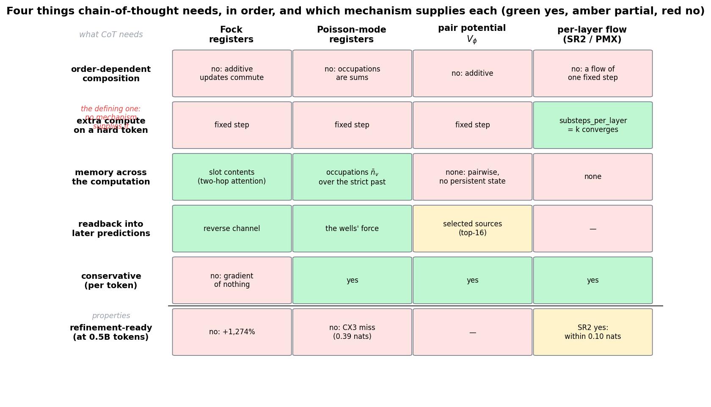
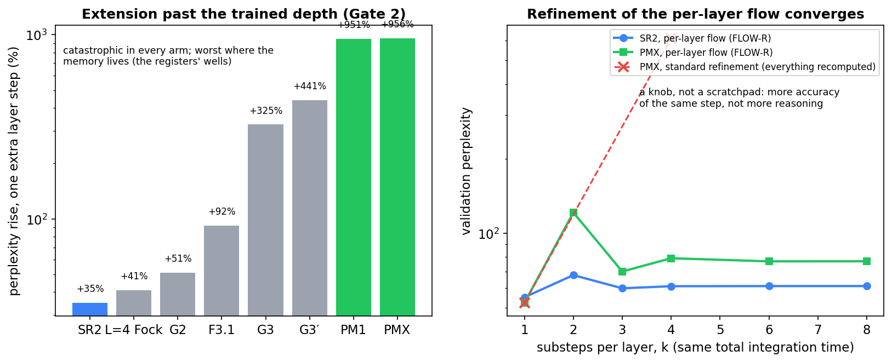
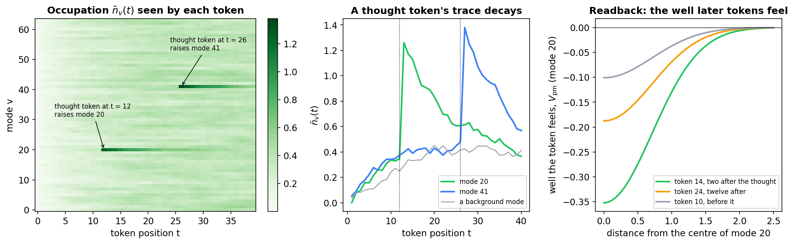
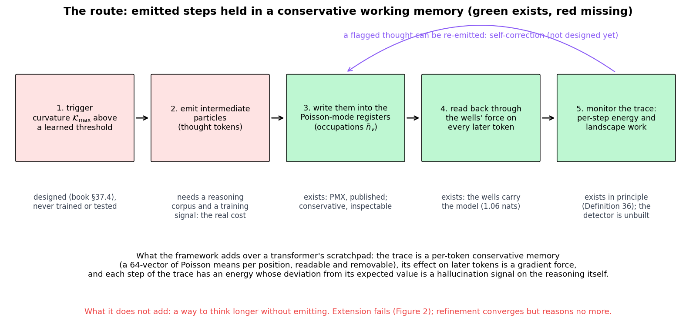

# Chain-of-Thought and the Lagrangian Models: a Working Memory Without the Operator

**The question.** Can chain-of-thought be built inside one of our models, with the mechanisms we have: the Fock registers, the Poisson-mode registers, the pair potential, the per-layer flow and per-token conservativity?

**The short answer.** Not today. Chain-of-thought, in the classical sense of Wei et al. (2022) and Feng et al. (2023), is a chain of emitted steps, each computed from a bounded number of earlier ones, that raises a model's effective depth with the problem. The trained mechanisms supply the memory such a chain would be written to, the Poisson-mode registers, a **conservative working memory** that transformers lack; they do not supply the chain itself. The registers' trace is order-blind (sums commute), so it holds the steps without composing them: in the book's terms, the v2 half of native chain-of-thought (§10.9.5) without the v3 half. Extension past the trained depth is catastrophic in every arm and refinement adds no depth, so the compute has to come from emission, which is what chain-of-thought is. What is missing is a training signal that produces steps, an operator that composes them, and depth: Feng et al.'s constructions need four or five layers, and the ladder's models have two.

**Revised 2026-10-12** against the two classical papers (§1a); the first version led with memory, which is not the heart of chain-of-thought.

This note records the analysis, replaces the substrate of the book's native chain-of-thought design (§37.4), and fixes the first measurement. The figures are made by [`figures/_make_cot_substrate_figs.py`](figures/_make_cot_substrate_figs.py).

## Contents

1. [What chain-of-thought needs](#1-what-chain-of-thought-needs)
2. [What each mechanism supplies](#2-what-each-mechanism-supplies)
3. [The blocker: nothing makes thinking longer help, and emission is the mechanism](#3-the-blocker-nothing-makes-thinking-longer-help-and-emission-is-the-mechanism)
4. [The route: emitted particles on a conservative working memory](#4-the-route-emitted-particles-on-a-conservative-working-memory)
4a. [The missing half: the working memory is an unordered bag](#4a-the-missing-half-the-working-memory-is-an-unordered-bag)
5. [What the framework adds, and what it does not](#5-what-the-framework-adds-and-what-it-does-not)
6. [What is missing, in order of cost](#6-what-is-missing-in-order-of-cost)
7. [The first measurement: do the registers already carry forward-looking state?](#7-the-first-measurement-do-the-registers-already-carry-forward-looking-state)
8. [Consequences for the book](#8-consequences-for-the-book)
9. [Related notes](#9-related-notes)

---

## 1. What chain-of-thought needs

### 1a. The classical definition

Two papers fix what the term means.

- **Wei et al. (2022), *Chain-of-Thought Prompting Elicits Reasoning in Large Language Models*.** A chain of thought is "a series of intermediate natural language reasoning steps that lead to the final output", elicited by a few exemplars in the prompt with no training, no fine-tuning and no architectural change ("no language models were finetuned"). Its gains are largest on multi-step problems and negative on single-step ones; the ability emerges with scale; and the chains are usually faithful (of 50 correct GSM8K answers, 48 chains were also correct).
- **Feng et al. (2023), *Towards Revealing the Mystery behind Chain of Thought*.** The mechanism. Assuming TC⁰ ≠ NC¹, no bounded-depth, polynomial-size, log-precision transformer evaluates arithmetic expressions, solves linear equations or decides context-free-grammar membership in one pass, however wide (Theorems 3.1, 3.2, 4.8): the obstruction "is not due to the (serialized) computational cost of these problems but rather to their parallel complexity." A constant-size transformer (depth 4–5, five heads, width independent of the input) generates correct step-by-step derivations for all of them, and for every dynamic program whose transition reads a bounded number of inputs and earlier states, $\mathrm{dp}(i) = f(n, i, s_{g(n,i)}, \mathrm{dp}(h(n,i)))$ (Theorems 3.3, 3.4, 4.7): "the recursive nature of CoT … increases the effective depth of the Transformer to be proportional to the generation steps." Trained on derivations, models extrapolate to longer inputs than any seen in training.

So the defining property is **serial, order-dependent computation bought by emission**: each step is a function of a bounded number of earlier steps, and the chain's length is the depth. Memory and readback are how the chain is stored, not what it is. The first version of this note led with memory; that was the wrong order, and it is corrected below.

### 1b. The four requirements

Strip chain-of-thought down to what it does mechanically and four requirements remain, in this order.

1. **Order-dependent composition.** Each step is computed from a bounded number of earlier steps, and the result depends on their order: "subtract, then divide" is not "divide, then subtract". This is what raises the effective depth, and it is the defining requirement. [`Realizing_Execution_Gauge_vs_Causal_Ordering.md`](Realizing_Execution_Gauge_vs_Causal_Ordering.md) §1 proves that no additive update can supply it: additive contributions to a state commute, so the outcome is blind to their order. The book assigns it to v3, the non-abelian apparatus (§10.5.3), with F4 and F5 as its falsifiers; Feng et al.'s DP transition with constant fan-in $K$ is a v3-operator event of rank $r = K$ (book §10.9.5).
2. **Extra compute on a hard token.** A way to spend more work on some positions than on others, without changing the trained function on the easy ones. In the classical form this is emission: each step is a forward pass.
3. **Memory across the computation.** Intermediate state that persists while the answer is being produced and is not the output distribution.
4. **Readback.** A way for later predictions to use that state, and ideally to check it (self-correction).

A transformer gets all four by emitting tokens: the emitted token is the step, the forward pass is the compute, the KV cache is the memory, and attention over position supplies readback and order. the KV cache is the memory, each extra token is a full forward pass of extra compute, and attention is the readback. The reasoning trace is external to the architecture; it has no privileged status, no energy, and no conservation law. The book's claim (§37.4, §10.5) is that the composite simulator can make it native. The question here is whether the trained mechanisms support that.

---

## 2. What each mechanism supplies

**Figure 1.** The four requirements and two properties, against the four mechanisms. Green: supplied; amber: in part; red: not supplied. The numbers are the ladder's (protocol §5.10, §5.15, §5.19).

| | Fock registers | Poisson-mode registers | pair potential V_φ | per-layer flow (SR2, PMX) |
| --- | --- | --- | --- | --- |
| memory across the computation | slot contents, read by a two-hop attention | occupations n̄_v over the strict past | none: pairwise, no persistent state | none |
| extra compute on a hard token | no, fixed step | no, fixed step | no | **yes**: `substeps_per_layer = k` converges |
| readback | the reverse channel | the wells' force | the selected sources (top-16) | — |
| order-dependent composition | **no**: the additive channel commutes | **no**: occupations are sums | **no**: additive | **no**: one flow at a fixed step |
| conservative (per token) | **no**: the gradient of nothing | yes | yes | yes |
| refinement-ready at 0.5B tokens | no (+1,274%) | no (CX3 miss: 0.39 nats) | — | SR2 yes (within 0.10 nats) |

Two readings of the table.

- **No single mechanism covers the three requirements.** The two register mechanisms supply memory and readback but no extra compute; the per-layer flow supplies extra compute but no memory. $V_\phi$ supplies neither memory nor compute: it binds a token to a few earlier tokens within one step, which is routing, not a scratchpad.
- **No mechanism covers the first, the defining one.** Every coupling in the framework updates a token's state additively, so none can make the outcome depend on the order in which the registers acted. This is the missing half of §4a.
- **One published model covers the other three.** PMX-PARFLM carries the Poisson-mode registers (memory, readback, conservative) and the per-layer flow (extra compute). Whether that extra compute is the right kind is the question of §3; it is not.

Where the mechanisms are described: the Fock registers in the book §20 and [`Doi_Peliti_Dynamics_of_Semantic_Particles_and_Registers.md`](Doi_Peliti_Dynamics_of_Semantic_Particles_and_Registers.md) §2–3 (exclusion slots, one content vector each, always occupied); the Poisson-mode registers in [`Poisson_Mode_Registers_PM1.md`](Poisson_Mode_Registers_PM1.md) §1–4 and the book §10.5.2; the modes themselves in [`Single_Particle_Hilbert_Space_in_Semantic_Simulation.md`](Single_Particle_Hilbert_Space_in_Semantic_Simulation.md) §1 and §5 (states as root densities; repeated occupation); the exact integration in [`Exact_Integration_of_Poisson_Mode_Wells_PMX.md`](Exact_Integration_of_Poisson_Mode_Wells_PMX.md); the per-layer flow in the protocol §5.19.

---

## 3. The blocker: nothing makes thinking longer help, and emission is the mechanism

There are two ways to spend more compute on a trained model without retraining it, and the ladder has measured both.

**Figure 2.** Left: Gate 2, one extra layer step at the trained step size, for every arm (Cell 6b-7). Right: the per-layer flow, the same integration time cut into $k$ substeps, for SR2 and PMX (FLOW-R), with PMX's standard refinement for contrast.

**Extension fails everywhere.** Running one more layer step past the trained depth raises perplexity by $+35\%$ in SR2, the gentlest, and by $+956\%$ in PMX. The arms with the deepest memory fail worst: the Poisson-mode wells, carrying the model (removal cost 1.06 nats), are also what makes an extra step catastrophic. This is property (S), settling, which no arm has (book §37.6). "Think longer by integrating longer" is closed.

**Refinement converges, and is not reasoning.** Cutting each layer into $k$ substeps with the context and the quadratics frozen at the layer's entry converges: SR2 to within 0.10 nats of its trained step, PMX to within 0.39. But this is more accuracy of the *same* step, the trained map sampled more finely. It changes no decision the model makes; it cannot, since it converges to a limit that the trained step already approximates. It is a knob, not a scratchpad.

Neither extension nor refinement raises the effective depth with the problem, which by Feng et al. is what chain-of-thought is. The compute therefore has to come from the classical source, **emission**: each intermediate particle is a full step, spent where the model chooses, raising the depth by one. Emission is not a fallback from a failed "think longer"; it is the mechanism, and extension's failure is irrelevant to it. The book's earlier design (§37.4, now rewritten) asked for compute in the form it cannot have, "a trajectory continued past the trained window", on the Fock registers, which are the non-conservative channel and refine worst.

---

## 4. The route: emitted particles on a conservative working memory

The route that is open is the transformer's: **emit intermediate particles.** An intermediate token is a full step of extra compute, spent exactly where the model chooses to spend it, and it costs no new property. What differs is where the trace lives and what it does to later tokens.

**Figure 3.** The occupation recursion of the PM1 note (eq. 1.2) on a planted sequence of 40 tokens with 64 modes: two "thought" tokens, at positions 12 and 26, overlap modes 20 and 41 strongly. Left: the occupation every token sees. Middle: a thought token's trace rises at once and decays with the survival probability $\lambda_v$. Right: the well of mode 20 as felt by a token two positions after the thought, twelve after, and before it.

In the Poisson-mode registers an emitted particle at position $s$ raises the occupation $\bar n_v$ of every mode it overlaps, by its overlap $E_v(s)$ ([`Poisson_Mode_Registers_PM1.md`](Poisson_Mode_Registers_PM1.md) eq. 1.1–1.2). Every later token then feels wells deepened by that amount, decaying with $\lambda_v$, and the force it feels is the gradient of the summed wells in its own coordinates. Three things follow.

- **The trace is a 64-vector of Poisson means per position.** It can be read, logged and compared across positions. In a transformer the trace is spread over the KV cache of every head and layer.
- **The trace acts as a force, and a conservative one.** The effect of a thought on later tokens is $-\nabla_h V_{\mathrm{pm}}$ at fixed occupation, a gradient (book Definition 36). What an intermediate particle does to the answer is therefore the descent of a landscape it reshaped, not an arbitrary update.
- **The trace need not be emitted as output.** All a later token sees of a thought is its occupation. A particle written into the registers without being written to the output stream is the same mechanism with the readout suppressed. This is a design, not a feature we have; see §6.

**Figure 4.** The five steps of the route and what exists for each. Steps 3–5 exist, in PMX and in the definition of per-token conservativity; steps 1–2 do not.

---

## 4a. The missing half: the working memory is an unordered bag

The route of §4 inherits a limit that [`Realizing_Execution_Gauge_vs_Causal_Ordering.md`](Realizing_Execution_Gauge_vs_Causal_Ordering.md) §1 states for the Fock channel and that applies equally to the Poisson-mode registers. The occupation is a sum,

$$
\bar n_v(t) = \sum_{s \lt t} \lambda_v^{t-1-s} E_v(s),
$$

and a sum does not depend on the order of its terms except through the weights $\lambda_v^{t-1-s}$. Two thought tokens that raise modes 20 and 41 in that order leave the same occupations as the reverse order would, up to the decay, which is a timestamp and not an operation. The scratchpad records **which** intermediate concepts were raised and **how recently**; it cannot record that one was applied to the other. The force every later token feels, $-\nabla_h V_{\mathrm{pm}}$, is the gradient of a sum of wells, and the sum commutes.

What this permits and what it forbids:

- **Permitted: retrieval-style reasoning.** Which facts are relevant, which concepts are in play, which entities have been introduced. The trace is a set with recency weights, and that is what a set supports. The RF probe's weak signal (§7) is consistent with exactly this: the occupation carries content about what the context was.
- **Forbidden: procedural reasoning.** Anything whose answer depends on the order of operations, which includes arithmetic chains, nested structure and "who did what to whom". The book's own witnesses are F4 (cross-serial dependencies, $a^n b^n c^n$) and F5 (bounded copy, $ww$); a Poisson-mode scratchpad should fail both for the same reason the Fock channel does.

The execution note works out the two ways through the ceiling, neither built or run: **Route A**, a gauge channel in which registers act on a token's state by rotations rather than additive forces, so that two thoughts applied in opposite orders land in different places (and conservativity may survive, since a rotation is a change of frame, not a force: conjectured there, §2.4); and **Route B**, keeping every force a gradient and putting the order into the dynamics through causality. The experiment that separates them is F4 against F5 (§4 there). Until one of them exists, what the registers supply is a **conservative working memory**, not chain-of-thought: in the book's terms, the v2 half of the native derivation of §10.9.5 (emission into a memory) without the v3 half (the operator that composes). The book's §37.4 says so. One further bound is independent of training: Feng et al.'s constructions need depth 4–5 at constant width, and the ladder's L = 2 models sit below that floor.

[`Semantic_Templates_as_Doi_Peliti_Reactions.md`](Semantic_Templates_as_Doi_Peliti_Reactions.md) reaches the same conclusion from the other side (§7.3 there): a reaction formalism sequences firings perfectly well, through a control particle hopping on the atom tree, but cannot make the outcome depend on the sequence. It also supplies the language in which a learned template bank, the source of intermediate steps that §6 says is missing, would be stated (firing as a creation term, the threshold as a rate); it does not supply the bank.

## 5. What the framework adds, and what it does not

**Adds.**

- **A conservative working memory.** The reasoning state is per-token conservative memory: its effect on every later token is a gradient force, and the model that carries it stays a damped geodesic step per token.
- **An energy on the trace.** Each step along the trace has an energy $H_t$ that, within a step, falls at exactly the friction rate, and across steps changes by friction plus the landscape work $V_{\ell+1}(h_t) - V_\ell(h_t)$ (book §37.6, the energy-anomaly bullet). A thought token that moves the system into a region inconsistent with the learned landscape shows up as an energy anomaly on the reasoning itself. That is the hallucination detector of Experiment G2 applied to the trace, and it has no transformer analogue.
- **A removable trace.** Suppressing the readout of a thought while keeping its occupation gives a reasoning step with no output token. Transformers cannot do this: a token that is not emitted is not in the cache.
- **Self-correction has a mechanism.** A flagged thought can be re-emitted; its occupation decays with $\lambda_v$ and is overwritten by the new one. This is not designed yet.

**Does not add.**

- **A way to think longer without emitting.** §3.
- **Order-dependent composition.** The scratchpad is an unordered bag (§4a); procedural reasoning needs Route A or B of the execution note.
- **Any reasoning at all, today.** Our models are next-token predictors on OpenWebText. Nothing in them learns to reason in steps, and the mechanisms above are a substrate for a trace, not a source of one.

---

## 6. What is missing, in order of cost

1. **A training signal that produces intermediate particles.** Supervised reasoning traces (GSM8K-style corpora) or a reinforcement objective, on data that contains reasoning rather than web text. This is independent of the physics and is the real cost. It also decides the readout question: whether thoughts are emitted as tokens (standard chain-of-thought, with the registers as the memory) or written to the registers only (a latent trace, which needs its own training signal because no token supervises it).
2. **A trigger.** The book's curvature-gated activation, a reasoning step when $\mathcal{K}_{\max}$ exceeds a learned threshold (§37.4), is the right shape and parameter-light. It has never been trained or tested.
3. **A non-commutative channel, for procedural reasoning.** Route A or Route B of the execution note, separated by F4 against F5. Without one, the route of §4 is bounded by retrieval-style reasoning.
4. **Settling, if "think longer" is wanted as well.** Mode-resolved friction on PMX (SR3-on-PMX and the L = 4 pair SR3-L4, queued) targets property (S). If it works, extension stops being catastrophic, and a second form of extra compute opens.

---

## 7. The first measurement: do the registers already carry forward-looking state?

Before anything is trained, one question can be answered on the published PMX weights: **does a token's occupation vector predict the loss at later tokens better than its hidden state does?** If it does, the registers already carry information about what comes next, the scratchpad is there, and the training signal of §6 is the only missing piece. If it does not, the registers are a summary of the past with no forward-looking content, and the design has to change before anything is trained.

**Design (RF, pre-registered in the protocol §5.23 before any measurement).**

- **Data.** 200 sequences of 512 validation tokens, fixed seed; the per-token loss $\ell_{t'}$ of the full model at every position, and the layer-1 occupation vector $\bar n(t) \in \mathbb{R}^{64}$ and hidden state $h_t \in \mathbb{R}^{384}$ at every position.
- **Probes.** Ridge regression from $\bar n(t)$, from $h_t$, and from both, to the mean loss over the next $w$ tokens, $w \in \lbrace 1, 4, 16 \rbrace$, fit on 150 sequences and scored ($R^2$) on 50.
- **Controls.** The same probes from $\bar n(t)$ with the modes shuffled across positions (breaks the trace, keeps the marginal); from the position alone; from $h_t$ reduced to 64 dimensions by PCA (equal capacity).
- **Primary statistic.** $\Delta R^2 = R^2(\bar n, h) - R^2(h)$ at $w = 16$: the forward-looking information the occupation adds to the hidden state.
- **Calls.** RF-a, the occupation alone beats position and the shuffle at every $w$: 80%. RF-b, $\Delta R^2 \ge 0.02$ at $w = 16$: 45%. RF-c, $\Delta R^2$ grows with $w$: 40%.
- **Reading.** RF-b holding means the registers carry state about what comes next that the hidden state does not, the precondition for a scratchpad. RF-b failing with RF-a holding means they carry a summary of the past that the hidden state already has: a memory, not a working memory. All CPU on the PMX checkpoint, about an hour. The same measurement on PM1 and, as the Fock comparison, on G2's register contents.

**Scored 2026-10-12** (protocol §5.23, "RF scored"). PMX: RF-a MISS, RF-b MISS (ΔR² +0.011, interval [−0.006, +0.028]), RF-c HIT, RF-d MISS. PM1: all four MISS. The G2 probe is invalid (a 12,288-wide register bank against 125 training sequences overfits; the control fails the same way) and is not scored.

- **PMX's occupation carries a small, real forward-looking signal:** alone it predicts the next 16 tokens' loss as well as the full hidden state does (R² 0.024 against 0.023) and better than a capacity-matched 64-dimensional hidden state (0.012), and it beats its own shuffle at w = 4 and 16. Added to the hidden state it contributes +0.011, below the pre-registered 0.02.
- **PM1's carries none.** The exact integration made the registers more informative about what follows, not only better integrated.
- **Follow-up: the signal is content, not difficulty.** With the mean loss over the previous 16 tokens as a competing feature, the occupation's increment at w = 16 sharpens to [+0.004, +0.014] (disjoint from 0), and n̄ and the difficulty feature are nearly additive (0.024 + 0.022 ≈ 0.051 together). The forward component is about what the recent context was, not how predictable it was.
- **Reading.** The strong precondition fails at the pre-registered size: the scratchpad is not "already there" in the sense RF-b asked for. The weak one holds: PMX's registers carry a small, real, content-bearing signal about what comes next that neither the hidden state nor local difficulty supplies, and PM1's do not. The route of §4 stands with that scope. Nothing has been trained to write to the registers; what the probe shows is that what the model already writes to them, untrained for the purpose, carries forward-looking content. The §37.4 rewrite may say that, and no more.

---

## 8. Consequences for the book

*Done 2026-10-12:* §37.4 rewritten as "Native chain-of-thought: the substrate, the blocker and the ceiling" (book pp. 456–458), with the mechanisms table (Table 68), the RF result in its weak form, the commutativity ceiling, and the curvature trigger and geodesic-consistency loss kept; the capability table's row and §37.6's chain-of-thought bullet updated; the old Fock-lifecycle figure removed.

- **§37.4 (native chain-of-thought) rests on the wrong substrate.** Its mechanism is the Fock register lifecycle on a trajectory continued past the trained window: the non-conservative channel, and extension, which fails in every arm. The Poisson-mode registers are the conservative memory the design was reaching for, and emitted particles, not extension, are the open route. The section should be rewritten around Figure 4 when the first measurement is in, keeping the curvature-gated trigger and the geodesic-consistency loss, which are substrate-independent.
- **The capability table (§37.6)** is right to say "no" for usable today, and should keep saying so. Its "needs (S)" entry becomes "needs (S) *or* emitted particles"; the per-token definition of (C) is what the route keeps.
- **§37.4 must state the ceiling.** A trace on additive registers, Fock or Poisson-mode, is order-blind (§4a); the design supports retrieval-style reasoning and not procedural reasoning until a non-commutative channel exists, which is the v3 question of §10.5.3 and the subject of the execution note.
- **Nothing here claims chain-of-thought.** It claims a substrate with properties a transformer's lacks, and names the one thing, a training signal, that stands between the substrate and the capability.

---

## 9. Related notes

| note | for |
| --- | --- |
| [`Poisson_Mode_Registers_PM1.md`](Poisson_Mode_Registers_PM1.md) | the registers: creation rate, occupation, wells, the Poisson-mean theorem, conservativity (§1–4) |
| [`Exact_Integration_of_Poisson_Mode_Wells_PMX.md`](Exact_Integration_of_Poisson_Mode_Wells_PMX.md) | how the published model integrates the wells; what the trained spring looks like (§10) |
| [`Doi_Peliti_Dynamics_of_Semantic_Particles_and_Registers.md`](Doi_Peliti_Dynamics_of_Semantic_Particles_and_Registers.md) | why the Fock slots are exclusion objects and the Poisson modes are bosonic (§2, §9); the registers as a clustering mechanism (§10) |
| [`Single_Particle_Hilbert_Space_in_Semantic_Simulation.md`](Single_Particle_Hilbert_Space_in_Semantic_Simulation.md) | what a mode is; repeated occupation and what it means classically (§5) |
| [`Two_Clustering_Mechanisms_Saturation_and_Synchronization.md`](Two_Clustering_Mechanisms_Saturation_and_Synchronization.md) | the registers as synchronization toward fixed centres (§5.2); the conservative and non-conservative routes (§5.3) |
| [`Spontaneous_Synchronization_and_Semantic_Binding_Test_Programme.md`](Spontaneous_Synchronization_and_Semantic_Binding_Test_Programme.md) | whether the wells' assignments follow linguistic structure, which a reasoning trace would need (SY2) |
| [`Realizing_Execution_Gauge_vs_Causal_Ordering.md`](Realizing_Execution_Gauge_vs_Causal_Ordering.md) | the commutativity obstruction (§1) and the two routes through it: the gauge channel (§2) and causal ordering (§3); F4 against F5 (§4) |
| [`Semantic_Templates_as_Doi_Peliti_Reactions.md`](Semantic_Templates_as_Doi_Peliti_Reactions.md) | templates as reactions; firing as a creation term (§4); control flow as hopping and the commutativity obstruction from the reaction side (§7) |
| [`Depth_Ladder_and_Matched_Baseline_Protocol.md`](Depth_Ladder_and_Matched_Baseline_Protocol.md) | §5.15 PMX; §5.19 the per-layer flow and Gate 2; §5.23 the RF pre-registration and scoring |
