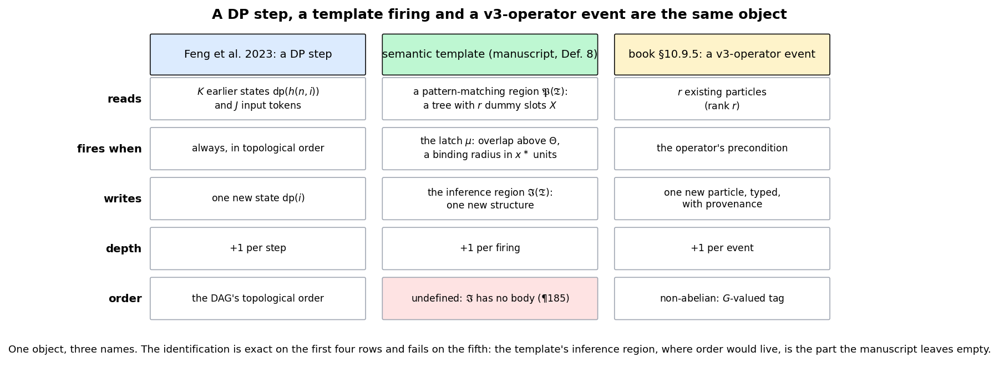
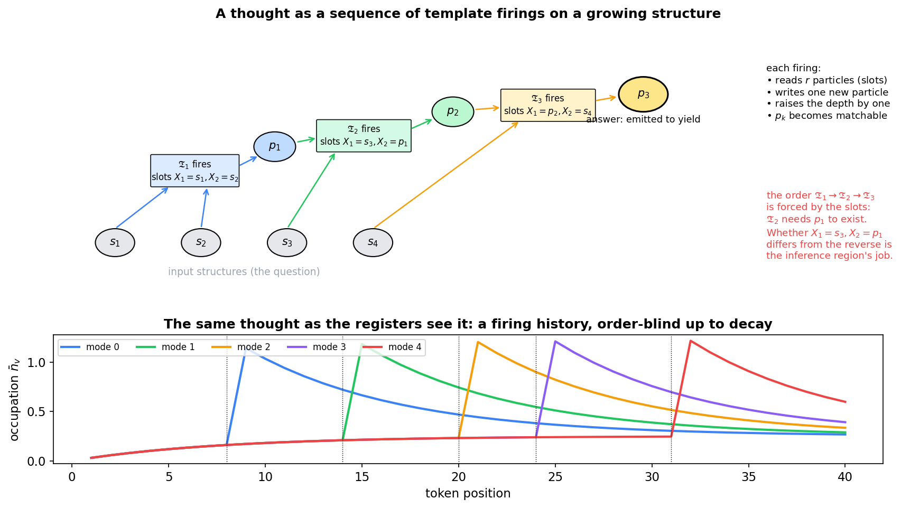
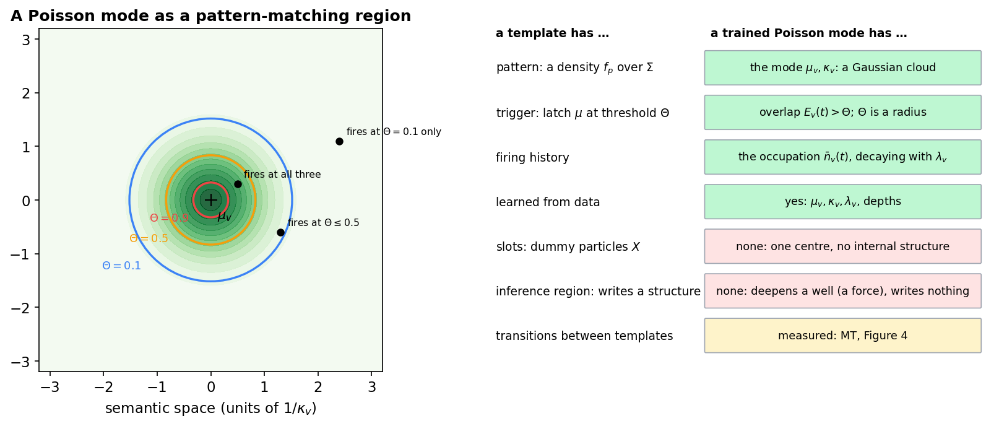
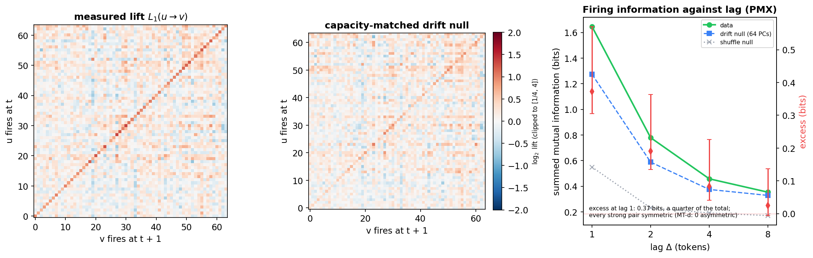

# A Community of Semantic Templates as the Source of Native Chain-of-Thought

**The claim (the author, 2026-10-12).** Forming a community of semantic templates, from training or from prior inference, that can be applied to newly generated thoughts (sequences of semantic structures), is the key to a native chain-of-thought.

**What this note does.** It makes the claim precise and tests the one part of it that can be tested on the published models today. Three things that the framework names separately are one object: a dynamic-programming step in the theory of chain-of-thought (Feng et al. 2023), a semantic template firing (the 2022 manuscript; book Definition 8), and a v3-operator event (book §10.9.5). A template bank applied to a growing thought is therefore a chain-of-thought generator by construction, and a *learned* bank is what makes the chain generalise. A trained Poisson mode is already a learned pattern-matching region, with the occupation as its firing history. What no document yet supplies is the template's **inference region**, the part that writes a structure and in which the order of a chain would live; the manuscript leaves that section empty, and a reaction reading of templates cannot supply order on its own. A first measurement asks whether the trained modes already have *transitions*, which a bank needs to carry a chain.

This note continues [`Chain_of_Thought_Substrate_in_Lagrangian_Models.md`](Chain_of_Thought_Substrate_in_Lagrangian_Models.md) (the working-memory note) and [`Semantic_Templates_as_Doi_Peliti_Reactions.md`](Semantic_Templates_as_Doi_Peliti_Reactions.md) (firing as a reaction). The figures are made by [`figures/_make_template_community_figs.py`](figures/_make_template_community_figs.py).

## Contents

1. [One object, three names](#1-one-object-three-names)
2. [A thought as a sequence of firings](#2-a-thought-as-a-sequence-of-firings)
3. [A Poisson mode is a learned pattern-matching region](#3-a-poisson-mode-is-a-learned-pattern-matching-region)
4. [How a community forms](#4-how-a-community-forms)
5. [The inference region: where order has to live](#5-the-inference-region-where-order-has-to-live)
6. [What the manuscript contains, and what it does not](#6-what-the-manuscript-contains-and-what-it-does-not)
7. [First measurement: do the trained modes have transitions?](#7-first-measurement-do-the-trained-modes-have-transitions)
8. [What would have to be built](#8-what-would-have-to-be-built)
9. [Related notes](#9-related-notes)

---

## 1. One object, three names

**Figure 1.** The identification, row by row. It is exact on what is read, when it fires, what is written and what it costs in depth. It fails on order, and it fails in the template column: the inference region, where order would be decided, has no body in the manuscript.

**The DP step.** Feng et al. prove that a constant-size transformer can produce the derivation of any dynamic program whose transition reads a bounded number of earlier states and input tokens,

$$
\mathrm{dp}(i) = f\big(n, i, s_{g(n,i)}, \mathrm{dp}(h(n,i))\big),
$$

with constant fan-in $K$ (their eq. 5 and Theorem 4.7), one emitted step per state, each step raising the effective depth by one. That is their account of why chain-of-thought works: the obstruction to a one-pass answer is parallel complexity, and the chain buys depth.

**The template.** Book Definition 8 and the manuscript make a template a function: a pattern-matching region $\mathfrak{P}(\mathfrak{T})$ monitors semantic space and, when its latch $\mu$ fires, an inference region $\mathfrak{I}(\mathfrak{T})$ constructs and places a new structure. The pattern-matching region is a tree whose leaves include **dummy particles** $X$, slots to be filled by matched structures (manuscript ¶25–28). A template with $r$ slots reads $r$ structures and writes one.

**The v3 event.** Book §10.9.5 translates transformer chain-of-thought into the composite simulator: intermediate tokens are non-terminal v2 particles, each forward pass is a v3-operator event reading $r$ existing particles (rank $r$), the context window is the active particle set. The derivation tree is the chain.

So a template firing with $r$ slots **is** a DP transition with fan-in $K = r$ **is** a v3-operator event of rank $r$. A bank of templates applied in sequence to a growing structure is a chain-of-thought generator in Feng's sense, with the derivation tree as the DAG of subproblems. Nothing has to be added to the framework to say this; it was already in three of its documents, unjoined.

---

## 2. A thought as a sequence of firings

**Figure 2.** Top: three templates fire in turn. $\mathfrak{T}\_1$ matches two input structures and writes $p_1$; $\mathfrak{T}\_2$ matches an input and $p_1$ and writes $p_2$; $\mathfrak{T}\_3$ matches $p_2$ and an input and writes the answer. Each firing reads a bounded number of particles, writes one, raises the depth by one, and makes a new particle available for later matching. Bottom: the same thought as the Poisson-mode occupations record it, a firing history with recency, blind to which firing read which.

A **thought**, in the author's phrase, is a sequence of semantic structures. Applied to a thought, a template bank does three things a transformer's scratchpad does not:

- **The steps are typed and structured.** A firing writes a particle with a non-terminal label and a position in a known rule, not a token in the output vocabulary (book §10.9.5, advantage 2).
- **The chain is a tree.** A template with $r$ slots reads $r$ earlier particles, so the dependency structure is explicit in which particles each firing read (advantage 1). In Figure 2, $\mathfrak{T}\_2$ reads $p_1$, which is why it cannot fire before $\mathfrak{T}\_1$: the slot discipline sequences the firings.
- **Self-application.** A fired particle is itself matchable, so the bank applies to its own output. That is what "applied to newly generated thoughts" means mechanically, and it is where a bad firing can cascade. The per-step energy of the working-memory note (§5 there) is the natural check on it.

What the slot discipline sequences is the **events**; what it does not decide is whether the **result** of $\mathfrak{T}_2$ depends on which structure filled which slot. That is §5.

---

## 3. A Poisson mode is a learned pattern-matching region

**Figure 3.** Left: a mode's overlap kernel with the three firing thresholds of the Doi–Peliti note's table, each a binding radius. Right: slot by slot, what a template has and what a trained mode has.

The Doi–Peliti note established (§2 there) that a template particle and a mode are the same object, a density over semantic space presented with or without the square root, and that the matching threshold $\Theta$ is a binding radius $d/x^{\ast} \lt \sqrt{2 \ln(1/\Theta)}$ once the matching functional is made bilinear (§3.4 there). The Poisson-mode registers of PMX are exactly this object, **learned**:

| a template has | a trained Poisson mode has |
| --- | --- |
| a pattern, a density f_p over Σ | a centre μ_v and width κ_v: a Gaussian cloud |
| a trigger, the latch μ at threshold Θ | the overlap E_v(t) = exp(−κ_v²‖h_t − μ_v‖²) against a radius |
| a firing record | the occupation n̄_v(t), decaying with λ_v |
| parameters set by hand | μ_v, κ_v, λ_v and the depths, learned from data |
| **slots**: dummy particles X | none: one centre, no internal structure |
| **an inference region** that writes a structure | none: the mode deepens a well, a force on later tokens; it writes nothing |

So PMX already carries a bank of 64 learned pattern-matching regions with learned triggers and a firing history, and the RF probe (protocol §5.23) found that history carries a small, real, content-bearing signal about what comes next. What a mode lacks is the two things that make a template a *function*: slots and an inference region. A mode detects; it does not construct.

---

## 4. How a community forms

Two routes, and they are different programmes.

**Specified.** Templates written by hand, the manuscript's reading. Finite, auditable, no learning, and no account of how the bank grows with experience. Feng's constructive proofs are of this kind: a fixed, small set of transitions suffices for arithmetic, equations and the DP class.

**Learned**, from training or from the model's own prior inferences. The Doi–Peliti note identifies the one differentiable handle (§4.2 there): the firing rate at finite inverse temperature,

$$
r_{\mathfrak{T}} = r_0 \sigma\big(\beta (\mathrm{BC} - \Theta)\big),
$$

whose $\beta \to \infty$ limit is the manuscript's hard threshold. A learned template then has three learnable parts: the pattern (a cloud, equivalently $\mu, \kappa$), the threshold (a radius) and the inference map. The first two **are the Poisson-mode parameters**, and the models learn them now, from next-token prediction, with no supervision on firing. The third does not exist yet (§5).

**Admission.** A community needs a rule for when a new template joins. The manuscript lists *repulsion between template properties* as a `//TODO` (¶175–176); that is the admission rule's job. The natural form is the one the Doi–Peliti geometry already supplies: a candidate template is admitted if its overlap with every existing one is below a radius, so that the bank covers the space without redundancy. Without such a rule a learned bank either never grows or grows without bound. The 6b-15 diagnostic on PMX is a first look at this: no dead modes, half-lives from 3 to 21 tokens, and about half the depths of each sign, so the trained bank is neither collapsed nor saturated.

**Two formation signals the trained models already supply.** RF (protocol §5.23) measured whether the firing history predicts the future; it does, weakly and with content. MT (§7 below) measures whether the modes have transitions among themselves, which is the bank's internal structure.

---

## 5. The inference region: where order has to live

The identification of §1 is exact on everything except order, and the reason is specific.

**Firing cannot supply order.** The Doi–Peliti note proves it (§7.3 there): a reaction reading of templates sequences firings perfectly well, through a control particle hopping on the atom tree (its eq. 7.1), but every reaction changes the state by adding occupation numbers, and additive updates commute. "Doi–Peliti sequences the firings; it cannot make the outcome depend on the sequence." [`Realizing_Execution_Gauge_vs_Causal_Ordering.md`](Realizing_Execution_Gauge_vs_Causal_Ordering.md) §1 states the same obstruction for any additive channel.

**The slots sequence events, not outcomes.** In Figure 2, $\mathfrak{T}\_2$ cannot fire before $\mathfrak{T}\_1$ because it needs $p_1$. That is Feng's topological order of the DAG, and it is real. But whether $\mathfrak{T}\_2$ with $X_1 = s_3, X_2 = p_1$ writes a different structure from $\mathfrak{T}\_2$ with the slots swapped is decided by what the inference region does with its slots, and that is the question of "who did what to whom" (book §10.5.3, the motivation for v3).

**So the inference region is where the non-commutative action has to live.** The execution note works out the two candidates: Route A, a gauge action in which a firing transports the state by a group element, so that slot assignments in different orders land in different places (and conservativity may survive, since a rotation is a change of frame, not a force; conjectured, §2.4 there); Route B, keeping every force a gradient and putting the order into the dynamics through causality. The experiment that separates them is F4 (cross-serial dependencies) against F5 (bounded copy), the book's own witnesses for v3.

A template bank therefore supplies the **v2 half** of native chain-of-thought (structured emission, with a principled, learned trigger) in full, and the **v3 half** exactly to the extent that its inference regions are non-commutative. Defining the inference region is the v3 work, and it is the one part of the manuscript that is empty.

---

## 6. What the manuscript contains, and what it does not

The source is `manuscripts/Semantic_Templates.docx` (188 paragraphs, dated 9 May 2022; git evidence from January 2022, `manuscripts/PROVENANCE.md`). The `Semantic_Templates.pdf` beside it was a two-page stub until 2026-10-12 and is now the full export (9 pages).

| part | status |
| --- | --- |
| template as a function: match in 𝔓, construct in ℑ | defined (¶7, ¶11; book Def. 8) |
| template space Τ, inference space, extended semantic space, region of applicability | defined (¶12–17) |
| the pattern-matching tree with structures, primitive particles and dummy particles X | defined (¶25–28) |
| template particles as stochastic clouds; deterministic and stochastic aspects | defined (¶30–71) |
| binding region; template-weighted trajectory length; average trajectory weight; matching threshold Θ (Eqs. 17–20) | defined (¶102–163), threshold `//TODO` (¶165) |
| representation of a template property | `//TODO` (¶168–174) |
| **repulsion between template properties** (the admission rule) | `//TODO` (¶175–176) |
| primitive template particle; semantic template structure; representation of a template particle | `//TODO` (¶177–183) |
| **optimal match of the pattern-matching region** | heading only (¶184) |
| **inference structure of a semantic template** | heading only (¶185) |
| worked example: attractive force between structures | begun (¶186–187) |

The three bold rows are the three things a community of templates needs beyond what exists: how a template is admitted, how a match is chosen among candidates, and what a firing constructs. The last is where order lives (§5).

---

## 7. First measurement: do the trained modes have transitions?

A bank that carries a chain needs transitions: which template fires next, given which fired. The trained modes are learned pattern-matching regions (§3); this asks whether they already have transition structure among themselves, without any training for it. **Pre-registered in the protocol §5.24 (MT) before measurement.**

**Method.** A mode fires on a token when its overlap exceeds a per-mode threshold at its 90th percentile (so every mode fires on 10% of tokens, which removes the dominant-mode artefact of the clustering note §6.3). For lags 1, 2, 4, 8 tokens: the 64 × 64 transition matrix, its lift over the marginal, and the summed mutual information between "u fires at t" and "v fires at t + Δ".

**The null.** Adjacent states are similar, so modes co-fire without any transition structure. The control keeps the data's own firings and conditions on the state: a capacity-matched logistic model (the 64-PC projection of $h_t$, as in RF) predicts each mode's firing at t + Δ, and the null's firings are drawn from those probabilities. Structured transitions are the excess information over that null. (A full-state logistic fit reads *above* the data, because it predicts sharper than the truth; it is reported alongside, not used.)

**Calls** (protocol §5.24): MT-a, firing information exceeds a within-sequence shuffle (90%); MT-b, the excess over the drift null at lag 1 is positive with a disjoint interval (55%); MT-c, the excess decays with lag but is still positive at lag 4 (40%); MT-d, at least 20 asymmetric transition pairs beyond the null (35%). MT-d is the one that bears on order: a chain needs asymmetric transitions, and a similarity structure has symmetric ones.

**Figure 4.** The MT probe on the published PMX weights. Left: the measured lift matrix at lag 1. Middle: the lift the state's own drift predicts. Right: summed mutual information against lag for the data, the drift null and the shuffle, with the excess and its interval.

**Result (2026-10-12; protocol §5.24, "MT scored").** Three of four calls hit, in both arms; the fourth, the one that bears on order, missed in both.

| | PMX | PM1 |
| --- | --- | --- |
| summed MI at lag 1: data / drift null / shuffle (bits) | 1.65 / 1.27 / 0.55 | 3.37 / 2.89 / 1.28 |
| excess over the drift null at lag 1 (MT-b) | **+0.37** [+0.31, +0.57] | **+0.48** [+0.17, +0.96] |
| excess at lag 4 (MT-c) | +0.08 [+0.04, +0.23] | +0.19 [+0.07, +0.42] |
| ordered pairs with lift ≥ 2 beyond the null | 0 | 7 |
| of those, asymmetric, L(u→v) ≥ 2 L(v→u) (MT-d) | **0** | **3** |

- **The modes have transitions.** About a quarter of the firing information at lag 1 in PMX is not explained by the hidden state's own drift, and it decays over 4–8 tokens. The bank is not a set of independent detectors; which mode fires makes some others more likely to fire next.
- **The transitions have no direction.** In PMX no ordered pair reaches a lift of 2 at all, and the strongest are within 0.2 of their own reverse. In PM1 three pairs are asymmetric, against the 20 pre-registered. u-then-v is as likely as v-then-u: the modes co-fire on temporal proximity, which is what a similarity structure does and not what a chain does.
- **PM1's bank is coarser and more concentrated** (16 strong pairs; 3.4 bits against 1.6), consistent with its explicitly integrated wells firing together over longer stretches. The difference does not bear on order.

**Reading.** The weak form of the claim holds: the trained models already carry a learned community of pattern-matching regions whose firings carry transition structure. The strong form does not: the transitions are symmetric, so the community has co-occurrence and not sequence. That is the order-blindness of the working-memory note's §4a measured at the level of the bank rather than the trace, and it sharpens §5 above. The inference region is not only undefined on paper; nothing in the trained modes has the asymmetric structure an inference region would have had to learn. Supplying order is therefore a design task, not a training task that more data would finish: a non-commutative inference region (Route A or B of the execution note), tested on F4 against F5, with a corpus that contains ordered derivations.

---

## 8. What would have to be built

In order of what is missing, from the trained models to a community of templates that carries a chain:

1. **Slots.** A mode has one centre; a template has a tree of them. The minimal extension is a mode that matches a *pair* of structures at a relative displacement, which is the manuscript's two-slot pattern-matching tree and the smallest object with an order to decide.
2. **An inference region.** What a firing constructs, and whether its slots commute. This is the v3 work (§5), and the F4/F5 falsifiers are its test.
3. **An admission rule.** Repulsion between templates, as an overlap radius (§4).
4. **A training signal for firing.** The Doi–Peliti note's finite-β rate is the differentiable handle; the corpus is one with derivations. Feng's arithmetic and DP tasks are the natural first targets, because the template bank that solves them is known in closed form (their constructive proofs) and can be compared against what a model learns.
5. **Depth.** Feng's constructions need four or five layers per step; the ladder's models have two. The L = 4 arms are the first on which any of this can be tested.

Nothing here claims that the trained models reason. It claims that one of the two halves of native chain-of-thought, a learned bank of pattern-matching regions with triggers and a firing history, is already present in PMX in a weak form, and it names the other half.

---

## 9. Related notes

| note | for |
| --- | --- |
| [`Chain_of_Thought_Substrate_in_Lagrangian_Models.md`](Chain_of_Thought_Substrate_in_Lagrangian_Models.md) | the classical definition (§1a); the four requirements; the registers as a conservative working memory; the commutativity ceiling (§4a); RF |
| [`Semantic_Templates_as_Doi_Peliti_Reactions.md`](Semantic_Templates_as_Doi_Peliti_Reactions.md) | template particle ≡ mode (§2); the bilinear repair and the threshold as a radius (§3); firing as a creation operator and the finite-β rate (§4); control flow as hopping and the commutativity obstruction (§7) |
| [`Realizing_Execution_Gauge_vs_Causal_Ordering.md`](Realizing_Execution_Gauge_vs_Causal_Ordering.md) | the two routes to a non-commutative inference region, and F4 against F5 |
| [`Poisson_Mode_Registers_PM1.md`](Poisson_Mode_Registers_PM1.md) | the modes: creation rate, occupation, wells (§1), the Poisson-mean theorem (§3) |
| [`Single_Particle_Hilbert_Space_in_Semantic_Simulation.md`](Single_Particle_Hilbert_Space_in_Semantic_Simulation.md) | modes as root densities; the overlap as the Bhattacharyya coefficient (§1) |
| [`The_Execution_Problem.md`](The_Execution_Problem.md) | the template–execution duality; the executive atom |
| [`Depth_Ladder_and_Matched_Baseline_Protocol.md`](Depth_Ladder_and_Matched_Baseline_Protocol.md) | §5.23 RF; §5.24 MT |
| `manuscripts/Semantic_Templates.docx` | the source; `PROVENANCE.md` for its history and the PDF's status |

**References.** G. Feng, B. Zhang, Y. Gu, H. Ye, D. He, L. Wang, Towards revealing the mystery behind chain of thought: a theoretical perspective, NeurIPS 36 (2023). J. Wei et al., Chain-of-thought prompting elicits reasoning in large language models, NeurIPS 35 (2022). D. Gueorguiev, Semantic Templates and Semantic Functions, manuscript (2022).
