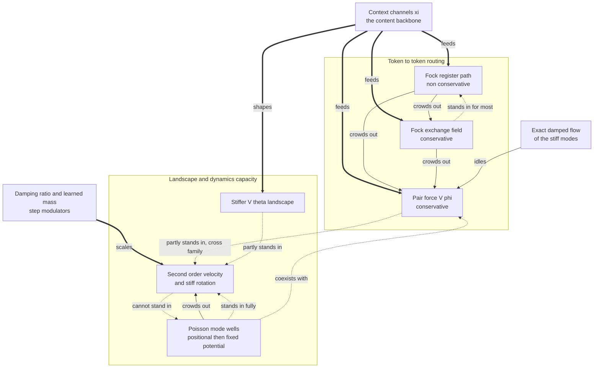

# Competing Mechanisms: Families, Dominance and Substitution in the Conservative Core

**Status:** working note, 2026-10-24. It states a tenet that the Gen 3 ladder, the coupling-dominance ablations (CD), the exchange-field factorial (XRB) and the first-versus-second-order pairs (MS) point to, and draws it as a graph. Every edge cites its measurement; edges not yet measured are marked as such. All numbers are from 0.53B-token runs at L = 2, d = 384, OpenWebText, one seed per arm (protocol §5.13, §5.21 and the ladder sections).

---

## Contents

1. [The tenet](#1-the-tenet)
2. [The mechanisms](#2-the-mechanisms)
3. [Two measures of influence](#3-two-measures-of-influence)
4. [The whole picture in one graph](#4-the-whole-picture-in-one-graph)
5. [The order of dominance (solid arrows)](#5-the-order-of-dominance-solid-arrows)
6. [Substitution: who can stand in for whom (dotted arrows)](#6-substitution-who-can-stand-in-for-whom-dotted-arrows)
7. [The evidence behind each edge](#7-the-evidence-behind-each-edge)
8. [What the graph does not yet show](#8-what-the-graph-does-not-yet-show)
9. [Toward a measured substitution matrix](#9-toward-a-measured-substitution-matrix)

---

## 1. The tenet

The mechanisms of the design compete for influence over a token's step. A stronger mechanism displaces a weaker one's share, and some weaker mechanisms can take most of that share back when the stronger one is removed. The competition is not among interchangeable parts:

- **It is ordered.** Some mechanisms dominate others wherever both are present.
- **It is asymmetric.** A can stand in for B without B standing in for A.
- **It is confined, mostly, to two families:** mechanisms that route information from token to token, and mechanisms that give the step more landscape or dynamical capacity without carrying other tokens' content.
- **One mechanism is not part of it:** the context channels ξ underlie both families and have not been displaced at this scale.

Second-order dynamics is one of the competitors. That is the reading behind the book's planned scoping of its premise: second order is what makes the framework's geometry exist, and at this scale it is one predictive mechanism among several that can stand in for each other.

## 2. The mechanisms

Each entry below is one node of the graph in §4, under the label the graph uses, with what it does in plain words and the note that documents its design.

**Context channels ξ (the content backbone).** Five running averages of the earlier token states, each a causal exponential moving average with its own learned decay, so each channel remembers over a different horizon (from about 2 to about 200 tokens). The two short channels mostly carry the current token; the three long ones carry its context. They are the input to $V_\theta$ and the sources that the pair force and the Fock routes read. *Design:* [`Multi-Channel_vs_Single_Channel_Xi_SPLM_Design.md`](Multi-Channel_vs_Single_Channel_Xi_SPLM_Design.md); [`Reducing_Information_Bottleneck_In_Multi-Channel_Xi_SPLM.md`](Reducing_Information_Bottleneck_In_Multi-Channel_Xi_SPLM.md).

**Fock register path (non-conservative).** A bank of virtual "register" particles that are created and destroyed as the text is read. Tokens deposit content into the registers, and through the reverse channel the registers' content acts back on later tokens. The reverse channel's force is not the gradient of any potential, so this path makes the model non-conservative. With the reverse channel off (tag `norc`), the registers still exist but have no path to the tokens. *Design:* [`Fock_Mechanism_v2.1_Principle_of_Operation.md`](Fock_Mechanism_v2.1_Principle_of_Operation.md) §5–7; [`Improving_the_Fock_Mechanism_to_match_Attention.md`](Improving_the_Fock_Mechanism_to_match_Attention.md) §9.6 and §10.

**Fock exchange field (conservative).** The direct route between tokens. Each token is routed over the earlier tokens by attention-like heads (normalised queries and keys, a softmax over earlier tokens), and the routed values push the token. At frozen routing the push is the gradient of a potential, so the model stays conservative. *Design:* [`Fock_Mechanism_v2.1_Principle_of_Operation.md`](Fock_Mechanism_v2.1_Principle_of_Operation.md) §4 and §9 (attention, the exchange field and the register path side by side).

**Pair force $V_\phi$ (conservative).** A learned potential between a token and each of its 16 strongest sources among the earlier tokens (four heads; type and angle features; the softmax-normalised "structural competitive" variant). The token feels minus its gradient, so it is pulled or pushed according to how it relates to each source. *Design:* [`Structured_VPhi_Design_and_Theory.md`](Structured_VPhi_Design_and_Theory.md) §5.2; [`PARF_Augmented_SPLM_Architecture_v2.md`](PARF_Augmented_SPLM_Architecture_v2.md).

**Poisson-mode wells (as trained, a positional, then fixed, potential).** K modes, each with a learned centre, width, depth and half-life. A mode's occupation is a decaying running sum of how close earlier tokens came to its centre, and each mode adds a Gaussian well whose depth grows with its occupation. PM1 applies the wells' force as a kick; PMX integrates it exactly. As trained, the occupations follow token position, not content, and beyond the first ~100 tokens the wells act as a fixed extra landscape. *Design:* [`Poisson_Mode_Registers_PM1.md`](Poisson_Mode_Registers_PM1.md); [`Exact_Integration_of_Poisson_Mode_Wells_PMX.md`](Exact_Integration_of_Poisson_Mode_Wells_PMX.md); the deep dive [`Deep_Dive_in_the_Poisson_Mode_Registers_Wells_and_Semantic_Templates.pdf`](deep_dives/Deep_Dive_in_the_Poisson_Mode_Registers_Wells_and_Semantic_Templates.pdf).

**Second-order velocity and stiff rotation.** Under second-order dynamics a token carries a velocity from one layer step into the next, its own previous displacement, so it can keep moving in the direction it was already moving. Inside a step, the stiffest modes of $V_\theta$ rotate position into velocity and back. The first-order twins (FO-b) remove the velocity entirely: each step is an overdamped gradient flow. *Design:* [`CfC_BAOAB_Integrator_and_Mitigations.md`](CfC_BAOAB_Integrator_and_Mitigations.md); [`First_Order_vs_Second_Order_Dynamical_Systems.md`](First_Order_vs_Second_Order_Dynamical_Systems.md); FO-b in [`Future_of_Semantic_Simulation_When_Second_Order_Earns_Its_Keep.md`](Future_of_Semantic_Simulation_When_Second_Order_Earns_Its_Keep.md).

**Stiffer $V_\theta$ landscape.** $V_\theta$ is the token's own potential: eight anisotropic Gaussian wells, each a joint function of all five context channels, so the landscape a token moves on changes with its context. "Stiffer" means a larger curvature along the landscape's stiffest direction, measured as ω·Δt (the angle the stiffest mode turns through in one step). *Design:* [`Structured_VTheta_Design_and_Theory.md`](Structured_VTheta_Design_and_Theory.md); [`Curvature_Diagnostics_and_Rank_Selection_for_Aniso_Gaussian_Vtheta.md`](Curvature_Diagnostics_and_Rank_Selection_for_Aniso_Gaussian_Vtheta.md).

**Exact damped flow of the stiff modes.** A choice of integrator, not a mechanism of the model (introduced with SR2, `LOWRANK_DAMPED_FLOW = True`): the up to 16 stiffest modes of $V_\theta$ are integrated exactly as damped oscillators within the step instead of being kicked; PMX extends the exact flow to the wells. It is in the graph because it changes the order of dominance. *Design:* [`Exact_Integration_of_Poisson_Mode_Wells_PMX.md`](Exact_Integration_of_Poisson_Mode_Wells_PMX.md) §5; [`Tech_Report_Position_Dependent_Damping_CfC_BAOAB.md`](Tech_Report_Position_Dependent_Damping_CfC_BAOAB.md).

**Damping ratio and learned mass (step modulators).** The damping sets how quickly a token's velocity decays (a fixed rate of 0.1, or a damping ratio learned per token); the mass sets how far a token moves per unit of force. They scale how strongly the capacity mechanisms act and are not competitors in their own right. *Design:* [`Tech_Report_Position_Dependent_Damping_CfC_BAOAB.md`](Tech_Report_Position_Dependent_Damping_CfC_BAOAB.md); [`Position_Dependent_Damping_and_Reinforcement_Field.md`](Position_Dependent_Damping_and_Reinforcement_Field.md); [`On_the_Interpretation_of_Semantic_Mass.md`](On_the_Interpretation_of_Semantic_Mass.md).

## 3. Two measures of influence

The tenet needs two measurements, kept apart throughout (book §27.15, protocol §5.21):

- **Reliance:** the cost of removing a mechanism from a trained model at inference. It says what the network routes through the mechanism.
- **Value:** the cost of training without the mechanism. It says what the model would lose, after it has had the chance to compensate.

Reliance overstates value, often by a large factor: removing the register path from the trained L = 2 model costs 4.0 times in perplexity, while the model trained without it is only 1.087 times worse. **Displacement is visible in reliance** (a displaced mechanism's removal cost falls), **substitution only in value** (a model trained without the stronger mechanism recovers through the weaker one).

## 4. The whole picture in one graph

One graph carries all of it, with one visual channel per kind of relation:

- **boxes are the families:** token-to-token routing, and landscape and dynamics capacity;
- **solid arrows are dominance:** where both are present, A crowds out B's share of the step;
- **dotted arrows are substitution:** trained without B, the model recovers B's value through A;
- **thick arrows are the backbone feeding the families:** the context channels ξ sit outside both boxes;
- **the cross-family exception is visible by construction:** it is the only pair of dotted arrows that cross from one box into the other.

### The families

- **Token-to-token routing** carries content from earlier tokens to the current one: the register path (non-conservative, through the reverse channel), the exchange field (conservative, attention-like routing as a potential) and the pair force $V_\phi$ (conservative pair potential over the token's sources).
- **Landscape and dynamics capacity** shapes how a token moves without bringing in other tokens' content:
  - the velocity, the token's own previous displacement, with the stiff modes' rotation inside a step;
  - the Poisson-mode wells, which as trained act as a positional, then fixed, potential;
  - the stiffness of $V_\theta$'s landscape.
- **Step modulators** (the damping ratio, the learned mass) set how strongly the capacity acts: how quickly the velocity decays, how far a token moves per unit force. They are not competitors in their own right.
- **The context channels ξ** are five normalised causal averages of earlier states. They drive $V_\theta$'s wells and the content routing. Replacing their three long channels with another text's costs 300–340% in every model, and that cost does not change when another mechanism is removed. They are the backbone the competition sits on.
- **The exact damped flow** is a choice of integrator, not a mechanism of the model. It enters the graph because it changes the order: under it the pair force goes nearly idle.

## 5. The order of dominance (solid arrows)

Within routing the register path dominates the exchange field, and both dominate the pair force. Integrating the stiff modes exactly leaves the pair force nearly idle even alone. Across the capacity family the wells crowd out the velocity: the fewer the wells, the more a second-order model loads into its velocity (resetting it costs +91% at 64 wells and +5,788% at 16).

## 6. Substitution: who can stand in for whom (dotted arrows)

- **Within routing:** the exchange field, trained alone, recovers three quarters of the register path's value.
- **Within capacity, one way only:** the wells replace the velocity completely, but the velocity does not replace the wells. A second-order model without wells is 6–7% worse than one with them.
- **The cross-family exception:** the first-order models compensate for the missing velocity partly through the pair force, a routing mechanism, and partly through a stiffer landscape. In the graph this is the dotted arrow from the routing box into the capacity box.
- **Coexistence:** under the explicit integrator the wells and the pair force are both load-bearing and overlap little; neither displaces the other.

## 7. The evidence behind each edge

| edge | measurement | numbers | source |
| --- | --- | --- | --- |
| register path crowds out exchange field | value: the field beside the registers against alone | alone −6.0% against the conservative core (54.27 against 57.76); beside the registers 0.4% (52.90 against 53.12) | protocol, XRB factorial |
| exchange field stands in for most of the register path | value: trained without the registers | field alone recovers 6.0 of the register path's 8.0 points (−6.0% against −8.0%) | protocol, XRB factorial |
| register path crowds out V phi | reliance: removing V phi | 0.282 nats alone (F3.1), 0.037 beside the registers (G2) | protocol, CD |
| exact damped flow idles V phi | reliance: removing V phi | 0.014 nats under SR2, 0.015 under PMX, against 0.282 under the explicit integrator | protocol, CD and its PMX extension |
| wells coexist with V phi | reliance: removing each and both (PM1) | V phi 0.324 nats, wells 0.775, both 0.956: 13% overlap | protocol, CD |
| wells make the velocity redundant | value: first-order twins with the wells | the first-order twin matches at 64 wells (−1.1%) and leads at 16 (−0.9%, paired by step, spread 0.14%) | protocol §5.13, MS |
| velocity does not stand in for the wells | value: second order without wells | SR2 58.32 against PMX 54.63: removing the wells costs second order 6.3% to 6.8% | protocol §5.13 |
| the wells matter more without a velocity | value: the wells' gain by order | wells help first order 11.7%, second order 6.3% | protocol §5.13, MS |
| the velocity takes up share as the wells shrink | reliance: resetting the velocity (Gate 1) | SR2 +3.9%, PMX (64 wells) +91%, PMX-K16 (16 wells) +5,788% | Cell 6b-7 outputs |
| V phi and a stiffer landscape partly stand in for the velocity | reliance in the first-order twins | V phi removal 1.7 times (64 wells) and 2.1 times (16 wells) its twin's; V theta layer-1 stiffness +21% and +17% | protocol §5.13, M1–M4 |
| the context channels are not displaced | reliance: context channels from another text | +303% to +337%, the two orders within 1.01–1.05 times of each other | protocol §5.13, M2 amendment |

One provisional point belongs here too: the second-order model with **two** wells (PM2-PMX16, still training) recovers about nine tenths of the wells' benefit over no wells, paired by step. If that holds after the decay, a very small amount of the capacity family's landscape does most of the work.

## 8. What the graph does not yet show

- **Several cells are unmeasured.** No Gen 3 model has been trained without the context channels, so "ξ is not displaced" is a statement about reliance, not value. The register path and the wells have never been combined in one model, so their relation is unknown. The pair force has never been removed from a trained model's design (the VF factorial is registered, not run).
- **Coexistence depends on the integrator.** Wells and pair force coexist under the explicit integrator and the pair force goes idle under the exact flow. The graph's edges are therefore conditional on the integrator, and the order may differ again under other designs.
- **All of it is at one budget, one depth and one corpus.** A mechanism that loses at 0.53B tokens and L = 2 may win at 2B tokens or at L = 4; the velocity in particular has only one layer boundary to act across at L = 2.
- **One seed per arm.** Paired evaluation removes the evaluation noise (to about 0.1%), not the training-seed spread.

## 9. Toward a measured substitution matrix

The graph would become a measured result with a **substitution matrix**: for each pair of mechanisms, the value of training without each, alone and together. Most cells exist already; the missing ones name the runs the tenet needs:

| pair | measured | missing |
| --- | --- | --- |
| register path and exchange field | all four corners (XRB factorial) | none |
| register path and V phi | reliance in both; value of the register path | V phi trained out beside the registers (VF2) |
| wells and V phi | reliance in both (PM1, PMX) | V phi trained out beside the wells (VF1) |
| wells and velocity | all four corners at 64 and 16 wells; K = 2 in progress | the second-order point below 2 wells |
| register path and wells | nothing | a model with both |
| context channels and anything | reliance only | a model without the long context channels |
| velocity and a fixed bank of Gaussian wells | nothing | the proposed fixed-bank arm: whether the Poisson machinery is needed at all |

The two runs that test the tenet most directly are the fixed-bank arm (does a fixed extra landscape, without occupations, stand in for the velocity as fully as the wells do?) and VF1/VF2 (is the pair force valuable, or only relied on, beside the dominant mechanisms?).
