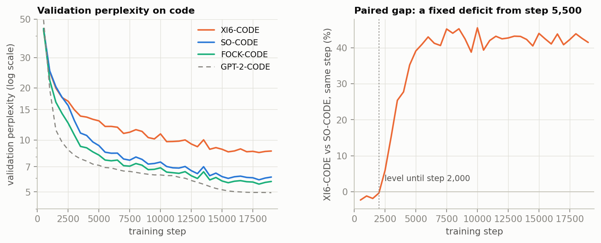
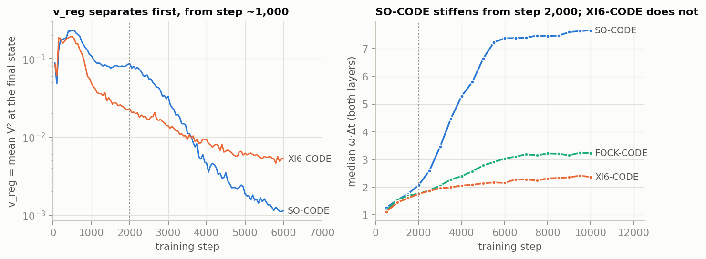
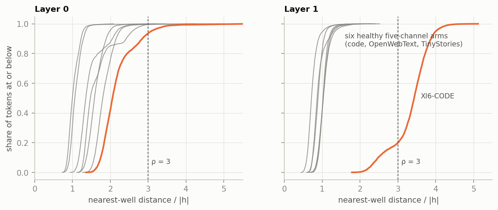
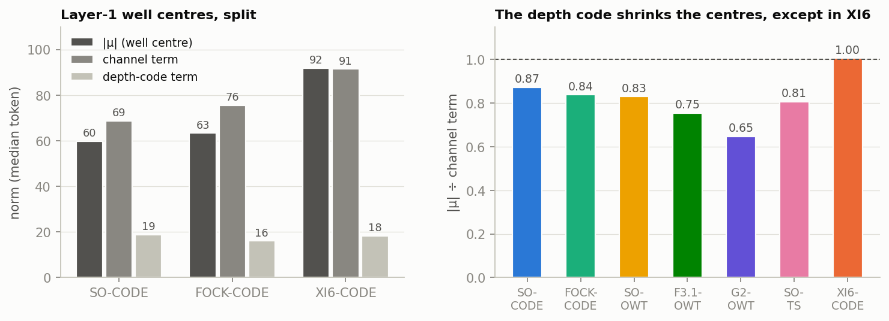
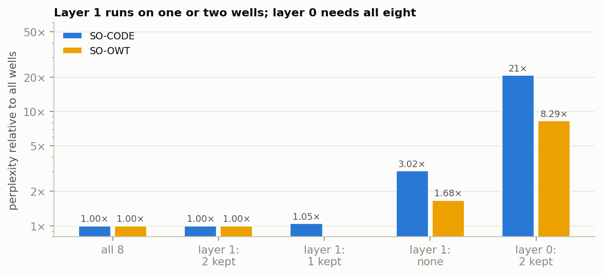
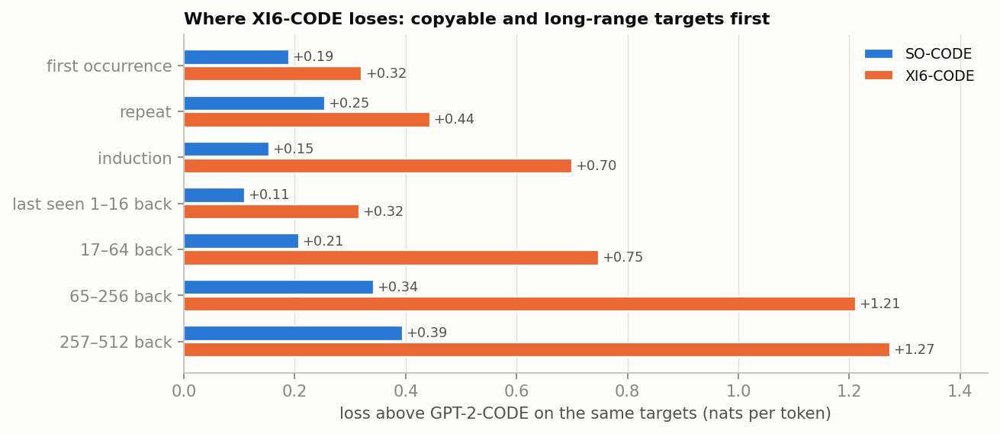
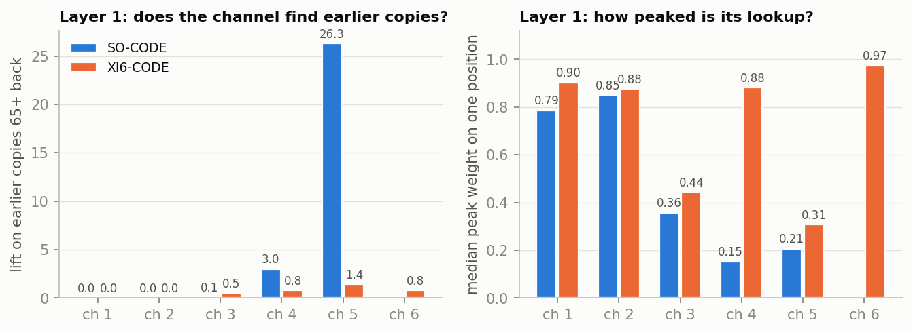
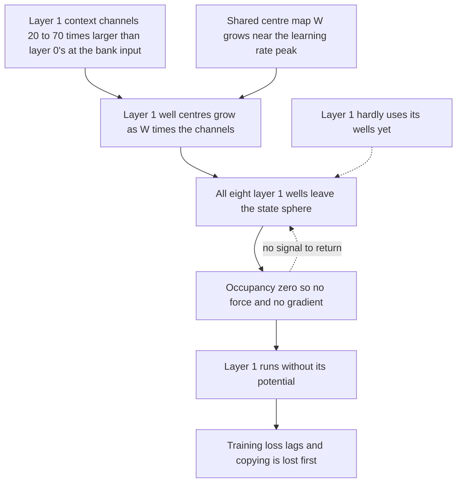

# Dead Wells in the Joint V_θ Bank

**XI6-CODE's failure, its root cause, and two mitigations that keep the wells alive (technical report, 2026-10-28; updated 2026-10-30).**

XI6-CODE added a sixth content-routed context channel to SO-CODE, the conservative second-order model on Python code. It settled 42.7% behind SO-CODE. The cause is not the channel's information but a failure of V_θ's well bank in the second layer: every layer-1 well drifted away from the region the states live in, where a well exerts no force and receives no gradient, and so cannot come back. This report describes the symptom, the debugging that located the cause, what is established and what is open, a first mitigation that failed (a reachability penalty), two short screens that kept the wells alive, the full-length run of one of them, which closes the gap to SO-CODE, and its five-channel twin, which shows the sixth channel itself adds nothing.

Protocol entries: [XI6-CODE](Depth_Ladder_and_Matched_Baseline_Protocol.md#p-xi6-code), [root cause](Depth_Ladder_and_Matched_Baseline_Protocol.md#p-dead-wells), [reachability penalty](Depth_Ladder_and_Matched_Baseline_Protocol.md#p-well-reach), [its result](Depth_Ladder_and_Matched_Baseline_Protocol.md#p-xi6-code-wr), [screens](Depth_Ladder_and_Matched_Baseline_Protocol.md#p-dead-wells-screens) and [their result](Depth_Ladder_and_Matched_Baseline_Protocol.md#p-dead-wells-screens-result), [screen B at full length](Depth_Ladder_and_Matched_Baseline_Protocol.md#p-dw-screen-b-full), [SO-CODE-VTLR](Depth_Ladder_and_Matched_Baseline_Protocol.md#p-so-code-vtlr-result). One seed per model throughout; L = 2 layers.

---

## Contents

1. [Summary](#1-summary)
2. [The parts of the model involved](#2-the-parts-of-the-model-involved)
3. [The symptom](#3-the-symptom)
4. [Debugging, step by step](#4-debugging-step-by-step)
5. [Root cause](#5-root-cause)
6. [Mitigations](#6-mitigations)
7. [The tests](#7-the-tests)
8. [Open questions](#8-open-questions)
9. [Reproduction](#9-reproduction)

---

## 1. Summary

- **Result.** XI6-CODE settled at perplexity 8.55 against SO-CODE's 6.00 (+42.7%). It matched SO-CODE until step 2,000, then fell behind and held a fixed deficit of 40–45% from step 5,500 to the end. Its training loss lags just as much, so it fails to fit the data rather than overfitting it. Both registered calls missed (XI1, XI2).
- **Mechanism.** In layer 1 the states lie on the LayerNorm sphere of radius ‖h‖ = √384 = 19.6. XI6-CODE's layer-1 well centres have norm 92 (SO-CODE 60), the nearest well is 67 away (SO-CODE 20), and its occupancy is 0.000 (SO-CODE 0.18). With zero occupancy a well gives no force and gets no gradient: layer 1 runs without its potential, and the optimiser has no signal to bring the wells back.
- **What failed to hold them.** One well bank serves both layers; only a learned depth code, added to the context channels before the bank reads them, tells layer 1 from layer 0. In every healthy arm, on code, OpenWebText and TinyStories, that depth code shrinks the layer-1 well centres (‖μ‖ is 0.65–0.87 of the channel term). In XI6-CODE it does not (1.00).
- **Layer 1 is marginal everywhere.** In every healthy five-channel arm, layer 1 works on one or two wells at occupancy 0.17–0.38. Removing the other six wells at layer 1 leaves the perplexity unchanged; removing all of them costs +202% on code. There is no spare well, so losing the working ones is catastrophic. XI6-CODE is the run that crossed over.
- **Not the cause:** a duplicated channel (channels 5 and 6 separate early), the sixth channel's term alone (zeroing it on the trained model does not revive the wells), or the stiffness readout ω·Δt (FOCK-CODE has the lowest ω·Δt and the best loss).
- **Alongside the dead wells**, XI6-CODE's long context channels in layer 1 stopped retrieving earlier occurrences and became near one-hot lookups of a single position. Whether this caused the dead wells or followed from them is open.
- **First mitigation, failed.** A well-reachability penalty (a hinge on each token's nearest-well distance relative to ‖h‖, beyond ρ = 3) did not keep XI6-CODE's layer 1 alive: XI6-CODE-WR settled at 8.87. ρ = 3 was set against the healthy arms' tails, not the wells' width, and the penalty engaged only after the deaths (§7.1).
- **When the wells die.** XI6-CODE-WR's log dates the deaths to steps 750–1,200, just after the learning rate peaks (step 812). Layer 1 was hardly using its wells then (removing them cost +1.6%), the shared centre map W was growing, and layer 1's context channels at the bank input are 20–70 times larger than layer 0's, so its centres grew with W and left the sphere (§7.1).
- **Two switches keep layer 1 alive** in 3,000-step screens (§7.2): unit-norm context channels at the bank input (screen A), or V_θ's learning rate × 0.25 (screen B). Each cuts one factor of the centres' growth. Both beat the control's perplexity at step 3,000 (13.54 and 11.27 against 14.80; SO-CODE 12.96).
- **Screen B at full length closes the gap** (§7.3): settled 5.98 against SO-CODE's 6.00 and XI6-CODE's 8.55, with layer 1 alive to the end (removing its wells costs +242%; SO-CODE +202%). The whole deficit was the dead wells; the sixth channel itself buys nothing on code.
- **The slower V_θ is a fix, not a general gain** (§7.4). SO-CODE with the same switch (SO-CODE-VTLR) settles at 6.09, +1.6% against SO-CODE. It has screen B's early lead, and its bank follows screen B's checkpoint for checkpoint. Screen B is level with it too (−1.8%, within the paired noise), so the sixth channel adds nothing, with or without the slower V_θ.

---

## 2. The parts of the model involved

The ladder model integrates a hidden state h through L = 2 layer steps of a damped second-order flow. One force on the state comes from **V_θ**, a learned potential built from a bank of Gaussian wells whose shape depends on the context.

**Context channels.** Each layer reads the context through n_ctx channels ξ⁽¹⁾…ξ⁽ⁿ⁾: causal averages of past states with decays α (SO-CODE: 0.50, 0.75, 0.95, 0.99, 0.995; XI6-CODE adds a second 0.995). With content routing on, each channel's weights over past positions also depend on a query–key match, so a channel can look up specific earlier positions.

**The joint well bank.** One bank of K = 8 wells reads the concatenation of all channels. For context ξ and state h, the potential is

$$V_\theta(h; \xi) = -\sum_{k=1}^{K} w_k \exp\left(-\frac{1}{2}(h-\mu_k)^\top P_k (h-\mu_k)\right), \quad P_k = \mathrm{diag}(a_k) + B_k B_k^\top$$

where the well weights w_k (a softmax, summing to 1), centres μ_k, diagonal precisions a_k and low-rank factors B_k (rank 4) are all linear maps of the concatenated context. XI6-CODE's sixth channel widens that input from 5 × 384 to 6 × 384; it does not change the number or shape of the wells. (The tag part `dcvt6x8` reads as 6 × 8 wells, but under the joint coupling the bank has 8.)

**Occupancy.** The factor that decides whether a well acts on a token is its occupancy

$$o_k = \exp\left(-\frac{1}{2}(h-\mu_k)^\top P_k (h-\mu_k)\right), \quad g_k = w_k o_k$$

The force on the state is a sum of springs weighted by g_k:

$$f(h) = \sum_{k} g_k P_k (\mu_k - h)$$

and every gradient that reaches a well's parameters through this force carries the same factor g_k. **A well whose occupancy is zero for all tokens exerts no force and receives no gradient.** Nothing in the loss can move it back. This is the same trap as a dead entry in a VQ-VAE codebook.

**The depth code.** The bank's parameters are shared by both layers. A learned depth code c_ℓ (one vector per layer and channel) is added to the channels before the bank reads them, so the layer-ℓ well centres are

$$\mu_k^{(\ell)} = W_k(\xi + c_\ell) + b_k$$

The layers' inputs differ in scale: layer-0 states are embeddings with norm around 2.5, while layer-1 states are LayerNorm-projected onto the sphere of radius √384 = 19.6, and the channels averaging them are about as large. Only the depth code can make the shared bank place layer-1 wells differently from layer-0 wells.

**Stiffness ω·Δt.** The run monitor logs ω·Δt, where ω is the frequency of the stiffest low-rank mode, ω² = λ_max(G Gᵀ)/m, with G = [√g₁ B₁, …, √g_K B_K] and m the token's learned mass. The factors B_k are capped (Frobenius norm at most 1), so λ_max is at most the sum of the g_k, at most 1. Under SR2 the low-rank modes are integrated exactly, so ω·Δt above 2 is a stiffness reading, not an instability.

---

## 3. The symptom

*Figure 1. Left: validation perplexity on code. Right: XI6-CODE against SO-CODE at the same step (fresh runs share their evaluation batches, so the comparison is paired).*

| measure | XI6-CODE | SO-CODE |
| --- | ---: | ---: |
| settled perplexity (evals at 18,000, 18,500, 19,000) | 8.55 | 6.00 |
| paired gap at steps 1,000 / 2,000 / 2,500 / 3,500 / 5,000 | −1.2% / −0.4% / +5.9% / +25.4% / +39.1% | — |
| paired gap over 8,000–13,000 | 0.355 nats (SD 0.015), fitted change −0.006 | — |
| training loss at step 13,000 | 2.10 | 1.79 |
| validation minus training loss at step 13,000 | +0.11 nats | +0.06 nats |

The deficit is not a slow start: from step 5,500 the gap is flat, and at its fitted rate it would take hundreds of thousands of steps to close. The training loss lags by almost the whole gap, so the extra parameters (+9.3%, nearly all in the bank's projections) are not being used.

Registered calls: XI1 (more than 2% below SO-CODE) **missed**; XI2 (the gain is long-range) **missed**: there is no gain, and the loss is worst at long range (§4.8).

The run was healthy in every other respect: no watchdog trigger, gradient norm median 0.64, the largest loss rise at the step the other code arms share, causal-leak probes clean.

---

## 4. Debugging, step by step

Each step below is a check that was run, what it showed, and what it ruled out. Unless stated otherwise the measurements come from `debug/vtheta_well_probe.py` on the best checkpoints (step 18,000), over 16 evenly spaced windows of 512 tokens from each model's own validation set.

### 4.1 The stiffness readout stayed near 2

The first visible difference was in the run monitor: SO-CODE's median ω·Δt climbed from 2.1 at step 2,000 to 7.4 by step 6,000, while its loss fell fastest; XI6-CODE's rose only from 1.8 to 2.6 over the rest of the run.

*Figure 2. Left: v_reg, the mean squared potential at the final state (a regulariser term, logged every 50 steps). Right: the monitor's median ω·Δt.*

Splitting ω·Δt into its factors on the final checkpoints showed that ω·Δt alone diagnoses nothing:

| arm | layer | ω·Δt | λ_max | mass m | nearest-well occupancy |
| --- | ---: | ---: | ---: | ---: | ---: |
| SO-CODE | 0 / 1 | 9.55 / 5.02 | 0.29 / 0.08 | 0.053 | 0.98 / 0.18 |
| FOCK-CODE | 0 / 1 | 3.27 / 3.79 | 0.19 / 0.25 | 0.277 | 0.65 / 0.36 |
| XI6-CODE | 0 / 1 | 2.79 / **0.000** | 0.07 / **0.000** | 0.152 | 0.74 / **0.000** |

FOCK-CODE has the lowest ω·Δt of the healthy code arms and the best loss; its ω·Δt is low mostly because its learned mass is five times SO-CODE's. **Ruled out:** a low ω·Δt as the problem in itself. **Found:** XI6-CODE's layer-1 curvature is exactly zero for the median token.

### 4.2 Underfitting, not overfitting

At step 13,000 XI6-CODE's training loss is 0.31 nats above SO-CODE's, out of a 0.36-nat validation gap. **Ruled out:** overfitting through the extra capacity. The optimiser does not reach the solution SO-CODE reaches.

### 4.3 The duplicated channel

The first hypothesis was that channels 5 and 6, which start as the same vector (same decay, query weights at zero), receive identical Adam updates through the bank, so the long-range path learns at twice the rate. The step-500 and final checkpoints refute it:

- at step 500, channels 5 and 6 already differ at the bank input (cosine 0.75 in layer 0);
- at the end they are nearly orthogonal in layer 1 (cosine about 0.2 with every other channel);
- the bank's weight blocks reading them are no more alike than SO-CODE's two longest channels' blocks (cosines 0.66, 0.54, 0.71 for B, μ and a, against SO-CODE's 0.73, 0.66, 0.80).

**Ruled out:** duplication.

### 4.4 The layer-1 wells are dead

| layer 1 | XI6-CODE | SO-CODE |
| --- | ---: | ---: |
| state norm ‖h‖ | 19.6 | 19.6 |
| mean well-centre norm ‖μ‖ | **92** | 60 |
| distance to the nearest well | **67** | 20 |
| nearest-well distance ÷ ‖h‖, median | **3.43** | 1.03 |
| occupancy of the nearest well | **0.000** | 0.18 |

Every one of XI6-CODE's eight layer-1 wells sits far outside the sphere its states live on. With occupancy zero, layer 1 has no V_θ force and the wells get no gradient (§2). Layer 0 is still alive (occupancy 0.74 against SO-CODE's 0.98).

The sixth channel's own term is not what pushes them out: every channel's contribution to the layer-1 centres is larger in XI6-CODE (40, 37, 31, 33, 24 and 33 against SO-CODE's 32, 26, 20, 17 and 18). Zeroing channel 6 at the bank input of the trained model moves ‖μ‖ from 92 to 81, still out of reach, and the loss gets worse (perplexity 10.59 to 12.04 on these windows), because layer 0 uses the channel.

**At step 500 the two models are indistinguishable:** mass 1.27 in both, layer-1 nearest-well ratio 0.95 against 0.94, the same distances and occupancies. The collapse happened between step 500 and about step 2,000. v_reg is the earliest logged sign: XI6-CODE's is half of SO-CODE's from step 1,000, while the losses are still equal (Figure 2). There are no checkpoints between 500 and the end, so the onset cannot be dated more precisely.

### 4.5 Every healthy arm keeps its layer-1 wells within reach

The same probe on the healthy five-channel arms, each on its own corpus:

*Figure 3. Cumulative distribution over tokens of the nearest-well distance divided by ‖h‖. Grey: SO-CODE, FOCK-CODE, SO-OWT, F3.1, G2 (OpenWebText) and SO-TS (TinyStories). Orange: XI6-CODE. The dashed line is the penalty threshold of §6.*

| arm | corpus | layer-1 occupancy | nearest ÷ ‖h‖, median | largest | tokens above 3 (layer 0 / layer 1) |
| --- | --- | ---: | ---: | ---: | ---: |
| SO-CODE | code | 0.18 | 1.03 | 2.32 | 0.24% / 0% |
| FOCK-CODE | code | 0.36 | 0.89 | 1.97 | 0.46% / 0% |
| SO-OWT | OpenWebText | 0.17 | 1.03 | 2.28 | 0% / 0% |
| F3.1 | OpenWebText | 0.24 | 0.72 | 2.52 | 0.02% / 0% |
| G2 | OpenWebText | 0.38 | 0.87 | 2.12 | 0.43% / 0% |
| SO-TS | TinyStories | 0.20 | 1.02 | 2.41 | 0.05% / 0% |
| **XI6-CODE** | code | **0.000** | **3.43** | 5.13 | 6.5% / **80%** |

In every healthy arm, on every corpus, the nearest layer-1 well sits about one state-norm away (median ratio 0.72–1.03, never above 2.52), with occupancy 0.17–0.38. That is alive but marginal. XI6-CODE is the only model whose layer-1 wells left.

### 4.6 The depth code is the counterweight that failed

Splitting the layer-1 centres into the channels' part, the depth code's part and the bias shows how the healthy arms keep them in reach:

*Figure 4. Left: median norms of the layer-1 well centres and of their channel and depth-code terms (code arms). Right: ‖μ‖ divided by the channel term's norm for every arm; below 1, the depth code shrinks the centres.*

In every healthy arm the depth-code term partly cancels the channel term, so the centres end up smaller than the channels alone would put them: the ratio is 0.65–0.87. In XI6-CODE it is 1.00, although its depth code is as large as SO-CODE's (term norm 18 against 19). At step 500 the ratio is 1.00 in both models: the counterweight is learned between step 500 and the end, and XI6-CODE never learned it.

### 4.7 Layer 1 runs on one or two wells

Per token, one well is the nearest for essentially every token, in both layers (SO-CODE's well 5, SO-OWT's well 3). Removing wells from the trained models, by setting their weight to zero at one layer only, shows how much each layer depends on them:

*Figure 5. Perplexity after removing wells at one layer, relative to the full model (16 windows).*

| wells kept | SO-CODE | SO-OWT |
| --- | ---: | ---: |
| all 8 | 7.45 | 58.28 |
| layer 1: the 2 strongest | 7.45 | 58.27 |
| layer 1: the strongest only | 7.79 | — |
| layer 1: none | 22.49 (+202%) | 97.62 (+67%) |
| layer 0: the 2 strongest | 155.2 | 483.1 |

Layer 1 needs exactly one or two wells and nothing else; layer 0 needs all eight (low-weight wells still carry much of layer 0's force, because a well's pull grows with its distance). The bank's parameters are therefore not wasted, but **layer 1 has no redundancy**: when its one or two working wells leave, the layer loses its potential. Code depends on the layer-1 wells far more than OpenWebText does (+202% against +67%).

### 4.8 What the dead layer cost: the copy split

`debug/copy_split.py` splits every model's per-token loss on 262,144 code validation targets by what the context offers for each target:

*Figure 6. Loss above GPT-2-CODE on the same targets, by group: first occurrence in the window, repeat, induction (the pair of current and next token occurred earlier), and repeat or induction targets by distance back to the last occurrence.*

XI6-CODE's extra loss falls first on copyable targets: induction targets cost 4.5 times SO-CODE's gap, first occurrences 1.7 times, and targets last seen 65–512 tokens back about 3.5 times. That fits the masking result: on code, layer 1's wells carry much of the copying.

### 4.9 What the layer-1 channels retrieve

`debug/xi_reach.py` measures where each context channel puts its weight for targets that occurred earlier in the window:

*Figure 7. Layer 1, per channel (1 = shortest decay). Left: weight on the target's earlier occurrences 65 or more tokens back, relative to an even spread. Right: the median largest weight a query puts on a single position.*

SO-CODE's longest channel finds earlier occurrences 65 or more tokens back with 26 times an even spread, over about 36 positions. XI6-CODE's two long channels do not (lifts 1.4 and 0.8). Instead, channels 4 and 6 have become near one-hot lookups: a median 0.88 and 0.97 of their weight on a single position, a median 76 and 148 tokens back, almost never the window's first token. A one-position lookup delivers a full-size state to the bank, which fits XI6-CODE's larger layer-1 channel norms and larger well-centre terms (§4.4).

---

## 5. Root cause

*Solid arrows are established: they follow from the form of the potential (§2), were measured (§4.7, §4.8, §7.1), or were tested by removing one factor (§7.2: either cut alone keeps the wells alive). The dashed arrows are inferred: an unused well gets little gradient to hold it in place, and a dead well none to bring it back.*

**Established:**
- XI6-CODE's layer-1 wells are dead: the nearest well is 3.4 state-norms away and its occupancy is zero (§4.4).
- A dead well cannot recover: its force and its gradient are both proportional to its occupancy (§2).
- Layer 1 works on one or two wells in every healthy arm, so it has no spare (§4.7).
- The healthy arms keep their layer-1 centres in reach through a depth-code counterweight that XI6-CODE lacks (§4.6).
- Before step 500 nothing distinguishes the two models; v_reg separates at step 1,000 and the loss at step 2,000 (§4.4).
- XI6-CODE's long layer-1 channels became one-position lookups that do not find earlier copies (§4.9).
- The deaths fall in steps 750–1,200, just after the learning-rate peak, while layer 1 hardly uses its wells (removing them costs +1.6% at step 500). The one-position lookups sharpen after the deaths, so they are a consequence (§7.1).
- Either unit-norm channels at the bank input or a slower V_θ keeps the layer-1 wells alive to step 3,000 (§7.2).
- With the slower V_θ, the wells stay alive to step 19,250 and XI6 settles level with SO-CODE (5.98 against 6.00): the dead wells account for the whole deficit, and the one-position lookups do not form (§7.3).
- The slower V_θ alone gives SO-CODE screen B's early lead and its small, inward bank; at the end it costs SO-CODE 1.5%, consistently from step 14,000 on, and screen B is level with this twin (§7.4).

**Open:**
- **Which loss term pushes the centres outward.** Averaged over 16 batches, the gradient through layer 1 pulls the wells in and `v_reg` pushes them out more weakly; the update Adam actually stored moves them outward, 2–3 times faster in the XI6 arms. The decomposition does not reproduce the stored update (§7.1).
- **Why XI6 and not the five-channel arms.** XI6 has lost layer 1 in 2 of 2 runs, the five-channel arms in 0 of 6. A sixth channel adds one more large term to the centres; whether that alone tips the race is not separated from seed.
- **Whether screen A's fix holds to the end of training** (§8).

---

## 6. Mitigations

### 6.1 Considered and set aside

| option | why set aside |
| --- | --- |
| Normalise the bank's input per layer (a LayerNorm on the depth-shifted channels) | Set aside on 2026-10-28: the larger layer-1 inputs seemed to supply the larger layer-1 centres, and normalising would leave the whole layer difference to the depth code. **Revised on 2026-10-29:** that scaling is what lets the layer-1 centres grow with W, and scaling each channel to unit norm (screen A, §7.2) kept layer 1 alive. |
| Cap every well centre's norm relative to ‖h‖ | At 6 × ‖h‖ the cap touches under 1% of the healthy arms' wells but would not have reached XI6-CODE's (median 4.8 × ‖h‖). At about 2 × ‖h‖ it would have, but it would move layer-0 wells that carry 16–85% of the healthy arms' force weight. It is harmless and useless, or effective and invasive. |
| Fewer wells | The healthy arms use all eight at layer 0 (§4.7). |
| Reset dead wells during training (as in VQ-VAE codebooks) | It acts on the symptom with an intervention outside the loss; kept in reserve. |

### 6.2 The well-reachability penalty

The penalty acts on the nearest well only, and only when it is far:

$$\mathcal{R} = \frac{1}{L} \sum_{\ell=1}^{L} \frac{1}{T} \sum_{t=1}^{T} \mathrm{relu}\left(\frac{\min_k \lVert h_t - \mu_k^{(\ell)} \rVert}{\lVert h_t \rVert} - \rho\right)^2$$

added to the training loss with weight λ. Design choices:
- **Nearest well only.** The six parked wells a healthy layer 1 keeps far away are left alone; only the token's closest well is pulled, and only when even that one is out of reach.
- **Relative to ‖h‖.** The same threshold serves layer 0 (states of norm about 2.5) and layer 1 (19.6).
- **States and channels detached.** The gradient moves the well centres (the bank's `mu_proj` and the depth code) towards the states, never the states or the context channels towards the wells.
- **Independent of occupancy.** Its gradient does not carry the factor g_k that vanishes for a dead well, so it acts exactly where the potential gives no signal.
- **Hinge at ρ = 3.** From §4.5: zero on every layer-1 token of every healthy arm on all three corpora (largest ratio 2.52), nonzero on under 0.5% of their layer-0 tokens, and engaged on 80% of XI6-CODE's layer-1 tokens. Every arm is below 1.6 at step 500.

**Implementation** (default off):
- Cell 0: `WELL_REACH_RHO = None` (off) and `WELL_REACH_LAMBDA = 0.1`; tag part `wr<rho>l<lambda>`, e.g. `wr3l0p1`, checked by Cell 5b.
- Model: config `well_reach_rho` in `parf/model_parf_multixi.py`. The layer step records only its detached inputs, keyed by layer. `pop_well_reach_penalty()` computes the term after the forward, and Cell 6's loss (and Cell 6c's copy) adds `WELL_REACH_LAMBDA * model.pop_well_reach_penalty()`.
- Why outside the layer step: under layer checkpointing the step is re-run inside the forward (V_φ's force uses `autograd.grad`, which unpacks checkpointed tensors) and again in the backward. A term built inside the step changed what the checkpoint saves, so PyTorch refused the backward, and it was recorded twice. Recording detached inputs is idempotent and saves nothing.
- Logging: each log line gains `reach=[median ratio/fraction above ρ]` per layer; each evaluation record gains `well_reach_stats`.

**Verification** (`debug/verify_well_reach.py`, the notebook's own Cells 0–5b on trained weights):

| check | result |
| --- | --- |
| off, against HEAD: eval logits, train-mode logits, every gradient, the loss (SO-CODE, XI6-CODE, FOCK-CODE, F3.1, G3′) | bit-identical |
| on: tag gains exactly `wr3l0p1`; no new parameter or state-dict key | pass |
| on: eval and train-mode logits and the NTP loss equal to off | bit-identical |
| on: inputs recorded once per layer, also under layer checkpointing; backward runs; same penalty | pass |
| on: parameters receiving the penalty's gradient | `mu_proj` and the depth code only |
| on, 8 × 256 code tokens: penalty value | SO-CODE 0.0006, FOCK-CODE 0.0008, XI6-CODE 0.21 |
| on, 8 × 256 code tokens: layer-1 tokens above ρ | SO-CODE 0%, FOCK-CODE 0%, XI6-CODE 77% |

With λ = 0.1 the penalty adds 0.00006 nats to a healthy model's loss and 0.02 nats to XI6-CODE's end state, with its gradient concentrated on the dead layer.

---

## 7. The tests

### 7.1 The reachability penalty did not keep layer 1 alive

**The pair as proposed on 2026-10-28.** Two arms on the code corpus, about 6 hours each, both with `WELL_REACH_RHO = 3` and with weight snapshots at steps 1,000, 1,500, 2,000, 2,500 and 3,000, so that the window in which XI6-CODE collapsed can be watched in both:
- **XI6-CODE-WR**: XI6-CODE plus the penalty.
- **SO-CODE-WR**: SO-CODE plus the penalty, the check that a healthy run is unchanged.

| id | prediction (calls fixed by the author on 2026-10-28, before training) | called |
| --- | --- | ---: |
| WR1 | the penalty keeps XI6-CODE's layer 1 alive: at the end, layer-1 median nearest-well ratio below 2 and under 1% of layer-1 tokens above 3 | 70% |
| WR2 | it leaves a healthy run alone: SO-CODE-WR settles within 2% of SO-CODE (5.88–6.12) | 70% |
| WR3 | it removes most of XI6-CODE's deficit: XI6-CODE-WR settles within 5% of SO-CODE (at or below 6.30) | 45% |
| WR4 | the original question, with live wells: XI6-CODE-WR settles more than 2% below SO-CODE-WR | 25% |

If WR1 holds but WR3 fails, live wells are not enough and the sharp channel lookups (§4.9) become the next suspect. If WR1 fails, the penalty is too weak at λ = 0.1, or the wells die by a route the nearest-well distance does not capture.

**Result (2026-10-29).** XI6-CODE-WR settled at 8.87 (XI6-CODE 8.55, SO-CODE 6.00). WR1, WR3 and WR4 missed; SO-CODE-WR was dropped by the author, so WR2 is not scored. Its log and weight snapshots show what the end state of XI6-CODE could not:
- **The deaths are dated.** Layer 1's median nearest-well ratio stays near 0.97 up to step 750, then reaches 1.35 at step 1,000, 2.06 at 1,100 and 2.27 at 1,200; `v_reg`, which is nonzero only while the last layer's wells are occupied, falls to zero from step 1,200. The learning rate peaks at step 812.
- **The penalty came too late and pulled too little.** Its first tokens above ρ = 3 appear at step 1,150. It pulled the nearest well from 67 to 51 (‖h‖ = 19.6), but a live layer-1 well is about 20 away; at 51 its occupancy is about e⁻¹⁶.
- **The wells were hardly used when they died.** Removing every layer-1 well on the step-500 checkpoint costs +1.6% (SO-CODE +2.8%); at step 1,000, nothing.
- **The centres grew with the shared centre map.** Between steps 500 and 1,500 the layer-1 mean centre norm went 18 → 39 → 69, while the largest `mu_proj` column norm went 25 → 41 → 52 and layer 1's channels entered the bank at norm 7–16. The depth code's term stayed small (0.8–3.2). The channels became sharp one-position lookups only after step 1,000.

### 7.2 Two screens keep layer 1 alive

Each screen is XI6-CODE-WR's Cell 0 plus one switch, stopped at step 3,000 (about 1 h; protocol `p-dead-wells-screens`). Since a centre's size is roughly W times the size of the channel it reads, each switch cuts one factor:
- **Screen A, `VTHETA_INPUT_UNIT_NORM = True`:** every context channel is scaled to unit norm before the bank reads it, in both layers.
- **Screen B, `VTHETA_LR_MULT = 0.25`:** V_θ's parameters train at a quarter of the scheduled learning rate.

| step | validation perplexity: control / A / B | layer-1 median nearest-well ratio: control / A / B |
| ---: | --- | --- |
| 500 | 43.35 / 35.75 / 50.22 | 0.95 / 0.99 / 1.04 |
| 1,000 | 25.15 / 22.03 / 28.29 | 1.35 / 0.99 / 0.96 |
| 2,000 | 17.32 / 16.21 / 15.87 | 2.45 / 0.98 / 0.87 |
| 3,000 | 14.80 / 13.54 / **11.27** | 2.55 / 0.97 / 0.82 |

The control is XI6-CODE-WR; SO-CODE is at 12.96 at step 3,000.

- **Screen A** lets W grow as in the control (largest `mu_proj` column 25 → 71), but the layer-1 centres stay at norm 2–5. Layer 1 spreads over five to eight wide wells near the origin, the strongest at occupancy about 0.5; removing them costs +9.5% at step 3,000.
- **Screen B** keeps W at its step-500 size (21 → 28) while layer 1's channels are as large as in the control. Layer 1 runs on one well at occupancy 0.2–0.4, as in SO-CODE; removing it costs +98% at step 3,000. B is not only slower: at step 3,000 its V_θ has had the same cumulative learning rate as the control's at step 1,055, inside the death window.
- **Proposed calls:** DW1 (A keeps layer 1 alive) hit, DW2 (B only delays the drift) missed, DW3 (A costs at most 5%) hit.
- **Caveats.** These are 3,000 of 19,250 steps. B's stiffness readout ω·Δt is above 2 on 96% of tokens at step 3,000, like SO-CODE's on its way to 6.00. A slower V_θ may help any arm, so B's gain need not be specific to the dead wells.

### 7.3 Screen B at full length

Screen B was resumed from its step-3,000 checkpoint (model and optimizer state, with the 0.25 groups) and ran to step 19,250, clean (protocol `p-dw-screen-b-full`).

| | settled perplexity | gap to SO-CODE, steps 16,000–19,000 | layer-1 occupancy, strongest well | layer-1 removal cost | `mu_proj` largest column norm |
| --- | ---: | ---: | ---: | ---: | ---: |
| screen B | **5.98** | +0.002 nats | 0.173 | +242% | 36 |
| SO-CODE | 6.00 | — | 0.184 | +202% | 101 |
| XI6-CODE | 8.55 | +0.352 nats | 0.000 | — | 112 |

- **Level with SO-CODE.** The runs share eval batches (both trained from step 0), and the paired gap is +0.003 nats over steps 8,000–13,000 and +0.002 over 16,000–19,000. The training loss is level too (1.687 for both over the last 3,250 steps; XI6-CODE 1.987). Screen B was ahead of SO-CODE only early, over steps 2,000–5,000.
- **Layer 1 stays alive and looks like SO-CODE's:** its median nearest-well ratio stays at 0.76–0.83 to the end, one well carries 83% of the force at occupancy 0.17, and its stiffness readout ω·Δt is 4.34 (SO-CODE 4.94, XI6-CODE 0.000).
- **The bank works at a smaller scale.** The centre map W ends three times smaller than in any full-speed arm (36 against 100–112), and the layer-1 centres sit inside the state sphere (nearest well 15.1 against ‖h‖ 19.6).
- **No one-position lookups.** On the same 16 windows as §4.9 (`debug/xi_reach.py`, step 16,000; `results/copy_split_code/xi_reach_xi6vtlr.txt`), layer 1's long channels find earlier occurrences 65 or more tokens back at 19 and 27 times an even spread (channels 5 and 6; SO-CODE's longest 26, XI6-CODE's 1.4 and 0.8), and their median peak weight on one position is 0.21 (channel 4) and 0.39 (channel 6), against XI6-CODE's 0.88 and 0.97. With live wells the lookups do not form, so in XI6-CODE they followed from the deaths, as the snapshots' timing suggested (§7.1).
- **What it settles.** XI6-CODE's +43% was entirely the dead wells. With live wells the sixth context channel retrieves like SO-CODE's longest, yet neither helps nor hurts on code.

### 7.4 The five-channel twin: SO-CODE with the slower V_θ

Screen B differs from SO-CODE in two ways: the sixth channel and V_θ's learning rate × 0.25. SO-CODE-VTLR is SO-CODE with only the second, trained from step 0 for 19,250 steps (protocol `p-so-code-vtlr-result`). All three runs share eval batches, so their evals can be compared step by step.

| | settled perplexity | at step 3,000 | gap to SO-CODE, steps 16,000–19,000 | layer-1 removal cost | `mu_proj` largest column norm |
| --- | ---: | ---: | ---: | ---: | ---: |
| SO-CODE | 6.00 | 12.96 | — | +202% | 101 |
| SO-CODE-VTLR | **6.09** | 11.32 | +0.015 nats (SD 0.002) | +272% | 37 |
| screen B | 5.98 | 11.27 | +0.002 nats (SD 0.035) | +242% | 36 |

- **The early lead is the slower V_θ's.** SO-CODE-VTLR starts behind SO-CODE (+16% at step 1,000), crosses it before step 2,000 and leads by 13–17% at steps 2,500–3,000, as screen B did. Screen B and the twin stay within the paired noise of each other throughout.
- **At the end the slower V_θ costs a healthy arm about 1.5%.** The gap to SO-CODE opens in the decay phase and is 1.2–1.7% at every eval from step 14,000 (training loss 1.704 against 1.687). It sits inside the pre-registered ±2% band. Because the two runs differ only in V_θ's learning rate, their evals move together (SD of the paired difference 0.002 nats), so the gap is consistent; it is still one seed each.
- **The bank is set by V_θ's speed, not by the channel count.** At steps 500, 1,000 and 3,000 and at the end, the twin's layer-1 nearest-well ratio, centre norm, `mu_proj` size, occupancy and removal cost match screen B's. Layer 1 stays alive throughout: its median nearest-well ratio is at most 1.03 at every checkpoint.
- **So does the halved refinement penalty.** In Cell 6b-7's Gate 3 (three integration steps over the trained time), the penalty is 0.312 nats for the twin, 0.290 for screen B and 0.639 for SO-CODE.
- **What it settles.** The sixth context channel neither helps nor hurts on code. Screen B is a dead-well fix whose cost (about 1.5%) the sixth channel gives back. `VTHETA_LR_MULT = 0.25` is not a setting to adopt for arms whose wells survive at full speed.

---

## 8. Open questions

- **Full length, screen A.** Screen B's wells survive to step 19,250 and it settles level with SO-CODE (§7.3). Whether screen A's wide, near-origin wells do as well is open; it can resume from its step-3,000 checkpoint.
- **Specific or general, screen A.** The slower V_θ does not help SO-CODE (§7.4). Whether unit-norm input does is open; it would need its own SO-CODE twin.
- **The outward push.** Which term moved the control's centres outward is not identified (§5).
- **Seed.** Does XI6-CODE collapse on another seed? Does SO-CODE ever collapse? Layer 1's margin (occupancy 0.17–0.38 on one or two wells) suggests a collapse is possible in any arm.
- **Why layer 1 runs on so few wells.** With unit-norm input (screen A) layer 1 uses five to eight wells, so the input scale may be the reason. A per-layer bank (more parameters) or a per-layer scale on the centre map (two scalars) remain alternatives.

---

## 9. Reproduction

All on CPU, from `notebooks/conservative_arch/scaleup/debug/`, with the run folders (including checkpoints) in `~/Downloads`:

| what | command | output |
| --- | --- | --- |
| well probe (per arm) | `python3 vtheta_well_probe.py ../results/dead_wells <FOLDER> name=<arm> windows=16 [val=<tokens.npy>] [ckpt=<file>]` | `results/dead_wells/well_probe_<arm>.txt`, `.npz` |
| well removal | the same with `keep=<wells> keep_layers=<layer>` | `well_probe_<arm>_L<l>_keep<n>.txt` |
| channel ablation | the same with `ablate=<channel index>` | `well_probe_xi6_code_ablate_ch6.txt` |
| copy split | `python3 copy_split.py ../results/copy_split_code nll xi6 <FOLDER> threads=8`, then `report` and `report ref=so` | `results/copy_split_code/` |
| channel retrieval | `python3 xi_reach.py <scratch dir> <FOLDER>` | `results/copy_split_code/xi_reach_<arm>.txt` |
| switch check | `python3 verify_well_reach.py <HEAD worktree> <out> dump`, then `<working copy> <out> compare` and `on` | printed |
| screen switches check | `python3 verify_vt_screens.py <out>` | printed |
| snapshots and screens | the well probe with `ckpt=<file in the folder's checkpoints/>` (XI6-CODE-WR's snapshots: `ckpt=../snapshots/<file>`) | `results/dead_wells/well_probe_xi6wr_code_step*`, `…_xi6vtun_code_step*`, `…_xi6vtlr_code_step*`, `…_sovtlr_code_step*` |
| figures | `python3 dead_wells_figures.py` | `companion_notes/figures/dead_wells/` |

XI6-CODE's run output and diagnostics: [results folder](../notebooks/conservative_arch/scaleup/results/cfc_baoab_code_xi6long_topk16_dt32da16_mh4_aniso_dcvt6x8_vtjoint_cgqk_norc_vplive_xilive_sr2_st16250_L2probe_ob_untied_wsd_e5c_plgate_rep0.05_fockreg0.005_g0.1_baoab_cfc_lowrank_idt4_lr0p0012_noattn/). XI6-CODE-WR: [results folder](../notebooks/conservative_arch/scaleup/results/cfc_baoab_code_xi6long_topk16_dt32da16_mh4_aniso_dcvt6x8_vtjoint_cgqk_norc_vplive_xilive_sr2_st16250_wr3l0p1_L2probe_ob_untied_wsd_e5c_plgate_rep0.05_fockreg0.005_g0.1_baoab_cfc_lowrank_idt4_lr0p0012_noattn/). Screens: [A](../notebooks/conservative_arch/scaleup/results/cfc_baoab_code_xi6long_topk16_dt32da16_mh4_aniso_dcvt6x8_vtjoint_cgqk_norc_vplive_xilive_sr2_st16250_wr3l0p1_vtun_L2probe_ob_untied_wsd_e5c_plgate_rep0.05_fockreg0.005_g0.1_baoab_cfc_lowrank_idt4_lr0p0012_noattn/), [B](../notebooks/conservative_arch/scaleup/results/cfc_baoab_code_xi6long_topk16_dt32da16_mh4_aniso_dcvt6x8_vtjoint_cgqk_norc_vplive_xilive_sr2_st16250_wr3l0p1_vtlr0p25_L2probe_ob_untied_wsd_e5c_plgate_rep0.05_fockreg0.005_g0.1_baoab_cfc_lowrank_idt4_lr0p0012_noattn/). SO-CODE-VTLR: [results folder](../notebooks/conservative_arch/scaleup/results/cfc_baoab_code_xi5long_topk16_dt32da16_mh4_aniso_dcvt5x8_vtjoint_cgqk_norc_vplive_xilive_sr2_st16250_vtlr0p25_L2probe_ob_untied_wsd_e5c_plgate_rep0.05_fockreg0.005_g0.1_baoab_cfc_lowrank_idt4_lr0p0012_noattn/).
