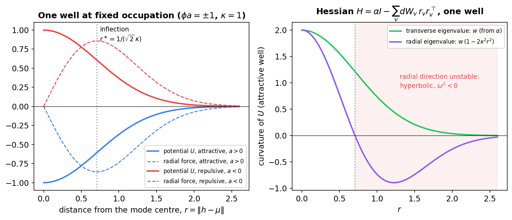
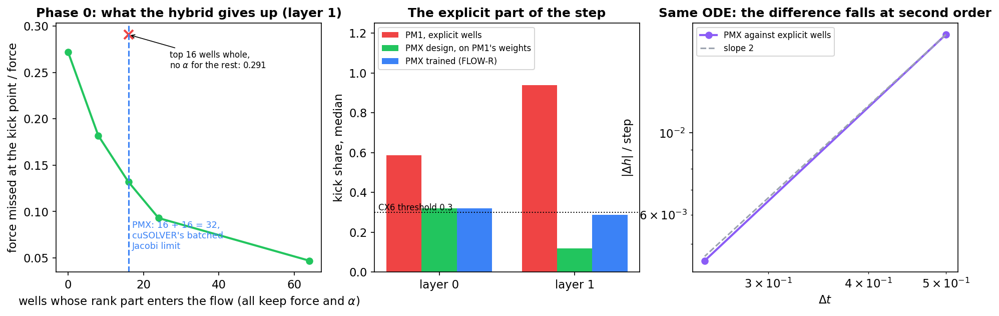
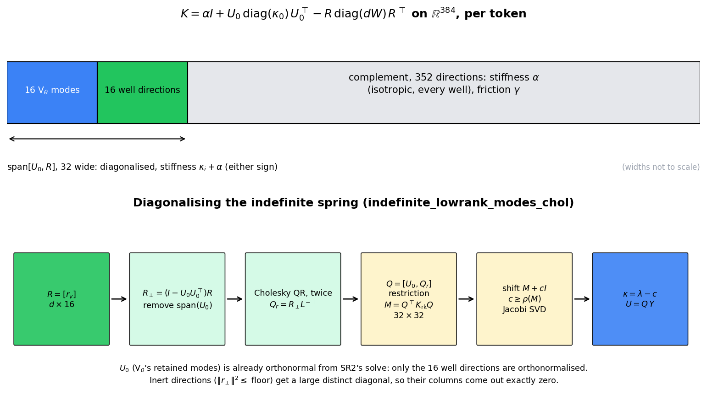
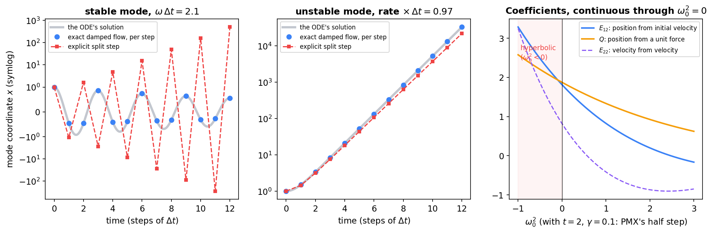
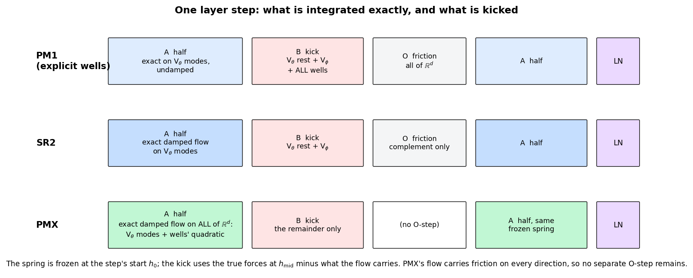
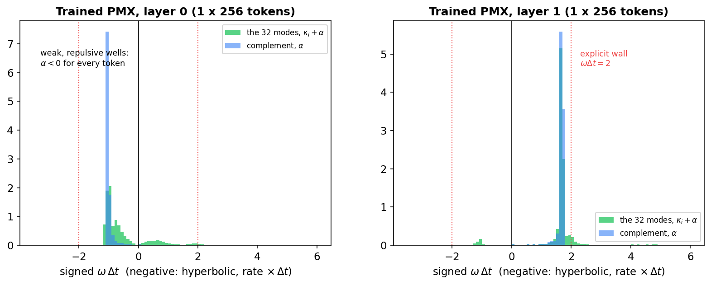

# Exact Integration of the Poisson-Mode Wells (PMX)

How the PMX models integrate the Poisson-mode wells exactly: the derivations, the numerical route and its verification. PMX is the mechanism of [`Poisson_Mode_Registers_PM1.md`](Poisson_Mode_Registers_PM1.md) (the registers, their occupations and their wells) with one change: the wells leave the explicit kick of the integrator and join the exact damped flow that SR2 introduced for V_θ's stiff modes. The force law is unchanged; only its integration differs.

The design was pre-registered and verified on 2026-10-10 (protocol [`Depth_Ladder_and_Matched_Baseline_Protocol.md`](Depth_Ladder_and_Matched_Baseline_Protocol.md) §5.15, the PMX blocks). The code is `parf/cfc_baoab.py` and the `pmx` branch of `_layer_step_langevin` in `parf/model_parf_multixi.py`; §13 maps every equation below to its function. The figures are made by [`figures/_make_pmx_exact_wells_figs.py`](figures/_make_pmx_exact_wells_figs.py).

**Notation.** The wells' potential is written $U$, as in the PM1 note; the book writes it $V_{\mathrm{pm}}$ (the book's convention that potentials are $V$'s). Token $t$, layer $l$, hidden state $h \in \mathbb{R}^d$ with $d = 384$, mass $m$ (per token), damping $\gamma = 0.1$, layer step $\Delta t = 4$. Everything below is per token and per layer, at fixed context.

## Contents

0. [Why integrate the wells exactly](#0-why-integrate-the-wells-exactly)
1. [The equation of motion and the step](#1-the-equation-of-motion-and-the-step)
2. [The wells' force and Hessian](#2-the-wells-force-and-hessian)
3. [The linear model inside a step](#3-the-linear-model-inside-a-step)
4. [Diagonalising the indefinite spring](#4-diagonalising-the-indefinite-spring)
5. [The exact damped flow on all of R^d](#5-the-exact-damped-flow-on-all-of-rd)
6. [One layer step](#6-one-layer-step)
7. [The per-layer flow](#7-the-per-layer-flow)
8. [Gradients](#8-gradients)
9. [Verification](#9-verification)
10. [What the trained model integrates](#10-what-the-trained-model-integrates)
11. [Cost](#11-cost)
12. [Results so far, and their scope](#12-results-so-far-and-their-scope)
13. [Code map](#13-code-map)

---

## 0. Why integrate the wells exactly

PM1 put the wells' force into the explicit kick of the integrator, beside V_φ. Three measurements on PM1's trained weights showed that this was the weak point.

- **The explicit part of the step was almost all of it.** At layer 1 the kick share (how far the step moves if the explicit kick is set to zero, divided by the step) was 0.94.
- **The wells sat at the explicit stability wall.** Their isotropic curvature gave ω·Δt between 2.00 and 2.18 at layer 1 (p05 to p95), and every token also had one unstable radial direction with rate × Δt about 0.97 (protocol §5.15, Phase 0). An explicit split step is stable only for ω·Δt below 2.
- **The refinement failure lived there.** Removing the layer-1 wells removed both PM1's refinement failure and its dependence on the incoming velocity (protocol §5.15, "PM1 refinement localized").

SR2 had already solved the same problem for V_θ: its stiff low-rank modes are integrated by the exact damped flow, and the kick carries only what the flow does not. PMX extends that flow to the wells. The difficulty is that the wells' curvature is **indefinite** (it has negative directions) and **acts on all of $\mathbb{R}^d$** (its isotropic part touches every direction), where V_θ's low-rank part was positive and confined to 16 directions.

---

## 1. The equation of motion and the step

Each token obeys the damped equation of motion at fixed context,

$$
m \ddot{h} = F(h) - \gamma m \dot{h}, \qquad F(h) = -\nabla_h \big( V_\theta(\xi, h) + V_\phi + U(h) \big),
$$

with V_φ's sources and the occupations frozen at their values for the step. The integrator carries a velocity through the layer stack by the implicit encoding $v = (h - h_{\mathrm{prev}})/\Delta t$, and writes $h_{\mathrm{prev,out}} = h_{\mathrm{new}} - \Delta t v_{\mathrm{new}}$ so that the next layer decodes $v_{\mathrm{new}}$.

One layer step is a splitting: an exact half-step of a frozen linear system (A), a kick with the force the linear system does not carry (B), and a second exact half-step (A), followed by the LayerNorm projection. §3 builds the linear system, §4 diagonalises it, §5 integrates it, and §6 assembles the step.

---

## 2. The wells' force and Hessian

### 2.1 Force

From the PM1 note (equations 1.3 and 1.4), the token at $t$ feels

$$
U(h) = -\sum_{v=1}^{K} \phi_v a_v e^{-\kappa_v^2 \lVert h - \mu_v \rVert^2},
$$

with $K = 64$ modes, occupations $\phi_v$ built from the strict past (tokens $s \lt t$), depths $a_v$ for this layer and widths $\kappa_v$. Write $r_v = h - \mu_v$, $E_v = e^{-\kappa_v^2 \lVert r_v \rVert^2}$ and the per-mode weight

$$
w_v = 2 \kappa_v^2 \phi_v a_v E_v .
$$

Since $\nabla_h E_v = -2\kappa_v^2 E_v r_v$, the force is

$$
F_w(h) = -\nabla_h U = -\sum_v w_v r_v .
$$

### 2.2 Hessian

Differentiate once more. The weight depends on $h$ through $E_v$, with $\nabla_h w_v = -2\kappa_v^2 w_v r_v$, so

$$
\nabla_h^2 U = \sum_v \big( w_v I + r_v (\nabla_h w_v)^{\top} \big) = \sum_v \big( w_v I - 2\kappa_v^2 w_v r_v r_v^{\top} \big).
$$

Define the isotropic curvature and the rank weights

$$
\alpha = \sum_v w_v, \qquad dW_v = 2\kappa_v^2 w_v ,
$$

so that the Hessian is an isotropic term minus a sum of rank-one terms:

$$
H_w = \nabla_h^2 U = \alpha I - \sum_v dW_v r_v r_v^{\top}.
$$

This is exact only because $\phi_v$ does not depend on $h_t$: the occupation is built from tokens $s \lt t$, so at fixed context it is a constant of the token's own coordinates. Had $\phi$ depended on $h_t$, the Hessian would carry extra terms and the force would not be a gradient in $h_t$ at all (PM1 note §4).

### 2.3 The spectrum of one well

For a single well, $H_w = w I - 2\kappa^2 w r r^{\top}$ has two eigenvalues:

- along $\hat{r} = r / \lVert r \rVert$, the **radial** one, $w(1 - 2\kappa^2 \lVert r \rVert^2)$;
- on the $d - 1$ directions orthogonal to $r$, the **transverse** one, $w$.

**Figure 1.** One well at fixed occupation, $\phi a = \pm 1$, $\kappa = 1$. Left: the potential and its radial force for an attractive ($a \gt 0$) and a repulsive ($a \lt 0$) well. Right: the attractive well's transverse and radial curvature. Past the inflection at $r^{\ast} = 1/(\sqrt{2}\kappa)$ the radial curvature is negative: a token there is on the well's outer slope, and along the radial direction the linearised motion is hyperbolic, not oscillatory.

Two consequences shape the whole design.

1. **The curvature is indefinite.** An attractive well has a negative radial eigenvalue outside its inflection; a repulsive well ($a \lt 0$, so $w \lt 0$) has negative transverse curvature everywhere. With 64 wells summed, $\alpha$ can take either sign, and so can every mode. The integrator must handle $\omega^2 \lt 0$.
2. **The isotropic part acts everywhere.** $\alpha I$ touches all 384 directions, not a low-rank subspace. Integrating it exactly means integrating every direction exactly, including friction, which is why PMX has no separate friction step (§6).

---

## 3. The linear model inside a step

### 3.1 The frozen quadratic

At the start $h_0$ of a step (in the per-layer flow, of a layer's share; §7), take the wells' force and Hessian and freeze them for the step:

$$
F_w(x) \approx F_w(h_0) - H_w(h_0)(x - h_0).
$$

V_θ's contribution is the one SR2 already integrates. Its low-rank harmonic part is exactly linear, $f_L(x) = s_L - G G^{\top} x$, and SR2 keeps its $q = 16$ stiffest modes: $U_0$ ($d \times q$, orthonormal columns) and $\kappa_0$, the top eigenpairs of $G G^{\top}$. The projection onto them is linear in $x$ with exactly that curvature, because $U_0 U_0^{\top} G G^{\top} = U_0 \mathrm{diag}(\kappa_0) U_0^{\top}$:

$$
U_0 U_0^{\top} f_L(x) = U_0 U_0^{\top} f_L(h_0) - U_0 \mathrm{diag}(\kappa_0) U_0^{\top} (x - h_0).
$$

### 3.2 The hybrid: all forces, all isotropic curvature, 16 rank parts

The exact flow is limited to a 32-wide eigensolve (§4.5). V_θ takes 16 of those directions, so the wells get 16. PMX therefore carries

- **every well's force** $F_w(h_0)$, all 64 of them;
- **every well's isotropic curvature**, through $\alpha$, which costs no eigensolve;
- **the rank part of the token's 16 strongest wells**, chosen by $\lvert w_v \rvert \lVert r_v \rVert$, the size of each well's own force term $-w_v r_v$.

With $R = [r_v]$ ($d \times 16$, the top wells) and $dW$ their rank weights, the flow carries the linear force

$$
f_{\mathrm{flow}}(x) = f_0 - K (x - h_0), \qquad f_0 = U_0 U_0^{\top} f_L(h_0) + F_w(h_0),
$$

with the frozen **spring**

$$
K = \alpha I + U_0 \mathrm{diag}(\kappa_0) U_0^{\top} - R \mathrm{diag}(dW) R^{\top}.
$$

### 3.3 The remainder goes to the kick

Whatever the linear model misses is kicked explicitly, at the midpoint $h_{\mathrm{mid}}$ of the step:

$$
f_{\mathrm{rem}}(h_{\mathrm{mid}}) = F(h_{\mathrm{mid}}) - f_{\mathrm{flow}}(h_{\mathrm{mid}}).
$$

$F$ is the true total force, with the occupations recomputed at $h_{\mathrm{mid}}$'s context. The remainder therefore holds V_θ's soft modes and its non-harmonic part, all of V_φ, the wells' nonlinearity over the step, and the rank parts of the 48 wells left out of $K$. Nothing is dropped: every force term is either in the flow or in the kick.

### 3.4 What the hybrid gives up

Phase 0 measured, on PM1's trained weights at layer 1, the force the flow misses at the kick point as a fraction of the force (protocol §5.15, PMX amendment):

**Figure 2.** Left: force missed by the frozen linear model at the kick point (median, layer 1), against the number of wells whose rank part enters $K$; every point keeps all forces and all of $\alpha$. 64 wells (80 wide, the first design) miss 0.047; the 32-wide hybrid misses 0.132; the isotropic part alone, 0.272. Keeping the top 16 wells whole but dropping $\alpha$ for the rest is worse than the hybrid (0.291). Middle: the explicit part of the step (§9). Right: PMX and the explicit wells integrate the same equation; their difference falls at second order in Δt (§6.4).

| what the flow carries | force missed |
| --- | ---: |
| every well's full quadratic (80 wide) | 0.047 |
| forces and α for all wells, rank part of the top 24 | 0.093 |
| **forces and α for all wells, rank part of the top 16 (PMX, 32 wide)** | **0.132** |
| the same with the top 8 | 0.182 |
| the top 16 wells whole, nothing else | 0.291 |
| the isotropic part only | 0.272 |

The stiffness is in $\alpha$: its ω·Δt was 2.10, against 2.18 for the stiffest direction. The rank part mostly softens directions. That is why keeping $\alpha$ for every well matters more than keeping more rank parts.

---

## 4. Diagonalising the indefinite spring

The exact flow needs the eigenvectors and eigenvalues of $K$. Write its low-rank part as

$$
K_{\mathrm{rk}} = U_0 \mathrm{diag}(\kappa_0) U_0^{\top} - R \mathrm{diag}(dW) R^{\top} = B S B^{\top}, \qquad B = [U_0 \mathrm{diag}(\kappa_0)^{1/2}, R], \qquad S = \mathrm{diag}(1, \dots, 1, -dW_1, \dots, -dW_{16}),
$$

so that $K = \alpha I + K_{\mathrm{rk}}$ and $K_{\mathrm{rk}}$ is symmetric, of rank at most 32, possibly indefinite.

**Figure 3.** Top: per token, $\mathbb{R}^{384}$ splits into the 32-wide span of $U_0$ and $R$, where $K$ has 32 eigenvalues $\kappa_i + \alpha$ of either sign, and its 352-dimensional complement, where $K$ is $\alpha I$. Bottom: the route of `indefinite_lowrank_modes_chol`.

### 4.1 An orthonormal basis of the span

$U_0$ is already orthonormal (SR2's solve returns it so). Only the wells' directions need a basis, and only their part outside $\mathrm{span}(U_0)$:

$$
R_\perp = (I - U_0 U_0^{\top}) R .
$$

**Cholesky QR.** Let $G = R_\perp^{\top} R_\perp$ ($16 \times 16$) and factor $G = L L^{\top}$. Then $Q_r = R_\perp L^{-\top}$ has orthonormal columns:

$$
Q_r^{\top} Q_r = L^{-1} R_\perp^{\top} R_\perp L^{-\top} = L^{-1} L L^{\top} L^{-\top} = I .
$$

In floating point, one pass loses orthogonality in proportion to the square of the condition number of $R_\perp$; a second pass on the output (CholeskyQR2) restores it to rounding for any condition number well below the inverse square root of machine precision. On PM1's trained states the worst condition number of $R_\perp$ was 8.7, and the two passes gave orthonormality to $8.9 \times 10^{-16}$ (§9). Columns with $\lVert r_\perp \rVert^2$ at or below $10^{-10}$ are **inert**: their Gram rows are replaced by the identity and their output columns set to zero.

Then $Q = [U_0, Q_r]$ ($d \times 32$) is orthonormal, because $Q_r$ lies outside $\mathrm{span}(U_0)$ by construction, and $\mathrm{span}(Q) \supseteq \mathrm{range}(B)$.

### 4.2 The restriction, and why it is enough

Form the $32 \times 32$ restriction

$$
M = Q^{\top} K_{\mathrm{rk}} Q = (Q^{\top} B) S (Q^{\top} B)^{\top},
$$

symmetrised in code against rounding.

**Claim.** $K_{\mathrm{rk}} = Q M Q^{\top}$.

**Proof.** $P = Q Q^{\top}$ is the orthogonal projector onto $\mathrm{span}(Q)$, which contains every column of $B$, so $P B = B$. Hence $K_{\mathrm{rk}} = B S B^{\top} = P B S B^{\top} P = Q (Q^{\top} B S B^{\top} Q) Q^{\top} = Q M Q^{\top}$. ∎

So if $M = Y \Lambda Y^{\top}$ is an eigendecomposition, then

$$
K_{\mathrm{rk}} = (Q Y) \Lambda (Q Y)^{\top}, \qquad K = \alpha I + U \mathrm{diag}(\kappa) U^{\top}, \qquad U = Q Y, \quad \kappa = \mathrm{diag}(\Lambda),
$$

with $U$ orthonormal ($Q$ orthonormal, $Y$ orthogonal). On the complement of $\mathrm{span}(U)$, $K x = \alpha x$.

### 4.3 Diagonalising an indefinite matrix with a PSD solver

The batched Jacobi SVD the GPU uses returns singular values, which are the absolute values of the eigenvalues; it cannot tell $+\lambda$ from $-\lambda$. Shift $M$ to make it positive semidefinite:

$$
M_s = M + c I, \qquad c = \max_i \sum_j \lvert M_{ij} \rvert \ge \rho(M),
$$

where the bound on the spectral radius $\rho(M)$ is Gershgorin's. Every eigenvalue of $M_s$ is then non-negative, its SVD is its eigendecomposition, and $\lambda_i(M) = \sigma_i(M_s) - c$.

Two details make the result exact and deterministic.

- **Inert directions are decoupled.** An inert column of $Q$ is zero, so its row and column of $M$ vanish. Adding a large distinct value $10c + 1$ on that diagonal entry gives it an eigenvalue far above the others and the unit vector as its eigenvector, so its mode column $Q e_j$ is exactly zero; the code subtracts that value back out of $\kappa$.
- **Degeneracies are broken.** A ramp of at most $10^{-12} c$ on the diagonal separates exactly repeated eigenvalues, so the solver's choice of eigenvectors does not depend on rounding.

### 4.4 Why it is done this way

- **Only 16 columns are orthonormalised,** not 32: $U_0$ comes from SR2's solve already orthonormal (`indefinite_lowrank_modes_split`, 2026-10-10).
- **Cholesky QR replaces a Gram SVD** for those 16 columns (`indefinite_lowrank_modes_chol`, 2026-10-11): on the GPU a batched SVD costs a fixed Jacobi tile whatever the width, so removing one saves a third of PMX's eigensolve time.
- **The operator is unchanged** by either change. The three routines agree to $10^{-12}$ in float64 on the operator, and on the model's logits to float32 rounding (§9).

### 4.5 Why 32

cuSOLVER's batched Jacobi eigensolvers handle matrices up to $32 \times 32$. The first PMX design put all 64 wells' rank parts into the spring, an $80 \times 80$ problem per token, which leaves the batched path: the first launch ran at more than 26 s per step and was stopped. 16 V_θ modes plus 16 wells is exactly 32, and the model refuses to build if `lowrank_max_modes + poisson_wells_exact_modes` exceeds it.

---

## 5. The exact damped flow on all of R^d

### 5.1 Decoupling

Inside a half-step of length $\tau$, starting from $x(0) = h$ and $\dot{x}(0) = v$, the A substep integrates exactly

$$
m \ddot{x} = f - K (x - h) - \gamma m \dot{x}, \qquad f = f_{\mathrm{flow}}(h).
$$

In the displacement $y = x - h$ this is $m \ddot{y} + \gamma m \dot{y} + K y = f$, with $y(0) = 0$ and $\dot{y}(0) = v$. $K$ is symmetric with the orthonormal eigenvectors $u_i$ (the columns of $U$), eigenvalues $\kappa_i + \alpha$, and $\alpha$ on the complement $C = \mathrm{span}(U)^{\perp}$. Projecting onto each $u_i$ and onto $C$ gives decoupled equations:

$$
\ddot{z}_i + \gamma \dot{z}_i + \omega_i^2 z_i = a_i, \qquad \omega_i^2 = \frac{\kappa_i + \alpha}{m}, \qquad a_i = \frac{u_i^{\top} f}{m}, \qquad z_i(0) = 0, \qquad \dot{z}_i(0) = u_i^{\top} v,
$$

and, for the complement component $y_C = (I - U U^{\top}) y$,

$$
\ddot{y}_C + \gamma \dot{y}_C + \frac{\alpha}{m} y_C = \frac{f_C}{m}.
$$

The complement is isotropic: every one of its 352 components obeys the same scalar equation, so it needs one set of coefficients and no basis of its own. That is what makes "exact on all of $\mathbb{R}^d$" affordable.

### 5.2 The scalar problem

Every direction reduces to

$$
\ddot{z} + \gamma \dot{z} + \omega_0^2 z = a, \qquad z(0) = 0, \qquad \dot{z}(0) = w,
$$

with constant $a$ and $\omega_0^2$ of either sign. Let $\omega_d^2 = \omega_0^2 - \gamma^2/4$, which can also have either sign, and define

$$
C(t) = \cos(\omega_d t), \quad S(t) = \frac{\sin(\omega_d t)}{\omega_d} \quad \text{if } \omega_d^2 \ge 0; \qquad C(t) = \cosh(\lvert \omega_d \rvert t), \quad S(t) = \frac{\sinh(\lvert \omega_d \rvert t)}{\lvert \omega_d \rvert} \quad \text{if } \omega_d^2 \lt 0,
$$

with $S(t) = t$ at $\omega_d = 0$. The homogeneous solutions, written as a propagator, are

$$
E_{11} = e^{-\gamma t/2}\Big(C + \frac{\gamma}{2} S\Big), \qquad E_{12} = e^{-\gamma t/2} S, \qquad E_{21} = -\omega_0^2 e^{-\gamma t/2} S, \qquad E_{22} = e^{-\gamma t/2}\Big(C - \frac{\gamma}{2} S\Big).
$$

$E_{12}$ is the solution with $z(0) = 0$ and $\dot{z}(0) = 1$, $E_{22}$ its derivative; $E_{11}$ is the solution with $z(0) = 1$ and $\dot{z}(0) = 0$, and $\dot{E}\_{11} = E_{21} = -\omega_0^2 E_{12}$.

For the constant forcing, the particular solution $a/\omega_0^2$ plus the homogeneous part that cancels it at $t = 0$ gives

$$
z(t) = E_{12} w + Q a, \qquad \dot{z}(t) = E_{22} w + P a, \qquad Q = \frac{1 - E_{11}}{\omega_0^2}, \qquad P = -\frac{\dot{E}_{11}}{\omega_0^2} = E_{12}.
$$

These expressions are analytic in $\omega_0^2$ and hold unchanged for $\omega_0^2 \lt 0$, the unstable directions of §2.3: there $\omega_d^2 \lt 0$ and the hyperbolic branch applies. They cover the underdamped, critically damped and overdamped cases with one formula.

### 5.3 Small curvature: the series

$Q = (1 - E_{11})/\omega_0^2$ cancels catastrophically when $\omega_0^2 t^2$ is small, and the complement can have $\alpha \approx 0$. There $Q$ is summed from its Taylor series instead. With $a = 1$, write $z = \sum_n c_n t^n$. The initial conditions give $c_0 = c_1 = 0$ and the equation at $t = 0$ gives $c_2 = 1/2$. Substituting into $\ddot{z} + \gamma \dot{z} + \omega_0^2 z = 1$ and matching powers of $t$ gives, for $n \ge 1$,

$$
(n+2)(n+1) c_{n+2} + \gamma (n+1) c_{n+1} + \omega_0^2 c_n = 0 .
$$

In the terms $T_n = c_n t^n$ this is the recurrence the code runs:

$$
T_{n+2} = -\frac{\gamma t (n+1) T_{n+1} + \omega_0^2 t^2 T_n}{(n+2)(n+1)}, \qquad T_1 = 0, \qquad T_2 = \frac{t^2}{2}, \qquad Q = \sum_n T_n .
$$

It is used where $\lvert \omega_0^2 \rvert t^2 \lt 10^{-4}$ and $\gamma t \lt 4$. On that branch the terms fall at least as fast as $(\gamma t + 0.01)^n / n!$, so few are needed: `series_terms_for` returns the smallest count, at least 8, that brings a term below $10^{-18}$ of $T_2$. At PMX's half-step ($\tau = 2$, $\gamma = 0.1$, so $\gamma \tau = 0.2$) that is 12 terms, identical to the 40-term sum to float64 rounding (§9). Where $\gamma t \ge 4$ with tiny $\omega_0^2$, the code uses the exact $\omega_0 = 0$ result $Q = (\gamma t - 1 + e^{-\gamma t})/\gamma^2$ or the division, whichever is more accurate.

### 5.4 Reassembly

With $z_i$ and $y_C$ advanced by §5.2,

$$
h_{\mathrm{new}} = h + U \Delta z + \Delta y_C, \qquad v_{\mathrm{new}} = U \dot{z} + \dot{y}_C .
$$

### 5.5 Why exact, and not a smaller step

**Figure 4.** Left: a stable mode at ω·Δt = 2.1, the wells' stiffness at layer 1 of PM1. The exact damped flow (blue) lands on the ODE's solution (grey) at every step; an explicit split step (leapfrog with exact friction, red) is past its stability wall at ω·Δt = 2 and grows without bound. Middle: an unstable mode at rate × Δt = 0.97, the wells' radial direction. Both follow the growth, but only the exact flow lands on the solution. Right: $E_{12}$, $E_{22}$ and $Q$ at PMX's half-step, continuous through $\omega_0^2 = 0$ into the hyperbolic regime. All three panels use the integrator's own `damped_mode_coefficients`.

A smaller explicit step would also be stable, but the layer step is the model: refining it changes the trained function (the refinement problem itself). The exact flow integrates the stiff part at the trained step with no stability limit at all.

---

## 6. One layer step

### 6.1 The splitting

With $\tau = \Delta t / 2$:

1. **Decode** $v = (h - h_{\mathrm{prev}})/\Delta t$, and build $K$ and $f_{\mathrm{flow}}$ at $h_0 = h$ (§3, §4).
2. **A, exact half-step:** advance $(h, v)$ by §5 over $\tau$ with $f = f_{\mathrm{flow}}(h)$, to $(h_{\mathrm{mid}}, v_{\mathrm{mid}})$.
3. **B, kick:** $v_{\mathrm{mid}} \leftarrow v_{\mathrm{mid}} + (\Delta t / m) f_{\mathrm{rem}}(h_{\mathrm{mid}})$, with $f_{\mathrm{rem}}$ of §3.3.
4. **A, exact half-step** with the same frozen $K$ and $f = f_{\mathrm{flow}}(h_{\mathrm{mid}})$.
5. **Project** with LayerNorm, and encode the velocity.

**Figure 5.** What each integrator treats exactly and what it kicks. PM1 kicks all the wells and applies friction in a separate O-step; SR2 integrates V_θ's stiff modes with friction exactly and applies the O-step to the complement only; PMX integrates V_θ's modes and the wells' quadratic with friction on every direction, and kicks only the remainder.

Because $f_{\mathrm{flow}}$ is linear with the curvature $K$, the two A halves are the exact flow of one linear system over $\Delta t$, interrupted at its midpoint by the impulse of the remainder. This is the impulse (RESPA, Strang) splitting $\Phi_A(\tau) \circ \Phi_B(\Delta t) \circ \Phi_A(\tau)$: second order in $\Delta t$ in the remainder, and exact when the remainder vanishes, that is, for a purely quadratic potential.

### 6.2 No friction step

Friction is inside both A flows, on every direction, for $\tau$ each: $\Delta t$ in total. Under SR2 the complement of V_θ's modes had no stiffness and was a free drift, so its friction could be applied separately (the O-step) without error. Under PMX the complement has stiffness $\alpha$, generally non-zero, so spring and friction must be integrated together, and the O-step is removed. For the same reason PMX requires zero temperature (`langevin_T = 0`): a thermostat would need an O-step.

### 6.3 Energy along the exact flow

For the A system, define

$$
\mathcal{E}(y, \dot{y}) = \frac{m}{2} \lVert \dot{y} \rVert^2 + \frac{1}{2} y^{\top} K y - f^{\top} y .
$$

Along the flow,

$$
\frac{d\mathcal{E}}{dt} = \dot{y}^{\top} \big( m \ddot{y} + K y - f \big) = -\gamma m \lVert \dot{y} \rVert^2 \le 0,
$$

for **any** symmetric $K$, indefinite included. Along an unstable direction $\mathcal{E}$ is unbounded below and the token runs downhill, but it still loses energy at exactly the friction rate. The exact flow dissipates its own energy monotonically; an explicit kick has no such identity within the substep.

### 6.4 The same equation as PM1

PM1 and PMX integrate the same equation of motion with the same forces. They differ by $O(\Delta t^2)$ per unit time. On PM1's weights, the difference between the two steps fell from $1.85 \times 10^{-2}$ to $4.50 \times 10^{-3}$ of the step when Δt was halved from 0.5 to 0.25, a ratio of 4.1 (second order; Figure 2, right). At the trained Δt = 4 they differed by 44% of the step (measured for the first, 80-wide design): this is why a model trained with one integrator is not the model trained with the other.

---

## 7. The per-layer flow

Refinement asks what happens when a layer's share of the integration time is cut into $k$ substeps. The per-layer flow (protocol §5.19) holds fixed, at the share's first substep: the context $\xi$, V_θ's low-rank quadratic, **the wells' quadratic together with its linearisation point** $h_0$, and the occupations $\phi$; and it applies LayerNorm once, at the end of the share.

The linearisation point has to be stored with the quadratic. The flow's force is $f_{\mathrm{flow}}(x) = F_w(h_0) - H_w(h_0)(x - h_0)$. Caching $F_w(h_0)$ and $H_w(h_0)$ but measuring the displacement from the current substep's start $x_{\mathrm{cur}}$ would give $F_w(h_0) - H_w(h_0)(x - x_{\mathrm{cur}})$, which is a different, wrong linear model. The model stores the quadruple and $h_0$ together in its flow context (`_flow_ctx["pmq"]`), and the refinement harness opens a fresh context at each share's first substep (`split_stack(..., pmq_freeze=True)`).

The same mechanism is the model's inference mode, `substeps_per_layer = k`. The harness's per-layer flow at $N = 4L$ reproduces it bit for bit (§9).

---

## 8. Gradients

As under SR2, the spring's modes and stiffnesses ($U$, $\kappa$, $\alpha$ in the coefficients) are detached: the eigensolve is not differentiated. Every force term is live. Gradients reach the wells' parameters through $F_w(h_0)$ and the linear force $-H_w(h_0)(x - h_0)$ inside $f_{\mathrm{flow}}$, through the remainder in the kick, and through the occupations, which carry the loss to earlier tokens (the Gen 3 live-gradient convention). The forward value of every force is the true force; only the propagation of the stiff part changes.

---

## 9. Verification

From `debug/verify_pm_wells_exact.py`, `debug/verify_pmx_split.py`, `debug/verify_pmx_fast.py` and `debug/refinement_flow_confirmation.py` (outputs beside them).

| check | result |
| --- | --- |
| switch off: PM1 and SR2 configurations, trained weights | bit-identical (eval logits, train loss, all 77 and 73 gradients) |
| coefficients for ω₀² ≥ 0 against the previous code | bit-identical on {0} ∪ [10⁻¹², 10²] |
| coefficients for ω₀² < 0 against RK4 (float64) | 1.6 × 10⁻¹³ |
| indefinite modes: reconstruction, orthonormality | 2.0 × 10⁻¹², negative modes present |
| full-space exact substep against RK4; two half-steps against one | 6.9 × 10⁻¹⁴; 6.5 × 10⁻¹⁵ |
| the quadratic's force against `poisson_mode_force` | exactly equal |
| PMX against explicit wells as Δt halves | ratio 4.1 (second order) |
| causality, tokens replaced at t ≥ 128 | logits at t < 128 unchanged exactly |
| gradients | finite, reaching every pm_ parameter |
| eigensolve width | 32, every call |
| guards | refuses without SR2, with temperature, wider than 32 |
| Cholesky QR: orthonormality, column reproduction | 8.9 × 10⁻¹⁶, 7.9 × 10⁻¹⁶ |
| worst condition number of the well directions, PM1's states | 8.7 |
| short series (12 terms) against 40 | identical to float64 rounding |
| split and Cholesky routines against the original, model level | logits 2.4 × 10⁻⁵ and 1.0 × 10⁻⁶ relative |
| per-layer flow at N = 8 against `substeps_per_layer = 4`, trained PMX | bit-identical |

**Kick share**, the explicit part of the step (median; Figure 2, middle):

| | layer 0 | layer 1 |
| --- | ---: | ---: |
| PM1, explicit wells | 0.586 | 0.938 |
| PMX design, on PM1's weights | 0.319 | 0.119 |
| PMX trained (FLOW-R, 2026-10-11) | 0.319 | 0.288 |

---

## 10. What the trained model integrates

`debug/pmx_spring_spectrum.py` records, at every exact half-step of one forward on the trained PMX weights, the spring each token carries.

**Figure 6.** Signed ω·Δt of the 32 modes ($\kappa_i + \alpha$) and of the complement ($\alpha$), one forward of 256 tokens; negative values are hyperbolic directions, plotted as minus rate × Δt.

- **Layer 0: weak, repulsive wells.** $\alpha \lt 0$ for every token, so the complement is hyperbolic, and so are most of the 32 modes (median 27 per token). Magnitudes are moderate, |ω·Δt| about 1.
- **Layer 1: stiff, attractive wells.** $\alpha \gt 0$ for every token, median |ω·Δt| 1.7, with a tail beyond the explicit wall at 2. Each token has at most one negative mode, the radial direction of §2.3 that Phase 0 found on every PM1 token.

Both regimes are what §2.3 predicts for repulsive and attractive wells, and both are integrated exactly: an explicit step would be unstable on the layer-1 tail, and inaccurate on the hyperbolic directions of both layers.

---

## 11. Cost

- **GPU:** 2.92 s per step at launch, against 1.72 for SR2, under the 3.5 s cap set before the run; peak memory 26.1 GB.
- **Where it goes** (Cell 6b-16): the batched SVD kernel costs a fixed $32 \times 16$ Jacobi tile whatever the width, so the eigensolves are about a third of PMX's overhead and the exact substeps about a quarter.
- **Mathematically identical speed-ups,** each verified (§9): the split basis (16 columns orthonormalised, not 32), Cholesky QR in place of one batched SVD, and the 12-term series at PMX's γ·τ.

---

## 12. Results so far, and their scope

PMX trained for 32,500 steps on the SR2 base (protocol §5.15, "PMX full run scored"):

- **Settled perplexity 54.63:** 6.3% better than SR2, 1.0% better than PM1, 2.8% behind the Fock model G2. The best conservative model on the ladder.
- **Gate 1, the incoming velocity reset: +91%,** down from +30,600% at the 8,000-step probe; PM1 ended at +10,600%. The momentum lock at the layer-1 wells was a mid-training state, and the exact flow has removed it.
- **Layer-1 kick share 0.288**, within the pre-registered 0.3 (PM1: 0.94).
- **Standard refinement still fails** (penalty 1.10 nats at N = 3); the per-layer flow, the architectural test (CX3), is being scored.

**Scope.** Every PMX result is for a model trained on 532.5M tokens, about 7 tokens per parameter, a third of compute-optimal. A refinement failure at this budget does not show that a fully trained PMX model cannot refine (protocol §5.19, scope caveat).

---

## 13. Code map

| equation or step | code |
| --- | --- |
| §2.1 force | `poisson_mode_force`; `poisson_mode_quadratic` returns F |
| §2.2 α, dW, r for the top wells | `poisson_mode_quadratic(h, layer, top=16)` |
| §3.1 V_θ's retained modes | `lowrank_modes` (SR2's solve) |
| §3.2 the flow's force | `_th_proj(f_L) + _pm_quad_force(h)` in `_layer_step_langevin` |
| §3.3 the remainder | `f_kick` minus the flow's force at `h_mid` |
| §4.1 basis | `_cholqr_basis` |
| §4.2–4.3 restriction, shift, inert decoupling | `indefinite_lowrank_modes_chol` (also `_split`, and the original `indefinite_lowrank_modes`) |
| §5.2–5.3 coefficients and series | `damped_mode_coefficients`, `series_terms_for` |
| §5.1, §5.4 the exact flow on all of R^d | `lowrank_iso_damped_substep` |
| §6.1 the step; no O-step | `_layer_step_langevin`, `pmx` branch |
| §7 the per-layer flow | `_flow_ctx`, `substeps_per_layer`; harness `split_stack(pmq_freeze=True)` |
| switches | Cell 0 `POISSON_WELLS_EXACT`, `POISSON_WELLS_EXACT_MODES`; tag `pmx16` |

**Related notes.** [`Poisson_Mode_Registers_PM1.md`](Poisson_Mode_Registers_PM1.md) for the registers, the Poisson-mean theorem and conservativity; [`Doi_Peliti_Dynamics_of_Semantic_Particles_and_Registers.md`](Doi_Peliti_Dynamics_of_Semantic_Particles_and_Registers.md) for why the formalism is bosonic; [`Single_Particle_Hilbert_Space_in_Semantic_Simulation.md`](Single_Particle_Hilbert_Space_in_Semantic_Simulation.md) for what a mode is; [`Two_Clustering_Mechanisms_Saturation_and_Synchronization.md`](Two_Clustering_Mechanisms_Saturation_and_Synchronization.md) §5.2–5.3 for the registers as a conservative coupling route.
