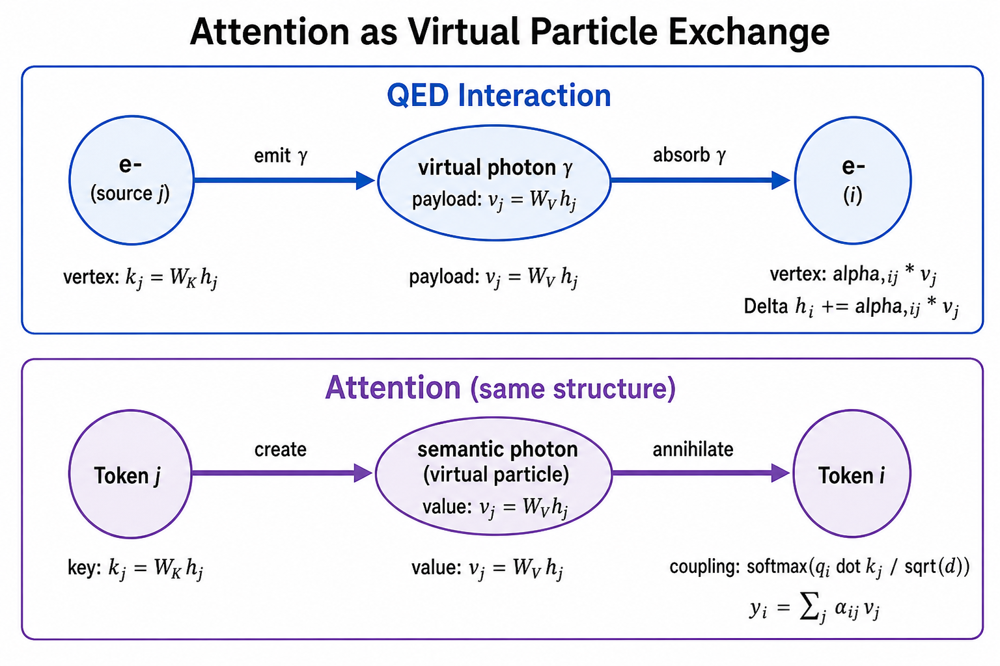
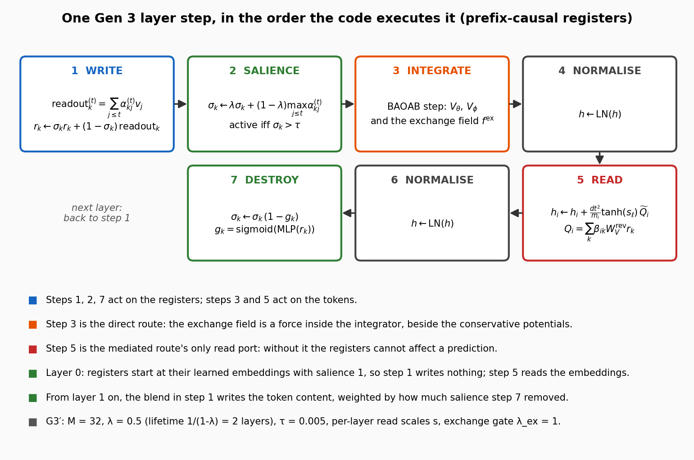
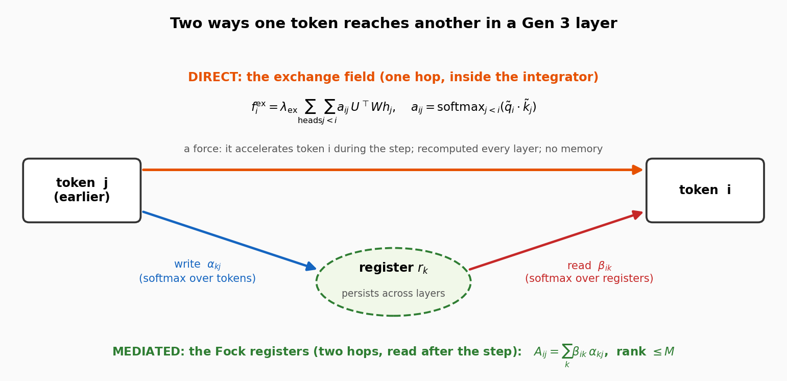
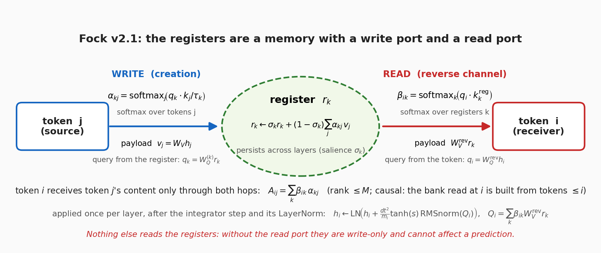
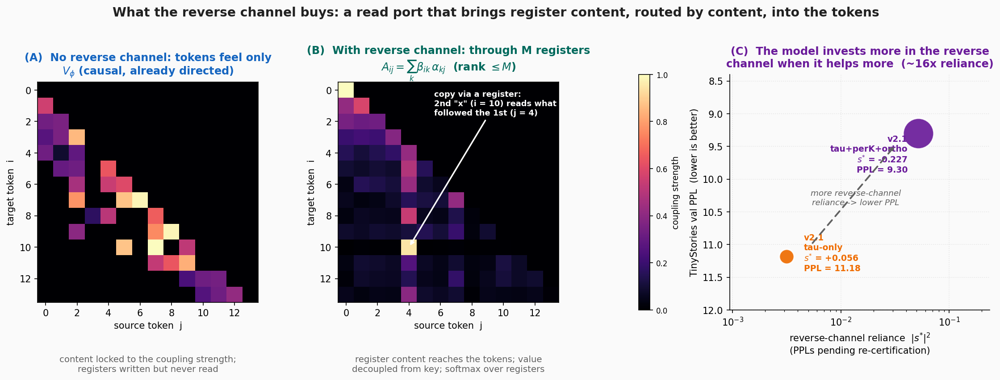
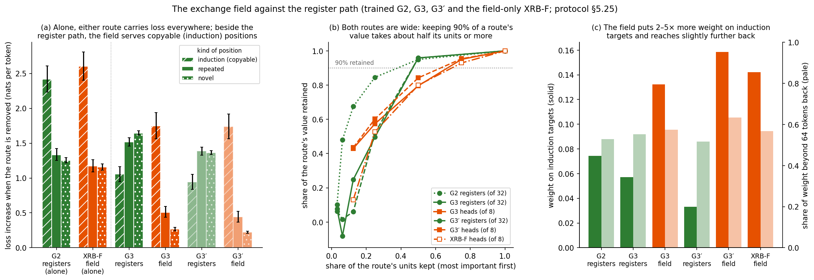
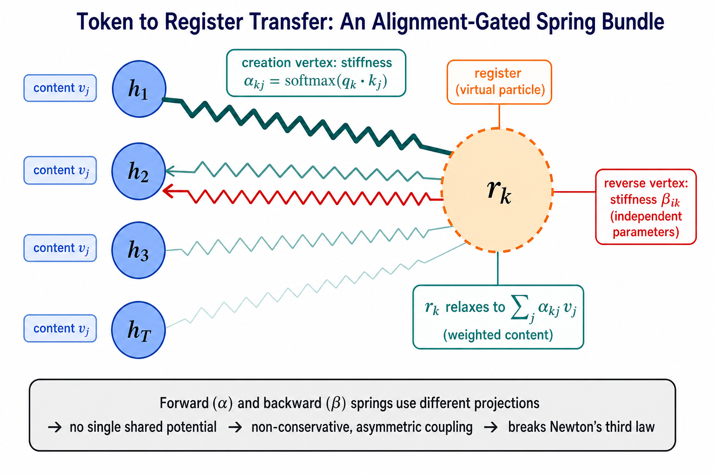
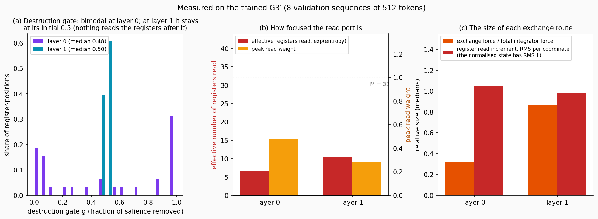

# The Fock Mechanism v2.1: Principle of Operation

**What this is.** A self-contained description of the token-to-token exchange in the current Gen 3 models: the **exchange field** and the **Fock registers** with their **reverse channel**. It covers how each works, its equations, its reading as virtual-particle exchange, and its relation to attention. It describes the code as it stands (2026-10-16) and the published configuration G3′. The history of the design, the convergence work and the conservative-obstruction proofs are in [`Improving_the_Fock_Mechanism_to_match_Attention.md`](Improving_the_Fock_Mechanism_to_match_Attention.md) and are not repeated here.

**In one paragraph.** A Gen 3 layer moves the token states by integrating an equation of motion. Tokens reach each other by two routes. The **direct route** is the exchange field: an attention-shaped force that pushes token $i$ toward a softmax-weighted combination of earlier tokens, applied inside the integrator and recomputed every layer. The **mediated route** passes through $M = 32$ registers that persist across layers. Each register **writes** a content-weighted summary of the tokens (the creation step), and each token **reads** the registers (the reverse channel). The reverse channel is the registers' only read port: without it, nothing written into them can affect a prediction. Read as particle physics, the direct route is an instantaneous exchange and the mediated route is an exchange through a long-lived intermediate particle.

## Contents

1. [Notation](#1-notation)
2. [The attention mechanism it is built to match](#2-the-attention-mechanism-it-is-built-to-match)
3. [Where the mechanism sits in a layer](#3-where-the-mechanism-sits-in-a-layer)
4. [The direct route: the exchange field](#4-the-direct-route-the-exchange-field)
5. [The mediated route: the Fock registers](#5-the-mediated-route-the-fock-registers)
6. [The reverse channel in detail](#6-the-reverse-channel-in-detail)
7. [What the reverse channel adds to expressivity](#7-what-the-reverse-channel-adds-to-expressivity)
8. [The virtual-particle interpretation](#8-the-virtual-particle-interpretation)
9. [Attention, the exchange field and the register path side by side](#9-attention-the-exchange-field-and-the-register-path-side-by-side)
10. [The trained mechanism, measured](#10-the-trained-mechanism-measured)
11. [Configurations and code map](#11-configurations-and-code-map)

---

## 1. Notation

Values are those of the published G3′ (`attention-potential-rfqk-live`), $L = 2$ layers, width $d = 384$.

| symbol | meaning | G3′ |
| --- | --- | --- |
| $h_t$ | state of token $t$ (position in semantic space) | |
| $m_t$ | per-token mass | median 0.40 |
| $dt$ | integration step per layer | 4 |
| $V_\theta$, $V_\phi$ | the one-body potential (wells placed by the context) and the pair potential | |
| $f^{\mathrm{ex}}\_t$ | exchange-field force on token $t$ | |
| $\lambda_{\mathrm{ex}}$ | exchange-field gate | fixed at 1 |
| $H$ | exchange-field heads | 8 |
| $W^{(c)}\_{\mathrm{q}}$, $W^{(c)}\_{\mathrm{k}}$, $W^{(c)}\_{\mathrm{v}}$ | query, key and value projections of exchange head $c$ (subscripts q, k, v; v is "value", not the Greek $\nu$) | each $d \to 48$ |
| $U^{(c)}$ | readout projection of exchange head $c$ (value space back to $d$) | $48 \to d$, random at initialisation (scale 0.02) |
| $d_{\mathrm{k}}$, $d_{\mathrm{v}}$ | key and value width of each exchange head | 48, 48 |
| $a^{(c)}_{ts}$ | exchange routing weight of source $s$ for token $t$, head $c$ | |
| $\eta_c$ | exchange routing temperature, head $c$ | initial 1/0.07, cap 100 |
| $M$ | number of registers | 32 |
| $r^{(t)}\_k$ | register $k$ as seen by position $t$ | |
| $\alpha^{(t)}_{kj}$ | write weight of token $j$ into register $k$, at position $t$ | |
| $\eta_k$ | write temperature of register $k$ | learned, 13 to 56, cap 100 |
| $\sigma^{(t)}\_k$ | salience of register $k$ at position $t$ | initial 1 |
| $\lambda$ | salience decay per layer | 0.5 |
| $\tau$ | activity threshold on salience | 0.005 |
| $g_k$ | destruction gate (fraction of salience removed) | |
| $\beta_{ik}$ | read weight of register $k$ for token $i$ | |
| $Q_i$, $\widetilde{Q}\_i$ | read result, before and after its output normalisation | |
| $s_\ell$ | read scale of layer $\ell$ | $\tanh(s_\ell)$ = 0.026, 0.025 |
| $w(n)$ | warm-up ramp of the read, at training step $n$ | 4,000 steps |
| $A_{ij}$ | effective influence of token $j$ on token $i$ through the registers | |

A tilde marks a normalised vector: $\tilde{q}$ and $\tilde{k}$ are the query and key scaled to unit length, and $\widetilde{Q}$ is the read result after its output normalisation. Two symbols that look alike are kept apart: $\lambda$ is the salience decay and $\lambda_{\mathrm{ex}}$ the exchange-field gate; $\sigma_k$ is a salience and $\eta$ (with any index) a softmax temperature.

## 2. The attention mechanism it is built to match

Causal self-attention updates token $i$ with a weighted combination of earlier tokens:

$$q_i = W_Q h_i, \qquad k_j = W_K h_j, \qquad v_j = W_V h_j, \qquad \alpha_{ij} = \mathrm{softmax}_{j \leq i}\left(\frac{q_i \cdot k_j}{\sqrt{d_k}}\right), \qquad y_i = \sum_{j \leq i} \alpha_{ij} v_j.$$

Three properties make it expressive, and the Fock mechanism is built to have all three:

1. **Asymmetry.** The influence of $j$ on $i$ depends on $q_i \cdot k_j$, the influence of $i$ on $j$ on $q_j \cdot k_i$. One token can attend strongly to another that ignores it.
2. **Coupling decoupled from content.** How strongly two tokens couple ($W_Q$, $W_K$) and what is transferred ($W_V$) come from separate projections. A token can be selected by one feature and contribute another.
3. **A softmax budget.** The weights over sources sum to one, so attending more to one source means attending less to the others.

**Attention as virtual-particle exchange.** In quantum electrodynamics two electrons interact by exchanging a virtual photon. The emission vertex, the propagated payload and the absorption vertex are three separate objects, as key, value and query are.

**Figure 1.** Attention read as virtual-particle exchange: token $j$ emits a quantum carrying its value, and token $i$ absorbs it with an amplitude set by the query–key match.

| QED | attention |
| --- | --- |
| charge of the receiver | query $q_i$ |
| charge of the emitter | key $k_j$ |
| payload of the virtual particle | value $v_j$ |
| vertex coupling | weight $\alpha_{ij}$ |
| $i$ absorbs from $j$ | contribution $\alpha_{ij} v_j$ to $y_i$ |
| a conserved budget | $\sum_j \alpha_{ij} = 1$ |

## 3. Where the mechanism sits in a layer

A Gen 3 layer is one step of a damped second-order integrator (BAOAB with an exact flow for the stiff part of $V_\theta$). Between layers the state is renormalised (LayerNorm). The integrator advances

$$m_t \ddot{h}_t = -\nabla_{h_t}\left(V_\theta + V_\phi\right) + f^{\mathrm{ex}}_t - \gamma m_t \dot{h}_t,$$

with $\gamma$ the friction. The exchange field $f^{\mathrm{ex}}$ is the direct route (§4). The registers act around this step (§5): they are written before it, and they are read after it, by an increment added to the positions.

**Figure 2.** One layer step, in the order the code executes it:
1. write the registers;
2. update their salience;
3. integrate the tokens, with the exchange field among the forces;
4. normalise;
5. read the registers into the tokens;
6. normalise;
7. destroy salience.

Steps 1, 2 and 7 act on the registers; steps 3 and 5 act on the tokens.

**Figure 3.** The two routes. The direct route is one hop, a force inside the integrator. The mediated route is two hops, through a register that persists across layers, and is read after the step.

## 4. The direct route: the exchange field

### 4.1 Definition

The exchange field routes each token over the earlier tokens with $H$ attention heads. Head $c$ has four projections: a query projection $W^{(c)}\_{\mathrm{q}}$, a key projection $W^{(c)}\_{\mathrm{k}}$ and a value projection $W^{(c)}\_{\mathrm{v}}$, each from the token space ($d$) to a head space of width $d_{\mathrm{k}} = d_{\mathrm{v}} = 48$, and a readout $U^{(c)}$ that maps the value space back to the token space. The subscripts q, k and v stand for query, key and value. Queries and keys are normalised to unit length (a tilde marks a normalised vector), and a learned temperature restores their range ($b_c$ is a trained parameter):

$$\tilde{q}^{(c)}_t = \frac{W^{(c)}_{\mathrm{q}} h_t}{\lVert W^{(c)}_{\mathrm{q}} h_t \rVert}, \qquad \tilde{k}^{(c)}_s = \frac{W^{(c)}_{\mathrm{k}} h_s}{\lVert W^{(c)}_{\mathrm{k}} h_s \rVert}, \qquad a^{(c)}_{ts} = \mathrm{softmax}_{s \lt t}\left(\eta_c \tilde{q}^{(c)}_t \cdot \tilde{k}^{(c)}_s\right), \qquad \eta_c = \min\left(e^{b_c}, 100\right).$$

The score of source $s$ for token $t$ is the dot product $\tilde{q}^{(c)}\_t \cdot \tilde{k}^{(c)}\_s$ of two unit vectors, which is the cosine of the angle between the query and the key. It always lies between −1 and 1, however large the weights grow. Multiplying by $\eta_c$ restores the range: the score is at most $\eta_c$ in size, and $\eta_c$ is capped at 100. A larger $\eta_c$ makes the softmax sharper, concentrating token $t$ on the earlier tokens that match best. The softmax over the earlier positions turns the scores into routing weights that sum to 1. (Plain attention, as in G3, uses the unnormalised dot product divided by $\sqrt{d_{\mathrm{k}}}$, whose size grows with the weights.)

The force on token $t$ is the routed sum of the earlier tokens' values $W^{(c)}\_{\mathrm{v}} h_s$, mapped back to the token space by $U^{(c)}$ and scaled by $1/\sqrt{d_{\mathrm{v}}}$:

$$f^{\mathrm{ex}}_t = \lambda_{\mathrm{ex}} \sum_{c=1}^{H} \sum_{s \lt t} a^{(c)}_{ts} \frac{U^{(c)\top} W^{(c)}_{\mathrm{v}} h_s}{\sqrt{d_{\mathrm{v}}}}.$$

The sum runs over strictly earlier tokens: a token does not route to itself. All four projections start random (normal, scale 0.02), so the field acts from the first training step, and the gate $\lambda_{\mathrm{ex}}$ is fixed at 1 (the `'scalar'` gate setting of these runs).

### 4.2 As a potential, at frozen routing

The field was designed as the gradient of an attention potential. With the bilinear kernel $\phi^{(c)}(h_t, h_s) = (U^{(c)} h_t) \cdot (W^{(c)}\_{\mathrm{v}} h_s) / \sqrt{d_{\mathrm{v}}}$,

$$V_{\mathrm{attn}} = -\sum_t \sum_{s \lt t} \sum_c a^{(c)}_{ts} \phi^{(c)}(h_t, h_s), \qquad f^{\mathrm{ex}}_t = -\lambda_{\mathrm{ex}} \nabla_{h_t} V_{\mathrm{attn}} \quad \text{with } a \text{ and } h_s \text{ held fixed}.$$

Two consequences follow:
- **The force does not depend on the token's own position.** The kernel is linear in $h_t$, so at frozen routing the force on token $t$ is a push set by the sources, not a spring toward them. This is exactly what attention's output is.
- **It is conservative only per token, at frozen routing.** The routing weights are recomputed from the states at every layer, and under the causal mask the sources feel no reaction. So the field as a whole is not the gradient of one potential of all the states.

With `relax_grad_path='live'` (G3, G3′) the forward value is exactly the expression above, and the training gradient also flows through the routing.

### 4.3 Relation to attention

Algebraically the exchange field is causal multi-head self-attention without the self term: the routing is a softmax over query–key cosines, the value is $W_{\mathrm{v}} h_s$, and $U^{\top}$ is the output projection. It differs in where its output goes:
- **It is a force, not a residual write.** It enters the velocity, scaled by $dt / m_t$, and passes through the friction and the harmonic flow of the integrator before it moves the token.
- **It has no memory.** It is recomputed from the current states at every layer.

In the language of §2 it is an **instantaneous** virtual exchange, emitted and absorbed within one step.

### 4.4 Settings

- **G3** routes with plain scaled dot products ($1/\sqrt{d_k}$).
- **G3′** normalises queries and keys (the $\eta_c$ form above), and trains the field's parameters in their own gradient-clipping group (clip 0.3). The clip acts on the gradients, not on the field.
- Both: $H = 8$ heads, $d_{\mathrm{k}} = d_{\mathrm{v}} = 48$, routing from the token states, all projections random at initialisation, $\lambda_{\mathrm{ex}} = 1$.

## 5. The mediated route: the Fock registers

### 5.1 The register bank

There are $M = 32$ registers, each a vector in the token space. With `prefix_causal_registers=True` every position $t$ has its own copy of the bank, $r^{(t)}\_k$, built only from tokens $1 \ldots t$. A token never sees register content derived from later tokens.

- **Initial state.** At the first layer every position starts from the same learned embeddings $r^{(t)}\_k = e_k$, with salience $\sigma^{(t)}\_k = 1$. The embeddings are initialised as $M$ mutually orthogonal directions (scale 0.02) and then trained.
- **Per layer,** three things happen to the bank: a write (§5.2), a salience update (§5.3) and a destruction (§5.3). It is read once (§6).

### 5.2 The write port (creation)

Each register queries the tokens. The query comes from the register, the keys from the tokens through the register's own key projection, and the values from the tokens through a shared projection:

$$q^{(t)}_k = W^{(k)}_Q r^{(t)}_k, \qquad k^{(k)}_j = W^{(k)}_K h_j, \qquad v_j = W_V h_j, \qquad e^{(k)}_j = \eta_k \frac{q^{(j)}_k \cdot k^{(k)}_j}{\lVert q^{(j)}_k \rVert \lVert k^{(k)}_j \rVert}.$$

The score of token $j$ uses the register's state as seen at position $j$. The write at position $t$ is a softmax over the prefix:

$$\alpha^{(t)}_{kj} = \frac{\exp e^{(k)}_j}{\sum_{j' \leq t} \exp e^{(k)}_{j'}}, \qquad \mathrm{readout}^{(t)}_k = \sum_{j \leq t} \alpha^{(t)}_{kj} v_j.$$

The code computes it as a running (cumulative) softmax, so it costs one pass over the sequence. The register then keeps a share of its old content set by its salience:

$$r^{(t)}_k \leftarrow \sigma^{(t)}_k r^{(t)}_k + \left(1 - \sigma^{(t)}_k\right) \mathrm{readout}^{(t)}_k.$$

The per-register keys give each register its own key subspace, as heads have in multi-head attention. The values are shared.

### 5.3 Salience, activity and destruction

Salience measures how strongly a register is currently held. After the write it decays toward the peak write weight:

$$\sigma^{(t)}_k \leftarrow \lambda \sigma^{(t)}_k + (1 - \lambda) \max_{j \leq t} \alpha^{(t)}_{kj}.$$

A register is **active** at position $t$ if $\sigma^{(t)}\_k \gt \tau$. Only active registers can be read. (The configuration also sets a "stack discipline": the leading block of registers sorted by salience is active. With one threshold this is the same set.) After the read, the **destruction gate** removes part of the salience of each active register:

$$g^{(t)}_k = \mathrm{sigmoid}\left(\mathrm{MLP}\left(r^{(t)}_k\right)\right), \qquad \sigma^{(t)}_k \leftarrow \sigma^{(t)}_k \left(1 - g^{(t)}_k\right).$$

**Lifetime.** Without destruction, salience forgets with a time constant of $1/(1 - \lambda)$ layers, 2 layers at $\lambda = 0.5$. The destruction gate shortens it further. A register with low salience at the next write is mostly rewritten; one with high salience mostly keeps its content.

**What this means at $L = 2$.** The first layer's write is a no-op, because salience starts at 1. Its read therefore sees the learned embeddings $e_k$. Its destruction decides, register by register, how much the second layer's write replaces. Token content enters the registers at the second layer, and is read there.

### 5.4 Keeping the registers diverse

If all registers held similar content, the bank would act as one register. Two devices prevent that.
- **Orthogonal initial embeddings** (§5.1).
- **A repulsion term** in the training loss. It penalises the mean squared cosine between active registers (of the last position's bank, at every layer), with coefficient 0.05:

$$\mathcal{L}_{\mathrm{rep}} = 0.05 \cdot \frac{1}{\lvert P \rvert} \sum_{(k, l) \in P} \left(\hat{r}_k \cdot \hat{r}_l\right)^2, \qquad \hat{r}_k = \frac{r_k}{\lVert r_k \rVert},$$

where $P$ is the set of ordered pairs of distinct active registers. Its gradient rotates each register away from its neighbours. It vanishes only when the active registers are mutually orthogonal.

**How many registers are effectively in use.** With $G_{kl} = \hat{r}\_k \cdot \hat{r}\_l$ the register Gram matrix and $\mu_i$ its eigenvalues, the participation ratio is

$$N_{\mathrm{eff}} = \frac{\left(\sum_i \mu_i\right)^2}{\sum_i \mu_i^2} = \frac{\mathrm{tr}(G)^2}{\lVert G \rVert_F^2}.$$

If every pair has the same cosine $\rho$, then $N_{\mathrm{eff}} = M / (1 + (M - 1)\rho^2)$. At $M = 32$, a modest $\rho = 0.3$ already reduces the bank to about 10 effective registers.

## 6. The reverse channel in detail

### 6.1 The read port

The reverse channel is how tokens read the registers. Each token queries the registers active at its position:

$$q^{\mathrm{rev}}_i = W^{\mathrm{rev}}_Q \mathrm{LN}(h_i), \qquad k^{\mathrm{rev}}_k = W^{\mathrm{rev}}_K \mathrm{LN}(r^{(i)}_k), \qquad u_k = W^{\mathrm{rev}}_V \mathrm{LN}(r^{(i)}_k),$$

$$\beta_{ik} = \mathrm{softmax}_{k \in \mathrm{active}(i)}\left(\eta^{\mathrm{rev}} \frac{q^{\mathrm{rev}}_i \cdot k^{\mathrm{rev}}_k}{\lVert q^{\mathrm{rev}}_i \rVert \lVert k^{\mathrm{rev}}_k \rVert}\right), \qquad Q_i = \sum_{k \in \mathrm{active}(i)} \beta_{ik} u_k.$$

The write and read ports are mirror images:

| | write port (creation, §5.2) | read port (reverse channel) |
| --- | --- | --- |
| who queries | the register | the token |
| softmax over | the tokens of the prefix | the active registers |
| what moves | token values into the register | register values into the token |
| projections | per-register queries and keys, shared values | separate queries, keys and values |
| when | before the integrator step | after it |

**Figure 4.** The write and read ports. Token $i$ receives token $j$'s content only through both hops.

### 6.2 How the read enters the token state

The read result is not a force inside the integrator. It is added to the positions once per layer, after the integrator step and its LayerNorm, and the state is then normalised again:

$$h_i \leftarrow \mathrm{LN}\left(h_i + \frac{dt^2}{m_i} w(n) \tanh(s_\ell) \widetilde{Q}_i\right), \qquad \widetilde{Q}_i = \frac{Q_i}{\sqrt{\tfrac{1}{d} \lVert Q_i \rVert^2 + 1}}.$$

Under the BAOAB integrator the outgoing velocity absorbs the increment, as the velocity change a force would produce. Its parts:
- **The output normalisation** ("soft" RMS normalisation) passes small results almost unchanged and caps large ones at unit RMS per coordinate. It bounds the increment and its gradient.
- **The scale** $\tanh(s_\ell)$ is learned separately for each layer, so each layer chooses how much to rely on the registers.
- **The warm-up** $w(n) = \min(1, n / 4000)$ opens the read gradually over the first 4,000 training steps. It equals 1 in the trained model.
- **The query and key normalisation**, with learned temperature $\eta^{\mathrm{rev}}$ (10.6 in G3′), keeps the read softmax out of saturation.
- **The pre-LayerNorm** on the inputs bounds them at the source.

None of these makes the coupling symmetric. They bound its size, not its direction.

**Its size in G3′.** With $dt = 4$, $m_i \approx 0.40$ and $\tanh(s_\ell) \approx 0.025$, the coefficient $dt^2 \tanh(s_\ell) / m_i$ is close to 1 at both layers, and $\widetilde{Q}\_i$ has RMS close to 1. The read increment is therefore comparable in size to the normalised state it is added to (§10).

### 6.3 The only read port

Nothing else in the model reads the registers:
- tokens never receive a force from register rows;
- the destruction gate reads the registers only to update their salience;
- the next-token prediction is computed from the token states alone.

**Without the reverse channel, the registers are write-only, and the whole register mechanism cannot affect a prediction.** The write port, the salience and the destruction gate matter only because this read exists.

### 6.4 What a token receives from another token

Combining the two ports gives the effective influence of token $j$ on token $i$ through the registers:

$$A_{ij} = \sum_{k} \beta_{ik} \alpha^{(i)}_{kj}.$$

It has four properties:
- **Rank at most $M$.** Every exchange passes through 32 registers. At a given position, at most 32 distinct items can be retrieved.
- **Causal.** The bank read at position $i$ is built from tokens $1 \ldots i$.
- **Persistent.** Registers carry content across layers, so a read can return content written at an earlier layer.
- **Two independent softmaxes.** $\alpha$ normalises over tokens and $\beta$ over registers, with separate projections.

This write-then-read structure through a small set of intermediate slots is known in attention architectures as induced-set attention (Set Transformer) and as pack/unpack attention (Luna). The Fock registers add persistence across layers and a salience-gated lifecycle.

### 6.5 Why the read is not the gradient of a potential

A force on the tokens is conservative only if it is the gradient of one scalar of all the token states. Then the cross-Jacobian is symmetric: $\partial Q_i / \partial h_j = (\partial Q_j / \partial h_i)^{\top}$. The read violates this for two reasons:
- **Write and read are different maps.** Token $j$ reaches token $i$ through $\alpha$ (a softmax over tokens, with creation projections) and then $\beta$ (a softmax over registers, with independent read projections). The influence of $j$ on $i$ and of $i$ on $j$ are products of different factors.
- **No back-reaction.** Reading a register leaves it unchanged: the token exerts no force on what it reads.

A layer of a Gen 3 model is therefore a damped flow under $V_\theta$, $V_\phi$ and the exchange field, followed by a non-conservative read. The geometric statements about the conservative flow (its Jacobi metric, geodesic tests) describe the integrator step. The full layer map adds the read.

## 7. What the reverse channel adds to expressivity

### 7.1 Without it

Without the reverse channel the tokens feel only the integrator's forces: $V_\theta$, the pair potential $V_\phi$ and, in Gen 3, the exchange field. The registers contribute nothing (§6.3).

The pair potential already runs under a strict causal mask. Token $i$ is pulled by earlier tokens, and they do not feel $i$, so the coupling is already directed. What the pair potential cannot do is decouple what it transfers from how strongly it couples: its push on token $i$ is the gradient of one function of $h_i$ and $h_j$. Nor does its choice of up to 16 sources have a softmax budget.

In the Gen 3 arms the exchange field supplies those two properties directly, in one hop (§4).

### 7.2 What the read port adds

1. **Register content reaches the tokens at all.** This is the precondition for anything the registers do.
2. **Memory across layers.** The exchange field is recomputed from the current states at every layer and forgets. A register written at one layer can be read at a later one, and its salience decides how long it is kept.
3. **Compression into a few slots.** The write summarises the whole prefix into at most 32 content-selected slots, and the read chooses among them with its own softmax. Each slot pools many tokens, so a token can receive a summary of tokens that are individually weak sources.
4. **Learned prototypes.** At the first layer the bank holds the trained embeddings $e_k$. The first read is then a token-dependent lookup of 32 learned vectors, a key-value memory of the kind attention models add as persistent memory vectors. It carries no information from other tokens.
5. **A different insertion point.** The read is added to the normalised positions after the step, not to the velocity during it.

In G2, which has registers but no exchange field, the read port is the model's only content-routed transfer between tokens with coupling decoupled from content.

### 7.3 Induction and copy

The canonical routing primitive is: find an earlier occurrence of the current token, and copy the token that followed it. It needs a source selected by content (a match on the current token's identity) and transferred content different from the matching feature (the identity of the following token).
- The causal pair potential is directed, but it transfers along the gradient of its coupling function. It cannot match on one feature and copy another.
- The exchange field can, in one hop. Its key and value projections are separate.
- The register path can, through memory. A register keyed on token $x$ stores what followed it, and a later $x$ reads that register. Its capacity is bounded by $M$.

**Figure 5.**
- **(A)** Without the reverse channel the tokens feel only the causal pair potential: a directed, sparse coupling whose transferred content is locked to its strength. The registers are written but never read.
- **(B)** With it, the register path $A_{ij} = \sum_k \beta_{ik} \alpha_{kj}$: causal, rank at most $M$, values decoupled from keys. A planted copy shows one register storing what followed the first occurrence of a token, read by a later occurrence.
- **(C)** In two earlier TinyStories runs, the better configuration relied more on the read. Those numbers come from training logs and are pending re-certification.

Panels A and B are illustrations, not measurements. The exchange field is not drawn.

**What has been measured.** Because the read is the registers' only port, removing it is the same as removing the register mechanism from the forward pass. On the Gen 3 two-layer model with registers and no exchange field (G2) this has been measured two ways (book, "Which coupling carries the step"):
- **Reliance.** Switched off at inference on the trained weights, the register path costs 1.49 nats: the trained network routes a great deal through it.
- **Value.** A model trained without it, everything else equal, is only 0.084 nats worse (perplexity 57.76 against 53.12).

Reliance overstates value by an order of magnitude: a model trained without the registers finds other routes. An earlier ablation from initialisation on the $d = 384$ OpenWebText pilot showed a much larger gap, but that comparison predates the causal-leak fix and the live-gradient (Gen 3) training, so only its sign is retained. The corresponding measurements for G3 and G3′, where the exchange field offers a second route, are not in that comparison.

### 7.4 The two routes compared on the trained models

The exchange field and the register path were compared on the trained G3, G3′ and G2 by switching each one off at inference and measuring where the loss rises (protocol §5.25, "XR part A"). A fourth model, XRB-F, was then trained with the field and no register read (F3.1 plus G3′'s field, same 532.5M tokens; "XR part B"). Three terms first:
- An **induction position** is one where the next token is the token that followed an earlier occurrence of the current token. Copying from earlier in the text would predict it. About 8% of positions are of this kind.
- A **novel position** is one whose next token has not occurred earlier in the text (about 51%); the rest are **repeated** positions.
- A route's **kernel** is how much weight it gives each earlier token when it updates the current one: the field's routing weights averaged over its 8 heads, and for the register path the write weights multiplied through the read weights.

**Figure 6.**
- **(a)** The loss increase when each route is removed, by kind of position. The two bars on the left are each route alone (G2's register path, XRB-F's field).
- **(b)** How much of each route's value survives when only its most important registers or heads are kept.
- **(c)** Where each route's kernel puts its weight: on the token that followed an earlier occurrence of the current token, and further than 64 tokens back.

Made by [`figures/_make_xr_figs.py`](figures/_make_xr_figs.py).

| loss increase when removed (nats per token) | induction positions | novel positions | all positions |
| --- | ---: | ---: | ---: |
| G2: register path (no field present) | 2.42 | 1.25 | 1.42 |
| XRB-F: exchange field (no register read) | 2.61 | 1.16 | 1.32 |
| G3: register path / exchange field | 1.06 / 1.75 | 1.65 / 0.27 | 1.56 / 0.52 |
| G3′: register path / exchange field | 0.94 / 1.74 | 1.36 / 0.22 | 1.34 / 0.47 |

1. **The register path is the broad channel.** It carries most of the loss at every kind of position, and removing it costs about three times as much as removing the field. It is wide: its kernel has effective rank about 30 in G2 and G3, and keeping 95% of its value takes about 16 of its 32 registers. In G3′ its rank is about 10, because half its registers keep their learned content (§10).
2. **The exchange field is a copying specialist.** Its cost is 6 to 8 times larger at induction positions than at novel ones, and its kernel puts 2 to 5 times the register path's weight on the induction targets. This is the job of attention's induction heads. It reaches slightly further back than the register path, and it needs 6 of its 8 heads to keep 95% of its value.
3. **Beside the field, the register path gives the copying up.** In G2, which has no field, the register path does it: removing it costs 2.42 nats at induction positions, twice its cost elsewhere. Beside the field that falls to about 1 nat, and the field carries the rest. With both routes removed, the cost at induction positions (2.7 to 2.9 nats) is close to G2's. The total copying ability is about the same; it is divided differently.

4. **Alone, the field becomes the broad channel too.** In XRB-F, removing the field costs about what removing G2's register path costs, at every kind of position (2.61 against 2.42 at induction positions, 1.16 against 1.25 at novel ones). Its kernel widens to match: effective rank 25 at the last layer, against 7.4 beside the registers and 29 for G2's register path. It still puts twice the register path's weight on induction targets (0.142 against 0.075). So the division of labour in points 1–3 is not built into the field. It arises when the two routes are trained together.

**What this says about the field's value.** Value is measured by training with and without a route, not by removing it from a trained model: a trained model leans on whatever route it has (removing XRB-F's field costs 1.32 nats, although training with it lowered the loss by only 0.06 nats). Trained values, as settled perplexity at L = 2:

| | no exchange field | exchange field |
| --- | ---: | ---: |
| no register read | 57.76 (F3.1) | 54.27 (XRB-F, −6.0%) |
| register path | 53.12 (G2, −8.0%) | 52.90 (G3′, −8.4%) |

1. **The field alone is a real but weaker route.** It takes the conservative core three quarters of the way the register path does (6.0% against 8.0%).
2. **Beside the registers it adds almost nothing** (0.4%). The two routes largely substitute for each other: each, alone, does most of what the pair does.
3. **Refinement.** XRB-F refines about as well as F3.1 and G3′ (Gate 3 at 1.5× the steps: +134%, against +143% and +115%), and far better than G2 and G3 (above +1,200%). The exchange field does not cause the large refinement failures.
4. **It leans on momentum.** Resetting the velocity between layers costs XRB-F +113%, against +33% to +34% for every other two-layer model, including G3′. This was not predicted and is not yet explained.

One seed per model; settled values have an evaluation spread of about ±1.

## 8. The virtual-particle interpretation

### 8.1 Two exchange processes

| | QED | direct route (exchange field) | mediated route (registers) |
| --- | --- | --- | --- |
| emitter | source charge | earlier token $s$ (key) | token $j$, through the write's key |
| emission vertex | coupling at the source | routing weight $a_{ts}$ | write weight $\alpha_{kj}$ |
| what propagates | the virtual photon | the value $W_{\mathrm{v}} h_s$, within one step | the register $r_k$, across layers |
| absorption vertex | coupling at the receiver | the same weight $a_{ts}$ | read weight $\beta_{ik}$ |
| receiver | target charge | token $t$ (query) | token $i$, through the read's query |
| lifetime | off-shell, short | zero: emitted and absorbed in one step | set by salience, about $1/(1-\lambda)$ layers |
| budget | conserved quantities | softmax over sources | softmax over tokens, then over registers |

The direct route is attention's single vertex pair. The mediated route has two vertices with independent couplings, joined by a propagating intermediate. That intermediate is what the register is.

### 8.2 The Fock-space reading

The registers are the occupied modes of a Fock space, described classically (the Doi–Peliti formalism gives a Fock-space operator algebra for classical many-particle systems without quantum superposition):

| register mechanism | Fock-space object |
| --- | --- |
| a register gains salience from a write | creation $a^{\dagger}\_k$ |
| salience removed by destruction | annihilation $a_k$ |
| the registers currently active | the occupation numbers |
| the bank as a whole | a state in $\mathcal{F}(\mathcal{H}) = \bigoplus_{n \geq 0} \mathcal{H}^{\otimes n}$ |

In the trained G3′ every register is active at every position (§10). Creation and annihilation act through salience, as continuous weights on how much a register is rewritten, rather than by switching registers on and off.

### 8.3 The write as a spring bundle

The write has a mechanical reading. Treat register $k$ as a particle tied to every token by a spring of stiffness $\alpha_{kj}$ and rest position $v_j$:

$$V_{\mathrm{create}}(r_k) = \frac{1}{2} \sum_j \alpha_{kj} \lVert r_k - v_j \rVert^2, \qquad -\nabla_{r_k} V_{\mathrm{create}} = \sum_j \alpha_{kj} v_j - r_k.$$

A light register relaxes to the force balance $r_k = \sum_j \alpha_{kj} v_j$, which is the write's readout. The softmax plays two physical roles: it sets each spring's stiffness by the query–key alignment, and it fixes the total stiffness at one.

**Figure 7.** The write port as a bundle of alignment-gated springs (teal), and the read as a separately parameterised coupling back to the tokens (red).

This is an interpretation, not the implementation. In the published prefix-causal arms the registers are not integrated as particles: the write is computed directly, and blended by salience. The read has no restoring term. It adds $\sum_k \beta_{ik} u_k$, not $\sum_k \beta_{ik} (u_k - h_i)$.

### 8.4 Where the analogy holds and where it does not

- **It holds** for the structure of the exchange: separate emission and absorption couplings, a payload distinct from both, and a budget at each vertex.
- **It does not hold** for the lifetime of the mediated route. A virtual particle is emitted and absorbed within one interaction. A register persists across layers and is blended rather than replaced, so it behaves like a real intermediate particle with a finite lifetime.
- **It does not hold** for reciprocity either. Absorption leaves the register unchanged: there is no back-reaction.

## 9. Attention, the exchange field and the register path side by side

| | causal attention | exchange field | register path |
| --- | --- | --- | --- |
| hops | one | one | two |
| who queries | the token | the token | the register (write), then the token (read) |
| softmax over | earlier tokens | strictly earlier tokens | prefix tokens, then active registers |
| content | $W_V h_j$ | $W_{\mathrm{v}} h_s$, read out by $U^{\top}$ | $W_V h_j$ into the register, $W^{\mathrm{rev}}\_V r_k$ out |
| enters the token as | a residual write | a force inside the integrator | a position increment after the step |
| memory across layers | none | none | yes, salience-gated |
| rank of the token kernel | up to $T$ | up to $T$ per head | at most $M$ |
| cost per layer | $O(T^2)$ | $O(T^2)$ | $O(T M)$ |
| state for generating one more token | all earlier keys and values, $O(T)$ | all earlier keys and values, $O(T)$ | the bank and its running sums, $O(M)$ |
| conservative | no | only per token, at frozen routing | no |

## 10. The trained mechanism, measured

**Figure 8.** Measured on the trained G3′, 8 validation sequences of 512 tokens (re-measured 2026-10-16 after a loader fix that restored G3′'s trained exchange-field temperatures; the changes are small).
- **(a)** The destruction gate.
- **(b)** How focused the read is.
- **(c)** The relative size of the two routes.

Made by [`figures/_make_fock_v21_figs.py`](figures/_make_fock_v21_figs.py).

**The register lifecycle.**
- **Layer 0.** The registers are still the learned embeddings, the same at every position, so the gate takes one value per register. It is bimodal (10th percentile 0.03, 90th 0.999): about half the registers are emptied and rewritten at the second layer, and the rest keep their learned content.
- **Layer 1.** The gate sits at 0.50 for every register, its initial value. Nothing reads the registers after the last layer, so this gate receives no gradient. At $L = 2$ the last layer's destruction has no effect.
- **Activity.** All 32 registers are active at every position, at both layers.

**The read.**
- At layer 0 the read weights have entropy 1.9 nats, about 6.7 registers read effectively, with peak weight 0.48.
- At layer 1 the entropy is 2.3 nats, about 10.4 registers, with peak weight 0.28.

The read is selective, and more so at the first layer, where it looks up the learned prototypes. The read increment has RMS 1.04 and 0.98 per coordinate, the same size as the normalised state.

**The exchange field.** It carries 32% of the integrator's force at layer 0 and 88% at layer 1 (medians of per-token force norms).

**What the synchronization tests found.** These are from [`Spontaneous_Synchronization_and_Semantic_Binding_Test_Programme.md`](Spontaneous_Synchronization_and_Semantic_Binding_Test_Programme.md) §15, §18 and §24.
- **The register read** spreads the token set apart at every layer of G2, G3 and G3′. It works slightly against the grouping of noun-chunk words.
- **The exchange field** contracts nothing. Read before any normalisation, it spreads the tokens at the second layer and binds no linguistic grouping. Its apparent contraction at the first layer was the normalisation acting on its large shared push.
- **Constituents** are grouped in these models through the context field instead, a mean-field coupling.
- **Coreference** is bound by neither route: a decoding probe finds no pronoun's antecedent above the nearest-mention baseline.

## 11. Configurations and code map

### 11.1 The published arms

| | G2 | G3 | G3′ |
| --- | --- | --- | --- |
| registers, write and read | yes | yes | yes |
| exchange field | no | yes | yes, QK-normalised routing, own gradient-clip group |
| integrator | BAOAB, exact low-rank flow | the same | the same |
| layers | 2 | 2 | 2 |

Register settings common to the three arms (G3′ values):
- $M = 32$, $d_k = 64$ for the write and the read;
- per-register keys, per-register write temperatures, orthogonal initial embeddings, salience initial value 1;
- $\lambda = 0.5$, $\tau = 0.005$;
- stable reverse channel (pre-LayerNorm, QK normalisation, soft output normalisation), per-layer read scales, warm-up 4,000 steps;
- Gram repulsion with coefficient 0.05, prefix-causal registers.

In G3′ the register mechanism has about 2.0M parameters and the exchange field about 0.6M, out of 77.4M including the embeddings.

### 11.2 Code map

| component | file | object |
| --- | --- | --- |
| layer step (write, salience, read, destroy) | `notebooks/conservative_arch/parf/model_fock_parf_multixi.py` | `FockMultiXiPARFLM._fock_layer_step` |
| initial registers and salience | same | `_init_registers` |
| activity mask | same | `_active_mask` |
| repulsion | same | `_dynamic_repulsion` |
| write port | `notebooks/conservative_arch/parf/model_fock_parf_v2.py` | `QKVCreationGate_v21.forward_prefix`, `_prefix_causal_creation_readout` |
| read port | same | `ReverseChannel` |
| destruction gate | same | `DestructionGate_v2` |
| integrator step and forces | `notebooks/conservative_arch/parf/model_parf_multixi.py` | `_layer_step`, `_layer_forces` |
| exchange field | `notebooks/conservative_arch/parf/model_xi_attention.py` | `XiRoutedConservativeAttention.force_live` |
| exchange gate | `model_parf_multixi.py` | `_relax_gate` |

---

**References.**
- A. Vaswani et al., Attention Is All You Need, NeurIPS 30 (2017).
- J. Lee et al., Set Transformer: A Framework for Attention-based Permutation-Invariant Neural Networks, ICML (2019).
- X. Ma et al., Luna: Linear Unified Nested Attention, NeurIPS 34 (2021).
- S. Sukhbaatar et al., Augmenting Self-attention with Persistent Memory, arXiv:1907.01470 (2019).
- M. Dehghani et al., Scaling Vision Transformers to 22 Billion Parameters, ICML (2023): query–key normalisation.
- M. Doi, Second quantization representation for classical many-particle system, J. Phys. A 9 (1976); L. Peliti, Path integral approach to birth-death processes on a lattice, J. Physique 46 (1985).
