# The Future of Semantic Simulation: When Second Order Earns Its Keep

**Technical Report — Companion Note for the SemSimula Mega-Paper**
**Date:** 20 October 2026
**Status:** Working draft, **revised twice on the day it was written**: after FO-b-OWT was scored (settled 61.16 against SR2's 58.32, +4.9%), and after SR3-crit was scored (critical damping, 63.28, +8.5%). The first version leaned toward an overdamped reading while FO-b led; the revisions keep the equations, say which propositions held and why the others failed, and identify the mechanism: **the oscillation of the stiff modes**.

> **Scope.** The first-vs-second-order series has two scored results: on TinyStories the first-order twin is level (FO-TS against SO-TS, −0.6%), and on OpenWebText the true first-order twin is clearly worse (FO-b-OWT against SR2, **+4.9%**), after leading for the first third of training. This note asks what the equations of the framework say about that: what each dynamics is good at, why a first-order layer starts faster and finishes behind on a diverse corpus, where second order is expected to win, and what follows for the conservative models, the Fock models, the Poisson-well models, the Riemannian geodesics and second-order inference. It ends with the tests that decide each open case and the author's calls on them.

---

## Table of Contents

1. [Where the Evidence Stands](#1-where-the-evidence-stands)
2. [The Equations](#2-the-equations)
3. [Four Propositions, from the Equations Alone](#3-four-propositions-from-the-equations-alone)
4. [Where Second Order Can Win](#4-where-second-order-can-win)
5. [The Conservative Models](#5-the-conservative-models)
6. [The Fock Models](#6-the-fock-models)
7. [The Poisson-Well Models](#7-the-poisson-well-models)
8. [Riemannian Geodesics and Second-Order Inference](#8-riemannian-geodesics-and-second-order-inference)
9. [What Changes in the Book and the Roadmap](#9-what-changes-in-the-book-and-the-roadmap)
10. [The Open Tests and the Calls](#10-the-open-tests-and-the-calls)
11. [Related Notes](#11-related-notes)

---

## 1. Where the Evidence Stands

Two kinds of first-order model exist in the ladder notebook, and they measure different things.

- **FO-a** (`FIRST_ORDER_MEMORYLESS`): the velocity is set to zero where each layer begins. The step inside the layer is unchanged, so in the stiff modes it is still an inertial flow. FO-a removes the **velocity between layers** only.
- **FO-b** (`FIRST_ORDER_OVERDAMPED`): the layer is the gradient flow of the same potential, with the stiff modes relaxed exactly. No velocity exists anywhere. FO-b removes **inertia everywhere**.

What has been measured, as of this date:

| comparison | corpus | second order | first order | status |
| --- | --- | ---: | ---: | --- |
| SO-TS against FO-TS (FO-a), settled after a 3,000-step extension | TinyStories, 266M tokens | 5.16 | 5.13 | scored: Δ = −0.6%, inside the pre-registered ±3% |
| SR2 against FO-b-OWT (FO-b), 32,500 steps | OpenWebText, 532.5M tokens | 58.32 | 61.16 | scored: Δ = **+4.9%**; FB2 (≥ +3%, called 60%) hit |
| stiffness of the wells, median ω·Δt (Cell 6b-13), same pair | OpenWebText | 7.55 | 0.74 | descriptive: the first-order model builds wells ten times softer, with the same context horizons |
| SR2 against SR3-crit (critical damping of the stiff modes, velocity between layers kept) | OpenWebText, 532.5M tokens | 58.32 | 63.28 (critically damped, second order) | scored: **+8.5%**, worse than FO-b; SC3′ (falls toward FO-b, called 25%) hit |
| SR2 against the learned per-token damping ζ(h) | OpenWebText, 532.5M tokens | 58.32 | 59.29 (second order, moderately damped) | scored: +1.7%; the model adds damping and keeps the oscillation (protocol §5.13) |
| PMX against FO-b-PMX (FO-b), 32,500 steps | OpenWebText, 532.5M tokens | 54.63 | 54.02 | scored: Δ = **−1.1%**, a tie; FBX1 (≥ +3%, called 60%) missed, FBX3 and FBX4 hit; both published in the [first-vs-second-order collection](https://huggingface.co/collections/dimitarpg13/semantic-simulation-gen-3-first-vs-second-order-6ad7681596d9a670c268b524) |
| Gate 1, the velocity reset at inference on the trained second-order weights | both | +2% (SO-TS), +3.9% (SR2) | — | reliance, not need |

Two further facts frame the discussion. First, the Stage-0 rule that predicted a first-order gap from anharmonic wells (ε ≥ 0.3) missed on its first trained test: FO-TS learns wells more anharmonic than SO-TS's (ε 4.5 against 2.6 at the output step) and matches it. Second, the FO-a model is robust to extra layers where the second-order one is not (Gate 2: +1% against +25% for one extra layer, +77% against +2,000% for six), while its standard refinement is worse (Gate 3 at N = 3: +48% against +24%), for a reason given in §3.

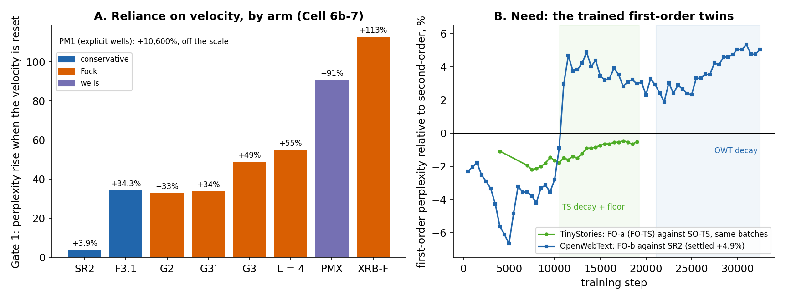

*Panel A: how much each trained second-order model loses when its velocity is reset at inference (Cell 6b-7, Gate 1). Panel B: what a model trained first-order from scratch loses against its second-order twin, on the same evaluation batches, through training. Both pairs are scored. On TinyStories the first-order lead shrank through the decay to −0.6%. On OpenWebText the first-order model led until step 10,500, stalled, fell behind at step 11,000, held about 3% behind through the constant phase, and lost more ground in the decay: SR2 gained 0.196 nats from step 21,000 to 32,500, FO-b 0.175.*

---

## 2. The Equations

One layer of the conservative architecture moves every token's hidden state $h$ for a time $T = L \cdot dt$ split into $L$ layer steps of length $dt$ (the ladder: $L = 2$, $dt = 4$, $T = 8$). The context $\xi$ is taken where the layer begins and held through the step; the potential is the learned, context-conditioned sum of the well potential and the pair potential. The force is its negative gradient:

$$
f(h) = -\nabla_h \big( V_\theta(h; \xi) + V_\varphi(h; \xi) \big) .
$$

**Second order.** The trained models integrate the damped Newton equation, with a learned mass $m$ per token and a constant damping $\gamma = 0.1$:

$$
m \ddot{h} = f(h) - m \gamma \dot{h} .
$$

The stiff part of the force, the low-rank quadratic of the wells, is integrated exactly within the step (SR2's exact damped flow); the rest is a kick. The velocity entering the next layer is $\dot{h}(T)$.

**First order (FO-b).** The same potential, followed by its gradient flow with mobility $\mu = dt / (2m)$:

$$
\dot{h} = \mu f(h) .
$$

The mobility is the overdamped limit of the Newton equation, $\mu = 1 / (m \gamma_{\text{eff}})$, with the identification $\gamma_{\text{eff}} = 2 / dt$ chosen so that a soft direction takes exactly the step a second-order layer takes from rest, $(dt^2 / 2m) f$. The stiff modes relax exactly, each by the factor $e^{-\mu \kappa dt}$ over a layer step.

**The stiff-mode picture.** In a stiff direction of stiffness $\kappa = m \omega^2$, with the well at $z^\ast$ and the step starting from rest, the two layers do this:

$$
z_{\text{SO}}(T) - z^\ast = (z_0 - z^\ast) e^{-\gamma T / 2} \cos(\omega T),
\qquad
z_{\text{FO}}(T) - z^\ast = (z_0 - z^\ast) e^{-\mu \kappa T} .
$$

The stiffest mode of a typical token in SR2 (the median over tokens of the stiffest mode, as the resonance monitor reports it) has $\omega \cdot dt \approx 6.6$, so $\omega T \approx 13$: the mode turns through two full periods inside one layer, and $e^{-\gamma T / 2} \approx 0.67$ of its amplitude survives. These two lines are the whole argument of the next section.

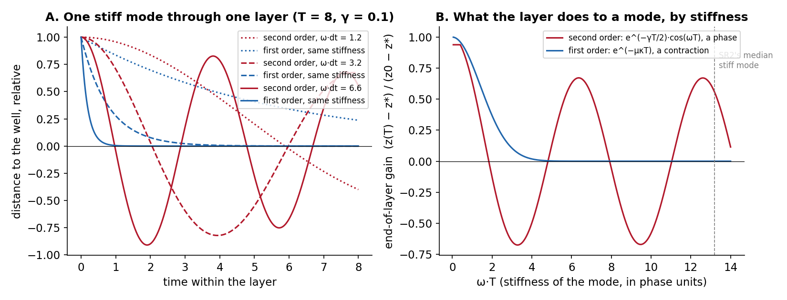

*Panel A: the distance to the well through one layer for three stiffnesses, under the second-order step (red) and the gradient flow (blue). Panel B: what the layer does to the mode as a function of its stiffness: the second-order gain is a phase, cos(ωT) under light damping; the first-order gain is a contraction, monotone in the stiffness.*

---

## 3. Four Propositions, from the Equations Alone

The corpus enters only through the learned potential $V$. The four statements below were written, in the first version of this note, as corpus-independent reasons to expect the first-order layer to be level or better. FO-b-OWT refutes that conclusion on OpenWebText, so each proposition is read again at the end of the section ("What the OpenWebText result says"): Propositions 1 and 3 stand as written; Propositions 2 and 4 are correct as mathematics but rest on premises that do not hold, and the reason they fail is itself informative.

### Proposition 1. The two layer maps have the same inputs

From rest, the second-order layer's output is a function of the layer input, the context and the layer time, $h(T) = \Phi_{\text{SO}}(h_0, \xi, T)$. The first-order layer's output is $\Phi_{\text{FO}}(h_0, \xi, T)$ with the same arguments. Neither family contains the other (the second-order step can end a token on the far side of a well, the first-order step cannot; the first-order step can contract a cloud of tokens, the second-order step cannot), so expressivity does not decide between them. What decides is how well each family's map can be learned and how robust it is. That is what Propositions 2 and 3 are about.

### Proposition 2. Light damping makes the second-order layer a rotation; the gradient flow is a contraction

In each stiff mode the second-order step multiplies the distance to the well by $e^{-\gamma T / 2} \cos(\omega T)$, a number in $[-0.67, 0.67]$ whose sign and size depend on the phase $\omega T$. The first-order step multiplies it by $e^{-\mu \kappa T}$, a number in $(0, 1]$ that falls monotonically with the stiffness. The general form is Liouville's theorem: a Hamiltonian step preserves phase-space volume, and a lightly damped one nearly does, so it cannot pull a cloud of tokens toward a well within a layer. The gradient flow can, and does so most strongly in the stiffest directions. A learned potential is built to act as an attractor on hidden states. The first-order layer uses it as one. The second-order layer, at $\zeta = \gamma / 2\omega \approx 0.03$, uses it as a rotor.

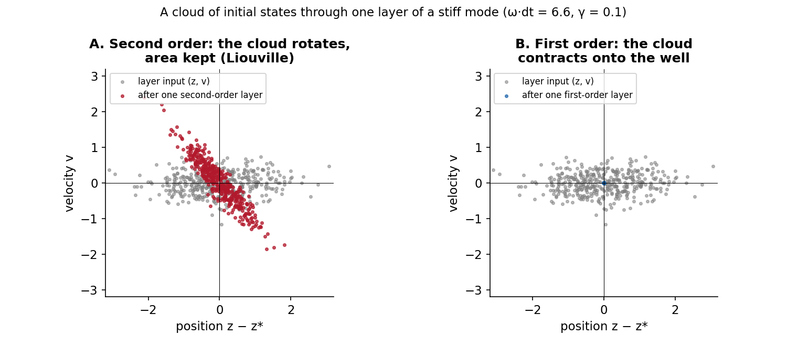

*Four hundred initial states of one stiff mode (grey) after one layer. Second order (A) rotates the cloud and keeps its area; the layer output still carries the full spread of its input. First order (B) collapses the cloud onto the well; the spread of the input is removed, which is what a denoising step is for.*

### Proposition 3. Learning the stiffness is better conditioned in the overdamped regime

The learning signal that the well parameters receive flows through the sensitivity of the output to the stiffness. In the stiff-mode picture,

$$
\frac{\partial z_{\text{SO}}(T)}{\partial \omega} \approx -T (z_0 - z^\ast) e^{-\gamma T / 2} \sin(\omega T),
\qquad
\frac{\partial z_{\text{FO}}(T)}{\partial \kappa} = -\mu T (z_0 - z^\ast) e^{-\mu \kappa T} .
$$

The second-order sensitivity alternates in sign as the stiffness moves, with a period of $2\pi / T$ in $\omega$, and its amplitude grows with the layer time. The first-order sensitivity has one sign and is bounded. In words: when the model nudges a well's stiffness, the second-order output moves in a direction that depends on where the mode's phase happens to sit, so the gradient landscape in the stiffness parameters is rugged; under the gradient flow the same nudge moves the output the same way every time. This is the resonance wall again, moved from the forward pass, where the exact flow removed it, into the learning problem, where nothing removes it.

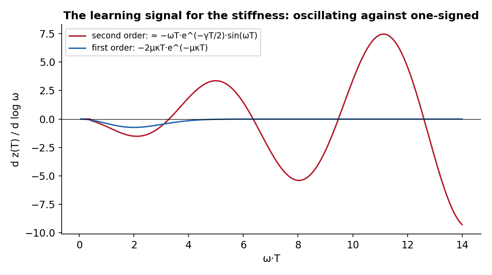

*The derivative of the end-of-layer position with respect to the logarithm of the stiffness. Under second order the sign flips every half period of ωT and the amplitude grows with T; under first order it has one sign and decays past the stiffness at which the mode is fully relaxed.*

Two measured facts follow from this proposition rather than from any property of the corpus: the first-order models are ahead from the first evaluation (step 500 on both corpora), because the easier learning problem is easier from the start; and FO-TS ends with stiffer, more anharmonic wells than SO-TS at the same perplexity, because it can move its stiffness freely.

### Proposition 4. In a piecewise-autonomous stack, the velocity at a layer boundary carries no information about the next layer's force beyond what the position carries

Each layer builds its own potential from its own context $\xi_\ell$ and its own depth code. Conditional on the position $h$ entering layer $\ell$, the force field of layer $\ell$ is independent of how the token arrived there. So

$$
\mathbb{E}\big[ f_\ell \mid h, v \big] = \mathbb{E}\big[ f_\ell \mid h \big],
$$

and the Bayes-optimal next step is a function of the position alone. The velocity does carry one thing the position does not: where the token came from, $h_{\ell - 1} = h - v dt$. Under second order that information is recoverable anyway, because the step is nearly invertible (Proposition 2); under first order it is discarded by the contraction, which is the point of the contraction.

The analogy with optimisation is exact. Momentum helps when successive gradients are correlated and hurts when each step faces a fresh landscape. A piecewise-autonomous stack is a sequence of fresh landscapes.

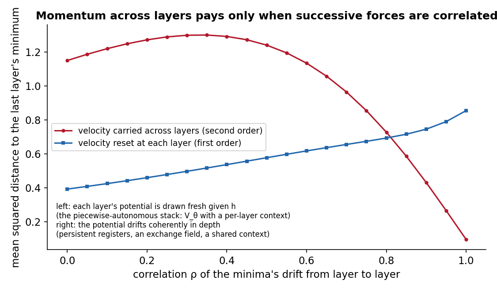

*An eight-layer stack in which every layer pulls toward its own minimum and the minima drift from layer to layer with correlation ρ. Carrying the velocity across layers (red) beats resetting it (blue) only when the drift is coherent; when each layer's minimum is drawn fresh, the carried velocity is noise. One heavy-ball step per layer, step 0.6, momentum 0.6, 400 seeds.*

### What the master inequality missed

The first-order-sufficiency chapter of the book and the corpus-statistics note bound the distance between the two dynamics' trajectories under a **fixed** potential, and predicted a gap from the anharmonicity of the wells. FO-TS refuted the anharmonicity channel on its first trained test. The reason is in Proposition 1: the potential is learned, so the right comparison is between the best map each family can learn, not between two integrators of one potential. Propositions 2 and 3 are statements about that comparison. The inequality remains correct as a bound on trajectories; it was the wrong bound for the question.

### What the OpenWebText result says about the four propositions

**Proposition 1 stands.** The two families are different function classes over the same inputs; nothing in it predicted a winner.

**Proposition 3 is correct as mathematics and fails as an explanation.** It said the oscillation makes the stiffness's learning signal change sign, so a model without the oscillation should learn faster; that was offered as the reason for FO-b's early lead (ahead from step 500, by 6.7% at step 5,000). SR3-crit tests it directly: critical damping removes the oscillation and keeps everything else, and SR3-crit did **not** learn faster than SR2; it was level to step 2,500 and behind from step 5,000. So FO-b's early lead does not come from the absence of oscillation. What else differs is the step itself: one explicit gradient step on the soft directions, with no velocity to build up, which moves a token further in the first steps of training. Whatever the cause, the early lead is a fact about optimisation speed, not about the optimum, and it ended on OpenWebText at step 11,000.

**Proposition 2 is correct mathematics with the wrong value judgement.** A lightly damped layer keeps phase-space volume, a gradient flow contracts it. The first version read contraction as the better use of an attractor. But keeping volume means **keeping information**: a rotation is invertible, so two tokens that entered a layer in different states leave it in different states, whereas a contraction merges them. Whether merging is good depends on how many distinctions the readout needs downstream. On TinyStories, a narrow corpus, few distinctions are needed and collapsing tokens onto wells costs little; on OpenWebText the next-token distribution is far broader, and the distinctions a contraction throws away are ones the readout needs. This gives the corpus a channel that the master inequality did not contain: **the value of contraction falls as the corpus's conditional entropy rises.**

**What FO-b-OWT's trained weights show.** The two OpenWebText models differ in one place only. Measured on their best checkpoints:

| reading | SR2 (second order) | FO-b-OWT (first order) |
| --- | ---: | ---: |
| settled perplexity | 58.32 | 61.16 |
| context channels' decay rates α at the end of training | 0.386, 0.521, 0.887, 0.981, 0.995 | 0.357, 0.511, 0.888, 0.992, 0.982 |
| stiffness of the wells, median ω·Δt at the endpoint (Cell 6b-13) | **7.55** | **0.74** |
| share of stiff-mode readings past the explicit-integrator wall (2.0) | 99.7% | 18.4% |
| share of the layer step carried by the kick rather than the exactly integrated quadratic (FLOW-R) | 0.37 (layer 0), 0.51 (layer 1) | 0.995, 0.967 |

Same corpus, same schedule, and the same context horizons to within a few hundredths: the context side is not where the two models differ. **The difference is in the wells: trained first order, the model builds them about ten times softer**, and in layer 1 most retained modes have almost no stiffness at all; nearly all of its movement comes from the kick, so the exactly integrated stiff quadratic does almost nothing. This is what Proposition 2's re-reading predicts. A second-order layer can use a stiff well as a rotor: the phase turns, the distinctions between tokens survive, and the well becomes a precise feature. A first-order layer cannot afford a stiff well, because a stiff mode under a gradient flow collapses every token onto its minimum within the step. So the first-order model is pushed to soft wells and gives up the expressivity that stiff modes provide; on TinyStories that costs nothing measurable, on OpenWebText 4.9%. (FO-TS on TinyStories built softer wells than SO-TS as well, ω·Δt 5.7 against 6.7, a far smaller difference, at no cost in perplexity.)

The corpus prediction stands open: the gap should grow on code and on any corpus with more distinctions per token than OpenWebText.

**SR3-crit confirms the mechanism inside one corpus.** Critical damping keeps the velocity between layers and turns every stiff mode into a contraction (a critically damped mode returns monotonically, with no overshoot). By this account it should lose what FO-b loses, and it does, more so:

| model | stiff modes | velocity between layers | settled | ω·Δt at the endpoint | per-layer flow, penalty at N = 16 |
| --- | --- | --- | ---: | ---: | ---: |
| SR2 | lightly damped, oscillating (ζ ≈ 0.03) | yes | **58.32** | 7.55 | 0.104, converged |
| FO-b | relaxed by a gradient flow | none | 61.16 | 0.74 | 0.904, not converging |
| SR3-crit | critically damped, no oscillation | yes | 63.28 | 2.06 (layer 0: 1.69, layer 1: 5.46) | 0.300, drifting |

**What the second-order model gains from is the oscillation of its stiff modes, not inertia as such.** Keeping the velocity while damping the oscillation away costs more (8.5%) than removing inertia altogether (4.9%). The stiffness readings follow: SR3-crit's wells stiffened to ω·Δt 3.1 by step 5,000 and then softened to about 2 for the rest of training, and it kept stiffness only in layer 1. And the refinement readings follow too: only the oscillating model's trained step is a close sample of a convergent per-layer flow. A critically damped stack also overshoots its trained depth badly (one extra layer costs +132%, against SR2's +35% and FO-b's +0.6%), and V_φ takes over part of the step (its share of the distance from the V_θ geodesic is −0.30, against SR2's −0.002).

**Proposition 4's premise does not hold in this architecture.** It assumed that each layer's potential is drawn fresh given the position. In the ladder's conservative core the two layers share **one** joint V_θ bank, conditioned on depth by a code, with context channels ξ that change smoothly from layer to layer, and the pair potential V_φ is evaluated on the same tokens at both layers. Successive forces are therefore correlated in depth, which is the condition (the right-hand side of the correlated-forces figure) under which a velocity carried across layers is an extrapolator and pays. The proposition remains a correct statement about a stack with independent per-layer potentials; that is not the stack that was trained. FO-a on OpenWebText (FO-OWT), now triggered, measures how much of the 4.9% this channel carries.

**In short.** The equations do not say that first order is better. They say what each dynamics is good at: the gradient flow is quick to train and denoises; the lightly damped flow turns its stiff modes and so keeps tokens distinct. Which matters more depends on the corpus: TinyStories does not reward the rotation measurably, OpenWebText does (4.9% against the gradient flow, 8.5% against critical damping). The useful second-order ingredient is the rotation, not the inertia.

### A corollary on refinement

A step from rest moves a token by about $(dt^2 / 2m) f$. So $N$ steps of length $T / N$, each from rest, move it by about $T^2 / (2 m N)$ in total: the distance covered shrinks with $N$. FO-a is therefore not a discretisation of any one flow, and its Gate 3 (+48% at N = 3) measures that mismatch, not whether the model can refine. FO-b ties its mobility to the trained step, so $N$ substeps cover one gradient flow; that was prediction FB4 of the protocol (refinement at N = 3 at most +10%, against SR2's +50%). **It missed on OpenWebText, on both tests.** The standard refinement costs +19.5% at N = 3 (half of SR2's +50%), and the per-layer flow does not converge: it sits about 0.9 nats above the trained step and moves 0.048 nats between N = 12 and 16, where SR2's converges to 0.104. The reason is the step itself: one FO-b step is first order in the step size (one explicit gradient step), so at the trained Δt = 4 it is far from the continuous flow, and the model learned to use the coarse map. Removing inertia makes extra layers harmless (one more layer costs +0.6% against SR2's +35%) but does not make the stack refinement-ready. Of the models measured, only SR2's second-order step is a close sample of a convergent per-layer flow.

---

## 4. Where Second Order Can Win

The same equations name the conditions under which inertia is not noise. Each is a failure of one proposition's premise, or of its value judgement. The first was found by the OpenWebText result and is the only one with a measurement behind it so far; the others are predictions.

**1. A broad corpus: information that a rotation keeps (Proposition 2's value judgement fails).** A lightly damped layer turns each stiff mode through a phase and keeps the distinctions between tokens; a gradient flow collapses them onto the well. When the readout needs many distinctions, as on a broad corpus, the second-order model can use stiff wells as precise features and the first-order model cannot afford them. **Measured on OpenWebText:** same context horizons, wells ten times softer under first order (ω·Δt 0.74 against 7.55), 4.9% worse perplexity; on TinyStories, a narrow corpus, no measurable cost (§3, "What the OpenWebText result says"). The prediction that follows: the gap grows with the corpus's conditional entropy, so it should be larger on code than on OpenWebText.

**2. Forces correlated across depth (the premise of Proposition 4 fails).** If the potential drifts coherently from layer to layer, the velocity is an extrapolator and momentum pays, as the right-hand side of the correlated-forces figure shows. Four things in the framework produce such correlation:

- the **shared V_θ bank** of the conservative core itself: one joint bank for both layers, conditioned on depth by a code, with context channels that change smoothly between layers. This one is present in every model of the series, so Proposition 4's premise never held for them; FO-OWT (FO-a on OpenWebText), now triggered, measures how much of the 4.9% it carries;
- the **register bank** of the Fock mechanism, which persists across layers and is injected into every layer by the reverse channel;
- the **exchange field**, a force built from other tokens' states, which varies slowly in depth when those states do;
- a **shared context** across layers (the autonomous framework of the book's appendix A1).

**3. Depth (the premise is weakest at L = 2).** With two layers there is exactly one boundary across which a velocity can carry anything. Every result in the series is the weakest possible test of memory between layers. Deeper stacks test it properly, and the stiffness oscillation of Proposition 3 compounds across layers, so depth cuts both ways.

**4. Passing through a well (Proposition 1's non-containment).** A token arriving at a well with enough kinetic energy passes through it; a token under the gradient flow is always captured. If the task sometimes needs a token **not** to be captured by a memory well it approaches, inertia is the only mechanism in the class that does it. This is where the Poisson-well models may need second order beyond what the conservative core does, taken up in §7. **Scored 2026-10-22:** FO-b-PMX matches PMX (−1.1%), so at this scale the capture mechanism earns nothing measurable; §7 gives the reading.

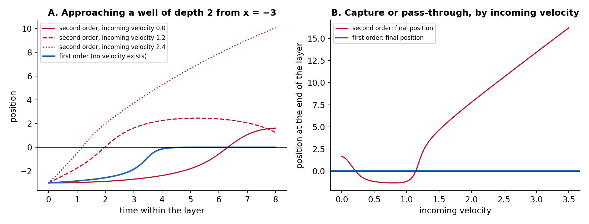

*A token approaching a well of depth 2 from the left. Under the gradient flow (blue) it is captured whatever happened before. Under second order (red) the outcome depends on the incoming velocity: captured below the escape velocity, through and beyond above it (panel B).*

**5. Sampling at T > 0.** Underdamped Langevin dynamics mixes faster than overdamped dynamics at the same temperature in many settings. If the framework ever samples hidden states rather than relaxes them, that is the one inference-time use of inertia left standing. It is a sampler's advantage, not a modelling claim.

Outside these five, the equations give second order nothing to win with. On OpenWebText the first two are present in the conservative core. SR3-crit separated them: it kept the velocity between layers (item 2) and removed the rotation (item 1), and lost 8.5%, so **the rotation carries the advantage**. FO-OWT (FO-a: the rotation inside the step kept, the velocity between layers removed) is the complementary test; the prediction from SR3-crit is that it lands close to SR2.

---

## 5. The Conservative Models

The first version of this section read the conservative core as overdamped because it seemed to satisfy every premise of §3. It does not: its layers share one V_θ bank, so its forces are correlated in depth, and on a broad corpus the information a rotation preserves is worth more than the denoising a contraction provides. The measurements now say: level on TinyStories (FO-a), **4.9% worse on OpenWebText (FO-b)**.

**On OpenWebText, at 0.5B tokens, L = 2 and d = 384, the conservative architecture is not in its overdamped regime: second order earns 4.9%.** The table below is what the overdamped reading would have meant. It remains the candidate reading for TinyStories, pending FO-b-TS, and it describes what is given up by training first order on a broad corpus:

| element | second-order reading | overdamped reading |
| --- | --- | --- |
| the layer | a damped inertial step | a gradient flow of the same potential |
| mass and damping | two parameters | one, the mobility μ = 1 / (m γ) |
| the learned mass (semantic mass) | inertia per token | mobility per token: how far a token moves per unit force |
| position-dependent damping γ(h), the roadmap item | a mechanism | position-dependent mobility μ(h), the same roadmap item renamed |
| depth as time | fragile: extra layers overshoot (Gate 2) | robust: a flow with a Lyapunov function, the potential itself, which decreases along it at fixed context |
| refinement | a coarse sample of a convergent per-layer flow (SR2) | the same, and predicted cleaner (FB4) |
| inference cost | position and velocity, a friction step | position only; cheaper and simpler |

What does not change: the potentials, the context channels, conservativity, causality, the coupling order (register read ≻ exchange field ≻ V_φ), the per-layer flow finding, and the stiffness problem. A stiff gradient flow still needs exact relaxation of its stiff modes, which is exactly what FO-b does; the CfC idea survives, the oscillation does not.

**SR3-crit answered the first open question about the conservative core:** the advantage needs the **oscillation**, not only the inertia (critical damping, 8.5% worse than SR2). **The learned γ(h)** asks the second: **where** does the model add damping to SR2's oscillation, and where does it keep it, by layer, token frequency and position. Its head was re-initialised before the run, after SR3-crit, to start near SR2's own damping (ζ = 0.005, against SR2's effective 0.026 on a typical token's stiffest mode) instead of at critical damping, the worst point measured; it can move multiplicatively either way and is capped at ζ = 10 (protocol §5.13, amendment of 2026-10-20).

**Second-order inference on first-order-trained weights** has no benefit left in either reading. The one direction measured, SR2's weights run first-order, costs ×1.33 in perplexity (PMX's ×4.1); the other direction has no reason to be kinder, and the refinement benefit the recipe was meant to buy is delivered better by the gradient flow. It stays as a one-evaluation descriptive check on the FO-b-OWT checkpoint.

---

## 6. The Fock Models

The Fock arms add, on top of the conservative core's correlated forces, the strongest cross-layer state in the framework. With the conservative core already earning 4.9% from second order on OpenWebText, the Fock arms, which lean on velocity far more, are now expected to need it too; FO-b on them is less informative than it was, and has moved down the queue.

The register bank persists across layers; the reverse channel injects it into tokens at every layer; the exchange field is a cross-token force. All three correlate successive forces in depth, on top of the shared V_θ bank that already does so in the conservative core (item 2 of §4), which is the condition under which momentum across layers can help. The reliance measurements agree with that reading: the velocity reset costs the conservative SR2 +3.9%, the Fock arms +33% to +55%, and XRB-F, the arm with a cross-token field and no register read to replace it, +113%.

But reliance is not need. Any state variable present during training can be loaded with information, whether or not a first-order model could have put the same information in the position. The one case with both readings, SR2 on TinyStories, went from +2% reliance to zero need. And a large Gate 1 can be an integrator artefact rather than a sign of correlated forces: F3.1, with no register path to the tokens, reads +34%, ten times SR2's, with the same forces and the same γ. G2 and G3′ on the F3.1 integrator read the same +33–34%, so at L = 2 the Fock mechanism added no reliance on top of the integrator's. That leaves the exchange field's +113% as the one reading the integrator does not explain.

Three outcomes, and what each would mean:

- **The Fock arms are first order too** (FO-b-G3′ level with G3′). Then the whole framework is overdamped at this scale, and the register bank is a first-order memory: a Hopfield-like store read by a gradient flow. The book's spine becomes "potential-driven semantic dynamics in the overdamped regime", with the Fock mechanism as its memory.
- **XRB-F needs it, G3′ does not.** The velocity stands in for the register read when the read is absent, and the register read is the better instrument. Second order is a workaround for a missing memory path, not a mechanism. The framework stays overdamped; the exchange field's design note gains a paragraph.
- **G3′ needs it.** Inertia earns its keep where cross-layer state exists. The framework becomes two-regime: overdamped tokens in the conservative core, inertial where the register path correlates forces across layers. That is a more interesting book, and the geodesic chapter keeps its original object for those arms.

The author's calls, revised after FO-b-OWT: a real gap on FO-b-XRB-F at about 75% (first version: 50%), on FO-b-G3′ at about 70% (first version: 35%). The first outcome above is now the least likely.

---

## 7. The Poisson-Well Models

The Poisson-mode registers (PM1, PMX) add memory wells to the potential: attractors placed by past tokens, with depths and half-lives. They are the component of the framework where the equations give second order a mechanism of its own beyond the conservative core's, item 4 of §4.

**The capture argument.** A gradient flow is always captured by a well it enters. A token with inertia passes through a well if its kinetic energy exceeds the well's depth. If the task sometimes needs a token to approach a memory and not be bound by it, the second-order model has that option and the first-order model does not; the first-order model would have to make the well shallower for everyone, or move it.

**What the measurements say so far.** PMX at its step-8,000 probe showed a momentum lock at the layer-1 wells, +30,600% on Gate 1: the step balanced the incoming velocity against the wells' pull. By the end of training that reliance had fallen to +91%, so exact integration removed most of it. Under FO-a its trained weights lose ×1.82, under FO-b ×4.1, far more than SR2's ×1.03 and ×1.33: PMX's trained weights lean on inertia more than any arm on the SR2 base. None of that is need. FO-b-PMX, pre-registered with predictions FBX1–FBX4 (a gap of at least 3% called at 60%), measures need.

**A first-order well model is a known object.** With the wells integrated by a gradient flow, PMX becomes a context-conditioned Hopfield network with dynamic, decaying memories: tokens relax toward the memories placed by past tokens. That is a legible position in the literature, and the exact relaxation of indefinite modes (a negative stiffness grows as $e^{\mu |\kappa| t}$ over the step) is what makes it well-posed. One risk is pre-registered as FBX4: the unstable well directions that the damped oscillator contains may grow unchecked without inertia.

**The call, and the score.** FBX1 at 60% was the series' highest call for a second-order gap when it was made, raised to about 75% after FO-b-OWT. **Scored 2026-10-22: FO-b-PMX settled at 54.02 against PMX's 54.63, −1.1%, a tie on any plausible seed spread; FBX1 and FBX2 missed, FBX3 (the wells help a first-order model: −11.7% against FO-b-OWT) and FBX4 (stable) hit** (protocol §5.13). The realised branch of §10's diagram is "no gap: the wells are a first-order memory". The capture argument above is refuted at this scale as a source of perplexity: whatever a token gains by passing through a well, the first-order model made up by other means. What those means are is the subject of the rest of this section.

### 7.1 Two memories

Three things carry information forward in these models, and the result above is about the relation between them.

| what | carries | across |
| --- | --- | --- |
| the velocity between layers | a token's own previous position: the step is a two-term recurrence, h(ℓ+1) = Φ(h(ℓ), h(ℓ−1)) | depth: one layer boundary at L = 2 |
| the rotation of the stiff modes inside a step | the distinctions between tokens, which a contraction would merge (Proposition 2) | one layer step |
| the Poisson-mode wells | the context: n̄ᵥ(t) = Σ_{s<t} λᵥ^(t−1−s) Eᵥ(s), an exponentially weighted trace of earlier tokens' overlaps with each mode | the sequence, at learned half-lives of 3–20 tokens |

The first two are the **implicit memory** of a second-order step. They remember the token's *own* past, as linear maps that carry whatever the state holds, with no addressing and a retention set by the damping: the velocity keeps $e^{-\gamma_0 \Delta t} = 0.67$ per layer, a stiff mode keeps $e^{-\gamma_0 \Delta t / 2} = 0.82$ of its amplitude per step and the share $e^{-\gamma_i \Delta t}$ of its phase-space area, where the gradient flow contracts the same mode by $e^{-(\omega_i \Delta t)^2 / 2}$, to nothing at the stiffest modes. Momentum in an optimiser is the same object, a decaying memory of past gradients. The wells are the **explicit memory**: of *other* tokens' pasts, addressed by content (a token deposits in the modes it overlaps and is pulled by the wells it is near), stored as $K = 64$ numbers per position, and acting through a force. They differ in substrate and in what they store; they agree in function, state that survives from one step to a later one and biases it, and both decay at a rate the model sets.

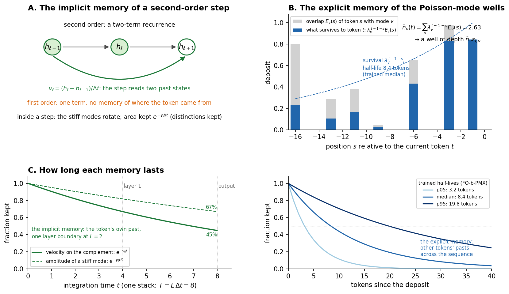

*A. The second-order layer map reads two past states; inside a step the stiff modes rotate and keep their phase-space area. B. A mode's occupation is a decaying trace of earlier tokens' overlaps, here at the trained median half-life of 8.4 tokens. C. Retention of the implicit memory through one stack at γ₀ = 0.1. D. Retention of the explicit memory at the trained half-lives.*

### 7.2 The memory-substitution hypothesis

**The perplexity advantage of second order in the conservative core is the advantage of a memory. Where the architecture supplies an explicit memory that carries at least the information the implicit one carried, the implicit memory is redundant and the advantage disappears.** The claim is about function, not mechanism: the rotation keeps tokens apart within a step, the wells feed each token the context of earlier positions, and both supply information the readout needs; the hypothesis says that at this scale the wells supply it as well or better.

**What supports it now.**

- The gap closes with the wells: +4.9% without them, −1.1% with them. The wells help the first-order model twice as much (11.7% against 6.3%), as substitution predicts: it lacked a memory, the second-order model had one.
- The gain on the core was the rotation (SR3-crit), the within-step part of the implicit memory.
- Reliance is not need: resetting the velocity costs PMX +91% and SR2 +3.9%, yet PMX's first-order twin matches it.
- The first-order model built its memory from attractive wells (Cell 6b-15): 64% and 61% of its depths are positive, medians +0.03 and +0.07, where PMX's are balanced (50%, 48%; medians at zero) with a repulsive tail at layer 1 twice as deep. A gradient flow is captured by every attractive well it enters; a token with inertia can pass through, and PMX uses repulsive wells as much as attractive ones. The half-lives are the same (medians 8.4 and 9.1 tokens): the two models remember over the same horizons and differ in how the memory acts.
- The explicit memory frees the model from the momentum lock: one extra layer costs FO-b-PMX +0.3% and PMX +956%; refinement at three steps 0.67 nats against 1.10.

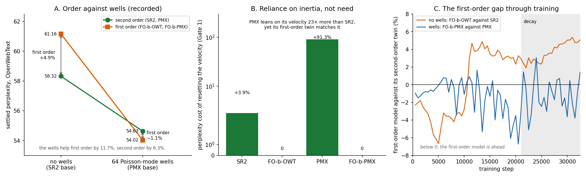

*A. Settled perplexity of the second-order models and their first-order twins, without and with the wells. B. The cost of resetting the velocity at inference (Gate 1). C. The first-order model against its second-order twin through training, on both bases; the shaded region is the learning-rate decay.*

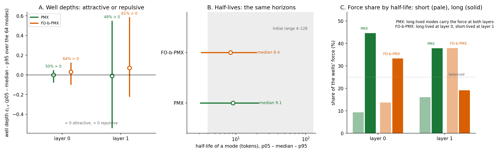

*Cell 6b-15 on the best checkpoints. A. Well depths over the 64 modes: the first-order model's are attractive by a majority. B. Half-lives: the same horizons. C. The share of the wells' force carried by the shortest-lived and longest-lived quarter of the modes.*

**What it would mean.** If it holds for scaled and fully trained models on other corpora, it answers the book's question, when does second order matter, with a mechanism: when it is the only memory the model has. The design rule reads the other way, spend the architecture on memory and let the integrator be first order, and it places the transformer: attention is an explicit, content-addressed memory followed by a first-order residual update, and a substitution of this kind is why that combination needs no inertia.

**What it does not yet show.** One seed, 0.53B tokens, L = 2, one corpus. In three of the four pairs the second-order arm gained more in the learning-rate decay, and PMX closed a 5.1% deficit in it, so a longer run could reopen a gap. The sharpest test, an explicit memory read by a non-conservative channel (the Fock register path), has not run; the §6 call of 2026-10-20 (G3′ needs second order, about 70%) predicts the opposite of substitution there, and stands on record.

### 7.3 The tests (MS1–MS7, protocol §5.13)

| id | test | substitution predicts | called |
| --- | --- | --- | ---: |
| MS1 | the seed spread (SR2, seed 1) | below 2% | 65% |
| MS2 | dose-response: pairs at K = 16 and 256 modes, against K = 0 and 64 | the gap falls with K and is within the seed spread from K = 64 | 60% |
| MS2′ | Cell 6b-15 along the dose | the first-order arm's wells grow more attractive and carry more force as K rises | 55% |
| MS3 | SR3-crit on PMX | within 2% of PMX (it cost 8.5% without wells) | 55% |
| MS4 | the 2B pair with wells | the tie holds at 2B tokens | 50% |
| MS5 | a code corpus, with and without wells | a gap without wells, none with them | 45% |
| MS6 | L = 4 with wells | the tie holds at L = 4 | 45% |
| MS7 | FO-b-G3′ against G3′ | a match within 2% | 55% |

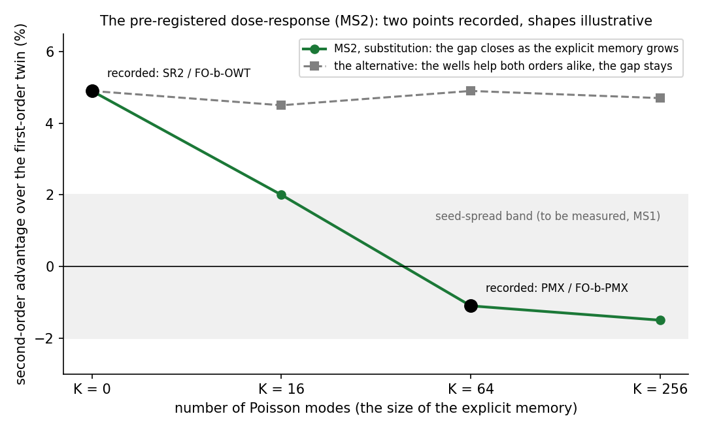

*MS2: the second-order advantage against the number of modes. Two points are recorded; the two shapes are what substitution and its alternative predict for the others.*

---

## 8. Riemannian Geodesics and Second-Order Inference

**Geodesics, after FO-b-OWT and SR3-crit.** On OpenWebText the conservative core is not only inertial: its advantage comes from the lightly damped, oscillating motion of the stiff modes, the regime in which tokens' paths are damped Jacobi geodesics in the original sense. The geodesic chapter keeps its object there, and the rotation reading of §3 gives it a job: a geodesic through a stiff well is a rotation that keeps tokens distinct. The paragraphs below describe what would replace geodesics in an overdamped regime; they apply to TinyStories if FO-b-TS comes out level, and to any token a learned γ(h) moves to the overdamped end.

A geodesic is the natural path of an inertial particle. In the overdamped regime the natural path is the steepest-descent line of the layer's potential in the metric set by the mobility, $\dot{h} = -M^{-1} \nabla V$ with $M$ the mass (or inverse-mobility) tensor. The two coincide only in special cases. So the geodesic residual of the book's Riemannian chapter and E1 ("is the layer step a damped V_θ geodesic?") measured the distance to a reference curve the overdamped model does not follow. Their first-order successor already exists: the per-layer flow test, which measures the distance from the trained step to the V_θ gradient flow, and which SR2 passes on both corpora (a limit 0.104 nats above the trained step on OpenWebText, 0.097 on TinyStories).

What survives: the metric, with a changed role. The learned mass becomes the metric of a Riemannian gradient flow, and the curvature along a trajectory is set by the Hessian of the potential, which is the anharmonic-fraction measurement M1. The Riemannian chapter keeps its mathematics and gains a second reference curve. For the Fock arms, if G3′ turns out to need inertia (§6), the geodesic reading keeps its original object there.

Depth matters more after this, not less. Trajectory geometry across layers (forecastability, sparse forcing, how the path turns) is only visible with several layers, and those readings stay meaningful for a gradient flow. Only the geodesic null model goes.

**Second-order inference.** No benefit is left for deterministic evaluation (§5). The remaining use of inertia is as a sampler at T > 0, where underdamped Langevin mixes faster. If the framework samples, inertia returns there, as a tool.

---

## 9. What Changes in the Book and the Roadmap

**The book, after FO-b-OWT.** The second-order spine stays, and is now supported on the broad corpus. What changes is smaller than the first version of this section estimated: the first-order-sufficiency chapter is scored (its master inequality predicted an OpenWebText gap from anharmonicity; the gap appeared, the anharmonicity channel did not explain it, and the information-preservation and correlated-forces channels of §3's revision do); the Riemannian chapter adds the overdamped reference curve as the limit case and as the TinyStories reading if FO-b-TS is level; and the claim gains a scope sentence: second order earns its keep on broad corpora, not on narrow ones. The first version's estimate below assumed the spine would change; it is kept for the record and no longer applies.

First version of this paragraph: the second-order theory stays as the general case; the four propositions give the reason the operating regime is overdamped for this architecture under any corpus; the two corpora become the confirmation rather than the proof. On the current PDF, 277 of 545 pages mention a geodesic, inertia, momentum, velocity or second order. About 60–80 pages need their interpretation rewritten (the Riemannian chapter, the geometric value proposition, position-dependent damping as mobility, the Lagrangian's overdamped limit promoted to the operating regime, the first-order-sufficiency chapter scored, the conclusion and front matter); about 100 need a scope sentence; about 270 are untouched. No measured number changes. The edit waits for FO-b-OWT and FO-b-PMX, because the Fock and well arms decide whether the rewrite says "the conservative architecture is overdamped" or "the framework is overdamped".

**The roadmap.** The following diagram shows how the open runs decide the framework's shape.

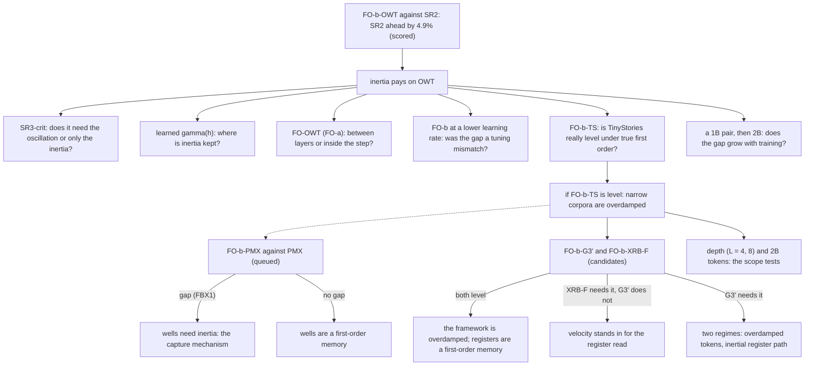

---

## 10. The Open Tests and the Calls

| test | what it decides | cost | the author's call |
| --- | --- | ---: | --- |
| FO-b-OWT against SR2 | the conservative core on OpenWebText | 10 h | **scored: +4.9%, FB2 hit** (called 60% before the run) |
| SR3-crit on SR2 | oscillation or inertia | 10 h | **scored: +8.5%, the oscillation is the mechanism**; SC3′ (falls toward FO-b, called 25%) hit, SC4 hit, SC5 missed |
| learned γ(h), conservative core, started near SR2 | where damping is added to the oscillation | 10 h | **scored: 59.29, +1.7%; median ζ 0.56 and 0.36; GH7 hit, GH6, GH8, GH9 missed** (protocol §5.13) |
| FO-OWT (FO-a), now triggered | between layers or inside the step | 10 h | FO-a closes at least half of FO-b's gap, 55% (after SR3-crit: lands within 2% of SR2, 60%) |
| FO-b-OWT at learning rate 8e-4 | a hyperparameter mismatch | 10 h | closes less than a third of the gap, 65% |
| a 1B pair (SR2-1B, FO-b-1B) | the trend with training | 40 h | the gap at 1B is larger than at 0.5B, 55% |
| SR2 rerun with the speed switches, seed 1 | the seed spread | 10 h | now first in the queue (MS1): the γ(h) +1.7% and the FO-b-PMX −1.1% both need it; spread below 2%, 65% |
| FO-b-TS against SO-TS | the TinyStories half of true first order | 5 h | level, 60% (first version: 75%) |
| FO-b-PMX against PMX | the wells' capture mechanism | 14 h | **scored: −1.1%, a tie; FBX1 (called 60%, then 75%) and FBX2 missed, FBX3 and FBX4 hit** |
| the memory-substitution programme, MS1–MS7 (§7.3) | whether the second-order advantage is the advantage of a memory | 10–80 h each | the dose-response MS2 at 60%; SR3-crit on PMX within 2% at 55%; the seed spread below 2% at 65% |
| FO-b-G3′ against G3′ | the register path | 14 h | a gap, 70% |
| FO-b-XRB-F against XRB-F | the exchange field without the read | 10 h | a gap, 75% |
| SO/FO-b on a code corpus | a third corpus; the information-preservation channel predicts a larger gap than on OpenWebText | 10 h | a gap larger than OpenWebText's, 50% |
| a deeper pair (L = 4 or 8) | memory across several boundaries | 20–40 h | a gap grows with depth, 40% |
| the 2B pair (SR2-2B, FO-b-2B) | the budget | 80 h | decided after the 0.5B results |

The scope line for the claim as it stands: at 0.5B tokens, L = 2, d = 384, one seed, for the conservative-only architecture, second order earns 4.9% on OpenWebText and nothing measurable on TinyStories (FO-a there; FO-b-TS pending); with 64 Poisson-mode wells it earns nothing measurable on OpenWebText either (§7).

---

## 11. Related Notes

- [The Overdamped Limit and the Position of the Second-Order Lagrangian Framework](The_Overdamped_Limit_and_The_Position_of_The_2nd_Order_Lagrangian_Framework.md): the formal reduction from the Newton equation to the gradient flow, and the mobility.
- [Corpus Statistics and the First- vs Second-Order Well Gap](Corpus_Statistics_and_the_First_vs_Second_Order_Well_Gap.md): the master inequality and the three corpus channels, now read as a bound on trajectories under a fixed potential.
- [First-Order vs Second-Order Dynamical Systems](First_Order_vs_Second_Order_Dynamical_Systems.md) and [Replacing the Conservative Mechanism of SPLM with First Order](Replacing_The_Conservative_Mechanism_of_SPLM_with_First_Order.md): the Gen 1 first-order work and its null.
- [Composing Single-Layer Inferences: Flow or Maps](Composing_Single_Layer_Inferences_Flow_or_Maps.md): Cell 6b-7's gates and the per-layer flow.
- [Exact Integration of Poisson-Mode Wells (PMX)](Exact_Integration_of_Poisson_Mode_Wells_PMX.md) and [Poisson-Mode Registers (PM1)](Poisson_Mode_Registers_PM1.md): the well models.
- [Exploiting the Riemannian Geometry of Conservative Language Models](Exploiting_the_Riemannian_geometry_of_conservative_language_models.md) and [Damped Riemannian Geodesics in the SPLM Family](Damped_Riemannian_Geodesics_in_the_SPLM_family-Comparative_Analysis.md): the geodesic programme whose reference curve this note re-scopes.
- [Depth Ladder and Matched Baseline Protocol](Depth_Ladder_and_Matched_Baseline_Protocol.md), §5.13: the FO series' pre-registrations (FO-a, FO-b, FO-b-PMX), amendments and scored results.
- [Hyperparameter Tuning Checklist](Hyperparameter_Tuning_Checklist.md): the GPU queue and the candidate runs of §10.

The figures are produced by `figures/_make_future_second_order_figs.py`; every dynamical panel is an exact simulation of the equations in §2 with the ladder's constants, and the measurement panel plots the recorded values with their sources.
