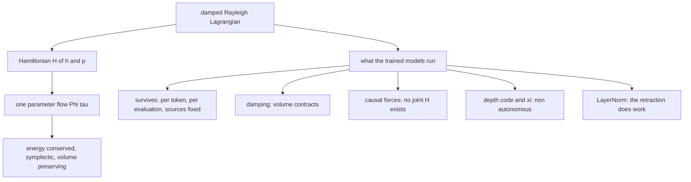
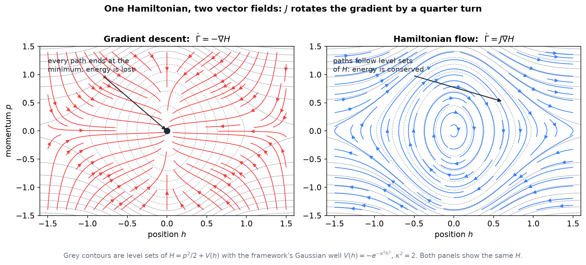
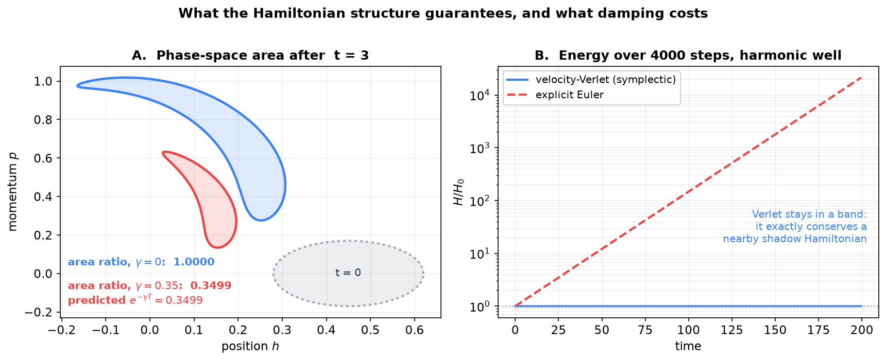
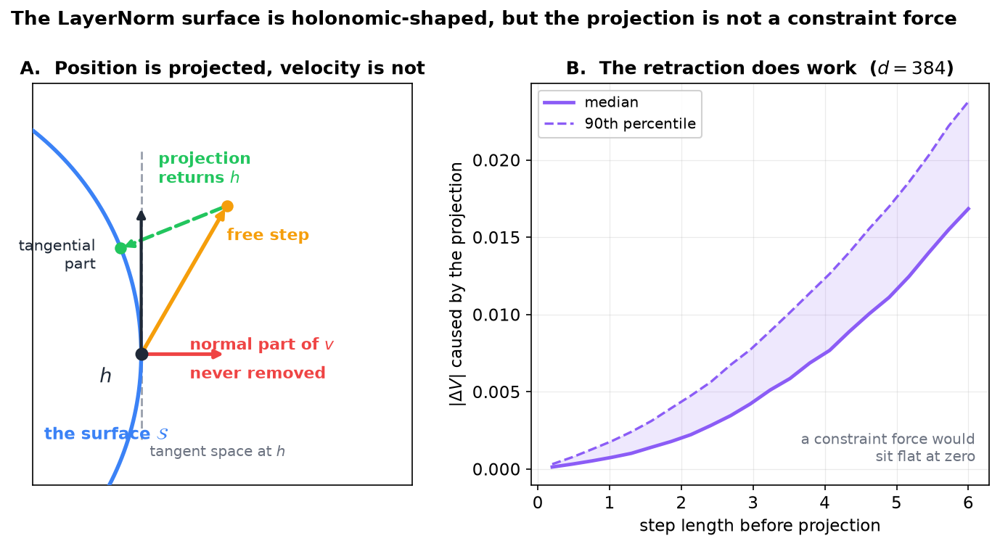

# Hamiltonian Flow in the Semantic Simulation Framework

**What the Lagrangian commitment buys, where the flow genuinely exists in the code, and the four places the trained models leave it**

Companion note to [*Langevin dynamics reformulation of classical damped Lagrangian flow*](Langevin_dynamics_reformulation_of_classical_damped_Lagrangian_flow.md), [*Conservative Obstruction and Virtual Particle Necessity*](Conservative_Obstruction_and_Virtual_Particle_Necessity.md) and [*Poisson Mode Registers PM1*](Poisson_Mode_Registers_PM1.md). Those notes use Hamiltonian language throughout — symplectic cores, Gibbs measures, conservative forces — without ever fixing what the Hamiltonian is or whether a flow exists. This note fixes it, and the answer is not uniform: the structure holds for one token at one force evaluation and fails, for four separate reasons, everywhere else.

Code references are to `notebooks/conservative_arch/parf/`.

---

## Contents

0. [Scope](#0-scope)
1. [From the Lagrangian to the Hamiltonian](#1-from-the-lagrangian-to-the-hamiltonian)
2. [The flow](#2-the-flow)
3. [The three structural properties](#3-the-three-structural-properties)
4. [Where the models leave the flow](#4-where-the-models-leave-the-flow)
5. [What survives](#5-what-survives)
6. [Consequences](#6-consequences)
7. [Dictionary](#7-dictionary)

---

## 0. Scope

| Claim | Status |
|---|---|
| Hamilton's equations, the flow, and its three properties | Standard classical mechanics, derived in §2–§3 |
| The framework's layer update is a damped Verlet step in a position-only state | In the code, `_layer_step` |
| Damping contracts phase-space volume at rate gamma times the dimension | Derived, §4.1, and measured in Figure 2 |
| No joint Hamiltonian exists for the causal models | Derived, §4.2 — the same fact as Lemma 1 of the obstruction note |
| The LayerNorm surface is holonomic-shaped but the projection is not a constraint force | Derived, §4.4. The position/velocity asymmetry and the energy injection are **already in the book**, §18 |
| Per token, at fixed sources and fixed context, the step is a Hamiltonian flow | Derived, §5.1 — this is property (C) |
| The Jacobi metric is built on the ambient space, with LayerNorm absorbed into an effective damping rather than into the metric | Settled from the book, §6.2 |
| Adding a RATTLE velocity projection would close the tangency gap, at a cost the book's measurements predict | **Proposed**, §6.3, untested |

Nothing here is an experimental result about a trained model. Figures 1–3 are exact computations on toy systems that use the framework's own Gaussian well where a potential is needed.



---

## 1. From the Lagrangian to the Hamiltonian

### 1.1 Configuration space and phase space

The framework's state is a position in semantic space. For one token particle the **configuration space** is $\Sigma = \mathbb{R}^{L}$, and a point of it is a hidden state $h$. Mechanics needs more: to say where a particle goes next you need where it is *and* how fast it is moving. The **phase space** is therefore the doubled object

$$\mathcal{M} = \lbrace \Gamma = (h, p) \mid h \in \mathbb{R}^{L}, p \in \mathbb{R}^{L} \rbrace \cong \mathbb{R}^{2L}$$

Its dimension is always even, and that evenness is structural rather than incidental: it is what allows the symplectic pairing of §2.1 to exist at all.

### 1.2 The Legendre transform

The framework starts from a Lagrangian, not a Hamiltonian. For the single-particle Lagrangian of the book,

$$\mathcal{L}(h, \dot h) = \tfrac12 \mathfrak{m} \lVert \dot h \rVert^2 - V(\xi, h)$$

the conjugate momentum and the Hamiltonian are defined by

$$p = \frac{\partial \mathcal{L}}{\partial \dot h} = \mathfrak{m} \dot h, \qquad H(h,p) = p \cdot \dot h - \mathcal{L} = \frac{\lVert p \rVert^2}{2\mathfrak{m}} + V(\xi, h)$$

So $H$ is the total energy written as a function of position and momentum, and the Legendre transform is the change of variables from velocity to momentum. The two formulations are equivalent **only for the conservative part**: Rayleigh damping has no place in either $\mathcal{L}$ or $H$, and enters through a separate dissipation function. That is the first hint of §4.1.

### 1.3 The framework's candidate

Writing the obvious many-particle version:

$$H_{0} = \sum_{t} \left[ \frac{\lVert p_t \rVert^2}{2\mathfrak{m}_t} + V_\theta(\xi_t, h_t) \right] + \sum_{t \neq s} V_\phi(h_t, h_s)$$

Section 4 shows that this object does **not** generate the trained dynamics. It is worth writing down anyway, because naming the candidate is what makes the four failures precise.

---

## 2. The flow

### 2.1 Hamilton's equations and the symplectic matrix

$$\dot h = \frac{\partial H}{\partial p}, \qquad \dot p = -\frac{\partial H}{\partial h}$$

Both equations collapse into one if we introduce the **symplectic matrix**

$$J = \begin{pmatrix} 0 & I \cr -I & 0 \end{pmatrix}, \qquad J^{\top} = -J, \qquad J^2 = -I$$

giving

$$\dot\Gamma = J \nabla H =: X_{H}(\Gamma)$$

$X_H$ is the **Hamiltonian vector field**. The single most useful thing to notice is the contrast with gradient descent. Descent is $\dot\Gamma = -\nabla H$ and moves *down* the gradient, across level sets, to a minimum. Hamiltonian flow applies $J$ first, which rotates the gradient by a quarter turn, so the motion is *along* level sets. One matrix is the entire difference between relaxation and mechanics.



**Figure 1.** The same Hamiltonian $H = p^2/2 + V(h)$, built from the framework's Gaussian well, generating two different vector fields. Left: $-\nabla H$, every trajectory terminating at the minimum. Right: $J\nabla H$, every trajectory riding a level set. Grey contours are level sets of $H$ in both panels.

### 2.2 The flow map

The **flow** $\Phi_\tau : \mathcal{M} \to \mathcal{M}$ sends each initial condition to where it has moved after time $\tau$:

$$\frac{d}{d\tau} \Phi_\tau(\Gamma) = X_{H}\bigl(\Phi_\tau(\Gamma)\bigr), \qquad \Phi_0 = \mathrm{id}$$

Because $X_H$ does not depend on $\tau$, the solutions compose, and $\Phi$ is a **one-parameter group of diffeomorphisms**:

$$\Phi_\tau \circ \Phi_s = \Phi_{\tau + s}, \qquad \Phi_\tau^{-1} = \Phi_{-\tau}$$

Invertibility is time-reversibility, and it is the reason "evolve for time $\tau$" can be treated as a change of coordinates on phase space rather than as an irreversible process.

**Notation: the derivative of the flow.** Sections 3.2 and 3.3 need the derivative of $\Phi_\tau$ with respect to its argument, written $D\Phi_\tau$. Here $D$ is the **total-derivative (Jacobian) operator**, not a partial derivative and not an increment: for a map from $\mathbb{R}^{2L}$ to $\mathbb{R}^{2L}$ it is the full matrix of first partials,

$$\bigl(D\Phi_\tau\bigr)_{ij} = \frac{\partial (\Phi_\tau)_i}{\partial \Gamma_j}, \qquad D\Phi_\tau \in \mathbb{R}^{2L \times 2L}$$

Its meaning is the propagation of perturbations: start at $\Gamma$ and at a nearby point $\Gamma + \epsilon w$, and after time $\tau$ the two have separated by

$$\Phi_\tau(\Gamma + \epsilon w) - \Phi_\tau(\Gamma) = \epsilon D\Phi_\tau(\Gamma) w + O(\epsilon^2)$$

so $D\Phi_\tau$ carries tangent vectors at $\Gamma$ to tangent vectors at $\Phi_\tau(\Gamma)$. It is also called the tangent flow, the state-transition matrix or, over a period, the monodromy matrix, and it obeys the **variational equation** $\dot M = J \nabla^2 H M$ with $M(0) = I$.

The letter is $D$ rather than the more common $J$ for a Jacobian because $J$ is already the symplectic matrix here. Keeping them apart matters: the two symbols stand side by side in the next subsection.

### 2.3 The generator

For an observable $A$ on phase space, write $A(\tau) := A \circ \Phi_\tau$. Differentiating and substituting Hamilton's equations gives the **Poisson bracket**:

$$\frac{d}{d\tau} A(\tau) = \nabla A \cdot J \nabla H = \lbrace A, H \rbrace =: \mathcal{L} A, \qquad A(\tau) = e^{\tau \mathcal{L}} A$$

$\mathcal{L}$ is the **Liouville operator**. This is the object that appears as $e^{(t - t')\mathcal{L}_0}$ in the linear-response derivation of the FDT, and §6.1 returns to what its absence costs.

---

## 3. The three structural properties

### 3.1 Energy is conserved

$$\frac{dH}{d\tau} = \nabla H \cdot \dot\Gamma = \nabla H \cdot J \nabla H = 0$$

because $J$ is antisymmetric, so $x^{\top} J x = 0$ for every $x$. One line, and it is purely algebraic: conservation is a property of $J$, not of any particular $H$.

### 3.2 The flow is symplectic

Let $M(\tau) = D\Phi_\tau$ be the Jacobian of the flow map. Differentiating $\dot\Gamma = J\nabla H$ gives the variational equation $\dot M = J \nabla^2 H M$, where $\nabla^2 H$ is the Hessian. Then

$$\frac{d}{d\tau}\left( M^{\top} J^{-1} M \right) = \dot M^{\top} J^{-1} M + M^{\top} J^{-1} \dot M = M^{\top} (\nabla^2 H) J^{\top} J^{-1} M + M^{\top} (\nabla^2 H) M$$

Now $J^{\top} J^{-1} = (-J)(-J) = J^2 = -I$, so the two terms cancel and $M^{\top} J^{-1} M$ is constant. At $\tau = 0$, $M = I$, hence

$$D\Phi_\tau^{\top} J^{-1} D\Phi_\tau = J^{-1} \quad \text{for all } \tau$$

**Where the symmetry of the Hessian was used matters.** The cancellation above needs $\nabla^2 H$ to be the same matrix in both terms, which holds because second derivatives commute. Symplecticity of the flow is therefore the same statement as symmetry of the force Jacobian — and §4.2 is nothing more than the observation that the causal models violate that symmetry.

### 3.3 Volume is preserved

The divergence of the Hamiltonian vector field vanishes identically:

$$\nabla \cdot X_{H} = \sum_{k} \frac{\partial}{\partial h_k}\frac{\partial H}{\partial p_k} + \sum_{k} \frac{\partial}{\partial p_k}\left(-\frac{\partial H}{\partial h_k}\right) = \sum_{k} \left( \frac{\partial^2 H}{\partial h_k \partial p_k} - \frac{\partial^2 H}{\partial p_k \partial h_k}\right) = 0$$

so $\det D\Phi_\tau = 1$. This is **Liouville's theorem**: a region of phase space may be stretched and sheared arbitrarily, but its volume never changes.

### 3.4 Why the Gibbs measure is stationary

Densities obey $\partial_\tau \rho = \lbrace H, \rho \rbrace$. For any function of the Hamiltonian alone, $\rho = F(H)$, the chain rule gives

$$\lbrace H, F(H) \rbrace = F'(H) \lbrace H, H \rbrace = 0$$

so every such density is stationary, the Gibbs measure $\rho_0 \propto e^{-\beta H}$ among them. **Stationarity of the equilibrium ensemble is not an assumption about the ensemble; it is a corollary of $H$ generating the flow.** This is the fact the FDT derivation leans on, and §6.1 is about what happens when it is unavailable.

---

## 4. Where the models leave the flow

Four independent departures. Any one of them alone would be enough to deny a global flow.

### 4.1 Damping

The damped equation $\dot p = -\nabla V - \gamma p$ is not $J \nabla H$ for any $H$. The divergence no longer vanishes:

$$\nabla \cdot \dot\Gamma = \nabla_h \cdot \left(\frac{p}{\mathfrak{m}}\right) + \nabla_p \cdot \bigl(-\nabla V - \gamma p\bigr) = 0 - \gamma L$$

so phase-space volume contracts as $e^{-\gamma L \tau}$ with $L$ the number of degrees of freedom. Liouville's theorem fails by a computable factor.



**Figure 2.** Left: a disc of initial conditions carried for $t = 3$ by the undamped flow (area ratio 1.0000, sheared but preserved) and by the damped flow at $\gamma = 0.35$ (area ratio 0.3499, against the predicted $e^{-\gamma t} = 0.3499$ for one degree of freedom). Right: energy over 4000 steps in a harmonic well — the part the CfC substep propagates in closed form. Velocity-Verlet stays in a band because it exactly conserves a nearby shadow Hamiltonian; explicit Euler grows by four decades.

In the code the damping appears as the denominator of the Verlet step,

```python
# model_parf_multixi.py, MultiXiPARFLM._layer_step
delta = h - h_prev
...
denom = 1.0 + dt * gamma
h_new = h_in + delta / denom + (dt * dt / (m_b * denom)) * f
```

and, under the Langevin integrators, as the exact factor $c_1 = e^{-\gamma \Delta t}$ in `cfc_baoab.ou_step`.

### 4.2 Non-reciprocity — the decisive one

Suppose a joint $H_0$ existed, with $F_i = -\partial H_0 / \partial h_i$. Then

$$\frac{\partial F_i}{\partial h_j} = -\frac{\partial^2 H_0}{\partial h_j \partial h_i} = -\frac{\partial^2 H_0}{\partial h_i \partial h_j} = \frac{\partial F_j}{\partial h_i}$$

The off-diagonal Jacobian blocks must be **symmetric**. The causal models satisfy, for $s \lt t$,

$$\frac{\partial F_t}{\partial h_s} \neq 0, \qquad \frac{\partial F_s}{\partial h_t} = 0$$

A block-triangular matrix is not symmetric, so **no $H_0$ exists at all**. Not "exists but is complicated" — the obstruction is exact.

This is one fact wearing several names across the notes: Lemma 1 of the obstruction theorem, the qualification in PM1 §4.4(a), and in the code the line that enforces it,

```python
# model_parf_multixi.py, MultiXiPARFLM._layer_step
xi_input = h.detach() if (cfg.causal_force and not xi_live) else h
xis = self.xi_module(xi_input)
```

The detach makes the context an external field for the purposes of differentiation, so the force is the partial derivative at fixed context rather than the total derivative. It buys the causal structure, and the price is the joint Hamiltonian.

### 4.3 Non-autonomy

$V_\theta$ carries a per-layer depth code, and $\xi$ is recomputed at every layer from that layer's states. Even restricted to one token the energy function is $H(\Gamma, \tau)$ with explicit time dependence, so §3.1 does not apply and $\Phi$ is a two-parameter family $\Phi_{\tau, \tau'}$ rather than a one-parameter group. The Addendum on non-autonomous fields treats this case; within a single force evaluation the field is conservative, across evaluations it is a conservative field that changes in time.

### 4.4 The LayerNorm projection

The projection is

```python
# model_parf.py, PARFLM._project
def _project(self, h: torch.Tensor) -> torch.Tensor:
    return F.layer_norm(h, (self.cfg.d,), eps=self.cfg.ln_eps)
```

whose image, with no affine parameters, is

$$\mathcal{S} = \lbrace x \in \mathbb{R}^{L} \mid \mathbf{1}^{\top} x = 0, \ \lVert x \rVert^2 = L \rbrace \cong S^{L-2}$$

a sphere of radius $\sqrt{L}$ inside the hyperplane orthogonal to $\mathbf{1}$. Two scalar equations, both position-only: exactly the shape of a **holonomic constraint**.

But the enforcement is not a constraint, for three reasons.

**It acts after the fact.** A holonomic constraint enters the equations of motion through Lagrange multipliers, $\mathfrak{m}\ddot h = -\nabla V + \sum_a \lambda_a \nabla g_a$, keeping the trajectory on $\mathcal{S}$ at every instant. The code integrates freely and then snaps back. That is a retraction, not a constraint force.

**The velocity is never projected.** A holonomic constraint carries a hidden companion condition: differentiating $g(h) = 0$ along the motion gives $\nabla g \cdot v = 0$, so the velocity must be tangent to $\mathcal{S}$. The code enforces only the position half:

```python
# model_parf_multixi.py, MultiXiPARFLM._layer_step_langevin
if cfg.ln_after_step:
    h_new = self._project(h_new)
return h_new, encode_velocity(h_new, v_new, dt)
```

`encode_velocity` pairs the projected position with the **unprojected** velocity, so the next layer decodes exactly $v_{\text{new}}$, normal components included. In the Verlet path the same gap appears differently: `_layer_step_ex` returns `_h_prev_out = h`, so the next layer's $\delta$ is a chord between two points of $\mathcal{S}$, which is a secant rather than a tangent vector.

**The retraction does work.** A constraint force is orthogonal to admissible motion and therefore workless, which is why constrained systems still conserve energy. The projection moves $h$, hence changes $\lVert h - \mu_v \rVert$, hence changes $V_\theta$.

**None of this is new, and the book states it more sharply.** Section 18 of the book already identifies the same asymmetry in the same words — the projection "modifies the position $h$ but not the velocity $v$: the velocity evolves in the ambient space $\mathbb{R}^{d}$, while the position is projected back to the sphere" — and names the work term the **LayerNorm energy injection**

$$\delta V_\ell = V\bigl(\mathrm{LN}(\tilde h_{\ell+1})\bigr) - V(\tilde h_{\ell+1})$$

which is exactly the quantity plotted in Figure 3B. The book goes further than this note does in two respects. It converts the injection into an **effective damping**,

$$\gamma_{\mathrm{eff}} = \gamma - \frac{\delta V_\ell}{2 T_\ell \Delta t}, \qquad \delta V_\ell \approx v_{r} F_{n}$$

with $v_r$ the radial velocity and $F_n$ the radial force component; and it measures the result on trained models, finding that LayerNorm acts as a persistent **counter-damping** that reduces the effective damping by roughly five to seven times relative to the learned $\gamma_{\mathrm{param}} \approx 0.93$. The mechanism is the one the geometry predicts: damping drives an inward radial velocity, the projection removes the inward displacement but not that velocity, and the resulting energy injection partially offsets the dissipation.



**Figure 3.** Left: the surface, a point $h$ on it, the free step leaving it, and the projection returning the position. The velocity is decomposed at $h$: the projection removes nothing from its normal component, so the state is on $\mathcal{S}$ while the velocity is not tangent to it. Right: at $d = 384$, the change in a Gaussian well potential caused by the projection alone, against the length of the step being projected. A genuine constraint force would sit flat at zero. This is a toy instance of the quantity the book calls the LayerNorm energy injection $\delta V_\ell$, which it computes directly from the forward pass.

### The four departures, collected

| Departure | Property lost | Where in the code |
|---|---|---|
| Damping | volume preservation, energy conservation | `denom = 1 + dt * gamma`, `ou_step` |
| Non-reciprocity | existence of any joint $H_0$ | `h.detach()` in `_layer_step` |
| Non-autonomy | one-parameter group, conserved energy | depth code in $V_\theta$, per-layer $\xi$ |
| LayerNorm projection | symplecticity, workless constraint | `_project` after the step |

---

## 5. What survives

### 5.1 The per-token, per-evaluation Hamiltonian

Fix a token $t$, a layer, and the states of all other tokens. Then the context $\xi_t$ and the pair sources are constants, and there is a scalar

$$U_t(h) = V_\theta(\xi_t, h) + \sum_{s \lt t} V_\phi(h, h_s)$$

with $F_t = -\nabla_h U_t$. The pair $(h_t, p_t)$ evolves under the genuine Hamiltonian

$$H_t(h, p) = \frac{\lVert p \rVert^2}{2 \mathfrak{m}_t} + U_t(h)$$

This is the book's property (C), and it is exactly what PM1 §4 proves for the mode force and what the reverse channel violates. It is a real structure — symmetric Jacobian, vanishing curl, path-independent work — but it is a statement about **one diagonal block** of the joint system, not about the system.

### 5.2 Verlet as a symplectic integrator

Velocity-Verlet is not merely an approximation of the flow of $H_t$; it is the exact flow of a nearby **shadow Hamiltonian** $\tilde H = H_t + O(\Delta t^2)$. That is why the right panel of Figure 2 shows a bounded oscillation rather than a drift: the energy error cannot accumulate, because the quantity the integrator really conserves is a fixed perturbation of the one we care about. Explicit Euler conserves nothing and grows without bound.

This is the precise content of the phrase "symplectic NVE core" in the Langevin note, and the reason the $\gamma \to 0$ limit of the framework's integrator is worth naming.

### 5.3 Reading the splitting

The implemented sequence is A, B, O, A — a half drift, a full kick, the friction and optional noise, a half drift. Sorting the substeps by whether they are Hamiltonian:

| Substep | Hamiltonian? | What it is |
|---|---|---|
| A, half drift | yes | the flow of the kinetic term alone |
| B, full kick | yes | the flow of the potential term alone |
| O at $T = 0$ | no | dissipative contraction by $c_1 = e^{-\gamma \Delta t}$ |
| O at $T \gt 0$ | no | Ornstein-Uhlenbeck, preserves the Gibbs measure of $H_t$ |
| projection | no | retraction onto $\mathcal{S}$, §4.4 |

A and B are each exactly integrable Hamiltonian flows, and composing them in a palindromic order is what makes the composite symplectic. The entire non-Hamiltonian content of a layer sits in O and the projection.

---

## 6. Consequences

### 6.1 The first-kind FDT does not apply, and now we can say why

The linear-response derivation needs three things: an equilibrium density $\rho_0 \propto e^{-\beta H_0}$, its stationarity under the flow, and a one-parameter group $\Phi_\tau$ to define the correlation $\langle B(\tau) A(0) \rangle_0$. Section 4.2 removes $H_0$; §4.3 removes the group; §4.1 and §4.4 remove the measure. **It is not the $T = 0$ setting that blocks the first-kind FDT — it is the absence of a joint Hamiltonian for $\Phi_\tau$ to be the flow of.**

The second-kind FDT is untouched by all of this. It constrains how the thermostat is *built*, which is a statement about one substep, and it remains correct whether or not any global flow exists.

### 6.2 Maupertuis, Jacobi, and a caveat about the sphere

Where the per-token Hamiltonian of §5.1 does hold, and in the $\gamma \to 0$ limit, a classical theorem applies. **Maupertuis-Jacobi**: the trajectories of $H = \tfrac12 \lVert p \rVert^2 + V$ at fixed energy $E$ are precisely the geodesics of the **Jacobi metric**

$$g_{ij} = 2\bigl(E - V(h)\bigr)\delta_{ij}$$

so "falling through a potential" and "moving straight in a curved space" are the same statement, and the curvature carries the dynamics. This is the bridge to the Riemannian notes, and it is why a conformal-invariance result about the STP loss is the right thing to prove: the Jacobi metric is conformal to the flat one, with conformal factor $2(E - V)$.

**How the framework handles the constraint surface.** An earlier draft of this note left open whether the Riemannian treatment accounts for $\mathcal{S}$. Reading §18 settles it, and the answer is a deliberate modelling choice rather than an oversight.

The Jacobi metric is built on the **ambient** space: $\tilde g_{ij} = 2(E - V)g_{ij}$ with $g_{ij}$ Euclidean, "a valid Riemannian metric on the entire space". The sphere is never made the configuration manifold and the induced metric on it is never formed. Instead LayerNorm enters through the **damping coefficient**: downstream geometric quantities, the energy anomaly and the geodesic distance among them, are computed with $\gamma_{\mathrm{eff}}$ in place of $\gamma$. The book's own summary of the position is explicit — LayerNorm is

> rather than an obstacle that "breaks" the Riemannian geometry ... an integral participant in the effective damped metric, modulating $\gamma_{\mathrm{eff}}$ while preserving geodesic compliance under the resulting metric.

So the framework takes the **force reading** of §4.4 rather than the constraint reading: the projection is treated as a radial interaction that costs energy, not as a restriction defining where the particle may live. On that reading the ambient conformal geometry is the right object, the sphere's intrinsic curvature never enters, and the question of the induced metric does not arise. The choice is supported by measurement, since geodesic compliance was tested under the resulting metric, and the curvature proxy does not involve $\gamma$ at all, so the negative curvature result is unaffected either way.

What remains genuinely open is narrower than I first put it. The two readings are not equivalent, and nothing yet distinguishes them empirically: a constrained treatment would put the dynamics on $S^{L-2}$ with its own second fundamental form, and would predict different geodesics from the ambient treatment with $\gamma_{\mathrm{eff}}$. Whether that difference is measurable at $L = 384$, where the sphere is very flat locally, is a question nobody has posed.

### 6.3 The missing velocity projection

Section 4.4 identified the gap precisely: position is projected, velocity is not. The standard fix is the velocity half of RATTLE — after projecting $h$, remove the two normal components from $v$:

$$v \leftarrow v - \frac{\mathbf{1}^{\top} v}{L}\mathbf{1} - \frac{h^{\top} v}{\lVert h \rVert^2} h$$

Then $(h, v)$ is a genuine point of the tangent bundle $T\mathcal{S}$, and in the $\gamma \to 0$ limit the step becomes a constrained symplectic step rather than a retraction.

It is cheap to implement. **It is not cheap in effect, and an earlier draft of this note got the prediction backwards.** The §4.4 measurements say what happens: the radial velocity $v_r$ is precisely the thing that produces the energy injection $\delta V \approx v_r F_n$, and that injection is what reduces the effective damping by about five to seven times. Projecting the velocity sets $v_r = 0$, hence $\delta V \to 0$, hence

$$\gamma_{\mathrm{eff}} \longrightarrow \gamma_{\mathrm{param}}$$

so the fix does not remove motion the model was wasting. It removes the counter-damping mechanism the model has been training against, and leaves a model that learned $\gamma_{\mathrm{param}} \approx 0.93$ suddenly running at five to seven times the damping it was tuned for — deep into the overdamped regime, where the depth-ladder work says trajectories collapse rather than flow.

The honest version of the proposal is therefore a two-parameter change: project the velocity **and** retune $\gamma$ downward by the measured counter-damping factor, so that $\gamma_{\mathrm{eff}}$ is held fixed across the comparison. That is the only version in which the experiment isolates the geometry. Run without the retune it is a damping sweep wearing a geometry costume, and the result would be uninterpretable.

What the clean version would buy: a model whose state and velocity both live on $T\mathcal{S}$, where the constrained-geometry reading of §6.2 becomes available and testable against the ambient one.

---

## 7. Dictionary

| Object | Meaning here | Status in the trained models |
|---|---|---|
| Phase space $\mathcal{M}$ | pairs of hidden state and momentum | carried as the pair `(h, h_prev)`, with momentum encoded |
| Hamiltonian $H$ | total energy as a function of $(h,p)$ | exists per token at fixed sources; no joint version |
| Symplectic matrix $J$ | rotates the gradient a quarter turn | implicit in the Verlet and BAOAB splittings |
| Flow $\Phi_\tau$ | time-advance map, a one-parameter group | not available: non-autonomous and dissipative |
| Liouville operator | the generator, $\lbrace \cdot, H \rbrace$ | defined only per token, per evaluation |
| Liouville's theorem | volume preservation | fails by $e^{-\gamma L \tau}$ |
| Shadow Hamiltonian | what a symplectic integrator really conserves | why Verlet does not drift, Figure 2 |
| Holonomic constraint | position-only restriction with a workless force | the surface is one, the projection is not; the book folds the difference into $\gamma_{\mathrm{eff}}$ |
| Jacobi metric | $2(E - V)\delta_{ij}$, geodesics are trajectories | built on the ambient space; LayerNorm enters through $\gamma_{\mathrm{eff}}$, not the metric |

**Summary.** The framework is Lagrangian by commitment and Hamiltonian by construction only in a restricted sense. Fixing one token, one force evaluation and all other sources, the dynamics is a genuine Hamiltonian flow, integrated by a symplectic method, and everything the classical theory promises applies — conserved energy, symmetric Jacobian, a shadow Hamiltonian that explains the absence of drift. Release any of those restrictions and the structure goes, in four distinct ways, of which non-reciprocity is the one that cannot be repaired by tuning: it denies the existence of the Hamiltonian rather than perturbing it. The practical consequences are that the first-kind FDT has no referent here; that the Jacobi-geodesic correspondence is built on the ambient space, with the constraint surface deliberately absorbed into an effective damping rather than into the metric; and that the obvious repair to the projection is not the benign cleanup it looks like, because the normal velocity it would remove is the mechanism of a measured counter-damping.
