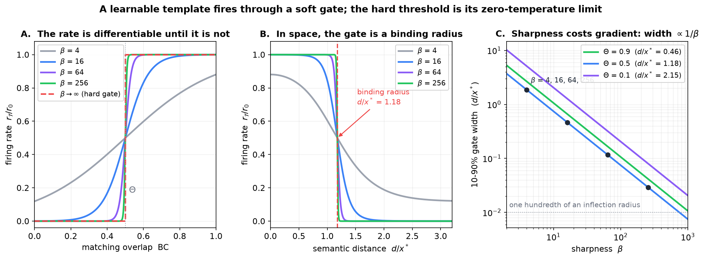

# Implementing Semantic Templates: A Path

**Design note — Semantic Simulation Research Programme**
**Relates to:** book §9.8, §10.4, §10.5.2; [*Semantic Templates as Doi–Peliti Reactions*](Semantic_Templates_as_Doi_Peliti_Reactions.md); [*Doi–Peliti Dynamics of Semantic Particles and Registers*](Doi_Peliti_Dynamics_of_Semantic_Particles_and_Registers.md); [*Poisson Mode Registers (PM1)*](Poisson_Mode_Registers_PM1.md); [*A Community of Semantic Templates for Native CoT*](Community_of_Semantic_Templates_for_Native_CoT.md); [*Realizing Execution: Gauge vs Causal Ordering*](Realizing_Execution_Gauge_vs_Causal_Ordering.md); [*The Execution Problem*](The_Execution_Problem.md); [*MCS Reduction for the v3 Composite*](MCS_Reduction_For_v3_Composite.md); [*Expressivity Bounds for the v0 Simulator*](Expressivity_Bounds_For_v0_Simulator.md)
**Status:** Proposal, with the substrate stages partly built: Stage 0′ (selective matching) and a first build of Stage 0″ (the particle store) are in the code and verified; nothing is trained at scale yet.

> **Thesis.** Hardcoding a template bank cannot work, because the bank *is* the Liouvillian — it specifies the whole dynamics rather than sitting inside it. Nor can a bank of wells work, because deepening a potential adds no degree of freedom and the v0 ceiling falls only to creation. A learned bank is reachable, but less of it is free than it first appears: the Poisson relaxation is exact only in the linear corner, so a thresholded rate costs either the formalism or a sampling step; the pairing of a Pattern Matching Structure with its Inference Structure is unformulated, and two of its three candidate forms are provably order-blind; and the MCS reduction constrains a learned bank to be finite up to string-action equivalence. The substrate is not ready on either half — creation or matching — and measurement says so for both.

---

## Contents

1. [Why hardcoding fails structurally](#1-why-hardcoding-fails-structurally)
   - [1.1 And a bank of wells is not enough either](#11-and-a-bank-of-wells-is-not-enough-either)
2. [Anatomy of a template: three kinds of parameter](#2-anatomy-of-a-template-three-kinds-of-parameter)
3. [The relaxation does not make stoichiometry learnable](#3-the-relaxation-does-not-make-stoichiometry-learnable)
4. [The part with no formulation: the PMS-to-IS pairing](#4-the-part-with-no-formulation-the-pms-to-is-pairing)
   - [4.1 Two of the three candidates are ruled out, not merely weak](#41-two-of-the-three-candidates-are-ruled-out-not-merely-weak)
   - [4.2 The order deficit has been measured](#42-the-order-deficit-has-been-measured)
   - [4.3 What the placement map can be anchored to](#43-what-the-placement-map-can-be-anchored-to)
5. [Three tiers of generality](#5-three-tiers-of-generality)
6. [What the measurements say about the current substrate](#6-what-the-measurements-say-about-the-current-substrate)
7. [Staging, with pass criteria](#7-staging-with-pass-criteria)
   - [7.1 Constraints the MCS reduction places on any bank](#71-constraints-the-mcs-reduction-places-on-any-bank)
8. [Open calibration questions](#8-open-calibration-questions)
9. [Dictionary](#9-dictionary)
10. [Reading map: the companion notes this plan rests on](#10-reading-map-the-companion-notes-this-plan-rests-on)
    - [10.1 The set at a glance](#101-the-set-at-a-glance)
    - [10.8 What the set does not contain](#108-what-the-set-does-not-contain)

---

## 1. Why hardcoding fails structurally

The usual argument against hardcoding is that a fixed bank will not transfer across corpora. True, but the framework supplies a stronger one.

Throughout, **the templates note** means [*Semantic Templates as Doi–Peliti Reactions*](Semantic_Templates_as_Doi_Peliti_Reactions.md), and equation numbers of the form (4.4) refer to it unless the text says otherwise.

Section 4.4 of the templates note establishes that summing the reaction term over a bank of templates, together with transport and destruction, gives a *complete* Liouvillian — and concludes that the bank "is not an additional structure sitting beside the Doi–Peliti dynamics; it is the specification of that dynamics."

So a template bank is not a module. Hardcoding it is hardcoding the model's entire inference dynamics: which structures may be created, under what conditions, at what rate. That is the generator of the time evolution, not a feature attached to it. A fixed bank gives a model whose dynamics cannot adapt, no matter how much data it sees.

A second consequence points the same way. Section 4.3 of that note shows that templates with trivial matchers reduce to spontaneous creation $\varnothing \to A_v$, whose stationary state is Poisson with mean $c/d$ — so **a model's prior is the stationary state of its unconditional templates**. Hardcoding the bank therefore hardcodes the prior, which is the one thing that most obviously must differ between corpora.

### 1.1 And a bank of wells is not enough either

There is a second way to get this wrong, and it is the more likely one here, because the trained models supply the temptation. The v0 expressivity ceiling rests on exactly one hypothesis — no inference-time creation:

> there is no mechanism by which the state space grows during inference (no creation, no destruction, no operator that maps to outside $M$)

and the bounds note is explicit that nothing *else* can break it:

> v0 cannot be made context-free by adding parameters, by adding RL signal, or by **enriching the force vocabulary**, because none of those operations grow the state-space dimension during inference.

Its Cook–Wolfram section closes the remaining loophole: "the bottleneck is **not** the rule complexity… The bottleneck is the **finite, non-growing state space**."

A Poisson mode is a well. Firing it deepens a potential; it adds no degree of freedom. The Community note says the same from the trained side: a mode has no "inference region that writes a structure — none: the mode deepens a well, a force on later tokens; **it writes nothing**." So a template bank whose firing only modulates $V$ is still v0, still regular, and no amount of selectivity changes that.

**Templates lift the class only if firing instantiates a particle.** That is the single structural requirement the whole programme rests on. The first draft of §7 had no stage for it — Stage 0 repaired the slot registers, Stage 0′ made matching selective, and neither produced a new degree of freedom. Stage 0″ (added 2026-10-31) is that stage, and Stage 0 is retired in its favour.

---

## 2. Anatomy of a template: three kinds of parameter

A template $\mathcal{T}$ pairs a Pattern Matching Structure with an Inference Structure (book Definition 8), and in reaction form is

$$
\sum_v k_v A_v \longrightarrow \sum_v (k_v + l_v) A_v, \qquad (2.1)
$$

catalytic and non-consuming: matched structures persist and new ones appear beside them. Its parameters fall into three classes, and conflating them is the main way to get the design wrong.

**Class I — continuous, already differentiable.** The templates note has done this work. Equation (4.4) there reads the hard threshold as the zero-temperature limit of a rate:

$$
r_\mathcal{T} = r_0 \sigma\left(\beta(\mathrm{BC} - \Theta)\right) \longrightarrow r_0 \mathbb{1}\left[\mathrm{BC} \gt \Theta\right] \quad (\beta\to\infty), \qquad (2.2)
$$

with the explicit remark that the form at finite $\beta$ "is also the differentiable one, which matters if templates are ever to be learned rather than specified." The matcher BC is a Bhattacharyya coefficient between the template cloud and the local state, so it is smooth in the cloud's centroid and width. That makes $\mu_\mathcal{T}$, the width, $\Theta$, $r_0$ and $\beta$ ordinary parameters.

Better still, $\Theta$ is not free. By (3.4) of that note,

$$
\mathrm{BC} \gt \Theta \quad\Longleftrightarrow\quad \frac{d}{x^{\ast}} \lt \sqrt{2\ln\frac1\Theta}, \qquad (2.3)
$$

so the matching threshold is a **binding radius measured in inflection radii**, fixed by the same $\kappa$ that sets the well. Learning $\Theta$ is learning how far a template reaches.

**Figure 1.** Left: the rate (2.2) against matching overlap, as $\beta$ anneals toward the manuscript's hard gate. Centre: the same rate against semantic distance, where by (2.3) the gate is a binding radius — here $\Theta = 0.5$ gives $d/x^{\ast} = 1.18$, firing within roughly one inflection radius. Right: the price of sharpness. The 10-90% width of the gate shrinks as $1/\beta$, so the gradient that trains $\Theta$ and $\mu_\mathcal{T}$ vanishes at exactly the sharpness that makes firing decisive. Annealing $\beta$ is therefore not optional bookkeeping but the central training schedule, in the same role as the Gumbel temperature in the existing sparse pair routing.

**Class II — discrete, but relaxable.** The stoichiometry $k, l$ in (2.1): which types participate and how many of each. This is the actual *content* of a template, and it is combinatorial. Section 3 below gives the way through.

**Class III — neither continuous nor discrete.** The pairing of the Pattern Matching Structure with its Inference Structure. Section 4.

---

## 3. The relaxation does not make stoichiometry learnable

> **Corrected 2026-10-28.** An earlier version of this section argued that because the Poisson-mode reading carries an intensity rather than a count, the stoichiometry $(k, l)$ becomes a pair of non-negative real vectors and is therefore learnable by gradient. That argument is wrong, and the two notes it leaned on say so explicitly. The section below states the constraint instead.

Reactions act on occupation numbers, and integer occupancy looks like the obstruction. The framework does relax it — PM1 carries a real-valued, unbounded Poisson intensity $\phi_v(t)$ and never an integer count, and §3.3 of the PM1 note proves that carrying only the mean is *exact*. But the proof names its own precondition, and that precondition is what forbids the generalisation.

**Linearity in the occupation is a requirement, not a convenience.** The Doi–Peliti note lists it among three requirements "each forced by §2–§4":

> **A coupling linear in the occupation.** Otherwise the mean is not enough.

and the PM1 note's requirements table gives the reason in one line: "a coupling linear in the occupation | **so that carrying the mean is exact**". The exactness is the identity $\mathbb{E}[U(h;n)] = U(h;\mathbb{E}n) = U(h;\phi)$, which holds because the potential is linear in $n$ and for no other reason.

**A thresholded firing rate is not linear in the occupation.** The rate (2.2) passes the occupation through a sigmoid, so

$$
\mathbb{E}\left[r_\mathcal{T}(n)\right] \neq r_\mathcal{T}\left(\mathbb{E}n\right), \qquad (3.1)
$$

and the deterministic model that carries $\phi$ stops computing the expected dynamics of any particle system. The exactness result is lost at the moment the threshold is introduced — which is to say, at the moment a template becomes a template rather than a well.

**Reactant terms are worse.** Any $k_v \geq 1$ makes the reaction nonlinear in the occupations, and the Doi–Peliti note states the consequence generally: "Every linear process closes on its first moment this way. **Nonlinear ones, such as pair annihilation, couple each moment to the next.**" Its worked case notes that sub-Poissonian processes require "imaginary noise" in the Doi field. Moment closure fails; carrying $\phi$ alone is no longer a model of anything.

**So PM1 is not a template substrate.** It occupies exactly the $k = 0$, $l = 1$ corner: one linear reaction per mode, spontaneous creation at rate $E_v$ against decay at rate $\lambda_v$, no reactant terms and no cross-mode coupling. That corner is where the relaxation is exact, and the relaxation does not extend beyond it. Neither note anywhere asserts that $(k, l)$ is continuous or learnable.

**What follows for the design.** Three options, in increasing order of honesty about the cost:

1. **Stay linear.** Restrict the bank to $k = 0$ templates — unconditional creation at a learned, state-independent rate. The relaxation stays exact, and the bank is a learned prior (§1) rather than a conditional inference mechanism. Cheap, and almost certainly too weak to be interesting.
2. **Sample the occupations.** Draw $n \sim \mathrm{Poisson}(\phi)$ in training with a straight-through or score-function gradient. This is open question 2 of the PM1 note, which calls it "the only test of the statistics themselves". It restores a particle system that a nonlinear rate can legitimately act on, at the cost of gradient variance.
3. **Accept a mean-field approximation and say so.** Keep the deterministic $\phi$ and the thresholded rate, and treat the result as a heuristic closure rather than the exact mean of a reaction. Workable, but then the Doi–Peliti apparatus is being used as notation and not as a derivation, and none of its inherited theorems apply.

Option 2 is the one that keeps the formalism. It also happens to be the item the PM1 note already has on its open list, which makes it the cheapest thing to be wrong about.

Two practical consequences follow.

**Sparsity is the existing machinery.** A bank is useful only if few templates fire per step, and that is a top-k selection over a learned score — precisely the straight-through Gumbel-softmax routing the architecture already runs over token pairs. The same code, applied over the template bank instead of over source positions. Note this inherits the same gap flagged elsewhere: the routing ranks a *learned score*, not a force magnitude or an overlap, so the selection is a trained decision rather than the thresholded matcher of (2.2). Whether the two should be unified or deliberately kept apart is a design question, not a detail.

**The bank size is the real capacity dial.** With $k$ and $l$ dense over $\lvert\mathcal{V}\rvert$ the parameter count is $2\lvert\mathcal{V}\rvert$ per template, which is a vocabulary-sized embedding each. A bank of any size then dwarfs the rest of the model. Low-rank or sparse parameterisation of $(k, l)$ is therefore not an optimisation but a precondition for the bank being trainable at all.

---

## 4. The part with no formulation: the PMS-to-IS pairing

Section 6 of the templates note lists what remains open, and one item is the obstruction for this programme:

> Template space geometry. §3.4 proposes the overlap distance as the metric on $\mathfrak{T}$ that book Definition 8 defers. That covers template *clouds*; it says nothing about the pairing of a Pattern Matching Structure with its Inference Structure, **which is the part of a template that is not a density at all.**

Matching is a comparison of densities, and has a metric: the overlap distance restricted to template clouds. The PMS-to-IS binding is a *correspondence* — which created structure goes with which matched one, and where it is placed relative to the match. It is not a point in $\Sigma$, not a density over $\Sigma$, and so the overlap distance says nothing about it.

The gap is traceable to the source. The status table of [*A Community of Semantic Templates*](Community_of_Semantic_Templates_for_Native_CoT.md) §6 reads the 2022 manuscript paragraph by paragraph, and the row for the inference structure says **"heading only (¶185)"**. It is one of three bold rows there — admission, optimal match, and what a firing constructs — and the note adds: "The last is where order lives."

### 4.1 Two of the three candidates are ruled out, not merely weak

An earlier version of this section offered three candidates as if they differed in strength. They do not: a theorem separates them.

> **Firing cannot supply order.** The Doi–Peliti note proves it (§7.3 there): a reaction reading of templates sequences firings perfectly well, through a control particle hopping on the atom tree, but every reaction changes the state by adding occupation numbers, and **additive updates commute**. "Doi–Peliti sequences the firings; it cannot make the outcome depend on the sequence." (Community note §5; [*Realizing Execution*](Realizing_Execution_Gauge_vs_Causal_Ordering.md) §1 states the same obstruction for any additive channel.)

So:

1. **A placement map** — $\mu_{\text{new}} = \mu_{\text{match}} + \delta_\mathcal{T}$ with $\delta_\mathcal{T}$ learned. Additive, hence **order-blind by construction**. It can serve as a v2 baseline for *what* gets written; it cannot decide whether a template with its slots swapped writes something different.
2. **An operator.** The IS is a map on the matched structure's state. This is the only candidate that can be non-commutative, and it is the v3 reading. The execution note's asymmetry passage is the cost: templates live in $\mathbf{T}$, of the same dimension as $\Sigma$, while executive structures live in $\mathbf{E}$, "generally different dimensionality", because execution "must encode computational structure that has no natural representation in the geometry of meaning." An operator IS is an $\mathbf{E}$-object attached to a $\mathbf{T}$-object, and the attachment is exactly what is unformulated.
3. **A joint mode over the pair.** A density over $(\text{matched}, \text{created})$. Keeps the overlap geometry — and is additive, hence **also order-blind**. The Gram-matrix cost is the lesser problem.

So the real choice is binary: an additive IS that is a legitimate v2 mechanism and cannot order, or an operator IS that can order and is v3 work. Community §5 states it exactly:

> A template bank therefore supplies the **v2 half** of native chain-of-thought (structured emission, with a principled, learned trigger) in full, and the **v3 half** exactly to the extent that its inference regions are non-commutative. Defining the inference region is the v3 work, and it is the one part of the manuscript that is empty.

### 4.2 The order deficit has been measured

It is not only undefined on paper. The MT probe (protocol §5.24, scored 2026-10-12) asked whether the trained modes already carry transitions. Three of four pre-registered calls hit: the firing information at lag 1 exceeds the state's own drift by +0.37 bits in PMX, decaying over 4–8 tokens. The fourth, the one that bears on order, missed in both arms — **zero** ordered pairs reaching a lift of 2 in PMX, three asymmetric pairs in PM1 against twenty pre-registered. The note's reading:

> The transitions have no direction… u-then-v is as likely as v-then-u: the modes co-fire on temporal proximity, which is what a similarity structure does and not what a chain does… **Supplying order is therefore a design task, not a training task that more data would finish.**

That closes off one hope the staging below might otherwise have carried: Stage 3 (induction) cannot recover order that no stage designed in.

### 4.3 What the placement map can be anchored to

The additive baseline is still worth building first, and it need not be invented from nothing. The framework already has an affixing rule, quoted in the execution note from the 2022 working note: "When the semantic latch $\mu$ associated with $\mathfrak{T}$ is triggered the centroid of $\mathfrak{T}$ is affixed to the point which has triggered the latch." That places the **matcher**. The open question for the output is asked verbatim in the same note, of the transfer template $\mathfrak{S}$: "how does an execution result become a new semantic structure? **What determines its position, mass, and signature in Semantic Space?**"

A displacement relative to the affixed matcher centroid is the minimal object that answers the second question in the vocabulary of the first — and Community §8 independently names "a relative displacement" as the smallest two-slot object with an order to decide. That gives the baseline two precedents and makes the gap precise: the affixing rule exists for the PMS, and nothing exists for the IS.

---

## 5. Three tiers of generality

| Tier | Where templates come from | Generality | Status |
|---|---|---|---|
| 0 | Hardcoded bank | none — the bank is the dynamics (§1) | ruled out |
| 1 | Learned at training, fired at inference | corpus-specific | reachable now |
| 2 | Induced from context at inference | cross-corpus | the real target |

Tier 1 is v2 as the book describes it: creation during inference, with the bank as a parameter. It is the tractable step.

**Decision (2026-10-31).** The first implementation is Tier 1: the bank is learned at training time and fired at inference, on the Stage 0″ store of §7. Tier 2 — the model creating templates it did not have, during inference — is the stated follow-on, to be reached by extending the Tier 1 training algorithm once Tier 1 is validated, not designed in from the start.

Tier 2 deserves its own name — **induction**, not learning. No weight updates; the model recognises a regularity in the context window and begins firing a template it did not previously have. That is the in-context-learning analogue, and it is what actually answers "widely different corpora without retraining." It is also where (2.2) becomes awkward: an induced template has no training signal to set $r_0$, which §8 returns to.

Continual learning with weight updates at inference is a different problem, treated in the book's continual-learning section. It is probably not needed for this and should not be conflated with Tier 2.

---

## 6. What the measurements say about the current substrate

This is the part that should govern sequencing, because three measured facts make templates premature today.

**There is no particle-number dynamics to hang reactions on.** The book's remark on what the trained registers implement reports three pre-registered measurements (DP1–DP3) on trained Fock models:

- the active fraction is **0.9995–1.000 at every layer** — "there are no particle-number dynamics";
- near-duplicate register content is at most 1.3% of active pairs — the registers are distinct slots;
- the Spearman correlation between a register's salience and its own contribution to the reverse-channel force lies between $-0.41$ and $0.0$, **never positive** — "salience is not an intensity."

The conclusion recorded there is that the trained registers are "$M$ always-occupied exclusion slots whose content is renewed layer by layer." A template is a creation operator. Firing one into a pool that is already fully occupied does nothing that a content refresh was not already doing, and the Poisson-intensity relaxation of §3 has no referent in a substrate whose occupancies are pinned at one.

**And the register write is the form §7.1 forbids.** Independently of how the registers are trained, the write port $r \leftarrow \sigma r + (1-\sigma) \mathrm{readout}$ (Fock v2.1 note §5.2) matches against the active set and edits the matched slot in place. That is match-and-edit, under which the MCS reduction's polynomial parsing becomes PSPACE recognition. A template substrate has to consume and emit — destroy a reactant, bear a product elsewhere — and a slot that is rewritten in place cannot do that whatever its salience does. Together with the fixed pool size $M$ (the per-position bank is $(B, T, M, d)$, so the state at position $t$ is $Md$ numbers for every $t$, and Lemma 4's hypothesis holds exactly), this is why Stage 0 below is retired rather than repaired.

**v2's necessity has never been witnessed.** The F1 falsifier (base Dyck) exists to show it, but the only Dyck run used the v1 register design, whose registers could not reach the tokens at all: scrambling every register-side parameter left the logits unchanged and no gradient reached them. That result is run-to-run variation, not evidence.

**The candidate matchers do not match.** A template's matcher is the overlap between its cloud and the local state (§2). The trained Poisson modes have exactly that form (a centre, a width, the overlap $E_v = \exp(-\kappa_v^2 \lVert h - \mu_v \rVert^2)$, a firing record), and the community note reads them as learned pattern-matching regions. Measured on the trained PMX, FO-b-PMX and PMX-K16 (protocol §5.13, 2026-10-23), they do not discriminate:
- a mode's overlap varies by only 1–4% from token to token, because the trained wells stay broad ($\kappa_v^2 d$ median 0.6–1.0, its value at initialisation);
- the occupations are reproduced to 99.8% or more from the position alone;
- giving a sequence another text's occupations costs 0.02–0.09% perplexity, against 155–282% for removing the wells;
- beyond the first ~100 tokens, the wells act as a fixed extra landscape (fixing every occupation at one value costs about 1%).

So the matching half of a template, which the community note took to be present in weak form, is present in form but not in function: training did not make the modes content-selective, and the models do not use what selectivity there is.

Taken together: building templates on this substrate risks an unfalsifiable outcome. If the model improves, the cause is ambiguous; if it does not, one cannot distinguish a failure of the mechanism from a failure of the substrate to support it.

---

## 7. Staging, with pass criteria

**Stage 0 — make creation real in the registers. Retired (2026-10-31).** As first written: before any template code, reach an active fraction that varies across layers and positions and a salience that behaves as an intensity, with DP1–DP3 as the probe, by breaking the inequality $s \geq (1-\lambda)/(t+1)$ that pins the fraction (at $\lambda = 0.5$ no register can be inactive in the first 99 positions). Three independent facts say the registers cannot become the substrate however that inequality is broken, so the stage is withdrawn rather than fixed:

1. **The pool is fixed.** `n_registers` is a constructor constant and the per-position bank is $(B, T, M, d)$; the state at position $t$ is $Md$ numbers whatever $t$ is, so Lemma 4's hypothesis holds exactly. The book concedes it: "the class statement concerns the architecture family with a register pool that grows with the input, not the trained instances."
2. **The write is the forbidden form** (§6): match-and-edit, where a template substrate must consume and emit.
3. **DP1–DP3** (§6): always occupied, salience not an intensity.

What survives is the probe. DP1's active-fraction measurement becomes criterion 2 of Stage 0″.

**Stage 0′ — make matching real.** Alongside Stage 0, and equally a precondition. Target: modes whose overlap discriminates between tokens, and a model that uses it. Since training does not narrow the wells, selectivity has to be designed in: narrow initial wells (larger $\kappa_v^2$) with centres placed near real hidden states, so that each mode reaches only part of the state cloud. Pass criteria, all with existing tools (`pm_mode_usage.py`, `pm_content_swap.py`): the median coefficient of variation of a mode's overlap across tokens well above the present 0.01–0.04; the occupations no longer reproduced from position alone; and a content-swap cost well above the present 0.02–0.09%. The trained test is the narrow-wells arm (protocol §5.13, proposed); a check at initialisation, on CPU, comes first.

**Stage 0′a — why the modes do not match, and a design that would (CPU, 2026-10-23).** `notebooks/conservative_arch/scaleup/debug/narrow_wells_design.py`, output `narrow_wells_design_output.txt`; PMX-K16's configuration, at initialisation and trained, 4,096 validation tokens. Three findings:

1. **The centres sit outside the token cloud.** At layer 0 the token states are small (median norm 0.6 at initialisation, 2.9 trained; the whole cloud spans 1–4 units), while the centres are drawn at the LayerNorm scale (median norm 19 at initialisation, 14 trained; the code's comment assumes states at LayerNorm scale, which layer 0's are not). Every token is then 14–19 units from every centre, the same distance to within 0.1–0.4. No width makes such a mode selective, and training did not move the centres into the cloud.
2. **One set of centres cannot serve both layers.** Layer 1's input lies on the LayerNorm sphere (norm 19.6), far from layer 0's small cloud near the origin. The centres and widths are shared by the layers, so a mode can sit inside at most one cloud.
3. **In 384 dimensions an isotropic Gaussian cannot grade.** Even with centres placed on trained token states, distances concentrate: the token-to-centre distances spread by only 20–24% of their median. Halving the width moves a mode from reaching 97–100% of tokens to reaching 1–6%, with a third or more of tokens then reaching no mode at all.

| matching distance measured in | spread of distances | a mode reaches | tokens reaching some mode | selectivity (overlap CV) |
| --- | ---: | ---: | ---: | ---: |
| all 384 dimensions (today) | 0.20–0.24 | 97–100% or 1–6% | 100% or 36–64% | 0.1–0.2 |
| a 16-dimensional subspace | 0.58–0.60 | 5% | 90–95% | 0.8 |
| an 8-dimensional subspace | 0.77–1.00 | 6–15% | 94–99% | 0.8–1.1 |

(Both layers; the subspace is the top principal directions of the layer's trained states; width κ² = c / D², with D² the median squared token distance in the subspace, c = 2–4. Trained models today: selectivity 0.01–0.04.)

**The design that follows (proposed; nothing implemented).**
- **Low-rank matching:** E_v = exp(−κ_v² ‖P_l (h − μ_{l,v})‖²) with a learned projection P_l of rank r = 8 (16 as the alternative), one per layer, initialised from the principal directions of the layer's states. The potential stays a scalar function of h, so the wells' force stays conservative. Its curvature lies in the r-dimensional span of P_l.
- **Per-layer centres** μ_{l,v} (2 × K × d parameters, about 12k at K = 16), initialised at token states sampled from that layer's input at the start of training.
- **A width that follows the cloud:** κ_v² = c_v / D̄²_l, with D̄²_l a running estimate of the layer's median squared projected distance (detached) and c_v learned, starting at 2. The layer-0 cloud grows about fivefold in training, so a width fixed in absolute units would end up too narrow.
- **Integration:** the first build uses the explicit kick for the wells (PM1's path, `POISSON_WELLS_EXACT = False`), which needs changes only in the occupation and the force. Folding a rank-r curvature into PMX's exact flow comes after the selectivity is shown to survive training.
- **Checks before any GPU run (CPU):** at initialisation, selectivity of at least 0.5, coverage of at least 90%, a reach of 5–20%; finite, non-zero gradients on P_l, μ, c_v and the depths after one step; and, on a short CPU training run, the position-only share of the occupations falling below its present 99.8%.

**Stage 0′, implemented (2026-10-23).** The design above is in the model as `poisson_match_rank` (Cell 0 `POISSON_MATCH_RANK`, tag `pmlr<r>`), off by default. Two changes against the design, both from the checks:
- **Centres by k-means, not random samples.** At initialisation the projected cloud is a dense core (about 75% of the tokens) plus small, tight clusters, most likely the frequent tokens' random embeddings. With 16 random samples about 15% of the tokens reached no mode. The centres are now k-means cluster means in span(P_l) (k-means++ seeded, 10 passes), and coverage is 100%.
- **Starting width factor c = 1.0, not 2,** and the "median reach 5–20%" criterion was dropped, because the clustered cloud makes the median mode a small cluster's mode by construction. Selectivity (at least 0.5) and coverage (at least 90%) remain the criteria.

*Verification* (`debug/verify_pm_match.py`, output `debug/verify_pm_match_output.txt`). With the switch off, four existing configurations (F3.1, PM1, PMX-K16, FO-b-PMX-K16) are bit-identical to the committed code: loss, logits, every parameter and every gradient, checked against a checkout of HEAD. With r = 8 and K = 16, in both orders: selectivity 3.2–3.6 at initialisation (trained isotropic modes 0.01–0.04), coverage 100%, about five modes per token; the force equals −∇U by autograd to about 1e-7; every new parameter has a finite, non-zero gradient after one step; the running width moves in training and not in evaluation.

*Short training run* (`debug/pm_match_short_train.py`, output `debug/pm_match_short_train_output.txt`): both arms from scratch on CPU, SR2 base, K = 16, explicit wells, 300 steps of 4 × 256 tokens, evaluated on held-out tokens.

| after 300 steps | isotropic (today's modes) | rank 8 |
| --- | ---: | ---: |
| selectivity, layer 0 / layer 1 | 0.004 / 0.11 | 1.54 / 0.74 |
| occupations explained by position, layer 0 / layer 1 | 100.00% / 99.8% | 81.9% / 98.0% |
| content swap (occupations from another sequence) | +0.00% | +0.08% (spread 0.20%) |
| training loss at step 300; held-out perplexity | 5.77; 672 | 5.75; 694 |

- **The selectivity survives early training.** It falls from its initial value, but stays 100–400 times the isotropic modes' at layer 0.
- **At layer 0 the occupations start to carry content:** 18% of their variance is no longer position. At layer 1 they stay 98% position.
- **The model does not use the content yet** (content swap +0.08%, inside the spread). 300 steps on CPU is too short to say whether a full run would; the GPU arm answers that.
- **Selective overlaps are necessary, not sufficient.** An occupation sums a mode's overlaps over its half-life window, and the sum averages the token-level variation away. Even at initialisation, with selectivity 2.7, the occupations were 98% position at layer 0. Shorter half-lives (the initial range is 4–128 tokens) or sparser firing would keep more content in the occupations. That is the next knob if the GPU arm shows selective overlaps with positional occupations.

Of the three pass criteria, the first is met, the second partly (layer 0), and the third not yet.

*The half-life range* (`debug/pm_halflife_range.py`, output `debug/pm_halflife_range_output.txt`). With the rank-8 matcher at K = 16, the share of the occupations' variance explained by position, by initial half-life range, on PMX-K16's trained states (a proxy for the trained geometry) at layer 0 / layer 1: 4–128 tokens (today's default) 0.96 / 0.94; 2–32 0.75 / 0.70; **1–16 0.43 / 0.41**; 1–8 0.12 / 0.13. The default range averages the content away even with selective overlaps. 1–16 leaves 57–59% of the variance for content and keeps a 16-token horizon. It also matches what training chooses on its own: PMX-K16 started at 4–128 and ended with half-lives of 4–16 (p05 4.2, median 7.9, p95 15.7). Cell 0 now exposes the range (`POISSON_HALFLIFE_MIN`, `POISSON_HALFLIFE_MAX`, defaults 4 and 128, tag `pmhl<min>t<max>` otherwise).

*The trained test, as proposed (2026-10-23; calls to be registered when it is scheduled).* A pair at 2B tokens (130,000 steps, the TL plan's nine weights-only snapshots), identical except for the matcher, both on PMX-K16's base with explicit wells and the 1–16 range: the template arm `…pm16_pmhl1t16_pmlr8_sr2_st130000…` and its isotropic control `…pm16_pmhl1t16_sr2_st130000…`. At every snapshot: selectivity, the occupations' position share, the content-swap cost, and the mode count. 2B rather than 0.5B, because using content memory is a learned behaviour that may emerge late, so a 0.5B negative would not separate the design from the budget, and the snapshots give the emergence curve. Both configurations build from the notebook's cells and pass Cell 5b (`verify_pm_match.py … planned`).

**Stage 0″ — make allocation real (added 2026-10-31; a first build the same day, see the end of this stage).** The stage §1.1 found missing. A template lifts the class only if firing instantiates a particle, so before the first template there has to be a place for that particle to exist which neither overwrites a slot nor deepens a well. The design is a **write-once, block-causal particle store**.

- **State.** Per layer, slots $(B, T, k, \cdot)$: up to $k$ particles may be *born* at each position, $k$ being the number of templates the routing keeps per position (small, 2–4). A slot carries a bounded payload — position $\mu_p \in \Sigma$, type signature $\psi_p$, mass, birth index $b_p$ — and an **existence** $e_p \in [0, 1]$, the occupation a creation operator sets. Capacity $kT$ is preallocated, so allocation is realised as $e_p$ leaving zero; what grows with the input is the number of live particles at position $t$, up to $kt$, which is what Lemma 4 forbids v0 and what §8.2 of the bounds note asks for ("grow its memory linearly with input length").
- **Visibility.** A particle born at $b_p$ is visible to tokens $t \geq b_p$: a block-causal $T \times kT$ mask. Training stays parallel over positions; at generation the store behaves as a cache.
- **Force on tokens.** Live particles act through the well potential already in the code, $U = -\sum_p e_p D_p \exp\left(-\kappa_p^2 \lVert P_\ell (h - \mu_p) \rVert^2\right)$ — conservative, $\Sigma$-valued, $-\nabla U$ by autograd. This is the additive v2 channel: order-blind by §4.1, and that is its job.
- **Firing.** At position $t$, layer $\ell$, a template matches (its cloud against $h_t$ and against the visible particles, with the Stage 0′ matcher), is routed (Gumbel top-k over the bank, $k$ as above), and emits into slot $(t, j)$: $e \leftarrow \mathrm{fire}$, $\mu \leftarrow \mu_{\mathrm{match}} + \delta_\mathcal{T}$ (the §4.3 baseline), $\psi \leftarrow \psi_\mathcal{T}$. **Payloads are written once and never again.**
- **Consumption** ($k_v \geq 1$). The matched reactant's existence is thinned, $e_p \leftarrow e_p (1 - \mathrm{fire})$; nothing else about it changes. Rebinding is destroy-old plus emit-new, never an edit.
- **Across layers.** The store is carried layer to layer. Within a layer no particle depends on one born in the same layer, so a forward pass supports derivations of depth at most $L$ — the depth floor of §7.1 again.

| requirement | how the store meets it |
|---|---|
| state grows with the input (Lemma 4's hypothesis fails) | live particles at $t$ up to $kt$; payloads persist |
| bounded multiplicity per firing | at most one particle per template per position, $k$ in all |
| consume and emit, never match and edit | write-once payloads; consumption touches only $e_p$ |
| bounded fragment dimension and arity | payload $d + O(1)$; Stage 1′ reads two slots |
| finite bank | bank size fixed; the admission rule of Stage 2 governs growth |
| causal and parallel-trainable | block-causal mask; no particle-to-particle dependence within a layer |
| conservative token forces | wells in $h$; the `verify_pm_match` autograd check applies verbatim |
| §3 exactness | at $k_v = 0$ the store with $e \in [0,1]$ is linear, so carrying the mean is exact (option 1); with reactants it is the object options 2 and 3 act on |

Cost: particle-to-token forces $O(kT^2 d)$ per layer, attention over $kT$ keys; memory $(B, T, k, d)$ per layer.

*Pass criteria.*

1. **Bit-identity with the switch off** on the four reference configurations (the `verify_pm_match` discipline).
2. **Number dynamics exist.** Mean existence across slots and positions away from both 0 and 1, and varying with content — what DP1 could not find. Run first at $k_v = 0$, the exact regime, on CPU.
3. **The collapse depth moves.** Equation (7.2) of the bounds note predicts a Dyck-1 collapse depth $D^\ast$ that does not depend on $T$ for v0. With the store at $k = 1$, $D^\ast$ on the matched baseline should exceed the v0 prediction and grow with the training-length cap. One pre-registrable number from an existing derivation; it is F1's per-depth protocol in its smallest form, which has never been run as written.
4. **Copy beyond $M$.** A planted-copy task whose source distance exceeds what 32 registers can hold, at $L = 2$: the cheap check that persistence across positions works.

*What it does not change.* Consume-and-emit does not weaken §4.1: when two reactions both fire, the resulting configuration is the same multiset in either order; consumption makes the second firing's *rate* path-dependent, not the result (templates note §7.3 says exactly "adding and removing"). The practical consequence is the one Stage 2 already books: a store with consumption can pass F3 by destroy-plus-emit rebinding, and must then be described as such.

**Stage 0″, first build (2026-10-31).** The store is in the model as `particle_store` (Cell 0 `PARTICLE_STORE = K`, `PARTICLE_STORE_RANK`, `PARTICLE_STORE_DECAY`; tag `ps<K>r<r>`, `nd` without decay), off by default: `notebooks/conservative_arch/parf/model_parf_multixi.py` (`particle_store_force`, `_ps_pairs`), verified by `scaleup/debug/verify_particle_store.py` (output `verify_particle_store_output.txt`). What it is, against the design above:

- **The $k_v = 0$ corner.** At every layer each token bears, per type $j$, a particle with existence $e = E_j(h)$ — the Stage 0′ overlap in a rank $r$ subspace, the same code (`_lowrank_match`) — and payload $h + \delta_j$, written once; it acts on later tokens at this and every later layer through a well in the acting layer's subspace. Linear in the existences, so carrying the mean is exact (option 1 of §3). Nothing consumes yet.
- **Decay is a switch, and it decides the class.** With half-lives of 1–16 tokens the live count a token sees saturates at $\sum_j E_j / (1 - \lambda_j)$: 11 / 15 / 14 particles at $t$ = 32 / 128 / 255. Without spontaneous death it grows with the input: 35 / 148 / 298, about $1.2\,t$. A decaying store is bounded memory however large the store (Lemma 2 of the bounds note); the class lift needs $\lambda = 1$ and destruction only by consumption. `PARTICLE_STORE_DECAY = False` is that arm.
- **Checks passed** (CPU, at initialisation, real tokens): off is bit-identical to HEAD on F3.1, PM1-K64, PMX-K16 and FO-b-PMX-K16; depths at 0 give logits bit-identical to no store; the force equals $-\nabla U$ at fixed sources to $10^{-7}$ at both layers, layer 1 with layer-0 particles present; causal; layer checkpointing on and off bit-identical; every new parameter has a finite, non-zero gradient; clip group `pstore_`.
- **Readings at initialisation** ($K = 4$, $r = 8$): mean existence 0.29, CV across tokens 0.56–0.58 (Stage 0′'s selectivity carried over); layer-0 particles carry 53–58% of the reach at layer 1. Cross-layer particles are seen, which the layer-0 / layer-1 cloud mismatch of Stage 0′a had put in doubt.
- **Criterion 3 moves to the first consuming template.** Without consumption a Dyck close cannot decrement the live count, so $D^\ast$ cannot move in this build. Criterion 2 is what this build tests: the no-decay arm passes its structural half (the count grows with $t$); whether training keeps the existences content-dependent is the short-training question, as it was for Stage 0′.
- **A pre-existing bug fixed on the way.** Under the production default `LAYER_CHECKPOINT = True`, the Stage 0′ matcher's running median $D^2_l$ was updated again in the backward recompute, so the recompute's force differed from the forward's: gradients off by $6.6 \times 10^{-5}$ and $D^2$ moving twice per step on PM1-K16 `pmlr8`. The matcher's state now moves only in the forward inside the stack loop; both arms are bit-identical with checkpointing on and off.
- **Not in this build:** the first consuming template, and the alternative of integrating created particles under the flow, as Fock v2 did when it concatenated registers into the Verlet state — the write-once payload is the simpler first choice, not the only one.

**Stage 0″, first training run (2026-11-01), and why consumption became required.** Three arms on CPU — no store, store with half-lives 1–16, store with no spontaneous death — 300 steps of $4 \times 256$ tokens each (`scaleup/debug/ps_short_train.py`). Two results matter. The existences stay **content-driven** after training: the share of their variance explained by position is negative at every layer in both arms, against 0.94–1.00 for the Poisson occupations, because an existence is a per-token overlap and no half-life averaging is applied to it. But the **no-decay arm — the one the expressivity argument needs — is the one the model declines to use**: removal cost $+0.16\%$ against the decay arm's $+5.41\%$, depths six times smaller, and creation at layer 0 suppressed to a mean existence of 0.003. With $\lambda = 1$ and nothing removing particles, a token sees about 288 of them by $t = 255$ and their summed well potential is a near-uniform background: the averaging that made the occupations positional returns as *infinite half-life = maximal averaging*. Since §3 and the bounds note together say only $\lambda = 1$ lifts the class, **destruction by reaction is required, not optional** — and the moment a reactant exists, $k_v \geq 1$ makes the trilemma of §3 binding rather than theoretical. Full analysis, figures and reproduction steps: [*The Particle Store: Making Allocation Real*](The_Particle_Store_Making_Allocation_Real.md).

**Stage 1 — one template, smallest form.** The single-type catalytic case $A_u \to A_u + A_v$, fired into the Stage 0″ store, with learned $r_0$ and $\Theta$ and an annealed $\beta$. A free correctness check comes with it: by §4.3 of the templates note, unconditional templates give a Poisson stationary state of mean $c/d$, which should reproduce the log-unigram output bias. An implementation that does not recover that is wrong before anything interesting is tested.

**Stage 1′ — slots.** Between the single template and a bank, and skipped in the first draft of this staging. A mode has one centre; a template has a tree of them. Community §8 names the minimal extension: "a mode that matches a *pair* of structures at a relative displacement, which is the manuscript's two-slot pattern-matching tree and **the smallest object with an order to decide**." Until a template reads two things, there is no order question to answer and no way to tell an additive IS from an operator one.

*What the words mean.* A **slot** is one position in the pattern the template matches — one cloud, expecting one particle. Everything implemented today has exactly one, which is why a mode can only ask "is there something near here?". Book Definition 8 already requires the plural: the Pattern Matching Structure monitors its region "for the appearance of specified semantic signatures along specified trajectories". A **displacement** binds two slots into a configuration rather than two independent detectors: the template fires on a particle matching slot A *and* one matching slot B, with B about a fixed offset $\delta$ from A in $\Sigma$. The offset is measured from the same anchor the framework already uses for the matcher — the affixing rule, "when the semantic latch $\mu$ associated with $\mathfrak{T}$ is triggered the centroid of $\mathfrak{T}$ is affixed to the point which has triggered the latch" — so a displacement is the matcher's own anchoring applied a second time.

*Why two is the interesting number.* With one slot the template either fires or does not; there is nothing to order. With two bound slots one can ask whether exchanging which particle lands in which slot changes the result — the v2/v3 boundary in miniature, since "John gave Mary a book" and "Mary gave John a book" share their participant set and differ only in slot assignment. §4.1's theorem says an additive inference structure cannot separate them and only an operator one can, so **Stage 1′ is what gives that theorem something to act on**. Two slots is also the first case with a reactant, $k_v \geq 1$: "a template firing with $r$ slots **is** a DP transition with fan-in $K = r$", which is where §3's linearity trilemma stops being hypothetical — the same conclusion the no-decay result of Stage 0″ reached from the other direction. The MCS reduction permits it, conditionally: a multi-creation operator producing a coordinated tuple with binding "reaches MCS without a separately named v3, provided the coordination structure satisfies the boundedness assumptions" (§7.1).

**Stage 2 — a bank.** Gumbel top-k routing over templates, placement-map IS, and the $k = 0$ or sampled-occupation choice of §3. Three falsifiers, with three different jobs, which the first draft of this staging conflated:

| falsifier | role here | what it witnesses |
|---|---|---|
| F1 (base Dyck) | **positive control** | v2's necessity. The test v2 has never passed, and whose per-depth protocol "has never been run as written" |
| F3 (Dyck + let-binding) | **negative control** | v3's necessity. A pure-v2 bank should *fail* it: "v2 can only create or destroy", and F3 needs an existing particle rebound mid-derivation |
| F6 (2-counter machine) | **upper-bound guard** | over-generation. Success here is a failure of the MCS claim, and the notes name the likely cause as "state-dependent bulk creation in v2" |

A bank that passes F3 while being described as pure v2 has not succeeded; it has become a disguised v3, which is permitted but changes the bookkeeping (§7.1).

**An admission rule is a precondition for this stage, not an extra.** Routing top-k over a *fixed* bank sidesteps the question; a learned bank cannot. The manuscript has listed repulsion between template properties as a `//TODO` since 2022, and Community §4 states the consequence plainly: "**Without such a rule a learned bank either never grows or grows without bound.**" The natural form is the one the overlap geometry already supplies — admit a candidate when its overlap with every existing template is below a radius.

**Stage 3 — induction.** Only once a learned bank demonstrably beats no bank on F1. Two further cautions. Induction cannot supply order (§4.2): that is a design task. And an open-ended bank threatens the expressivity result itself — see §7.1.

### 7.1 Constraints the MCS reduction places on any bank

The reduction to LCFRS is what licenses the framework's mildly-context-sensitive claim. A template implementation that violates its assumptions does not merely under-perform; it invalidates the result. Four constraints bind, and two of them bind hardest on a *learned* bank:

- **The bank must be finite up to string-action equivalence.** "The yield-length set is semilinear **because the rule set is finite**." Finitely many distinct concatenation, permutation and copy patterns — however many continuous parameters decorate them. An open-ended induced bank is not an LCFRS at all, which makes this the binding constraint on Stage 3.
- **Bounded multiplicity per firing.** The forbidden form is named: $\lvert\psi\rangle \to (a^\dagger_v)^{m(\lvert\psi\rangle)}\lvert\psi\rangle$, state-dependent bulk creation. A template meaning "one copy per existing $X$" destroys semilinearity and with it the MCS reach. Note what is *not* forbidden: an unbounded **number** of firings is explicitly fine. It is unbounded **breadth per firing** that breaks it.
- **Consume and emit, never match and edit.** Linearity requires each particle's state be read exactly once. A bank that matches against the active set and mutates the matched particles in place is the forbidden in-place-mutation form, under which "polynomial parsing is replaced by PSPACE-complete recognition."
- **Bounded fragment dimension and bounded arity.** A created particle's payload may not grow with input length, and a firing may not consume unboundedly many inputs; either lifts the class to recursively enumerable.

One permission worth recording, because it makes the multi-slot design of Stage 1′ legitimate: a multi-creation operator producing a coordinated tuple with binding "reaches MCS without a separately named v3, **provided the coordination structure satisfies the boundedness assumptions**." The reduction survives. What does not survive is the clean one-to-one map from falsifier to mechanism, so a bank with binding should not then be presented as a pure-v2 result.

**A depth floor independent of all of this.** Feng's constructions need four or five layers per step; the ladder's models have two. The $L = 4$ arms are the first on which any of this can be tested, and **a null result at $L = 2$ would not be informative about the mechanism.**

---

## 8. Open calibration questions

- **The rate scale $r_0$.** Listed as open in the templates note: (2.3) fixes *where* a template fires, nothing fixes how often. Harmless at Tier 1, where $r_0$ is a parameter. It becomes the central problem at Tier 2, since an induced template arrives with no training signal for its rate. A natural candidate is to tie $r_0$ to the match strength itself rather than learning it separately, but that collapses two degrees of freedom the formalism deliberately separates.
- **Annealing schedule for $\beta$.** Figure 1C quantifies the trade-off; it does not choose a schedule. The existing Gumbel temperature schedule is the obvious starting point, and the two may need to be annealed together since both sharpen a selection.
- **Whether the routing score and the matcher should coincide.** §3 above.
- **Bank size.** No principle yet sets how many templates a corpus needs, nor whether the bank should be shared across contexts or conditioned on them.
- **Empirical status of templates generally.** The templates note records that "no comparable probe exists for templates, because the trained models do not implement them." That remains true.
- **Scale and renormalisation.** Five candidate renormalization-group readings of the template programme, with their dependency on Tier 1 tagged and two measurements named but not run, are recorded in [*Renormalization Group Readings of Template Matching: A Proposal*](Renormalization_Group_Readings_of_Template_Matching_A_Proposal.md). One of them (§2.4 there) is a criterion on the consumption rule and belongs in the Tier 1 discussion; the rest wait.

---

## 9. Dictionary

| Term | Meaning here |
|---|---|
| Template $\mathcal{T}$ | A Pattern Matching Structure paired with an Inference Structure (book Definition 8); in reaction form, (2.1) |
| Template bank | The set of all templates — equivalently, the Liouvillian of the dynamics (§1) |
| Matcher BC | Bhattacharyya coefficient between the template cloud and the local state; smooth in the cloud's parameters |
| Binding radius | $d/x^{\ast} = \sqrt{2\ln(1/\Theta)}$ by (2.3): the threshold expressed as a distance |
| Sharpness $\beta$ | Interpolates between a differentiable gate and the manuscript's hard threshold; the central training schedule |
| Stoichiometry $(k, l)$ | Requirement and production intensities over modes; relaxed to non-negative reals in §3 |
| PMS-to-IS pairing | The correspondence between matched and created structures. Not a density; no formulation yet (§4) |
| Induction | Acquiring a template from context at inference with no weight update — Tier 2, distinct from continual learning |

**Summary.** The continuous parameters of a template are already differentiable, and the templates note supplies the form. The stoichiometry is not: the Poisson relaxation is exact only where the coupling is linear in the occupation, and a thresholded rate is not, so the choice is a linear bank, sampled occupations, or an admitted mean-field approximation (§3). The pairing of matcher to inference structure is unformulated at source — "heading only (¶185)" — and the choice there is binary rather than graded, because additive updates commute: an additive IS is honest v2 and cannot order, an operator IS can order and is v3 work (§4). Order is a design task, not a training task; the MT probe found zero asymmetric transitions in PMX. A learned bank must stay finite up to string-action equivalence, bounded in multiplicity and arity, and must consume rather than edit, or the MCS reduction does not hold (§7.1). And firing must instantiate a particle, not deepen a well, or the v0 ceiling stands however good the matching becomes (§1.1). The substrate is ready on neither half: active fraction pinned at 0.9995–1.000 and salience not an intensity on the slot side, modes that do not discriminate between tokens on the matching side, and v2's own falsifier never yet run as specified.

---

## 10. Reading map: the companion notes this plan rests on

The plan above draws on sixteen companion notes. They were written for different purposes over a year, and none of them was written with templates as its subject, so what each one *settles* for this programme is not what its title says it is about. This section is the index: one table to see the whole set, then one table per layer with a summary of each note and the specific thing it establishes or constrains here. Read §10.1 to orient, the per-layer tables when a stage below sends you to a source, and §10.8 for what the set as a whole still lacks.

### 10.1 The set at a glance

| Layer | Notes | What it settles for templates |
|---|---|---|
| **What a type is** | Single-Particle Hilbert Space; Overlap Distance | A mode is a root density; overlap is the Bhattacharyya coefficient and equals one minus the normalised well; the matcher and its threshold-as-radius come from here |
| **Dynamics between firings** | Jacobi Metric; Langevin Reformulation | Trajectories as geodesics of a potential-built metric; the deterministic flow as the noise-free skeleton of a Langevin system, with creation explicitly excluded from the stochastic treatment |
| **The substrate as built** | Fock Mechanism v2.1; Doi–Peliti Dynamics; Poisson-Mode Registers | What creation currently means in code; slot registers are exclusion objects with no particle-number dynamics; Poisson modes are bosonic in structure but not in observable consequence |
| **Templates proper** | Semantic Templates as Doi–Peliti Reactions; this note | Firing as a catalytic reaction with a differentiable rate; the staging, its corrections, and its constraints |
| **Order and execution** | The Execution Problem; Realizing Execution; Community of Semantic Templates; Chain-of-Thought Substrate | Additive channels commute, so order is a design task; two candidate routes; the measured absence of asymmetric transitions |
| **Expressivity constraints** | Expressivity Bounds for v0; MCS Reduction for v3; Advancing the Dynamic Simulation Model | Only creation lifts the class; a learned bank must be finite, bounded in multiplicity and arity, and consume rather than edit |

### 10.2 What a type is

| Note | What it covers | What it establishes for templates | Caveat |
|---|---|---|---|
| [Single-Particle Hilbert Space](Single_Particle_Hilbert_Space_in_Semantic_Simulation.md) | The space a semantic particle's state lives in: root densities over semantic space, with the Bhattacharyya coefficient as inner product; Gaussian modes at width half the inflection radius; Löwdin orthonormalisation; multi-particle sectors; the Doi–Peliti Fock state | The index of a template bank runs over **semantic particle types**, one level above aspects; a mode's overlap with a state is a one-body comparison between types; symmetrisation turns labelled particles into occupation numbers, which is the variable templates act on | The §1.3 clarification that *type* is not the aspect type of Definitions 3–4 is load-bearing: a template matches a particle type, never an aspect label |
| [Overlap Distance](Overlap_Distance_in_Semantic_Simulation.md) | Derives the overlap of two Gaussian states, its calibration to the well, the Hellinger and Fisher–Rao geometry, and the repercussions for the v2 formalism | Supplies the matcher: overlap equals one minus the normalised well potential exactly at the calibrated width, so the firing threshold becomes a binding radius in inflection radii (2.3) | The calibration is a convention chosen so one shape parameter governs both dynamics and geometry, not a consequence of the dynamics |

### 10.3 Dynamics between firings

| Note | What it covers | What it establishes for templates | Caveat |
|---|---|---|---|
| [Jacobi Metric from the Euler–Lagrange Equations](Jacobi_Metric_from_the_Euler_Lagrange_Equations.md) | Two derivations that trajectories in a potential are geodesics of the Jacobi metric, what friction changes, and the geodesic equation in layer time | Background for the piecewise picture of a template-equipped model: conservative geodesic segments *between* firings, jumps *at* firings. Says nothing about the jumps | Finds a discrepancy in the book's §27 geodesic equation — a missing term from the change of time variable — affecting the tangential acceleration, not the path |
| [Langevin Reformulation of the Damped Lagrangian Flow](Langevin_dynamics_reformulation_of_classical_damped_Lagrangian_flow.md) | The deterministic damped flow as the noise-free skeleton of underdamped Langevin dynamics; the fluctuation–dissipation lock; calibration; BAOAB discretisation | Relevant to Option 2 of §3 — making particle statistics consequential by sampling occupations is a noise source in the creation channel, and this is the framework such noise would have to live in | **Assumption A8 excludes exactly that channel**: "the reverse-channel / Fock creation–destruction force stays as the post-Verlet correction and is OFF by default." The stochastic treatment was built on the conservative skeleton alone |

### 10.4 The substrate as built

| Note | What it covers | What it establishes for templates | Caveat |
|---|---|---|---|
| [Fock Mechanism v2.1: Principle of Operation](Fock_Mechanism_v2.1_Principle_of_Operation.md) | The Gen 3 token-to-token exchange: the direct exchange field and the mediated register route with its write port, salience and destruction, and reverse-channel read | What "creation" currently means in code is the write port of a fixed pool. §6.5 shows the read is **not the gradient of a potential** — write and read are different maps, and there is no back-reaction — so a Gen 3 layer is a conservative flow followed by a non-conservative read. §7.3 shows the register path can perform induction/copy through memory, capacity bounded by the pool size | The copy primitive it describes is memory-mediated, which is the form §7.1's linearity constraint permits; a match-and-edit implementation of the same behaviour would not be |
| [Doi–Peliti Dynamics of Semantic Particles and Registers](Doi_Peliti_Dynamics_of_Semantic_Particles_and_Registers.md) | The second-quantised language for the registers; the exclusion-versus-bosonic question; the DP1–DP3 measurements | **Supplies the commutativity theorem** (§7.3): additive updates commute, so reactions sequence firings but cannot make the outcome depend on the sequence. Supplies the linearity requirement (§9) on which the Poisson exactness rests. Establishes that the slot registers are M always-occupied exclusion slots whose salience is a retention probability, not an intensity | The exclusion-versus-bosonic question is settled by representational capacity, not statistics: a slot holds one content vector |
| [Poisson-Mode Registers (PM1)](Poisson_Mode_Registers_PM1.md) | The bosonic register mechanism: shared modes, a Poisson-mean occupation accumulated over the strict past, wells whose depth is that occupation | The one substrate where occupation is an unbounded intensity (DP3 on the modes +0.815). Fixes the "salience is not an intensity" defect and removes the occupancy cap. Occupies the linear corner of template space, one spontaneous creation per mode | Bosonic in structure, not in consequence: the model never sees a count, only the mean. Not refinement-ready. The "repetition counts" reading failed its test (+0.086). Settled above the slot-register model's perplexity |

### 10.5 Templates proper

| Note | What it covers | What it establishes for templates | Caveat |
|---|---|---|---|
| [Semantic Templates as Doi–Peliti Reactions](Semantic_Templates_as_Doi_Peliti_Reactions.md) | Joins the 2022 template manuscript to the reaction formalism: template particle and mode are one object; the matching functional repaired to be bilinear; firing as a catalytic creation operator; the threshold as a zero-temperature rate | The source of (2.1)–(2.3) and of the differentiable rate: finite-β firing "is also the differentiable one, which matters if templates are ever to be learned." §4.3: unconditional templates give the model's prior as a Poisson stationary state. §4.4: the bank *is* the Liouvillian | Its own §6 lists the PMS-to-IS pairing as open, "the part of a template that is not a density at all," and records that no probe exists because no trained model implements templates |
| This note | The staging and its constraints | — | The corrections of 2026-10-28 (§3, §4.1–4.3, §7.1) are the current state |

### 10.6 Order and execution

| Note | What it covers | What it establishes for templates | Caveat |
|---|---|---|---|
| [The Execution Problem](The_Execution_Problem.md) | The executive atom (latch, inference template, two transfer templates, action); template matching as analysis and execution as synthesis; the Σ→E mapping | The duality that locates templates: matching is local in Σ and reads fragments, execution is global in S and lands in a space of different dimension. Asks verbatim the IS placement question — "what determines its position, mass, and signature" — and leaves it open | Has no numbered sections; cite by heading. The NDTM-equivalence claim is explicitly "a working conjecture… not a load-bearing assumption" |
| [Realizing Execution: Gauge vs Causal Ordering](Realizing_Execution_Gauge_vs_Causal_Ordering.md) | The two candidate mechanisms for a non-commutative inference region: a gauge action transporting the state by a group element, or order carried by causality in the dynamics | The only formulations of the inference region that exist. §1 states the additive-channel obstruction independently. F4 against F5 is the experiment that separates the routes | Neither route is implemented or measured |
| [Community of Semantic Templates for Native CoT](Community_of_Semantic_Templates_for_Native_CoT.md) | Identifies a DP step, a template firing and a v3 event as one object; a thought as a sequence of firings; the manuscript's status table; the MT probe; what would have to be built | **The MT measurement**: trained modes carry transition structure beyond the state's drift, but zero asymmetric pairs in PMX against twenty pre-registered — "supplying order is a design task, not a training task." The status table is where "heading only (¶185)" comes from. §8 gives the five-item build list this plan's Stage 1′ and admission rule were taken from | Its §3 was qualified on 2026-10-23: the modes have the form of matchers but not the function, which is Stage 0′ |
| [Chain-of-Thought Substrate in Lagrangian Models](Chain_of_Thought_Substrate_in_Lagrangian_Models.md) | Whether the trained models reason in steps (not today); the Poisson registers as a conservative working memory; what is missing | The substrate is template-independent; templates are one candidate filler for its first missing item, "a training signal that produces intermediate particles." States the depth floor: Feng's constructions need four or five layers and the ladder has two | "Any reasoning at all, today" is listed among the things the framework does *not* add |

### 10.7 Expressivity constraints

| Note | What it covers | What it establishes for templates | Caveat |
|---|---|---|---|
| [Expressivity Bounds for the v0 Simulator](Expressivity_Bounds_For_v0_Simulator.md) | The four-lemma proof that v0 is at most regular: phase-space capacity, damping as information loss, non-chaoticity, Chomsky placement; the predicted Dyck collapse depth | The ceiling rests on one hypothesis — no inference-time creation — and is immune to everything else: "cannot be made context-free by adding parameters, by adding RL signal, or by enriching the force vocabulary." This is §1.1: a bank of wells cannot lift the class | Records on 2026-09-28 that the per-depth F1 protocol "has never been run as written" |
| [MCS Reduction for the v3 Composite](MCS_Reduction_For_v3_Composite.md) | The constructive reduction of the composite to LCFRS; the step-local boundedness assumptions; the CSL failure modes; the fold-in alternative | **The four constraints of §7.1**: finite rule set up to string-action equivalence, bounded multiplicity per firing, consume-and-emit linearity, bounded fragment dimension and arity. Sanctions multi-creation with binding as a valid relabelling of v3. Names F3 as a v3 witness and F6 as the upper-bound guard | A language-level sketch: "does not yet account for finite-precision dynamics, integrator step-size, or salience-decay rate." Linearity rests on an unproven assumption about salient decay |
| [Advancing the Dynamic Simulation Model](Advancing_The_Dynamic_Simulation_Model.md) | The conceptual scaffold for v1.5/v2/v3: the four-tier ladder, the falsifier-to-mechanism map, the apparatus each tier inherits, the roadmap | The falsifier map (F1↔v2, F3↔v3, F4/F5↔v3, F6↔over-generation) and the milestone gating: the v2 EOM specification is deferred until F1 has measured the collapse depth | Contains no results and does not mention templates; its one sentence on v2 describes "binding rules that fuse particles into composite entities," which is the multi-creation picture, not single creation |

### 10.8 What the set does not contain

The map above is also a map of absences, and these are the ones that bind:

- **No formulation of the inference region.** Sixteen notes and a manuscript, and the PMS-to-IS pairing is "heading only (¶185)." Two candidate routes exist for its non-commutative part; none for the pairing itself.
- **No mechanism that allocates — now a designed stage, not a built one.** Every creation operation in the codebase overwrites a slot or deepens a well; nothing adds a degree of freedom at inference, and §1.1 shows nothing else lifts the class. Stage 0″ (§7) specifies the write-once particle store that would, and a first build of it exists ($k_v = 0$, switch `PARTICLE_STORE`), verified but untrained.
- **No stochastic treatment of the creation channel.** The Langevin note's A8 leaves it out by assumption. Option 2 of §3 would have to extend the fluctuation–dissipation lock to a channel it was deliberately built without.
- **No run of v2's own falsifier as specified.** F1's per-depth protocol is on record as never executed; the one Dyck run used registers that could not reach the tokens.
- **No ordered-derivation corpus.** The MT result says order is a design task; the Community note adds that testing the design needs "a corpus that contains ordered derivations," which does not exist in the programme yet.
