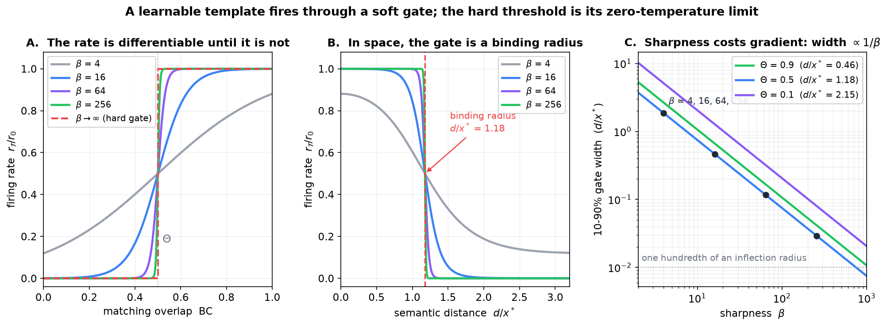

# Implementing Semantic Templates: A Path

**Design note — Semantic Simulation Research Programme**
**Relates to:** book §9.8, §10.4, §10.5.2; [*Semantic Templates as Doi–Peliti Reactions*](Semantic_Templates_as_Doi_Peliti_Reactions.md); [*Doi–Peliti Dynamics of Semantic Particles and Registers*](Doi_Peliti_Dynamics_of_Semantic_Particles_and_Registers.md); [*The Execution Problem*](The_Execution_Problem.md)
**Status:** Proposal. Nothing here is implemented or measured.

> **Thesis.** Hardcoding a template bank cannot work, because the bank *is* the Liouvillian — it specifies the whole dynamics rather than sitting inside it. A learned bank is reachable with machinery the codebase already has, except for one piece that has no formulation yet: the pairing of a Pattern Matching Structure with its Inference Structure. And neither is worth building until the register substrate supports particle-number dynamics at all, which measurement says it currently does not.

---

## Contents

1. [Why hardcoding fails structurally](#1-why-hardcoding-fails-structurally)
2. [Anatomy of a template: three kinds of parameter](#2-anatomy-of-a-template-three-kinds-of-parameter)
3. [The relaxation that makes stoichiometry learnable](#3-the-relaxation-that-makes-stoichiometry-learnable)
4. [The part with no formulation: the PMS-to-IS pairing](#4-the-part-with-no-formulation-the-pms-to-is-pairing)
5. [Three tiers of generality](#5-three-tiers-of-generality)
6. [What the measurements say about the current substrate](#6-what-the-measurements-say-about-the-current-substrate)
7. [Staging, with pass criteria](#7-staging-with-pass-criteria)
8. [Open calibration questions](#8-open-calibration-questions)
9. [Dictionary](#9-dictionary)

---

## 1. Why hardcoding fails structurally

The usual argument against hardcoding is that a fixed bank will not transfer across corpora. True, but the framework supplies a stronger one.

Section 4.4 of the templates note establishes that summing the reaction term over a bank of templates, together with transport and destruction, gives a *complete* Liouvillian — and concludes that the bank "is not an additional structure sitting beside the Doi–Peliti dynamics; it is the specification of that dynamics."

So a template bank is not a module. Hardcoding it is hardcoding the model's entire inference dynamics: which structures may be created, under what conditions, at what rate. That is the generator of the time evolution, not a feature attached to it. A fixed bank gives a model whose dynamics cannot adapt, no matter how much data it sees.

A second consequence points the same way. Section 4.3 of that note shows that templates with trivial matchers reduce to spontaneous creation $\varnothing \to A_v$, whose stationary state is Poisson with mean $c/d$ — so **a model's prior is the stationary state of its unconditional templates**. Hardcoding the bank therefore hardcodes the prior, which is the one thing that most obviously must differ between corpora.

---

## 2. Anatomy of a template: three kinds of parameter

A template $\mathcal{T}$ pairs a Pattern Matching Structure with an Inference Structure (book Definition 8), and in reaction form is

$$
\sum_v k_v A_v \longrightarrow \sum_v (k_v + l_v) A_v, \qquad (2.1)
$$

catalytic and non-consuming: matched structures persist and new ones appear beside them. Its parameters fall into three classes, and conflating them is the main way to get the design wrong.

**Class I — continuous, already differentiable.** The templates note has done this work. Equation (4.4) there reads the hard threshold as the zero-temperature limit of a rate:

$$
r_\mathcal{T} = r_0 \sigma\left(\beta(\mathrm{BC} - \Theta)\right) \longrightarrow r_0 \mathbb{1}\left[\mathrm{BC} \gt \Theta\right] \quad (\beta\to\infty), \qquad (2.2)
$$

with the explicit remark that the form at finite $\beta$ "is also the differentiable one, which matters if templates are ever to be learned rather than specified." The matcher BC is a Bhattacharyya coefficient between the template cloud and the local state, so it is smooth in the cloud's centroid and width. That makes $\mu_\mathcal{T}$, the width, $\Theta$, $r_0$ and $\beta$ ordinary parameters.

Better still, $\Theta$ is not free. By (3.4) of that note,

$$
\mathrm{BC} \gt \Theta \quad\Longleftrightarrow\quad \frac{d}{x^{\ast}} \lt \sqrt{2\ln\frac1\Theta}, \qquad (2.3)
$$

so the matching threshold is a **binding radius measured in inflection radii**, fixed by the same $\kappa$ that sets the well. Learning $\Theta$ is learning how far a template reaches.

**Figure 1.** Left: the rate (2.2) against matching overlap, as $\beta$ anneals toward the manuscript's hard gate. Centre: the same rate against semantic distance, where by (2.3) the gate is a binding radius — here $\Theta = 0.5$ gives $d/x^{\ast} = 1.18$, firing within roughly one inflection radius. Right: the price of sharpness. The 10-90% width of the gate shrinks as $1/\beta$, so the gradient that trains $\Theta$ and $\mu_\mathcal{T}$ vanishes at exactly the sharpness that makes firing decisive. Annealing $\beta$ is therefore not optional bookkeeping but the central training schedule, in the same role as the Gumbel temperature in the existing sparse pair routing.

**Class II — discrete, but relaxable.** The stoichiometry $k, l$ in (2.1): which types participate and how many of each. This is the actual *content* of a template, and it is combinatorial. Section 3 below gives the way through.

**Class III — neither continuous nor discrete.** The pairing of the Pattern Matching Structure with its Inference Structure. Section 4.

---

## 3. The relaxation that makes stoichiometry learnable

Reactions act on occupation numbers, and integer occupancy is the obstruction. The framework already relaxes it: the Poisson-mode reading carries an intensity rather than a count, and a coherent state is a Poisson distribution of mean $\alpha$ rather than a definite number of particles.

Taking that seriously, a template's stoichiometry becomes a pair of non-negative **real** vectors,

$$
k \in \mathbb{R}^{\lvert\mathcal{V}\rvert}_{\geq 0}, \qquad l \in \mathbb{R}^{\lvert\mathcal{V}\rvert}_{\geq 0}, \qquad (3.1)
$$

a requirement intensity and a production intensity over modes. A template is then a learned vector field on mode space, which is a gradient-friendly object: parameterise by $k = \mathrm{softplus}(\tilde{k})$ and likewise for $l$, exactly as semantic mass is already parameterised for positivity.

Two practical consequences follow.

**Sparsity is the existing machinery.** A bank is useful only if few templates fire per step, and that is a top-k selection over a learned score — precisely the straight-through Gumbel-softmax routing the architecture already runs over token pairs. The same code, applied over the template bank instead of over source positions. Note this inherits the same gap flagged elsewhere: the routing ranks a *learned score*, not a force magnitude or an overlap, so the selection is a trained decision rather than the thresholded matcher of (2.2). Whether the two should be unified or deliberately kept apart is a design question, not a detail.

**The bank size is the real capacity dial.** With $k$ and $l$ dense over $\lvert\mathcal{V}\rvert$ the parameter count is $2\lvert\mathcal{V}\rvert$ per template, which is a vocabulary-sized embedding each. A bank of any size then dwarfs the rest of the model. Low-rank or sparse parameterisation of $(k, l)$ is therefore not an optimisation but a precondition for the bank being trainable at all.

---

## 4. The part with no formulation: the PMS-to-IS pairing

Section 6 of the templates note lists what remains open, and one item is the obstruction for this programme:

> Template space geometry. §3.4 proposes the overlap distance as the metric on $\mathfrak{T}$ that book Definition 8 defers. That covers template *clouds*; it says nothing about the pairing of a Pattern Matching Structure with its Inference Structure, **which is the part of a template that is not a density at all.**

Matching is a comparison of densities, and has a metric: the overlap distance restricted to template clouds. The PMS-to-IS binding is a *correspondence* — which created structure goes with which matched one, and where it is placed relative to the match. It is not a point in $\Sigma$, not a density over $\Sigma$, and so the overlap distance says nothing about it.

Three candidate formulations, none worked out:

1. **A placement map.** The IS carries a displacement field: given the matched configuration, the created structure's centroid is $\mu_{\text{new}} = \mu_{\text{match}} + \delta_\mathcal{T}$, with $\delta_\mathcal{T}$ learned. Simple, differentiable, and almost certainly too weak — it makes placement translation-equivariant and blind to the matched configuration's shape.
2. **An operator.** The IS is a map on the matched structure's state, which is the v3 reading, and the execution note already establishes that execution is global in $S$ and lands in a space $\mathbf{E}$ of different dimension. Expressive, but it imports v3's difficulty into what was meant to be a v2 mechanism.
3. **A joint mode over the pair.** Treat $(\text{matched}, \text{created})$ as one multi-particle mode and let the template be a density over the pair. This keeps the overlap-distance geometry, at the cost of a Gram matrix over pairs — $\lvert\mathcal{V}\rvert^2$ in the worst case.

I would start with 1 as a baseline precisely because it is weak: it gives a falsifiable floor. If placement-only templates buy nothing, the question becomes whether placement is the wrong degree of freedom or whether templates are not the bottleneck.

---

## 5. Three tiers of generality

| Tier | Where templates come from | Generality | Status |
|---|---|---|---|
| 0 | Hardcoded bank | none — the bank is the dynamics (§1) | ruled out |
| 1 | Learned at training, fired at inference | corpus-specific | reachable now |
| 2 | Induced from context at inference | cross-corpus | the real target |

Tier 1 is v2 as the book describes it: creation during inference, with the bank as a parameter. It is the tractable step.

Tier 2 deserves its own name — **induction**, not learning. No weight updates; the model recognises a regularity in the context window and begins firing a template it did not previously have. That is the in-context-learning analogue, and it is what actually answers "widely different corpora without retraining." It is also where (2.2) becomes awkward: an induced template has no training signal to set $r_0$, which §8 returns to.

Continual learning with weight updates at inference is a different problem, treated in the book's continual-learning section. It is probably not needed for this and should not be conflated with Tier 2.

---

## 6. What the measurements say about the current substrate

This is the part that should govern sequencing, because three measured facts make templates premature today.

**There is no particle-number dynamics to hang reactions on.** The book's remark on what the trained registers implement reports three pre-registered measurements (DP1–DP3) on trained Fock models:

- the active fraction is **0.9995–1.000 at every layer** — "there are no particle-number dynamics";
- near-duplicate register content is at most 1.3% of active pairs — the registers are distinct slots;
- the Spearman correlation between a register's salience and its own contribution to the reverse-channel force lies between $-0.41$ and $0.0$, **never positive** — "salience is not an intensity."

The conclusion recorded there is that the trained registers are "$M$ always-occupied exclusion slots whose content is renewed layer by layer." A template is a creation operator. Firing one into a pool that is already fully occupied does nothing that a content refresh was not already doing, and the Poisson-intensity relaxation of §3 has no referent in a substrate whose occupancies are pinned at one.

**v2's necessity has never been witnessed.** The F1 falsifier (base Dyck) exists to show it, but the only Dyck run used the v1 register design, whose registers could not reach the tokens at all: scrambling every register-side parameter left the logits unchanged and no gradient reached them. That result is run-to-run variation, not evidence.

**The candidate matchers do not match.** A template's matcher is the overlap between its cloud and the local state (§2). The trained Poisson modes have exactly that form (a centre, a width, the overlap $E_v = \exp(-\kappa_v^2 \lVert h - \mu_v \rVert^2)$, a firing record), and the community note reads them as learned pattern-matching regions. Measured on the trained PMX, FO-b-PMX and PMX-K16 (protocol §5.13, 2026-10-23), they do not discriminate:
- a mode's overlap varies by only 1–4% from token to token, because the trained wells stay broad ($\kappa_v^2 d$ median 0.6–1.0, its value at initialisation);
- the occupations are reproduced to 99.8% or more from the position alone;
- giving a sequence another text's occupations costs 0.02–0.09% perplexity, against 155–282% for removing the wells;
- beyond the first ~100 tokens, the wells act as a fixed extra landscape (fixing every occupation at one value costs about 1%).

So the matching half of a template, which the community note took to be present in weak form, is present in form but not in function: training did not make the modes content-selective, and the models do not use what selectivity there is.

Taken together: building templates on this substrate risks an unfalsifiable outcome. If the model improves, the cause is ambiguous; if it does not, one cannot distinguish a failure of the mechanism from a failure of the substrate to support it.

---

## 7. Staging, with pass criteria

**Stage 0 — make creation real.** Before any template code. Target: an active fraction that genuinely varies across layers and positions, and a salience that behaves as an intensity. DP1–DP3 are the existing probe, so the pass criterion is already written: active fraction away from the 0.9995–1.000 ceiling, and a *positive* salience-to-force correlation. The note on the register scheme diagnoses why the current update pins the fraction — right after refresh, $s \geq (1-\lambda)/(t+1)$, so at $\lambda = 0.5$ no register can be inactive in the first 99 positions. That inequality is the thing to break.

**Stage 0′ — make matching real.** Alongside Stage 0, and equally a precondition. Target: modes whose overlap discriminates between tokens, and a model that uses it. Since training does not narrow the wells, selectivity has to be designed in: narrow initial wells (larger $\kappa_v^2$) with centres placed near real hidden states, so that each mode reaches only part of the state cloud. Pass criteria, all with existing tools (`pm_mode_usage.py`, `pm_content_swap.py`): the median coefficient of variation of a mode's overlap across tokens well above the present 0.01–0.04; the occupations no longer reproduced from position alone; and a content-swap cost well above the present 0.02–0.09%. The trained test is the narrow-wells arm (protocol §5.13, proposed); a check at initialisation, on CPU, comes first.

**Stage 0′a — why the modes do not match, and a design that would (CPU, 2026-10-23).** `notebooks/conservative_arch/scaleup/debug/narrow_wells_design.py`, output `narrow_wells_design_output.txt`; PMX-K16's configuration, at initialisation and trained, 4,096 validation tokens. Three findings:

1. **The centres sit outside the token cloud.** At layer 0 the token states are small (median norm 0.6 at initialisation, 2.9 trained; the whole cloud spans 1–4 units), while the centres are drawn at the LayerNorm scale (median norm 19 at initialisation, 14 trained; the code's comment assumes states at LayerNorm scale, which layer 0's are not). Every token is then 14–19 units from every centre, the same distance to within 0.1–0.4. No width makes such a mode selective, and training did not move the centres into the cloud.
2. **One set of centres cannot serve both layers.** Layer 1's input lies on the LayerNorm sphere (norm 19.6), far from layer 0's small cloud near the origin. The centres and widths are shared by the layers, so a mode can sit inside at most one cloud.
3. **In 384 dimensions an isotropic Gaussian cannot grade.** Even with centres placed on trained token states, distances concentrate: the token-to-centre distances spread by only 20–24% of their median. Halving the width moves a mode from reaching 97–100% of tokens to reaching 1–6%, with a third or more of tokens then reaching no mode at all.

| matching distance measured in | spread of distances | a mode reaches | tokens reaching some mode | selectivity (overlap CV) |
| --- | ---: | ---: | ---: | ---: |
| all 384 dimensions (today) | 0.20–0.24 | 97–100% or 1–6% | 100% or 36–64% | 0.1–0.2 |
| a 16-dimensional subspace | 0.58–0.60 | 5% | 90–95% | 0.8 |
| an 8-dimensional subspace | 0.77–1.00 | 6–15% | 94–99% | 0.8–1.1 |

(Both layers; the subspace is the top principal directions of the layer's trained states; width κ² = c / D², with D² the median squared token distance in the subspace, c = 2–4. Trained models today: selectivity 0.01–0.04.)

**The design that follows (proposed; nothing implemented).**
- **Low-rank matching:** E_v = exp(−κ_v² ‖P_l (h − μ_{l,v})‖²) with a learned projection P_l of rank r = 8 (16 as the alternative), one per layer, initialised from the principal directions of the layer's states. The potential stays a scalar function of h, so the wells' force stays conservative. Its curvature lies in the r-dimensional span of P_l.
- **Per-layer centres** μ_{l,v} (2 × K × d parameters, about 12k at K = 16), initialised at token states sampled from that layer's input at the start of training.
- **A width that follows the cloud:** κ_v² = c_v / D̄²_l, with D̄²_l a running estimate of the layer's median squared projected distance (detached) and c_v learned, starting at 2. The layer-0 cloud grows about fivefold in training, so a width fixed in absolute units would end up too narrow.
- **Integration:** the first build uses the explicit kick for the wells (PM1's path, `POISSON_WELLS_EXACT = False`), which needs changes only in the occupation and the force. Folding a rank-r curvature into PMX's exact flow comes after the selectivity is shown to survive training.
- **Checks before any GPU run (CPU):** at initialisation, selectivity of at least 0.5, coverage of at least 90%, a reach of 5–20%; finite, non-zero gradients on P_l, μ, c_v and the depths after one step; and, on a short CPU training run, the position-only share of the occupations falling below its present 99.8%.

**Stage 0′, implemented (2026-10-23).** The design above is in the model as `poisson_match_rank` (Cell 0 `POISSON_MATCH_RANK`, tag `pmlr<r>`), off by default. Two changes against the design, both from the checks:
- **Centres by k-means, not random samples.** At initialisation the projected cloud is a dense core (about 75% of the tokens) plus small, tight clusters, most likely the frequent tokens' random embeddings. With 16 random samples about 15% of the tokens reached no mode. The centres are now k-means cluster means in span(P_l) (k-means++ seeded, 10 passes), and coverage is 100%.
- **Starting width factor c = 1.0, not 2,** and the "median reach 5–20%" criterion was dropped, because the clustered cloud makes the median mode a small cluster's mode by construction. Selectivity (at least 0.5) and coverage (at least 90%) remain the criteria.

*Verification* (`debug/verify_pm_match.py`, output `debug/verify_pm_match_output.txt`). With the switch off, four existing configurations (F3.1, PM1, PMX-K16, FO-b-PMX-K16) are bit-identical to the committed code: loss, logits, every parameter and every gradient, checked against a checkout of HEAD. With r = 8 and K = 16, in both orders: selectivity 3.2–3.6 at initialisation (trained isotropic modes 0.01–0.04), coverage 100%, about five modes per token; the force equals −∇U by autograd to about 1e-7; every new parameter has a finite, non-zero gradient after one step; the running width moves in training and not in evaluation.

*Short training run* (`debug/pm_match_short_train.py`, output `debug/pm_match_short_train_output.txt`): both arms from scratch on CPU, SR2 base, K = 16, explicit wells, 300 steps of 4 × 256 tokens, evaluated on held-out tokens.

| after 300 steps | isotropic (today's modes) | rank 8 |
| --- | ---: | ---: |
| selectivity, layer 0 / layer 1 | 0.004 / 0.11 | 1.54 / 0.74 |
| occupations explained by position, layer 0 / layer 1 | 100.00% / 99.8% | 81.9% / 98.0% |
| content swap (occupations from another sequence) | +0.00% | +0.08% (spread 0.20%) |
| training loss at step 300; held-out perplexity | 5.77; 672 | 5.75; 694 |

- **The selectivity survives early training.** It falls from its initial value, but stays 100–400 times the isotropic modes' at layer 0.
- **At layer 0 the occupations start to carry content:** 18% of their variance is no longer position. At layer 1 they stay 98% position.
- **The model does not use the content yet** (content swap +0.08%, inside the spread). 300 steps on CPU is too short to say whether a full run would; the GPU arm answers that.
- **Selective overlaps are necessary, not sufficient.** An occupation sums a mode's overlaps over its half-life window, and the sum averages the token-level variation away. Even at initialisation, with selectivity 2.7, the occupations were 98% position at layer 0. Shorter half-lives (the initial range is 4–128 tokens) or sparser firing would keep more content in the occupations. That is the next knob if the GPU arm shows selective overlaps with positional occupations.

Of the three pass criteria, the first is met, the second partly (layer 0), and the third not yet.

**Stage 1 — one template, smallest form.** The single-type catalytic case $A_u \to A_u + A_v$, with learned $r_0$ and $\Theta$ and an annealed $\beta$. A free correctness check comes with it: by §4.3 of the templates note, unconditional templates give a Poisson stationary state of mean $c/d$, which should reproduce the log-unigram output bias. An implementation that does not recover that is wrong before anything interesting is tested.

**Stage 2 — a bank.** Gumbel top-k routing over templates, low-rank $(k, l)$, placement-map IS. Measured on F1 (base Dyck, v2's own falsifier) and F3 (Dyck with let-binding). F1 is the one that matters: it is the test v2 has never passed for substrate reasons.

**Stage 3 — induction.** Only once a learned bank demonstrably beats no bank on F1. Otherwise Tier 2 is being built on an unproven Tier 1.

---

## 8. Open calibration questions

- **The rate scale $r_0$.** Listed as open in the templates note: (2.3) fixes *where* a template fires, nothing fixes how often. Harmless at Tier 1, where $r_0$ is a parameter. It becomes the central problem at Tier 2, since an induced template arrives with no training signal for its rate. A natural candidate is to tie $r_0$ to the match strength itself rather than learning it separately, but that collapses two degrees of freedom the formalism deliberately separates.
- **Annealing schedule for $\beta$.** Figure 1C quantifies the trade-off; it does not choose a schedule. The existing Gumbel temperature schedule is the obvious starting point, and the two may need to be annealed together since both sharpen a selection.
- **Whether the routing score and the matcher should coincide.** §3 above.
- **Bank size.** No principle yet sets how many templates a corpus needs, nor whether the bank should be shared across contexts or conditioned on them.
- **Empirical status of templates generally.** The templates note records that "no comparable probe exists for templates, because the trained models do not implement them." That remains true.

---

## 9. Dictionary

| Term | Meaning here |
|---|---|
| Template $\mathcal{T}$ | A Pattern Matching Structure paired with an Inference Structure (book Definition 8); in reaction form, (2.1) |
| Template bank | The set of all templates — equivalently, the Liouvillian of the dynamics (§1) |
| Matcher BC | Bhattacharyya coefficient between the template cloud and the local state; smooth in the cloud's parameters |
| Binding radius | $d/x^{\ast} = \sqrt{2\ln(1/\Theta)}$ by (2.3): the threshold expressed as a distance |
| Sharpness $\beta$ | Interpolates between a differentiable gate and the manuscript's hard threshold; the central training schedule |
| Stoichiometry $(k, l)$ | Requirement and production intensities over modes; relaxed to non-negative reals in §3 |
| PMS-to-IS pairing | The correspondence between matched and created structures. Not a density; no formulation yet (§4) |
| Induction | Acquiring a template from context at inference with no weight update — Tier 2, distinct from continual learning |

**Summary.** The continuous parameters of a template are already differentiable, and the templates note supplies the form. The discrete part, stoichiometry, becomes differentiable under the Poisson-intensity relaxation the framework already uses, with low-rank structure as a precondition for trainability. The genuinely unformulated part is the pairing of matcher to inference structure, which is not a density and so inherits none of the overlap-distance geometry; a placement map is the weak baseline worth falsifying first. None of it should be built before the register substrate shows particle-number dynamics, because measurement currently says it has none — active fraction pinned at 0.9995–1.000, salience not an intensity, and v2's own falsifier never yet run on a substrate where registers could reach the tokens. Nor before the modes that would serve as matchers discriminate between tokens, which as trained they do not (Stage 0′).
