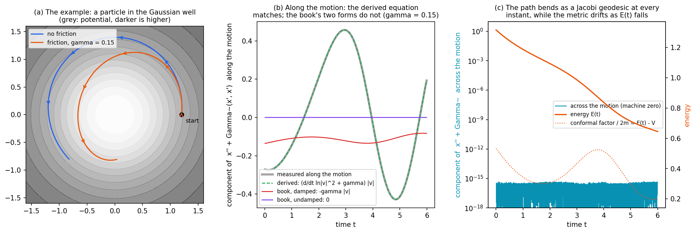

# The Jacobi Metric from the Euler–Lagrange Equations

**What this note does.** It derives, step by step, why the trajectories of a particle moving in a potential are geodesics of a metric built from that potential (the **Jacobi metric**), and what changes when friction is added. Two independent derivations are given: one variational (Maupertuis' principle), one by direct computation with the connection of a conformally rescaled metric. The note then works out how the geodesic equation reads in the original time variable, which is the form the book's diagnostics use. It checks every equation numerically.

**Why it matters for the book.** The book (§27, "The Jacobi metric: what the framework predicts") states the Jacobi metric correctly, but writes the geodesic equation in the layer-time variable without the term that a change of time variable produces. §8 sets out the discrepancy, which affects the tangential part of the predicted acceleration and not the shape of the path.

## Contents

1. [Notation](#1-notation)
2. [The Euler–Lagrange equations in a curved configuration space](#2-the-eulerlagrange-equations-in-a-curved-configuration-space)
3. [Energy conservation](#3-energy-conservation)
4. [First derivation: Maupertuis' principle](#4-first-derivation-maupertuis-principle)
5. [Second derivation: the connection of the conformal metric](#5-second-derivation-the-connection-of-the-conformal-metric)
6. [Time versus the Jacobi parameter](#6-time-versus-the-jacobi-parameter)
7. [With friction: the damped case](#7-with-friction-the-damped-case)
8. [Numerical check](#8-numerical-check)
9. [Relation to the book](#9-relation-to-the-book)
10. [Summary of results](#10-summary-of-results)

---

## 1. Notation

- $x = (x^1, \dots, x^n)$: coordinates of the particle (in the book, the hidden state $h$ in $\mathbb{R}^d$).
- $t$: time (in the book, the layer index, with step $\Delta t$).
- $\dot{x} = dx/dt$, $\ddot{x} = d^2x/dt^2$.
- $g$: the **kinetic metric**, a symmetric positive-definite matrix field with components $g_{ij}(x)$ and inverse $g^{ij}$. In the book $g_{ij} = \delta_{ij}$ (Euclidean). Repeated upper and lower indices are summed.
- $m$: the mass (the book writes $\mathfrak{m}$), assumed constant.
- $V(x)$: the potential.
- $\lvert v \rvert^2 = g_{ij} v^i v^j$ for a vector $v$; for $v = \dot{x}$ this is the squared speed.
- $\nabla V$: the gradient vector, with components $g^{ij} \partial_j V$.
- $\Gamma$: the Christoffel symbols of $g$ (zero in Euclidean coordinates).
- $E$: the total energy; $T = \frac{1}{2} m \lvert \dot{x} \rvert^2$, the kinetic energy.
- $\gamma$: the friction coefficient (§7).
- A tilde marks objects of the Jacobi metric: $\tilde{g}$, $\tilde{\Gamma}$.

## 2. The Euler–Lagrange equations in a curved configuration space

The Lagrangian is kinetic minus potential energy:

$$
L(x, \dot{x}) = \frac{1}{2} m g_{ij}(x) \dot{x}^i \dot{x}^j - V(x).
$$

The Euler–Lagrange equation for each coordinate $x^k$ is

$$
\frac{d}{dt} \frac{\partial L}{\partial \dot{x}^k} - \frac{\partial L}{\partial x^k} = 0.
$$

The two derivatives are

$$
\frac{\partial L}{\partial \dot{x}^k} = m g_{kj} \dot{x}^j, \qquad \frac{\partial L}{\partial x^k} = \frac{1}{2} m (\partial_k g_{ij}) \dot{x}^i \dot{x}^j - \partial_k V.
$$

Differentiating the first in time, along the motion,

$$
\frac{d}{dt}\left( m g_{kj} \dot{x}^j \right) = m g_{kj} \ddot{x}^j + m (\partial_i g_{kj}) \dot{x}^i \dot{x}^j.
$$

The term $(\partial_i g_{kj}) \dot{x}^i \dot{x}^j$ is symmetric in $i$ and $j$ after summation, so it can be written as $\frac{1}{2}(\partial_i g_{kj} + \partial_j g_{ki}) \dot{x}^i \dot{x}^j$. Substituting into the Euler–Lagrange equation gives

$$
m g_{kj} \ddot{x}^j + m \cdot \frac{1}{2}\left( \partial_i g_{kj} + \partial_j g_{ki} - \partial_k g_{ij} \right) \dot{x}^i \dot{x}^j = - \partial_k V.
$$

The bracket is twice the Christoffel symbol of the first kind. Multiplying by $g^{lk}$ raises the index and yields the **equation of motion**

$$
m \left( \ddot{x}^l + \Gamma^l_{ij} \dot{x}^i \dot{x}^j \right) = - g^{lk} \partial_k V, \qquad \Gamma^l_{ij} = \frac{1}{2} g^{lk} \left( \partial_i g_{kj} + \partial_j g_{ki} - \partial_k g_{ij} \right).
$$

The left side is $m$ times the covariant acceleration, $m \nabla_{\dot{x}} \dot{x}$, so the equation reads $m \nabla_{\dot{x}} \dot{x} = - \nabla V$: Newton's law with the geometry of $g$. In Euclidean coordinates $\Gamma = 0$ and it is $m \ddot{x} = - \nabla V$, the book's eq. (euler-lagrange).

Without a potential the equation is $\nabla_{\dot{x}} \dot{x} = 0$: free particles move on geodesics of the kinetic metric $g$. The Jacobi metric extends this to particles in a potential.

## 3. Energy conservation

The total energy is

$$
E = \frac{1}{2} m \lvert \dot{x} \rvert^2 + V(x).
$$

Along the motion,

$$
\frac{dE}{dt} = m g(\dot{x}, \nabla_{\dot{x}} \dot{x}) + \dot{x}^k \partial_k V = g(\dot{x}, - \nabla V) + \dot{x}^k \partial_k V = 0,
$$

using the equation of motion. So $E$ is constant, and at every point of the trajectory

$$
T = \frac{1}{2} m \lvert \dot{x} \rvert^2 = E - V(x), \qquad \lvert \dot{x} \rvert^2 = \frac{2 (E - V(x))}{m}.
$$

The speed is therefore a known function of position. This is what lets time be eliminated from the problem.

## 4. First derivation: Maupertuis' principle

**Step 1. Hamilton's principle with a free end time.** The action is $S = \int L dt$. Compare the true motion with nearby motions that keep the end positions fixed but may end at a slightly different time. For such variations, with fixed end positions, the standard first-variation formula gives

$$
\delta S = - H \delta t_{\mathrm{end}},
$$

where $H = p_k \dot{x}^k - L$ is the Hamiltonian, $p_k = \partial L / \partial \dot{x}^k$ the momentum, and $\delta t_{\mathrm{end}}$ the change of the end time. (The integrand's contribution vanishes because the true motion satisfies the Euler–Lagrange equation; only the boundary term survives.) Here $H = E$.

**Step 2. Restrict to motions of the same energy.** If all compared motions have the same energy $E$, then $\delta S = - E \delta t_{\mathrm{end}} = - \delta (E t_{\mathrm{end}})$, so

$$
\delta \int (L + E) dt = 0.
$$

Since $L + E = (T - V) + (T + V) = 2T = p_k \dot{x}^k$, this is **Maupertuis' principle**: among paths of energy $E$ between two points, the true path makes the *abbreviated action* stationary,

$$
S_0 = \int p_k \dot{x}^k dt = \int 2T dt.
$$

**Step 3. Eliminate time.** Let $ds = \lvert \dot{x} \rvert dt$ be arc length in the kinetic metric. Then

$$
2T dt = m \lvert \dot{x} \rvert^2 dt = m \lvert \dot{x} \rvert ds = \sqrt{2 m (E - V)} ds,
$$

using §3 for the speed. So

$$
S_0 = \int \sqrt{2 m \left( E - V(x) \right)} ds = \int \sqrt{ 2 m (E - V) g_{ij} dx^i dx^j }.
$$

**Step 4. Read off the metric.** This is the length of the path in the metric

$$
\tilde{g}_{ij}(x) = 2 m \left( E - V(x) \right) g_{ij}(x),
$$

which is the **Jacobi metric**. Paths that make length stationary are geodesics. So the paths of the motion at energy $E$ are geodesics of $\tilde{g}$.

Two remarks:

- **Constant factors do not matter.** Multiplying a metric by a positive constant does not change its geodesics. The book's eq. (jacobi-metric) writes $2(E - V) g$ without the mass, and eq. (damped-conformal-factor) writes $2 \mathfrak{m} T$; the two conventions differ by the constant $m$ and give the same geodesics.
- **Where the metric degenerates.** $\tilde{g}$ is a genuine metric only where $E \gt V$. On the boundary $E = V$ (a turning point, where the particle stops) it vanishes, and the construction breaks down there.

Maupertuis' principle is a statement about the **path**, the unparametrised curve. It says nothing about how fast the path is traversed. §6 shows what the time dependence looks like.

## 5. Second derivation: the connection of the conformal metric

This route verifies the result directly from the equation of motion, and it gives the time dependence at the same time.

**Step 1. The connection of a conformally rescaled metric.** Write the Jacobi metric as $\tilde{g} = e^{2 \sigma} g$ with

$$
e^{2 \sigma(x)} = 2 m \left( E - V(x) \right), \qquad \sigma = \frac{1}{2} \ln \left( 2 m (E - V) \right).
$$

The book calls $\Omega = e^{\sigma}$ the conformal factor. The derivatives of the new metric are

$$
\partial_k \tilde{g}_{ij} = e^{2\sigma} \left( \partial_k g_{ij} + 2 (\partial_k \sigma) g_{ij} \right).
$$

Inserting them into the Christoffel formula of §2, the factors $e^{2\sigma}$ cancel between the inverse metric and the derivatives, leaving

$$
\tilde{\Gamma}^l_{ij} = \Gamma^l_{ij} + \delta^l_i \partial_j \sigma + \delta^l_j \partial_i \sigma - g_{ij} g^{lk} \partial_k \sigma.
$$

In Euclidean coordinates $\Gamma = 0$, and this is the book's eq. (christoffel) with $\ln \Omega = \sigma$.

**Step 2. The Jacobi acceleration of any curve.** Contracting with $\dot{x}^i \dot{x}^j$, the covariant acceleration in the Jacobi metric is

$$
\ddot{x}^l + \tilde{\Gamma}^l_{ij} \dot{x}^i \dot{x}^j = \left( \ddot{x}^l + \Gamma^l_{ij} \dot{x}^i \dot{x}^j \right) + 2 (\dot{x}^k \partial_k \sigma) \dot{x}^l - \lvert \dot{x} \rvert^2 \nabla^l \sigma.
$$

**Step 3. Insert the motion.** From the definition of $\sigma$,

$$
\nabla \sigma = \frac{- \nabla V}{2 (E - V)} = \frac{- \nabla V}{m \lvert \dot{x} \rvert^2},
$$

where the second form uses energy conservation, $2(E - V) = m \lvert \dot{x} \rvert^2$, valid on the trajectory. The equation of motion gives the first bracket as $- \nabla V / m$. Substituting both,

$$
\ddot{x} + \tilde{\Gamma}(\dot{x}, \dot{x}) = - \frac{\nabla V}{m} - \frac{2 (\dot{x} \cdot \nabla V)}{m \lvert \dot{x} \rvert^2} \dot{x} + \frac{\nabla V}{m} = - \frac{2 (\dot{x} \cdot \nabla V)}{m \lvert \dot{x} \rvert^2} \dot{x},
$$

where $\dot{x} \cdot \nabla V = \dot{x}^k \partial_k V$ is the rate at which the potential changes along the motion. **The two $\nabla V$ terms cancel exactly**: everything that pushes the particle sideways has been absorbed into the geometry.

**Step 4. Use energy conservation once more.** Since $\frac{d}{dt} \left( \frac{1}{2} m \lvert \dot{x} \rvert^2 \right) = - \dot{x} \cdot \nabla V$,

$$
\frac{-2 (\dot{x} \cdot \nabla V)}{m \lvert \dot{x} \rvert^2} = \frac{d}{dt} \ln \lvert \dot{x} \rvert^2,
$$

and therefore

$$
\ddot{x} + \tilde{\Gamma}(\dot{x}, \dot{x}) = \left( \frac{d}{dt} \ln \lvert \dot{x} \rvert^2 \right) \dot{x}.
$$

The right side points along $\dot{x}$. Its component perpendicular to the motion is zero, so the path bends exactly as a geodesic of $\tilde{g}$ does: this is the same result as §4, reached without any variational argument. But the right side is not zero. In the time variable $t$ the trajectory is a geodesic *traversed at a non-uniform rate*, which the next section makes precise.

## 6. Time versus the Jacobi parameter

**The reparametrisation identity.** Let a curve be written as $x(t) = y(\tau(t))$ for some other parameter $\tau$, with $y' = dy/d\tau$. The chain rule gives $\dot{x} = \dot{\tau} y'$ and $\ddot{x} = \dot{\tau}^2 y'' + \ddot{\tau} y'$, so

$$
\ddot{x} + \tilde{\Gamma}(\dot{x}, \dot{x}) = \dot{\tau}^2 \left( y'' + \tilde{\Gamma}(y', y') \right) + \frac{\ddot{\tau}}{\dot{\tau}} \dot{x}.
$$

**The affine parameter.** Choose $\tau$ so that $\ddot{\tau} / \dot{\tau} = \frac{d}{dt} \ln \lvert \dot{x} \rvert^2$, that is,

$$
\frac{d\tau}{dt} = c \lvert \dot{x} \rvert^2 = \frac{2c}{m} T = \frac{2c}{m} (E - V),
$$

for any constant $c \gt 0$. Comparing with §5, step 4, the curve then satisfies

$$
y'' + \tilde{\Gamma}(y', y') = 0:
$$

it is an **affinely parametrised geodesic** of $\tilde{g}$ in the parameter $\tau$. This $\tau$ is, up to a constant, the Jacobi arc length: $d\tilde{s} = e^{\sigma} ds = \sqrt{2 m (E - V)} \lvert \dot{x} \rvert dt = m \lvert \dot{x} \rvert^2 dt$. It runs fast where the particle is fast and slow where it is slow.

So there are two correct statements, and they must not be mixed:

| variable | equation | meaning |
| --- | --- | --- |
| Jacobi parameter τ | y″ + Γ̃(y′, y′) = 0 | an affinely parametrised geodesic |
| original time t | ẍ + Γ̃(ẋ, ẋ) = (d/dt ln ∣ẋ∣²) ẋ | the same curve, at the true speed |

## 7. With friction: the damped case

**The equation of motion.** Friction proportional to velocity enters through the Rayleigh dissipation function $R = \frac{1}{2} \gamma m \lvert \dot{x} \rvert^2$ (the book's eq. (lagrange-rayleigh)), which adds $\partial R / \partial \dot{x}^k = \gamma m g_{kj} \dot{x}^j$ to the Euler–Lagrange equation:

$$
m \nabla_{\dot{x}} \dot{x} = - \nabla V - \gamma m \dot{x}.
$$

**Energy now decreases.** Repeating §3,

$$
\frac{dE}{dt} = - \gamma m \lvert \dot{x} \rvert^2 = - 2 \gamma T.
$$

So there is no single energy, and no single Jacobi metric. At each moment, though, there is a current energy $E(t)$, and the **Jacobi metric of the current energy**

$$
\tilde{g}_t = 2 m \left( E(t) - V(x) \right) g.
$$

At the particle's position this conformal factor equals $2 m T(t) = m^2 \lvert \dot{x} \rvert^2$, which is the book's layer-dependent factor $\Omega_{\ell}^2 = 2 \mathfrak{m} T_{\ell}$ (eq. (damped-conformal-factor)). The metric depends on time only through the constant shift $E(t)$, so its spatial gradient is still $\nabla \sigma = - \nabla V / (m \lvert \dot{x} \rvert^2)$ at the particle.

**The computation.** §5, steps 2 and 3, go through unchanged except that the equation of motion now has the extra term $- \gamma \dot{x}$:

$$
\ddot{x} + \tilde{\Gamma}(\dot{x}, \dot{x}) = - \gamma \dot{x} - \frac{2 (\dot{x} \cdot \nabla V)}{m \lvert \dot{x} \rvert^2} \dot{x}.
$$

The power balance is now $\frac{d}{dt} \left( \frac{1}{2} m \lvert \dot{x} \rvert^2 \right) = - \dot{x} \cdot \nabla V - \gamma m \lvert \dot{x} \rvert^2$, so

$$
\frac{-2 (\dot{x} \cdot \nabla V)}{m \lvert \dot{x} \rvert^2} = \frac{d}{dt} \ln \lvert \dot{x} \rvert^2 + 2 \gamma,
$$

and the result is

$$
\ddot{x} + \tilde{\Gamma}(\dot{x}, \dot{x}) = \left( \frac{d}{dt} \ln \lvert \dot{x} \rvert^2 + \gamma \right) \dot{x}.
$$

**What it means.**

- **Friction adds no sideways force.** The right side is again along $\dot{x}$, so at every instant the path bends exactly as a geodesic of the *current* Jacobi metric does.
- **But the metric drifts.** As $E(t)$ falls, the metric $\tilde{g}$ of the current energy changes, so the path is not a geodesic of any one fixed metric. Friction changes the path only through the energy, never by a transverse push. This agrees with the book's §7a ("Friction adds no transverse force, but it does change the path").
- **In the Jacobi parameter** ($d\tau / dt = \lvert \dot{x} \rvert^2$), the reparametrisation identity of §6 gives

$$
y'' + \tilde{\Gamma}(y', y') = \frac{\gamma}{\lvert \dot{x} \rvert^2} y',
$$

  a tangential term of *positive* sign. In this parameter friction shows up as a stretching of the parameter, not as a drag.

## 8. Numerical check

Each equation above was checked on a particle in a two-dimensional Gaussian well, $V = m \upsilon^2 (1 - e^{-\kappa^2 \lvert x \rvert^2})$, the book's well, with $m = 1.3$, $\upsilon = 1$, $\kappa = 0.8$. It was integrated with a fourth-order Runge–Kutta scheme at step $10^{-4}$, without friction and with $\gamma = 0.15$. Along the trajectory the left side $\ddot{x} + \tilde{\Gamma}(\dot{x}, \dot{x})$ was computed from the current-energy Jacobi metric and compared with three candidate right sides.

**Figure 1.** (a) The motion, from the same start, without friction (blue) and with γ = 0.15 (orange), over the potential (grey; darker is higher). (b) Along the damped trajectory, the component of the Jacobi acceleration along the motion: measured (thick grey), the equation derived in §7 (green dashed, indistinguishable from it), and the book's two forms (red and purple). (c) The component across the motion (blue, logarithmic scale), at machine precision throughout, together with the falling energy and the conformal factor at the particle.

| candidate right side, in time t | no friction | γ = 0.15 |
| --- | ---: | ---: |
| 0 (book, eq. jacobi-geodesic-flat) | 100% error | 100% error |
| −γẋ (book, eq. damped-geodesic) | 100% error | 126% error |
| (d/dt ln ∣ẋ∣² + γ) ẋ (§5 and §7) | 1 × 10⁻⁹ | 3 × 10⁻⁹ |
| component of the left side perpendicular to ẋ | 8 × 10⁻¹⁷ | 1 × 10⁻¹⁶ |

The errors are median relative errors; the residual $10^{-9}$ is the precision of the finite-difference time derivative. The last row confirms that the path is a geodesic of the (current) Jacobi metric to machine precision.

## 9. Relation to the book

The book's Jacobi metric (eq. jacobi-metric), its conformal factor and the layer-dependent factor $\Omega_{\ell}^2 = 2 \mathfrak{m} T_{\ell}$ are correct, and so is its claim that the path is a Jacobi geodesic. Two equations are not correct as written, because they use the layer time $t$ without the reparametrisation term of §6:

- **eq. (jacobi-geodesic-flat)** sets $\ddot{x} + \tilde{\Gamma}(\dot{x}, \dot{x}) = 0$ in $t$. The correct equation in $t$ has $\left( \frac{d}{dt} \ln \lvert \dot{x} \rvert^2 \right) \dot{x}$ on the right. Written out in flat coordinates, the book's "predicted coordinate acceleration of a Jacobi geodesic" equals Newton's acceleration $- \nabla V / m$ in its component **perpendicular** to the motion, but has the **opposite sign** in its component **along** the motion.
- **eq. (damped-geodesic)** sets $\ddot{x} + \tilde{\Gamma}(\dot{x}, \dot{x}) = - \gamma \dot{x}$. The correct right side is $\left( \frac{d}{dt} \ln \lvert \dot{x} \rvert^2 + \gamma \right) \dot{x}$: friction appears with the opposite sign, next to the reparametrisation term.

**What this affects.** The shape of the path, and every statement about it, is unaffected, since the error is purely along the direction of motion. A diagnostic that compares a *predicted acceleration vector* with the observed one in layer time is affected, because it mixes in the wrong tangential component. Directional cosine similarity is such a diagnostic. A correct comparison uses either the component of the acceleration perpendicular to the motion, or the corrected equation of §5 and §7. The book already withdraws the residual diagnostic derived from these equations, for a separate reason (its Remark on the residual's inability to detect a geodesic at one step per layer). Whether the "3–20% higher directional cosine" reported for the damped form in the Diagnostic Battery survives the correction would have to be recomputed.

This note does not change the book. The correction is the author's decision.

## 10. Summary of results

- **The Jacobi metric.** For $L = \frac{1}{2} m g(\dot{x}, \dot{x}) - V$ at energy $E$, $\tilde{g} = 2 m (E - V) g$. Constant factors are immaterial, and the metric degenerates at turning points, where $E = V$.
- **The path** of the motion is a geodesic of $\tilde{g}$ (§4 by Maupertuis' principle, §5 directly).
- **In the Jacobi parameter** τ, with $d\tau = \lvert \dot{x} \rvert^2 dt$, the geodesic is affinely parametrised: $y'' + \tilde{\Gamma}(y', y') = 0$.
- **In time t**, $\ddot{x} + \tilde{\Gamma}(\dot{x}, \dot{x}) = \left( \frac{d}{dt} \ln \lvert \dot{x} \rvert^2 \right) \dot{x}$.
- **With friction γ**, using the Jacobi metric of the current energy: $\ddot{x} + \tilde{\Gamma}(\dot{x}, \dot{x}) = \left( \frac{d}{dt} \ln \lvert \dot{x} \rvert^2 + \gamma \right) \dot{x}$. The path bends as a geodesic of the current metric at every instant, and friction changes the path only through the falling energy.

**References.** V. I. Arnold, *Mathematical Methods of Classical Mechanics*, 2nd ed., Springer (1989), §45. H. Goldstein, C. Poole, J. Safko, *Classical Mechanics*, 3rd ed., Addison-Wesley (2002), §8.6. L. D. Landau, E. M. Lifshitz, *Mechanics*, 3rd ed., Pergamon (1976), §44. J. M. Lee, *Introduction to Riemannian Manifolds*, 2nd ed., Springer (2018), on conformal changes of metric.
