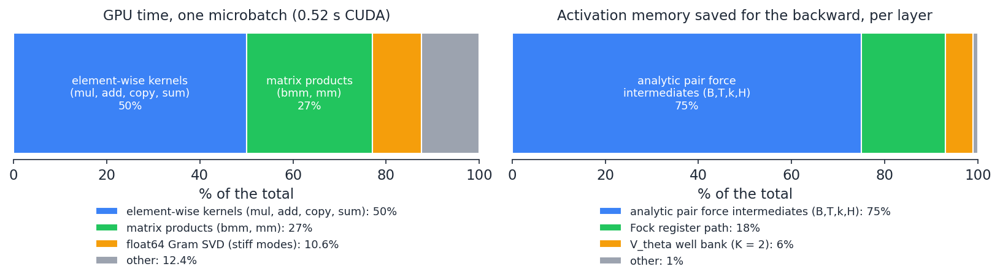
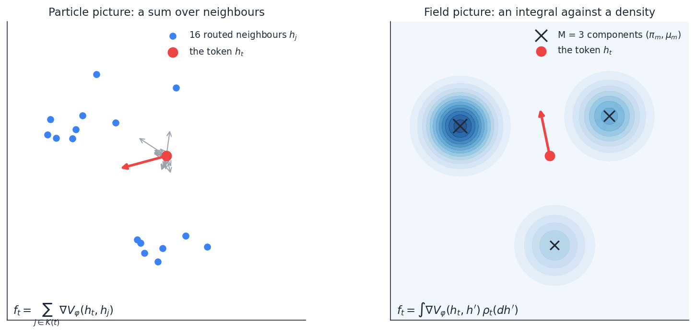
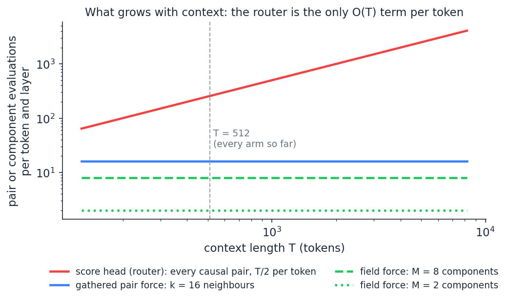
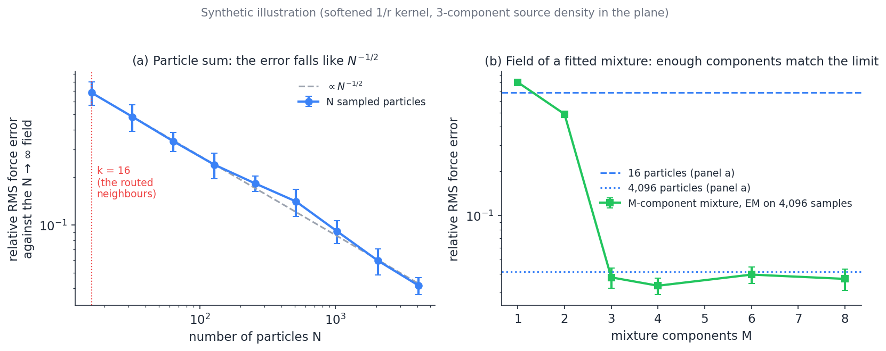
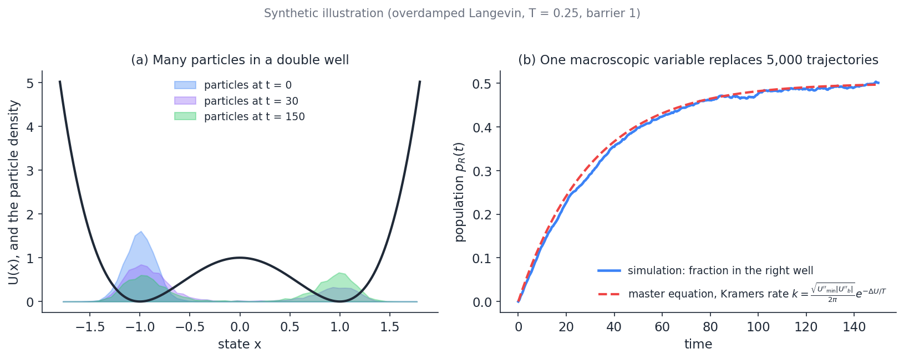
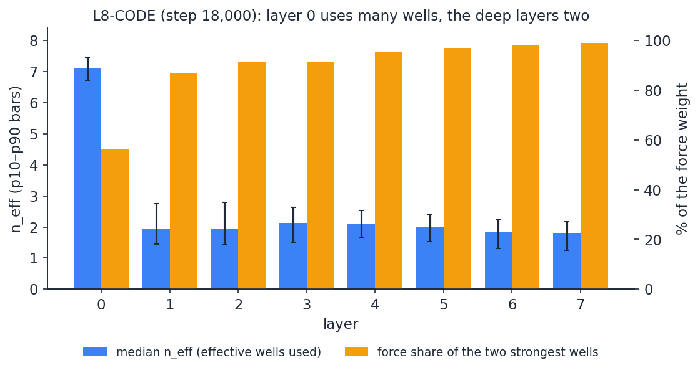
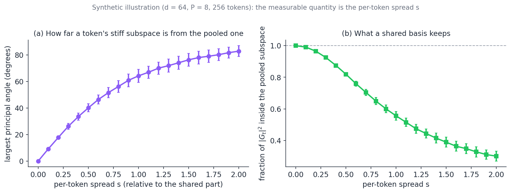

# Macroscopic Limits of the Conservative Step

**A technical report on replacing per-token physics by field equations in the conservative language model (draft, 2026-11-03).**

**Status.** This is a proposal with a measured starting point and no new results yet. Every number in §1 and §4 is measured and cited to its source; everything in §5–§7 is a derivation or a design, and the two experiments that would decide between them are pre-registered in §8 with placeholders for their results. The synthetic figures say so in their titles.

**Companion notes this one builds on.** [Fock_Inference_Productionization_Plan.md](Fock_Inference_Productionization_Plan.md) §10 (where a training step's time goes), [Depth_Ladder_and_Matched_Baseline_Protocol.md](Depth_Ladder_and_Matched_Baseline_Protocol.md) (the arms whose numbers are quoted), [Minimum_Well_Count_for_Conservative_Models.md](Minimum_Well_Count_for_Conservative_Models.md) (the effective well count and force shares used as evidence in §4), [Refinement_Experiments_and_Variable_Step_Training.md](Refinement_Experiments_and_Variable_Step_Training.md) (the time direction of the same question). The theory behind §3, from Gibbs distributions to the mean-field forms used in machine learning, and what it predicts about our models, is in [Mean_Field_Theory_for_Particle_Language_Models.md](Mean_Field_Theory_for_Particle_Language_Models.md).

---

## Contents

1. [The problem in numbers](#1-the-problem-in-numbers)
2. [The step as a system of interacting particles](#2-the-step-as-a-system-of-interacting-particles)
3. [What "macroscopic" means: a primer](#3-what-macroscopic-means-a-primer)
4. [The conservative step is already half macroscopic](#4-the-conservative-step-is-already-half-macroscopic)
5. [Macroscopic replacements for the two particle terms](#5-macroscopic-replacements-for-the-two-particle-terms)
6. [What each replacement costs and what it loses](#6-what-each-replacement-costs-and-what-it-loses)
7. [Low-hanging fruit, ranked](#7-low-hanging-fruit-ranked)
8. [Pre-registered probes](#8-pre-registered-probes)
9. [Risks and failure modes](#9-risks-and-failure-modes)
10. [Glossary](#10-glossary)
11. [References](#11-references)

---

## 1. The problem in numbers

A training step of our conservative models costs several times a matched transformer's, and the cost grows with depth. The table collects the A100 timings of the code-corpus arms (one optimizer step is 16,384 tokens for every model: 16 sequences of 512 tokens, two microbatches).

| model | layers L | wells K | seconds per step | source |
| --- | ---: | ---: | ---: | --- |
| GPT-2-CODE (matched transformer, 33.7M parameters) | 8 | — | 0.30 | plan §10.3b |
| SO-CODE | 2 | 8 | 1.11 | plan §10.3b |
| L4-CODE | 4 | 8 | 2.0 | its Cell 6 log (102 s per 50 steps) |
| K2-L8-CODE | 8 | 2 | 3.46 | its Cell 6 log |
| L8-CODE (layer checkpointing on) | 8 | 8 | 5.6 | its Cell 6 log (281 s per 50 steps) |

Two readings. First, the fixed part of a step (embedding, output head, loss, optimizer) is about 0.2 s, and each added layer costs about 0.4–0.45 s, against roughly 0.04 s for a transformer layer: a layer of ours is about ten transformer layers. Second, the gap is not launch overhead: the bottleneck profile of 2026-10-27 (plan §10.3b) found the step compute-bound at the operating point (86% mean and 99% median GPU utilisation; one microbatch of 32 instead of two of 16 gains 4%; bf16 gains 2%).

Where the time and the memory go is measured:

Left: the GPU profile of one microbatch (plan §10.3b). Half the time is element-wise kernels (`mul` 21%, `add_` 10%, `add` 5%, `copy_` 5%, `sum` 4%), which move large tensors and do little arithmetic per byte; 27% is matrix products; 10.6% is the float64 SVD of the stiff-mode Gram matrices. Right: the bytes one training forward saves for the backward, per layer (the V_φ-force checkpointing entry of the protocol, measured on the CPU at K = 2): three quarters are the pair force's intermediates.

The reason, stated once: a transformer layer is a few large matrix products, which run near the card's peak arithmetic rate. Our layer instead evaluates, **for every token separately**, a pair force over its neighbours, the forces of a well bank, an eigendecomposition of a 32 × 32 matrix, and an integrator substep. All of this is batched over tokens (there is no loop over tokens anywhere; every operation is one kernel over all 8,192 tokens of a microbatch), so the problem is not batching. It is *arithmetic intensity*: each of those operations does a small amount of work per token, on tensors shaped (batch, tokens, neighbours, heads), so the kernels are bound by memory bandwidth, not by arithmetic. Fusing them (§7, item 4) attacks that symptom. This note is about attacking the cause: the per-token structure of the physics itself.

## 2. The step as a system of interacting particles

The vocabulary is fixed here so that the primer in §3 can refer to it. The constants are those of every code arm (the ladder notebook's Cell 0; `d` = 384, `T` = 512 tokens per sequence).

**The state.** Token $t$ of a sequence carries a state $h_t \in \mathbb{R}^d$ and a velocity $v_t$. A layer is one step of a damped second-order dynamics (the BAOAB splitting of Langevin dynamics, friction $\gamma = 0.1$, thermostat temperature 0, so the friction is deterministic) over a time $\Delta t = T_{\mathrm{tot}}/L$ with $T_{\mathrm{tot}} = 8$ held fixed across the depth ladder. The force on a token is the negative gradient of a potential, which is what makes the model conservative:

$$
f_t = -\nabla_{h_t} \big[ V_\theta(h_t; \xi_t) + U_{\mathrm{pair}}(h_t) \big].
$$

**The context channels $\xi_t$.** Five exponential moving averages of the preceding tokens' states, with decays $\alpha \in \lbrace 0.5, 0.75, 0.95, 0.99, 0.995 \rbrace$:

$$
\xi_t^{(c)} = \sum_{s \le t} W_{ts}^{(c)} h_s, \qquad W_{ts}^{(c)} = \frac{\alpha_c^{ t-s}}{Z_t}, \qquad Z_t = \sum_{r \le t} \alpha_c^{ t-r}.
$$

(`multixi/model_multixi.py`, `causal_ema_weights`.) Each row of $W^{(c)}$ sums to one, so $\xi_t^{(c)}$ is a weighted mean of the past states, with weights that fall off geometrically with distance in position. The weights never depend on what the states contain.

**The well bank $V_\theta$.** $K$ Gaussian wells whose centres and shapes are linear in the bank input $x_t = \mathrm{flat}(\xi_t + \text{depth code})$ (1,920 dimensions):

$$
V_\theta(h; x) = -\sum_{k=1}^{K} w_k(x) \exp\Big(-\tfrac12 (h-\mu_k(x))^\top P_k(x) (h-\mu_k(x))\Big),
$$

with $\mu_k = M_k x + m_k$, $w = \mathrm{softmax}(W_w x + b)$ and $P_k = \mathrm{diag}(a_k) + B_k B_k^\top$ of rank 4. The effective well count $n_{\mathrm{eff}} = \exp H(w)$ and the force shares are defined in the minimum-well-count note; §4 uses them.

**The pair potential $V_\varphi$ and its router.** The structural pair potential between a token and an earlier one (`parf/model_parf.py`, `StructuralVPhi`):

$$
V_\varphi(h_t, h_s) = - C \Theta_\varphi\big(\theta(h_t), \theta(h_s)\big) \Phi_\varphi\big(l(h_t), l(h_s)\big) \Big/\sqrt{\lVert h_t - h_s\rVert^2 + \varepsilon^2},
$$

a softened inverse-distance law (the $\varepsilon$ is the Plummer softening of gravitational N-body codes) modulated by a bounded "value aligner" $\Theta$ and a "type gate" $\Phi = \exp(-c \lVert l_t - l_s\rVert^2)$ with a learned bandwidth. Four heads. The sum does not run over all earlier tokens: a **score head** evaluates an additive score $\pi_{ts} = w_2^\top \mathrm{GELU}(a(h_t) + b(h_s))$ for every causal pair $(t, s)$, $s \lt t$, and keeps the $k = 16$ best per token (a hard top $k$ with a straight-through gate). The pair term of the potential is then

$$
U_{\mathrm{pair}}(h_t) = s_\ell \sum_{j \in K(t)} m_{tj} V_\varphi(h_t, h_j), \qquad \lvert K(t) \rvert = 16,
$$

with the sources $h_j$ detached, so the force differentiates the query slot only and remains a gradient. Two costs follow. The score head is evaluated on every causal pair, so its intermediates are shaped (B, T, T, $H_s$): quadratic in $T$. The force over the 16 gathered neighbours has intermediates shaped (B, T, 16, ·) and, with the analytic force, those intermediates are what the backward pass keeps: the 75% of the right panel above.

**The stiff modes.** The low-rank integrator (`parf/cfc_baoab.py`) treats the stiffest directions of the force's linearisation exactly and the rest explicitly. For each token it forms a $d \times P$ generator $G_t$ ($P = 32$), the $P \times P$ Gram matrix $G_t^\top G_t$, and its eigendecomposition (a float64 Jacobi SVD, after the float32 symmetric eigensolver failed on real inputs on 2026-09-17; `_gram_eigh`). The substep then uses $\cos$, $\mathrm{sinc}$, $\sinh$-type and $\exp$ functions of the eigenvalues. That SVD is the 10.6% of the profile; the einsums that project onto and out of the basis are part of the element-wise half.

**The Fock registers.** Exclusion slots with creation and destruction gates; 18% of the saved memory and little of the time. They are not touched by this note.

Left: the force on a token is a sum over its 16 routed neighbours (grey: each neighbour's pull, red: the sum). Right: the same token in the field of a density with three components. The field picture needs the density's parameters, not the particles.

**Which operations are "per token".** The question of this note is well-posed only if the phrase is made precise. An operation is per-token physics if its cost per token depends on how many *other tokens* it touches ($T$ for the router, $k = 16$ for the pair force) or if it performs a token-specific linear-algebra factorisation (the stiff-mode SVD). The well bank is not: its cost per token is $O(K d \cdot \mathrm{rank})$ with no reference to other tokens, because the other tokens enter it only through $\xi_t$. The figure below counts the pair or component evaluations per token and layer, which is exact and needs no constants:

Only the router grows with the context: $T/2$ score evaluations per token. The gathered pair force is 16 per token at any $T$; a field force with $M$ components is $M$ per token. At $T = 512$ the router already does 256 evaluations per token and layer, sixteen times the pair force, though each score evaluation is cheap.

## 3. What "macroscopic" means: a primer

This section assumes nothing about statistical mechanics. It builds the ideas from the particle picture of §2, in the order in which they were discovered, with the mathematics derived rather than cited. A reader who knows the Vlasov equation, propagation of chaos and Kramers' rate can skip to §4.

### 3.1 From particles to a density

Take $N$ particles at positions $y_1, \dots, y_N$ in some space (for us, the states of the preceding tokens in $\mathbb{R}^d$). Any sum over them of the form $\frac1N \sum_j g(y_j)$ can be written as an integral:

$$
\frac1N \sum_{j=1}^N g(y_j) = \int g(y) \rho_N(dy), \qquad \rho_N = \frac1N \sum_{j=1}^N \delta_{y_j}.
$$

$\rho_N$ is the **empirical measure**: a probability distribution that puts mass $1/N$ at each particle. Nothing has been approximated; this is a change of notation. Its point is that it separates *what is summed* ($g$, the physics) from *what it is summed over* ($\rho_N$, the data). The macroscopic programme is the replacement of $\rho_N$ by something smaller.

**Convergence.** If the particles are drawn independently from a density $\rho$, the law of large numbers says $\int g d\rho_N \to \int g d\rho$ as $N \to \infty$, and the central limit theorem says the error is of order $N^{-1/2}$: with $16$ particles the relative error of a sum is of order $1/4$, with $4{,}096$ about $1/64$. The figure in §3.3 shows exactly this on a toy force. The convergence is **weak**: it holds for each bounded continuous $g$, not for $\rho_N$ as a function (it has no density). That is the right notion here, because a force is $\int \nabla V(h, y) \rho(dy)$ for a fixed smooth kernel.

### 3.2 The mean field: Vlasov and McKean

Consider particles that move under a force that is a sum of pair interactions:

$$
\dot{v}_i = -\nabla U(y_i) - \frac1N \sum_{j \ne i} \nabla_{y_i} V(y_i, y_j).
$$

The $1/N$ is the **mean-field scaling**: each pair interaction is weak, so that the total force from $N$ neighbours stays of order one as $N$ grows. (Without it the force would grow with $N$; with it the model has a limit.) Writing the sum as an integral against the empirical measure,

$$
\dot{v}_i = -\nabla U(y_i) - \int \nabla_{y_i} V(y_i, y) \rho_N(dy) = -\nabla_{y_i}\Big[ U(y_i) + \int V(y_i, y) \rho_N(dy) \Big].
$$

The bracket is the **mean-field potential**: the potential one particle feels from the *density* of all the others. If $\rho_N \to \rho$, the force on particle $i$ converges to $-\nabla_{y}[U(y) + (V \ast \rho)(y)]$, where $(V \ast \rho)(y) = \int V(y, y')\rho(dy')$. The N-body problem has become a one-body problem in a field that the bodies themselves generate.

That field is not fixed: the density moves because the particles move. The closed equation for $\rho$ is the **Vlasov equation** (Vlasov 1938; Jeans 1915 for stellar systems), the transport of a density $f(y, v, t)$ in position and velocity under the self-consistent force:

$$
\partial_t f + v \cdot \nabla_y f - \nabla_y\big[U + V \ast \rho\big] \cdot \nabla_v f = 0, \qquad \rho(y, t) = \int f(y, v, t) dv.
$$

With friction and noise added (which is our BAOAB step at nonzero temperature) the same limit is the **McKean–Vlasov equation** (McKean 1966): a stochastic differential equation for one particle whose drift depends on the law of that particle,

$$
dY_t = -\nabla\big[U + V \ast \rho_t\big](Y_t) dt + \sqrt{2\beta^{-1}} dW_t, \qquad \rho_t = \mathrm{Law}(Y_t),
$$

and whose density solves a nonlinear Fokker–Planck equation. The two names are used for the same idea in two settings: Vlasov for the deterministic transport of a phase-space density, McKean–Vlasov for the diffusive case.

**Why this is "macroscopic".** The $N$ particle trajectories have been replaced by one density. The density is a function on the state space, which is an infinite-dimensional object, so by itself this is not yet a saving. The saving appears when the density is **parametrised**: by its first moments (mean, covariance), by a mixture of $M$ bumps, by a histogram on a grid. Then the force $\int \nabla V(h, y) \rho(dy)$ costs $O(M)$ evaluations per query instead of $O(N)$, and the state of the whole system is $M$ parameters instead of $N$ positions. Every macroscopic method is a choice of parametrisation plus a rule for how the parameters evolve.

### 3.3 Propagation of chaos: when is the mean field right?

The mean-field limit assumes that the particles are, in the limit, *independent* draws from $\rho_t$: that the correlations which the interactions build up between any fixed pair vanish as $N \to \infty$. Kac (1956) named this **propagation of chaos** (if the initial state is chaotic, i.e. independent, so is the state at any later time, in the limit) and it was proved for smooth pair potentials by McKean (1966), Braun and Hepp (1977) and Dobrushin (1979), with the quantitative form by Sznitman (1991): the law of one particle in the N-body system differs from the McKean–Vlasov law by $O(N^{-1/2})$, on any fixed time interval, for Lipschitz forces. Singular kernels (gravitational $1/r$ without softening, point vortices) are harder; Jabin and Wang (2018) cover a large class, and softening is what makes ours smooth.

Three consequences matter for us.

1. **The error is statistical, $N^{-1/2}$, not systematic.** Below, a synthetic experiment: sources drawn from a three-component density in the plane, the softened inverse-distance force on 200 query points, the $N$ particle average compared with the $N \to \infty$ field. Sixteen particles, our $k$, give a relative error of about $0.5$.
2. **A parametrised density can beat the particle sum.** The right panel fits an $M$ component Gaussian mixture by expectation–maximisation to $4{,}096$ samples and computes the field of the *fitted* density. With $M \ge 3$ (the true number of components) its error is that of $4{,}096$ particles, at the cost of $M$ evaluations per query instead of $4{,}096$. A mixture with too few components is biased ($M = 1, 2$).
3. **The limit depends on the *law* of the sources, not on their identities.** This is the sense in which the field is content-addressable without routing: the force on $h_t$ is large from the components of $\rho_t$ near $h_t$ (the kernel's locality does the selecting) and small from the others. §5.1 builds on this.

### 3.4 Kinetic, hydrodynamic, thermodynamic: the ladder of descriptions

Physics has a standard ladder of coarser and coarser descriptions of the same system, and the names in this note's title come from it. From the bottom:

- **Microscopic:** $N$ trajectories $(y_i(t), v_i(t))$. Exact; costs $O(N)$ per step, and $O(N k)$ or $O(N^2)$ for the interactions.
- **Kinetic:** one density $f(y, v, t)$ on position–velocity space. The Vlasov equation (collisionless) or the Boltzmann equation (with collisions). The step from microscopic to kinetic is the mean-field limit of §3.2, or more generally the BBGKY hierarchy (Bogoliubov, Born, Green, Kirkwood, Yvon, 1946–47), which writes the equation for the one-particle density in terms of the two-particle one, the two-particle in terms of the three-particle, and so on; a **closure** is any rule that cuts the hierarchy, and "the pair correlation vanishes" (chaos) is the simplest closure.
- **Hydrodynamic:** a few fields of position only, the moments of $f$ in velocity: density $\rho(y)$, mean velocity $u(y)$, temperature or pressure. The Euler and Navier–Stokes equations are the hydrodynamic limit of the Boltzmann equation; Chapman and Enskog (1916–17) derived them by expanding $f$ about its local equilibrium. Grad (1949) kept thirteen moments; Levermore (1996) gave the general theory of **moment closures** (how to close the moment equations by choosing the maximum-entropy $f$ consistent with the kept moments). The pattern: keep a few moments, close with an equilibrium assumption.
- **Thermodynamic:** a handful of global variables (energy, volume, particle numbers in each phase) and the laws relating them. No space dependence left.

Each rung keeps less and is cheaper, and each is valid when the variables it drops relax *fast* compared with the ones it keeps. That condition, **separation of time scales**, is the whole content of the word "macroscopic": a description with few variables is right when the many discarded variables have time to equilibrate between successive changes of the few. Mori (1965) and Zwanzig (1961) made this exact: project the dynamics onto the slow variables, and what is left over is a memory term plus a noise term; when the fast variables decorrelate quickly, the memory term becomes a friction and the projected dynamics is a closed Langevin equation (Chorin, Hald and Kupferman 2000 give the computational version, "optimal prediction").

### 3.5 Kramers' rate: a macroscopic law for well populations

The cleanest example of a thermodynamic variable arising from many particles is the population of a potential well. Take particles in a double well $U(x)$ at temperature $T$, starting on the left. Each particle rattles in its well on a fast time scale $1/\omega_0$ and, rarely, crosses the barrier of height $\Delta U$. Kramers (1940) showed that, when $\Delta U \gg T$, the crossing is a Poisson process with rate

$$
k = \frac{\sqrt{U''(x_{\min}) \lvert U''(x_b)\rvert}}{2\pi\gamma} e^{-\Delta U / T} \qquad\text{(overdamped friction }\gamma),
$$

with the standard review by Hänggi, Talkner and Borkovec (1990). The population of the right well then obeys a **master equation** $\dot{p_R} = k (1 - p_R) - k p_R$ whose solution is $p_R(t) = \tfrac12(1 - e^{-2kt})$. One ordinary differential equation for one number replaces the simulation of every particle, and it is exact in the limit of a high barrier because of the separation of scales: intra-well relaxation is fast, inter-well hopping slow.

Synthetic: 5,000 overdamped Langevin particles in $U(x) = (x^2 - 1)^2$ at $T = 0.25$. Left, the density at three times; right, the fraction in the right well against the master equation with Kramers' rate, with no fitted parameter.

### 3.6 The same idea in computation: tree codes, multipoles, particle–mesh

The macroscopic idea has a purely computational form that predates none of the above but is the one an engineer meets first. Simulating $N$ gravitating bodies costs $O(N^2)$ pair forces per step. Three families of methods reduce this by **aggregating far-away particles into a few numbers**:

- **Tree codes** (Barnes and Hut 1986): put the particles in a hierarchy of boxes; for a query far from a box, replace the box's particles by their total mass at their centre of mass (the monopole). Cost $O(N \log N)$, error controlled by an opening angle.
- **The fast multipole method** (Greengard and Rokhlin 1987): the same, but each box carries a truncated multipole expansion (mass, dipole, quadrupole, …) and the expansions are translated between boxes. Cost $O(N)$ at any fixed accuracy. The multipole coefficients of a box are exactly the low moments of the empirical measure of the particles in it: the FMM is the moment closure of §3.4 made into an algorithm.
- **Particle–mesh methods** (Hockney and Eastwood 1981; P³M, Ewald summation): deposit the particles onto a grid (a histogram of $\rho_N$), solve the field equation on the grid by a fast Fourier transform, interpolate the force back. The near field is corrected by direct pair sums.

All three replace "sum over particles" by "evaluate a parametrised density", which is what §5 proposes for the pair force. The difference from the physics of §3.2 is only that the parametrisation is chosen for accuracy at fixed $N$, not for a limit $N \to \infty$.

## 4. The conservative step is already half macroscopic

The claim of this section is that the model, as built, already uses the mean-field structure for one of its two interactions, and that this is why the proposal of §5 is not foreign to it.

**The context channels are density moments.** Write the empirical measure of the preceding states with the EMA weights of §2 as a weighting:

$$
\rho_t^{(c)} = \sum_{s \le t} W_{ts}^{(c)} \delta_{h_s}, \qquad \xi_t^{(c)} = \int h \rho_t^{(c)}(dh).
$$

So $\xi_t^{(c)}$ is the *first moment* (the mean) of a weighted density of the past, and the five channels are the first moments of five densities with different memory lengths. The weights depend on position only, so this is a density *along the sequence*; its parametrisation is "one moment per decay", and its evolution is a linear recurrence (up to the row normalisation)

$$
\xi_t = \alpha \xi_{t-1} + (1-\alpha) h_t,
$$

which is a linear state-space model with five fixed poles (the S4 and Mamba families start from the same object: Gu, Goel and Ré 2021; Gu and Dao 2023). The well bank $V_\theta$ then acts on those moments. It is a field model: the state is pulled to places $\mu_k(\xi_t)$ determined by *moments* of the preceding tokens, never by any token in particular. Its cost per token is independent of $T$ and of how many tokens precede.

**The pair force is the particle term.** $U_{\mathrm{pair}}$ sums over sixteen actual earlier states, selected by content through the router. In the vocabulary of §3 it is the microscopic description, with $N = 16$ and a content-dependent choice of which sixteen. The Fock inference plan's "constriction" analysis found what the EMA field *cannot* do: its weights "never depend on content", so the only content-addressed lookup in the model is this term.

**The stiff basis is the second particle term.** The $d \times P$ generator and its eigendecomposition are computed per token because the force's linearisation differs from token to token. It is a token-local factorisation, not an interaction, so it is "per token" in the second sense of §2.

**Evidence that deep layers have few slow variables.** The minimum-well-count note measured, on L8-CODE at step 18,000, how many wells each layer uses:

Blue: the median effective well count $n_{\mathrm{eff}} = \exp H(w)$ per layer, with its 10th–90th percentile bars (`vtheta_weight_logits.py`, 16 windows). Orange: the force share of the two strongest wells (`vtheta_well_probe.py`). Layer 0 spreads its weight over seven wells and two wells carry 56% of its force; every deeper layer uses two wells and two wells carry 87–99%.

Two more measurements point the same way. The per-layer refinement test (FLOW-R, protocol) found L8-CODE's per-layer flow settled: the penalty for refining one layer's step is 0.03–0.04 nats from $1.5\times$ to $8\times$ finer steps (0.186 at $1.5\times$), ten times smaller than SO-CODE's and L4-CODE's. And K2-L8-CODE, trained with two wells in every layer, is within 0.03 nats of L8-CODE. Together: the deep layers' dynamics is governed by two collective variables per layer (which well, and how strongly) whose evolution is smooth in the step size. That is the separation of scales that §3.4 requires for a macroscopic law to hold, and layer 0 is where it does not hold.

**What is left to replace.** Of the per-token terms of §2, the EMA field already replaced one interaction. The two remaining are the routed pair force (with its $T^2$ router) and the per-token stiff basis. Everything in §5 is about those two.

## 5. Macroscopic replacements for the two particle terms

### 5.1 A field for $V_\varphi$: the McKean–Vlasov form of the pair force

**The construction.** Replace the sum over sixteen neighbours by the integral against a density of the preceding states, parametrised as a mixture of $M$ components on the state space:

$$
f_t^{\mathrm{field}} = -\nabla_{h_t} \int V_\varphi(h_t, h') \rho_t(dh'), \qquad \rho_t = \sum_{m=1}^M \pi_{m,t} \mathcal N(\mu_{m,t}, \Sigma_{m,t}).
$$

Because $V_\varphi$ is a learned kernel, the integral against a Gaussian component has no closed form in general; two practical choices are (i) evaluate the kernel at the component mean, $\int V_\varphi(h, h') \mathcal N(dh') \approx V_\varphi(h, \mu_m)$, which is the monopole approximation of the tree code (exact when the component is narrow relative to the kernel's scale), or (ii) a few sigma points per component (Julier and Uhlmann 1997), which is the quadrupole-level correction at $2d+1$ or fewer evaluations. With (i) the force is a sum over $M$ "virtual tokens" at the component means, weighted by $\pi_m$:

$$
f_t^{\mathrm{field}} \approx -\sum_{m=1}^M \pi_{m,t} \nabla_{h_t} V_\varphi(h_t, \mu_{m,t}).
$$

This is the existing gathered pair force with $M$ fixed sources instead of $16$ routed ones, and no router. The intermediates become (B, T, M, ·).

**Conservativity is kept.** The field force is the gradient in $h_t$ of $\int V_\varphi(h_t, h') \rho_t(dh')$ provided $\rho_t$ does not depend on $h_t$. In the present model the sources are detached for the same reason (the force differentiates the query slot only; `causal_force`); a mixture built from the detached preceding states inherits the property.

**How the mixture evolves: content-gated EMA channels.** The crucial design question is how $\rho_t$ is computed at every position without a sequential loop, because the EMA channels owe their speed to being a matrix product $W h$ with a precomputed $(T, T)$ weight matrix. A mixture fitted by expectation–maximisation along the sequence would be a *nonlinear* recurrence (the responsibilities at $t$ depend on the components at $t-1$), which cannot be written as one matrix product; that is the obstacle Mamba-type models solve with chunked scans. The way round it that uses only what the model already has: fix $M$ **prototypes** $c_m$ as learned parameters (as the Poisson-mode wells of the PM arms already are), define each token's responsibilities pointwise, $r_{s,m} = \underset{m}{\mathrm{softmax}}\big(-\lVert h_s - c_m\rVert^2 / \tau\big)$, and let the component weights and means be *EMA channels of the responsibility-weighted states*:

$$
\pi_{m,t} = \sum_{s \le t} W_{ts} r_{s,m}, \qquad \mu_{m,t} = \frac{\sum_{s \le t} W_{ts} r_{s,m} h_s}{\pi_{m,t}}.
$$

Both numerators are matrix products with the same $W$ as the existing channels, applied to $r_{s,m}$ and to $r_{s,m} h_s$: linear, parallel over the sequence, and differentiable in the prototypes and in the (detached or live) states. The result is a density over the state space whose components are *content-defined* (which prototype a past token was near) and whose weights and means are *position-weighted* (how recently). This is a content-gated extension of $\xi$; its cost is $M$ extra channels of $d$ numbers plus $M$ scalars per token and layer, with no $(T, T, H_s)$ tensor anywhere.

**What it would change in the model.** The router is gone, and with it the content-addressed lookup of one specific earlier token. The field addresses content too, but at the resolution of the $M$ prototypes: two past tokens that fall in the same component are indistinguishable to it. Whether that resolution is enough is an empirical question, and the existing evidence cuts both ways: on the SR2 base used by every code arm, removing $V_\varphi$ altogether costs only 0.014 nats, so a field version costs at most that on those arms; but on F3.1 and PM1 the removal costs 0.28 and 0.32 nats, which says the routed lookup carries real information there. Probe A (§8) is designed around this: it measures the force fidelity on both bases and the loss on the base where the term matters.

### 5.2 Collective stiff modes: one basis per block

**The construction.** The generator $G_t$ and its eigenbasis are computed per token. The collective version computes one basis per block of $b$ tokens (a window, or a whole sequence) from the pooled Gram matrix

$$
\bar{M} = \frac1b \sum_{t \in \mathrm{block}} G_t^\top G_t \quad\text{(a } P \times P \text{ matrix)}, \qquad\text{or}\qquad \bar{L} = \frac1b \sum_t G_t G_t^\top \quad\text{(a } d \times d \text{ matrix)},
$$

and uses its top $P$ eigenvectors as the stiff subspace for every token of the block. The per-token work left is the projection of each token's own force and velocity onto the shared basis (two $d \times P$ products), which the substep does anyway. The eigensolve count drops from one per token to one per block, by a factor $b$. In the language of §3 this is a moment closure: the per-token Gram matrices are replaced by their block mean (their first moment).

**What it loses.** Exactness of the stiff directions for tokens whose own subspace differs from the pooled one. The quantity that decides is the *spread* of the per-token subspaces about their mean. The synthetic figure shows how the largest principal angle between a token's subspace and the pooled one, and the fraction of the token's generator energy that the pooled subspace captures, depend on that spread (per-token perturbation $s$ relative to the shared part):

Synthetic: $G_t = G_0 + s E_t$ with $d = 64$, $P = 8$, 256 tokens. At $s = 0.5$ the pooled subspace captures 82% of each token's generator energy; at $s = 1$, 56%. The spread $s$ of the real model is measurable on any checkpoint (Probe B).

The integrator's own `floor` already marks the weakest modes as inert, so what matters is whether the *stiff* directions are shared. A plausible mechanism for sharing: the generator's columns come from the wells' precisions $P_k(x_t)$, and in the deep layers two wells carry almost all the force (§4), so the stiff directions should be close to those two wells' $B_k$ columns, which vary slowly with $x_t$.

### 5.3 Well-population dynamics: the thermodynamic description of a layer

This is the most macroscopic proposal and the least ready. The evidence of §4 says a deep layer's state is described by which of two wells it is in and how strongly. Define, per layer, the **occupancies** $p_k$ (the fraction of tokens whose force weight is concentrated on well $k$) and the **kinetic temperature** $\langle \lVert v \rVert^2 \rangle$. If the wells are stiff and the barrier between them high relative to the kinetic energy, Kramers' argument gives transition rates $k_{ij}$ between wells from the barrier heights of $V_\theta$, and the occupancies obey a master equation $\dot{p} = p K$.

What such a law can and cannot do. It describes *populations*, not the trajectory of any one token; next-token prediction needs $h_t$ for each $t$. So the law cannot replace the per-token step; it can replace the **collective part of what the step depends on**. Concretely, the mixture $\rho_t$ of §5.1 is a population description of the preceding tokens, and a master equation for its weights $\pi_{m,t}$ (which well-component the past tokens have migrated to) is an alternative to recomputing them from scratch at every layer: the mixture at layer $\ell+1$ would be the mixture at layer $\ell$ transported by the layer's own rates. This is a hypothesis about the model, not a design, and it is listed here because §4's evidence makes it testable: the occupancies' change from layer to layer on L8-CODE can be compared with a rate law fitted on one layer. Nothing in §7 or §8 depends on it.

**Its derivation already exists in the programme's other formalism.** The semantic-templates line writes firings as Doi–Peliti reactions ([Semantic_Templates_as_Doi_Peliti_Reactions.md](Semantic_Templates_as_Doi_Peliti_Reactions.md) §4: a template bank is a Liouvillian; a firing is a creation term with a rate). The mean-field limit of a Doi–Peliti theory is the saddle point of its action, and that saddle point is the **law of mass action**: the deterministic rate equations for the mean occupancies of each type (Täuber, Howard and Vollmayr-Lee 2005, §2). So the rate law proposed here for the well populations is not a new object; it is the mass-action kinetics of the template bank, which the Doi–Peliti reading of the templates supplies with its rates. The two lines meet exactly here: this note's macroscopic law for populations is the templates' microscopic reaction content, averaged. §7.1 of [Mean_Field_Theory_for_Particle_Language_Models.md](Mean_Field_Theory_for_Particle_Language_Models.md) draws the consequences for sequencing the two programmes.

### 5.4 Matrix functions by augmented matrices (not macroscopic, listed for completeness)

The eigensolve exists only to evaluate $\cos$, $\mathrm{sinc}$, $\sinh$ and $\exp$ of the $P \times P$ stiff block. Those are matrix functions, and Van Loan (1978) showed that integrals of matrix exponentials (the $\varphi$-functions of exponential integrators) are blocks of the exponential of an augmented matrix; Al-Mohy and Higham (2011) give the scaling-and-squaring algorithm for them, using matrix products only, in float32, with no repeated-eigenvalue failure mode. It would remove the float64 SVD (10.6% of the step) without changing the per-token structure. It is a bounded gain; it belongs in the plan's lever list, not here.

### 5.5 Depth as a macroscopic time variable

The same question has a time direction. The variable-step arm SR4a (the refinement note; protocol `p-sr4a-code`) asks whether a model trained at several step counts can be run at a step count chosen at inference. If it can, depth stops being a training cost: train at $L = 2$ (1.1 s per step) and refine to $N = 8$ steps when predicting. In the language of §3.4 this is the statement that the per-layer flow is a *continuous* macroscopic law of which the trained layers are a discretisation. FLOW-R's result on L8-CODE (the per-layer flow settled to 0.03 nats) is the evidence that such a law exists per layer; the open question SR4a tests is whether the whole stack has one.

## 6. What each replacement costs and what it loses

The table states, for each proposal, the operation it removes, the operation it adds, what information is lost, and whether the force remains a gradient. Costs are per token and layer; "evaluations" are pair or component evaluations as in the scaling figure.

| proposal | removes | adds | what is lost | conservative |
| --- | --- | --- | --- | --- |
| 5.1 field $V_\varphi$ (content-gated EMA) | the $(T, T, H_s)$ score head; the 16-neighbour gather and its (B, T, 16, ·) intermediates | $M$ responsibility scalars per token; $M$ EMA channels of $d$ numbers (two matrix products with the existing $W$); $M$ kernel evaluations | the lookup of one specific earlier token; resolution limited to $M$ prototypes | yes, with detached mixture |
| 5.2 shared stiff basis (block $b$) | $b - 1$ of every $b$ eigensolves; per-token $U_t$ storage | one pooled Gram per block | exactness of the stiff directions for tokens far from the block mean | unchanged (the basis choice does not change the force) |
| 5.3 well-population law | nothing in the step itself | a rate law per layer | nothing yet; a hypothesis to test | n/a |
| 5.4 augmented-matrix functions | the float64 SVD | scaling-and-squaring products | nothing (same functions to rounding) | unchanged |
| 5.5 shallow training, deep inference | $L - 2$ trained layers | variable-step training | unknown until SR4a runs | unchanged |

**Expected speed, honestly.** None of these has been timed. The profile gives bounds. The pair force and router own three quarters of the saved activations and a large, unmeasured part of the element-wise half of the time; the plan's §10.3b attributes the element-wise kernels to "the integrator" without separating the pair force from the substep. A step without $V_\varphi$ at all has not been timed either. So the honest statement is: 5.1 removes the only $O(T)$ per token term and most of the activation memory; its effect on time is between zero and the share of the element-wise work that the pair force owns, which Cell 6c can measure in ten minutes by profiling a step with `pair_potential='none'` against the default. That measurement comes before any arm (§7).

## 7. Low-hanging fruit, ranked

Ranked by cost to find out, then by expected gain. Items 1–3 need no GPU and no training.

1. **Time a step without $V_\varphi$** (Cell 6c, one Colab session, ten minutes). It bounds the gain of 5.1 from above. If the step without the pair force is not markedly faster, the pair force is not where the time goes, and 5.1 is a memory lever only.
2. **Probe A: field $V_\varphi$ fidelity on trained checkpoints** (§8; CPU, hours). It says whether the mixture force reproduces the routed force, and at which $M$, before anything is trained.
3. **Probe B: the stiff-subspace spread** (§8; CPU, hours). It measures $s$ of §5.2 on the real model and the loss penalty of a shared basis at block sizes 8, 64 and 512.
4. **Fuse the element-wise work** (`torch.compile` on the layer step; plan §10.3b lever 2). Not macroscopic, but it attacks the same half of the profile from the other side, with a parity check and no model change. Plausibly 1.3–1.5× per step. It composes with everything above.
5. **A field $V_\varphi$ arm** (5.1), if Probe A passes: a pre-registered model, SO-CODE's Cell 0 with the router replaced by content-gated channels at the $M$ Probe A selects, on the code base first (cheapest, 6 h) and then on OWT against F3.1 (where the term matters).
6. **A shared-basis switch** (5.2), if Probe B passes: a memory-and-speed switch with a parity threshold rather than an arm, since it changes the arithmetic only through which basis is used.
7. **SR4a-CODE** (5.5) is already first in the GPU queue for its own reasons; its result decides whether depth is a training cost at all.

### 7.1 Relation to the semantic-templates programme

The templates line ([Implementing_Semantic_Templates_A_Path.md](Implementing_Semantic_Templates_A_Path.md), [Community_of_Semantic_Templates_for_Native_CoT.md](Community_of_Semantic_Templates_for_Native_CoT.md)) and this one do not compete for a mechanism; the theory assigns them different jobs, and the dependency between them runs through depth.

- **Different jobs, by the templates' own criterion.** Only creation lifts the expressivity class (Path §1.1); a bounded summary of the context is v0 whatever it contains. A field with $M$ components is a bounded summary by construction, so it can never be the mechanism that lifts the class; that job belongs to the particle store (Path §7, Stage 0″). Conversely a template is a microscopic object by necessity, consuming one particle and emitting one, each read once (Path §7.1), and a mean field erases exactly that identity. The division is the one reaction–diffusion theory makes: the **bulk** (what every token feels from the population: $V_\theta$ through $\xi$, and the pair force this note turns into a field) and the **reactions** (discrete, identity-preserving firings into the store). Doi–Peliti is the field theory of that split, and its mean-field limit is the law of mass action (§5.3 above).
- **The content-gated field is a PM-type bank.** PM1's occupation of a mode, $\bar{n}(t) = \sum_{s \le t} \lambda^{t-s} E(s)$ with $E$ its Gaussian overlap and $\lambda$ its decay ([Poisson_Mode_Registers_PM1.md](Poisson_Mode_Registers_PM1.md) §3) is an EMA of a Gaussian overlap: the responsibility channel of §5.1 with one addition, a responsibility-weighted centroid. The field should be built on the store's matcher (`_lowrank_match`), not as a third mechanism. The measured failure of the trained modes to discriminate (Path §6: overlaps varying 1–4% token to token, occupations 99.8% from position) is the failure a content-gated field would have, collapsing to the plain EMA; Probe A's force cosine tests for it, and the Stage 0′ selectivity work is the remedy for both.
- **Order.** Field updates are additive and commute, which is the theorem the templates line proved against itself (Doi–Peliti note §7.3). The field neither helps nor hurts v3; the non-commutative action still has to live in the inference region. Removing the routed pair force does make the store the only identity-preserving channel, which is cleaner for the falsifiers: if Probe A finds the routed force retrieves one specific earlier token, that is bounded copy (F5), a template's job.
- **Depth is the dependency.** Feng's constructions need four or five layers per step and a null at $L = 2$ is uninformative (Community §8). A layer of ours costs ten transformer layers and the store's force is over pairs $(B, T, T, K)$, so a deep template model with a growing store is the most expensive model in the programme on the current step. The field removes three quarters of the activation memory per layer and the only $O(T)$-per-token term: it is what makes a deep template arm trainable. On this count this note is upstream of the templates.
- **One prohibition in the other direction.** The store itself must not be coarse-grained: a decaying or summarised store is bounded memory (Stage 0″, Lemma 2) and the class lift needs the explicit set unbounded. Particles that nothing will consume may be summarised into the field; the reactive set may not.
- **Sequencing (proposed 2026-11-03).** Probes A, B and C on existing checkpoints, and the store's CPU-side stages (short training, the first consuming template, the Dyck-1 $D^\ast$ test), run in parallel; they are CPU work on different machines. The GPU order is decided by Probe A: if the field reproduces the routed force, the field arm precedes the 2B template pair because it is a precondition for deep template arms; if it fails on F3.1, the routed force is doing retrieval, the templates line gets that mandate, and the field waits for a design that leaves the store as the retrieval channel. Whichever runs first, one matcher, one per-layer temperature and one occupancy bookkeeping serve both.

## 8. Pre-registered probes

Both probes run on the CPU on existing checkpoints, with the debug harness that the keep-k and well-count probes use (`notebooks/conservative_arch/scaleup/debug/`, the model built from its folder tag through the ladder notebook's own cells). Thresholds are proposed; the author confirms or changes them before the probes run, as for every pre-registered item in the protocol.

### Probe A: field $V_\varphi$ fidelity

- **Models.** SO-CODE (layers 0 and 1), L8-CODE at step 18,000 (layers 0, 1 and 7), F3.1 on OWT (layers 0 and 1). The first two are the SR2 base where the term costs 0.014 nats on removal; F3.1 is where it costs 0.28.
- **Windows.** 64 validation windows of 512 tokens, spaced evenly over the validation set (`copy_split.windows`); the same windows for every variant.
- **The reference force.** The model's own analytic pair force $f_t$ per token and layer (`_pair_force_analytic`), as trained.
- **The field force.** Prototypes $c_m$ from k-means on the layer's states over the windows (not learned: this is a probe of representability, not of training). Responsibilities $r_{s,m}$ with the softmax temperature set so that the median $n_{\mathrm{eff}}$ of $r$ is 1.5. Mixture weights and means by the EMA channel with the model's longest decay (0.995), and alternatively by a uniform causal mean, reported both ways. The field force as the $\pi$ weighted sum of $\nabla V_\varphi(h_t, \mu_m)$ over the $M$ components (monopole), $M \in \lbrace 2, 4, 8, 16, 32 \rbrace$.
- **Metrics.** Per token: the cosine between the two forces, and the relative error (the norm of their difference over the norm of the model's force). Per model: medians and 10th–90th percentiles over tokens and layers. Then the **substitution loss**: the model's validation loss on the windows with $f_t$ replaced by $f_t^{\mathrm{field}}$ in every layer, against the trained loss and against the loss with $V_\varphi$ removed (the two ends of the scale).
- **Calls (proposed).** A1: on F3.1, at $M = 8$, the substitution penalty is at most 25% of the removal penalty (the field recovers three quarters of what the term contributes); 55%. A2: on L8-CODE's deep layers (1–7) the median force cosine at $M = 8$ is at least 0.9; 60%. A3: on layer 0 of every model the cosine is lower than on the deeper layers (layer 0 is the hot layer of §4); 75%.
- **Reading.** A1 and A2 hit: item 5 of §7 is built. A1 misses with A2 hit: the routed term carries information the mixture resolution loses on OWT; raise $M$ or add sigma points before deciding. A2 misses: the field is not the right parametrisation of this kernel; stop here.
- **Result.** PENDING-PROBE-A.

### Probe B: the stiff-subspace spread and the shared-basis penalty

- **Models and windows.** SO-CODE, L8-CODE at step 18,000; 64 windows as above.
- **Measurements.** Per token and layer, the top $P$ left singular subspace of $G_t$ (`lowrank_modes`), and for blocks of $b \in \lbrace 8, 64, 512 \rbrace$ consecutive tokens the top $P$ eigenspace of the pooled $\bar{L}$. Reported: the largest principal angle between each token's subspace and its block's, the fraction of $\lVert G_t\rVert^2$ inside the block subspace, both as medians and percentiles; then the validation loss with the block basis substituted in every layer.
- **Calls (proposed).** B1: at $b = 64$, the median energy fraction is at least 0.9 in layers 1–7 of L8-CODE; 55%. B2: at $b = 64$ the substitution penalty is at most 0.02 nats on L8-CODE; 50%. B3: layer 0 has the largest principal angles; 70%.
- **Reading.** B1 and B2 hit: a block-basis switch (item 6 of §7) is worth a parity-checked implementation. B2 misses at $b = 64$ but hits at $b = 8$: the saving is a factor 8 on the eigensolves, worth it only if the SVD share grows with depth (it is 10.6% at $L = 2$; the per-layer figure at $L = 8$ is unmeasured). Both miss: the stiff directions are token-specific; the augmented-matrix route (§5.4) is the only lever left on this term.
- **Result.** PENDING-PROBE-B.

## 9. Risks and failure modes

- **The hot layer.** Every measurement in §4 singles out layer 0: it uses seven wells, its input norm is small (the softmax temperature argument of the minimum-well-count note), and its per-layer flow penalty is the largest. A field replacement that works in the deep layers may fail there. The probes report layer 0 separately for this reason, and a hybrid (routed pair force in layer 0, field in the rest) is a legitimate design.
- **Resolution versus routing.** A mixture with $M$ components cannot distinguish two past tokens in the same component. If the routed lookup's value lies in retrieving one specific token (a copy mechanism), no mixture will reproduce it; the copy-split diagnostics of the protocol (`copy_split.py`) are the right tool to see whether the pair force is doing that.
- **Training is not inference.** Probe A tests whether a trained model's force is representable by a field; a model *trained* with the field may use it differently, better or worse. The probe bounds the representational loss, not the trained loss.
- **The sequential recurrence.** If the content-gated channels are later made adaptive (prototypes that move along the sequence), the recurrence becomes nonlinear and loses its matrix-product form; that is the Mamba-2 chunking problem (Dao and Gu 2024) and should be treated as a separate design.
- **Conservativity under a live mixture.** If the mixture is built from live (not detached) states so that gradients flow to the sources, the force is still a gradient in $h_t$ for a fixed mixture, as now; but a mixture whose *parameters* depend on $h_t$ itself (a token contributing to its own field) would break it. The construction must exclude $s = t$ from the sums, as the causal mask does.
- **Aliasing with refinement.** A field that depends on position-weighted moments is a function of the step count through the decays; the refinement note's aliasing analysis applies to any new channel exactly as to the existing ones.
- **Paired evaluation.** Every loss comparison above is on the same windows for every variant, and every difference is reported with its paired per-window standard error, as the well-count estimator now does; differences under twice that error are not resolved.

## 10. Glossary

- **Empirical measure.** The probability distribution that puts mass $1/N$ on each of $N$ points; it turns a sum over points into an integral.
- **Mean field.** The force a particle feels from the *density* of all the others, $-\nabla \int V(y, y')\rho(dy')$, in place of the sum over them.
- **Vlasov equation.** The transport equation for a phase-space density under its own mean-field force (collisionless plasmas, stellar systems).
- **McKean–Vlasov equation.** The diffusive version: a stochastic differential equation whose drift depends on the law of its own solution; its density obeys a nonlinear Fokker–Planck equation.
- **Propagation of chaos.** The statement that, in the $N \to \infty$ limit of a mean-field system, any fixed set of particles becomes independent; the justification of the mean field, with error $O(N^{-1/2})$.
- **BBGKY hierarchy.** The chain of equations linking the one-particle density to the two-particle one, and so on; a closure cuts it.
- **Moment closure.** Keeping a finite set of moments of a density and choosing the density (usually maximum entropy) that completes them.
- **Separation of time scales.** Fast variables relax between changes of the slow ones; the condition under which a description in the slow variables alone is accurate.
- **Mori–Zwanzig projection.** The exact rewriting of a dynamics in terms of chosen variables plus memory and noise; the formal basis of coarse-graining.
- **Kramers rate.** The rate of thermally activated escape over a barrier, $\propto e^{-\Delta U / T}$ with a prefactor from the curvatures at the minimum and at the barrier.
- **Master equation.** The linear rate equation for the populations of discrete states.
- **Tree code, fast multipole method, particle–mesh.** N-body algorithms that aggregate distant particles into moments or grid values.
- **Monopole, multipole.** The zeroth moment of a cluster (its total weight at its centre) and the higher moments that refine it.
- **Sigma points.** A small deterministic set of points whose weighted sum reproduces the first two moments of a distribution; used to integrate a nonlinear function against a Gaussian.
- **State-space model (SSM).** A linear recurrence $x_t = A x_{t-1} + B u_t$ read out linearly; the EMA channels are one with fixed scalar $A$.
- **Responsibility.** In a mixture model, the probability that a point belongs to each component.

## 11. References

- Al-Mohy, A. H. and Higham, N. J. (2011). Computing the action of the matrix exponential, with an application to exponential integrators. *SIAM J. Sci. Comput.* 33(2).
- Barnes, J. and Hut, P. (1986). A hierarchical O(N log N) force-calculation algorithm. *Nature* 324.
- Bogoliubov, N. N. (1946). Kinetic equations. *J. Phys. USSR* 10; Born, M. and Green, H. S. (1946); Kirkwood, J. G. (1946); Yvon, J. (1935). (The BBGKY hierarchy.)
- Braun, W. and Hepp, K. (1977). The Vlasov dynamics and its fluctuations in the 1/N limit of interacting classical particles. *Comm. Math. Phys.* 56.
- Chapman, S. and Cowling, T. G. (1939). *The Mathematical Theory of Non-Uniform Gases.* Cambridge. (The Chapman–Enskog expansion.)
- Chorin, A. J., Hald, O. H. and Kupferman, R. (2000). Optimal prediction and the Mori–Zwanzig representation of irreversible processes. *Proc. Natl. Acad. Sci.* 97(7).
- Dao, T. and Gu, A. (2024). Transformers are SSMs: generalized models and efficient algorithms through structured state space duality. *ICML.*
- Dobrushin, R. L. (1979). Vlasov equations. *Funct. Anal. Appl.* 13.
- Geshkovski, B., Letrouit, C., Polyanskiy, Y. and Rigollet, P. (2023). A mathematical perspective on transformers. arXiv:2312.10794. (Tokens as interacting particles on the sphere, with a mean-field limit.)
- Grad, H. (1949). On the kinetic theory of rarefied gases. *Comm. Pure Appl. Math.* 2.
- Greengard, L. and Rokhlin, V. (1987). A fast algorithm for particle simulations. *J. Comput. Phys.* 73.
- Gu, A., Goel, K. and Ré, C. (2021). Efficiently modeling long sequences with structured state spaces. *ICLR 2022.*
- Gu, A. and Dao, T. (2023). Mamba: linear-time sequence modeling with selective state spaces. arXiv:2312.00752.
- Hänggi, P., Talkner, P. and Borkovec, M. (1990). Reaction-rate theory: fifty years after Kramers. *Rev. Mod. Phys.* 62(2).
- Hockney, R. W. and Eastwood, J. W. (1981). *Computer Simulation Using Particles.* McGraw-Hill.
- Jabin, P.-E. and Wang, Z. (2018). Quantitative estimates of propagation of chaos for stochastic systems with $W^{-1,\infty}$ kernels. *Invent. Math.* 214.
- Jeans, J. H. (1915). On the theory of star-streaming and the structure of the universe. *Mon. Not. R. Astron. Soc.* 76.
- Julier, S. J. and Uhlmann, J. K. (1997). New extension of the Kalman filter to nonlinear systems. *Proc. SPIE* 3068.
- Kac, M. (1956). Foundations of kinetic theory. *Proc. Third Berkeley Symposium* 3.
- Kramers, H. A. (1940). Brownian motion in a field of force and the diffusion model of chemical reactions. *Physica* 7.
- Levermore, C. D. (1996). Moment closure hierarchies for kinetic theories. *J. Stat. Phys.* 83.
- Lu, Y., Li, Z., He, D., Sun, Z., Dong, B., Qin, T., Wang, L. and Liu, T.-Y. (2019). Understanding and improving transformer from a multi-particle dynamic system point of view. arXiv:1906.02762.
- McKean, H. P. (1966). A class of Markov processes associated with nonlinear parabolic equations. *Proc. Natl. Acad. Sci.* 56.
- Mori, H. (1965). Transport, collective motion, and Brownian motion. *Prog. Theor. Phys.* 33.
- Sznitman, A.-S. (1991). Topics in propagation of chaos. *École d'Été de Probabilités de Saint-Flour XIX*, Lecture Notes in Math. 1464.
- Täuber, U. C., Howard, M. and Vollmayr-Lee, B. P. (2005). Applications of field-theoretic renormalization group methods to reaction–diffusion problems. *J. Phys. A* 38, R79.
- Van Loan, C. F. (1978). Computing integrals involving the matrix exponential. *IEEE Trans. Automat. Control* 23(3).
- Vlasov, A. A. (1938). On vibration properties of electron gas. *Zh. Eksp. Teor. Fiz.* 8 (in Russian; English translation in *Sov. Phys. Usp.* 10, 1968).
- Zwanzig, R. (1961). Memory effects in irreversible thermodynamics. *Phys. Rev.* 124.
