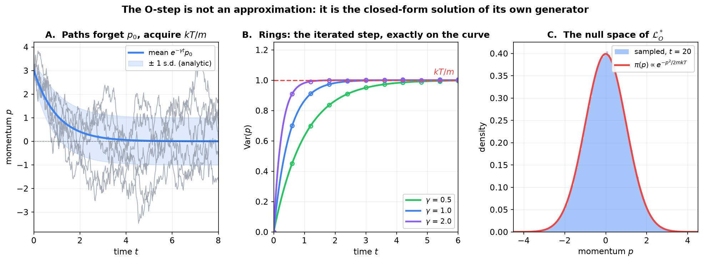
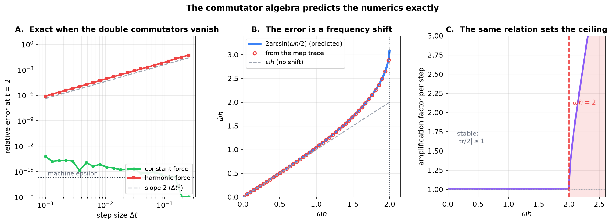

# Markov Generators and the Langevin Splitting

**Why BAOAB is the shape it is, from the semigroup up**

Theory companion to [*PyTorch Implementation of CfC + BAOAB in Fock-PARFLM*](PyTorch_Implementation_of_CfC_BAOAB_in_Fock-PARFLM.md) and [*Deep Dive: The Blended CfC BAOAB Integrator*](Blended_CfC_BAOAB_Deep_Dive.md). Written to fill the theory gap those notes assume: what a Markov generator is, why solving an SDE is the same thing as exponentiating an operator, and why the splitting error is entirely a statement about commutators.

Every numerical claim below is produced by [`figures/_make_markov_generator_figs.py`](figures/_make_markov_generator_figs.py), not asserted.

---

## Contents

1. [A Markov process and its semigroup](#1-a-markov-process-and-its-semigroup)
2. [The generator](#2-the-generator)
   - [2.1 What makes (2.1) legitimate](#21-what-makes-21-legitimate)
3. [From an Ito SDE to its generator](#3-from-an-ito-sde-to-its-generator)
4. [The Langevin generator, and where A, B and O come from](#4-the-langevin-generator-and-where-a-b-and-o-come-from)
5. [Stationarity, and why the noise is locked to the friction](#5-stationarity-and-why-the-noise-is-locked-to-the-friction)
6. [Solving the SDE means exponentiating the generator](#6-solving-the-sde-means-exponentiating-the-generator)
7. [The error is the commutators, and nothing else](#7-the-error-is-the-commutators-and-nothing-else)
8. [What the framing buys](#8-what-the-framing-buys)
9. [Dictionary](#9-dictionary)

---

## 1. A Markov process and its semigroup

Let $\mathcal{F}\_t := \sigma(X_u : u \leq t)$ be the **natural filtration** — the $\sigma$-algebra generated by the whole history of the process up to time $t$, that is, everything an observer who has watched the path so far could know. A process $X_t$ taking values in a measurable state space is **Markov** when conditioning on that entire history is no better than conditioning on the present state:

$$
\mathbb{P}\left(X_{t+s}\in A \mid \mathcal{F}\_t\right) = \mathbb{P}\left(X_{t+s}\in A \mid X_t\right)
\quad\text{a.s., for all } t,s \geq 0 \text{ and measurable } A. \qquad (1.1)
$$

Three things that matter and are easy to lose:

- **The equality is almost sure**, not pointwise. Both sides are conditional expectations, hence random variables defined only up to null sets.
- **The quantifiers are part of the statement.** Holding for one $s$, or for one $A$, is strictly weaker.
- **This is the *simple* Markov property**, where $t$ is a fixed time. Replacing $t$ by a stopping time gives the *strong* Markov property, which is genuinely stronger in continuous time and is what arguments about hitting times need. The present note does not use it.

What (1.1) does **not** supply, and §2 will need: a *regular* version of the conditional probability, giving a transition kernel $p_t(x, dy)$, and enough continuity in $t$ to differentiate the resulting operator family. Those are extra hypotheses, taken up at the end of §2.

Rather than track trajectories, track what they do to **observables**. Define the transition semigroup

$$
(P_t f)(x) := \mathbb{E}\left[f(X_t)\mid X_0 = x\right] = \int f(y)\,p_t(x, dy), \qquad (1.2)
$$

where $p_t$ is the transition kernel. The Markov property makes $P_t$ multiplicative in time — the Chapman-Kolmogorov relation

$$
P_{t+s} = P_t P_s, \qquad P_0 = I, \qquad (1.3)
$$

which is exactly the statement that $\lbrace P_t \rbrace$ is a one-parameter **semigroup of linear operators**. That algebraic structure, and not any property of individual paths, is what the rest of this note exploits.

---

## 2. The generator

A semigroup is determined by its derivative at the identity. The **infinitesimal generator** is

$$
\mathcal{L}f := \lim_{t\to 0}\frac{P_t f - f}{t}, \qquad\text{so formally}\qquad P_t = e^{t\mathcal{L}}. \qquad (2.1)
$$

The limit is taken in a norm, on the set of $f$ for which it exists — the **domain** $\mathcal{D}(\mathcal{L})$, which is generally not all of the function space. See the regularity note closing this section for what makes (2.1) legitimate.

Two evolution equations follow, and keeping them apart is the single most useful piece of bookkeeping in the subject.

**Backward equation — evolves observables.** With $u(t,x) = \mathbb{E}[f(X_t)\mid X_0 = x]$,

$$
\partial_t u = \mathcal{L}u, \qquad u(0,\cdot) = f. \qquad (2.2)
$$

**Forward equation — evolves densities.** With $\rho_t$ the law of $X_t$, and $\mathcal{L}^{\ast}$ the formal adjoint,

$$
\partial_t \rho = \mathcal{L}^{\ast}\rho. \qquad (2.3)
$$

This is the Fokker-Planck equation. Stationarity then becomes a null-space question: a density $\pi$ is invariant precisely when

$$
\mathcal{L}^{\ast}\pi = 0. \qquad (2.4)
$$

### 2.1 What makes (2.1) legitimate

The Markov property (1.1) by itself does not entitle anyone to write $P_t = e^{t\mathcal{L}}$. Two further hypotheses are doing the work, and they are worth naming because they are where the measure theory actually lives.

**Strong continuity.** $\lbrace P_t \rbrace$ must be a $C_0$-semigroup on a Banach space $E$ of functions:

$$
\lVert P_t f - f \rVert \longrightarrow 0 \quad\text{as } t \to 0, \text{ for every } f \in E. \qquad (2.5)
$$

Without (2.5) the difference quotient in (2.1) need not converge for any $f$ at all, and there is no generator to speak of. Strong continuity is an assumption about the process, not a consequence of (1.1).

**The Feller property.** The standard sufficient condition: $P_t$ maps $C_0(E)$ into itself and $P_t f \to f$ pointwise as $t\to 0$. A Markov process with this property is a **Feller process**, and the Hille-Yosida theorem then guarantees that $\mathcal{L}$ is closed, that $\mathcal{D}(\mathcal{L})$ is dense, and that the semigroup is recovered from the generator uniquely. That last clause is what licenses treating "$e^{t\mathcal{L}}$" as more than notation.

The Langevin diffusion (4.1) with smooth coefficients of at most linear growth is Feller, so everything below is on solid ground. The point of saying so is that the splitting argument of §7 manipulates $e^{\Delta t\mathcal{L}\_A}$, $e^{\Delta t\mathcal{L}\_B}$ and $e^{\Delta t\mathcal{L}\_O}$ as if they were matrices, and that licence comes from this theorem rather than from (1.1).

A caveat on the exponential notation. For unbounded $\mathcal{L}$ — which is the case here, since (4.2) contains differential operators — the series $\sum_n (t\mathcal{L})^n/n!$ need not converge on any useful domain. $e^{t\mathcal{L}}$ denotes the semigroup generated by $\mathcal{L}$ in the Hille-Yosida sense, not a convergent power series. The Baker-Campbell-Hausdorff manipulations of §7 are correspondingly formal: they are asymptotic expansions in $\Delta t$, justified term by term on smooth compactly supported functions, not identities between convergent series.

---

## 3. From an Ito SDE to its generator

For a diffusion $dX = b(X)\,dt + \sigma(X)\,dW$, Ito's lemma gives

$$
df(X_t) = \left[b\cdot\nabla f + \tfrac12\mathrm{tr}\left(\sigma\sigma^{\top}\nabla^2 f\right)\right]dt + \nabla f\cdot\sigma\,dW. \qquad (3.1)
$$

Take expectations. The stochastic integral is a martingale and contributes nothing, leaving $\frac{d}{dt}\mathbb{E}[f] = \mathbb{E}[\mathcal{L}f]$ with

$$
\mathcal{L} = b\cdot\nabla + \tfrac12\mathrm{tr}\left(\sigma\sigma^{\top}\nabla^2\right). \qquad (3.2)
$$

**Drift becomes first order, noise becomes second order.** Always. Three instances:

| Process | SDE | Generator |
|---|---|---|
| Deterministic transport | $dX = b\,dt$ | $b\cdot\nabla$ |
| Brownian motion | $dX = \sqrt{2D}\,dW$ | $D\Delta$ (the heat equation) |
| Ornstein-Uhlenbeck | $dp = -\gamma p\,dt + \sigma dW$ | $-\gamma p \partial_p + \tfrac{\sigma^2}{2}\partial_p^2$ |

Generators need not be differential operators. A jump process with rate $\lambda$ and jump law $\nu$ has the integral generator $\mathcal{L}f(x) = \lambda\int(f(y)-f(x))\nu(dy)$ — worth knowing, because it shows the framework is about semigroups rather than about PDEs.

---

## 4. The Langevin generator, and where A, B and O come from

Langevin dynamics in phase space:

$$
dq = M^{-1}p\,dt, \qquad dp = F(q)\,dt - \gamma p\,dt + \sqrt{2\gamma k_B T M}\,dW. \qquad (4.1)
$$

Apply (3.2) and the generator splits into three terms with no choices made:

$$
\mathcal{L} = \underbrace{M^{-1}p\cdot\nabla_q}_{\mathcal{L}_A} + \underbrace{F(q)\cdot\nabla_p}_{\mathcal{L}_B} + \underbrace{-\gamma p\cdot\nabla_p + \gamma k_B T\,M:\nabla_p\nabla_p}_{\mathcal{L}_O}. \qquad (4.2)
$$

The letters of BAOAB are not an arbitrary labelling: they are the three terms (3.2) produces from (4.1). Note also that

$$
\mathcal{L}_A + \mathcal{L}_B = \lbrace\cdot, H\rbrace \qquad (4.3)
$$

is the Liouville operator of the underlying Hamiltonian flow, so $\mathcal{L}\_O$ is precisely what the thermostat adds and nothing more.

---

## 5. Stationarity, and why the noise is locked to the friction

Why is the invariant density $\pi \propto e^{-H/k_B T}$? Check (2.4) piecewise.

**The Hamiltonian part fixes the form.** The flow of $\mathcal{L}\_A + \mathcal{L}\_B$ preserves phase-space volume, so by Liouville's theorem it annihilates **any** function of $H$ alone. It cannot pick out a temperature.

**The thermostat fixes the temperature.** The OU part acting on $p$ has its own stationary density

$$
\pi_O(p) \propto \exp\left(-\frac{p^{\top}M^{-1}p}{2k_B T}\right), \qquad (5.1)
$$

but only when the noise amplitude is exactly $\sqrt{2\gamma k_B T M}$ as written in (4.1). Together the two give $e^{-H/k_B T}$.

That proviso is the **fluctuation-dissipation condition**: $\gamma$ and the noise are not independent dials. Raise friction without raising noise and the sampled distribution is no longer $\pi$ — it is colder. Any mechanism that adds effective damping outside the thermostat (a projection, a renormalisation, a clipped update) therefore changes what the integrator samples, which is why the effective-damping bookkeeping in the SemSimula models has to be done carefully rather than by inspection of $\gamma$ alone.

---

## 6. Solving the SDE means exponentiating the generator

By (2.1), "solve the Langevin equation over a step" means "compute $e^{\Delta t\mathcal{L}}$". That cannot be done in closed form. But each summand of (4.2) can be, and this is the whole reason the splitting family exists.

**A is a shift.** The exponential of a first-order operator translates its argument:

$$
e^{\tau a\partial_q}f(q) = \sum_{n\geq 0}\frac{\tau^n a^n}{n!}\partial_q^n f(q) = f(q + \tau a), \qquad (6.1)
$$

which is Taylor's theorem read backwards. Hence $e^{\tau\mathcal{L}\_A}f(q,p) = f(q + \tau M^{-1}p,  p)$, exactly.

**B is the same shift in momentum.** $F(q)$ does not depend on $p$, so it is constant along the flow it generates, and $e^{\tau\mathcal{L}\_B}f(q,p) = f(q,  p + \tau F(q))$, exactly.

**O is the Ornstein-Uhlenbeck kernel.** Integrating $dp = -\gamma p\,dt + \sigma dW$ gives

$$
p_t = e^{-\gamma t}p_0 + \sigma\int_0^t e^{-\gamma(t-s)}dW_s, \qquad (6.2)
$$

a Gaussian with mean $e^{-\gamma t}p_0$ and variance $\frac{\sigma^2}{2\gamma}\left(1 - e^{-2\gamma t}\right)$. Substituting the FDT-locked amplitude $\sigma^2 = 2\gamma k_B T/m$:

$$
p_t = c_1 p_0 + \sqrt{\frac{k_B T}{m}\left(1 - c_1^2\right)} \xi, \qquad c_1 = e^{-\gamma t}, \quad \xi\sim\mathcal{N}(0,1). \qquad (6.3)
$$

**This is `ou_step` verbatim.** Its docstring reads `v <- c1 v + sqrt((T/m)(1 - c1^2)) * xi, c1 = exp(-gamma dt)`. The O-step in the code is not a discretisation of the thermostat; it is the closed-form solution of $e^{\Delta t\mathcal{L}\_O}$, correct at any step size.

**Figure 1.** Left: sample paths with the analytic mean $e^{-\gamma t}p_0$ and the $\pm$ one-standard-deviation envelope from (6.2). The process forgets its initial condition exponentially and acquires the thermal width. Centre: the variance law for three frictions, with rings marking the variance of 200000 trajectories of the iterated (6.3) recursion — they sit on the continuous curve at every step, because the recursion is exact rather than approximate. Right: the sampled density at $t = 20$ against (5.1); the measured variance is 1.0012 against a target of 1.

---

## 7. The error is the commutators, and nothing else

BAOAB asserts

$$
e^{\Delta t\mathcal{L}} \approx e^{\frac{\Delta t}{2}\mathcal{L}_B}e^{\frac{\Delta t}{2}\mathcal{L}_A}e^{\Delta t\mathcal{L}_O}e^{\frac{\Delta t}{2}\mathcal{L}_A}e^{\frac{\Delta t}{2}\mathcal{L}_B}. \qquad (7.1)
$$

Every factor on the right is exact, by §6. The **only** approximation is replacing the exponential of a sum by a product of exponentials, and

$$
e^{X+Y} = e^X e^Y \iff [X,Y] = 0. \qquad (7.2)
$$

So the entire error is attributable to non-commutativity. This is unusual: in Euler or Runge-Kutta every stage is itself a truncated series, and the error is spread across them.

Baker-Campbell-Hausdorff for the symmetric composition quantifies it:

$$
e^{\frac{h}{2}X}e^{hY}e^{\frac{h}{2}X} = \exp\left(h(X+Y) + h^3\left[-\tfrac{1}{24}\left[X,[X,Y]\right] + \tfrac{1}{12}\left[Y,[Y,X]\right]\right] + O(h^5)\right). \qquad (7.3)
$$

Three readings:

1. **The leading error is a double commutator**, $O(h^3)$ locally and $O(h^2)$ globally: second order.
2. **Only odd powers survive.** The palindrome B-A-O-A-B is time-symmetric, and time-symmetry cancels every even BCH order. A non-symmetric A-B-O would be first order; the symmetry is load-bearing, not cosmetic.
3. **The scheme integrates a modified generator exactly**, rather than the true one approximately. For the deterministic part this is the shadow-Hamiltonian picture, and it is why symplectic schemes do not drift in energy over long runs.

### 7.1 The commutators, written out

With $\mathcal{L}\_A = \frac{p}{m}\partial_q$ and $\mathcal{L}\_B = F(q)\partial_p$, direct computation gives

$$
\left[\mathcal{L}_A, \mathcal{L}_B\right] = \frac{p}{m}F'(q) \partial_p - \frac{F(q)}{m} \partial_q. \qquad (7.4)
$$

Non-zero whenever there is any force at all.

### 7.2 A prediction worth checking

For a **constant** force, $F' = 0$, so (7.4) collapses to $-\frac{F}{m}\partial_q$ — and both double commutators in (7.3) vanish identically. The leading error term is therefore zero, and the prediction is that Strang splitting is **exact** under uniform acceleration, at any step size.

It is. At $h = 0.5$ and $h = 0.25$ the computed position is $2.00000000000000000$ against an exact $2$, absolute error $0$; at $h = 0.1$ the error is $4.4\times10^{-16}$, pure floating-point accumulation. Verlet integrates projectile motion exactly, and the commutator algebra says so in advance.

For a **harmonic** force $F = -\omega^2 q$ the double commutators do not vanish, and the error is second order. Better, it is computable in closed form: the one-step map has trace $2 - \omega^2h^2$, so the scheme advances a shifted frequency $\tilde\omega$ obeying

$$
\sin\left(\frac{\tilde\omega h}{2}\right) = \frac{\omega h}{2}. \qquad (7.5)
$$

The error appears as a **frequency shift**, not as energy drift — and the scheme loses stability exactly where (7.5) stops having a real solution, at $\omega h = 2$.

**Figure 2.** Left: relative error at $t = 2$ against step size. The harmonic case tracks the $\Delta t^2$ reference; the constant-force case sits at machine epsilon across four decades of step size, exactly as the vanishing double commutators predict. Centre: $\tilde\omega h$ measured from the trace of the one-step map against the closed form (7.5); they agree to $1.4\times10^{-15}$, which is machine precision. Right: the per-step amplification factor, which leaves the unit circle precisely at $\omega h = 2$.

### 7.3 Why this is the design argument for CfC

For the framework's Gaussian wells, $F'(q)\neq 0$ — the well's force curves — so (7.4) survives and the stiffest well's $\omega_k$ sets the step ceiling for the whole model through (7.5).

The CfC substep replaces the A-then-B treatment of the harmonic part with the **exact propagator** of that oscillator. Since that propagator is the true flow of the harmonic piece, its commutator contribution is not reduced but removed. What remains is only the commutator between the exactly-handled flow and the residual forces, which is what the blended note records as its error term: $O(\Delta t^3\lVert[\nabla V_\theta, \nabla V_{\mathrm{ex}} + Q]\rVert)$.

Stated as a design rule: **enumerate the commutators, and buy back the expensive ones by solving those pieces exactly.** The stiff harmonic part is bought back by CfC; the exchange field and the reverse channel are not, because no closed-form propagator exists for them.

---

## 8. What the framing buys

| Question about the SDE | In generator language |
|---|---|
| Solve the dynamics | Exponentiate $\mathcal{L}$ |
| Split into tractable pieces | Factor $e^{\Delta t\mathcal{L}}$ into exponentials of summands |
| How large is the error | BCH: double commutators, $O(\Delta t^3)$ locally |
| Why is the ordering palindromic | Time-symmetry cancels even BCH orders |
| What does the scheme sample | The null space of $\mathcal{L}^{\ast}$ |
| Why is the noise tied to the friction | Required for (5.1) to be stationary |
| Why does CfC help | It removes a commutator rather than shrinking it |

Every entry is algebra about operators rather than analysis of trajectories. That is the reason the Markov-generator view is the standard setting for this material, and the reason the splitting literature reads as a literature about Lie brackets.

**One caveat specific to the SemSimula models.** The sampling argument of §5 applies only when the thermostat is running. The default configuration sets `langevin_T = 0.0`, at which (6.3) reduces to pure deterministic friction $v \leftarrow e^{-\gamma\Delta t}v$ with no noise and no Boltzmann target. At $T = 0$ the justification for the splitting is not sampling accuracy but the exactness of the friction factor — $e^{-\gamma\Delta t}$ rather than a first-order $1/(1+\gamma\Delta t)$ — together with the symplectic structure of the A and B substeps. Both arguments are good; they are different arguments, and an introduction that runs only the molecular-dynamics one will misdescribe the default configuration.

---

## 9. Dictionary

| Term | Meaning here |
|---|---|
| Transition semigroup $P_t$ | $(P_tf)(x) = \mathbb{E}[f(X_t)\mid X_0=x]$; evolves observables |
| Generator $\mathcal{L}$ | Derivative of $P_t$ at $t=0$; $P_t = e^{t\mathcal{L}}$ |
| Backward equation | $\partial_t u = \mathcal{L}u$, for observables |
| Forward equation | $\partial_t\rho = \mathcal{L}^{\ast}\rho$, Fokker-Planck, for densities |
| Invariant density | Any $\pi$ with $\mathcal{L}^{\ast}\pi = 0$ |
| $\mathcal{L}\_A$, $\mathcal{L}\_B$, $\mathcal{L}\_O$ | The three terms (3.2) produces from (4.1); each exactly exponentiable |
| Splitting error | The BCH commutator terms of (7.3); zero iff the pieces commute |
| Shadow generator | The modified operator the scheme integrates exactly |

**Summary.** A Markov process is summarised by a semigroup, a semigroup by its generator, and solving the dynamics by exponentiating that generator. The Langevin generator splits into three pieces that are individually exactly exponentiable — two shifts and an Ornstein-Uhlenbeck kernel, the last of which is `ou_step` verbatim. Composing them is the only approximation in the scheme, so the whole error is the Baker-Campbell-Hausdorff commutator series: second order by time symmetry, exactly zero when the double commutators vanish, and reducible by solving stiff pieces exactly, which is what the CfC substep does.
