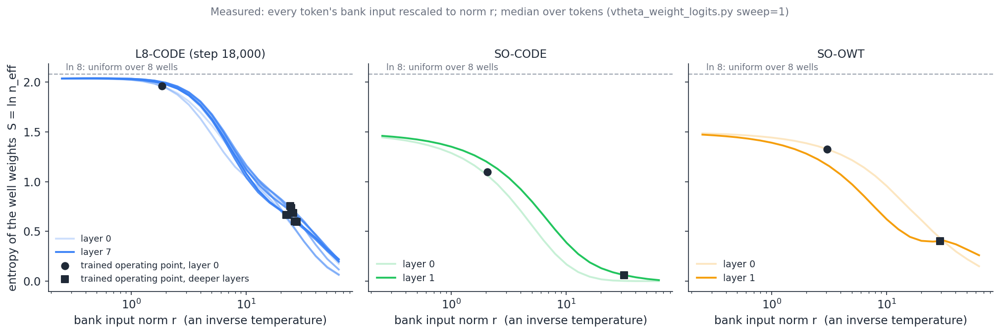
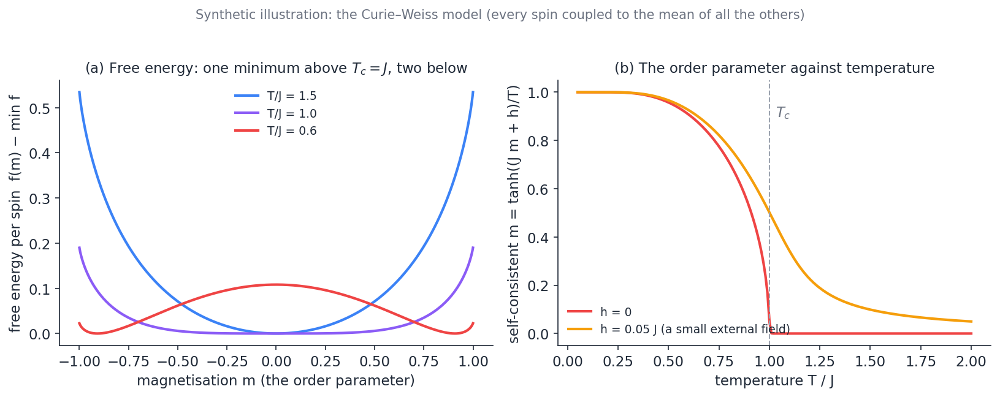
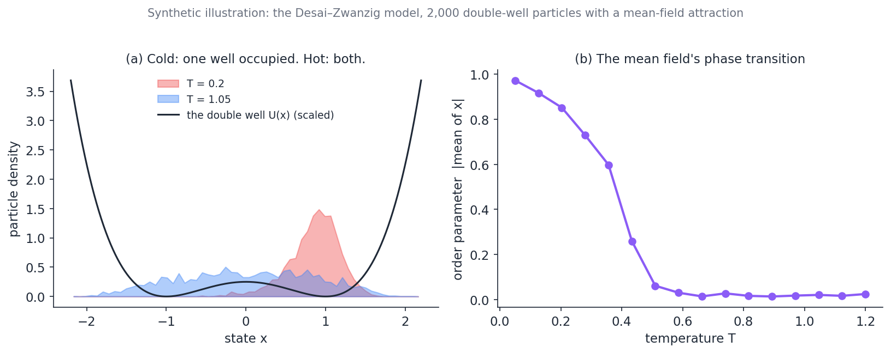
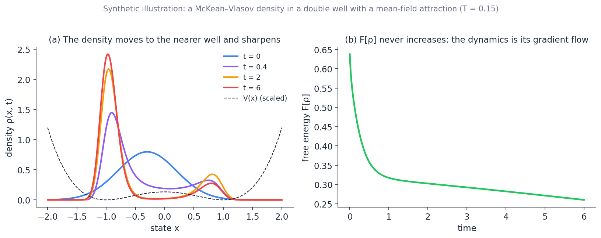
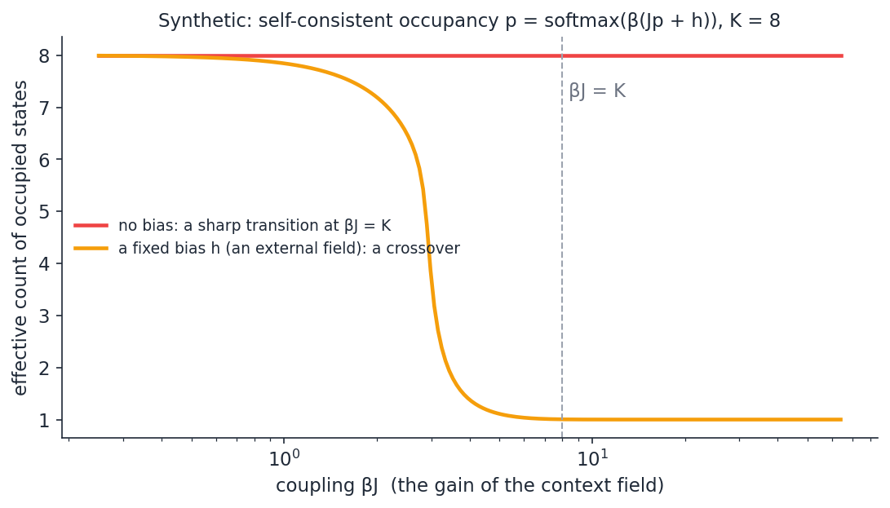

# Mean-Field Theory for Particle-Based Language Models

**A study guide: the theory from its simplest model to its modern machine-learning forms, and what it says about the conservative models (draft, 2026-11-03).**

**Purpose.** [Macroscopic_Limits_of_the_Conservative_Step.md](Macroscopic_Limits_of_the_Conservative_Step.md) proposes replacing the per-token pair force by a field and gives a primer on the limit that justifies it. This note goes deeper into the theory itself: where mean-field theory comes from, why it is a piece of thermodynamics, what its modern forms in machine learning are, and what it predicts about our models. It assumes no statistical mechanics. Every derivation is carried out in the text, at the level of a first course, and every claim about our models is either measured here (one figure reads the temperature sweeps of 2026-11-03) or stated as a prediction with the experiment that would test it (§8). The synthetic figures say so in their titles.

**How to read it.** §1–§4 build the theory on one running example, the well bank's softmax, so that every abstract object has a concrete counterpart in the model. §5 surveys the machine-learning literature. §6 and §7 are the application. §9 is a reading plan.

---

## Contents

0. [The one-page version](#0-the-one-page-version)
1. [Thermodynamics from a softmax](#1-thermodynamics-from-a-softmax)
2. [The simplest mean-field model: Curie–Weiss](#2-the-simplest-mean-field-model-curieweiss)
3. [From spins to particles: McKean–Vlasov as a free-energy descent](#3-from-spins-to-particles-mckeanvlasov-as-a-free-energy-descent)
4. [Many states, one field: the self-consistent well bank](#4-many-states-one-field-the-self-consistent-well-bank)
5. [Mean-field theory in machine learning](#5-mean-field-theory-in-machine-learning)
6. [Our model in mean-field language](#6-our-model-in-mean-field-language)
7. [What it means for building particle-based language models](#7-what-it-means-for-building-particle-based-language-models)
8. [Pre-registered probe C: the self-consistent bank](#8-pre-registered-probe-c-the-self-consistent-bank)
9. [A reading plan](#9-a-reading-plan)
10. [Glossary](#10-glossary)
11. [References](#11-references)

---

## 0. The one-page version

A **mean-field theory** replaces the interaction of one particle with every other particle by its interaction with one averaged quantity, the field, which the particles generate together. It is exact when the number of particles is large and each interaction is weak, and it is a piece of thermodynamics because the field is determined by a **self-consistency condition** that is the same thing as minimising a **free energy**: the average energy minus temperature times entropy. The free energy has one minimum at high temperature (a disordered phase, every state used) and several at low temperature (ordered phases, one state used): a **phase transition** at a critical temperature.

The well bank of our models is already a thermodynamic object: its weights are a Gibbs distribution over the wells, $w_k = e^{z_k} / \sum_j e^{z_j}$, with the logit $z_k$ playing the role of minus the energy of well $k$, the norm of the bank input playing the role of the inverse temperature, and the bias playing the role of an external field. The effective well count $n_{\mathrm{eff}} = e^{S}$ is the exponential of the entropy of that distribution. The temperature sweeps of 2026-11-03 trace the entropy against the inverse temperature for three models (§1); the deep layers of L8-CODE sit in the cold, two-well phase and layer 0 in the hot, seven-well phase, on the *same* curve, and the input norm rises with depth: the trained model anneals.

The **McKean–Vlasov** equation is the dynamics of a density of such particles under its own mean field; it is the gradient flow of the free energy, so the free energy never increases along it (the second law), and its stationary states are the self-consistent Gibbs measures. Attention is one step of such a dynamics on an energy whose minima are the stored patterns (modern Hopfield networks), tokens under attention cluster on the sphere (Geshkovski et al.), and the training of a wide network is itself a McKean–Vlasov flow of the distribution of its neurons (Mei–Montanari–Nguyen, Chizat–Bach). Our model has two temperatures, the bank's and the integrator's (set to zero), two kinds of interaction (the mean-field one through $\xi$ and the truncated one through the sixteen routed neighbours), and wells that are phases. The content-gated field proposed in the companion note is the McKean–Vlasov form of the second interaction. What the theory predicts about us, and the experiments that test it, are in §6 and §8.

## 1. Thermodynamics from a softmax

### 1.1 The Gibbs distribution and where it comes from

A system with states $k = 1, \dots, K$ and energies $E_k$, in contact with a heat bath at temperature $T$, is found in state $k$ with probability

$$
p_k = \frac{e^{-E_k / T}}{Z}, \qquad Z = \sum_{j=1}^K e^{-E_j / T}.
$$

This is the **Gibbs** (or Boltzmann) distribution and $Z$ is the **partition function**. The argument for it that matters here is not physical but variational, due to Jaynes (1957): among all distributions with a given mean energy $\langle E \rangle = \sum_k p_k E_k$, the Gibbs distribution is the one with the largest **entropy**

$$
S(p) = -\sum_k p_k \ln p_k,
$$

and $1/T$ is the Lagrange multiplier of the energy constraint. The proof is two lines: maximise $S(p) - \beta\sum_k p_k E_k - \lambda\sum_k p_k$ over $p$; the stationarity condition $-\ln p_k - 1 - \beta E_k - \lambda = 0$ gives $p_k \propto e^{-\beta E_k}$. So a softmax is the least-committed distribution consistent with a mean energy, and $\beta = 1/T$ measures how strongly the energy is enforced: at $\beta = 0$ every state is equally likely; as $\beta \to \infty$ only the lowest-energy state survives.

Three identities follow from $Z$ and are the whole of equilibrium thermodynamics in this setting. With $F = -T \ln Z$ the **free energy**:

$$
\langle E \rangle = -\frac{\partial \ln Z}{\partial \beta}, \qquad
F = \langle E \rangle - T S, \qquad
\mathrm{Var}(E) = \frac{\partial^2 \ln Z}{\partial \beta^2} = T^2 C,
$$

where $C = \partial \langle E \rangle / \partial T$ is the **heat capacity**: the variance of the energy measures how much the mean energy responds to temperature. The second identity says that minimising $F$ over distributions is the same as the maximum-entropy problem above; this is why "the system minimises its free energy" and "the system is in the maximum-entropy state at this energy" are one statement. The third says that a large fluctuation of the energy is the signature of a state that is sensitive to temperature; at a phase transition the heat capacity peaks or diverges.

### 1.2 The well bank as a Gibbs distribution

The bank's weights are $w = \mathrm{softmax}(W_w x + b)$ with $x$ the bank input. Write $z_k = (W_w x)_k + b_k$. Then $w_k = e^{z_k} / \sum_j e^{z_j}$ is the Gibbs distribution with

$$
-E_k / T \equiv z_k, \qquad\text{so that, with } x = r \hat{x} \text{ and } \lVert \hat{x} \rVert = 1:\qquad z_k = r (W_w \hat{x})_k + b_k .
$$

Three readings follow at once.

- **The input norm $r$ is an inverse temperature.** For a fixed direction $\hat{x}$, the logits are $r$ times a fixed pattern $(W_w \hat{x})_k$ plus the bias. Scaling $r$ is scaling $\beta$. This is the statement that the minimum-well-count note made from the arithmetic; here it is the definition.
- **The bias is an external field.** At $r = 0$ the weights are $\mathrm{softmax}(b)$, which is not uniform unless $b$ is constant. In the magnet of §2 an external field $h$ biases the spins even at infinite temperature; $b$ does the same for the wells. The entropy at $r \to 0$ is $S(\mathrm{softmax}(b))$: $\ln 8 = 2.08$ for a bank with no bias, and what the sweeps show for each trained bank.
- **$n_{\mathrm{eff}} = e^{S}$ is the exponential of the entropy**, the number of equally weighted wells that would have the same entropy. And the quantity $\mathrm{Var}_{w}(z)$, the variance of the logits under the weights (the *varentropy* that the layer-to-layer bound in `vtheta_weight_logits.py` is built on), is the heat capacity of the bank up to the factor $T^2$: it is largest where $S$ falls fastest with $r$.

### 1.3 The sweeps: entropy against inverse temperature, measured

The temperature sweep of `vtheta_weight_logits.py` rescales every token's bank input to a common norm $r$ and reports the median $n_{\mathrm{eff}}$ per layer. Plotted as $S = \ln n_{\mathrm{eff}}$ against $r$ it is the entropy-versus-inverse-temperature curve of each trained bank:

Measured on 16 windows of 512 tokens per model. Curves: the median entropy at a common norm, one per layer (the depth code differs per layer; the bank is shared). Markers: each layer's trained operating point, its median input norm and its trained median $n_{\mathrm{eff}}$; the markers are medians over tokens at their *own* norms, so a wide spread of norms moves a marker off its curve (SO-CODE layer 0: 2.99 against 3.6 on the curve).

What the figure says:

1. **L8-CODE's eight layers lie on one curve**, from a hot plateau at $S \approx 2.03$ (7.6 wells; the bias is nearly flat) to $S \approx 0.1$ at $r = 64$. Layer 0 operates at $r = 1.85$ on the plateau, with 7.1 wells; layers 1–7 operate at $r = 22.5$ to $27.6$ on the cold slope, with 1.8–2.1 wells. **Same bank, two temperatures, two phases.** And the operating norm rises monotonically with depth, 22.5, 22.9, 24.1, 24.8, 25.6, 26.5, 27.6: the model has learned a schedule in which the temperature falls with depth, which is **annealing** (Kirkpatrick, Gelatt and Vecchi 1983). Nothing in the architecture asks for it; the depth code and the context norms produce it.
2. **The $L = 2$ banks have a lower hot plateau**, $S \approx 1.45$ (4.3 wells): their biases already pick out about four wells at infinite temperature. Their layer-0 operating points are on the shoulder of the curve, their layer-1 points deep in the cold region (SO-CODE at $r = 32$ has 1.06 wells: a single well).
3. **The steepest descent is at $r \approx 4$–$10$ for the code banks**, between the two operating regimes. This is the bank's "specific-heat peak", where its weights are most sensitive to the input norm. The dead-wells episode recorded in the protocol (XI6-CODE-WR, where the layer-1 well centres inflated and the wells died) is a change of norm through exactly this region.

The curves are smooth, not sharp: a crossover, not a transition. That is expected, and §4 explains it: a sweep holds the *field* fixed and varies the temperature, which never gives a sharp transition in a finite system with a bias. The sharp transition, if there is one, lives in the self-consistent problem.

## 2. The simplest mean-field model: Curie–Weiss

### 2.1 The model and the mean field

Take $N$ spins $\sigma_i \in \lbrace -1, +1 \rbrace$ (think of each as one token choosing between two wells), every pair coupled with the same strength, and an external field $h$:

$$
E(\sigma) = -\frac{J}{2N}\Big(\sum_{i=1}^N \sigma_i\Big)^2 - h \sum_{i=1}^N \sigma_i .
$$

This is the **Curie–Weiss** model (Weiss 1907 for the physics; the name is standard). The coupling is divided by $N$ so that the energy per spin stays finite as $N$ grows: this is the **mean-field scaling** met in the companion note's §3.2, and it is what makes the model solvable. Write the magnetisation $m = \frac1N \sum_i \sigma_i$; the energy is $N(-\tfrac{J}{2} m^2 - h m)$, a function of one collective variable.

The force on one spin is the energy's dependence on it: $E = \dots - \sigma_i (J m_{\neg i} + h) + \dots$, where $m_{\neg i}$ is the average of the *other* spins. Each spin feels a field $J m + h$ made of the average of all the others: the **mean field**. In the Gibbs distribution at temperature $T$, a spin in a field $H$ has $\langle \sigma \rangle = \tanh(H / T)$. Requiring that the average produced by the spins equals the average they respond to gives the **self-consistency equation**

$$
m = \tanh\Big(\frac{J m + h}{T}\Big).
$$

### 2.2 Why it is exact for large $N$: the free energy

The self-consistency is not an approximation in this model; it is the saddle-point of the exact partition function. Count the configurations with a given $m$: there are $\binom{N}{N(1+m)/2} \approx e^{N s(m)}$ of them, with the entropy per spin

$$
s(m) = -\frac{1+m}{2}\ln\frac{1+m}{2} - \frac{1-m}{2}\ln\frac{1-m}{2}.
$$

So $Z = \sum_m e^{N s(m)} e^{-N(-\frac J2 m^2 - h m)/T} = \sum_m e^{-N f(m)/T}$ with the **free energy per spin**

$$
f(m) = -\frac{J}{2} m^2 - h m - T s(m).
$$

For large $N$ the sum is dominated by the $m$ that minimises $f$ (Laplace's method; in probability, a large-deviation principle), and $f'(m) = 0$ is $-J m - h + \frac T2 \ln\frac{1+m}{1-m} = 0$, which is the self-consistency equation above. This is the general pattern: **a mean-field self-consistency condition is the stationarity condition of a free energy that combines an energy of the collective variable with the entropy of the configurations that realise it.**

### 2.3 The phase transition

At $h = 0$, $f(m)$ has one minimum at $m = 0$ when $T \gt J$ and two minima at $\pm m^\ast \ne 0$ when $T \lt J$: the critical temperature is $T_c = J$ (expand $f$ to fourth order: $f(m) \approx f(0) + \tfrac12 (T - J) m^2 + \tfrac{T}{12} m^4$, so the quadratic coefficient changes sign at $T = J$). Above $T_c$ the spins are disordered and the collective variable is zero; below, the system picks one of two ordered states. A small field $h$ rounds the transition into a crossover (the orange curve), which is why the sweeps of §1.3 are smooth.

Synthetic: (a) the free energy per spin at three temperatures; (b) the self-consistent magnetisation against temperature, without and with a small external field.

The vocabulary this fixes: the **order parameter** ($m$) is the collective variable that is zero in the disordered phase and nonzero in the ordered one; the **critical temperature** is where the disordered state loses stability; an **external field** rounds the transition; the **susceptibility** $\partial m / \partial h$ diverges at $T_c$. For the bank, the order parameter is the deviation of the well occupancy from uniform (or $\ln K - S$), the field is the bias, and the question §4 asks is whether there is a $T_c$.

## 3. From spins to particles: McKean–Vlasov as a free-energy descent

### 3.1 Particles with a mean-field interaction

Replace the spins by particles with positions $y_i \in \mathbb{R}^d$ in a potential $V$, attracted to one another by a pair potential $W$, with the mean-field scaling, and with friction and thermal noise (overdamped Langevin dynamics at temperature $T$):

$$
dy_i = -\nabla V(y_i) dt - \frac1N \sum_{j} \nabla W(y_i - y_j) dt + \sqrt{2T} dB_i .
$$

The model with $V$ a double well and $W(y) = \tfrac{\theta}{2} y^2$ (each particle attracted to the mean of all) is the **Desai–Zwanzig** model (Desai and Zwanzig 1978; its critical behaviour in Dawson 1983). It is the particle version of Curie–Weiss: the two wells are the two spin states, the attraction to the mean is the coupling, and the question is whether the particles all sit in one well (ordered) or split between the two (disordered). It is the closest classical analogue of our model: particles with wells plus an interaction.

Synthetic: 2,000 particles, $\theta = 1$. (a) Cold, the population sits in one well; hot, it spreads over both. (b) The order parameter, the modulus of the mean position, against temperature.

### 3.2 The density and its equation

As $N \to \infty$ with the particles chaotic (companion note §3.3), the empirical measure converges to a density $\rho_t$ that obeys the **McKean–Vlasov equation**, a Fokker–Planck equation whose drift depends on $\rho_t$ itself:

$$
\partial_t \rho = \nabla \cdot \Big( \rho \nabla \big( V + W \ast \rho \big) \Big) + T \Delta \rho, \qquad (W \ast \rho)(y) = \int W(y - y') \rho(y') dy' .
$$

Its stationary states are the **self-consistent Gibbs measures**

$$
\rho_\infty(y) = \frac{1}{Z} \exp\Big( -\frac{V(y) + (W \ast \rho_\infty)(y)}{T} \Big),
$$

the continuous version of $m = \tanh((Jm + h)/T)$: the density is the Gibbs distribution of the field that the density itself generates. There may be one such $\rho_\infty$ (high $T$) or several (low $T$).

### 3.3 The free energy and the second law

Define the **free-energy functional**

$$
\mathcal F[\rho] = \int V \rho dy + \frac12 \iint W(y - y') \rho(y) \rho(y') dy dy' + T \int \rho \ln \rho dy ,
$$

energy of the external potential, energy of the interaction (the $\tfrac12$ because each pair is counted once), and minus temperature times the entropy $-\int \rho \ln \rho$. Two facts make this the centre of the theory.

**The McKean–Vlasov equation is the gradient flow of $\mathcal F$.** Jordan, Kinderlehrer and Otto (1998) showed that the Fokker–Planck equation is the steepest descent of $\mathcal F$ in the space of densities, when "steepest" is measured by the Wasserstein distance (the cost of moving mass); Otto (2001) made it a Riemannian calculus; Carrillo, McCann and Villani (2003) did the interacting case. The computation that shows it in one line: with $\mu = \delta \mathcal F / \delta \rho = V + W \ast \rho + T(\ln \rho + 1)$ the variational derivative, the equation reads $\partial_t \rho = \nabla \cdot (\rho \nabla \mu)$, and then

$$
\frac{d}{dt} \mathcal F[\rho_t] = \int \mu \partial_t \rho = \int \mu \nabla\cdot(\rho \nabla \mu) = -\int \rho \lVert \nabla \mu \rVert^2 \le 0 .
$$

**So the free energy never increases.** This is the H-theorem (Boltzmann 1872) in this setting, and it is the second law of thermodynamics: the quantity that can only decrease. The dynamics stops exactly where $\nabla \mu = 0$ on the support of $\rho$, which is the self-consistency condition.

Synthetic: a density in a double well with a mean-field attraction, evolved by the McKean–Vlasov equation on a grid. (a) It moves to the nearer well and sharpens. (b) $\mathcal F[\rho_t]$ decreases monotonically.

**Why this matters for a learning system.** The loss of a language model is not $\mathcal F$. But if the forward pass is a McKean–Vlasov step, or several, then *within* the forward pass the state's density descends a free energy whose minima are the self-consistent Gibbs measures of the trained potentials. The layers do not compute an arbitrary function; they relax a density toward the minima of $\mathcal F$, and what training shapes is $\mathcal F$ (through $V_\theta$, $V_\varphi$ and the temperatures). §6 draws the consequences.

## 4. Many states, one field: the self-consistent well bank

### 4.1 The Potts form of self-consistency

Curie–Weiss has two states per spin. With $K$ states and a coupling that rewards agreement ("the more tokens are in well $k$, the more attractive well $k$ is"), the mean-field self-consistency becomes

$$
p = \mathrm{softmax}\big( \beta (J p + h) \big), \qquad p \in \text{the } K\text{-simplex},
$$

the mean-field **Potts** model (Potts 1952; the mean-field analysis in Wu 1982). The symmetric point $p = \mathbf 1 / K$ is always a fixed point. Linearising the softmax at it, the Jacobian of the map $p \mapsto \mathrm{softmax}(\beta J p + \beta h)$ on the simplex has eigenvalue $\beta J / K$ at $h = 0$, so the symmetric point is stable for $\beta J \lt K$ and unstable beyond: the critical coupling is $\beta J = K$. Past it the stable fixed points have the weight concentrated on one state (or a few), and the effective count drops from $K$ toward 1. A bias $h \ne 0$ rounds the transition into a crossover, exactly as in §2.3.

Synthetic: $K = 8$; the effective count of occupied states at the stable fixed point found by iteration, against the coupling $\beta J$, without a bias (a transition at $\beta J = 8$) and with one (a crossover).

### 4.2 The same equation inside the well bank

The sweeps vary the temperature at a *given* input $x$. But $x$ is not given from outside: it is a weighted mean of the preceding tokens' states (the context channels, companion note §4), and those states sit, if the wells are stiff, at the well centres $\mu_k(x)$ that the bank itself selects. Close the loop with the simplest **closure**, "the context is the weighted mean of the centres the bank selects":

$$
x = \sum_{k=1}^K w_k(x) \mu_k(x), \qquad w(x) = \mathrm{softmax}(W_w x + b), \qquad \mu_k(x) = M_k x + m_k .
$$

This is a self-consistency equation for the context field $x$, of the Potts type: the weights depend on the field through $W_w$, and the field is made of the centres with those weights. Its symmetric solutions (many wells with comparable weight, a small $x$) and its ordered solutions (one or two wells, a large $x$ aligned with their centres) are the two phases seen in §1.3, now as *fixed points* rather than as responses. Linear stability at a fixed point is the spectral radius of the Jacobian $\partial x_{\mathrm{new}} / \partial x = \sum_k \big( \mu_k \nabla w_k^\top + w_k M_k \big)$; the gain of the loop is set by $W_w$ (how strongly the field selects wells) and by $M_k$ (how far the centres move with the field). The input norm is not a free parameter here: it is *determined* by the fixed point. That is the difference between the sweeps and the phase diagram, and it is what Probe C (§8) computes from a trained checkpoint's bank parameters alone, in minutes, with no model forward.

The closure is crude on purpose. It ignores the dynamics within a layer (the states are not exactly at the centres), the five decays (one $x$ for all channels), the depth code (a fixed offset per layer, easy to include) and the pair force. It is the Curie–Weiss level of the theory: wrong in detail, right about whether there are phases and where the transition is.

## 5. Mean-field theory in machine learning

Five lines of work, each a different use of the same idea; for each, what it is, what it buys, and what it says about us.

### 5.1 Variational inference is mean-field free-energy minimisation

In a Boltzmann machine or any graphical model with energy $E(\sigma)$, the Gibbs distribution $p \propto e^{-E}$ is intractable, and the mean-field approximation replaces it by a product $q(\sigma) = \prod_i q_i(\sigma_i)$ chosen to minimise the free energy $\mathcal F[q] = \langle E \rangle_q - S(q)$ (Peterson and Anderson 1987 for Boltzmann machines; the general theory in Jordan, Ghahramani, Jaakkola and Saul 1999 and Wainwright and Jordan 2008; MacKay 2003, ch. 33, is the readable account). The stationarity conditions are self-consistency equations of the Curie–Weiss type, one per variable, and $\mathcal F[q] - \mathcal F[p] = \mathrm{KL}(q \Vert p) \ge 0$, so minimising the variational free energy maximises a lower bound on $\ln Z$: the evidence lower bound (ELBO) of variational autoencoders is this free energy with the sign flipped. **What it says about us:** a softmax over wells with logits linear in a summary of the context *is* a mean-field posterior over "which well", with the summary as the field. The bank is a one-step variational inference of the well assignment.

### 5.2 Hopfield networks and attention

Hopfield (1982) stored patterns $\xi^\mu$ as minima of the energy $E(\sigma) = -\tfrac12 \sum_\mu (\xi^\mu \cdot \sigma)^2$ and retrieved them by descending it; its mean-field analysis (Amit, Gutfreund and Sompolinsky 1985) gives a capacity of $0.14 N$ patterns. Krotov and Hopfield (2016) replaced the square by a steeper function and raised the capacity to a polynomial, then an exponential, in $N$. Ramsauer et al. (2020) took the energy $E(\sigma) = -\tfrac1\beta \ln \sum_\mu e^{\beta \xi^\mu \cdot \sigma} + \tfrac12 \lVert\sigma\rVert^2$ and showed that one step of its descent is

$$
\sigma_{\mathrm{new}} = \sum_\mu \mathrm{softmax}_\mu(\beta \xi^\mu \cdot \sigma) \xi^\mu ,
$$

which is **exactly the attention update** with the stored patterns as keys and values and $\beta$ the inverse temperature. The log-sum-exp is $-T \ln Z$: the free energy of a Gibbs distribution over the stored patterns. So attention is a mean-field retrieval step: the query is updated to the Gibbs-weighted mean of the patterns, one iteration of a self-consistency equation. **What it says about us:** the bank's well selection $x \mapsto \sum_k w_k(x) \mu_k(x)$ of §4.2 is this update with $K$ patterns that are themselves linear in the query; the self-consistent bank is the fixed point of a Hopfield-type retrieval.

### 5.3 Transformers as interacting particles

Lu et al. (2019) read a transformer layer as one step of a multi-particle dynamics (attention the interaction, the MLP the external force) and derived better integrators from it. Sander, Ablin, Blondel and Peyré (2022, Sinkformers) showed that with doubly-stochastic attention the continuous-depth limit is a Wasserstein gradient flow of an energy, which is the McKean–Vlasov structure of §3. Geshkovski, Letrouit, Polyanskiy and Rigollet (2023) studied self-attention on the sphere as an interacting-particle system with the mean-field scaling and proved that the tokens **cluster**: as depth grows, the particles collapse to a small number of points, with the number of clusters controlled by the inverse temperature of the attention. Vuckovic, Baratin and Combes (2020) gave the measure-theoretic formulation. **What it says about us:** our deep layers' $n_{\mathrm{eff}} \approx 2$ and the force concentrated on two wells is a clustering of the kind Geshkovski et al. predict, with the wells as the cluster centres; a direct test is the number of clusters of the states $h_t$ per layer (§8, the optional Probe D).

### 5.4 Mean-field theory of training

Mei, Montanari and Nguyen (2018), Chizat and Bach (2018), Rotskoff and Vanden-Eijnden (2018) and Sirignano and Spiliopoulos (2020) showed, independently, that for a two-layer network with $N$ neurons and the mean-field scaling $f(x) = \frac1N \sum_i a_i \phi(w_i \cdot x)$, stochastic gradient descent on the weights is, as $N \to \infty$, a McKean–Vlasov equation for the distribution of the neurons' parameters: a Wasserstein gradient flow of the loss as a functional of that distribution. Neurons are particles; the loss is the free energy (with an entropy term when the SGD noise is kept); the mean field is the network's output. Chizat and Bach proved that this flow converges to the global minimiser under conditions, which is a convergence proof for training. **What it says about us:** the training of the bank ($K$ wells, each a "neuron" with parameters $(M_k, m_k, \dots)$) is a particle system in parameter space with $K = 8$ or $2$ particles, far from the limit; the dead-wells phenomenon (a particle that stops moving because nothing is assigned to it) is the finite-size failure the mean-field theory of training does not see, and it is the reason those proofs need $N \to \infty$.

### 5.5 Mean-field games (a mention)

Lasry and Lions (2007) and Huang, Malhamé and Caines (2006) studied many agents each optimising against the population's distribution; the equilibrium couples a McKean–Vlasov equation forward in time with a Hamilton–Jacobi equation backward. Carmona and Delarue (2018) is the reference. It is the mean-field theory with optimisation inside, and the right frame if one day the tokens are given objectives rather than forces. Not used here.

## 6. Our model in mean-field language

### 6.1 A dictionary

| in the model | in mean-field theory | note |
| --- | --- | --- |
| a token's state $h_t$ on the sphere, its velocity $v_t$ | a particle's position and velocity | the sphere is the LayerNorm constraint |
| a sequence of $T$ tokens | an $N$-body system with $N = T$, in a fixed order | the order (causality) has no analogue; the field at $t$ uses $s \lt t$ only |
| a layer | one time step of the dynamics | $\Delta t = 8 / L$ |
| the well bank $V_\theta(h; \xi_t)$ | an external potential whose parameters are functionals of the empirical measure of the past | this is the mean-field coupling the model already has |
| the context channels $\xi_t$ | the first moments of position-weighted densities of the past | five densities, five decays |
| the bank weights $w(x)$ | a Gibbs distribution over $K$ states | logit = minus energy over temperature |
| the bank input norm | the inverse temperature of the bank | §1.2 |
| the bias $b$ | an external field | sets the entropy at infinite temperature |
| $n_{\mathrm{eff}}$ | $e^{S}$, the exponential of the entropy | the effective number of occupied states |
| $\ln K - S$, or the force shares | the order parameter | zero in the disordered phase |
| the wells | the phases | a dead well is an unoccupied phase |
| the pair force over 16 routed neighbours | a truncated interaction: fixed $k$, not the mean-field scaling | §6.2 |
| the content-gated field (companion note §5.1) | a McKean–Vlasov interaction with a mixture density | the mean-field scaling by construction |
| the depth code | a time-dependent external field | it sets the per-layer temperature |
| the integrator's thermostat, $T = 0$ | the particles' temperature | zero: deterministic friction |
| the Fock registers | exclusion (a hard-core constraint) | not treated here |

### 6.2 Two temperatures and two interactions

The dictionary exposes two facts about the model that the mean-field vocabulary makes visible.

**Two temperatures.** The bank's weights are a Gibbs distribution at the temperature set by the input norm, but the particles move at temperature zero (the thermostat is off: the friction is exact and deterministic). So the model is a zero-temperature particle dynamics in a potential whose *shape* is chosen by a finite-temperature Gibbs distribution. The entropy that the sweeps measure is the entropy of the potential's selection, not of the particles. In the Desai–Zwanzig picture, this is a population that never fluctuates thermally (every particle rolls to a minimum) in a landscape whose minima are mixed with weights that *do* obey Gibbs statistics. It is a legitimate model, but it means that "the free energy that the forward pass descends" is the zero-temperature one, $\mathcal F = \int V \rho + \tfrac12 \iint W \rho \rho$ with no entropy term, and that the only entropy in the system is the bank's. Whether a nonzero particle temperature would help (the SR5 "thermal training" item in the protocol) is, in this language, the question of whether the entropy term of $\mathcal F$ is wanted.

**Two interactions, two limits.** The interaction through $\xi$ has the mean-field scaling: it is a normalised average over the past ($\sum_s W_{ts} = 1$), so it stays bounded as the context grows and its $N \to \infty$ limit is a field. The interaction through the routed pair force does not: it is a sum over exactly 16 neighbours whatever $T$ is, a **dilute** or "fixed-degree" interaction whose limit is not a mean field but a sparse random graph (the Bethe or cavity regime of Mézard and Montanari 2009, ch. 14). The two are different theories with different behaviour: the mean field averages out pairwise correlations (propagation of chaos), the sparse interaction keeps them. The content-gated field replaces the second by the first. Whether the pairwise correlations that the routed force keeps are what the model needs is the empirical content of Probe A in the companion note; the theory says that if the force's job is retrieval of *one* earlier token, the sparse regime is the right one, and if its job is a population effect, the mean field is.

### 6.3 Predictions

Each is stated with its status.

- **P1. Hot and cold layers on one curve.** A shared bank read at two input norms is in two phases. *Measured (§1.3).*
- **P2. The disordered layer needs all its wells, the ordered layers two.** Removing wells from layer 0 of a trained model must hurt (every well carries weight in the disordered phase); removing all but two from a deep layer must not. *Measured in the minimum-well-count note: layer-0 removal costs 28 to 39 times the perplexity at one well; deep layers lose nothing at two.* And a model trained with $K = 2$ everywhere should be close to one with $K = 8$ if the ordered phase is what the deep layers need and layer 0 can live with two wells as a two-state system. *Measured: K2-L8-CODE within 0.03 nats of L8-CODE.*
- **P3. Annealing with depth.** The inverse temperature should rise with depth if the layers act as a relaxation toward the minima of $\mathcal F$ (hot first to explore, cold later to commit). *Measured: the norm rises from 22.5 to 27.6 across layers 1–7 of L8-CODE.* Whether a model forced to a flat schedule does worse is untested.
- **P4. A critical gain in the self-consistent bank.** The closure of §4.2 should have a disordered fixed point at small gain and ordered fixed points at large gain, with the transition between layer 0's operating norm and the deep layers'. *Untested: Probe C.*
- **P5. The ordered fixed points select the force-carrying wells.** At the deep norm, the self-consistent solutions should put their weight on the wells that carry 87–99% of the force (wells 5 and 6 in L8-CODE). *Untested: Probe C.*
- **P6. Token clustering with depth.** The states $h_t$ should form fewer, tighter clusters on the sphere in deeper layers (Geshkovski et al.), with the clusters near the selected well centres. *Untested: Probe D.*
- **P7. The specific-heat region is where training is fragile.** Where $S(r)$ is steepest ($r \approx 4$–$10$ for the code banks), a small change of norm changes the well assignment most; a training run whose norms pass through that region should show the largest instabilities. *Consistent with the dead-wells episode; not a controlled test.*
- **P8. A field interaction has no context-length ceiling; a dilute one has a retrieval advantage.** The content-gated field's force is bounded for any $T$ (mean-field scaling); the routed force retrieves a specific token. Which matters is Probe A's question. *Untested.*

## 7. What it means for building particle-based language models

Design principles the theory suggests, stated as positions one can disagree with.

1. **Say what the temperatures are.** A model of particles in potentials has at least two: the one that selects the landscape (the bank's) and the one the particles move at (the thermostat's). Both are knobs with meaning; the first is currently set implicitly by the context norms and the depth code, and the trained model chose an annealing schedule for it. Making the schedule explicit (a per-layer temperature parameter, or a constraint on the input norm per layer) would turn a learned accident into a controlled design.
2. **Use the mean-field scaling for interactions that are population effects, and a sparse interaction for retrieval.** They are different theories (§6.2); choosing one by cost alone is choosing a theory by accident. The companion note's probes measure which the trained model is using.
3. **Choose $K$ as a number of phases, not a width.** In the ordered regime the number of wells the model needs is the number of phases its data has at that temperature; the minimum-well-count estimator and the self-consistent bank (Probe C) both measure that. A bank with more wells than phases has dead wells by construction, and a bank with fewer is forced into the disordered phase.
4. **Treat $n_{\mathrm{eff}}$, the force shares and the cluster count as order parameters and watch them during training.** They are the thermodynamic state of the model, cheap to log, and the dead-wells episodes were visible in them before they were visible in the loss.
5. **Know which free energy the forward pass descends.** At the thermostat's $T = 0$ it is the energy alone; the layers roll the state to a minimum of $V_\theta + U_{\mathrm{pair}}$ in the field of the past. Whether an entropy term (a nonzero particle temperature) improves the model is a question the theory makes precise, and the SR5 arm asks it.
6. **The field view is the scalable view.** A model whose every interaction is a functional of a density parametrised by $O(M)$ numbers has a cost per token independent of the context length and a well-defined continuum limit in depth and in context. The routed pair force has neither. That is the long-run argument for the content-gated field, independent of the step-time argument.

### 7.1 Relation to the semantic-templates programme

The templates line ([Implementing_Semantic_Templates_A_Path.md](Implementing_Semantic_Templates_A_Path.md), [Semantic_Templates_as_Doi_Peliti_Reactions.md](Semantic_Templates_as_Doi_Peliti_Reactions.md)) is the microscopic counterpart of everything in this note, and the two meet at three points.

- **Mass action is the mean field of Doi–Peliti.** A template bank is a Liouvillian whose firings are creation terms with rates (Doi–Peliti note §4). The saddle point of the Doi–Peliti action is the law of mass action: deterministic rate equations for the mean occupancy of each type (Täuber, Howard and Vollmayr-Lee 2005). So the well-population rate law of the companion note's §5.3, and the Kramers reading of §3.5 of that note, are the mean-field level of the template dynamics; the templates supply the reactions, this note supplies the kinetics of their populations. What the mean field drops is what the templates exist for: the identity of individual particles, and with it order (additive updates commute, Doi–Peliti note §7.3).
- **Temperature is shared.** The template firing rate $r_0 \sigma(\beta(\mathrm{BC} - \Theta))$ has a $\beta$ whose annealing schedule is an open calibration question (Path §8). §1.3 shows the trained bank anneals with depth by itself. One temperature per layer, read by the bank's softmax and by the firing rate, is the natural design, and Probe C's critical gain is where a firing threshold wants to sit.
- **The class lift is not a field.** Only creation lifts the expressivity class (Path §1.1), and a mean field is a bounded summary with $M$ parameters whatever the context: by the bounds note's own criterion it is v0. The field view is the scalable view of the *bulk* (§7, item 6); the growing state that the class needs is the particle store's, and the store must not itself be coarse-grained (a summarised store is bounded memory). The division of labour, the dependency through depth, and the proposed sequencing of the two programmes are in the companion note's §7.1.

## 8. Pre-registered probe C: the self-consistent bank

Runs on the CPU from a checkpoint's bank parameters alone ($W_w$, $b$, $M_k$, $m_k$, the depth code), in minutes, with no model forward. Calls proposed; the author confirms or changes them before it runs.

- **Models.** L8-CODE at step 18,000 (eight depth codes, one bank), SO-CODE, SO-OWT.
- **The map.** For layer $\ell$, $x \mapsto \Phi_\ell(x) = \sum_k w_k(x + c_\ell) \mu_k(x + c_\ell)$ with $c_\ell$ the depth code and $x$ the context part of the bank input (the five channels, 1,920 dimensions). Two versions: free norm (the fixed point sets $\lVert x \rVert$) and constrained norm ($x$ rescaled to $r$ after each iteration, $r$ on the sweep's grid), the second to compare with the sweeps directly.
- **Fixed points.** Damped iteration $x \leftarrow \tfrac12 x + \tfrac12 \Phi_\ell(x)$ from 256 random starts per layer (Gaussian, norms spread over $0.25$–$64$) and from the trained tokens' own inputs (the 16 probe windows); convergence when the step is below $10^{-6}$. For each fixed point: $n_{\mathrm{eff}}$ of $w$, the wells carrying 90% of the weight, $\lVert x \rVert$, and the spectral radius of the Jacobian (stable if below 1).
- **Reported.** Per layer: the distinct stable fixed points (clustered at tolerance $10^{-3}$) with their basins' sizes; $n_{\mathrm{eff}}$ against $r$ for the constrained version, overlaid on the sweep curve; the smallest $r$ at which the symmetric-type fixed point (the one with the largest $n_{\mathrm{eff}}$) is unstable.
- **Calls (proposed).** C1: in L8-CODE there is a critical $r_c$ with $1.85 \lt r_c \lt 22$ beyond which no stable fixed point has $n_{\mathrm{eff}} \gt 4$; 60%. C2: at the deep layers' norms the stable fixed points' 90%-weight sets are subsets of $\lbrace 5, 6 \rbrace$ in at least 6 of layers 1–7; 65%. C3: SO-CODE's layer-0 fixed points at $r = 2$ have $n_{\mathrm{eff}} \ge 2.5$ (disordered side) and its layer-1 fixed points at $r = 32$ have $n_{\mathrm{eff}} \le 1.3$; 70%. C4: the constrained-norm fixed-point curve lies below the sweep curve for all $r$ (self-consistency sharpens the selection); 60%.
- **Reading.** C1 and C2 hit: the two-phase picture is a property of the bank, not only of the inputs it receives, and the "number of phases" reading of $K$ (§7, item 3) is supported. C1 misses: the bank alone has no transition and the cold phase is imposed by the context dynamics; the closure is too crude and the next version includes the integrator step. C4 misses: the trained inputs are *more* selective than self-consistency, which would point to the pair force or the dynamics doing the selecting.
- **Result.** PENDING-PROBE-C.

**Optional Probe D (clustering with depth).** On the 16 probe windows, per layer, k-means on the states $h_t$ with $k = 1 \dots 16$ and the silhouette score; the number of clusters at the best silhouette against depth, and the distance of the cluster centres to the nearest selected well centre. P6 predicts fewer clusters with depth, near the force-carrying wells. Calls to be proposed if the author wants it run.

## 9. A reading plan

In the order I would read them, with what each is for. Chapter numbers are given where I am confident of them.

1. **Jaynes (1957)**, *Information theory and statistical mechanics*. Twelve pages: the maximum-entropy derivation of the Gibbs distribution (§1.1). Read first; everything else assumes it.
2. **Mézard and Montanari (2009)**, *Information, Physics, and Computation*, ch. 2 (statistical physics and probability), ch. 4 (the Curie–Weiss model, with the large-deviation derivation of §2.2), ch. 14 (the Bethe/cavity regime of sparse interactions, §6.2). Written for computer scientists; the best bridge.
3. **Kardar (2007)**, *Statistical Physics of Particles*, ch. 4 (ensembles, free energies) and *Statistical Physics of Fields* (2007), ch. 2 (mean-field theory, the Landau expansion of §2.3). The standard physics treatment.
4. **MacKay (2003)**, *Information Theory, Inference, and Learning Algorithms*, ch. 33 (variational methods: the mean-field free energy as inference, §5.1), ch. 42 (Hopfield networks).
5. **Chaintron and Diez (2022)**, *Propagation of chaos: a review of models, methods and applications*, parts I and II. The modern survey of the limit $N \to \infty$; long, but §1–§3 of part I give the definitions and the main theorems with the Desai–Zwanzig model as an example.
6. **Golse (2016)**, *On the dynamics of large particle systems in the mean field limit*. Lecture notes; the Vlasov limit done carefully in about eighty pages.
7. **Jordan, Kinderlehrer and Otto (1998)**, then **Carrillo, McCann and Villani (2003)**: the Fokker–Planck and McKean–Vlasov equations as free-energy gradient flows (§3.3). Villani (2003), *Topics in Optimal Transportation*, ch. 8, is the textbook account; Santambrogio (2015), ch. 8, the gentler one.
8. **Dawson (1983)**: the Desai–Zwanzig model's phase transition and fluctuations, the particle analogue of Curie–Weiss (§3.1).
9. **Ramsauer et al. (2020)**, *Hopfield networks is all you need*, with **Krotov and Hopfield (2016)** before it: attention as a mean-field retrieval (§5.2).
10. **Geshkovski, Letrouit, Polyanskiy and Rigollet (2023)**: tokens as particles on the sphere, clustering with depth (§5.3). The introduction and §2 suffice for the picture; the proofs are optional.
11. **Mei, Montanari and Nguyen (2018)** and **Chizat and Bach (2018)**: the mean-field theory of training (§5.4). Read the first for the equation and the second for the convergence result.
12. **Hänggi, Talkner and Borkovec (1990)**: Kramers' rate theory, for the well-population dynamics of the companion note's §5.3.
13. **Spohn (1991)**, *Large Scale Dynamics of Interacting Particles*, for the hydrodynamic limits beyond mean field, when the time comes.

## 10. Glossary

- **Gibbs distribution.** $p_k \propto e^{-E_k / T}$; the maximum-entropy distribution at a given mean energy.
- **Partition function.** $Z = \sum_k e^{-E_k/T}$; its logarithm generates the mean energy and its fluctuations.
- **Free energy.** $F = \langle E \rangle - TS = -T \ln Z$; the quantity a system at temperature $T$ minimises.
- **Entropy.** $S = -\sum_k p_k \ln p_k$; $e^{S}$ is the effective number of occupied states.
- **Heat capacity.** $\partial \langle E \rangle / \partial T$; equals $\mathrm{Var}(E) / T^2$; peaks at a transition.
- **Mean field.** The average field one particle feels from the population; replaces the sum over particles.
- **Mean-field scaling.** Dividing each pair interaction by $N$ so that the total stays finite; the condition for a mean-field limit.
- **Self-consistency equation.** The field produced by the population equals the field the population responds to; the stationarity condition of a free energy.
- **Order parameter.** A collective variable that is zero in the disordered phase and nonzero in an ordered one.
- **Phase transition, critical temperature.** The loss of stability of the disordered state as the temperature falls; sharp without an external field, a crossover with one.
- **External field.** A term that biases the states independently of the interaction; the bank's bias.
- **Annealing.** Lowering the temperature over time (here, over depth) so that a system explores before it commits.
- **Dilute (sparse) interaction.** Each particle interacts with a fixed number of others as $N$ grows; the limit is a sparse graph, not a mean field; keeps pairwise correlations.
- **McKean–Vlasov equation.** The nonlinear Fokker–Planck equation of a density under its own mean field.
- **Wasserstein gradient flow.** Steepest descent of a functional of a density, with the cost of moving mass as the metric; the McKean–Vlasov equation is one for the free energy.
- **H-theorem.** The free energy (or minus the entropy) never increases along the dynamics; the second law.
- **Propagation of chaos.** In the mean-field limit, finitely many particles become independent; the justification of the mean field.
- **Potts model.** The $K$-state generalisation of the two-state magnet.
- **Closure.** A rule that expresses what a coarse description discards in terms of what it keeps.
- **Variational free energy, ELBO.** The free energy of an approximating distribution; its minimisation bounds $\ln Z$ from below.
- **Hopfield network, dense associative memory.** An energy whose minima are stored patterns, retrieved by descent; attention is one step of the modern version.

## 11. References

- Amit, D. J., Gutfreund, H. and Sompolinsky, H. (1985). Storing infinite numbers of patterns in a spin-glass model of neural networks. *Phys. Rev. Lett.* 55.
- Boltzmann, L. (1872). Weitere Studien über das Wärmegleichgewicht unter Gasmolekülen. *Wiener Berichte* 66. (The H-theorem.)
- Carmona, R. and Delarue, F. (2018). *Probabilistic Theory of Mean Field Games with Applications*, vols. I–II. Springer.
- Carrillo, J. A., McCann, R. J. and Villani, C. (2003). Kinetic equilibration rates for granular media and related equations: entropy dissipation and mass transportation estimates. *Rev. Mat. Iberoam.* 19.
- Chaintron, L.-P. and Diez, A. (2022). Propagation of chaos: a review of models, methods and applications. I. Models and methods; II. Applications. *Kinetic and Related Models* 15.
- Chizat, L. and Bach, F. (2018). On the global convergence of gradient descent for over-parameterized models using optimal transport. *NeurIPS.*
- Dawson, D. A. (1983). Critical dynamics and fluctuations for a mean-field model of cooperative behavior. *J. Stat. Phys.* 31.
- Desai, R. C. and Zwanzig, R. (1978). Statistical mechanics of a nonlinear stochastic model. *J. Stat. Phys.* 19.
- Geshkovski, B., Letrouit, C., Polyanskiy, Y. and Rigollet, P. (2023). A mathematical perspective on transformers. arXiv:2312.10794.
- Golse, F. (2016). On the dynamics of large particle systems in the mean field limit. In *Macroscopic and Large Scale Phenomena*, Lecture Notes in Applied Mathematics and Mechanics 3, Springer.
- Hänggi, P., Talkner, P. and Borkovec, M. (1990). Reaction-rate theory: fifty years after Kramers. *Rev. Mod. Phys.* 62.
- Hopfield, J. J. (1982). Neural networks and physical systems with emergent collective computational abilities. *Proc. Natl. Acad. Sci.* 79.
- Huang, M., Malhamé, R. P. and Caines, P. E. (2006). Large population stochastic dynamic games. *Commun. Inf. Syst.* 6.
- Jaynes, E. T. (1957). Information theory and statistical mechanics. *Phys. Rev.* 106.
- Jordan, M. I., Ghahramani, Z., Jaakkola, T. S. and Saul, L. K. (1999). An introduction to variational methods for graphical models. *Machine Learning* 37.
- Jordan, R., Kinderlehrer, D. and Otto, F. (1998). The variational formulation of the Fokker–Planck equation. *SIAM J. Math. Anal.* 29.
- Kardar, M. (2007). *Statistical Physics of Particles*; *Statistical Physics of Fields.* Cambridge.
- Kirkpatrick, S., Gelatt, C. D. and Vecchi, M. P. (1983). Optimization by simulated annealing. *Science* 220.
- Krotov, D. and Hopfield, J. J. (2016). Dense associative memory for pattern recognition. *NeurIPS.*
- Lasry, J.-M. and Lions, P.-L. (2007). Mean field games. *Jpn. J. Math.* 2.
- Lu, Y., Li, Z., He, D., Sun, Z., Dong, B., Qin, T., Wang, L. and Liu, T.-Y. (2019). Understanding and improving transformer from a multi-particle dynamic system point of view. arXiv:1906.02762.
- MacKay, D. J. C. (2003). *Information Theory, Inference, and Learning Algorithms.* Cambridge.
- Mei, S., Montanari, A. and Nguyen, P.-M. (2018). A mean field view of the landscape of two-layer neural networks. *Proc. Natl. Acad. Sci.* 115.
- Mézard, M. and Montanari, A. (2009). *Information, Physics, and Computation.* Oxford.
- Otto, F. (2001). The geometry of dissipative evolution equations: the porous medium equation. *Comm. PDE* 26.
- Peterson, C. and Anderson, J. R. (1987). A mean field theory learning algorithm for neural networks. *Complex Systems* 1.
- Potts, R. B. (1952). Some generalized order-disorder transformations. *Proc. Camb. Phil. Soc.* 48.
- Ramsauer, H. et al. (2020). Hopfield networks is all you need. *ICLR 2021.*
- Rotskoff, G. M. and Vanden-Eijnden, E. (2018). Parameters as interacting particles: long time convergence and asymptotic error scaling of neural networks. *NeurIPS.*
- Sander, M. E., Ablin, P., Blondel, M. and Peyré, G. (2022). Sinkformers: transformers with doubly stochastic attention. *AISTATS.*
- Santambrogio, F. (2015). *Optimal Transport for Applied Mathematicians.* Birkhäuser.
- Sirignano, J. and Spiliopoulos, K. (2020). Mean field analysis of neural networks: a law of large numbers. *SIAM J. Appl. Math.* 80.
- Spohn, H. (1991). *Large Scale Dynamics of Interacting Particles.* Springer.
- Täuber, U. C., Howard, M. and Vollmayr-Lee, B. P. (2005). Applications of field-theoretic renormalization group methods to reaction–diffusion problems. *J. Phys. A* 38, R79.
- Villani, C. (2003). *Topics in Optimal Transportation.* AMS.
- Vuckovic, J., Baratin, A. and Tachet des Combes, R. (2020). A mathematical theory of attention. arXiv:2007.02876.
- Wainwright, M. J. and Jordan, M. I. (2008). Graphical models, exponential families, and variational inference. *Found. Trends Mach. Learn.* 1.
- Weiss, P. (1907). L'hypothèse du champ moléculaire et la propriété ferromagnétique. *J. Phys. Theor. Appl.* 6.
- Wu, F. Y. (1982). The Potts model. *Rev. Mod. Phys.* 54.
