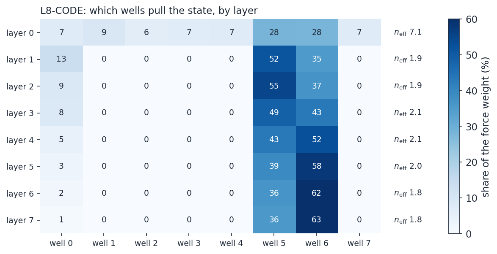
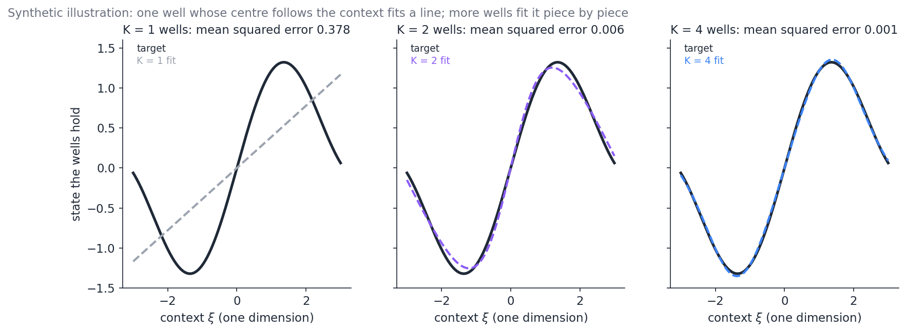

# How many wells does a conservative model need? Effective and minimum well counts

**What this note is.** A guide to one question about the conservative models of the depth ladder: how many wells the context potential V_θ needs, and whether the training corpus decides it. It covers:

- two counts that are easy to confuse: the number of wells a trained layer **uses** and the number the model **needs**, and why the first does not measure the second;
- three ways to measure the need: removing wells from a trained model, training with fewer wells, and a fit to the corpus that predicts the count without training;
- the results on code, OpenWebText and TinyStories, and what they imply for the parameter budget.

The raw numbers and run records live in the [protocol note](Depth_Ladder_and_Matched_Baseline_Protocol.md) ([`p-dead-wells`](Depth_Ladder_and_Matched_Baseline_Protocol.md#p-dead-wells), [`p-l8-code-result`](Depth_Ladder_and_Matched_Baseline_Protocol.md#p-l8-code-result), [`p-k2-l8-code-setup`](Depth_Ladder_and_Matched_Baseline_Protocol.md#p-k2-l8-code-setup)). The rank of each well's shape is a separate question, covered in [Curvature_Diagnostics_and_Rank_Selection_for_Aniso_Gaussian_Vtheta.md](Curvature_Diagnostics_and_Rank_Selection_for_Aniso_Gaussian_Vtheta.md).

**Status, 2026-11-03:** PENDING-STATUS

Figures: [`figures/_make_min_well_count_figs.py`](figures/_make_min_well_count_figs.py) (it reads the result files named in its header).

---

## Contents

1. [The question and the vocabulary](#1-the-question-and-the-vocabulary)
2. [What trained models use](#2-what-trained-models-use)
3. [Why use is not need: the softmax temperature](#3-why-use-is-not-need-the-softmax-temperature)
4. [Removing wells from a trained model](#4-removing-wells-from-a-trained-model)
5. [Training with fewer wells: K2-L8-CODE](#5-training-with-fewer-wells-k2-l8-code)
6. [A corpus-side criterion: wells as gated linear pieces](#6-a-corpus-side-criterion-wells-as-gated-linear-pieces)
7. [The well-count estimator](#7-the-well-count-estimator)
8. [What the evidence says, and what is open](#8-what-the-evidence-says-and-what-is-open)

---

## 1. The question and the vocabulary

Each layer of a conservative model moves the token state h under a potential. One part of that potential, V_θ, is a bank of K Gaussian wells. Each well has a centre, a width and a depth, and all three are computed from the token's context. The models in this note use one bank shared by all layers (the joint bank), told apart by a learned depth code. Their bank has K = 8 wells.

Written out for one token at one layer, with bank input x (the layer's context channels plus its depth code, 5 × 384 = 1,920 numbers):

$$V_\theta(h) = -\sum_{k=1}^{K} w_k(x) \exp\big(-\tfrac{1}{2} (h - \mu_k(x))^\top P_k(x) (h - \mu_k(x))\big)$$

- μ_k(x) = M_k x + m_k is well k's **centre**. It is linear in the bank input.
- P_k(x) is its **precision** (inverse width): a diagonal part plus a rank-4 part, both computed from x.
- w_k(x) is its **weight**, a softmax over the wells:

$$w(x) = \mathrm{softmax}(W_w x + b)$$

The weights depend on the context only, never on the state h.

The question "how many wells are needed" has three different answers depending on what is counted. This note keeps them apart with the following names.

| term | symbol | what it counts | how it is measured |
| --- | --- | --- | --- |
| bank size | K | wells the model has | the architecture (Cell 0's `V_THETA_WELLS_PER_HEAD`) |
| effective well count | n_eff | wells a layer spreads its weight over, for one token | exp of the entropy of w(x); median over tokens |
| force weight share | g_k share | which wells actually pull the state | g_k = w_k times the well's occupancy at h; share of the sum over wells, pooled over tokens |
| minimum well count | K_min(ε) | the fewest wells that train to within ε nats of the full bank | train arms at several K (the definition); estimated by removal and by the corpus fit |

**Effective well count.** For one token at one layer,

$$n_{\mathrm{eff}}(x) = \exp\big(-\sum_k w_k(x) \ln w_k(x)\big).$$

It is 1 when all weight sits on one well and K when the weight is uniform. It says how the layer spreads its weight, not whether the spread matters.

**Force weight share.** A well with large weight pulls nothing if the state is far outside it. The force from well k is a spring of strength g_k P_k towards μ_k, with

$$g_k = w_k \exp\big(-\tfrac{1}{2} (h - \mu_k)^\top P_k (h - \mu_k)\big).$$

The share of g_k in the sum over wells says which wells do the pulling at that state.

**Minimum well count.** K_min(ε) is the smallest bank size whose model, trained with everything else unchanged, ends within ε nats of the K = 8 model's validation loss. Only training arms measure it directly, and each costs a GPU run. Two cheaper readings stand in for it, and neither is the same thing:

- **removal** (section 4): delete wells from a trained model and measure the loss. This measures what the trained weights need. A model trained with fewer wells may arrange itself differently.
- **the corpus fit** (sections 6 and 7): fit the form that K wells can express to the targets a trained model reaches, and find where more pieces stop helping. This is a prediction from the data, checked against the arms.

---

## 2. What trained models use

*Figure 1. Median effective well count per layer, from `vtheta_well_probe.py` on 16 validation windows of each model's corpus.*

| model | corpus | layers | layer 0 | deeper layers |
| --- | --- | ---: | ---: | --- |
| SO-CODE | code | 2 | 2.99 | 1.06 |
| FOCK-CODE | code | 2 | 7.88 | 1.09 |
| L4-CODE | code | 4 | 7.51 | 1.53, 1.65, 1.30 |
| L8-CODE | code | 8 | 7.12 | 1.95, 1.94, 2.13, 2.09, 1.98, 1.82, 1.81 |
| SO-OWT | OpenWebText | 2 | 3.77 | 1.50 |
| F3.1-OWT | OpenWebText | 2 | 7.14 | 1.00 |
| G2-OWT | OpenWebText | 2 | 7.70 | 1.00 |
| SO-TS | TinyStories | 2 | 3.95 | 1.92 |

Two regularities hold on every model and every corpus.

- **Every layer after the first uses one or two wells.** The counts range from 1.0 to 2.1.
- **The first layer spreads its weight over three to eight.**

The corpus does not set the deep-layer count. Models of different design on the same corpus differ as much as the same design on different corpora: on OpenWebText, 1.0 for F3.1 and G2 against 1.5 for SO; on code, 1.1 for SO-CODE against 2.0 for L8-CODE.

*Figure 2. L8-CODE, share of the force weight by well (percent, pooled over tokens).*

The force shares agree. In L8-CODE's deeper layers, wells 5 and 6 carry 87–99% of the pull, and five of the eight wells carry none. The same two wells serve all seven deep layers, because the bank is shared and only the depth code tells the layers apart. Which two wells win is set by training, not by the corpus: SO-CODE's deep layer uses wells 5 and 7, SO-OWT's wells 3 and 4, and SO-TS's wells 6 and 0.

---

## 3. Why use is not need: the softmax temperature

The weights are a softmax of a linear function of x. Multiplying x by a factor multiplies the logits W_w x by the same factor, so **the size of the bank input acts as an inverse temperature**. A small input spreads the weight over all wells; a large one concentrates it on the largest logit.

The first layer and the rest see inputs of very different size:

- **layer 0's** context channels are running averages of token embeddings, with median norm 1.85 in L8-CODE;
- **every later layer's** channels are running averages of states on the LayerNorm sphere (radius √384 ≈ 19.6), with median norm 22–28.

The scale test separates the temperature from anything the layers learned. It reuses each layer's own trained weights and changes only the size of its input.

| L8-CODE, bank input | median n_eff |
| --- | ---: |
| layer 0 as trained (norm 1.85) | 7.12 |
| layer 0 rescaled to the deep layers' median norm (25.1) | 2.04 |
| layer 0's context rescaled, depth code kept | 2.48 |
| layer 1 shrunk to layer 0's norm | 7.10 |
| layer 7 shrunk to layer 0's norm | 7.30 |

At the deep layers' input size, layer 0's weights concentrate on two wells. At layer 0's size, the deep layers' weights spread over seven. The 8-against-2 contrast is a temperature effect of the input's size, not a difference in what the layers need.

PENDING-TEMPERATURE-FIGURE

**Is there a theorem that makes the deep layers' counts equal?** No. What can be proved is a continuity bound. For one token at layers i and j, with δ = z_i − z_j the difference of the two logit vectors,

$$\big| \ln n_{\mathrm{eff}}(i) - \ln n_{\mathrm{eff}}(j) \big| \le \tfrac{1}{2} s_K \big( \max_k \delta_k - \min_k \delta_k \big),$$

where s_K is the largest square root of the varentropy of a K-outcome distribution (s_8 = 1.333, found numerically). The bound holds for every token and pair of layers in L8-CODE, but it is loose: the actual change is a median of 0.6–9.5% of the bound for pairs of deep layers, and at most 48%. It says that layers whose logits differ little have similar counts. It does not say they must, and it does not involve the corpus. The deep layers agree because their inputs have similar size and they share one bank.

---

## 4. Removing wells from a trained model

The keep-k curve keeps the k wells with the largest force share in one layer, sets the others' weights to zero, and measures the validation perplexity on 16 windows. No retraining. A second version rescales the kept weights to the trained sum for each token, so that removal does not also weaken the total pull.

*Figure 3. Keep-k curves. Wells removed weakest first by force share; no retraining.*

| wells kept | SO-CODE layer 1 | L8-CODE layer 4 | SO-CODE layer 0 | L8-CODE layer 0 | L8-CODE layer 0, rescaled |
| ---: | ---: | ---: | ---: | ---: | ---: |
| 1 | +4.6% | +5.5% | ×28.7 | ×29.9 | ×39.4 |
| 2 | 0.0% | +0.4% | ×20.8 | ×30.7 | ×35.3 |
| 3 | 0.0% | 0.0% | ×9.8 | ×17.0 | ×13.4 |
| 5 | 0.0% | 0.0% | ×2.7 | ×3.4 | ×2.4 |
| 7 | 0.0% | 0.0% | +19.5% | +29.5% | +20.5% |

Removing every well from one layer at a time (L8-CODE, perplexity 6.74 with all wells) gives the same picture: layer 0 +2,780%; layers 1–7 between +0.6% and +26%.

What this shows:

- **In the deeper layers, the trained weights need two wells.** One well costs about 5%; a second removes the cost.
- **Layer 0's trained weights need all eight.** Rescaling the kept weights does not rescue it. Its high temperature makes the layer's output a blend of all eight centres, and removing any one changes the blend.

The second point is a property of these trained weights, not of the model. Section 5 shows a model trained with two wells everywhere, layer 0 included, training about as well.

---

## 5. Training with fewer wells: K2-L8-CODE

K2-L8-CODE is L8-CODE with two wells instead of eight, trained on the same batches from step 0, so the paired difference of validation losses isolates K. It is still running. The table and Figure 4 cover the evals through step 10,000.

*Figure 4. K2-L8-CODE's validation loss minus L8-CODE's (8 wells, 8 layers) and L4-CODE's (8 wells, 4 layers), paired by step.*

| step | K2-L8-CODE | L8-CODE | L4-CODE | K2-L8 − L8 | K2-L8 − L4 |
| ---: | ---: | ---: | ---: | ---: | ---: |
| 6,000 | 2.0181 | 2.0602 | 2.0002 | −0.042 | +0.018 |
| 8,000 | 1.9847 | 1.9841 | 1.9636 | +0.001 | +0.021 |
| 9,000 | 1.9096 | 1.8947 | 1.8841 | +0.015 | +0.026 |
| 10,000 | 1.9330 | 1.9062 | 1.9035 | +0.027 | +0.030 |

- L8-CODE skipped most of its updates over steps 1,400–3,600 (non-finite gradients). K2-L8-CODE had none on the same batches, so those skips are tied to the eight-well bank. The early lead of two wells is that lag, not a K effect.
- Since L8-CODE recovered, two wells trail eight by +0.021 nats on average over steps 9,000–10,000, and the gap has grown by about 0.013 nats per 1,000 steps.
- Against L4-CODE, the gap has held at +0.02–0.03 nats since step 3,500: two wells at eight layers train about as well as eight wells at four layers.
- The decay phase (steps 10,562–16,250) decides the settled number. Over it, L8-CODE went from level with L4-CODE to 0.024 nats ahead.

So far, at L = 8 on code, K_min is 2 for a tolerance of about 0.03 nats and more than 2 for 0.01.

**What the six wells cost.** Each well reads the full 1,920-number bank input through three maps: its centre (to 384 numbers), its diagonal precision (to 384) and its rank-4 shape (to 4 × 384). At rank r a well costs (2 + r) × 737,664 + 1,921 parameters, which is 4,427,905 at r = 4. Embeddings excluded:

| model | wells | layers | parameters, all | non-embedding | settled perplexity |
| --- | ---: | ---: | ---: | ---: | ---: |
| matched GPT-2 on code | (attention) | 8 | 33,691,776 | 14,196,480 | 4.96 |
| K2-L8-CODE | 2 | 8 | 50,164,436 | 11,567,059 | running |
| L8-CODE | 8 | 8 | 76,731,865 | 38,134,489 | 5.35 |

The conservative models carry an untied readout (19.3 M parameters that GPT-2 shares with its input embedding). Outside the embeddings, K2-L8-CODE is 18% smaller than the matched GPT-2, and L8-CODE was 2.7 times larger. Six wells were 26.6 M of L8-CODE's parameters, so the minimum well count decides whether the comparison with GPT-2 is at matched size.

---

## 6. A corpus-side criterion: wells as gated linear pieces

The aim is a statistic of the corpus that predicts K_min before training. The structure of the bank suggests one.

**What K wells can express.** When the wells are stiff, the state settles near the weighted centre of the wells that hold it. Since each centre is linear in the bank input and each weight is a softmax of a linear function of it, the state the bank can hold is

$$h(x) \approx \sum_{k=1}^{K} w_k(x) (M_k x + m_k),$$

a softmax-gated mixture of K linear maps (a mixture of linear experts). Two consequences:

- **One well can already reach any target that is linear in the context.** Its centre follows x. A single well with a context-driven centre is not "one attractor for every token".
- **Extra wells buy a piecewise-linear fit of the rest.** With K wells the bank can approximate a nonlinear map from context to target with K softly gated linear pieces.

*Figure 5. Synthetic illustration (not model data): a one-dimensional target fitted by the form above with K = 1, 2 and 4.*

So the criterion is: **K_min(ε) is the fewest gated linear pieces that approximate the corpus's map from context to the target state within ε**, scored by the loss the model would see. It depends on the corpus through two properties of that map:

- **its curvature**: how far from linear the target is as a function of the context;
- **the intrinsic dimension d_eff of the contexts** the corpus produces.

**How the count should scale.** For a target with bounded second derivatives on a d_eff-dimensional set, the best K-piece approximation has error falling like K to the power −2/d_eff. That is the standard rate for piecewise-linear approximation, and Jiang and Tanner (1999) prove the same rate for mixtures of experts. Inverting it,

$$K_{\min}(\varepsilon) \approx (C / \varepsilon)^{d_{\mathrm{eff}}/2},$$

with C set by the curvature.

**Depth substitutes for wells.** L layers, each with K gated pieces, can carve the context space into up to about K^L regions. This is the counting argument behind the number of linear regions of deep ReLU networks (Montúfar et al., 2014). It predicts that K_min falls as L grows, which fits two wells training well at L = 8 (2^8 = 256 regions).

**Caveats the criterion must carry.**

- The bank is not exactly a mixture of linear experts. Its gates are soft; each well's pull depends on the state through the occupancy and the precision; and a mixture of Gaussians can have more minima than components (Carreira-Perpiñán and Williams, 2003). The rates above are clean for hard gates and loosen as the gates soften. Section 3 shows that the deep layers' gates are sharp, so the approximation is best there.
- The target is not a point. The model is scored on a next-token distribution through a fixed readout, so "within ε" has to be measured in that loss, not as a distance between states.
- "Needed" is relative to the rest of the architecture. The pair potential V_φ, the register path and depth all add nonlinearity that the wells would otherwise have to supply. A non-conservative model has more such paths, which is why its K_min is harder to pin down.

---

## 7. The well-count estimator

PENDING-ESTIMATOR

---

## 8. What the evidence says, and what is open

PENDING-SUMMARY

---

**References.**

- Jiang, W. and Tanner, M. A. (1999). Hierarchical mixtures-of-experts for exponential family regression models: approximation and maximum likelihood estimation. *Annals of Statistics* 27(3).
- Montúfar, G., Pascanu, R., Cho, K. and Bengio, Y. (2014). On the number of linear regions of deep neural networks. *NeurIPS*.
- Carreira-Perpiñán, M. Á. and Williams, C. K. I. (2003). On the number of modes of a Gaussian mixture. *Scale-Space Methods in Computer Vision*.

**Provenance.** Probes: `notebooks/conservative_arch/scaleup/debug/vtheta_well_probe.py` (effective counts, force shares, removal; `renorm=1` added 2026-11-03), `keep_k_curves.py`, `vtheta_weight_logits.py` (the bound, the scale test and the temperature sweep), `well_count_fit.py` (the estimator). Results in `notebooks/conservative_arch/scaleup/results/dead_wells/` and `.../results/well_count/`. K2-L8-CODE's evals through step 10,000 are from its Cell 6 log (2026-11-03). The parameter counts per well are the bank's formula, checked against L8-CODE's and K2-L8-CODE's built totals.

Last updated: 3 November 2026.
