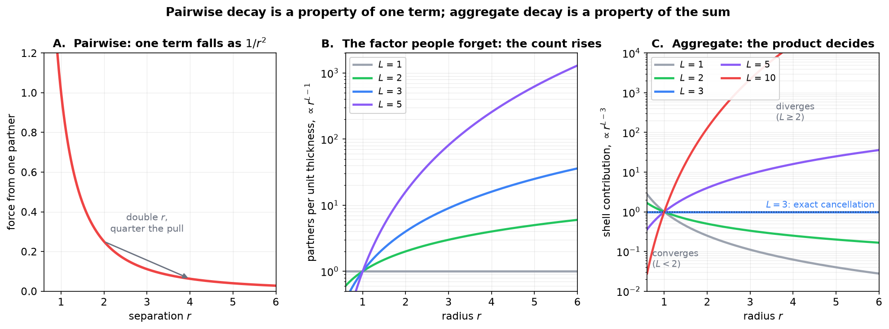
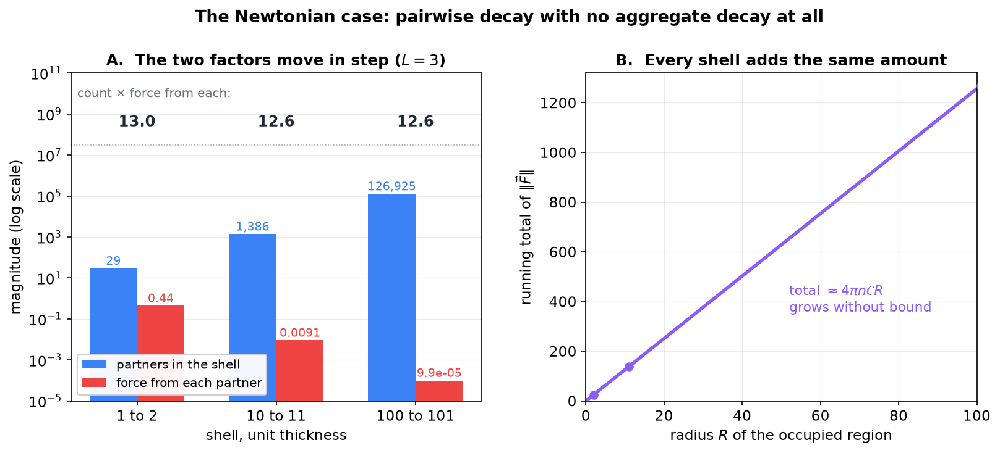
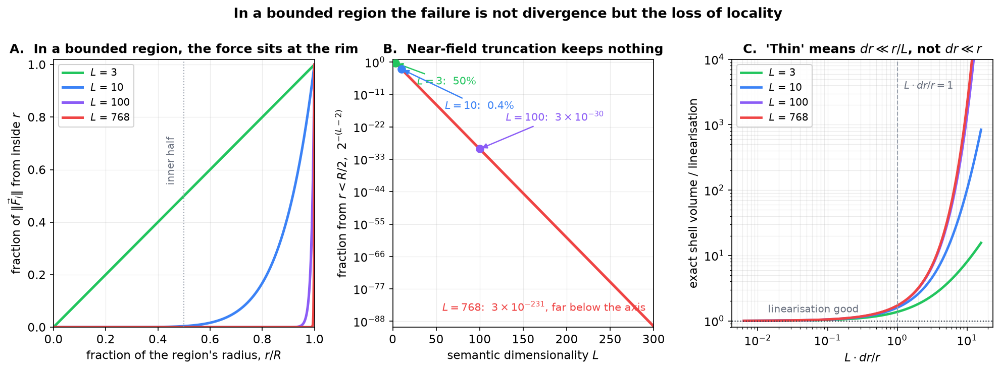
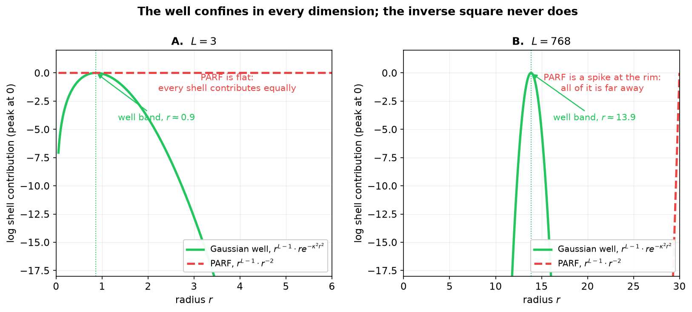

# Pairwise versus Aggregate Decay in Semantic Space

**Why the pair force needs a partner cap and the Gaussian well does not**

Companion note to Section 9.8 of the book (*Salience and destruction of semantic structures*) and to Section 5 (*PARF*). Notation follows the book: semantic space $\Sigma = (\mathbb{R}^L, d_\Sigma)$ with $L$ the semantic dimensionality (Definition 1), Gaussian semantic energy well $V(x) = m\upsilon^2(1 - e^{-\kappa^2x^2})$ with inflection radius $x^{\ast} = 1/(\kappa\sqrt2)$ (Definition 13), and the aspect-level PARF of Definition 16.

Section 9.8 records that without destruction "the simulator's effective state grows unboundedly with discourse length and no convergence guarantee on the force-field sums is available." The book states the consequence; this note gives the argument, the numbers and the pictures behind it.

---

## Contents

1. [The claim, and why it is not obvious](#1-the-claim-and-why-it-is-not-obvious)
2. [Two different things called decay](#2-two-different-things-called-decay)
3. [The criterion](#3-the-criterion)
4. [The Newtonian case, worked](#4-the-newtonian-case-worked)
5. [A bounded region: the failure is loss of locality](#5-a-bounded-region-the-failure-is-loss-of-locality)
6. [How thin is a thin shell?](#6-how-thin-is-a-thin-shell)
7. [The framework's own contrast: the well against PARF](#7-the-frameworks-own-contrast-the-well-against-parf)
8. [What bounds the sum in practice](#8-what-bounds-the-sum-in-practice)
9. [Dictionary](#9-dictionary)

---

## 1. The claim, and why it is not obvious

The quantity at stake is the net force on one participating structure: the sum of the property-level law over the set $\mathcal{P}_t$ of properties participating in the force computation at discourse step $t$,

$$
\vec{F}_i = \sum_{j \in \mathcal{P}_t, j \neq i} \vec{f}(P_i, P_j), \qquad \vec{f}(P_i, P_j) = \sum_{A \in P_i} \sum_{B \in P_j} \vec{f}_{12}(A, B). \qquad (1.1)
$$

Creation without destruction makes $\lvert\mathcal{P}_t\rvert$ grow with discourse length, so $\vec{F}_i$ becomes a sum of unbounded length.

The natural reassurance is that the aspect-level force carries an inverse-square factor,

$$
\vec{f}_{12}(A_1, A_2) = \mathcal{C} \frac{\Theta(\boldsymbol{\theta}^{(1)}, \boldsymbol{\theta}^{(2)}) \Phi(l_1, l_2)}{\lVert \vec{p}_1 - \vec{p}_2 \rVert^2} \cdot \frac{\vec{p}_2 - \vec{p}_1}{\lVert \vec{p}_2 - \vec{p}_1 \rVert}, \qquad (1.2)
$$

so distant partners contribute little and the sum ought to settle. Section 5.2 says as much: the $1/r^2$ dependence "suppresses far-field pair contributions without a sharp cutoff."

That reassurance does not survive contact with the dimension count. The statement is about one term; the sum is a different object.

---

## 2. Two different things called decay

**Pairwise decay** is a property of a single term: how the force between one pair falls off as the pair separates. PARF has $\lVert\vec{f}_{12}\rVert \propto 1/r^2$. Move one partner twice as far away and it pulls four times less.

**Aggregate decay** is a property of the sum: how much total force arrives from all partners at distance about $r$. It is a product of two factors,

$$
(\text{partners at distance } r) \times (\text{force from each}),
$$

and the first factor **grows**. In $\mathbb{R}^L$ the ball of radius $r$ has volume $C_L r^L$, so a shell of thickness $dr$ has volume

$$
\frac{d}{dr}\left(C_L r^L\right) dr = L C_L r^{L-1} dr, \qquad (2.1)
$$

the sphere's surface area times its thickness. At roughly uniform density the partner count therefore grows as $r^{L-1}$. One power below the volume, because the skin is one dimension thinner than the body.

**Figure 1.** Left: one term falls as $1/r^2$. Centre: the partner count per unit thickness rises as $r^{L-1}$, the factor that is easy to forget. Right: the product $r^{L-3}$ is what decides convergence. The case $L = 3$ is exactly flat, $L = 2$ is the marginal case (it falls, but only as $1/r$, which still diverges logarithmically), and every $L \geq 4$ grows outright.

---

## 3. The criterion

Combining (2.1) with a pairwise law $f(r)$, aggregate decay holds exactly when

$$
\int^{\infty} r^{L-1} f(r) dr \lt \infty, \qquad (3.1)
$$

that is, when $f$ decays **faster than $r^{-L}$**. Pairwise decay asks only $f(r) \to 0$, which is far weaker.

For PARF's $f(r) = r^{-2}$ the integrand is $r^{L-3}$, and (3.1) fails for every $L \geq 2$. For $L = 3$ the two factors cancel exactly; beyond that the count wins outright. The dimensions of interest for semantic space are in the hundreds, so the failure is not marginal.

| Pairwise law | Integrand $r^{L-1}f(r)$ | Converges when |
|---|---|---|
| $1/r^2$ (PARF) | $r^{L-3}$ | $L \lt 2$ only |
| $1/r^3$ | $r^{L-4}$ | $L \lt 3$ only |
| $1/r^{L+1}$ | $r^{-2}$ | every $L$, by construction |
| $r e^{-\kappa^2r^2}$ (the well) | $r^L e^{-\kappa^2r^2}$ | every $L$ |

The last row is the one that matters for the framework, and §7 below returns to it.

---

## 4. The Newtonian case, worked

The cleanest instance is the one physics already knows. Take $L = 3$, uniform density $n = 1$ partner per unit volume, and force $\mathcal{C}/r^2$ from each partner. Count the partners in successive unit-thickness shells and total their pull.

| Shell | Partners in it | Force from each | Shell total |
|---|---|---|---|
| r = 1 to 2 | 29 | 0.4444 𝒞 | 13.03 𝒞 |
| r = 10 to 11 | 1,386 | 0.009070 𝒞 | 12.58 𝒞 |
| r = 100 to 101 | 126,925 | 0.000099 𝒞 | 12.57 𝒞 |

**Every shell contributes the same amount.** Between the first row and the last the per-partner force fell by a factor of about 4500 and the partner count rose by the same factor. They cancel exactly, because

$$
4\pi r^2 \cdot r^{-2} = 4\pi, \qquad (4.1)
$$

a constant independent of $r$. The totals converge to $4\pi \approx 12.566$ from above, the small excess in the first row being the curvature of a unit shell at small radius. Summing shells out to radius $R$ gives a running total of about $4\pi n \mathcal{C} R$, which grows without bound.

**Figure 2.** Left: the two factors on a logarithmic scale, with their product printed above. The count rises by four orders of magnitude between the near shell and the far one; the per-partner force falls by the same four orders. Right: the running total grows linearly in the radius of the occupied region, with the three tabulated shells marked.

So gravity decays pairwise and does not decay in aggregate. A galaxy a thousand times further away pulls on you as hard in total as a nearby one, because there is a thousand-squared times more of it. This is the divergence that Newtonian cosmology removes by subtracting the mean field. Section 6 of the book draws the gravitational parallel at the structure level, where SARF stands to PARF as Newtonian gravity stands to a molecular-scale force.

---

## 5. A bounded region: the failure is loss of locality

The Newtonian picture integrates to infinity. The framework's participating structures occupy a **bounded** region, so that picture is not the right model, and it is worth being precise about what actually goes wrong.

Put $N$ partners at roughly uniform density in a ball of radius $R$. The total magnitude is finite:

$$
\lVert\vec{F}_i\rVert \approx n \int_0^R L C_L r^{L-1} \frac{\mathcal{C}}{r^2} dr \propto n R^{L-2} = \frac{N L \mathcal{C}}{(L-2) R^2}, \qquad (5.1)
$$

using $n = N/(C_L R^L)$. There is no divergent integral here. What (5.1) shows is **linear growth in $N$** — the same conclusion reached more simply by noting that in a bounded region every type-compatible pair contributes at least $\mathcal{C}\Phi\Theta/(\text{diam}(\mathcal{P}_t))^2 \gt 0$, so a sum whose terms do not tend to zero cannot converge absolutely.

The shell-count fact does something else here, and it is arguably worse. The fraction of $\lVert\vec{F}_i\rVert$ contributed by partners nearer than a fraction $x$ of the region's radius is

$$
\frac{\int_0^{xR} r^{L-3} dr}{\int_0^R r^{L-3} dr} = x^{L-2}, \qquad (5.2)
$$

so the near half keeps only $2^{-(L-2)}$ of the total:

| $L$ | from the inner half | from the outer 10% |
|---|---|---|
| 3 | 50% | 10% |
| 10 | 0.39% | 57% |
| 100 | 3×10⁻³⁰ | 99.997% |
| 768 | 3×10⁻²³¹ | ~100% |

**There is no truncation radius.** At semantic-space dimensions essentially all of the force comes from the most distant partners, and restricting the sum to a neighbourhood captures a vanishing fraction of it. The inverse-square law supplies no effective cutoff, so the sum is irreducibly $O(N)$ per particle and every one of those $N$ terms matters.

**Figure 3.** Left: the cumulative fraction of the force from inside radius $r$, by (5.2). At $L = 3$ it is linear; by $L = 100$ the curve hugs zero until the rim. Centre: the inner-half fraction $2^{-(L-2)}$ against dimension, falling off a cliff. Right: the thin-shell caveat of §6.

Two regimes therefore both fail, for different reasons, and the framework can meet either:

- **Crowding at fixed radius.** Density grows with $\lvert\mathcal{P}_t\rvert$ and the sum grows with it by (5.1). The nearest-neighbour spacing falls as $\lvert\mathcal{P}_t\rvert^{-1/L}$, so the largest single term grows as $\lvert\mathcal{P}_t\rvert^{2/L}$, and the scale-separation ratio of the coarse-grained SARF law tends to 1, at which point the multipole truncation loses its error control.
- **Spreading at fixed density.** The radius $R$ grows and the aggregate $\int r^{L-3} dr$ grows without bound for every $L \geq 2$, which is the Newtonian case of §4.

---

## 6. How thin is a thin shell?

Equation (2.1) is a derivative, so it is the first-order term of an exact difference:

$$
C_L\left[(r+dr)^L - r^L\right] = C_L r^L\left[\left(1 + \frac{dr}{r}\right)^L - 1\right]. \qquad (6.1)
$$

The approximation $(1+\epsilon)^L \approx 1 + L\epsilon$ needs $L\epsilon \ll 1$, that is $dr \ll r/L$ — **not** merely $dr \ll r$. In high dimension this bites hard. At $r = 10$:

| $L$ | $dr$ | $L \cdot dr/r$ | exact / linear |
|---|---|---|---|
| 3 | 1 | 0.3 | 1.10 |
| 768 | 1 | 76.8 | 8×10²⁹ |
| 768 | 0.1 | 7.7 | 271 |
| 768 | 0.01 | 0.77 | 1.50 |
| 768 | 0.001 | 0.077 | 1.04 |

At $L = 768$ a shell of unit thickness at radius 10 holds thirty orders of magnitude more volume than the linearisation predicts. To be genuinely thin there one needs $dr$ smaller than about $r/1000$.

The failure is always in the same direction — the exact value exceeds the linearisation — because volume concentrates at the outer edge of whatever region one draws. That is the same fact as (5.2), seen locally: even inside a single shell, the mass sits against the outer surface. The shell-volume numbers in §4 used exact differences, not the linearisation, so they stand as computed.

---

## 7. The framework's own contrast: the well against PARF

The framework contains both a law that fails the criterion (3.1) and one that passes it, which is why the two behave so differently.

The Gaussian well of Definition 13 has restoring force $\propto x e^{-\kappa^2x^2}$, so its aggregate integrand is $r^L e^{-\kappa^2r^2}$. A Gaussian beats every polynomial, so

$$
\int_0^{\infty} r^{L-1} \cdot r e^{-\kappa^2r^2} dr \lt \infty \quad \text{for every } L. \qquad (7.1)
$$

**The well has aggregate decay in every dimension.** Beyond a few inflection radii it genuinely stops contributing, however many particles lie out there. This is a third reading of $x^{\ast}$, alongside the two it already carries — the radius of peak restoring force (Section 4.4) and twice the mode width $\sigma$ of the single-particle space (Section 10.5.2). It is a real interaction range.

The integrand $r^L e^{-\kappa^2r^2}$ peaks at

$$
r_{\text{band}} = \frac{\sqrt{L}}{\kappa\sqrt2} = \sqrt{L} \cdot x^{\ast}, \qquad (7.2)
$$

so in high dimension the well's effective shell sits well outside $x^{\ast}$ — at the note's standard calibration ($\sigma = 0.25$, $\kappa^2 = 2$, $x^{\ast} = 0.5$) that is $r \approx 0.87$ at $L = 3$ and $r \approx 13.9$ at $L = 768$. The band moves outward, but it remains a **band**: finite width, finite total, no tail problem.

**Figure 4.** Log shell contribution, each curve normalised to its own peak. Left, $L = 3$: the well has a band near $x^{\ast}$ and falls away; PARF is exactly flat, the cancellation of (4.1). Right, $L = 768$: the well's band has moved out to $\sqrt{L}x^{\ast}$ and narrowed in relative terms, while PARF has become a spike pressed against the rim — all of its contribution arrives from the most distant partners.

---

## 8. What bounds the sum in practice

Three mechanisms are available, and the framework and its implementations use different ones.

**The type filter $\Phi$.** Section 5 observes that $\Phi$ nulls most pairs. This is the framework's answer, and note what kind of answer it is: $\Phi$ filters on **type**, not on distance, so it caps the effective partner count rather than relying on a decay law. That cap holds only when the number of type-compatible partners is itself bounded.

**Destruction.** Which is exactly what Section 9.8 supplies. Its requirement is placed on the salience-weighted active mass,

$$
\sum_{s \text{ active}} \sigma_t(s) m(s) \quad \text{bounded in discourse length}, \qquad (8.1)
$$

rather than on a count, because semantic mass sets how many constituent aspects a property contributes to the double sum in (1.1). It is the weighted mass, not the structure count, that these sums are sensitive to. Structures held below the salience threshold are gated out and contribute nothing; one salient, massive structure contributes a great deal.

**A fixed cap, in the trained models.** The PARF-augmented architectures do not wait for either mechanism. They evaluate the pair potential on a fixed number $k$ of partners per position, where $k$ is a configuration field (`top_k`, default 16) capped at $T-1$ by the causal mask. The book describes this as a Gumbel-softmax relaxation of the relevant-pair cutoff of Definition 18, and the straight-through machinery is indeed there — but the implementation ranks candidates by the logits of a **learned score head** perturbed with Gumbel noise, not by the magnitude of the pairwise force that Definition 18 quantiles over. The selection is a trained routing decision that happens to cap the partner count, rather than the force-magnitude cutoff it stands in for.

That is worth stating plainly: the trained models satisfy the Section 9.8 requirement by construction, while implementing neither of the mechanisms Section 9.8 names and approximating the Section 5.2 cutoff only in form.

**And a mechanism that needs none of this.** The one-body potential $V_\theta$ carries no cutoff and needs none, by (7.1). The asymmetry between $V_\theta$ and the pair potential $V_\phi$ is usually presented as a matter of computational cost — the dense pair evaluation is quadratic in sequence length. The cost is real, but it is not the whole reason. $V_\phi$ needs its cutoff because its sum does not converge; $V_\theta$ needs none because the Gaussian's aggregate decay holds in every dimension. No faster kernel would remove the need.

---

## 9. Dictionary

| Term | Meaning here |
|---|---|
| Pairwise decay | $f(r) \to 0$: one term falls off with separation |
| Aggregate decay | $\int^{\infty} r^{L-1}f(r)dr$ finite: the total from all partners at a given distance falls off |
| The criterion | $f$ must decay faster than $r^{-L}$; pairwise decay alone is far weaker |
| Shell factor | $r^{L-1}$, the sphere's surface area; the partner count at radius $r$ |
| Locality | Existence of a truncation radius capturing most of the force. Absent for $1/r^2$ in high $L$, by (5.2) |
| Thin shell | $dr \ll r/L$, not $dr \ll r$ |
| Well band | $r_{\text{band}} = \sqrt{L} x^{\ast}$, where the well's aggregate contribution peaks |
| $\mathcal{P}_t$ | Properties participating in the force computation at step $t$: salience at or above the gating threshold |

**Summary.** An inverse-square force decays pairwise and does not decay in aggregate for any $L \geq 2$. In a bounded region the consequence is not a divergent integral but the loss of locality: the force is dominated by the most distant partners and the sum admits no neighbourhood truncation, so it grows linearly in the number of participants. The framework's Gaussian well escapes this entirely, in every dimension, which is why $x^{\ast}$ is a genuine interaction range and why the one-body potential needs no cutoff while the pair potential does. Bounding the pair sum is therefore not an optimisation but a precondition, and Section 9.8's salience requirement is what supplies it.
