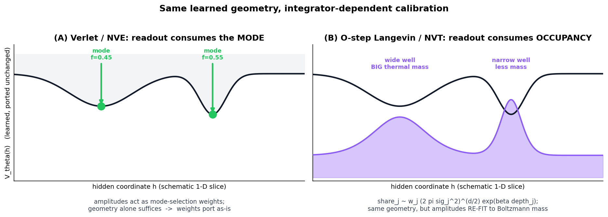

# Portable Learned Potentials: When a Trained Well Landscape Can Be Reused

**Technical Report** (revised 2026-11-15 for the Gen 3 architecture; first version 2026-07-09)

Subject: reusing the learned potentials $V_\theta$ and $V_\phi$ of a trained conservative model in another run or another model ("potential harvesting"): what the trained object is, which axes decide whether it ports, what the Gen 3 measurements say about it, and how a frozen landscape differs from a warm start.

**What changed in this revision.** The first version was written for the explicit-integrator Fock-PARFLM models of July 2026: isotropic wells with widths $\sigma_k$, a velocity-Verlet layer step, a planned O-step Langevin consumer, and five model "flavours". None of these is the current model. The Gen 3 models have one joint bank of anisotropic low-rank wells computed from a content-routed context, a CfC/BAOAB step whose stiff modes are integrated exactly, an untied head, and live gradients through every force source (§2). Since July the ladder has also measured several things that bear directly on portability (§4). They qualify the first version's operating rule, "geometry ports, amplitudes re-fit": in Gen 3 the wells' stiffness is set by the integrator, so part of what the rule called geometry does not port. The frame machinery of the first version (frame coherence, anchored and free centres, confinement, the tokenizer bundle, the grafting pathologies) still holds and is kept, condensed and corrected, in §6 to §10. The Verlet and O-step material is kept in §11.3 as the planned thermal axis, which has not been run.

---

## Contents

1. [Motivation and scope](#1-motivation-and-scope)
2. [What a Gen 3 model learns](#2-what-a-gen-3-model-learns)
3. [Portability axes](#3-portability-axes)
4. [What the Gen 3 measurements say about portability](#4-what-the-gen-3-measurements-say-about-portability)
5. [Frozen landscape against warm start](#5-frozen-landscape-against-warm-start)
6. [Frame coherence and the untied head](#6-frame-coherence-and-the-untied-head)
7. [Anchored and free-centre wells](#7-anchored-and-free-centre-wells)
8. [Confinement](#8-confinement)
9. [Tokenizer sharing and the frame bundle](#9-tokenizer-sharing-and-the-frame-bundle)
10. [Grafting pathologies](#10-grafting-pathologies)
11. [The integrator axis in Gen 3](#11-the-integrator-axis-in-gen-3)
12. [Gen 3 model families on the two transplant axes](#12-gen-3-model-families-on-the-two-transplant-axes)
13. [The transplant ladder](#13-the-transplant-ladder)
14. [The transplant procedure](#14-the-transplant-procedure)
15. [Gates](#15-gates)
16. [What ports and what re-fits](#16-what-ports-and-what-re-fits)
17. [Proposed experiments](#17-proposed-experiments)
18. [Summary](#18-summary)
19. [Related notes](#19-related-notes)

---

## 1. Motivation and scope

A trained conservative model leaves behind two learned potentials, the single-particle potential $V_\theta$ and the pair potential $V_\phi$. They are not only weights that minimise cross-entropy: they define the forces of a damped flow in the hidden-state space. Reusing them is **potential harvesting**, the machine-learned interatomic-potential programme (Behler–Parrinello, GAP, NequIP, MACE) transposed to semantics, and the analogue of AlphaFold's "never fold from scratch" (`Lessons_from_AlphaFold.md`).

Three uses are distinct, and the first version did not separate them:

1. **Warm start.** Initialise a new model's potentials from a trained one, then train everything. The new model may reshape the wells to suit its own step.
2. **Frozen landscape.** Keep the trained potentials fixed and train or run a different model against them: another integrator, another depth, another force law, or a non-conservative model that adds its own forces on top.
3. **Analysis.** Read the trained landscape without changing it: which wells a layer uses, how many directions it needs, how stiff its modes are. The well probe, keep-k curves and direction count of the ladder do this (`Minimum_Well_Count_for_Conservative_Models.md`, `Dead_Wells_in_the_Joint_V_theta_Bank.md`).

The central claim of the first version stands with one qualification:

> A learned potential is defined over a hidden-state coordinate frame, so a transplant is meaningful only insofar as the consumer's frame is a known map of the producer's. **In Gen 3 the potential is also tuned to the step that integrates it:** its stiffness is set by the integrator and by the training budget, so a consumer with a different step inherits wells calibrated for a different flow.

The operating rule becomes:

> **Frame first, always. Centres and weights can port within one integrator. Stiffness belongs to the integrator. A frozen bank is a conditional field, not a terrain.**

---

## 2. What a Gen 3 model learns

The reference model is SR2: the conservative-only Gen 3 model with the exact damped stiff-mode flow, $L = 2$, $d = 384$, 76,572,110 parameters, settled perplexity 58.32 on OpenWebText at 0.53B tokens (`Depth_Ladder_and_Matched_Baseline_Protocol.md`, §5.19). The ladder notebook is `notebooks/conservative_arch/scaleup/colab_fock_cfc_baoab_lowrank_depth_ladder_openwebtext_d384.ipynb`.

### 2.1 The context $\xi$

The context is five causal exponential moving averages of the hidden states, one per channel $c$, with learned decays $\alpha_c$:

$$
\xi^{(c)}_t = \sum_{s \le t} W_c[t, s] h_s, \qquad c = 1, \dots, 5,
$$

initialised at $\alpha = (0.5, 0.75, 0.95, 0.99, 0.995)$, horizons of about 2, 4, 20, 100 and 200 tokens (`xi5long`). In Gen 3 the averaging weights are also **content-routed**: a query from the current state and a key from each earlier state ($d_k = 48$ per channel) add a content term to the logarithm of each moving-average weight, and a softmax over the earlier tokens renormalises them, so a channel can weight earlier tokens by relevance as well as by distance. The query map starts at zero, so at initialisation $\xi$ is exactly the plain moving average. The five channels are concatenated into the bank input $x = (\xi^{(1)}, \dots, \xi^{(5)}) \in \mathbb{R}^{1920}$, and a per-layer depth code is added to it.

### 2.2 The scalar potential $V_\theta$: one joint bank of anisotropic low-rank wells

$$
V_\theta(h; x) = -\sum_{k=1}^{K} w_k(x) \exp\Big(-\tfrac12 \big[ (h - \mu_k)^\top \mathrm{diag}(a_k) (h - \mu_k) + \lVert B_k^\top (h - \mu_k) \rVert^2 \big]\Big),
$$

with $K = 8$ wells and, for every token, four parameters per well computed from $x$ by dense maps: the centre $\mu_k(x) \in \mathbb{R}^{384}$, the diagonal precision $a_k(x) \gt 0$, a rank-4 shape $B_k(x) \in \mathbb{R}^{384 \times 4}$, and the weight $w_k(x)$, a softmax over the wells times a scale (`vtjoint`; design in `Analytic_Multi_Channel_Integration_in_Structured_Vtheta.md`, code in `parf/model_aniso_gaussian_vtheta.py`). Two caps bound the curvature: the diagonal precision is clamped, and a Frobenius cap of 1.0 on each $B_k$ bounds its largest squared singular value (`PRECISION_LR_MAX`).

The bank holds 35,427,080 of SR2's 76,572,110 parameters: the shape map `B_proj` 23,605,248, the centre map `mu_proj` and the precision map `a_proj` 5,901,312 each, the weight map `w_proj` 15,368, and the depth code 3,840. **One bank serves both layers**; the layers differ only by their depth code.

A well of rank $R$ pushes along $R$ directions at a token, so the bank pushes along at most $K R$ directions per token: 32 for SR2.

### 2.3 The pair potential $V_\phi$

$V_\phi$ is the structural pair potential of the first version, in its current form (`v_phi_kind = 'structural_competitive'`): four heads, each a factored central force between the current token and up to 16 earlier tokens chosen by a sparse score, with a bounded value-aligner, a type gate in a learned low-rank type space ($d_{\text{type}} = 32$, 16 angular directions), and a Plummer-softened $1/r$ radial kernel. The "competitive" gate replaces the Gaussian type gate by a softmax over the causal sources, which imports attention's selectivity while keeping the force the gradient of one scalar (design in `Structured_VPhi_Design_and_Theory.md`). As in the first version, what $V_\phi$ knows lives in its type space, not in raw $h$.

### 2.4 The step

Each layer integrates the damped second-order flow in $V = V_\theta + V_\phi$ with the CfC/BAOAB low-rank propagator (`baoab_cfc_lowrank`): the stiff low-rank modes of $V_\theta$ are integrated **exactly** as forced damped oscillators, the rest of the force acts as kicks, friction $\gamma = 0.1$ is fixed, and the thermostat is off ($T = 0$), so the step is deterministic. SR2 has $L = 2$ layers of $\Delta t = 4$ each. Each layer ends with a LayerNorm projection of the state, and the velocity is handed from layer 1 to layer 2. The readout is an untied linear head with a unigram output bias (`TIE_EMBEDDINGS = False`, `USE_OUTPUT_BIAS = True`; the `ob_untied` tag component).

### 2.5 Live gradients

Gen 2 detached the sources of $V_\phi$ and $\xi$ in the backward pass: the forward forces were the same, but no loss gradient reached an earlier token through them. Gen 3 makes them live (`VPHI_GRAD_PATH = 'live'`, `XI_GRAD_PATH = 'live'`). For portability this matters in two places. The context that places the wells is now trained by the loss through every earlier token (§10.1), and a Gen 2 bank and a Gen 3 bank of the same shape are different objects: the same forward pass trained under the two conventions settles at 87.93 and 57.76 (F3.1 against its Gen 2 twin).

### 2.6 The landscape is a conditional field

The trained object is not a fixed terrain over $h$. It is a **rule for building a landscape from the context**: at every token, the four maps read $x$ and return the eight wells for that token and layer. "Capturing the landscape" therefore means capturing those maps together with everything that fixes their inputs and outputs:

- the frame: the embedding, which fixes the coordinates of $h$ and of the centres $\mu_k$;
- the context module: the decays and the content routing that turn earlier states into $x$;
- the depth codes, which tell the bank which layer is asking;
- the step that the wells were trained to be integrated by (§4).

A consumer that changes any of these receives a different landscape from the same weights.

---

## 3. Portability axes

| axis | what it fixes | robust or fragile in Gen 3 |
| --- | --- | --- |
| frame (gauge, basis) | orientation and scale of the hidden space; coordinates of every centre | fragile: needs the producer's embedding, or an explicit alignment |
| dimension d | shapes of h, μ_k, B_k and of every projection | fragile: needs re-projection |
| context ξ (channels, decays, routing) | what each channel of the bank input means | robust at a fixed budget; moved at 2B (below) |
| depth code | which layer the bank is serving | fragile: a consumer with a different depth needs a mapping |
| integrator and step | the stiffness the wells were trained for | fragile: §4.1 to §4.3 |
| training budget | how tightly the wells are tuned to the step | fragile: §4.3 |
| tokenizer and vocabulary | token identities, the readout | a precondition, not a guarantee |

**The decays.** Every Gen 3 run starts from the same five decays. Across 34 trained runs of the ladder notebook in the results folder (OpenWebText and code, depths 1 to 8, well counts 1 to 8), 33 end with the five decays in 0.28–0.49, 0.47–0.76, 0.86–0.93, 0.97–0.995 and 0.98–0.999 (medians 0.41, 0.69, 0.91, 0.985, 0.992; horizons about 1.7, 3.2, 11, 67 and 125 tokens). So at the ladder's budget the channels keep their meaning, and channels can be matched by index within Gen 3, as by decay value across generations. Two cautions: the stability is partly the shared initialisation, and it fails with budget. **SR2-2B, at four times the tokens, moved its fastest channel to 0.948** (a horizon of about 20 tokens), outside every other run's range. A bank trained at one budget may read its fastest channel differently from a bank trained at another.

---

## 4. What the Gen 3 measurements say about portability

None of these was run as a transplant experiment. Each measures how a trained landscape behaves when something around it changes, which is the question a transplant asks.

### 4.1 A different integrator on trained weights

Switching SR2's exact stiff-mode flow on, after training, on the weights of F3.1, which were trained with the split drift–friction–drift step, raises the validation loss from 4.230 to 4.356 nats (+0.126, median absolute logit change 2.8; protocol §5.19). The stiff modes rotate by about 4.3 radians per step, so the two integrators differ materially there. Trained from scratch with the exact flow, the same architecture settles level with F3.1 (58.32 against 57.76). **The cost is in the transplant, not in the integrator:** the wells re-fit to the new step when they are trained with it, and do not carry over when they are not.

### 4.2 The stiffness is set by the integrator

Median ω·Δt of the stiffest well modes at the endpoint (Cell 6b-13), same data and budget:

| model | step | median ω·Δt |
| --- | --- | ---: |
| SR2 | exact damped flow, second order | 7.55 |
| F3.1 | split step, second order | 4.32 |
| FO-b | first order (gradient flow), stiff modes relaxed exactly | 0.74 |

The same bank architecture trains wells ten times softer under a first-order step, and SR2's exact flow, which charges no phase error for stiffness, trains them stiffer than the split step. The precisions $a_k$ and shapes $B_k$, which the first version counted as geometry, are therefore a property of the pair (landscape, integrator). Only the centres and weights are candidates for porting across integrators unchanged.

### 4.3 The tuning tightens with training

SR2's layer step is a coarse sample of a convergent per-layer flow: run each layer as $k$ smaller substeps (`substeps_per_layer`) and perplexity converges as $k$ grows. This is the closest thing the ladder has to running a different dynamics against a trained landscape without retraining. Its limit, read on fresh batches (FLOW-R):

| model | training tokens | per-layer flow limit above the trained step (nats) |
| --- | --- | ---: |
| SR2 | 0.53B | 0.104 |
| SR2-2B | 2.13B | 0.922 |

At 2.13B the per-layer penalty rises over training through every snapshot (0.008 at 6,500 steps to 0.922 at 130,000) and the learning-rate decay does not pull it back. The stiffness moves with the budget too: SR2-2B's endpoint median ω·Δt is about 4.1, against SR2's 7.55 at 0.53B. **The longer a model trains, the more its wells are shaped for its own step size.** A frozen landscape from a long run is the hardest to reuse under another step. The standard refinement, which also recomputes the context and the projection at every substep, diverges at both budgets.

### 4.4 Removing wells costs far more than training with fewer

Keeping only the two strongest wells of a trained L8-CODE costs about ×20 in perplexity. K2-L8-CODE, the same model trained with two wells, settles only 0.057 nats behind L8-CODE (`Minimum_Well_Count_for_Conservative_Models.md`, §5). On SR2, projecting layer 0 onto 24 of its 32 directions costs +5.0%; whether a model trained with 24 directions loses that much is being measured by the K4-R6 screen (protocol, `p-well-screen-setup`). The trained landscape is a solution co-adapted with the rest of the model; cutting it is not the same as training a smaller one.

### 4.5 The per-token shapes are intricate

Replacing each well's per-token shape with the strongest well's shape costs SR2's layer 0 +1,252%. A fitted head that a model could compute, a shared basis of 8 directions per token plus a per-well mix (27% of the shape map's weights), costs +663% at layer 0 and +35% at layer 1 (`Minimum_Well_Count_for_Conservative_Models.md`, §8). Each layer-0 well reads the context in its own way, token by token. A transplant cannot compress the bank on the way.

### 4.6 The layers use the shared bank differently

At 0.53B, SR2's layer 0 needs all eight wells (keeping seven costs 10.1%) and more than 28 of its 32 directions; layer 1 runs on two wells and 8 directions. At 2.13B layer 0 still needs all eight (keeping seven costs 60.7%), and layer 1 adds a third well in the decay. So the "landscape" is two landscapes, selected by the depth code. A consumer with a different depth has to decide which code each of its layers reads, and the evidence above says the choice matters.

### 4.7 V_φ's value depends on the integrator

Removed at inference, $V_\phi$ costs F3.1 0.282 nats and SR2 0.0135 (protocol §5.20). Under the exact flow the model stopped using $V_\phi$ as a force on the step. Whether a harvested $V_\phi$ is worth transplanting therefore depends on which step it is harvested from and which it goes to.

### 4.8 Grafting onto a trained checkpoint has a consolidation cost

The only grafts the programme has run are older: mechanisms added to the step-28,500 checkpoint of an earlier L = 8 Fock model, then trained through a 4,000-step decay. The attention-residual arm started 0.21 PPL ahead of its control and finished 0.95 behind: it consolidated about one perplexity point less (`Measuring_the_Price_of_Conservativity.md`, §7.3). A graft perturbs a trained solution, and the perturbation costs something the mechanism has to earn back.

### 4.9 What this does to the rule

The first version's rule was "geometry ports; amplitudes re-fit". The measurements split its "geometry":

- **Frame-level geometry ports:** the coordinates, the tokenizer, the context channels at a fixed budget.
- **Curvature does not port across integrators:** precisions and shapes are trained for the step (§4.1, §4.2), more tightly with more training (§4.3).
- **Centres and weights may port within one integrator**, which is the case the first version's Level 1 described. No measurement here tests it directly.

---

## 5. Frozen landscape against warm start

**Warm start.** Initialise the consumer's bank (and context module, and embedding) from the producer, train everything. The consumer can re-fit the curvature to its own step, so §4.1 to §4.3 are costs paid during training, not at the end. The open question is whether the start saves tokens over training from scratch, or whether the consolidation cost of §4.8 eats the head start. The SR2-2B branches of the decay programme are the simplest case: the same model continued under another schedule.

**Frozen landscape.** Keep the bank, the context module and the embedding fixed, train only the rest of the consumer: its step parameters, $V_\phi$ if it has one, its readout, and any non-conservative mechanism. This asks how much of what the producer learned is in the landscape itself, and whether another dynamics can use it as is. The measurements predict a cost whenever the consumer's step differs from the producer's (§4.1), growing with the producer's budget (§4.3).

**For a non-conservative consumer** the frozen bank supplies one force among several, $-\nabla_h V_\theta(h; x)$, and the consumer adds its own: the Fock reverse channel, a non-conservative exchange field, or, in a transformer, an extra term in the residual stream. The bank needs the consumer's states to live in the producer's frame (§6, §9), and the consumer has to supply a context $x$ the bank was trained on. The simplest consistent version keeps the producer's context module frozen and feeds it the consumer's states.

**The control that separates the two readings** is the same architecture with a frozen bank: if it nearly matches the producer, the landscape holds most of what the model learned and the other consumers measure whether other dynamics can use it; if it falls well short, the landscape and the rest of the model were learned together and cannot be separated cleanly. §17 proposes the arms.

---

## 6. Frame coherence and the untied head

**The coherence identity** (first version §4.1). Under a tied head, $W_{\text{out}} = E$. For an anchored well centred at a token embedding, $a_j = E[v_j]$, the direction the well pulls is the direction that raises the logit of $v_j$, and at settling $\ell_{v_j} = \lVert a_j \rVert^2$, the largest attainable logit. The attractor is the readout target.

**The untied head.** Untie it and settling into well $j$ no longer implies predicting $v_j$: the logit is $\langle W_{\text{out}}[v_j], E_{\text{in}}[v_j] \rangle$, an inner product of two independently learned vectors.

**In Gen 3** every model is untied, with a unigram output bias, and no well is anchored: the centres are free functions of the context (§7). The coherence argument therefore applies only to anchored designs. What remains for Gen 3 is weaker and more general: a frozen bank's centres live in the producer's frame, and the consumer's readout has to be trained against states that the producer's wells pull toward. A frozen landscape should be shipped with the producer's embedding, and the consumer's head either trained from scratch or initialised from the producer's.

---

## 7. Anchored and free-centre wells

The first version's two variants (§5 there) stand as a design distinction:

- **Anchored wells** have centres fixed at token embeddings, $a_j = E[v_j]$, chosen by peak pointwise mutual information (`SARF_Anchor_Placement_From_Converged_Gaussian_Centres.md`); only widths and context weights are learned. They port across a change of $d$ for free, because the centres are recomputed in the consumer's frame.
- **Free-centre wells** compute their centres from the context. They are more expressive and need re-projection to port.

**Gen 3 uses free centres only**, with the anisotropic low-rank shapes of §2.2 on top. Everything the first version said about free centres applies, with §10.1's correction. The anchored variant remains the option of choice if a run is meant to seed runs at a different width.

---

## 8. Confinement

A bounded Gaussian well's force peaks at its width and decays exponentially beyond it; past about three widths a state far from every well moves almost freely (first version §6). The first version's cures stand: anchor coverage, or a wide, shallow background well, in preference to a harmonic confiner that would make the potential unbounded.

**In Gen 3 the LayerNorm projection at the end of each layer confines the state to a shell of radius about $\sqrt d$**, so the escape problem is bounded by construction, and the wells only have to cover the shell. A consumer that drops or moves the projection (a different placement, or substeps that project once per layer, as the per-layer flow does) changes where the states sit relative to the frozen wells.

---

## 9. Tokenizer sharing and the frame bundle

Sharing the tokenizer is necessary and not sufficient (first version §7): two independently trained embeddings differ at least by a rotation, so token identities match while coordinates do not. All OpenWebText runs share the GPT-2 tokenizer.

**The Gen 3 frame bundle**, what a frozen or warm-started landscape has to ship with, versioned together:

- the tokenizer artefact;
- the embedding $E$;
- the head and output bias, if the consumer's readout starts from the producer's;
- the context module: the five decays and the content-routing maps;
- the bank: the four maps of §2.2, the caps, and the depth codes;
- $V_\phi$, with its type projections, if it is ported;
- the producer's step settings (integrator, $L$, $\Delta t$, $\gamma$), so the consumer knows what the curvature was trained for;
- the producer's training budget and schedule (§4.3).

The ladder's checkpoints hold the weights with the model and training configurations (`model_cfg`, `train_cfg`), and the run tag names the configuration, including a non-default run length (`st<steps>`).

---

## 10. Grafting pathologies

### 10.1 The moving target, corrected for live gradients

With free centres, the centres are read from the context, the context is built from the trajectories, and the trajectories follow the wells: a loop that the producer's training brought to a self-consistent point (first version §8.1). A consumer that starts away from that point moves the context, which moves the centres, which moves the trajectories. The first version gave three reasons this can fail: timescale collapse, a myopic gradient, and loss of adiabaticity.

**The second reason does not hold in Gen 3.** It assumed $\xi$ was detached, so the optimiser updated the centre map without seeing how moving the centres moves future contexts. In Gen 3 the context is live, so the gradient does see it: the loop is closed in the backward pass as well as the forward. That removes the myopia and adds a stronger coupling: a released bank in a warm-started consumer is trained through its own effect on the context. The mitigations stand: freeze the bank for a warm-up (a frozen landscape is that warm-up taken to the end), a reduced learning rate for the bank (the ladder has a `VTHETA_LR_MULT` switch from the dead-wells screens), and release only when the context has settled.

### 10.2 The initialisation scale

A badly scaled potential at step 0 drives a large gradient through any penalty on its size and destabilises training; a fresh unstructured MLP potential averaged about 581 against 1.9–8.8 for the structured variants (first version §8.2, `Training_Instabilities_in_Fock-PARFLM_with_structured_V_theta.md`). A harvested bank is trained, so its scale is set; the gate (§15, gate 1) checks that the consumer's states put it in the same range as the producer's. The Gen 3 range has not been measured and should be read off the producer before any transplant.

---

## 11. The integrator axis in Gen 3

### 11.1 The integrators the ladder has trained

All are deterministic ($T = 0$), all integrate the same $V_\theta + V_\phi$:

| step | what it does | trained as |
| --- | --- | --- |
| split CfC/BAOAB | drift, friction, drift; stiff modes by the closed-form propagator inside the split | F3.1 |
| exact damped flow | the stiff low-rank modes integrated exactly as forced damped oscillators, the rest as kicks | SR2 and every arm built on it |
| first order | no velocity; a gradient flow with the stiff modes relaxed exactly | FO-b and its pairs |
| damping axis | the exact flow with a learned per-token damping ratio, or every stiff mode critically damped | learned ζ(h), SR3-crit |
| depth and step count | the same step at L = 1, 4 or 8, or trained at several step counts | SR2-L1, L4, L8, the variable-step arms |

The position-dependent-damping report (`Tech_Report_Position_Dependent_Damping_CfC_BAOAB.md`) and the first-order notes (`First_Order_vs_Second_Order_Dynamical_Systems.md`) give the theory.

### 11.2 What the integrator changes for a transplant

- **The stiffness** (§4.2): each integrator trains its own precisions; a bank moved to another integrator carries the wrong curvature.
- **The use of $V_\phi$** (§4.7): an integrator can leave a potential idle.
- **Whether a velocity crosses layers**: second-order consumers hand a velocity from layer to layer, first-order ones do not. A bank trained with inertia between layers places layer 1's wells for states that arrive with momentum.
- **The step size and depth** (§4.3, §4.6): within one integrator, a different $\Delta t$ or $L$ is itself a change of step. The per-layer flow shows that SR2's wells tolerate a finer step at 0.53B and not at 2.13B.

### 11.3 The thermal axis (planned, not run)

The first version's main consumer was an O-step Langevin sampler: the same conservative core with the friction step replaced by an exact Ornstein–Uhlenbeck substep carrying thermostat noise locked to the friction by the fluctuation–dissipation relation. Its stationary density $\rho \propto \exp(-\beta V)$ is what a softmax readout reads, so under it a well's **occupancy**, not only its location, would matter, and the weights would have to be re-fitted to occupancy (first version §9; `Langevin_dynamics_reformulation_of_classical_damped_Lagrangian_flow.md`).

In the ladder this is the SR5 arm, thermal training with an O-step in training only, planned with calibrated temperatures and not yet run. The figure belongs to the first version's Verlet-against-Langevin framing; in Gen 3 the producer would be SR2's deterministic exact flow.

---

## 12. Gen 3 model families on the two transplant axes

The first version placed five flavours on two axes: is the force law conservative, and what does the step do with the potential. The Gen 3 models fall on the same axes. Settled perplexities are on OpenWebText at 0.53B tokens (matched GPT-2: 49.81).

| model | force law | step | settled PPL | role in a transplant |
| --- | --- | --- | ---: | --- |
| F3.1 | conservative | split, second order | 57.76 | producer; V_φ in use |
| SR2 | conservative | exact flow, second order | 58.32 | reference producer; V_φ idle |
| PMX | conservative (Poisson-mode register wells, exact) | exact flow | 54.63 | producer with a second, register-held set of wells |
| FO-b | conservative | first order | 61.16 | consumer with soft wells; the hardest step change from SR2 |
| learned ζ(h), SR3-crit | conservative | exact flow, more damping | 59.29, 63.28 | consumers along the damping axis |
| XRB-F | conservative (exchange field held at frozen routing) | split | 54.27 | consumer adding an attention-like conservative force |
| Fock-PARFLM L = 2 (G2), L = 4 | non-conservative (reverse channel on) | split | 53.12, 50.10 | consumer adding a directed force; the register path carries part of the work |
| G3, G3′ | non-conservative (reverse channel) plus a conservative exchange field | split | 54.21, 52.90 | consumer with both added routes |

Two consequences of the first version still hold.

1. **A directed force is not a potential.** When a non-conservative producer feeds a conservative consumer, only $V_\theta$ and $V_\phi$ transplant; the reverse channel or a non-conservative exchange is dropped. That is lossy but clean.
2. **Non-conservative consumers have no equilibrium measure.** Their stationary behaviour depends on the strength of the directed force, which becomes a matched setting. In the ladder the directed paths start from zero (`reverse_channel_scale` is initialised at 0), which is what a transplant into them would do anyway.

One new consequence: **the substitution between mechanisms** measured in the ladder (the register path crowds out $V_\phi$: removing $V_\phi$ costs F3.1 0.282 nats and G2, beside the registers, 0.037; `Competing_Mechanisms_Families_Dominance_and_Substitution.md`) means a frozen bank in a consumer with an extra mechanism may be used less than in its producer, not more.

---

## 13. The transplant ladder

| level | situation | what has to re-fit |
| --- | --- | --- |
| 0 | same model, same step, same budget | nothing; a frame and init-scale check |
| 1 | same integrator, different schedule or budget (a continuation, a branch) | the tuning of §4.3, if the budget grows |
| 2 | same integrator, different depth or step size | depth-code mapping (§4.6); curvature if the step size changes (§4.3) |
| 3 | different integrator, both conservative | curvature (§4.1, §4.2); V_φ's role (§4.7) |
| 4 | the consumer adds a directed force | level 3, plus the directed path warmed from zero, and substitution (§12) |
| 5 | a different model class (a transformer) using −∇V_θ | everything above, plus a frame bridge and a context the bank can read |

Levels 0 and 1 are routine in the ladder (resumes, the decay branches). Level 3 has one data point, +0.126 nats without retraining (§4.1). Levels 2, 4 and 5 are untested as transplants.

---

## 14. The transplant procedure

The first version's procedure stands for the frame (Steps 1 to 3) and is changed for the potential and the step (Steps 4 to 6).

1. **Frame alignment.** Shared embedding: nothing to do (engineer for this). Independent embeddings: recover the rotation by Procrustes on the shared-vocabulary rows, $R^{\ast} = \arg\min_{R \in O(d)} \lVert R E_P - E_C \rVert_F = U V^\top$ from the SVD of the cross-covariance, and apply it to every coordinate-valued output, which in Gen 3 means composing it with the centre map and the shape map rather than rotating stored centres.
2. **Width change.** Re-project the centre and shape maps; rescale for the $\sqrt d$ shell of the LayerNorm projection. The caps are recomputed for the consumer, not inherited.
3. **Context mapping.** Within Gen 3 at one budget, by index. Across budgets, check the decays first (§3: SR2-2B's first channel). Added channels start inert (the ladder's sixth-channel arm initialised it like the fifth).
4. **Depth mapping (new).** Assign each consumer layer a producer depth code. For a shallower consumer the natural choice is the producer's first codes; for a deeper one, the open question of which code a new layer should read.
5. **The potential.** Frozen landscape: load the bank, context module and embedding, freeze them. Warm start: load them, train them at a reduced rate for a warm-up, then release (§10.1).
6. **The step.** Same integrator and step: nothing re-fits. Different step: expect the curvature to be wrong (§4.1, §4.2); in a warm start it re-fits in training, in a frozen landscape it does not, and the cost is the experiment's result.

---

## 15. Gates

| # | gate | check | fix on fail |
| --- | --- | --- | --- |
| 1 | init scale | the bank's output on a validation batch, through the consumer's states, against the producer's own range | the consumer's states are off the producer's distribution: fix the frame or the context |
| 2 | frame | the producer's embedding is loaded, or the Procrustes residual is small | align before anything else |
| 3 | context | the consumer's decays and routing match the producer's | load the producer's context module |
| 4 | depth | every consumer layer has a code | §14 Step 4 |
| 5 | stability | no watchdog trigger, no non-finite step, gradient norm in the producer's range; ω·Δt at or below the producer's | reduce the learning rate of anything released; check the curvature caps |
| 6 | use | well probe and keep-k on the consumer: does it use the wells the producer used | a frozen bank the consumer ignores is the answer, not a failure |

The first version's thresholds (an init band of 1.9 to 8.8, the precision cap $2/d$, the escape radius) belonged to its isotropic, explicit-integrator wells. Gen 3's equivalents are the Frobenius cap of 1.0 on each shape, the diagonal-precision clamp, and the LayerNorm shell.

---

## 16. What ports and what re-fits

| part | ports as is | ports after alignment | re-fits under another step | notes |
| --- | :---: | :---: | :---: | --- |
| tokenizer, vocabulary | yes | | | precondition |
| embedding E | yes, if shared | yes (Procrustes) | | defines the frame |
| context decays and routing | yes, same budget | | possibly, across budgets | §3, SR2-2B |
| centre map (μ_k) | within one integrator | yes | unknown | untested directly |
| weight map (w_k) | within one integrator | | unknown | untested directly |
| precision and shape maps (a_k, B_k) | same step only | yes | yes | §4.1 to §4.3 |
| depth codes | same depth | | | §4.6 |
| V_φ | same integrator | type projections re-projected | its use changes | §4.7 |
| head and output bias | with the frame | | | §6 |
| directed paths (reverse channel, non-conservative exchange) | no | | warmed from zero | not potentials |

---

## 17. Proposed experiments

Proposed, not registered and not scheduled. They answer the question this revision was written for: can another model run against a captured landscape?

**FL, frozen landscape.** Producer: SR2 at 0.53B (its best checkpoint). Freeze the bank, the context module and the embedding; train the rest from its usual initialisation, same data, schedule and budget.

| arm | consumer | asks |
| --- | --- | --- |
| FL-0 | SR2 itself | the control: how much of SR2 is in its landscape |
| FL-1 | FO-b (first order) | can a different conservative step use the landscape |
| FL-2 | Fock-PARFLM with the reverse channel on | does a directed force use it, or substitute for it |

Read against SR2 (58.32), FO-b (61.16) and G2 (53.12) trained from scratch. If FL-0 is close to SR2, FL-1 and FL-2 measure portability; if FL-0 falls short, the landscape is not separable from the rest of the model, and FL-1 and FL-2 are not interpretable. A switch is needed: a Cell 0 option that loads the three parts from a checkpoint and freezes them, and a tag component.

**WS, warm start.** The same three consumers initialised from SR2's bank, context and embedding, everything trained. Read as tokens saved: the step at which each matches its from-scratch twin's curve, against the consolidation cost of §4.8.

**XB, across budgets.** FL-0 with the producer swapped for SR2-2B's 32,500-step snapshot, then its final checkpoint. §4.3 predicts the frozen landscape from the longer run is harder to reuse even for the same architecture.

Cheaper first steps on the CPU, before any of these: the init-scale and use gates (§15) evaluated with SR2's bank inside FO-b's and G2's trained models. That measures the mismatch at step 0 without training anything.

---

## 18. Summary

1. **The trained object is a conditional field.** A Gen 3 bank is a rule that builds eight wells for every token and layer from the context; capturing it means capturing the maps, the context module, the depth codes and the frame together.
2. **Frame first, always.** Shared tokenizer and embedding make the frame identical; otherwise align before anything else.
3. **Stiffness belongs to the integrator.** The same bank trains wells ten times softer under a first-order step (§4.2); an integrator switched onto trained weights costs 0.126 nats where training with it costs nothing (§4.1).
4. **The tuning tightens with tokens.** The per-layer flow sits 0.104 nats from SR2's step at 0.53B and 0.922 at 2.13B (§4.3). A frozen landscape from a long run is the hardest to reuse under another step.
5. **The layers read the bank differently**, so depth is a portability axis of its own (§4.6).
6. **Cutting or compressing a trained bank is not the same as training a smaller one** (§4.4, §4.5).
7. **A directed force never ports**; it is warmed from zero in the consumer, and it may substitute for the landscape rather than use it (§12).
8. **Frozen and warm-started transplants answer different questions.** FL-0, the frozen-landscape control, decides whether the others can be read (§17).

---

## 19. Related notes

**The Gen 3 model.**
- `Depth_Ladder_and_Matched_Baseline_Protocol.md` — the ladder, every arm's setup and result; §5.19 (the exact flow, FLOW-C and FLOW-R, the post-hoc switch), §5.20 (removal costs), `p-sr2-2b-result`, `p-well-screen-setup`.
- `Analytic_Multi_Channel_Integration_in_Structured_Vtheta.md` — the joint bank.
- `Closed_Form_and_Hybrid_Integration_Strategies_for_Fock-PARFLM.md`, `Blended_CfC_BAOAB_Deep_Dive.md` — the integrator.
- `Structured_VTheta_Design_and_Theory.md`, `Structured_VPhi_Design_and_Theory.md` — the potentials' design.

**What the trained bank does.**
- `Minimum_Well_Count_for_Conservative_Models.md` — keep-k, direction counts, the shared-core test.
- `Dead_Wells_in_the_Joint_V_theta_Bank.md` — dead wells and the fixes.
- `Competing_Mechanisms_Families_Dominance_and_Substitution.md` — substitution between mechanisms.
- `Measuring_the_Price_of_Conservativity.md` — §7.3, the consolidation cost of grafts.

**Integrators.**
- `First_Order_vs_Second_Order_Dynamical_Systems.md`, `Tech_Report_Position_Dependent_Damping_CfC_BAOAB.md`.
- `Langevin_dynamics_reformulation_of_classical_damped_Lagrangian_flow.md`, `Modified_BAOAB_with_STP_identity_Detailed_Analysis.md` — the planned thermal axis.

**Frame and stability.**
- `SARF_Anchor_Placement_From_Converged_Gaussian_Centres.md` — anchored wells.
- `Structural_Stability_of_Learned_Potentials_in_Semantic_Simulation.md` — gauge equivalence, perturbation under data shifts, basin protection.
- `Training_Instabilities_in_Fock-PARFLM_with_structured_V_theta.md` — the init-scale pathology.
- `Lessons_from_AlphaFold.md` — the "never fold from scratch" analogue.

**Superseded tooling** (first version, pre-ladder): `colab_fock_depthcond_vtheta_openwebtext.ipynb`, `colab_fock_ostep_gammaT_sweep_openwebtext.ipynb`, `colab_fock_ostep_langevin_openwebtext.ipynb`, `fock_ostep_setup.py`. The current tooling is the ladder notebook named in §2.
