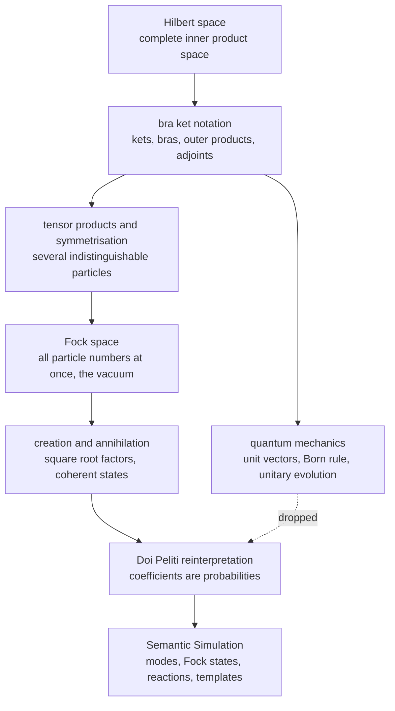
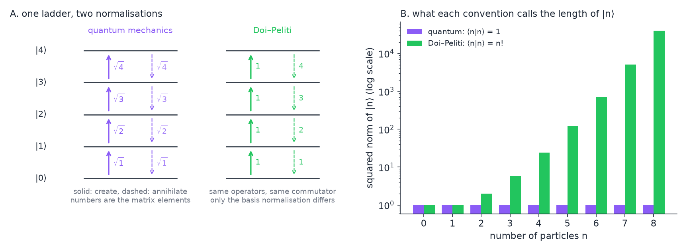
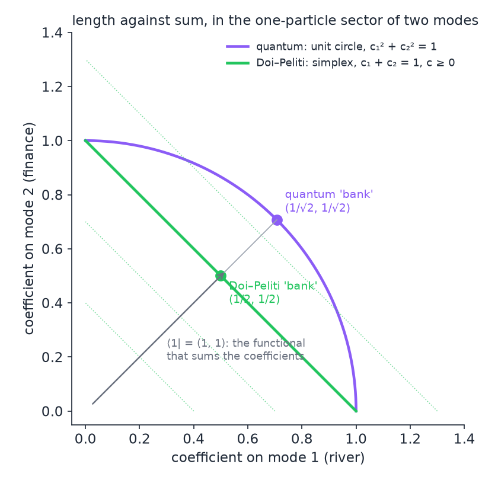
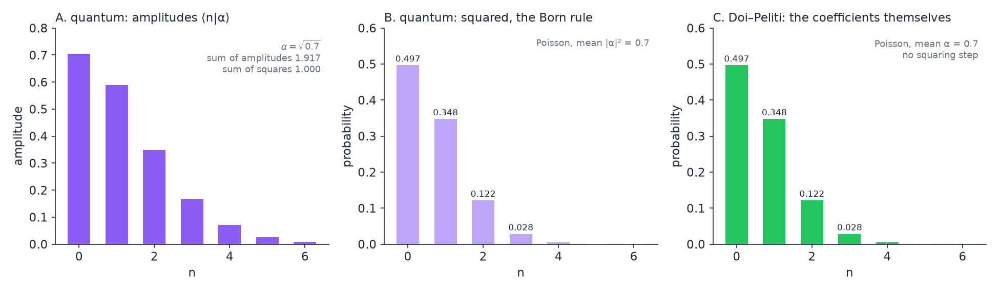
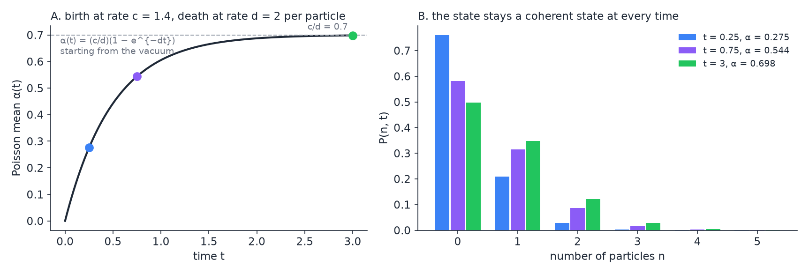
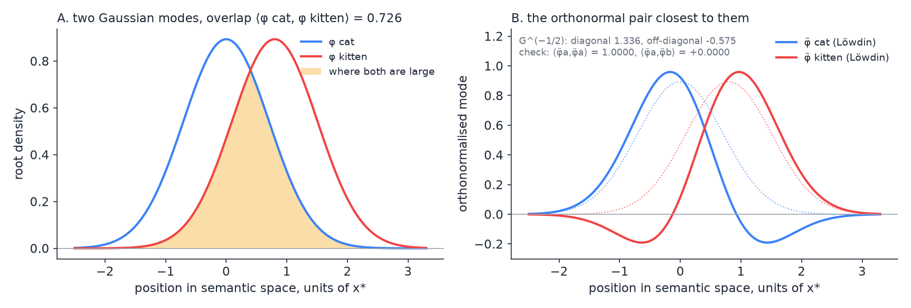
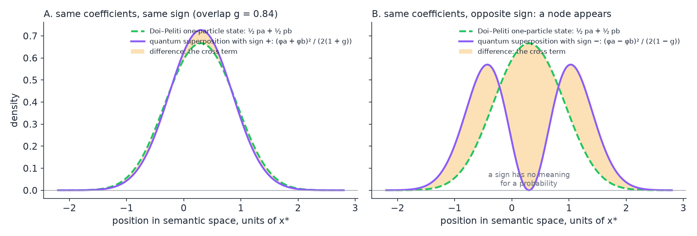

# The Quantum-Mechanical Formalism Behind Doi–Peliti, as Used in Semantic Simulation

**Technical primer — Semantic Simulation Research Programme**
**Relates to:** book §10.5.2 (pp. 117–119: Definition 62, the mode function (122), the Gram equation (124)); [*The Single-Particle Hilbert Space in Semantic Simulation*](Single_Particle_Hilbert_Space_in_Semantic_Simulation.md) (cited below as the single-particle note); [*Doi–Peliti Dynamics of Semantic Particles and Registers*](Doi_Peliti_Dynamics_of_Semantic_Particles_and_Registers.md) (the Doi–Peliti note); [*Semantic Templates as Doi–Peliti Reactions*](Semantic_Templates_as_Doi_Peliti_Reactions.md); [*Poisson Mode Registers (PM1)*](Poisson_Mode_Registers_PM1.md); [*The Particle Store*](The_Particle_Store_Making_Allocation_Real.md).
**Status:** Exposition. Nothing here is new to the programme; everything here is assumed by the documents above, usually without being said. The reader is assumed to be comfortable with linear algebra, measure-theoretic probability and the basics of functional analysis, and to have no prior exposure to quantum mechanics.

> **Thesis.** The Doi–Peliti formalism borrows the entire mathematical apparatus of many-particle quantum mechanics — Hilbert spaces, the bra–ket notation, creation and annihilation operators, Fock space, coherent states — and changes exactly one thing: the coefficients of a state vector are read as probabilities rather than as amplitudes to be squared. That single change propagates into every corner of the apparatus. Lengths stop mattering and sums take their place; the Hermitian adjoint becomes a formal partner; unitary evolution becomes a Markov semigroup; the square roots that decorate the quantum ladder operators disappear; superposition becomes mixture; entanglement becomes ordinary statistical correlation. This note builds the quantum apparatus from the ground up, then performs the change, and states at each step what the Semantic Simulation framework takes and what it leaves behind.

---

## Contents

0. [How to read this note](#0-how-to-read-this-note)
1. [Hilbert spaces](#1-hilbert-spaces)
   - 1.1 [Definition and the two examples that matter](#11-definition-and-the-two-examples-that-matter)
   - 1.2 [Orthonormal bases, and families that are not orthonormal](#12-orthonormal-bases-and-families-that-are-not-orthonormal)
   - 1.3 [Where the single-particle space of the framework sits](#13-where-the-single-particle-space-of-the-framework-sits)
2. [The bra–ket notation](#2-the-braket-notation)
   - 2.1 [Kets, bras and the Riesz representation theorem](#21-kets-bras-and-the-riesz-representation-theorem)
   - 2.2 [Outer products, projectors and resolutions of the identity](#22-outer-products-projectors-and-resolutions-of-the-identity)
   - 2.3 [Operators, matrix elements and the adjoint](#23-operators-matrix-elements-and-the-adjoint)
3. [What quantum mechanics does with this apparatus](#3-what-quantum-mechanics-does-with-this-apparatus)
   - 3.1 [States, observables and the Born rule](#31-states-observables-and-the-born-rule)
   - 3.2 [Dynamics: the Schrödinger equation and unitarity](#32-dynamics-the-schrödinger-equation-and-unitarity)
   - 3.3 [Mixtures and the density operator](#33-mixtures-and-the-density-operator)
4. [Many particles: tensor products, symmetrisation and Fock space](#4-many-particles-tensor-products-symmetrisation-and-fock-space)
   - 4.1 [Tensor products](#41-tensor-products)
   - 4.2 [Indistinguishable particles and the symmetric subspace](#42-indistinguishable-particles-and-the-symmetric-subspace)
   - 4.3 [Fock space and the vacuum](#43-fock-space-and-the-vacuum)
   - 4.4 [Creation and annihilation operators](#44-creation-and-annihilation-operators)
   - 4.5 [The occupation-number basis and the square roots](#45-the-occupation-number-basis-and-the-square-roots)
   - 4.6 [Coherent states in quantum mechanics](#46-coherent-states-in-quantum-mechanics)
   - 4.7 [Non-orthogonal modes and the Gram matrix](#47-non-orthogonal-modes-and-the-gram-matrix)
5. [The Doi–Peliti construction](#5-the-doipeliti-construction)
   - 5.1 [The master equation](#51-the-master-equation)
   - 5.2 [The state vector as a probability generating function](#52-the-state-vector-as-a-probability-generating-function)
   - 5.3 [The projection state replaces the inner product](#53-the-projection-state-replaces-the-inner-product)
   - 5.4 [Reactions become operators](#54-reactions-become-operators)
   - 5.5 [Coherent states are Poisson distributions](#55-coherent-states-are-poisson-distributions)
   - 5.6 [What became of the dagger](#56-what-became-of-the-dagger)
   - 5.7 [The Löwdin modes](#57-the-löwdin-modes)
   - 5.8 [From operators to fields: a sketch](#58-from-operators-to-fields-a-sketch)
6. [Parallels and distinctions](#6-parallels-and-distinctions)
7. [Where each object lives in the framework](#7-where-each-object-lives-in-the-framework)
8. [Worked examples](#8-worked-examples)
9. [Pitfalls when reading across the two literatures](#9-pitfalls-when-reading-across-the-two-literatures)
10. [References](#10-references)

---

## 0. How to read this note

The framework commits to **classical** semantic particles. The single-particle note's §0 lists what changes under that commitment, and the Doi–Peliti note's §0 names the three claims the book makes about the resulting apparatus. Neither document explains the apparatus itself; both assume it. This note is that missing explanation.

The exposition runs in the order the mathematics was built: first the Hilbert space and its notation (§1–§2), then what quantum mechanics does with it (§3), then the many-particle extension that produces creation and annihilation operators (§4), and only then the Doi–Peliti reinterpretation (§5). The reason for the order is that the Doi–Peliti construction is unintelligible without knowing what it modifies. A reader who has met quantum mechanics before may skim §1–§4 and read §4.5, §4.7 and §5 closely; those are the places where the two readings part ways.

Three conventions are fixed now and held throughout.

- **Scalars are real unless said otherwise.** Quantum mechanics needs the complex numbers; the framework does not (single-particle note §0 and §6.1). Where a formula is stated for the complex case, a bar denotes complex conjugation and the inner product is conjugate-linear in its first argument, which is the physicists' convention.
- **Inner products are written two ways.** The mathematicians' $\langle f, g\rangle$ and the physicists' $\langle f\lvert g\rangle$ denote the same number. The second is introduced in §2 and used from there on.
- **Operators of the orthonormalised modes carry a tilde**, $\tilde{a}\_v$, as in the companion notes. §5.7 explains why orthonormalisation is needed and what the tilde does.

---

## 1. Hilbert spaces

### 1.1 Definition and the two examples that matter

A **Hilbert space** is a vector space $\mathcal{H}$ over the real or complex numbers equipped with an **inner product**, a map $\langle\cdot,\cdot\rangle : \mathcal{H}\times\mathcal{H}\to\mathbb{F}$ that is linear in its second argument, conjugate-symmetric ($\langle f, g\rangle = \overline{\langle g, f\rangle}$, which over the reals is plain symmetry), and positive definite ($\langle f, f\rangle \gt 0$ for $f \neq 0$), such that the space is **complete** in the norm $\lVert f\rVert = \sqrt{\langle f, f\rangle}$: every Cauchy sequence converges to an element of the space. Completeness is what separates a Hilbert space from a mere inner-product space, and it is what makes limits of infinite sums, and hence infinite orthonormal expansions, legitimate.

Two inner products carry everything that follows.

**Sequences.** For a countable index set $\mathcal{V}$, the space $\ell^2(\mathcal{V})$ consists of the functions $c : \mathcal{V}\to\mathbb{F}$ with $\sum_v \lvert c_v\rvert^2 \lt \infty$, with inner product

$$
\langle c, d\rangle = \sum_{v\in\mathcal{V}} \overline{c_v}  d_v. \qquad (1.1)
$$

**Functions.** For a measure space, here the semantic space $\Sigma = \mathbb{R}^L$ with Lebesgue measure, the space $L^2(\Sigma)$ consists of the square-integrable functions, two functions being identified when they differ only on a set of measure zero, with inner product

$$
\langle f, g\rangle = \int_\Sigma \overline{f(x)}  g(x)  dx. \qquad (1.2)
$$

Both are complete; both are **separable**, meaning they possess a countable orthonormal basis. The second contains the first in spirit: choosing an orthonormal basis of $L^2(\Sigma)$ identifies it with $\ell^2(\mathbb{N})$, the coefficients of a function in that basis being a square-summable sequence. This identification, due to Riesz and Fischer, is why the two examples are not really two.

The **Cauchy–Schwarz inequality** $\lvert\langle f, g\rangle\rvert \le \lVert f\rVert \lVert g\rVert$ holds in any inner-product space, with equality exactly when $f$ and $g$ are proportional. For unit vectors it bounds the inner product by 1 in absolute value, which is why an inner product of unit vectors can be read as a cosine, and, in the framework, as a coefficient of resemblance.

### 1.2 Orthonormal bases, and families that are not orthonormal

A family $\lbrace e_i\rbrace$ is **orthonormal** when $\langle e_i, e_j\rangle = \delta_{ij}$, and it is an **orthonormal basis** when in addition its finite linear combinations are dense, so that every $f\in\mathcal{H}$ has the expansion

$$
f = \sum_i \langle e_i, f\rangle  e_i, \qquad \lVert f\rVert^2 = \sum_i \lvert\langle e_i, f\rangle\rvert^2. \qquad (1.3)
$$

The second identity is Parseval's. It says that in an orthonormal basis the squared length is the sum of the squared coefficients, and this is the geometric fact on which the whole of quantum mechanics rests, as §3.1 makes explicit.

A linearly independent family that is **not** orthonormal, $\lbrace\phi_v\rbrace$, has a **Gram matrix** $G_{vw} = \langle\phi_v, \phi_w\rangle$, which is Hermitian and positive definite. Expansions in such a family are still possible, but the coefficients are no longer read off by taking inner products with the family itself. One needs the **dual family**

$$
\phi^v = \sum_w (G^{-1})_{vw} \phi_w, \qquad \langle\phi^v, \phi_u\rangle = \sum_w (G^{-1})_{vw} G_{wu} = \delta_{vu}, \qquad (1.4)
$$

and then $f = \sum_v \langle\phi^v, f\rangle \phi_v$ on the span. Two standard ways exist to replace a non-orthonormal family by an orthonormal one spanning the same space. **Gram–Schmidt** orthogonalises sequentially and depends on the order in which the vectors are taken. **Löwdin's symmetric orthogonalisation** treats all members alike,

$$
\tilde\phi_v = \sum_w (G^{-1/2})_{vw} \phi_w, \qquad \langle\tilde\phi_v, \tilde\phi_w\rangle = (G^{-1/2}  G  G^{-1/2})_{vw} = \delta_{vw}, \qquad (1.5)
$$

and is the unique orthonormal family minimising $\sum_v \lVert\tilde\phi_v - \phi_v\rVert^2$, the total squared displacement from the original vectors (single-particle note §7.4, equation (7.8)). The framework uses Löwdin's construction, for a reason given in §5.7.

### 1.3 Where the single-particle space of the framework sits

The single-particle note's §2 weighs three candidate spaces and chooses the third, which it calls Choice B. A semantic particle of type $v$ has a **semantic density** $p_v$ on $\Sigma$, a Gaussian centred at the type's centroid $\mu_v$ with a width $\sigma$ fixed by the well that binds the type. Its **mode** is the root density

$$
\phi_v = \sqrt{p_v}, \qquad \lVert\phi_v\rVert^2 = \int_\Sigma p_v  dx = 1, \qquad (1.6)
$$

a unit vector of $L^2(\Sigma)$, and the single-particle space is the closed span of all modes,

$$
\mathcal{H} = \overline{\mathrm{span}}\lbrace\phi_v : v\in\mathcal{V}\rbrace \subset L^2(\mathbb{R}^L). \qquad (1.7)
$$

Two facts about this family, both from §1.2 and §1.3 of the single-particle note, govern everything that follows.

- **The inner product of two modes is the Bhattacharyya coefficient** of their densities, $\langle\phi_a, \phi_b\rangle = \int\sqrt{p_a p_b} dx = \mathrm{BC}(p_a, p_b)$, and for the framework's Gaussians of common width it equals $e^{-\kappa^2\lVert\mu_a - \mu_b\rVert^2}$, which is one minus the normalised well potential (single-particle note (1.2) and (1.4)).
- **The modes are therefore not orthonormal.** Their Gram matrix is the matrix of pairwise Bhattacharyya coefficients, equal to 1 on the diagonal and strictly between 0 and 1 off it. The book's equation (124) is this Gram matrix.

Functions of the form (1.6) with Gaussian $p_v$ are, as functions, the ground state of a quantum harmonic oscillator displaced to $\mu_v$; in quantum optics those are the position-space wavefunctions of coherent states, and the overlap formula $e^{-\kappa^2 d^2}$ is the coherent-state overlap formula. The resemblance is one of functional form only. In the framework a mode is the square root of a density, nothing oscillates, and the word "coherent state" is reserved for the Fock-space object of §4.6 and §5.5.

---

## 2. The bra–ket notation

Dirac's notation is a way of writing vectors, linear functionals and operators so that the three compose by juxtaposition. It is used by every document in the Doi–Peliti line, so this section spells it out in full.

### 2.1 Kets, bras and the Riesz representation theorem

A vector of $\mathcal{H}$ is written $\lvert\psi\rangle$ and called a **ket**. The label inside is arbitrary: $\lvert\psi\rangle$, $\lvert n\rangle$, $\lvert 0\rangle$, $\lvert\alpha\rangle$ are all vectors, distinguished by their labels.

A **bra** $\langle\psi\rvert$ is the linear functional $\mathcal{H}\to\mathbb{F}$ defined by $\langle\psi\rvert : \lvert\phi\rangle \mapsto \langle\psi, \phi\rangle$. Writing a bra and a ket next to each other, $\langle\psi\lvert\phi\rangle$, therefore denotes the inner product, and the notation's name is the pun: a bracket split into a bra and a ket.

The **Riesz representation theorem** is what makes bras a faithful mirror of kets. It states that every continuous linear functional on a Hilbert space is of the form $\langle\psi, \cdot\rangle$ for exactly one vector $\psi$. So the space of bras, the continuous dual $\mathcal{H}^\ast$, is in one-to-one correspondence with $\mathcal{H}$ itself, the correspondence being conjugate-linear in the complex case: $\lambda\lvert\psi\rangle \leftrightarrow \bar\lambda\langle\psi\rvert$. The map $\lvert\psi\rangle\mapsto\langle\psi\rvert$ is called taking the **dual** or the **adjoint** of the ket.

One point deserves emphasis because the Doi–Peliti construction will exploit it. A bra is a *functional*; it is a ket's dual only through the inner product. A functional defined some other way, by a rule that is not "take the inner product with this fixed vector under the given inner product", is still a perfectly good bra in the notational sense, and may be written $\langle\chi\rvert$ for some label $\chi$ without $\lvert\chi\rangle$ being a vector of interest. The projection state of §5.3 is of this kind.

### 2.2 Outer products, projectors and resolutions of the identity

A ket followed by a bra, $\lvert\psi\rangle\langle\phi\rvert$, is the **outer product**, the rank-one operator

$$
\lvert\psi\rangle\langle\phi\rvert : \lvert\chi\rangle \mapsto \lvert\psi\rangle \langle\phi\lvert\chi\rangle, \qquad (2.1)
$$

read from right to left: the bra absorbs the incoming ket and returns a scalar, which multiplies the outgoing ket. For a unit vector $\lvert e\rangle$, the operator $\lvert e\rangle\langle e\rvert$ is the **orthogonal projector** onto the line through $e$: applied twice it gives itself, and it is self-adjoint.

If $\lbrace\lvert e_i\rangle\rbrace$ is an orthonormal basis, Parseval's expansion (1.3) becomes an operator identity, the **resolution of the identity**

$$
\sum_i \lvert e_i\rangle\langle e_i\rvert = \mathbf{1}. \qquad (2.2)
$$

Inserting it anywhere in a product of bras and kets changes nothing and is the standard device for passing to coordinates: $\langle\psi\lvert\phi\rangle = \sum_i \langle\psi\lvert e_i\rangle\langle e_i\lvert\phi\rangle$. For a non-orthonormal family the same identity on the span reads $\sum_v \lvert\phi_v\rangle\langle\phi^v\rvert = \mathbf{1}$ with the dual family (1.4), which is the form the framework would need if it worked with the raw modes.

### 2.3 Operators, matrix elements and the adjoint

A linear operator $A$ acts on kets from the left, $A\lvert\psi\rangle$. The number $\langle\phi\rvert A\lvert\psi\rangle$ is its **matrix element** between $\phi$ and $\psi$, and in an orthonormal basis $A_{ij} = \langle e_i\rvert A\lvert e_j\rangle$ are the entries of its matrix. The **adjoint** $A^\dagger$ is the operator defined by

$$
\langle\phi\rvert A^\dagger\lvert\psi\rangle = \overline{\langle\psi\rvert A\lvert\phi\rangle} \quad\text{for all } \phi, \psi, \qquad (2.3)
$$

so that its matrix is the conjugate transpose. An operator is **self-adjoint** (or Hermitian, in the bounded case the words coincide) when $A^\dagger = A$, and **unitary** when $U^\dagger U = U U^\dagger = \mathbf{1}$, which is the same as preserving all inner products.

A point of rigour that will matter in §4: the creation and annihilation operators are **unbounded**. An unbounded operator is defined only on a dense subspace, its domain, and statements such as "self-adjoint" require care about domains. Everything in this note can be made rigorous on the subspace of vectors with finitely many particles, and the companion notes work there implicitly. The references in §10 give the full treatment.

The dagger notation $A^\dagger$ for the adjoint is universal in physics, and the Doi–Peliti line inherits it. §5.6 asks what the dagger means once the inner product has been demoted.

---

## 3. What quantum mechanics does with this apparatus

This section is here so that §5 has something definite to differ from. Each of its three parts is replaced in the classical reading, and the replacement is named in §6.

### 3.1 States, observables and the Born rule

A **pure state** of a quantum system is a unit vector $\lvert\psi\rangle\in\mathcal{H}$, with $\lvert\psi\rangle$ and $e^{i\theta}\lvert\psi\rangle$ representing the same state. An **observable** is a self-adjoint operator $A$. The **spectral theorem** says that a self-adjoint operator has real spectrum and, in the simplest case of a discrete spectrum, an orthonormal basis of eigenvectors $A\lvert a_i\rangle = a_i\lvert a_i\rangle$.

The **Born rule** connects the two: measuring $A$ in the state $\lvert\psi\rangle$ yields the eigenvalue $a_i$ with probability

$$
\Pr(a_i) = \lvert\langle a_i\lvert\psi\rangle\rvert^2, \qquad (3.1)
$$

and the probabilities sum to 1 by Parseval's identity (1.3), because $\lvert\psi\rangle$ is a unit vector. The expected value of the measurement is the **expectation value**

$$
\langle A\rangle_\psi = \langle\psi\rvert A\lvert\psi\rangle = \sum_i a_i \lvert\langle a_i\lvert\psi\rangle\rvert^2, \qquad (3.2)
$$

quadratic in the state vector. The coefficients $\langle a_i\lvert\psi\rangle$ are called **probability amplitudes**; they are complex numbers whose squared moduli are probabilities and whose phases produce interference when amplitudes are added before being squared.

Three structural consequences follow, and all three are undone in §5. The normalisation of a state is a statement about its *length*. Expectations are *quadratic* in the state. Probabilities arise by *squaring*, so that the sign or phase of a coefficient has physical content.

### 3.2 Dynamics: the Schrödinger equation and unitarity

A closed quantum system evolves by the Schrödinger equation

$$
i\hbar \frac{d}{dt}\lvert\psi(t)\rangle = H\lvert\psi(t)\rangle, \qquad \lvert\psi(t)\rangle = e^{-iHt/\hbar}\lvert\psi(0)\rangle, \qquad (3.3)
$$

where the **Hamiltonian** $H$ is a self-adjoint operator, the observable of energy. Because $H$ is self-adjoint, $e^{-iHt/\hbar}$ is unitary (this is Stone's theorem, which identifies strongly continuous one-parameter unitary groups with self-adjoint generators), so lengths and inner products are preserved and total probability is conserved automatically. Conservation of probability is a consequence of the geometry, not an extra condition. The evolution is reversible, the inverse being $e^{+iHt/\hbar}$. The lowest eigenvector of $H$ is the **ground state**, the state of least energy, which is in general not the vacuum of §4.3.

### 3.3 Mixtures and the density operator

Classical ignorance about which pure state a system is in, say $\lvert\psi_k\rangle$ with probability $p_k$, is *not* represented by a linear combination of the $\lvert\psi_k\rangle$. It is represented by the **density operator**

$$
\rho = \sum_k p_k \lvert\psi_k\rangle\langle\psi_k\rvert, \qquad \mathrm{tr} \rho = 1, \qquad \langle A\rangle_\rho = \mathrm{tr}(\rho A), \qquad (3.4)
$$

a positive operator of unit trace, with expectations now *linear* in $\rho$. The distinction between a **superposition** $\sum_k c_k\lvert\psi_k\rangle$ and a **mixture** $\rho$ is the distinction between adding amplitudes and adding probabilities, and it is the single most frequent source of confusion when quantum vocabulary is imported into a classical setting.

This representation is worth holding on to, because the Doi–Peliti state of §5 is, in a precise sense, a density operator that is diagonal in the occupation basis, written as a column vector instead of a matrix. Under that identification the trace functional of (3.4) becomes the projection state of §5.3, and the linearity of expectations in $\rho$ becomes the linearity of expectations in $\lvert P\rangle$. The analogy is drawn out in §6.

---

## 4. Many particles: tensor products, symmetrisation and Fock space

### 4.1 Tensor products

Given single-particle spaces $\mathcal{H}\_1$ and $\mathcal{H}\_2$, the **tensor product** $\mathcal{H}\_1\otimes\mathcal{H}\_2$ is the Hilbert space spanned by the **product vectors** $f\otimes g$, bilinear in $(f, g)$, with inner product

$$
\langle f\otimes g,\ f'\otimes g'\rangle = \langle f, f'\rangle \langle g, g'\rangle, \qquad (4.1)
$$

extended by linearity and completed. For function spaces this is concrete: $L^2(\Sigma)\otimes L^2(\Sigma)$ is $L^2(\Sigma\times\Sigma)$, the square-integrable functions of two points, and $(f\otimes g)(x, y) = f(x)g(y)$ (single-particle note §4.1). If $\lbrace e_i\rbrace$ is an orthonormal basis of $\mathcal{H}$, then $\lbrace e_i\otimes e_j\rbrace$ is one of $\mathcal{H}\otimes\mathcal{H}$, so the dimension multiplies.

A vector of the tensor product that is **not** a product vector is, in quantum mechanics, an **entangled** state; in the classical reading of the framework it is a **correlated** joint density, a root of a joint distribution that does not factorise (single-particle note §4.2, where the bank example gives a joint distribution with one nat of mutual information and no entanglement in sight). The $n$-fold product $\mathcal{H}^{\otimes n}$ is defined in the same way and describes $n$ distinguishable particles.

### 4.2 Indistinguishable particles and the symmetric subspace

If the particles are indistinguishable, a joint state must not change when two of them are exchanged. For each permutation $\pi$ of $n$ objects define the unitary $U_\pi$ that permutes the tensor factors (single-particle note (5.1)). The **symmetriser**

$$
P_+ = \frac{1}{n!}\sum_{\pi\in S_n} U_\pi \qquad (4.2)
$$

is an orthogonal projector, and its range $S^n\mathcal{H} = P_+\mathcal{H}^{\otimes n}$ is the **symmetric subspace**: the vectors invariant under every $U_\pi$. Particles described by symmetric states are **bosons**. The alternative projector with the sign of the permutation inserted gives the antisymmetric subspace and **fermions**, which obey the Pauli exclusion principle, no two in the same single-particle state. The framework's particles are bosonic, for the reason the single-particle note gives in §5.4: the forces of the simulator are symmetric under exchange of particles. The dimension count (single-particle note (5.4)) is $\dim S^n\mathcal{H} = \binom{N+n-1}{n}$ for $\dim\mathcal{H} = N$, the number of multisets of size $n$ drawn from $N$ types, which is the first sign that the symmetric subspace is about *counting how many of each type* rather than *which particle is which*.

### 4.3 Fock space and the vacuum

Quantum mechanics with a fixed number of particles lives in $S^n\mathcal{H}$. To describe creation and destruction one needs all $n$ at once. The **symmetric Fock space** over $\mathcal{H}$ is the orthogonal direct sum

$$
\mathcal{F}(\mathcal{H}) = \bigoplus_{n=0}^{\infty} S^n\mathcal{H} = \mathbb{F}\lvert 0\rangle \oplus \mathcal{H}\oplus S^2\mathcal{H}\oplus\cdots, \qquad (4.3)
$$

with the inner product of two vectors being the sum of the inner products of their components in each sector. The zero-particle sector $S^0\mathcal{H}$ is the scalars, spanned by one unit vector, the **vacuum** $\lvert 0\rangle$. The single-particle note's §6.1 states its three defining facts: it is a unit vector and not the zero vector, every annihilation operator sends it to the zero vector, and the polynomials in creation operators applied to it are dense in Fock space. The vacuum is the configuration with nothing in it. It is not an energy minimum, and in the framework it is not the model's resting state, which is a stationary distribution with particles in it (single-particle note §6.3).

### 4.4 Creation and annihilation operators

For each single-particle vector $f\in\mathcal{H}$ the **creation operator** $a^\dagger(f)$ maps the $n$-particle sector to the $(n+1)$-particle sector by adjoining a particle in state $f$ and resymmetrising,

$$
a^\dagger(f) \psi_n = \sqrt{n+1} P_+(f\otimes\psi_n), \qquad \psi_n\in S^n\mathcal{H}, \qquad (4.4)
$$

and the **annihilation operator** $a(f)$ is its adjoint with respect to the Fock inner product, which works out to contracting one argument against $f$,

$$
(a(f)\psi_n)(x_1, \dots, x_{n-1}) = \sqrt{n}\int_\Sigma \overline{f(x)} \psi_n(x, x_1, \dots, x_{n-1}) dx. \qquad (4.5)
$$

The square roots in (4.4) and (4.5) are not decorative. They are exactly what is needed for $a(f)$ to be the adjoint of $a^\dagger(f)$ under the inner product (4.1) with normalised basis vectors, and they are the object of §4.5. From the two definitions one derives the **canonical commutation relations**

$$
[a(f), a^\dagger(g)] = \langle f, g\rangle \mathbf{1}, \qquad [a(f), a(g)] = [a^\dagger(f), a^\dagger(g)] = 0, \qquad (4.6)
$$

where $[A, B] = AB - BA$. Note what sits on the right of the first relation: the single-particle inner product. For an orthonormal family $\lbrace e_i\rbrace$ one abbreviates $a_i = a(e_i)$ and obtains $[a_i, a_j^\dagger] = \delta_{ij}$; for a non-orthonormal family one obtains the Gram matrix instead, which is §4.7.

The **number operator** of mode $i$ is $N_i = a_i^\dagger a_i$ and the total number operator is $N = \sum_i N_i$. Every single-particle operator $h$ has a **second-quantised** form $\sum_{ij} \langle e_i\rvert h\lvert e_j\rangle  a_i^\dagger a_j$ acting on all particles at once; the Doi–Peliti hopping term of §5.4 has exactly this shape.

### 4.5 The occupation-number basis and the square roots

Fix an orthonormal basis $\lbrace e_i\rbrace$ of $\mathcal{H}$. The symmetric subspaces have an orthonormal basis labelled by **occupation numbers** $\mathbf{n} = (n_1, n_2, \dots)$, how many particles sit in each mode,

$$
\lvert\mathbf{n}\rangle_{\mathrm{QM}} = \prod_i \frac{(a_i^\dagger)^{n_i}}{\sqrt{n_i!}} \lvert 0\rangle, \qquad \langle\mathbf{n}\lvert\mathbf{m}\rangle = \delta_{\mathbf{n}\mathbf{m}}, \qquad (4.7)
$$

and on it the ladder operators act, mode by mode, as

$$
a_i^\dagger\lvert n_i\rangle = \sqrt{n_i + 1} \lvert n_i + 1\rangle, \qquad a_i\lvert n_i\rangle = \sqrt{n_i} \lvert n_i - 1\rangle, \qquad N_i\lvert n_i\rangle = n_i\lvert n_i\rangle. \qquad (4.8)
$$

Here is the origin of the square roots, stated once and for all. Demand that the basis vectors be unit vectors, which the Born rule requires, and demand that $a^\dagger$ be the adjoint of $a$, which self-adjointness of $N = a^\dagger a$ requires. Then the two matrix elements of the transition between $n$ and $n+1$ particles must agree,

$$
\langle n+1\rvert a^\dagger\lvert n\rangle = \overline{\langle n\rvert a\lvert n+1\rangle}, \qquad (4.9)
$$

and with $[a, a^\dagger] = 1$ fixing their product to be $n+1$, the symmetric split $\sqrt{n+1}$ on each side is forced. The factor $n+1$ is the combinatorial weight of the transition; quantum mechanics divides it evenly between creation and annihilation because its inner product treats the two directions symmetrically.

**Figure 1.** **(A)** The ladder of number states $\lvert 0\rangle, \lvert 1\rangle, \dots$ with the matrix elements of creation (solid, upward) and annihilation (dashed, downward) in the quantum convention (purple) and in the Doi–Peliti convention of §5 (green). The same operators, the same commutator, the same number operator; the combinatorial factor $n+1$ is split as $\sqrt{n+1}\cdot\sqrt{n+1}$ on the left and as $1\cdot(n+1)$ on the right. **(B)** What each convention calls the squared length of $\lvert n\rangle$: 1 for every $n$ in quantum mechanics, $n!$ in Doi–Peliti. The whole difference between the two conventions is this rescaling of the basis, $\lvert n\rangle_{\mathrm{DP}} = \sqrt{n!} \lvert n\rangle_{\mathrm{QM}}$.

### 4.6 Coherent states in quantum mechanics

For a single mode with operators $a, a^\dagger$ and a complex number $\alpha$, the **coherent state** is

$$
\lvert\alpha\rangle_{\mathrm{QM}} = e^{-\lvert\alpha\rvert^2/2}\sum_{n\ge0}\frac{\alpha^n}{\sqrt{n!}} \lvert n\rangle_{\mathrm{QM}} = e^{-\lvert\alpha\rvert^2/2} e^{\alpha a^\dagger}\lvert 0\rangle = D(\alpha)\lvert 0\rangle, \qquad D(\alpha) = e^{\alpha a^\dagger - \bar\alpha a}. \qquad (4.10)
$$

Its properties, all standard (Glauber 1963), are these. It is a unit vector. It is an eigenvector of the annihilation operator, $a\lvert\alpha\rangle = \alpha\lvert\alpha\rangle$, with the complex eigenvalue $\alpha$. By the Born rule the number of particles in it is Poisson distributed,

$$
\Pr(n) = \lvert\langle n\lvert\alpha\rangle\rvert^2 = e^{-\lvert\alpha\rvert^2} \frac{\lvert\alpha\rvert^{2n}}{n!}, \qquad \mathbb{E}[N] = \mathrm{Var}[N] = \lvert\alpha\rvert^2, \qquad (4.11)
$$

with mean $\lvert\alpha\rvert^2$, not $\alpha$. Two coherent states overlap by $\lvert\langle\alpha\lvert\beta\rangle\rvert^2 = e^{-\lvert\alpha - \beta\rvert^2}$, so they are never orthogonal, and they are **overcomplete**: $\frac{1}{\pi}\int\lvert\alpha\rangle\langle\alpha\rvert d^2\alpha = \mathbf{1}$. The **displacement operator** $D(\alpha)$ is unitary. In quantum optics $\alpha$ is the complex amplitude of a classical field, its modulus the field strength and its phase the field's phase, and the Poisson statistics (4.11) are the photon-counting statistics of an ideal laser.

The route from (4.10) to (4.11) passes through a squaring step. §5.5 removes it.

### 4.7 Non-orthogonal modes and the Gram matrix

Everything in §4.5 and §4.6 presupposed an orthonormal basis of $\mathcal{H}$. The framework's modes are not one (§1.3). Apply (4.6) with $f = \phi_v$ and $g = \phi_w$:

$$
[a(\phi_v), a^\dagger(\phi_w)] = \langle\phi_v, \phi_w\rangle = G_{vw}, \qquad (4.12)
$$

the Bhattacharyya coefficient of the two types. The consequences are concrete. The two-particle state $a^\dagger(\phi_v)a^\dagger(\phi_w)\lvert 0\rangle$ has squared norm $1 + G_{vw}^2$ rather than 1 (single-particle note (5.5)). The operator $a^\dagger(\phi_v)a(\phi_v)$ no longer has integer eigenvalues on the states built from other modes, because a particle created in mode $w$ is partly "in" mode $v$ by the amount $G_{vw}$. There is, in short, no well-defined answer to "how many particles are in mode $v$" when the modes overlap. Quantum mechanics meets the same situation whenever it works with atomic orbitals centred on different nuclei, and Löwdin's 1950 paper, written for that problem, is the solution the framework adopts (§5.7).

---

## 5. The Doi–Peliti construction

Doi (1976) and, independently in the path-integral form, Peliti (1985) noticed that the bookkeeping of §4 solves a problem that has nothing to do with quantum mechanics: writing down, and then analysing, the master equation of a classical system of reacting particles. This section performs the construction and marks each place where the quantum reading is set aside.

### 5.1 The master equation

A **configuration** $\mathbf{n} = (n_v)_{v\in\mathcal{V}}$ records how many particles of each type are present. A set of **reactions** $r$, each changing the configuration by a fixed vector $\Delta_r$ at a rate $w_r(\mathbf{n})$ that may depend on the current configuration, defines a continuous-time Markov jump process on configurations, and the probability $P(\mathbf{n}, t)$ of each configuration obeys the **master equation**

$$
\partial_t P(\mathbf{n}) = \sum_r\Big[w_r(\mathbf{n} - \Delta_r) P(\mathbf{n} - \Delta_r) - w_r(\mathbf{n}) P(\mathbf{n})\Big], \qquad (5.1)
$$

gain from the configurations one reaction away, minus loss to the configurations one reaction ahead (Doi–Peliti note (1.1)). This is a linear system of ordinary differential equations, one per configuration, with infinitely many configurations. The Doi–Peliti construction is a way of writing it as a single operator equation.

### 5.2 The state vector as a probability generating function

Take the Fock space of §4.3, but **do not normalise the number states**. Define

$$
\lvert\mathbf{n}\rangle = \prod_v (\tilde{a}_v^\dagger)^{n_v}\lvert 0\rangle, \qquad \text{so that}\qquad \tilde{a}_v^\dagger\lvert\mathbf{n}\rangle = \lvert\mathbf{n} + \mathbf{e}_v\rangle, \qquad \tilde{a}_v\lvert\mathbf{n}\rangle = n_v \lvert\mathbf{n} - \mathbf{e}_v\rangle, \qquad (5.2)
$$

with $\mathbf{e}\_v$ the unit vector in direction $v$ (single-particle note (7.1), Doi–Peliti note (1.2)). Compare with (4.7) and (4.8): the $\sqrt{n!}$ has been dropped from the basis, and in consequence the creation operator acts with coefficient 1 and the annihilation operator with coefficient $n_v$. The relation between the two bases is $\lvert\mathbf{n}\rangle_{\mathrm{DP}} = \prod_v\sqrt{n_v!} \lvert\mathbf{n}\rangle_{\mathrm{QM}}$, and pushing $a^\dagger$ through that rescaling turns $\sqrt{n+1}$ into 1 exactly.

**The commutator and the number operator survive this, and it is worth verifying rather than asserting**, since the coefficients of (5.2) are conspicuously lopsided. Work in one mode and drop the index. Recall that **operator products act from the right**, as in the composition $f\circ g$, so in $\tilde{a}\tilde{a}^\dagger$ the creation operator acts first. Recall also that the annihilator's coefficient reports the occupation of the state it acts *on*, not of the state it produces. Then

$$
\tilde{a} \tilde{a}^\dagger\lvert n\rangle = \tilde{a} \lvert n+1\rangle = (n+1)\lvert n\rangle, \qquad \tilde{a}^\dagger \tilde{a} \lvert n\rangle = \tilde{a}^\dagger n\lvert n-1\rangle = n\lvert n\rangle, \qquad (5.2a)
$$

the first product raising then lowering, the second lowering then raising, and the difference is $(n+1) - n = 1$. The second expression also exhibits the number operator, $\tilde{a}^\dagger\tilde{a}\lvert n\rangle = n\lvert n\rangle$, with integer eigenvalues as required of a count.

The reason this is insensitive to the convention is that a commutator never sees one step; it sees the *product* of the coefficients along each of the two orderings, and the two conventions distribute the same products differently.

| | raise then lower | lower then raise | difference |
|---|---|---|---|
| quantum, from (4.8) | $\sqrt{n+1}\cdot\sqrt{n+1} = n+1$ | $\sqrt{n}\cdot\sqrt{n} = n$ | 1 |
| Doi–Peliti, from (5.2) | $1\cdot(n+1) = n+1$ | $n\cdot 1 = n$ | 1 |

Quantum mechanics splits the combinatorial factor $n+1$ evenly as $\sqrt{n+1}$ in each direction, for the adjointness reason of §4.5; Doi–Peliti puts all of it on the annihilator and none on the creator, so that the coefficients match reaction rates as §5.4 requires. Same products, different split, same algebra. Structurally this is unavoidable: the two bases differ by a diagonal rescaling, which is a similarity transformation, and commutators are invariant under similarity transformations. The operators here are not merely analogous to the quantum ones, they are the same operators in a rescaled basis.

Now encode the whole probability distribution as one vector,

$$
\lvert P\rangle = \sum_{\mathbf{n}} P(\mathbf{n}) \lvert\mathbf{n}\rangle. \qquad (5.3)
$$

**The coefficient of a configuration is its probability.** Not an amplitude. This is the one substantive change, and it is the reason the square roots had to go: with the quantum normalisation the natural coefficients would have been $P(\mathbf{n})\sqrt{n!}$, and nothing in the master equation produces such factors.

There is a concrete model that makes everything in §5 transparent. Represent $\lvert n\rangle$ by the monomial $x^n$ in a formal variable $x$. Then

$$
\tilde{a}^\dagger \leftrightarrow \text{multiplication by } x, \qquad \tilde{a} \leftrightarrow \frac{d}{dx}, \qquad \Big[\frac{d}{dx},  x\Big] = 1, \qquad (5.4)
$$

and (5.2) reads $x\cdot x^n = x^{n+1}$ and $\frac{d}{dx}x^n = n x^{n-1}$, which are the Doi–Peliti rules exactly. The commutator check (5.2a) becomes a single application of the product rule, $\frac{d}{dx}(xf) - x\frac{df}{dx} = (f + xf') - xf' = f$: differentiating a product is the commutation relation. Under this dictionary the state (5.3) becomes

$$
\lvert P\rangle \leftrightarrow \sum_n P(n) x^n, \qquad (5.5)
$$

the **probability generating function** of the distribution, an object that predates Doi by two centuries. One variable per mode, $x_v$, handles several types. Every statement of §5.3 to §5.5 is a classical fact about generating functions wearing operator clothing, and the reader who finds the bra–ket formulation opaque may translate each line into (5.4) and (5.5) and verify it by elementary calculus.

The quantum convention has the same concrete model with one addition. In the Bargmann–Segal space of entire functions, creation is multiplication by $z$ and annihilation is $d/dz$, exactly as in (5.4), but the inner product is the Gaussian-weighted one $\langle f, g\rangle = \int\overline{f(z)}g(z)e^{-\lvert z\rvert^2} d^2z/\pi$, under which the monomial $z^n$ has squared norm $n!$, so that the orthonormal basis is $z^n/\sqrt{n!}$ and multiplication by $z$ expressed in that basis acquires the $\sqrt{n+1}$. The two conventions are the same two operators on the same monomials; the square root is the fingerprint of the Gaussian measure.

### 5.3 The projection state replaces the inner product

The coefficients of (5.3) must sum to 1. In quantum mechanics the corresponding condition was a statement about length, enforced by the inner product. Here the inner product inherited from Fock space, under which $\langle\mathbf{n}\lvert\mathbf{n}\rangle = \prod_v n_v!$, has no probabilistic meaning: the squared length $\sum_{\mathbf{n}} P(\mathbf{n})^2\prod_v n_v!$ of $\lvert P\rangle$ is not conserved by the dynamics and is not 1. What is needed is a *functional that sums the coefficients*. Doi's choice is the **projection state**

$$
\langle\mathbf{1}\rvert = \langle 0\rvert e^{\sum_v\tilde{a}_v}, \qquad \langle\mathbf{1}\lvert\mathbf{n}\rangle = 1 \quad\text{for every configuration } \mathbf{n}. \qquad (5.6)
$$

The second identity is proved by commuting $e^{\tilde{a}}$ through the creation operators: $e^{\tilde{a}}\tilde{a}^\dagger e^{-\tilde{a}} = \tilde{a}^\dagger + 1$, and $\langle 0\rvert$ kills every remaining $\tilde{a}^\dagger$, so $\langle 0\rvert e^{\tilde{a}}(\tilde{a}^\dagger)^n\lvert 0\rangle = \langle 0\rvert(\tilde{a}^\dagger + 1)^n\lvert 0\rangle = 1$ (single-particle note §7.1). In the generating-function model (5.5) the projection state is simply **evaluation at $x = 1$**: $\langle\mathbf{1}\lvert P\rangle = \sum_n P(n) = 1$ is the statement that a generating function evaluated at 1 gives the total probability.

With it, expectations are read off linearly. The same commutation argument gives $\langle\mathbf{1}\rvert\tilde{a}\_v^\dagger = \langle\mathbf{1}\rvert$, so

$$
\mathbb{E}[n_v] = \langle\mathbf{1}\rvert \tilde{a}_v^\dagger\tilde{a}_v \lvert P\rangle = \langle\mathbf{1}\rvert \tilde{a}_v \lvert P\rangle = \sum_{\mathbf{n}} n_v P(\mathbf{n}), \qquad (5.7)
$$

which in the generating-function model is $\frac{d}{dx}\big\rvert_{x=1}$ of the generating function, the textbook formula for the mean (single-particle note (7.4)). Every observable that is a function of the occupations is obtained this way, as $\langle\mathbf{1}\rvert F(\tilde{a}^\dagger, \tilde{a})\lvert P\rangle$, **linear** in $\lvert P\rangle$. Compare (3.2), which was quadratic.

Two remarks place the projection state within §2. First, it *is* a bra in the sense of §2.1, a linear functional on Fock space, and it can be written in the bra–ket notation without any vector $\lvert\mathbf{1}\rangle$ being of interest; its label is a reminder of what it does, not the name of a state. Second, it is nonetheless the dual of a vector under the Fock inner product with $\langle\mathbf{n}\lvert\mathbf{n}\rangle = n!$: the vector $\sum_n\frac{1}{n!}\lvert n\rangle = e^{\tilde{a}^\dagger}\lvert 0\rangle$, which is the unnormalised coherent state of mean 1. The Riesz theorem is not violated; it is simply not used, because the inner product it refers to is not the one carrying the probability.

**Figure 2.** The one-particle sector of two modes, river and finance, as the plane of coefficients. Quantum mechanics normalises by length and its states lie on the unit circle; Doi–Peliti normalises by sum and its states lie on the simplex, the segment from $(1, 0)$ to $(0, 1)$. The functional that enforces the second normalisation is the projection state, the vector $(1, 1)$ of §5.3; its level sets are the dotted lines. The two readings of "bank, either sense equally" are marked: the unit vector $(1/\sqrt2, 1/\sqrt2)$ and the probability vector $(1/2, 1/2)$, which is equation (7.6) of the single-particle note.

### 5.4 Reactions become operators

The payoff of the convention (5.2) is that reaction rates and operator coefficients have the same combinatorics. Consider birth at rate $c$ and death at rate $d$ per particle. The master equation (5.1) specialises to

$$
\partial_t P(n) = c [P(n-1) - P(n)] + d [(n+1)P(n+1) - n P(n)]. \qquad (5.8)
$$

The birth term moves probability from $n-1$ to $n$ at a rate independent of $n$, so the operator producing it must send $\lvert n-1\rangle$ to $\lvert n\rangle$ with coefficient exactly 1: that is $\tilde{a}^\dagger$. The death term moves probability from $n+1$ to $n$ at rate $d(n+1)$, because any one of the $n+1$ particles may die, so the operator must send $\lvert n+1\rangle$ to $\lvert n\rangle$ with coefficient $n+1$: that is $\tilde{a}$. Assembling gain and loss,

$$
\partial_t\lvert P\rangle = \mathcal{L}\lvert P\rangle, \qquad \mathcal{L} = c (\tilde{a}^\dagger - 1) + d (1 - \tilde{a}^\dagger) \tilde{a}, \qquad (5.9)
$$

and one checks line by line that (5.9) reproduces (5.8). In the quantum convention the same attempt produces a spurious $\sqrt n$ in the birth term, corresponding to no physical rate.

The general rule follows from iterating the annihilator. Since $\tilde{a}^k\lvert n\rangle = n(n-1)\cdots(n-k+1) \lvert n-k\rangle$, the coefficient is the **falling factorial**, the number of ordered $k$-tuples that can be drawn from $n$ particles, which is precisely the mass-action rate of a reaction consuming $k$ reactants. Hence the Doi–Peliti note's construction rule (1.4): a reaction $kA\to lA$ at rate $\kappa$ per ordered $k$-tuple has the operator

$$
\mathcal{L}_{k\to l} = \kappa\Big((\tilde{a}^\dagger)^l - (\tilde{a}^\dagger)^k\Big)\tilde{a}^k, \qquad (5.10)
$$

the first term creating the products (gain), the second restoring the reactants (loss). Its table lists the cases: creation $c(\tilde{a}^\dagger - 1)$, decay $d(\tilde{a} - \tilde{a}^\dagger\tilde{a})$, branching $b((\tilde{a}^\dagger)^2 - \tilde{a}^\dagger)\tilde{a}$, pair annihilation $\kappa(1 - (\tilde{a}^\dagger)^2)\tilde{a}^2$, and hopping from mode $v$ to mode $w$, $D(\tilde{a}\_w^\dagger - \tilde{a}\_v^\dagger)\tilde{a}\_v$, which is a second-quantised one-body operator in the sense of §4.4.

**Conservation of probability is visible in the form of (5.10).** Each term is a difference of creators times annihilators, and $\langle\mathbf{1}\rvert\tilde{a}^\dagger = \langle\mathbf{1}\rvert$ collapses both creators to 1, so $\langle\mathbf{1}\rvert\mathcal{L} = 0$ and $\partial_t\langle\mathbf{1}\lvert P\rangle = 0$. In quantum mechanics conservation was unitarity, a property of the inner product; here it is a left null vector of the generator, a property that has to be built into every term. The generator $\mathcal{L}$ is not anti-self-adjoint, $e^{t\mathcal{L}}$ is not unitary, and the evolution is irreversible: it is a Markov semigroup, which preserves the positivity and the sum of the coefficients and contracts the total-variation distance between any two distributions. Its spectrum lies in the closed left half-plane; the eigenvalue 0 belongs to the projection state on the left and to the stationary distribution on the right, and for an irreducible process the Perron–Frobenius theorem makes that stationary distribution unique. The quantum counterpart of all this, real spectrum and a ground state at the bottom of it, has no analogue here.

**Moments close for linear reactions and not otherwise.** Applying (5.7) to (5.9) gives $\frac{d}{dt}\mathbb{E}[n] = c - d \mathbb{E}[n]$, the rate equation, with no higher moment appearing (Doi–Peliti note (1.5)). For a reaction nonlinear in the occupation, such as pair annihilation, the equation for the first moment involves the second, that for the second involves the third, and the hierarchy does not close. This is the formal content of the plan note's §3: carrying the mean alone is exact for linear reactions and for no others.

### 5.5 Coherent states are Poisson distributions

Define the Doi–Peliti coherent state by the same exponential as (4.10) but with the probabilistic normalisation,

$$
\lvert\alpha\rangle = e^{\alpha(\tilde{a}^\dagger - 1)}\lvert 0\rangle = e^{-\alpha}\sum_{n\ge0}\frac{\alpha^n}{n!} (\tilde{a}^\dagger)^n\lvert 0\rangle = \sum_{n\ge0}\Big[e^{-\alpha}\frac{\alpha^n}{n!}\Big]\lvert n\rangle, \qquad \alpha\ge0. \qquad (5.11)
$$

Read off the coefficient of $\lvert n\rangle$: it is the Poisson probability with mean $\alpha$ (single-particle note (7.5)). No squaring, no $\sqrt{n!}$, and the parameter is the mean itself rather than the square root of the mean. In the generating-function model (5.11) is $e^{\alpha(x-1)}$, the generating function of the Poisson distribution. A product of such states over several modes has coefficients that multiply, so **a product coherent state is a product of independent Poisson distributions**, one per mode, specified by one number per mode. That is the book's claim 1, and it is also a definition of the mean-field approximation: the full distribution over configurations is replaced by its per-mode means, and every correlation between modes is discarded (single-particle note §4.2 on what a non-product state carries).

Two properties survive the change of convention because they belong to the algebra. The coherent state is still an eigenvector of the annihilator, $\tilde{a}\lvert\alpha\rangle = \alpha\lvert\alpha\rangle$, which in words says "remove a particle and the distribution of the rest is unchanged", the defining property of a Poisson population. And the stationary state of birth and death (5.9) is the coherent state with $\alpha = c/d$, since $\mathcal{L}\lvert\alpha\rangle = (\tilde{a}^\dagger - 1)(c - d\alpha)\lvert\alpha\rangle$ vanishes there; more than that, a coherent state stays coherent under (5.9) at all times, with $\alpha(t) = (c/d)(1 - e^{-dt})$ from the vacuum (single-particle note (6.4)). Linear reactions map the coherent family to itself, which is the other face of the moment-closure statement in §5.4.

**Figure 3.** The same Poisson distribution, mean 0.7, reached by the two routes. **(A)** The quantum coherent state with amplitude $\alpha = \sqrt{0.7}$: its coefficients $\langle n\lvert\alpha\rangle$ are amplitudes, their sum is not 1 and means nothing, their squares sum to 1. **(B)** The Born rule squares them and produces the Poisson distribution with mean $\lvert\alpha\rvert^2 = 0.7$. **(C)** The Doi–Peliti coherent state with $\alpha = 0.7$: its coefficients are already the distribution in (B), with no squaring step, and its parameter is the mean.

**Figure 4.** Birth at rate $c = 1.4$ and death at rate $d = 2$ per particle, started from the vacuum. **(A)** The mean $\alpha(t) = (c/d)(1 - e^{-dt})$ relaxes to $c/d = 0.7$. **(B)** The distribution $P(n, t)$ at the three marked times is a Poisson distribution at each of them: the coherent family is invariant under linear reactions, which is why the mean suffices to describe the process. A reaction nonlinear in the occupation would carry the state out of the family.

### 5.6 What became of the dagger

In §2.3 the dagger denoted the adjoint with respect to the inner product that carries the physics. In §5 the inner product that carries the physics has been replaced by a functional, so the question arises what $\tilde{a}^\dagger$ is the adjoint *of*. The answer is that it is still an adjoint, with respect to the Fock inner product in which $\langle n\lvert m\rangle = n! \delta_{nm}$: one checks $\langle m\rvert\tilde{a}^\dagger\lvert n\rangle = (n+1)! \delta_{m, n+1}$ and $\langle n\rvert\tilde{a}\lvert m\rangle = m! \delta_{n, m-1}$, which agree. The structure of §2 is intact. It is simply idle, because no quantity of interest is computed with that inner product. In practice the Doi–Peliti dagger is a *label* that says "the operator that raises the occupation", and the reader should not expect self-adjointness, unitarity or any other inner-product property of the generator $\mathcal{L}$ built from it. Doi–Peliti texts sometimes write $\bar{a}$ or $a^+$ instead of $a^\dagger$ to signal this; the framework's documents keep the dagger.

### 5.7 The Löwdin modes

§4.7 showed that with overlapping modes there is no well-defined count of particles per mode. In quantum mechanics that is an inconvenience. In Doi–Peliti it is fatal, because the entire construction rests on configurations $\mathbf{n}$ being *counts*: the master equation (5.1) is an equation for the probabilities of counts, the state (5.3) is indexed by counts, and the projection state (5.6) sums over counts. So before any of §5.1 to §5.6 can be applied to the framework's modes, the modes must be made orthonormal. Löwdin's symmetric orthogonalisation (1.5) does it with the least possible disturbance of the original Gaussians (single-particle note §7.4, equation (7.8)), and the tilde on $\tilde{a}\_v$ records that the operator creates one unit in the orthogonalised mode $\tilde\phi_v$, not in the raw mode $\phi_v$. For a mode with close neighbours, $\tilde\phi_v$ is mostly $\phi_v$ with small negative admixtures of the neighbours, exactly enough to cancel the overlaps; Figure 5 shows the two-mode case.

**Figure 5.** **(A)** Two Gaussian modes of the framework, cat and kitten, $0.8$ inflection radii apart, with overlap $e^{-\kappa^2 d^2} = 0.726$; the shaded region is where both are large. **(B)** The Löwdin pair: each orthonormalised mode is its own Gaussian plus a negative multiple of the other, the coefficients being the entries of $G^{-1/2}$, about $1.34$ on the diagonal and $-0.57$ off it. The numerical check in the panel confirms unit norm and zero overlap. The Doi–Peliti operators of the framework create and annihilate in these functions.

### 5.8 From operators to fields: a sketch

The Doi–Peliti note's §4 goes one step further than this primer needs: inserting resolutions of the identity in coherent states at every small time step turns the evolution $e^{t\mathcal{L}}$ into a path integral over two fields, a **Doi field** $\phi(t)$, which in the mean-field limit is the Poisson mean, and a **response field** $\tilde\phi(t)$, which enforces the dynamics and carries the fluctuations. The classical rate equations are the saddle point of the action, and the Doi shift $\tilde\phi\to 1 + \bar\phi$ moves the projection state's boundary condition into the action. This is the route by which renormalisation-group methods reach reaction kinetics (Täuber, Howard and Vollmayr-Lee 2005), and the companion [proposal on renormalisation-group readings](Renormalization_Group_Readings_of_Template_Matching_A_Proposal.md) discusses what that could mean for templates. For the purposes of this note it suffices to know that the fields are the continuum descendants of the operators, that the Doi field of a mode is the quantity the framework's intensities and existences aspire to be, and that the quantum path integral has the same formal shape with $i$ in the exponent, which is the path-integral form of the distinction drawn in §3.2 and §5.4.

---

## 6. Parallels and distinctions

The table collects the correspondences. Each row's left column is quantum mechanics as in §3–§4, its middle column is Doi–Peliti as in §5, and its right column is the place in the framework where the distinction has had consequences.

| Aspect | Quantum mechanics | Doi–Peliti | Where it bites in the framework |
|---|---|---|---|
| Scalars | complex, necessarily | real, non-negative coefficients | single-particle note §0; the book's $\mathbb{C}$ is unnecessary |
| Meaning of a coefficient | probability amplitude | probability | the one change from which all others follow |
| Normalisation | length, $\langle\psi\lvert\psi\rangle = 1$ | sum, $\langle\mathbf{1}\lvert P\rangle = 1$ | Figure 2; "normalization is a sum, not a length" |
| Reading out a number | Born rule, quadratic in the state | projection state, linear in the state | expectations linear in $\lvert P\rangle$; equation (5.7) |
| Basis normalisation | $\lvert n\rangle$ unit vectors | $\langle n\lvert n\rangle = n!$ | the missing $\sqrt{n+1}$; Figure 1 |
| Creation / annihilation | $\sqrt{n+1}$, $\sqrt n$ | $1$, $n$ | falling factorials equal mass-action rates; (5.10) |
| Role of the dagger | Hermitian adjoint under the physical inner product | adjoint under an idle inner product; in practice a label | §5.6 |
| Generator | self-adjoint $H$, real spectrum | $\mathcal{L}$ with $\langle\mathbf{1}\rvert\mathcal{L} = 0$, spectrum in the left half-plane | stationary state, not ground state; single-particle note §6.3 |
| Evolution | unitary, reversible | Markov semigroup, irreversible, contracting | the register path is non-conservative for other reasons; here only the formal shape is at issue |
| Conservation of probability | automatic from unitarity | built into each term as a difference of creators | Doi–Peliti note §1.4 |
| Coherent-state parameter | complex $\alpha$; mean $\lvert\alpha\rvert^2$; phase physical | real $\alpha\ge0$; mean $\alpha$; no phase | Figure 3; claim 2 of the Doi–Peliti note is only well posed on the right |
| Linear combination of states | superposition; interference | mixture; no cross terms | single-particle note §1.4 and §7.3; Figure 6 |
| Non-product joint state | entanglement | classical correlation | single-particle note §4.2, the bank example |
| Learning one particle's state | collapse | Bayesian conditioning | single-particle note §4.2 |
| Classical ignorance | density operator $\rho$, trace 1 | the state $\lvert P\rangle$ itself | §3.3 and the remark below |
| Statistics of the register slots | bosons would allow $n \gt 1$ per mode | measured: exclusion, $n\in\lbrace 0, 1\rbrace$, occupancy 0.9995 | Doi–Peliti note §2 and §7; not coherent states |
| Mode | element of an orthonormal basis | element of an orthonormal basis, after Löwdin | the raw type modes are not orthonormal; §5.7 |

**Superposition against mixture, once more, because it is the error most worth avoiding.** In quantum mechanics $\tfrac{1}{\sqrt2}(\phi_a + \phi_b)$ and $\tfrac{1}{\sqrt2}(\phi_a - \phi_b)$ are different states with different measurable consequences: the relative sign produces an interference term $\pm\phi_a\phi_b$ in the density, and the minus sign can produce a node, a point of zero density between the two centres. In the framework a one-particle Doi–Peliti state $\tfrac12\tilde{a}\_a^\dagger\lvert 0\rangle + \tfrac12\tilde{a}\_b^\dagger\lvert 0\rangle$ is a probability distribution over which mode is occupied, its density is the mixture $\tfrac12 p_a + \tfrac12 p_b$ with no cross term, and a negative coefficient would not be a different state but a meaningless one. The single-particle note's §1.4 quantifies how far the root of the mixture is from the scaled sum of the roots; Figure 6 shows what the sign does.

**Figure 6.** Two modes $0.6$ inflection radii apart, overlap 0.84, the overlapping pair of the single-particle note's Figure 2. The dashed green curve in both panels is the Doi–Peliti one-particle state, the mixture $\tfrac12 p_a + \tfrac12 p_b$. **(A)** The density of the quantum superposition with coefficients $(1, 1)/\sqrt2$, normalised; the shaded difference is the cross term, which moves mass toward the midpoint. **(B)** The same with coefficients $(1, -1)/\sqrt2$: a node appears at the midpoint. The two quantum states are physically distinct; in the classical reading there is only the dashed curve, because a probability has no sign.

**The density-operator analogy, made explicit.** Take a quantum system with the occupation basis (4.7) and a density operator diagonal in it, $\rho = \sum_{\mathbf{n}} P(\mathbf{n})\lvert\mathbf{n}\rangle\langle\mathbf{n}\rvert$, which is the quantum description of a system about whose particle numbers one is classically uncertain. Its expectations $\mathrm{tr}(\rho F) = \sum_{\mathbf{n}} P(\mathbf{n})\langle\mathbf{n}\rvert F\lvert\mathbf{n}\rangle$ are linear in $P$, its normalisation is the trace, a sum, and its evolution under a classical jump process is a master equation for the $P(\mathbf{n})$. Flatten $\rho$ into a column vector by keeping only its diagonal and one obtains (5.3); the trace functional becomes the projection state. The Doi–Peliti state is therefore not an exotic object: it is the diagonal part of a density operator, written as a vector so that the master equation becomes a first-order linear equation to which operator methods apply. What is dropped relative to full quantum mechanics is the off-diagonal part of $\rho$, the coherences, which is exactly where superposition and interference lived.

---

## 7. Where each object lives in the framework

| Object of this note | Symbol | In the framework | Defined or measured in |
|---|---|---|---|
| Single-particle Hilbert space | $\mathcal{H}$ | closed span of the type modes in $L^2(\mathbb{R}^L)$, Choice B | single-particle note §2.3, (2.1) |
| Unit vector of $\mathcal{H}$ | $\phi_v$ | mode of type $v$: root of the Gaussian density bound by the type's well | book §10.5.2 equation (122); single-particle note (1.3) |
| Inner product | $\langle\phi_a, \phi_b\rangle$ | Bhattacharyya coefficient, $e^{-\kappa^2 d^2}$, one minus the normalised well potential | single-particle note (1.2), (1.4) |
| Gram matrix | $G$ | matrix of pairwise Bhattacharyya coefficients | book equation (124) |
| Orthonormal modes | $\tilde\phi_v$ | Löwdin modes | single-particle note §7.4 |
| Creation / annihilation | $\tilde{a}\_v^\dagger$, $\tilde{a}\_v$ | raise or lower the count in Löwdin mode $v$ | single-particle note (7.1) |
| Vacuum | $\lvert 0\rangle$ | the empty scene; not the prior | single-particle note §6 |
| Occupation configuration | $\mathbf{n}$ | how many particles of each type are present | Doi–Peliti note §1.1 |
| Doi–Peliti state | $\lvert P\rangle$ | probability distribution over configurations | single-particle note (7.2) |
| Projection state | $\langle\mathbf{1}\rvert$ | the functional that sums probabilities | single-particle note (7.3) |
| Liouvillian | $\mathcal{L}$ | the template bank, plus transport and destruction | templates note §4.4 |
| Reaction $kA\to lA$ | (5.10) | a template with stoichiometry $(k, l)$ | templates note §4.1; plan note §3 |
| Coherent state | $\lvert\alpha\rangle$ | per-mode Poisson population with mean $\alpha$ | single-particle note §7.2 |
| Doi field of a mode | $\phi_v(t)$ | the intensity a Poisson-mode register carries, exactly the mean for the linear process | Doi–Peliti note §9, PM1 note §3 |
| Existence of a stored particle | $e_p\in[0, 1]$ | the expected occupation of one write-once slot | particle store note §2 |
| Register salience | $\sigma$ | measured to be a retention probability, not a Poisson mean | Doi–Peliti note §7 |

Two entries carry a warning. The Doi field $\phi_v(t)$ and the existence $e_p$ are *means*, not counts; the trained models carry no integer occupations anywhere, and the plan note's §3 is about what that restriction costs once a reaction has a reactant. And the register salience is listed because the book's claim 2 proposed it as the Poisson mean of the slot registers, and the measurement said otherwise: the slots behave as exclusion objects, with at most one particle each and that one almost always present, which is the statistics of neither a coherent state nor a boson.

---

## 8. Worked examples

**Example 1: one mode, by hand.** Let the cat mode be in the state "no cat with probability 0.5, one with 0.3, two with 0.2",

$$
\lvert P\rangle = 0.5 \lvert 0\rangle + 0.3 \tilde{a}^\dagger\lvert 0\rangle + 0.2 (\tilde{a}^\dagger)^2\lvert 0\rangle. \qquad (8.1)
$$

Applying $\tilde{a}^\dagger$ shifts every configuration up by one, the event "a cat appeared": $0.5\lvert 1\rangle + 0.3\lvert 2\rangle + 0.2\lvert 3\rangle$. Applying $\tilde{a}$ gives $0.3\cdot1 \lvert 0\rangle + 0.2\cdot 2 \lvert 1\rangle$, whose coefficients sum to $0.7$, the mean number of cats, as (5.7) says. In the generating-function model the state is $0.5 + 0.3x + 0.2x^2$, the mean is its derivative at 1, $0.3 + 0.4 = 0.7$, and the variance is $P''(1) + P'(1) - P'(1)^2 = 0.4 + 0.7 - 0.49 = 0.61$. The same computation in the quantum convention would require the coefficients $0.5, 0.3/\sqrt1, 0.2/\sqrt2$ to be amplitudes, their squares would not sum to 1, and nothing physical would correspond to the operation.

**Example 2: the coherent state at mean 0.7.** The state (5.11) with $\alpha = 0.7$ asserts the following table, which is what a semantic model carrying the intensity $\phi_{cat} = 0.7$ is implicitly asserting about the number of cat particles present.

| $n$ | 0 | 1 | 2 | 3 | 4 |
|---|---|---|---|---|---|
| probability | 0.497 | 0.348 | 0.122 | 0.028 | 0.005 |

Mean 0.7, variance 0.7, Fano factor 1. Put a second mode, tax, in the coherent state with $\alpha = 0.2$; the product state asserts independence, so the probability of one cat and no tax is $0.348\times0.819 = 0.285$, and learning that a cat particle is present changes nothing about the tax count. That independence is what the mean-field closure buys and what it costs.

**Example 3: why the trained registers are not coherent states.** A slot that behaved as a coherent state with mean 1 would be empty 37% of the time and doubly occupied 18% of the time. The measured slots are occupied 99.95% of the time and never doubly (Doi–Peliti note §7, the DP1 to DP3 series). Their count has mean about 1 and variance about 0, Fano factor 0 against the Poisson value 1. A two-state object of this kind is described by the algebra of a single spin one-half or of a hard-core boson, for which $(\tilde{a}^\dagger)^2 = 0$, and not by (5.2). This is the whole of the Doi–Peliti note's negative finding, stated in the language of this note.

**Example 4: the Löwdin pair numerically.** Two modes $d = 0.8$ inflection radii apart have overlap $g = e^{-\kappa^2 d^2} = e^{-0.32} = 0.726$. The Gram matrix has eigenvalues $1\pm g$, so $G^{-1/2}$ has diagonal entries $\tfrac12\big((1+g)^{-1/2} + (1-g)^{-1/2}\big) \approx 1.34$ and off-diagonal entries $\tfrac12\big((1+g)^{-1/2} - (1-g)^{-1/2}\big) \approx -0.57$. The Löwdin cat mode is $1.34 \phi_{cat} - 0.57 \phi_{kitten}$, a unit vector orthogonal to the Löwdin kitten mode, and the Doi–Peliti count "number of cats" refers to it. The off-diagonal entry grows without bound as $g\to1$: two types that are nearly the same cannot be counted separately, which is the single-particle note's warning that the Gram matrix of a family with a zero-width member is singular.

---

## 9. Pitfalls when reading across the two literatures

- **Square roots of factorials.** The most common transcription error when importing an identity from a quantum text. The reliable check is conservation: in the Doi–Peliti convention every reaction operator is a difference of creator products times annihilators, and $\langle\mathbf{1}\rvert$ must annihilate it. An identity that breaks this has carried a $\sqrt{n!}$ across.
- **Two different "normalised coherent states."** The prefactor is $e^{-\lvert\alpha\rvert^2/2}$ in quantum mechanics and $e^{-\alpha}$ in Doi–Peliti; the first makes a unit vector, the second makes the coefficients sum to 1. Formulas for coherent-state overlaps, resolutions of the identity and displacement operators do not transfer without rederivation.
- **The bra $\langle P\rvert$ is never used.** A Doi–Peliti expectation is $\langle\mathbf{1}\rvert F\lvert P\rangle$, never $\langle P\rvert F\lvert P\rangle$. The latter is a quadratic form with no probabilistic meaning.
- **"Hermitian" claims about the generator.** $\mathcal{L}$ is not self-adjoint and should not be expected to have real eigenvalues or orthogonal eigenvectors. Its left and right eigenvectors differ, and the physically meaningful pair at eigenvalue zero is the projection state on the left and the stationary distribution on the right.
- **Vacuum, zero vector, prior, ground state.** Four different things. The vacuum is the empty configuration, a unit vector. The zero vector is not a state. The prior of the framework is a stationary distribution with particles in it. The ground state is a quantum notion, the energy minimum, with no counterpart in a Markov semigroup.
- **"Mode" has to be orthonormal before it can be counted.** The type modes of the framework are not; the operators of every companion note act on the Löwdin modes, and the tilde is the reminder.
- **Occupation, intensity, existence, count.** The trained models carry means, never integer counts. The intensity of a Poisson-mode register is the parameter $\alpha$ of a coherent state, exact for a linear process; the existence of a stored particle is the expected occupation of one slot. Neither is a configuration $\mathbf{n}$, and the plan note's §3 is about what happens when a reaction needs one.
- **"Second quantisation" is a name, not a procedure.** It refers to the passage from $\mathcal{H}$ to $\mathcal{F}(\mathcal{H})$ with its creation and annihilation operators (§4.3–§4.4), which is an ordinary construction in linear algebra; nothing is quantised twice, and in the Doi–Peliti use nothing is quantised at all.
- **Complex numbers do appear in Doi–Peliti, once.** The response field of the path integral (§5.8) is integrated along the imaginary axis, and processes with sub-Poissonian statistics, pair annihilation among them, acquire a negative noise correlator that is sometimes described as "imaginary noise" (Doi–Peliti note §4). This is a feature of the field representation, not of the operator formalism of §5, where everything is real.

---

## 10. References

Grouped by the role each plays. Items marked with a dagger are the ones to read first for the topic in question.

**Hilbert spaces and the notation.**
- P. A. M. Dirac, *The Principles of Quantum Mechanics*, Oxford University Press, 1930; 4th edition 1958. †The source of the bra–ket notation, chapters I–II.
- J. von Neumann, *Mathematische Grundlagen der Quantenmechanik*, Springer, 1932; English translation *Mathematical Foundations of Quantum Mechanics*, Princeton University Press, 1955. The Hilbert-space formulation, the spectral theorem and the density operator in their original rigorous form.
- M. Reed and B. Simon, *Methods of Modern Mathematical Physics I: Functional Analysis*, Academic Press, 1972, revised 1980. †Hilbert spaces, the Riesz representation theorem, bounded and unbounded operators, chapters II, VI and VIII.
- B. C. Hall, *Quantum Theory for Mathematicians*, Graduate Texts in Mathematics 267, Springer, 2013. †Written for readers with the background assumed here; the Hilbert-space axioms, the spectral theorem and the harmonic oscillator, with Fock space in the later chapters.
- J. J. Sakurai and J. Napolitano, *Modern Quantum Mechanics*, 2nd edition, Addison-Wesley, 2011; 3rd edition, Cambridge University Press, 2020. The physicists' standard account of §3, including the density operator.

**Fock space, second quantisation and coherent states.**
- V. Fock, "Konfigurationsraum und zweite Quantelung", *Zeitschrift für Physik* 75, 622 (1932). The original construction of the space that bears his name.
- M. Reed and B. Simon, *Methods of Modern Mathematical Physics II: Fourier Analysis, Self-Adjointness*, Academic Press, 1975. †Section X.7, "The free quantum field", builds symmetric Fock space, the creation and annihilation operators with their domains, and proves the canonical commutation relations (4.6).
- O. Bratteli and D. W. Robinson, *Operator Algebras and Quantum Statistical Mechanics 2*, Springer, 1981; 2nd edition 1997. Section 5.2 on the canonical commutation relations and Fock representations, at full rigour.
- G. B. Folland, *Quantum Field Theory: A Tourist Guide for Mathematicians*, American Mathematical Society, 2008. Chapter 4 on Fock space, for a reader who wants the physics motivation alongside the mathematics.
- R. J. Glauber, "Coherent and incoherent states of the radiation field", *Physical Review* 131, 2766 (1963). †The coherent states of §4.6, their Poisson statistics and overcompleteness.
- V. Bargmann, "On a Hilbert space of analytic functions and an associated integral transform", *Communications on Pure and Applied Mathematics* 14, 187 (1961). The space in which creation is multiplication and annihilation is differentiation, the quantum counterpart of the generating-function model of §5.2.
- P.-O. Löwdin, "On the non-orthogonality problem connected with the use of atomic wave functions in the theory of molecules and crystals", *Journal of Chemical Physics* 18, 365 (1950). †The symmetric orthogonalisation of §1.2 and §5.7, invented for overlapping atomic orbitals.

**The Doi–Peliti formalism.**
- M. Doi, "Second quantization representation for classical many-particle system", *Journal of Physics A* 9, 1465 (1976), and "Stochastic theory of diffusion-controlled reaction", *Journal of Physics A* 9, 1479 (1976). †The two founding papers: the encoding (5.2)–(5.3), the projection state and the construction rule.
- P. Grassberger and M. Scheunert, "Fock-space methods for identical classical objects", *Fortschritte der Physik* 28, 547 (1980). An independent and very clear development of the same operator formalism, with attention to exactly the normalisation questions of §4.5 and §5.6.
- L. Peliti, "Path integral approach to birth-death processes on a lattice", *Journal de Physique* 46, 1469 (1985). The coherent-state path integral of §5.8 and the two fields.
- D. C. Mattis and M. L. Glasser, "The uses of quantum field theory in diffusion-limited reactions", *Reviews of Modern Physics* 70, 979 (1998). A review that spends its opening sections on the operator formalism before turning to applications.
- J. Cardy, "Field theory and non-equilibrium statistical mechanics", lecture notes, 1999, available from the author's web pages. †Short and lucid; the clearest derivation in print of the coherent-state path integral and the Doi shift.
- U. C. Täuber, M. Howard and B. P. Vollmayr-Lee, "Applications of field-theoretic renormalization group methods to reaction–diffusion problems", *Journal of Physics A* 38, R79 (2005). The review already cited across the programme; its §2 is a self-contained account of §5.
- U. C. Täuber, *Critical Dynamics: A Field Theory Approach to Equilibrium and Non-Equilibrium Scaling Behavior*, Cambridge University Press, 2014. Chapter 9 gives the Doi–Peliti formalism at textbook length.
- A. Kamenev, *Field Theory of Non-Equilibrium Systems*, Cambridge University Press, 2011. Chapter 4 treats classical stochastic systems in the same language as its quantum chapters, which makes the parallels of §6 visible on facing pages.
- J. C. Baez and J. Biamonte, *Quantum Techniques for Stochastic Mechanics*, World Scientific, 2018; also arXiv:1209.3632. †Written precisely to explain, to mathematicians, how the quantum apparatus is used for classical stochastic systems; the comparison of "stochastic mechanics" with quantum mechanics in its early chapters is the long form of §6.

**Generating functions and master equations.**
- N. G. van Kampen, *Stochastic Processes in Physics and Chemistry*, North-Holland, 1981; 3rd edition, Elsevier, 2007. †The master equation, birth-and-death processes and the generating-function method, chapters V–VI.
- C. W. Gardiner, *Handbook of Stochastic Methods*, Springer, 1983; 4th edition as *Stochastic Methods*, 2009. Chapter 7 on master equations and chapter 11 on their generating-function and operator treatments.
- H. S. Wilf, *generatingfunctionology*, Academic Press, 1990; 3rd edition, A K Peters, 2006, freely available from the author. The calculus of (5.4)–(5.5) with no physics in it.

**Within the programme.**
- *The Single-Particle Hilbert Space in Semantic Simulation*: §0 for the classical reading, §1–§2 for the modes and their overlaps, §5–§6 for symmetrisation and the vacuum, §7 for the Doi–Peliti conventions and the Löwdin modes.
- *Doi–Peliti Dynamics of Semantic Particles and Registers*: §1 for the construction rule, §2 and §7 for the exclusion measurement, §4 for the path integral.
- *Semantic Templates as Doi–Peliti Reactions*: §4 for templates as reaction terms and the bank as the Liouvillian.
- *Poisson Mode Registers (PM1)* and *The Particle Store*: for the two places where a Doi field is carried by a trained model, and for what the measurements say about each.
