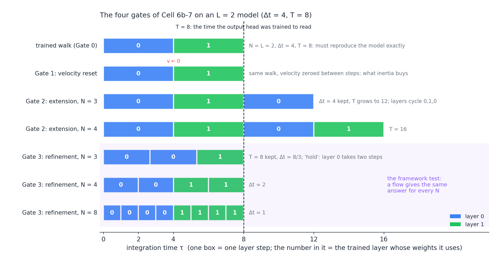
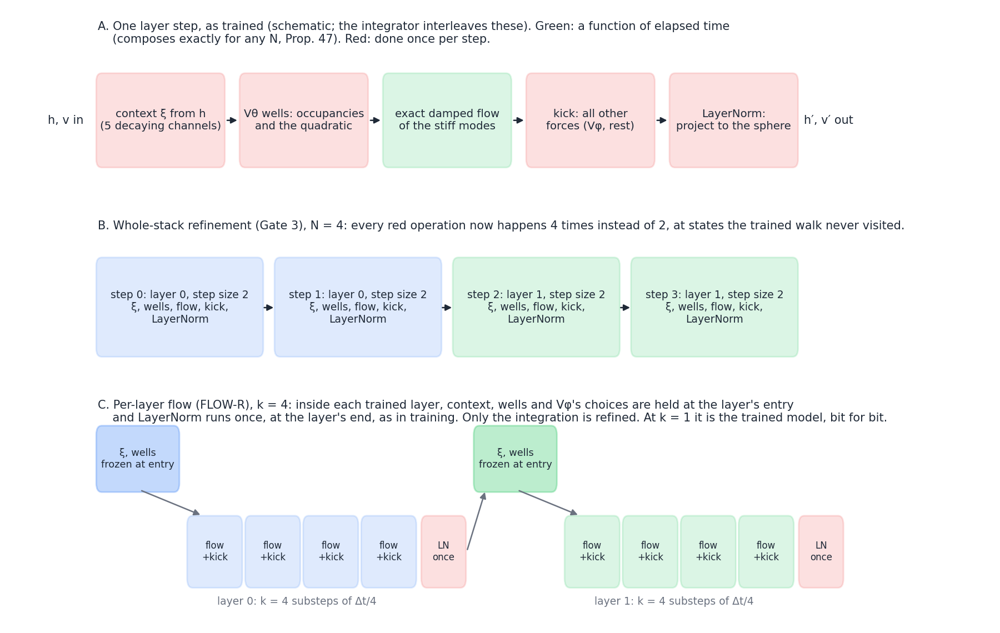
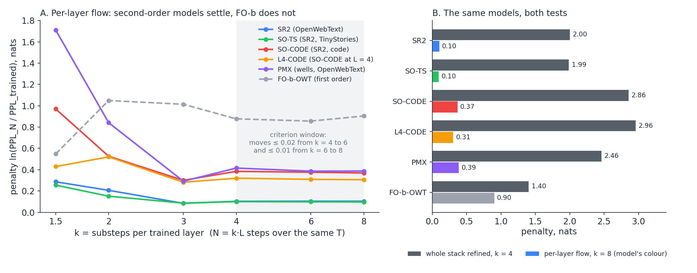
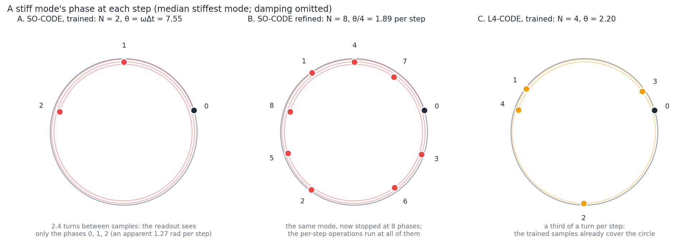
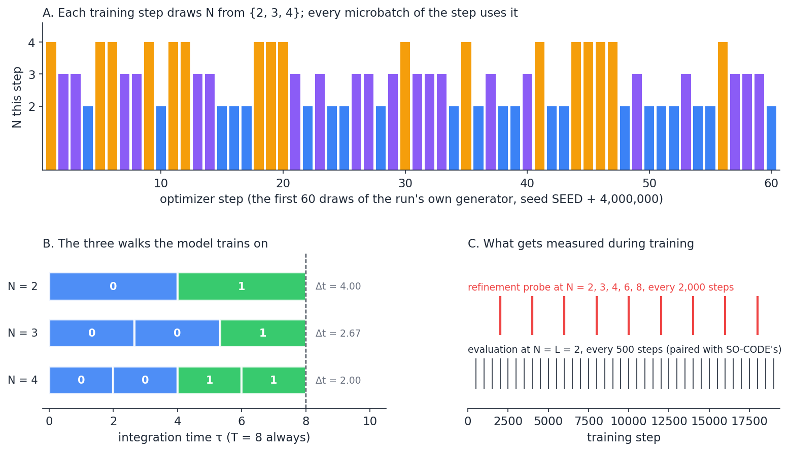
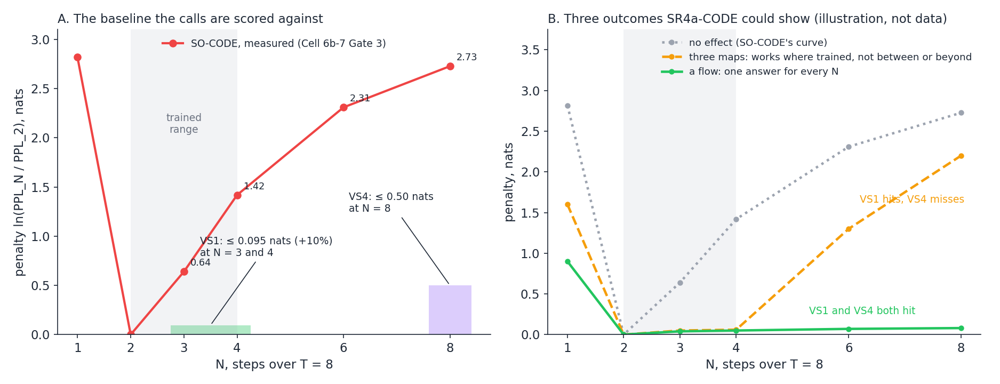

# Refinement experiments, and the variable-step arm (SR4a-CODE)

**What this note is.** An illustrated guide to the refinement experiments of the depth ladder. It covers:

- what each test changes and what it holds fixed;
- why each one exists, and what its result means;
- the variable-step training arm SR4a-CODE, with its five calls (VS1–VS5) and its code.

The pre-registrations, scores and raw numbers live in the [protocol note](Depth_Ladder_and_Matched_Baseline_Protocol.md): §5.9 (SR1–SR5), §5.19 (FLOW-R), [`p-flowr-code`](Depth_Ladder_and_Matched_Baseline_Protocol.md#p-flowr-code) and [`p-sr4a-code`](Depth_Ladder_and_Matched_Baseline_Protocol.md#p-sr4a-code). The original derivation of the gates is in [Composing_Single_Layer_Inferences_Flow_or_Maps.md](Composing_Single_Layer_Inferences_Flow_or_Maps.md). The book's treatment is Remark 67 (`rem:refinement-invariance`) and §8.9 (`ssec:settling-refinement`).

**Status, 2026-11-01:**

- The gates and FLOW-R have been run on every ladder arm.
- SR4a-CODE's switch is built and verified. The run waits for the GPU (queue: L8-CODE, K2-CODE, then SR4a-CODE).
- Its calls are proposed and not yet confirmed by the author.

Figures: [`figures/_make_refinement_figs.py`](figures/_make_refinement_figs.py) (the numbers are copied from the run outputs named in its header).

---

## 1. The question

A layer stack can be read in two ways.

- **A sequence of maps.** The model is L learned functions applied one after another. L is an architectural constant, and "the trajectory between layers" means nothing beyond the L states.
- **A discretised flow.** There is a continuous trajectory h(τ) on 0 ≤ τ ≤ T, and the L layer steps are one way of sampling it, with step Δt = T / L. Change the number of steps and you should get, approximately, the same trajectory.

The framework commits to the second reading in several places:

- the Jacobi-metric geodesics;
- the energy-based hallucination signal;
- the idea that depth could be an inference-time knob.

Training never distinguishes the two, because the loss only ever sees one step count. The refinement experiments ask which reading the trained models support.

**Vocabulary used throughout:**

| symbol | meaning | SO-CODE |
| --- | --- | --- |
| L | number of trained layers (distinct weight sets) | 2 |
| Δt | trained step size | 4 |
| T = L·Δt | total integration time; the output head was trained to read the state at T | 8 |
| N | number of steps actually taken at inference (or, in SR4a, in training) | 2 as trained |
| k = N / L | substeps per trained layer | 1 as trained |
| penalty | ln(PPL at N / PPL at the trained N), in nats; 0 means "no change", 0.095 nats is +10% perplexity, 0.69 nats is ×2 | |

---

## 2. The four gates (Cell 6b-7)



| gate | what changes | what is held | what a flow would show | what it tells us |
| --- | --- | --- | --- | --- |
| **0** | nothing: N = L through the probe's own harness | everything | exact reproduction | a harness check: any drift voids everything else |
| **1** | velocity zeroed between steps | weights, N, Δt | (not a flow test) | how much the model relies on momentum carried between layers ("what inertia buys") |
| **2** | more steps at the trained Δt (T grows) | Δt | little change if the trajectory has settled by T | extension: can the model "think longer"? |
| **3** | more steps over the same T (Δt shrinks) | T | **the same answer for every N** | **refinement: the framework test** |

**Why Gate 3 uses the `hold` layer order.** At N > L, some trained layer must be used for several steps. Two orders are possible:

- **`cycle`** (0, 1, 0, 1, …) alternates the layers' depth codes faster and faster as N grows. In the limit it converges to the flow of the *average* potential. That is a different model, and the convergence would look like evidence *for* the flow hypothesis.
- **`hold`** keeps each trained layer for its share of the time: step j uses layer min(j·L // N, L − 1). The map from time τ to weights stays (nearly) the same, which is what refinement means.

The "nearly": when N is not a multiple of L, the shares are unequal. At N = 3 layer 0 takes two of the three steps, so it covers 2/3 of T instead of 1/2. SR4a-CODE trains with this same order, so it is consistent with how Gate 3 measures.

**SO-CODE's readings (Cell 6b-7):**

- Gate 1: +3.95%.
- Gate 2 at N = 3: +42% (T = 12).
- Gate 3: the penalty is 0.64 nats at N = 3, 1.42 at N = 4 and 2.73 at N = 8. The perplexity goes from 5.06 at N = 2 to 9.59, 20.9 and 77.4.

Every second-order model on the ladder fails Gate 3 the same way.

---

## 3. What happens inside one step, and why refinement can break it



A trained layer step does five things (Panel A, schematic):

1. **Context.** It recomputes the context ξ from the current state h: five decaying channels over earlier tokens.
2. **Wells.** It recomputes V_θ's wells at that context: which wells the token occupies, and the low-rank quadratic (spring) they form.
3. **Exact flow.** It integrates the stiff modes of that spring with the **exact damped flow** (SR2). This part is a genuine function of elapsed time: two steps of Δt/2 equal one step of Δt exactly, for any damping (Prop. 47, `prop:sr-damped-flow`).
4. **Kick.** It applies every other force (V_φ and the rest) as a kick.
5. **Projection.** It projects h back onto the LayerNorm sphere. This is a pure projection, with no affine part.

Only step 3 (green) is a function of time. The other four (red) are **per-step operations**: done once per step, whatever the step size. Refining the whole stack (Panel B) doubles how often they run and evaluates them at states the trained walk never visited. That alone can change the computed function, even with perfect integration.

So "Gate 3 fails" has two candidate explanations, and they mean very different things:

- **(a) The integration is far from any continuous flow.** The model would be a set of maps all the way down.
- **(b) The integration is a decent sample of a flow, but the per-step operations, applied at new states and new rates, break it.** The model would be a flow inside each layer, held together by step-shaped glue.

---

## 4. Separating the two: the per-layer flow (FLOW-R)

The **per-layer flow** (Panel C above) refines *only* the integration. Inside each trained layer it:

- freezes, at the layer's entry, the context ξ, the wells' quadratic and V_φ's choice of sources;
- takes k substeps of Δt / k (exact flow plus kick);
- applies LayerNorm once, at the layer's end, as in training.

At k = 1 it is the trained model, bit for bit. As k grows, it converges to the continuous law that the layer step discretises, provided the step is a sample of one.

The **pre-registered criterion** (§5.19) calls the flow convergent when the penalty moves by at most 0.02 nats from k = 4 to k = 6, and by at most 0.01 from k = 6 to k = 8. The penalty at the limit then measures *how coarse a sample* of its own continuous law the trained step is.



**What the two tests show together:**

- **Every second-order model's per-layer flow settles. Its whole-stack refinement costs 1.9–3 nats.** So explanation (b) holds: the trained layers sample a continuous flow, and the per-step operations are what break the stack.
- **The limits are not all close to the trained step.**
  - SR2 on OpenWebText and SO-TS on TinyStories settle 0.10 nats from it.
  - SO-CODE, the same architecture with the same budget and schedule as SO-TS, settles 0.37 nats away, as far as the well-register models on OpenWebText (PMX 0.39). The corpus moves the limit.
- **Depth barely moves it.** L4-CODE halves the step and its stiffest modes turn less than a third as far per step, yet its limit is only 0.06 nats nearer (0.31).
- **FO-b, the first-order model, never settles.** Its step is first-order accurate, so the trained map is far from its gradient flow (book Table 56, `tab:fos-convergence-order`).

By the full criterion the per-layer flow converges for SR2, SO-TS, PMX-K16, SO-CODE and L4-CODE. It misses for PMX, PM2-PMX16, SR3-crit and the learned γ(h), by 0.002 to 0.036 nats beyond the limits. At L = 4 the criterion is read in substeps per layer (N = 16, 24, 32), because the registered N = 8, 12, 16 are k = 2, 3, 4 there.

---

## 5. Why the trained step size still matters: aliasing as an amplifier



A stiff mode with frequency ω turns by θ = ω·Δt per step.

- **SO-CODE.** The median token's stiffest mode has θ = 7.55, about 1.2 full turns per trained step. Over the two trained steps the readout sees it at only three phases (Panel A). At those instants it cannot be told apart from a mode turning 7.55 − 2π = 1.27 rad per step.
- **Refined to N = 8** (Panel B), the same mode is stopped at eight phases, most of which the trained walk never landed on. The per-step operations of §3 now run at all of them.
- **L4-CODE** (Panel C, θ = 2.20) samples a third of a turn per step, so its trained phases already cover the circle.

Under the exact flow this is **not a separate cause** of failure: a single mode composes exactly for any N, however far one step turns it. What aliasing does is **amplify** the per-step operations, by pushing the refined walk into phases that training never constrained.

The code data say the amplifier is not what sets the *size* of the failure. L4-CODE's far smaller θ leaves the whole-stack penalty where it was: 2.96 nats against 2.86.

---

## 6. SR4a-CODE: train at several step counts

### Motivation

Behind every refinement failure sits one **common cause**: training sees one discretisation. Nothing in the objective rewards a map that survives a different N, so the model is free to:

- carry information in the phase and momentum of one specific discrete trajectory;
- tune its per-step operations to the states that one walk visits.

**Variable-step training** removes that freedom on the refinement axis. Each training step uses a randomly chosen N at fixed T, so the readout must work for every N it is trained on. It is SR4a of the 2026-10-03 pre-registration (§5.9), moved to the code base because FLOW-R on code (§4) showed:

- the per-layer flow settles;
- the whole stack fails by about 3 nats;
- the trained step sits 0.37 nats from its own flow, with room to move.



### The design, and why each choice

| choice | value | why |
| --- | --- | --- |
| base | SO-CODE (L = 2, Δt = 4, T = 8, code, 19,250 steps) | the best-characterised code arm; its gates, FLOW-R and well readings are all in hand |
| step counts | N drawn uniformly from {2, 3, 4} per optimizer step | as registered; contains the trained N = 2, so the model must stay good there; 3 and 4 are the first refinements, where SO-CODE already loses 0.64 and 1.42 nats |
| T | fixed at 8 | refinement, not extension: the head always reads the state at the same time |
| layer order | `hold`, as Gate 3 | training and measurement use the same map from time to weights |
| one N per optimizer step | all microbatches of a step share N | each step's training loss belongs to one N, so the log can report the loss per N |
| own generator for N | seed SEED + 4,000,000, saved in checkpoints | the batch generator is untouched, so the batches and every evaluation are paired, step for step, with SO-CODE's |
| evaluation | at N = L = 2, every 500 steps | the settled perplexity compares directly with SO-CODE's 5.99 |
| in-training probe | penalty at N = 2, 3, 4, 6, 8 every 2,000 steps, on Cell 6b-7's fixed batches | the refinement curve as training goes, without waiting for the end; 6 and 8 lie outside the trained range |
| parameters | none added | any difference from SO-CODE is the objective, not capacity |

**Cost:** about 1.6 s per step (the mean of SO-CODE's 1.1 at N = 2 and L4-CODE's 2.0 at N = 4), about 8.5 h. An N = 4 step holds four layer steps' activations, about L4-CODE's 60.5 GB without layer checkpointing, on an 80 GB card.

---

## 7. The calls, VS1–VS5



All calls are scored after the run, on the best checkpoint unless stated. "Cell 6b-7" means its fixed batches (seed 20260920, 12 × 4 × 512 tokens). SO-CODE's values are the baseline.

### VS1: refinement inside the trained range (SR4a's registered threshold)

- **Prediction:** the Gate 3 penalty at N = 3 *and* at N = 4 is each at most ln 1.10 = 0.095 nats (perplexity within +10% of N = 2).
- **Baseline:** SO-CODE 0.639 and 1.418 nats.
- **Why this threshold:** it is SR4a's pre-registered bar (§5.9), kept unchanged so the code arm is scored as the original arm would have been.
- **Hit:** the model works at every step count it was trained on. That is necessary for depth as a knob, but not sufficient (see VS4).
- **Miss:** even direct training cannot make one set of weights serve three discretisations. The per-step operations conflict across N.
- **Called at 70%:** the objective optimises N = 3 and 4 directly, a third of the steps each, so failure would need a real conflict between the three walks.

### VS2: no perplexity cost at the trained step

- **Prediction:** the settled perplexity at N = 2 is within +5% of SO-CODE (at most 6.295).
- **Baseline:** SO-CODE 5.99. Settled = the mean of the evals at 18,000, 18,500 and 19,000.
- **Why:** SR4a's registered band. Refinement bought at a large perplexity cost would not be adopted.
- **Hit:** the variable-step objective is affordable.
- **Miss:** serving three walks costs capacity at the trained one, and the decision rule weighs that cost.
- **Called at 65%:** only a third of the steps train the N = 2 walk itself.

### VS3: inertia is kept

- **Prediction:** Gate 1 (velocity reset) costs at least +3.2%, i.e. at least 80% of SO-CODE's +3.95%.
- **Why:** across the four L = 2 arms measured first, reliance on momentum (Gate 1) and refinement failure (Gate 3) were perfectly rank-ordered, so the two looked like one cause. SR4a is the arm predicted to **break** that order, staying refinable without giving up momentum. Damping the momentum away (SR3) was predicted to keep the order, losing both together.
- **Hit:** refinement does not require giving up the second-order dynamics.
- **Miss:** the model became refinable by leaning less on its velocity. That is the trade the damping route makes, reached by a different path.
- **Called at 70%.**

### VS4: refinement beyond the trained range, "is it a flow?"

- **Prediction:** the Gate 3 penalty at N = 8 is at most 0.50 nats.
- **Baseline:** SO-CODE 2.73 nats.
- **Why this matters most:** VS1 can be met by learning **three maps with shared weights**, good at N = 2, 3 and 4 and nothing else (orange curve, Panel B). A flow gives the same answer at every N, including those never trained on (green curve). N = 8 is twice the largest trained N.
- **Hit with VS1:** the model has learned something that interpolates and extrapolates in step size, the property Remark 67 asks for.
- **VS1 hits, VS4 misses:** variable-step training teaches the step counts it is shown, not a flow. Depth as a knob would then need training over the whole range of N one wants to use.
- **Called at 40%:** nothing in the objective rewards N = 8 directly.

### VS5: the trained step moves onto its own flow

- **Prediction:** FLOW-R's per-layer flow limit, at k = 8, is at most 0.20 nats.
- **Baseline:** SO-CODE 0.369.
- **Why:** VS1 and VS4 test the whole stack. VS5 asks whether training at several step sizes also makes *each layer's* step a finer sample of its continuous law, as it is on prose (0.10). It separates "the per-step operations learned to cope with several N" from "the integration itself became more faithful".
- **Called at 45%.**

### Reading the outcomes together

| VS1 | VS4 | VS5 | reading |
| --- | --- | --- | --- |
| hit | hit | hit | variable-step training makes the model a flow, layer and stack; adopt it for any model meant to have depth as a knob |
| hit | hit | miss | the stack refines, but the layer step stays a coarse sample: the per-step operations adapted, the integration did not need to |
| hit | miss | either | three maps: works where trained, nowhere else; the per-step operations must be addressed in the architecture, not the objective |
| miss | miss | either | the single-discretisation objective is not the cause; the per-step operations (refrozen occupancies, kick, per-layer context, LayerNorm projection) are, as §5.9's decision rule records |

VS2 and VS3 qualify every row: an outcome that costs more than 5% perplexity, or gives up the momentum, is a trade, not a fix.

---

## 8. Code deep dive

### The model: `stack_steps` and the variable walk

File: [`parf/model_fock_parf_multixi.py`](../notebooks/conservative_arch/parf/model_fock_parf_multixi.py).

**A runtime attribute, not a config field** ([line 368](../notebooks/conservative_arch/parf/model_fock_parf_multixi.py#L368)). Checkpoints and configs are unchanged:

```python
self.stack_steps: Optional[int] = None   # None: the trained L steps of cfg.dt
self._stack_j: Optional[int] = None      # index of the current step inside the walk
```

**The walk** in `_stack_forward` ([lines 772–797](../notebooks/conservative_arch/parf/model_fock_parf_multixi.py#L772-L797)). When N = L the loop is the original one: the same layer index, the same `dt` object, so OFF is bit-identical.

```python
n_walk = cfg.L if self.stack_steps is None else int(self.stack_steps)
if n_walk != cfg.L:
    ...                                   # refuses substeps_per_layer > 1 and the particle store
    dt = cfg.dt * cfg.L / n_walk          # T held fixed
...
for j_walk in range(n_walk):
    ell = j_walk if n_walk == cfg.L else min((j_walk * cfg.L) // n_walk, cfg.L - 1)   # 'hold'
    self._stack_j = j_walk
    ...                                   # unchanged: FO-a reset, checkpointed or plain _fock_layer_step(h, ..., dt, ell)
```

`dt` and `ell` are captured as default arguments of the checkpointed closure. A layer-checkpoint recompute in the backward pass therefore replays exactly the step the forward took.

**The one behavioural fix needed** ([line 474](../notebooks/conservative_arch/parf/model_fock_parf_multixi.py#L474)). `_fock_layer_step` resets its per-forward accumulators (repulsion terms, CB readings, gate terms) "at layer 0". Under `hold`, layer 0 can take several steps, so it would have discarded the earlier steps' terms. The reset now keys on the walk's first step:

```python
_first = layer_idx == 0 if self._stack_j is None else self._stack_j == 0
```

In the trained walk the two tests pick the same step. Outside the loop (a checkpoint recompute), `_stack_j` is `None` and the old test applies.

### The notebook: Cell 0

```python
VARIABLE_STEP_COUNTS      = None             # SR4a-CODE: (2, 3, 4)
VARIABLE_STEP_PROBE_EVERY = 2_000
VARIABLE_STEP_PROBE_N     = (1, 1.5, 2, 3, 4)   # multiples of L
```

The tag gains `vs<counts>` right after `sr2` (conditional, so every existing tag is unchanged): `…_sr2_vs234_st16250_L2probe…`. Cell 0 asserts at least two distinct counts from 1 to 9, and no particle store. A banner `[SR4a] VARIABLE_STEP_COUNTS=(2, 3, 4) …` confirms the switch.

### The notebook: Cell 6

| where | what |
| --- | --- |
| after `rng = np.random.default_rng(SEED)` | `_vs_counts`, `_vs_rng = default_rng(SEED + 4_000_000)`, `_vs_run = {}` |
| top of each optimizer step | `_vs_n = _vs_rng.choice(_vs_counts)`; `model.stack_steps = None if _vs_n == L else _vs_n` |
| after the microbatch loop | `model.stack_steps = None`, so clipping, logging, monitors and evaluation see the trained walk |
| `evaluate()` | `model.stack_steps = None` at entry (a guard) |
| step log, every 50 steps | `vs_ntp_by_n`, `vs_steps_by_n` in `training_log.jsonl`; `vs=[N2:… N3:… N4:…]` on the printed line |
| every 2,000 steps | `vs_refinement_probe(step)`: N = 2, 3, 4, 6, 8 on Cell 6b-7's batches, layer checkpointing on; prints `>>> SR4a probe …`, logs `event: vs_probe` with `loss_by_n` and `pen_by_n` |
| `save_checkpoint` / resume | `vs_rng_state` saved (only when on) and restored: `[resume] SR4a step-count draw restored` |
| spike capture, interrupt handler | `vs_n` recorded in the spike bundle; `stack_steps` reset on interrupt |

### Verification

[`debug/verify_variable_step_switch.py`](../notebooks/conservative_arch/scaleup/debug/verify_variable_step_switch.py) runs on SO-CODE's trained weights, built through the notebook's own Cells 0–5b:

```bash
python3 verify_variable_step_switch.py OUT          # 26 checks, about 2 min on CPU
python3 verify_variable_step_switch.py OUT probe    # plus the probe against Cell 6b-7, about 15 min
```

The checks:

- **Tag and model:** the tag gains exactly `vs234`; the banner prints; there are no new parameters or keys.
- **N = L:** explicit or `None`, it is bit-identical to the OFF-built model.
- **Eval:** at N = 1, 3, 4, 6 and 8 the walk equals Cell 6b-7's `_fom_stack` exactly (max |Δ logit| 0.0).
- **Training, N = 3:**
  - loss and all 73 gradients equal `_fom_stack`'s, with layer checkpointing off and on;
  - checkpointing on against off agree exactly;
  - three repulsion terms (one per step);
  - `_stack_j` returns to `None` after the walk.
- **Refused combination:** `stack_steps` together with `substeps_per_layer` > 1.
- **Cell 6 fragments:**
  - the draw leaves the batch generator untouched;
  - 19,250 draws are uniform (6,525 / 6,416 / 6,309);
  - the saved state continues the draw after a resume;
  - the log entry is right, and empty when off.

OFF bit-identity is checked separately by `verify_well_reach.py`: a dump in a HEAD worktree, then a compare in the working copy. On SO-CODE, XI6-CODE, FOCK-CODE, F3.1 and G3′, the eval and train logits, the loss and every gradient differ by 0.0.

---

## 9. Running SR4a-CODE and what to watch

**Cell 0:**

- SO-CODE's nine changes: `REVERSE_CHANNEL = False`, `VPHI_GRAD_PATH = 'live'`, `XI_GRAD_PATH = 'live'`, `LOWRANK_DAMPED_FLOW = True`, `VPHI_ANALYTIC_FORCE = True`, `LAYER_CHECKPOINT = False`, `CORPUS = 'code'`, `LADDER_STEPS = 16_250`, `EXTRA_FLOOR_STEPS = 3_000`;
- plus `VARIABLE_STEP_COUNTS = (2, 3, 4)`.

**Early checks:**

1. **Cell 0** prints the `[SR4a]` banner and a tag containing `_sr2_vs234_st16250_`.
2. **Step 50:** the printed line carries `vs=[N2:… N3:… N4:…]`, and the speed is about 1.6 s per step.
3. **Step 2,000:** the first `>>> SR4a probe` line. Compare its N = 3 and N = 4 penalties with SO-CODE's final 0.64 and 1.42. Early in training no model is near its settled state, so read the trend over the later probes.

**Running signals:**

- **Per-N training losses** (`vs_ntp_by_n`). If N = 4 stays far above N = 2 late in training, the walks are competing (a VS1 risk). If they converge together, the model is finding one solution.
- **The probe's N = 6 and 8 penalties** are the running preview of VS4.

**After the run:**

- Cells 8, 7, 6b-7 (Gate 3 to N = 8, the scores of VS1, VS3 and VS4) and 6b-13 (ω·Δt);
- on CPU, FLOW-R with the `code` kind (VS5), and the paired evals against SO-CODE (VS2).

---

## 10. Caveats

- **One seed per arm**, as for every ladder arm. The step-by-step pairing with SO-CODE shares batches, not initial weights.
- **The `hold` asymmetry at N = 3:** layer 0 covers 2/3 of T. Training and Gate 3 share it, so the scoring is consistent. A model that refines under `hold` might still not refine under a time-proportional order, which the architecture cannot express (the depth codes are discrete).
- **The probe's batches are small** (12 × 4 × 512 tokens). It tracks the trend; the calls are scored on the full readings.
- **The budget is SO-CODE's** (315M tokens). How strongly a trained map leans on its per-step operations may change with training length (book Remark 45, `rem:sr-training-budget`).
