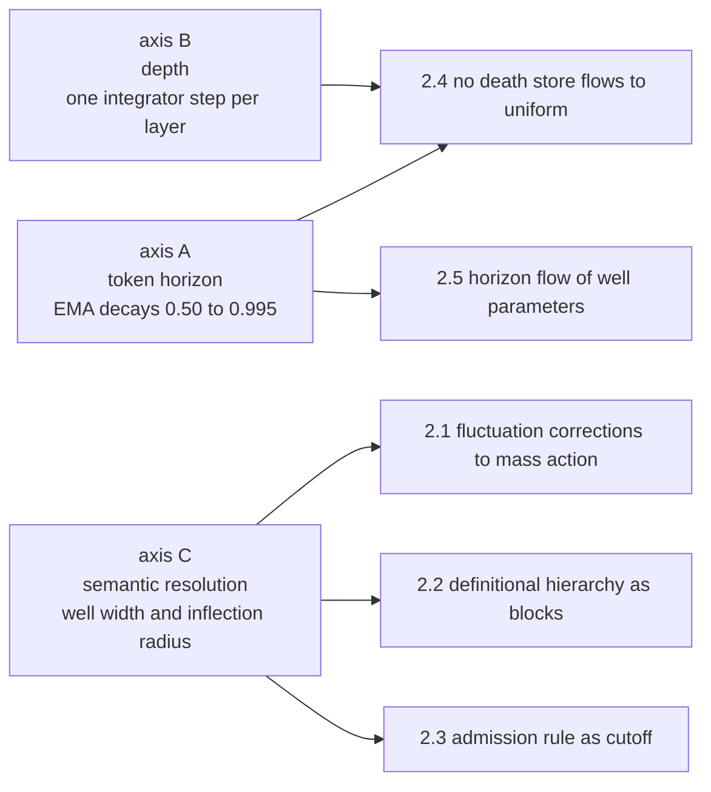

# Renormalization Group Readings of Template Matching: A Proposal

**Proposal note — Semantic Simulation Research Programme**
**Relates to:** book §10.5.4 (the one sentence on renormalisation-group reasoning, p. 124); [*Implementing Semantic Templates: A Path*](Implementing_Semantic_Templates_A_Path.md) §3, §7.1, §8; [*Semantic Templates as Doi–Peliti Reactions*](Semantic_Templates_as_Doi_Peliti_Reactions.md) §3.4, §4.4; [*The Particle Store: Making Allocation Real*](The_Particle_Store_Making_Allocation_Real.md) §3, §7; [*Macroscopic Limits of the Conservative Step*](Macroscopic_Limits_of_the_Conservative_Step.md) §3, §5.3, §7.1; [*Mean-Field Theory for Particle Language Models*](Mean_Field_Theory_for_Particle_Language_Models.md) §1.3, §7.1; [*Expressivity Bounds for the v0 Simulator*](Expressivity_Bounds_For_v0_Simulator.md) Lemma 2, §7.
**Status:** Proposal for future exploration. Nothing in this note is derived, implemented, or measured. It records candidate connections so they are not lost, and it names two measurements without running them. The Tier 1 training algorithm comes first; the only item below that enters that discussion is §2.4.

> **Thesis.** The book inherits "renormalisation-group reasoning (what happens at long-discourse vs short-utterance scales)" for the composite system in one sentence and develops it nowhere. The template programme now has enough structure to say what that sentence could mean: three distinct scale axes (token horizon, depth, semantic resolution), a reaction formalism whose mean-field level is already identified as the law of mass action, and one measured result — the no-death store flowing to a uniform background — that has the shape of a flow to a trivial fixed point. Five readings follow. Three of them need a consuming template and therefore wait for Tier 1. One needs nothing from templates at all. One is upstream of Tier 1: it states what the consumption rule must achieve, and so belongs in that discussion rather than after it. Every reading is a reading of a finite, discrete system in the language of an asymptotic apparatus, and the gap is stated each time.

---

## Contents

0. [Scope: what this note is and is not](#0-scope-what-this-note-is-and-is-not)
1. [Three scale axes, not one](#1-three-scale-axes-not-one)
2. [Five candidate readings](#2-five-candidate-readings)
   - 2.1 [Fluctuation corrections to the mass-action rate law](#21-fluctuation-corrections-to-the-mass-action-rate-law)
   - 2.2 [The definitional hierarchy as a block construction](#22-the-definitional-hierarchy-as-a-block-construction)
   - 2.3 [The admission rule as a cutoff](#23-the-admission-rule-as-a-cutoff)
   - 2.4 [The no-death result as a flow to a trivial fixed point](#24-the-no-death-result-as-a-flow-to-a-trivial-fixed-point)
   - 2.5 [Horizon flow of the well parameters](#25-horizon-flow-of-the-well-parameters)
3. [Two measurements, named and not run](#3-two-measurements-named-and-not-run)
4. [Order of work](#4-order-of-work)
5. [Dictionary](#5-dictionary)
6. [Reading](#6-reading)

---

## 0. Scope: what this note is and is not

| Claim | Status |
|---|---|
| The composite system inherits renormalisation-group reasoning across discourse scales | **In the book**, §10.5.4, one sentence, undeveloped |
| The mean-field level of the template dynamics is the law of mass action | **In the macroscopic and mean-field notes**, §5.3 and §7.1, citing Täuber, Howard and Vollmayr-Lee 2005 |
| A decaying store is bounded memory; only $\lambda = 1$ can lift the class | **In the store note**, §3 |
| The no-death store is the arm the model declines to use; its summed potential becomes a near-uniform background | **Measured**, store note §7, one seed, 300 CPU steps |
| The programme has three distinct scale axes that an RG reading must keep apart | **Proposed here**, §1 |
| Five specific RG readings, each with its dependency on Tier 1 stated | **Proposed here**, §2 |
| Two cheap measurements that would test the preconditions of two of them | **Named here, not run**, §3 |

Four boundaries hold throughout.

1. **The apparatus is asymptotic; the system is not.** The renormalization group is a statement about what survives as a scale is taken to infinity or to zero. The system here has eight joint wells, two to eight layers, context horizons of 2 to 200 tokens, and a store of at most a few hundred particles. Each reading below is therefore a finite system described in an asymptotic language, and the place where the finiteness bites is said explicitly.
2. **The book commits to one sentence; this note commits to nothing beyond it.** Nothing here is proposed for the book, and no book text is touched.
3. **No claim is made that the trained models exhibit RG behaviour.** The two measurements of §3 would test preconditions (universality of a scaling, separation of scales), not the behaviour.
4. **Dependency on Tier 1 is tagged per reading.** Three readings cannot be developed before a consuming template exists, because they renormalise a reaction that does not yet have a reactant. Developing them now would be the cart before the horse. Recording where they would go is not.

---

## 1. Three scale axes, not one

A renormalization group asks one question: how does the effective description of a system change when the scale at which it is observed changes? The book's sentence names one scale, "long-discourse vs short-utterance". The programme in fact has three, and an RG reading that conflates them will say nothing.

**Axis A, token horizon.** The context channels $\xi$ are causal exponential moving averages of the hidden state with decays 0.50, 0.75, 0.95, 0.99 and 0.995, horizons of roughly 2, 4, 20, 100 and 200 tokens. The well bank $V_\theta$ is generated jointly from all five, so every centre, precision and weight is a function of every horizon at once. This is the axis the book names. The short-horizon channels are the fine-grained description, the long-horizon channels the coarse one, and a token arrives carrying both.

**Axis B, depth.** Each layer is one integrator step. The macroscopic note §5.5 reads depth as a macroscopic time variable, and the mean-field note §1.3 measures that the trained bank anneals with depth: the operating inverse temperature rises monotonically across the eight layers of L8-CODE, with layer 0 in a hot seven-well phase and layers 1 to 7 in a cold two-well phase on the same curve. Of the three axes this is the one that most resembles a literal RG flow, because it is a one-parameter family of effective descriptions, indexed by layer, with a parameter (the temperature) that moves along it and a destination (the cold phase) that behaves as a fixed point.

**Axis C, semantic resolution.** The well width $1/\kappa$ and the inflection radius $x^\ast$ set the resolution at which semantic space $\Sigma$ is observed. The matching threshold is a binding radius in these units, templates note (3.4): $d / x^\ast \lt \sqrt{2 \ln (1/\Theta)}$. Coarsening semantic space means widening the well, and the matcher's selectivity is a function of exactly this scale.

In reaction–diffusion RG the scale is spatial, and what flows under it are the reaction rates in the presence of diffusion. Mapping that onto the programme requires a choice: which axis plays the role of space, and which of time? The natural assignment is $\Sigma$ for space (axis C), with position or depth for time (axes A and B). But the stored particles do not diffuse: a particle's payload is frozen at birth (store note §8, "Move"), and what moves through $\Sigma$ is the token that probes the store, not the particles in it. So the closest classical analogue is a system of **immobile reactants and a mobile probe**, and the standard reaction–diffusion results, which assume all species diffuse, do not transfer unmodified. This is the first thing any development of §2.1 would have to settle.

---

## 2. Five candidate readings

Each reading states what it would say, what it borrows, what it would need, and what would make it empty. The dependency tag is the operative line.

### 2.1 Fluctuation corrections to the mass-action rate law

**Depends on Tier 1 and on the first consuming template.**

The macroscopic note §5.3 and the mean-field note §7.1 already identify the mean-field level of the template dynamics: the saddle point of the Doi–Peliti action is the law of mass action, deterministic rate equations for the mean occupancy of each type. The plan note §3 shows where that level stops being exact. A thresholded firing rate is nonlinear in the occupation, so $\mathbb{E}[r(n)] \neq r(\mathbb{E} n)$, and any reactant intensity $k_v \geq 1$ couples each moment to the next. The plan's third option, "accept a mean-field approximation and say so", leaves the size of the error unstated.

Quantifying that error is the entire subject of Täuber, Howard and Vollmayr-Lee 2005. Below a critical dimension, fluctuations renormalise the reaction rates, and the mean-field decay law of a process such as pair annihilation is replaced by a slower one with a universal exponent. The reading proposed here is that the same machinery, applied to the template bank's Liouvillian (templates note §4.4), would say **when option three is honest**: in which regime of bank size, store occupancy and matcher rank the deterministic intensity $\phi$ computes the expected dynamics to within a stated error, and in which it does not.

*Where the finiteness bites.* The naive spatial dimension is the model width, several hundred, far above the critical dimension of any standard reaction, and in that reading mean-field would simply be correct. But the matcher does not act in the full space: it acts in a learned subspace of rank 8 (Stage 0′ and Stage 0″ both use `_lowrank_match`), and the effective dimension for the reaction is at most that rank, with the geometry of §3.4 of the templates note setting the reaction radius. Whether rank 8 is "high-dimensional" for this purpose is the question. And, as §1 says, the reactants do not diffuse, so the standard results would have to be rederived for an immobile species and a mobile probe.

*What would make it empty.* If the effective dimension is comfortably above critical and the fluctuation corrections are irrelevant in the RG sense, this reading has no content, and the plan's option three becomes safe at no cost. That is itself a useful result, and it would be the first thing to check.

### 2.2 The definitional hierarchy as a block construction

**Conceptual; needs the Stage 1′ two-slot design, not training.**

Book Definitions 4 to 8 ascend: aspect, property, particle, structure, template. The block-spin construction (Kadanoff 1966) replaces a block of degrees of freedom by one effective degree of freedom with a renormalised coupling, and then asks whether the blocked system has the same form as the original so that the step can be iterated. The reading is that a **structure is a block of particles**, and a multi-slot template that matches a structure is an operator at the block scale. The single-slot kernel is the Bhattacharyya overlap of one cloud against one cloud (templates note §3.3). The two-slot kernel of Stage 1′, two clouds at a relative displacement, would be the blocked kernel, and the displacement constraint is a coupling that has no counterpart at the single-particle scale. A decimation rule, saying how the block kernel is built from the particle kernels, is exactly what Stage 1′ does not yet have.

*Where the finiteness bites.* An RG requires self-similarity: the blocked system must be of the same form as the original, or the map cannot be iterated and what remains is a single coarse-graining. Whether a template of templates has the same form as a template is the open question of the templates note §7.4, where a reaction reading of the executive space $\mathbf{E}$ would need a mode set over $\mathbf{E}$ rather than over $\Sigma$, and nothing supplies it. So this reading may terminate after one step. If it does, it is a useful way to write the two-slot kernel and nothing more, and it should not be called an RG.

### 2.3 The admission rule as a cutoff

**Depends on Tier 1: there must be a trained bank whose size can be varied.**

The plan note §7.1 lists the constraints the MCS reduction places on a learned bank: finite up to string-action equivalence, bounded multiplicity per firing, consume-and-emit, bounded fragment dimension and arity. In field theory those are the job of a cutoff: a bound on resolution above which no degrees of freedom are admitted. The bank's admission rule, whatever decides which templates exist at Tier 1 and which can be induced at Tier 2, plays that role.

The lesson RG draws from a cutoff is renormalisability: predictions must not depend on where the cutoff sits. In the programme's terms, **behaviour on the class-lifting task should become insensitive to bank size beyond some scale.** The collapse depth $D^\ast$ of the bounds note (7.2) is the measurable: vary the bank size, measure $D^\ast$, and look for a plateau. A plateau says the bank is a finite description in the sense the MCS reduction needs, and the plan's open question "no principle yet sets how many templates a corpus needs" (§8) gets an operational answer, the knee of that curve. No plateau says the behaviour depends on the cutoff, which is the signature of a non-renormalisable description, and is the quantitative form of the warning in §7.1 that an open-ended bank is not an LCFRS at all.

*Where the finiteness bites.* $D^\ast$ on a two-layer model is uninformative (plan note §7.1, "a null result at $L = 2$ would not be informative"), so this needs the $L \geq 4$ arms, and it needs a consuming template, since without consumption a closing bracket cannot decrement the live count (store note §8).

### 2.4 The no-death result as a flow to a trivial fixed point

**Independent of Tier 1, and upstream of it: this is a criterion the consumption rule has to meet.**

The store note's two central results, read together. With spontaneous death at half-lives of 1 to 16 tokens the live count saturates at $\sum_j \bar{e}\_j / (1 - \lambda_j)$, a bounded memory however large the store, which is Lemma 2 of the bounds note in another form and lifts no class. With no spontaneous death the live count grows as about $1.2 t$, a token at $t = 255$ sees roughly 288 particles, their summed well potential becomes a near-uniform background, and the model declines to use it: removal cost 0.16% against 5.41% for the decay arm. Each individual existence stays content-driven (position $R^2$ negative at every layer in both arms); the sum the token feels does not.

The RG shape of this is a one-parameter family indexed by the half-life, with two endpoints that behave as fixed points and neither of which is where the programme wants to be.

- **Finite half-life.** Bounded memory, class v0. Useful, unable to lift the ceiling.
- **Infinite half-life without removal.** The summed potential of $N$ content-driven particles has a token-to-token variation that falls as $N^{-1/2}$, so the field a token feels flows toward a constant. A constant field is removed by the post-step LayerNorm, so the fixed point is not merely trivial but invisible. This is the same averaging that made the Poisson occupations 94 to 100% positional at long half-lives, reappearing as *infinite half-life equals maximal averaging*.

What the framing adds beyond the store note's own conclusion is a precise statement of what consumption must do. It must hold the system **away from the trivial fixed point**: the live count has to stay bounded in the mean, so that the sum does not average out, while *which* particles are live stays content-driven, so that the store is not bounded memory in Lemma 2's sense. Lemma 2 is about a uniform contraction of state; a store whose removals are content-dependent is not a uniform contraction, so the two requirements are compatible. In numbers: a stationary count $N^\ast = (\text{creation rate}) / (\text{consumption rate})$ that sits well below the $N$ at which the sum becomes uniform, and above the handful at which the store has nothing to say. The first measurement of §3 would put a number on that upper $N$.

*Where the finiteness bites.* The $N^{-1/2}$ law is a central-limit statement, not an RG one; RG enters only if the collapse to uniformity is **universal**, the same curve for every $K$, rank and depth, so that the critical $N$ can be stated once. That is testable now, cheaply, on the existing CPU harness (§3), and it is the only part of this note whose answer the Tier 1 discussion could use.

### 2.5 Horizon flow of the well parameters

**Independent of templates entirely. Not on the Tier 1 path, and should not be run before it.**

$V_\theta$ is generated jointly from five horizons. In an RG reading the long-horizon channels carry the coarse-grained description and the short-horizon channels the fine one, and the question is how the well parameters $(\mu_k, a_k, w_k)$ depend on which horizon dominates. A separation of scales would show as a block structure in the sensitivity of each well to each channel: some wells reading the discourse, some the utterance. If that structure exists, the book's sentence becomes a measurement rather than a slogan, and the natural object to write down is the change in well parameters per unit change in horizon, which is a flow equation along axis A.

*Where the finiteness bites.* Five discrete horizons and eight wells make a $8 \times 5$ sensitivity matrix, not a flow. An actual flow would need either a family of models trained at different horizon sets or a horizon-truncated evaluation of one model, and no such family exists. The second measurement of §3 is the matrix, and it is explicitly a scale-separation probe and not an RG one.

---

## 3. Two measurements, named and not run

Both are pre-registered in the sense that the prediction is written before the data. Neither is run, and neither should be run before the Tier 1 discussion unless that discussion asks for the first.

**RG-1, universality of the collapse to uniformity.** On the existing harness `scaleup/debug/ps_short_train.py`, sweep the half-life over 4, 16, 64, 256 and infinity, at $K = 4$ and $K = 16$ and at two matcher ranks. For each arm record, as functions of the live count $N$ at the evaluation position: the coefficient of variation across tokens of the summed store potential, and the removal cost. Prediction under the fixed-point reading: the variation falls as $N^{-1/2}$ with a prefactor that does not depend on $K$ or rank, and the removal cost collapses onto one curve in $N$. If the prefactor depends on $K$ strongly, the collapse is not universal, the fixed-point language is a slogan, and the consumption criterion of §2.4 has to be stated per configuration. Cost: of order ten CPU runs of the kind already made, one seed each. Output: one figure, two panels, and one number, the $N$ at which the removal cost falls below the decay arm's noise floor. That number is the ceiling on $N^\ast$ for any consumption rule.

**RG-2, horizon scale separation.** On one trained checkpoint (any F3.1 or PMX arm), compute the sensitivity of each well's centre, precision and weight to each of the five context channels, by finite differences or a Jacobian norm, over a few hundred validation tokens. Report the $8 \times 5$ matrix per layer. Prediction under the scale-separation reading: the matrix is close to block-structured, with most wells dominated by one or two adjacent horizons. A dense matrix says the bank uses all horizons jointly for every well, which is what the joint-bank design permits and what an RG reading of axis A would have to explain away. Cost: one evaluation pass, no training.

What would make each worth running. RG-1: once a consumption rule is drafted and needs its $N^\ast$ bounded. RG-2: at any point after Tier 1 is under way, as a side measurement on a checkpoint that exists anyway.

---

## 4. Order of work

Nothing in this note is on the critical path, and the note exists so that it does not have to be remembered.

1. **The Tier 1 training algorithm** is discussed and written into the plan note first. The author's ideas for it are not yet recorded.
2. **§2.4 enters that discussion** as a criterion on the consumption rule: hold $N$ bounded in the mean, content-driven in identity. RG-1 is run only if the discussion needs the ceiling on $N^\ast$.
3. **§2.1 and §2.3** wait for the first consuming template and the $L \geq 4$ arms respectively.
4. **§2.2** waits for the Stage 1′ two-slot kernel.
5. **§2.5 and RG-2** wait for a checkpoint that is being evaluated for other reasons.

If any of §2.1 to §2.3 is developed, it becomes its own note; this one stays a proposal.

---

## 5. Dictionary

| Term | Meaning here |
|---|---|
| Scale axis | One of three independent parameters along which the effective description can change: token horizon (A), depth (B), semantic resolution (C) |
| Fixed point | An effective description that does not change under further coarsening; §2.4 names two, bounded memory and a uniform background |
| Trivial fixed point | The uniform-background endpoint: a field with no token-to-token variation, removed by LayerNorm |
| Block construction | Replacing a group of degrees of freedom by one effective degree of freedom with a renormalised coupling; §2.2 reads a structure as a block of particles |
| Cutoff | A bound on admitted degrees of freedom; §2.3 reads the bank's admission rule as one |
| Renormalisability | Insensitivity of predictions to where the cutoff sits; §2.3 reads it as a plateau of $D^\ast$ in bank size |
| Universality | Independence of a scaling law from the microscopic parameters; RG-1 tests it for the collapse to uniformity across $K$ and rank |
| Mass action | The deterministic rate equations for mean occupancies; the saddle point of the Doi–Peliti action, and the level at which the plan note's option three works |
| $N^\ast$ | The stationary live count a consumption rule produces, creation rate over consumption rate; §2.4 bounds it from above and below |

---

## 6. Reading

Standard references, listed so the note is self-contained; none is relied on for a result here.

- Kadanoff, L. P. (1966). Scaling laws for Ising models near $T_c$. *Physics* 2, 263. The block-spin construction of §2.2.
- Wilson, K. G. and Kogut, J. (1974). The renormalization group and the $\epsilon$ expansion. *Phys. Rep.* 12, 75. The general apparatus; fixed points and relevance of operators.
- Goldenfeld, N. (1992). *Lectures on Phase Transitions and the Renormalization Group.* Addison-Wesley. The most readable account of why RG is an asymptotic statement, which is boundary 1 of §0.
- Cardy, J. (1996). *Scaling and Renormalization in Statistical Physics.* Cambridge University Press. Short; the chapter on reaction–diffusion is the bridge to the next entry.
- Täuber, U. C., Howard, M. and Vollmayr-Lee, B. P. (2005). Applications of field-theoretic renormalization group methods to reaction–diffusion problems. *J. Phys. A* 38, R79. Already cited by the macroscopic and mean-field notes for the mass-action saddle point; its subject proper is §2.1.
- Täuber, U. C. (2014). *Critical Dynamics.* Cambridge University Press. The Doi–Peliti path integral and its RG, at book length.
- Mehta, P. and Schwab, D. J. (2014). An exact mapping between the variational renormalization group and deep learning. arXiv:1410.3831. The best-known claim that depth is an RG flow; relevant to axis B, and the reasons it is contested are as instructive as the mapping.
- Koch-Janusz, M. and Ringel, Z. (2018). Mutual information, neural networks and the renormalization group. *Nature Physics* 14, 578. Coarse-graining chosen by retained information, which is the criterion §2.4 wants a consumption rule to meet.
