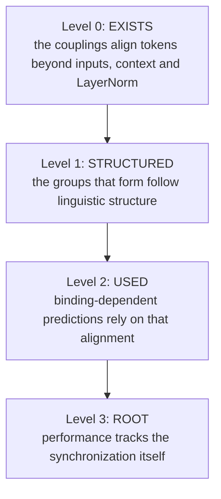

# Spontaneous Synchronization and Semantic Binding: a Test Programme

**The question.** Is spontaneous synchronization at the root of how models built on the Lagrangian framework make semantic inference?

This note turns that question into four claims of increasing strength, each of which can fail, and designs the measurements that decide them. The verdict criteria are pre-registered in the protocol ([`Depth_Ladder_and_Matched_Baseline_Protocol.md`](Depth_Ladder_and_Matched_Baseline_Protocol.md) §5.22) before any measurement. The book's open question Q10 points here.

**Background.** Self-attention, read with layers as time, is a system of particles under an attractive mean-field coupling, and such systems cluster (Geshkovski et al. 2023a, 2023b; Karagodin et al. 2024). The mathematics is that of coupled-oscillator synchronization. The mechanisms, and where they live in our models, are in [`Two_Clustering_Mechanisms_Saturation_and_Synchronization.md`](Two_Clustering_Mechanisms_Saturation_and_Synchronization.md) (§3–5). In this framework every route by which one token can pull another is a named term: V_φ (a pair potential with a learned per-pair sign), the Poisson-mode wells (shared centres; [`Poisson_Mode_Registers_PM1.md`](Poisson_Mode_Registers_PM1.md)) and the Fock path (a two-hop attention). V_θ cannot synchronize tokens: each token's wells come from its own context. That makes the question answerable here in a way it barely is for transformers: every coupling can be switched off, scaled, or read pair by pair.

## Contents

1. [What the question means](#1-what-the-question-means)
2. [The verdict ladder](#2-the-verdict-ladder)
3. [Measurements](#3-measurements)
4. [The tests](#4-the-tests)
5. [Confounds and controls](#5-confounds-and-controls)
6. [Arms, data and annotation](#6-arms-data-and-annotation)
7. [Statistics](#7-statistics)
8. [Instruments to build](#8-instruments-to-build)
9. [Order and cost](#9-order-and-cost)
10. [What each outcome would mean](#10-what-each-outcome-would-mean)
11. [Priors from what is already measured](#11-priors-from-what-is-already-measured)

---

## 1. What the question means

**Synchronization, not similarity.** Two tokens can end up close because their inputs were close, with no interaction between them. That is not synchronization. The definition used throughout:

> **Synchronization** is alignment among token states, or among their displacements, that is **produced by the inter-token couplings**. It is measured as the difference between the real layer step and a replay of the same step, from the same captured input, with a coupling switched off.

**Spontaneous** means the alignment is absent at the layer's input and is not produced by the shared context ξ or by LayerNorm's common direction (§5).

**At the root of semantic inference** is too broad to test in one step. It is split into four claims, ordered so that each presupposes the one before (§2). The answer is the highest level that survives.

**The kind of answer this gives.** Not "yes or no", but a located verdict: the couplings do not synchronize (refuted), they synchronize without linguistic structure, they synchronize along linguistic structure without the model relying on it (epiphenomenal), the model relies on it (load-bearing), or performance follows the synchronization itself (root). Each is a result worth printing, and fixing the criteria now is what makes a negative one credible.

---

## 2. The verdict ladder

| level | claim | decided by | fails if |
| --- | --- | --- | --- |
| 0. exists | coupling-attributable alignment occurs | SY1 | no coupling, in no arm, produces a measurable gain |
| 1. structured | it follows linguistic structure | SY2 | no route beats the position, frequency, input and shuffled-label controls |
| 2. used | the model relies on it for binding | SY3 | targeted removal hurts no more than matched random removal |
| 3. root | performance follows synchronization | SY4, SY5 | performance and the order parameters come apart under scaling, or over-synchronization does not appear |

SY0 validates the instruments before any of these; SY6 asks what is specific to the Lagrangian framework.

---

## 3. Measurements

All measurements are per layer, on the states the model actually uses, from captured layer inputs and outputs.

### 3.1 Centred states

LayerNorm puts the states on a sphere and produces a shared direction at layer 0 (the D-sync transient). That shared direction would count as alignment between every pair of tokens, so it is removed first. For a sequence, with $\hat{h}\_t = h_t / \lVert h_t \rVert$ and $\bar{h}$ the mean of the $\hat{h}\_t$ over the sequence,

$$
x_t = \frac{\hat{h}_t - \bar{h}}{\lVert \hat{h}_t - \bar{h} \rVert}.
$$

### 3.2 Order parameters

- **Global coherence** $R$: the mean of $x_t^{\top} x_s$ over all pairs in the sequence.
- **Binding contrast** for a labelled grouping $\mathcal{G}$ (for example, coreference chains): the mean cosine of pairs in the same group minus the mean cosine of pairs in different groups **at the same token distance**:

$$
B(\mathcal{G}) = \mathbb{E}\big[x_t^{\top} x_s \mid t \sim s \big] - \mathbb{E}_{\mathrm{dist}}\big[x_t^{\top} x_s \mid t \not\sim s\big],
$$

  where the second expectation reweights unrelated pairs to the distance distribution of the related ones.
- **Co-movement contrast** $C(\mathcal{G})$: the same contrast on the layer's displacements $\delta_t = h_t^{\mathrm{out}} - h_t^{\mathrm{in}}$ (before LayerNorm), normalised. Proximity can be inherited; co-movement is what the layer does. It is the analogue of phase-locking: tokens in a group are moved together.

### 3.3 Coupling attribution

For a coupling $c$ (V_φ, the wells, or the Fock path), replay each captured layer step with $c$ switched off and the inputs unchanged, giving $h^{\mathrm{out},-c}$. The synchronization attributable to $c$ is

$$
\Delta_c B = B(h^{\mathrm{out}}) - B(h^{\mathrm{out},-c}),
$$

and likewise $\Delta_c R$ and $\Delta_c C$. The replay is the 6b-9 instrument: it reproduces the trained step bit for bit when nothing is switched off, which is its validity check.

### 3.4 Route-specific readouts

- **V_φ, pair by pair.** For each token $t$ and each of its selected sources $s$ (top 16), the pair's radial force
$$
a_{ts} = f_{ts}^{\top} \frac{h_s - h_t}{\lVert h_s - h_t \rVert}, \qquad f_{ts} = -\nabla_{h_t} V_\phi(h_t, h_s),
$$
  positive when the pair attracts. Two statistics per grouping: **attraction contrast**, the mean $a_{ts}$ over related pairs minus distance-matched unrelated selected pairs; and **selection enrichment**, the rate at which related sources are selected into the top 16 divided by the distance-matched rate for unrelated ones.
- **The wells.** Each token's force share over the 64 modes,
$$
s_{tv} = \frac{\lvert w_v \rvert \lVert r_v \rVert}{\sum_u \lvert w_u \rvert \lVert r_u \rVert},
$$
  with its dominant mode $m_t = \arg\max_v s_{tv}$. Statistics: the normalised mutual information between $m_t$ and a label, and the **co-assignment rate** of related pairs (same dominant mode) against distance-matched unrelated pairs. The occupation $\phi$ is the order parameter of a mode (clustering note §5.2).
- **Fock (G2).** The registers' creation weights: whether related tokens are written into the same register.

---

## 4. The tests

### SY0. Validate the instruments

On systems where the answer is known, before touching a model:

1. **Kuramoto oscillators** below and above the coupling threshold: $\Delta_c R$ must be near 0 below and clearly positive above.
2. **Causal attention with V = I** (Karagodin et al.'s setting): $B$ for planted groups must rise with depth when groups are coupled more strongly within than between.
3. **Similar inputs, no coupling:** tokens drawn from planted clusters but evolved without interaction. $\Delta_c B$ and $\Delta_c C$ must be 0, while the raw $B$ is large. This is the test that the instruments do not mistake similarity for synchronization.
4. **Common-mode drift:** a shared displacement added to every token. The centred measures must not respond.

If any check fails, the instrument is fixed before SY1.

### SY1. Does coupling-induced synchronization occur? (level 0)

$R$, $C$ and their coupling attributions, per layer and per arm (§6), for each coupling the arm has. Depth enters through the L = 4 Fock arm now, and through the L = 4 PMX-PARFLM baseline when it runs (it is queued as the damping pair's baseline).

### SY2. Does it follow linguistic structure? (level 1)

Groupings, from the annotation (§6): coreference chains; dependency head–dependent pairs and shared subtrees (constituents); named-entity spans; part-of-speech classes; and, as a mechanical reference, repeated tokens.

- $B$, $C$ and $\Delta_c B$ for each grouping, against the controls of §5.
- **V_φ pair test:** attraction contrast and selection enrichment for coreferent and head–dependent pairs. This is the most direct test of binding by attraction, and it needs no clustering step.
- **Wells:** NMI and co-assignment against the same groupings, compared with the same statistics computed from the layer's input states (the gain is what the dynamics adds).
- **Fock:** register co-membership against the groupings.

### SY3. Does the model use it? (level 2)

Targeted ablations at inference, extending `debug/coupling_dominance_ablation.py`.

- **V_φ, targeted:** remove the coupling only for related pairs among the selected ones (coreferent, head–dependent). **Matched random:** remove the same number of unrelated selected pairs with the same distance distribution.
- **Binding-dependent positions:** later mentions of a coreference chain, verbs whose subject is at least two tokens away, pronouns. Measure the loss change at these positions and at all others, for targeted and random removal.
- **Wells:** zero the modes most co-assigned to a grouping, against random modes of equal total force share.
- **Behaviour:** BLiMP minimal pairs (agreement and anaphora sets), the share of pairs where the grammatical sentence gets the higher probability, under each ablation. Only sets where the full model scores at least 60% are used (fixed before measurement; a set at chance cannot show a drop).

### SY4. Dose-response: does performance follow synchronization? (level 3)

Scale each coupling at inference by λ in {0, 0.25, 0.5, 0.75, 1, 1.25, 1.5}: V_φ's force, and the wells' depths. Track, at each λ: loss, $R$, $B$ for coreference and dependency, and the BLiMP scores. Below λ = 1, loss, coupling strength and $B$ all move together and cannot be told apart. The discriminating part is λ above 1: the coupling keeps growing, and "root" predicts that performance turns down as the tokens over-synchronize ($R$ rises).

Already known for the wells, without the order parameters: scaling PM1's trained wells by α = 0, 0.5, 0.75, 1 gave perplexity 122, 77, 60 and 54 (clustering note §7 item 4).

### SY5. Over-synchronization as the failure mode of extra depth

Gate 2 (extra layers at the trained step) is catastrophic in every arm: PMX goes from 53 to 562 in perplexity with one extra layer. The hypothesis is that extra time over-synchronizes the tokens. Measure $R$ and the effective rank of the final states along Gate 2's axis (N = 2, 3, 4). If the perplexity blow-up comes with $R$ rising and the effective rank falling, synchronization is load-bearing and has to be kept in balance, and Gate 2's failure is explained. If not, the failure has another cause.

### SY6. What is specific to the Lagrangian framework

- **The matched GPT-2**, under SY1 and SY2's state-level measures, with attention as the coupling (replayed off per layer). If attention shows the same picture, the phenomenon is generic to interacting-particle models of language, which is still a result, but not a property of this framework.
- **Conservative against non-conservative routes:** PMX against G2.
- **Fixed against emergent centres:** the wells' clusters cannot merge with depth; attention's eventually do. Whether this matters for binding is read from SY2 and SY4 across arms.

---

## 5. Confounds and controls

| confound | why it could fake a positive | control |
| --- | --- | --- |
| input similarity | same-category tokens have similar embeddings before any dynamics | coupling attribution Δ_c; gain from layer input to output |
| position | nearby tokens are both related and similar; causal attention pulls toward the first token | distance-matched contrasts; position-bin baseline |
| frequency | frequent tokens share directions | frequency-bin baseline |
| LayerNorm common mode | a shared direction aligns every pair | centred states (§3.1); SY0 check 4 |
| shared context ξ | the context is a leaky average over earlier tokens, a Krause-type coupling in disguise | report the ξ contribution separately by replaying with ξ frozen at its input value |
| label noise | automatic annotation errs | shuffled-label control at the same group sizes; report against annotation confidence where available |
| subword tokens | labels are word-level | a word's label is given to all its BPE tokens; pairs within one word are excluded |
| model scale | L = 2 and 0.5B tokens may be too small for the effect | verdicts are scoped to these models; L = 4 arms read separately |

---

## 6. Arms, data and annotation

**Arms (existing checkpoints):**

| arm | couplings | role |
| --- | --- | --- |
| F3.1 | V_φ | V_φ alone, load-bearing (removal cost 0.28 nats) |
| SR2 | V_φ, marginal | V_φ nearly sidelined by the exact flow |
| PM1 | V_φ + wells (explicit) | the wells, explicitly integrated |
| PMX | V_φ + wells (exact) | the primary arm |
| G2 | V_φ + Fock | the non-conservative route |
| Fock, L = 4 | V_φ + Fock | depth |
| matched GPT-2 | attention | the transformer reference (SY6) |

**Data.** The validation split the ladder evaluates on, decoded back to text: 200 sequences of 512 tokens, about 100k tokens, drawn with a fixed seed.

**Annotation.**
- **Part of speech, dependencies, named entities:** spaCy (English pipeline), on the decoded text, aligned to BPE tokens by character offsets.
- **Coreference:** a neural coreference model (fastcoref or spaCy's experimental coref, whichever installs offline). If none is available, coreference is dropped and the verdicts rest on dependencies and constituents; this is fixed now.
- **BLiMP:** the agreement and anaphora sets (Warstadt et al. 2020), scored by summed log-probability.

Installing the annotation packages and downloading BLiMP needs the author's go-ahead.

---

## 7. Statistics

- **Unit:** the sequence. Confidence intervals by cluster bootstrap over sequences, 1,000 resamples, 95%.
- **Effect-size floor:** a contrast counts only if its interval excludes 0 **and** it exceeds 0.02 in cosine units (or 0.02 in NMI). Large samples make tiny effects significant; the floor keeps them from deciding a level.
- **Multiple comparisons:** the level verdicts use only the primary statistics named in the protocol (§5.22); everything else is reported as descriptive.
- **Replication:** a level counts only if it holds in PMX and in at least one other arm with the same coupling route.

---

## 8. Instruments to build

| script | does |
| --- | --- |
| `sy_instruments.py` | the measures of §3; SY0's toy systems and checks |
| `sy_annotate.py` | decoded text → POS, dependencies, entities, coreference, aligned to BPE tokens; cached |
| `sy_capture.py` | captured layer inputs and outputs, and replays with each coupling off or ξ frozen (from the 6b-9 replay) |
| `vphi_pair_attraction.py` | per-pair radial force, attraction contrast, selection enrichment |
| `sy_ablate.py` | targeted and matched-random pair removal; mode removal; loss at binding-dependent positions; BLiMP |
| `sy_dose.py` | SY4's λ sweep and SY5's Gate 2 axis, with the order parameters |

Every script follows the house rules: checks first (switches off reproduce the trained model bit for bit; replays reproduce captured steps), outputs written beside the script.

---

## 9. Order and cost

1. SY0, on toys: an hour of CPU.
2. Annotation of the 200 sequences: once, cached.
3. SY1 and SY2's V_φ pair test: the cheapest direct evidence.
4. SY2's wells and Fock readouts.
5. SY4, then SY3, then SY5.
6. SY6, and the L = 4 arms when available.

Everything except the L = 4 PMX-PARFLM arm runs on existing checkpoints on the CPU.

---

## 10. What each outcome would mean

| outcome | reading | for the book |
| --- | --- | --- |
| level 0 fails | the couplings do not synchronize tokens at these scales | the synchronization picture does not describe these models; clustering stays a property of the idealised attention flow |
| 0 holds, 1 fails | the couplings align tokens, but not along linguistic structure | synchronization is real but semantically blind |
| 1 holds, 2 fails | synchronization follows linguistic structure but the model does not rely on it | epiphenomenal: a signature of inference, not its mechanism |
| 2 holds, 3 fails | the model relies on synchronization for binding | load-bearing for binding, without performance tracking it as such |
| 3 holds | performance follows synchronization, and over-synchronization breaks it | synchronization is at the root of binding in these models, at this scale |

Each verdict is scoped to the trained models: L = 2 (and L = 4 where read), 532.5M tokens, a third of compute-optimal.

---

## 11. Priors from what is already measured

- **No collapse.** After layer 1 the mean pairwise cosine of token states is 0.19 in F3.1, SR2 and PM1; the shared direction at layer 0 is a transient (clustering note §6.2). At L = 2 any synchronization is partial.
- **The couplings carry weight.** Removing V_φ costs F3.1 0.28 nats and PM1 0.32; removing the wells costs PM1 0.77; removing the Fock channel costs G2 1.49 (protocol §5.20). Whatever they do, the models rely on it.
- **Mixed signs.** About half of PMX's well depths are positive and half negative: the wells attract toward some centres and repel from others, so a uniformly attractive picture is already ruled out.
- **A dose-response exists for the wells** (§4, SY4), without the order parameters that would interpret it.
- **Training budget.** Every model here is undertrained (book Remark 44). A weak result is weak for these models.

**References.** B. Geshkovski, C. Letrouit, Y. Polyanskiy, P. Rigollet, The emergence of clusters in self-attention dynamics, NeurIPS 36 (2023); A mathematical perspective on Transformers, arXiv:2312.10794. N. Karagodin, Y. Polyanskiy, P. Rigollet, Clustering in causal attention masking, arXiv:2411.04990 (2024). Y. Kuramoto, Chemical Oscillations, Waves, and Turbulence (1984). S. Strogatz, Sync (2003). A. Warstadt et al., BLiMP: The Benchmark of Linguistic Minimal Pairs for English, TACL 8 (2020).
