# Spontaneous Synchronization and Semantic Binding: a Test Programme

**The question.** Is spontaneous synchronization at the root of how models built on the Lagrangian framework make semantic inference?

**Status (2026-10-15).** Part I (§1–11) is the design, written before any measurement. Part II (§12–26) reports what has been measured, on six trained models, then the two exchange-field models of Gen 3, and the matched GPT-2, with figures: the instruments, the first two of the four claims, the extra-depth test, the transformer comparison, and four follow-up tests. Short answer: the couplings do synchronize tokens, but not along linguistic structure through the routes the test was designed around. The context field groups the words of syntactic constituents into clusters, which is not an artefact of next-word prediction. The matched transformer forms the same grouping, by a different mechanism. Reference (which word a pronoun stands for) is bound by neither family. Running the models past their trained depth makes the tokens collapse together, which accompanies the catastrophic failures but not their onset. The attention-shaped coupling of the exchange-field models binds nothing; their context field makes the strongest constituent grouping of any model.

This note turns that question into four claims of increasing strength, each of which can fail, and designs the measurements that decide them. The verdict criteria are pre-registered in the protocol ([`Depth_Ladder_and_Matched_Baseline_Protocol.md`](Depth_Ladder_and_Matched_Baseline_Protocol.md) §5.22) before any measurement. The book's open question Q10 points here.

**Background.** Self-attention, read with layers as time, is a system of particles under an attractive mean-field coupling, and such systems cluster (Geshkovski et al. 2023a, 2023b; Karagodin et al. 2024). The mathematics is that of coupled-oscillator synchronization. The mechanisms, and where they live in our models, are in [`Two_Clustering_Mechanisms_Saturation_and_Synchronization.md`](Two_Clustering_Mechanisms_Saturation_and_Synchronization.md) (§3–5). A **coupling** is any term in a token's equation of motion through which another token's state acts on it: a term whose contribution to token i's force would change if the other tokens moved while token i stayed put. In attention every such influence passes through one operation, so no part of it can be isolated. In this framework each coupling is a separate, **named** term of the equation of motion, with its own parameters: V_φ (a pair potential with a learned per-pair sign), the Poisson-mode wells (shared centres; [`Poisson_Mode_Registers_PM1.md`](Poisson_Mode_Registers_PM1.md)), the Fock path (a two-hop attention) and, in the exchange-field arms, a conservative attention-shaped potential. V_θ is one-body only at fixed context: its wells are placed by the context ξ, an average over the earlier tokens, so through ξ it couples tokens too (and Part II shows this is the coupling that matters). That makes the question answerable here in a way it barely is for transformers: every coupling can be switched off, scaled, or read pair by pair.

## Contents

1. [What the question means](#1-what-the-question-means)
2. [The verdict ladder](#2-the-verdict-ladder)
3. [Measurements](#3-measurements)
4. [The tests](#4-the-tests)
5. [Confounds and controls](#5-confounds-and-controls)
6. [Arms, data and annotation](#6-arms-data-and-annotation)
7. [Statistics](#7-statistics)
8. [Instruments to build](#8-instruments-to-build)
9. [Order and cost](#9-order-and-cost)
10. [What each outcome would mean](#10-what-each-outcome-would-mean)
11. [Priors from what is already measured](#11-priors-from-what-is-already-measured)

**Part II. Results**

12. [The results in one page](#12-the-results-in-one-page)
13. [Terms used in the results](#13-terms-used-in-the-results)
14. [The measuring tools, and why two were replaced](#14-the-measuring-tools-and-why-two-were-replaced)
15. [What each coupling does to the token set as a whole](#15-what-each-coupling-does-to-the-token-set-as-a-whole)
16. [The pair potential does not choose related tokens](#16-the-pair-potential-does-not-choose-related-tokens)
17. [A pattern every model forms](#17-a-pattern-every-model-forms)
18. [Which coupling forms it](#18-which-coupling-forms-it)
19. [It is not the geometry of prediction](#19-it-is-not-the-geometry-of-prediction)
20. [Clustered, not global, synchronization](#20-clustered-not-global-synchronization)
21. [Coreference: what is and is not bound](#21-coreference-what-is-and-is-not-bound)
22. [Extra depth: when the tokens collapse](#22-extra-depth-when-the-tokens-collapse)
23. [The matched transformer: what is generic and what is not](#23-the-matched-transformer-what-is-generic-and-what-is-not)
24. [The two exchange-field models](#24-the-two-exchange-field-models)
25. [The verdict against the pre-registered calls](#25-the-verdict-against-the-pre-registered-calls)
26. [What remains open](#26-what-remains-open)

---

## 1. What the question means

**Synchronization, not similarity.** Two tokens can end up close because their inputs were close, with no interaction between them. That is not synchronization. The definition used throughout:

> **Synchronization** is alignment among token states, or among their displacements, that is **produced by the inter-token couplings**. It is measured as the difference between the real layer step and a replay of the same step, from the same captured input, with a coupling switched off.

**Spontaneous** means the alignment is absent at the layer's input and is not produced by the shared context ξ or by LayerNorm's common direction (§5).

**At the root of semantic inference** is too broad to test in one step. It is split into four claims, ordered so that each presupposes the one before (§2). The answer is the highest level that survives.

**The kind of answer this gives.** Not "yes or no", but a located verdict: the couplings do not synchronize (refuted), they synchronize without linguistic structure, they synchronize along linguistic structure without the model relying on it (epiphenomenal), the model relies on it (load-bearing), or performance follows the synchronization itself (root). Each is a result worth printing, and fixing the criteria now is what makes a negative one credible.

---

## 2. The verdict ladder

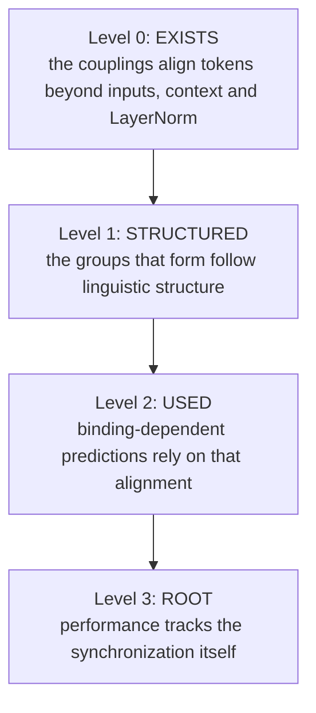

| level | claim | decided by | fails if |
| --- | --- | --- | --- |
| 0. exists | coupling-attributable alignment occurs | SY1 | no coupling, in no arm, produces a measurable gain |
| 1. structured | it follows linguistic structure | SY2 | no route beats the position, frequency, input and shuffled-label controls |
| 2. used | the model relies on it for binding | SY3 | targeted removal hurts no more than matched random removal |
| 3. root | performance follows synchronization | SY4, SY5 | performance and the order parameters come apart under scaling, or over-synchronization does not appear |

SY0 validates the instruments before any of these; SY6 asks what is specific to the Lagrangian framework.

---

## 3. Measurements

All measurements are per layer, on the states the model actually uses, from captured layer inputs and outputs.

### 3.1 Centred states

LayerNorm puts the states on a sphere and produces a shared direction at layer 0 (the D-sync transient). That shared direction would count as alignment between every pair of tokens, so it is removed first. For a sequence, with $\hat{h}\_t = h_t / \lVert h_t \rVert$ and $\bar{h}$ the mean of the $\hat{h}\_t$ over the sequence,

$$
x_t = \frac{\hat{h}_t - \bar{h}}{\lVert \hat{h}_t - \bar{h} \rVert}.
$$

### 3.2 Order parameters

- **Global coherence** $R$: the mean of $x_t^{\top} x_s$ over all pairs in the sequence.
- **Binding contrast** for a labelled grouping $\mathcal{G}$ (for example, coreference chains): the mean cosine of pairs in the same group minus the mean cosine of pairs in different groups **at the same token distance**:

$$
B(\mathcal{G}) = \mathbb{E}\big[x_t^{\top} x_s \mid t \sim s \big] - \mathbb{E}_{\mathrm{dist}}\big[x_t^{\top} x_s \mid t \not\sim s\big],
$$

  where the second expectation reweights unrelated pairs to the distance distribution of the related ones.
- **Co-movement contrast** $C(\mathcal{G})$: the same contrast on the layer's displacements $\delta_t = h_t^{\mathrm{out}} - h_t^{\mathrm{in}}$ (before LayerNorm), normalised. Proximity can be inherited; co-movement is what the layer does. It is the analogue of phase-locking: tokens in a group are moved together.

### 3.3 Coupling attribution

For a coupling $c$ (V_φ, the wells, or the Fock path), replay each captured layer step with $c$ switched off and the inputs unchanged, giving $h^{\mathrm{out},-c}$. The synchronization attributable to $c$ is

$$
\Delta_c B = B(h^{\mathrm{out}}) - B(h^{\mathrm{out},-c}),
$$

and likewise $\Delta_c R$ and $\Delta_c C$. The replay is the 6b-9 instrument: it reproduces the trained step bit for bit when nothing is switched off, which is its validity check.

**Revised before any model was measured** (SY0, §14). Switching a coupling off also removes its push shared by all tokens, which can make states look aligned without coupling them. The attribution actually used compares the trained step with a *common-mode reference*, in which the coupling's force is replaced by its average over the tokens, and the global measure $R$ was replaced by the pairwise contraction $S$ (definitions in §13).

### 3.4 Route-specific readouts

- **V_φ, pair by pair.** For each token $t$ and each of its selected sources $s$ (top 16), the pair's radial force

$$
a_{ts} = f_{ts}^{\top} \frac{h_s - h_t}{\lVert h_s - h_t \rVert}, \qquad f_{ts} = -\nabla_{h_t} V_\phi(h_t, h_s),
$$

  positive when the pair attracts. Two statistics per grouping: **attraction contrast**, the mean $a_{ts}$ over related pairs minus distance-matched unrelated selected pairs; and **selection enrichment**, the rate at which related sources are selected into the top 16 divided by the distance-matched rate for unrelated ones.
- **The wells.** Each token's force share over the 64 modes,

$$
s_{tv} = \frac{\lvert w_v \rvert \lVert r_v \rVert}{\sum_u \lvert w_u \rvert \lVert r_u \rVert},
$$

  with its dominant mode $m_t = \arg\max_v s_{tv}$. Statistics: the normalised mutual information between $m_t$ and a label, and the **co-assignment rate** of related pairs (same dominant mode) against distance-matched unrelated pairs. The occupation $\phi$ is the order parameter of a mode (clustering note §5.2).
- **Fock (G2).** The registers' creation weights: whether related tokens are written into the same register.

---

## 4. The tests

### SY0. Validate the instruments

On systems where the answer is known, before touching a model:

1. **Kuramoto oscillators** below and above the coupling threshold: $\Delta_c R$ must be near 0 below and clearly positive above.
2. **Causal attention with V = I** (Karagodin et al.'s setting): $B$ for planted groups must rise with depth when groups are coupled more strongly within than between.
3. **Similar inputs, no coupling:** tokens drawn from planted clusters but evolved without interaction. $\Delta_c B$ and $\Delta_c C$ must be 0, while the raw $B$ is large. This is the test that the instruments do not mistake similarity for synchronization.
4. **Common-mode drift:** a shared displacement added to every token. The centred measures must not respond.

If any check fails, the instrument is fixed before SY1.

### SY1. Does coupling-induced synchronization occur? (level 0)

$R$, $C$ and their coupling attributions, per layer and per arm (§6), for each coupling the arm has. Depth enters through the L = 4 Fock arm now, and through the L = 4 PMX-PARFLM baseline when it runs (it is queued as the damping pair's baseline).

### SY2. Does it follow linguistic structure? (level 1)

Groupings, from the annotation (§6): coreference chains; dependency head–dependent pairs and shared subtrees (constituents); named-entity spans; part-of-speech classes; and, as a mechanical reference, repeated tokens.

- $B$, $C$ and $\Delta_c B$ for each grouping, against the controls of §5.
- **V_φ pair test:** attraction contrast and selection enrichment for coreferent and head–dependent pairs. This is the most direct test of binding by attraction, and it needs no clustering step.
- **Wells:** NMI and co-assignment against the same groupings, compared with the same statistics computed from the layer's input states (the gain is what the dynamics adds).
- **Fock:** register co-membership against the groupings.

### SY3. Does the model use it? (level 2)

Targeted ablations at inference, extending `debug/coupling_dominance_ablation.py`.

- **V_φ, targeted:** remove the coupling only for related pairs among the selected ones (coreferent, head–dependent). **Matched random:** remove the same number of unrelated selected pairs with the same distance distribution.
- **Binding-dependent positions:** later mentions of a coreference chain, verbs whose subject is at least two tokens away, pronouns. Measure the loss change at these positions and at all others, for targeted and random removal.
- **Wells:** zero the modes most co-assigned to a grouping, against random modes of equal total force share.
- **Behaviour:** BLiMP minimal pairs (agreement and anaphora sets), the share of pairs where the grammatical sentence gets the higher probability, under each ablation. Only sets where the full model scores at least 60% are used (fixed before measurement; a set at chance cannot show a drop).

### SY4. Dose-response: does performance follow synchronization? (level 3)

Scale each coupling at inference by λ in {0, 0.25, 0.5, 0.75, 1, 1.25, 1.5}: V_φ's force, and the wells' depths. Track, at each λ: loss, $R$, $B$ for coreference and dependency, and the BLiMP scores. Below λ = 1, loss, coupling strength and $B$ all move together and cannot be told apart. The discriminating part is λ above 1: the coupling keeps growing, and "root" predicts that performance turns down as the tokens over-synchronize ($R$ rises).

Already known for the wells, without the order parameters: scaling PM1's trained wells by α = 0, 0.5, 0.75, 1 gave perplexity 122, 77, 60 and 54 (clustering note §7 item 4).

### SY5. Over-synchronization as the failure mode of extra depth

Gate 2 (extra layers at the trained step) is catastrophic in every arm: PMX goes from 53 to 562 in perplexity with one extra layer. The hypothesis is that extra time over-synchronizes the tokens. Measure $R$ and the effective rank of the final states along Gate 2's axis (N = 2, 3, 4). If the perplexity blow-up comes with $R$ rising and the effective rank falling, synchronization is load-bearing and has to be kept in balance, and Gate 2's failure is explained. If not, the failure has another cause.

### SY6. What is specific to the Lagrangian framework

- **The matched GPT-2**, under SY1 and SY2's state-level measures, with attention as the coupling (replayed off per layer). If attention shows the same picture, the phenomenon is generic to interacting-particle models of language, which is still a result, but not a property of this framework.
- **Conservative against non-conservative routes:** PMX against G2.
- **Fixed against emergent centres:** the wells' clusters cannot merge with depth; attention's eventually do. Whether this matters for binding is read from SY2 and SY4 across arms.

---

## 5. Confounds and controls

| confound | why it could fake a positive | control |
| --- | --- | --- |
| input similarity | same-category tokens have similar embeddings before any dynamics | coupling attribution Δ_c; gain from layer input to output |
| position | nearby tokens are both related and similar; causal attention pulls toward the first token | distance-matched contrasts; position-bin baseline |
| frequency | frequent tokens share directions | frequency-bin baseline |
| LayerNorm common mode | a shared direction aligns every pair | centred states (§3.1); SY0 check 4 |
| shared context ξ | the context is a causal, time-weighted average over earlier tokens that places V_θ's wells, so it couples tokens as a mean field (not Krause-type: Hegselmann–Krause weights depend on state similarity, ξ's only on time) | report the ξ contribution separately by replaying with ξ replaced (own-token and sequence-average versions). **Measured 2026-10-14:** ξ is not only a confound but the coupling that carries the noun-chunk binding (protocol §5.22, "The separating tests and the probe scored") |
| label noise | automatic annotation errs | shuffled-label control at the same group sizes; report against annotation confidence where available |
| subword tokens | labels are word-level | a word's label is given to all its BPE tokens; pairs within one word are excluded |
| model scale | L = 2 and 0.5B tokens may be too small for the effect | verdicts are scoped to these models; L = 4 arms read separately |

---

## 6. Arms, data and annotation

**Arms (existing checkpoints):**

| arm | couplings | role |
| --- | --- | --- |
| F3.1 | V_φ | V_φ alone, load-bearing (removal cost 0.28 nats) |
| SR2 | V_φ, marginal | V_φ nearly sidelined by the exact flow |
| PM1 | V_φ + wells (explicit) | the wells, explicitly integrated |
| PMX | V_φ + wells (exact) | the primary arm |
| G2 | V_φ + Fock | the non-conservative route |
| Fock, L = 4 | V_φ + Fock | depth |
| matched GPT-2 | attention | the transformer reference (SY6) |

**Data.** The validation split the ladder evaluates on, decoded back to text: 200 sequences of 512 tokens, about 100k tokens, drawn with a fixed seed.

**Annotation.**
- **Part of speech, dependencies, named entities:** spaCy (English pipeline), on the decoded text, aligned to BPE tokens by character offsets.
- **Coreference:** a neural coreference model (fastcoref or spaCy's experimental coref, whichever installs offline). If none is available, coreference is dropped and the verdicts rest on dependencies and constituents; this is fixed now.
- **BLiMP:** the agreement and anaphora sets (Warstadt et al. 2020), scored by summed log-probability.

Installing the annotation packages and downloading BLiMP needs the author's go-ahead.

---

## 7. Statistics

- **Unit:** the sequence. Confidence intervals by cluster bootstrap over sequences, 1,000 resamples, 95%.
- **Effect-size floor:** a contrast counts only if its interval excludes 0 **and** it exceeds 0.02 in cosine units (or 0.02 in NMI). Large samples make tiny effects significant; the floor keeps them from deciding a level.
- **Multiple comparisons:** the level verdicts use only the primary statistics named in the protocol (§5.22); everything else is reported as descriptive.
- **Replication:** a level counts only if it holds in PMX and in at least one other arm with the same coupling route.

---

## 8. Instruments to build

| script | does |
| --- | --- |
| `sy_instruments.py` | the measures of §3; SY0's toy systems and checks |
| `sy_annotate.py` | decoded text → POS, dependencies, entities, coreference, aligned to BPE tokens; cached |
| `sy_capture.py` | captured layer inputs and outputs, and replays with each coupling off or ξ frozen (from the 6b-9 replay) |
| `vphi_pair_attraction.py` | per-pair radial force, attraction contrast, selection enrichment |
| `sy_ablate.py` | targeted and matched-random pair removal; mode removal; loss at binding-dependent positions; BLiMP |
| `sy_dose.py` | SY4's λ sweep and SY5's Gate 2 axis, with the order parameters |

Every script follows the house rules: checks first (switches off reproduce the trained model bit for bit; replays reproduce captured steps), outputs written beside the script.

---

## 9. Order and cost

1. SY0, on toys: an hour of CPU.
2. Annotation of the 200 sequences: once, cached.
3. SY1 and SY2's V_φ pair test: the cheapest direct evidence.
4. SY2's wells and Fock readouts.
5. SY4, then SY3, then SY5.
6. SY6, and the L = 4 arms when available.

Everything except the L = 4 PMX-PARFLM arm runs on existing checkpoints on the CPU.

---

## 10. What each outcome would mean

| outcome | reading | for the book |
| --- | --- | --- |
| level 0 fails | the couplings do not synchronize tokens at these scales | the synchronization picture does not describe these models; clustering stays a property of the idealised attention flow |
| 0 holds, 1 fails | the couplings align tokens, but not along linguistic structure | synchronization is real but semantically blind |
| 1 holds, 2 fails | synchronization follows linguistic structure but the model does not rely on it | epiphenomenal: a signature of inference, not its mechanism |
| 2 holds, 3 fails | the model relies on synchronization for binding | load-bearing for binding, without performance tracking it as such |
| 3 holds | performance follows synchronization, and over-synchronization breaks it | synchronization is at the root of binding in these models, at this scale |

Each verdict is scoped to the trained models: L = 2 (and L = 4 where read), 532.5M tokens, a third of compute-optimal.

---

## 11. Priors from what is already measured

- **No collapse.** After layer 1 the mean pairwise cosine of token states is 0.19 in F3.1, SR2 and PM1; the shared direction at layer 0 is a transient (clustering note §6.2). At L = 2 any synchronization is partial.
- **The couplings carry weight.** Removing V_φ costs F3.1 0.28 nats and PM1 0.32; removing the wells costs PM1 0.77; removing the Fock channel costs G2 1.49 (protocol §5.20). Whatever they do, the models rely on it.
- **Mixed signs.** About half of PMX's well depths are positive and half negative: the wells attract toward some centres and repel from others, so a uniformly attractive picture is already ruled out.
- **A dose-response exists for the wells** (§4, SY4), without the order parameters that would interpret it.
- **Training budget.** Every model here is undertrained (book Remark 44). A weak result is weak for these models.

---

# Part II. Results

Measured 2026-10-13 to 2026-10-15. Every number below comes from the scripts in [`notebooks/conservative_arch/scaleup/sync/`](../notebooks/conservative_arch/scaleup/sync/), with the scoring recorded in the protocol (§5.22 and its scoring sections). The figures are made by [`figures/_make_sy_results_figs.py`](figures/_make_sy_results_figs.py) from the same outputs.

## 12. The results in one page

1. **The tools work, after two were replaced.** On toy systems where the answer is known, two of the measures planned in Part I failed, for reasons that are now understood. Their replacements recover synchronization where it exists and read zero where it does not (§14).
2. **The couplings do synchronize tokens, modestly.** The pair potential pulls tokens together a little. The Poisson wells pull them together strongly, but toward fixed points rather than toward each other. The Fock registers push them apart (§15). This is claim 1 of Part I, and it holds.
3. **None of the couplings the test was designed around groups related words.** The pair potential does not prefer to interact with coreferent words or with a word's syntactic head (§16). Claim 2, as pre-registered, fails: on those routes the models are *semantically blind*.
4. **But every model forms the same structure.** In all six, the words of a noun chunk ("the old wooden table") end up closer together, and a word ends up further from its syntactic head, than at the start (§17).
5. **The context field forms it.** The context is a fading average of the earlier words that sets where each word's own potential wells sit. Giving every word the same context removes the structure (§18).
6. **It is not a by-product of predicting the next word**, for noun chunks. The true next words of chunk members are no more alike than those of unrelated words, and the grouping survives removing everything that prediction similarity explains (§19).
7. **The synchronization is clustered, not global.** Each word's own context spreads the words apart overall while drawing the members of each noun chunk together (§20).
8. **Reference is not bound, in either family.** A probe cannot find a pronoun's antecedent better than "pick the nearest earlier mention", in our models or in the matched GPT-2. The one coreference signal found anywhere is the same word repeated, not reference (§21).
9. **Extra depth collapses the tokens.** Run past their trained depth, the models' tokens draw together or lose dimensions, and this accompanies every catastrophic failure. The first, milder degradation happens without it (§22).
10. **The constituent grouping is generic; its mechanism is not.** The matched GPT-2 groups noun-chunk words as strongly, and this too survives the prediction control. But in GPT-2 attention builds the grouping gradually in the middle layers, while in our models a mean field makes it at the last step (§23).
11. **An attention-shaped coupling does not bind either.** Two later models have an *exchange field*, a coupling shaped like attention. It moves and spreads the tokens and groups nothing. Their context field groups noun-chunk words more strongly than in any other model. Run past their trained depth, they collapse from the first extra step (§24).

## 13. Terms used in the results

The reader is assumed to know linear algebra and basic statistical mechanics, and nothing about language models.

- **Token.** A word or a piece of a word. A text of 512 tokens is the unit of analysis.
- **State.** Each token is represented by a vector of 384 numbers, its *state*. The model moves the states; the final states are read out to predict the next token.
- **Layer, or step.** The model moves the states in a fixed number of steps of an integrator for a second-order equation of motion (mass times acceleration equals force minus friction). Two steps in every model but one, which has four. The *embedding* is the state before the first step.
- **Normalisation.** At the end of every step each state is shifted and rescaled to a fixed mean and length. This matters below, because a push shared by all tokens can make normalised states look aligned.
- **The models.** Six were measured first; the two exchange-field models of Gen 3 were measured after them (§24). All are trained on the same 532.5 million tokens of web text, which is about a third of the compute-optimal amount for their size, so every result is about undertrained models.

| model | couplings it has | layers |
| --- | --- | --- |
| F3.1 | pair potential, context field | 2 |
| SR2 | pair potential (largely unused), context field | 2 |
| G2 | pair potential, Fock registers, context field | 2 |
| PM1 | pair potential, Poisson wells, context field | 2 |
| PMX | pair potential, Poisson wells (integrated exactly), context field | 2 |
| L = 4 | pair potential, Fock registers, context field | 4 |
| G3 | pair potential, Fock registers, exchange field, context field | 2 |
| G3′ | as G3, hardened (normalised queries and keys; the field's parameters in their own gradient-clipping group) | 2 |

- **Coupling.** Any term in a token's equation of motion through which another token's state acts on it: a term whose contribution to token i's force would change if the other tokens moved while token i stayed put (defined at first use in the Background). The six models measured first have four, each a separate term that can be switched off on its own; the two exchange-field models add a fifth, a conservative attention-shaped potential:
  - the **pair potential** V_φ: token i picks up to 16 earlier tokens and is attracted to or repelled from each;
  - the **Poisson wells**: shared attracting points whose depth for token i depends on how many earlier tokens fell into them;
  - the **Fock registers**: a memory written by earlier tokens that pushes token i;
  - the **exchange field** (G3 and G3′ only): a conservative potential shaped like attention. Its force on token i comes from attention-like scores between token i and the earlier tokens, and a learned gate sets its strength;
  - the **context field** ξ: a fading average of the earlier states, which decides where token i's own wells sit. It acts on every token as a *mean field* (each token responds to an aggregate of the others, not to any single one).
- **Replay.** Each step of the trained model is recomputed from its exact recorded input, once as trained (this reproduces the original to the last bit) and once with one coupling changed. The difference is what that coupling did.
- **Common-mode reference.** The replay in which a coupling's effect is replaced by its average over all tokens of the text. It keeps what the coupling does to every token alike and removes what it does differently to different tokens.
- **Synchronization**, as measured here, is what a coupling does differently to different tokens that brings them closer. A push shared by all tokens is not synchronization.
- **Contraction S.** The average, over all pairs of tokens, of the logarithm of how much closer the pair is with the coupling acting than in the common-mode reference:

$$
S = \Big\langle \ln \frac{\lVert h^{\mathrm{ref}}_{t} - h^{\mathrm{ref}}_{s} \rVert}{\lVert h_{t} - h_{s} \rVert} \Big\rangle_{t \neq s}.
$$

  S is positive when the coupling draws tokens together and negative when it spreads them apart. It is read before normalisation, and a push shared by all tokens leaves it unchanged. (In the models with Fock registers the step normalises twice, and S must be read before the first normalisation; §24 shows what goes wrong otherwise.)
- **Grouping.** A way of saying which pairs of tokens are *related*, from an automatic linguistic analysis of the text:
  - **coreference**: two mentions of the same entity ("Mary" and "she"; see *reference* below);
  - **head–dependent**: a word and the word it grammatically depends on ("keys" and "are" in "the keys to the cabinet are");
  - **noun chunk**: the words of one simple noun phrase ("the old wooden table");
  - **named entity**: the words of one name ("New York Times");
  - **part of speech**: two words of the same class (two nouns).
- **Syntax and reference.** The groupings are of two kinds. *Syntax* is how words combine into phrases: "the old wooden table" is one noun chunk whatever it denotes. *Reference* is what an expression stands for. Two expressions are **coreferent** when they pick out the same entity, as "Mary" and "she" do in "Mary said she would come". The earlier one is the **antecedent**, and all the mentions of one entity in a text form a **coreference chain**. Reference often crosses sentences and has no grammatical link to follow, so resolving it, above all **pronoun resolution** (deciding which earlier name a pronoun stands for), is the clearest case of binding that syntax does not supply.
  - *What was tested*: coreference chains found automatically by a coreference model (fastcoref) in 200 texts of 512 tokens, and, in the probe, pronoun resolution.
  - *What was not*: other parts of meaning, such as who did what to whom (semantic roles), word senses, or reference across texts. "Reference is not bound" below means precisely that the models do not link pronouns to the entities they refer to.
- **Binding contrast B.** The average cosine similarity of related pairs minus that of unrelated pairs. The states are first centred by subtracting their mean over the text, so a direction shared by all tokens does not count. Unrelated pairs are compared only at the **same token distance** as the related ones, because nearby tokens are both more often related and more often similar. Binding *made by a coupling* is the change in B between the trained step and the common-mode reference.
- **Shuffled control.** The same computation with the grouping's labels scrambled within each text. A real effect must vanish under it.
- **Threshold and interval.** An effect counts only if it is at least 0.02 (in cosine units) and its 95% interval excludes zero. The interval comes from resampling the 200 texts with replacement 1,000 times. The threshold keeps tiny but statistically certain effects from counting.
- **Replication.** A result counts only if it holds in PMX and in at least one other model with the same coupling.
- **Principal components.** The directions in which the states vary most across tokens. "The top 16 components" means the 16 most varied directions.
- **Probe.** A small model trained to read a piece of information out of the states. If it cannot, the information is not there in a readable form.
- **Effective rank.** How many dimensions the tokens of a text really occupy: the exponential of the entropy of the normalized squared singular values of the centred states. A collapse onto a few directions lowers it.
- **Extra-depth test.** The trained model run for more steps than it was trained for, at the same step size (in the protocol this is "Gate 2"). It is catastrophic in every model, and §22 asks whether over-synchronization is why.
- **Matched GPT-2.** A standard transformer with the same width (384), data, token budget and readout as our models, and 8 layers. In it, every influence of one token on another passes through **attention**, which is therefore its only coupling. It is replayed exactly like ours: as trained, switched off, and replaced by its token average.

## 14. The measuring tools, and why two were replaced

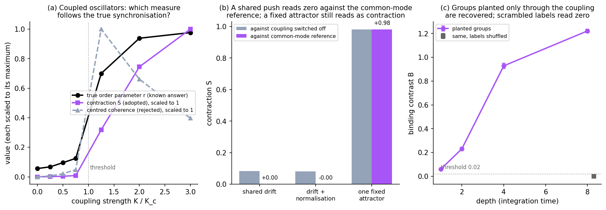

**Figure 1.** The measuring tools tested on systems whose answer is known, before any model was measured. (a) Coupled phase oscillators (the Kuramoto model) swept through their synchronization threshold. (b) Three systems in which tokens are pushed but do not interact. (c) An attention-like flow in which groups exist only through stronger coupling within them.

Part I planned to measure global synchronization with a *centred coherence*, the average cosine between states after subtracting their mean. Panel (a) shows why it was dropped. It rises at the threshold and then **falls** as the oscillators lock (grey dashed line), while the true order parameter rises to 0.98 (black). The reason is arithmetic. For vectors whose mean has been subtracted, the sum of all pairwise dot products equals minus the sum of their squared lengths, so the average cosine is pinned near −1/(N−1) once the spread becomes small. The contraction S (purple) follows the true order parameter all the way.

Part I also planned to attribute effects by switching a coupling off. Panel (b) shows the problem. A push applied equally to every token (a "drift") does not couple the tokens, yet against the switched-off step it reads as contraction (grey bars), because the push moves states into regions where the rest of the step contracts them, and because normalisation turns a shared push into apparent alignment. Against the common-mode reference the same push reads exactly zero (purple). The third pair of bars is a caveat that matters later: a single fixed attracting point, which pulls every token toward it without any interaction, still reads as strong contraction. The measure cannot tell "drawn toward each other" from "drawn toward the same fixed point".

Panel (c) is the positive control. Groups planted only through the coupling, with all tokens starting at random, are recovered and grow with depth to B = 1.22, while scrambled labels read 0.0009. A check of the binding contrast on clustered inputs with a group-blind coupling also confirmed that similarity of inputs alone is not read as binding. Three rounds of validation were needed, each recorded in the protocol (§5.22, "SY0 scored").

## 15. What each coupling does to the token set as a whole

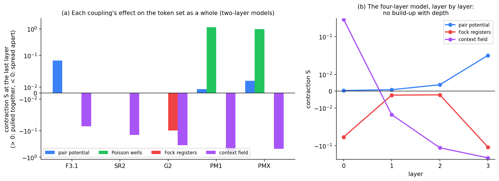

**Figure 2.** (a) The contraction S of each coupling at the last layer of the two-layer models, on a scale that is linear near zero and logarithmic beyond. (b) The four-layer model, layer by layer.

Four behaviours appear.

- **The pair potential draws tokens together a little**: S = +0.064 in F3.1, where it carries the most weight, and +0.021 in PMX. In SR2 it does essentially nothing, as an earlier experiment found.
- **The Poisson wells draw tokens together about fifty times more strongly** (S ≈ +1 in PMX and PM1). By the caveat of Figure 1(b) this is tokens converging on the wells' fixed centres, not on each other.
- **The Fock registers spread tokens apart** (S = −0.10 in G2).
- **The context field spreads tokens apart** in every model (S from −0.07 to −0.57). §20 explains what this means.

Panel (b) asks whether synchronization accumulates with depth, as it does in idealised attention, where the tokens eventually collapse. It does not. In the four-layer model the pair potential is nearly idle in the two middle layers and acts only at the last one. The Fock registers and the context field spread the tokens at both ends.

By the pre-registered rule (protocol §5.22), claim 1, that synchronization exists, holds. It holds on the pair potential alone, which is a genuine interaction between tokens.

## 16. The pair potential does not choose related tokens

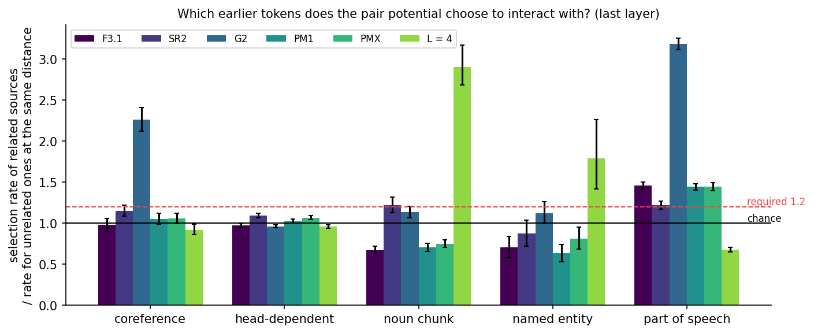

**Figure 3.** For each grouping, how often the pair potential picks a related earlier token among its 16, divided by how often it picks an unrelated one at the same distance. 1.0 is chance; the pre-registered requirement for "binding by attraction" was 1.2.

If synchronization were how these models bind meaning, the pair potential, the only direct token-to-token interaction, should interact preferentially with related words. For coreference and head–dependent pairs it does not: the ratio is 0.97 to 1.15 in PMX, PM1 and F3.1. It does pick words of the same part of speech more often (1.2 to 1.5). Among the words it does pick, the force toward coreferent ones has no consistent sign across layers, and the binding it produces on the states is at most 0.005 for every grouping in every model. Two exceptions do not change this. G2 picks coreferent words at 2.3 times chance, but its states do not move accordingly. The four-layer model picks noun-chunk members at 2.9 times chance at its last layer, but neither is a model in which the rule could call a replication.

## 17. A pattern every model forms

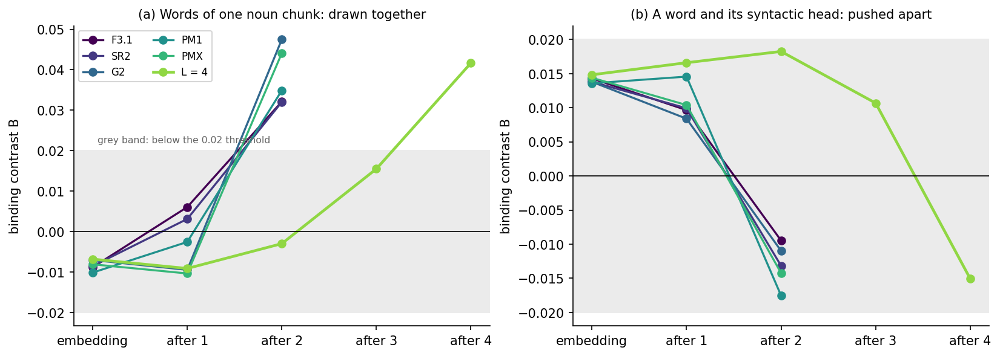

**Figure 4.** The binding contrast B of the states themselves, from the embedding to the last layer, in all six models. (a) Words of one noun chunk. (b) A word and its syntactic head. The grey band is below the threshold.

The states tell a different story from the couplings. All six models start from the same place, since they share the embedding: noun-chunk members slightly dissimilar (B ≈ −0.008), heads and dependents slightly similar (+0.014). All six end in the same place: **noun-chunk members clearly similar** (+0.032 to +0.047) and **heads further from their dependents** (−0.009 to −0.018). In the four-layer model almost all of it forms in the last layer.

This is a test of a prediction the framework made before these models existed. Prediction P2 of the book (§12 there) states that "tokens within a phrase should become more similar to each other across layers", the dynamical counterpart of the parts of a structure reaching a joint bound state. With distances matched, noun chunks do. The rise is strict in three models (F3.1, SR2, PM1); in the other three there is a small dip of about 0.002 after the first layer before the rise.

## 18. Which coupling forms it

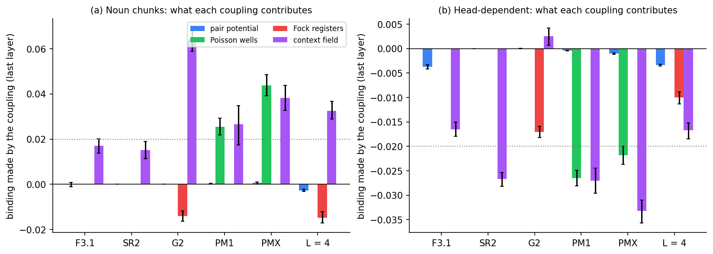

**Figure 5.** The binding made by each coupling at the last layer: the change in B when that coupling is replaced by its common-mode reference. (a) Noun chunks. (b) Head–dependent pairs. The dotted line is the threshold.

The pair potential (blue) contributes nothing. The Fock registers (red) work slightly *against* the pattern. Two couplings form it.

- **The context field (purple) forms it in every model.** Giving every token the sequence-average context, in place of its own, removes the noun-chunk binding (+0.038 in PMX, +0.027 in PM1, +0.064 in G2, +0.033 in the four-layer model; +0.017 and +0.015 in F3.1 and SR2, just under the threshold) and the head–dependent separation (−0.033 in PMX, −0.027 in PM1 and SR2).
- **The Poisson wells (green) form it too, where they exist** (+0.044 and +0.026 for noun chunks). Replacing either the wells or the context by its common-mode version removes the pattern while the other is left as trained, so the two act together. Whether the wells work through the context or alongside it is not separated.

This is the pre-registered follow-up test A (protocol §5.22), and it holds: in PMX, replicated in PM1, for both groupings.

## 19. It is not the geometry of prediction

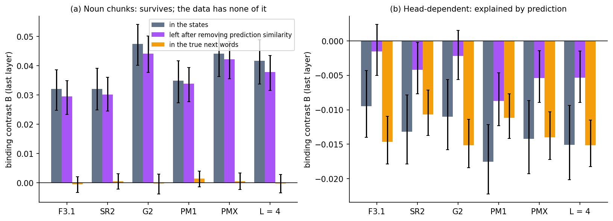

**Figure 6.** At the last layer: B in the states (grey), what remains of it after removing everything that the similarity of the model's predicted next-word distributions explains (purple), and B computed on the true next words (orange). (a) Noun chunks. (b) Head–dependent pairs.

The last layer's states are what the readout reads, and the readout is linear in them. Two tokens with similar likely continuations will therefore have similar states for that reason alone. A grouping could be nothing more than this. Two controls separate it from binding.

- **Do the true next words have the pattern?** For noun chunks, no: the contrast on the true next words is at most 0.0014 in magnitude, with every interval spanning zero (orange, panel a). The data's continuations do not group chunk members.
- **Does prediction similarity explain the states' pattern?** State similarity and prediction similarity are correlated (0.51 to 0.52 in every model), but after removing, text by text, the part of state similarity that prediction similarity explains, the noun-chunk binding remains at +0.029 to +0.044 in all six models (purple).

So **the noun-chunk grouping is made by the models, not inherited from what comes next.** Head–dependent pairs are the opposite case: there the residual falls below the threshold everywhere (panel b), and heads and dependents do have dissimilar continuations (−0.011 to −0.015). The separation of a word from its head is mostly a consequence of prediction. This is pre-registered follow-up test B, and its "prediction geometry" reading is contradicted for noun chunks.

## 20. Clustered, not global, synchronization

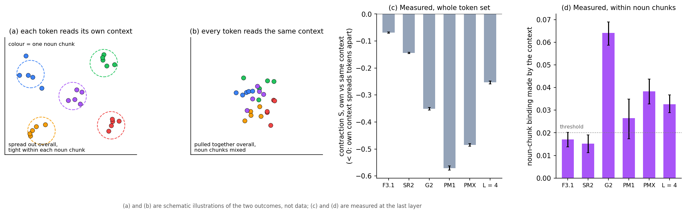

**Figure 7.** (a, b) Schematic illustrations, not data, of the two outcomes the context replay distinguishes. (c) Measured contraction of the whole token set: each token's own context against the same context for all. (d) Measured noun-chunk binding made by the context, at the last layer.

The context replay answers a second question at the same time. When every token reads the same context, the tokens end up much closer together overall; their own contexts spread them apart (panel c, S from −0.07 in F3.1 to −0.57 in PM1). Within that spreading, the members of each noun chunk are drawn together (panel d). Each word is individuated by its own context, and the words of one constituent share theirs.

This is **clustered synchronization**: the system breaks into groups that synchronize internally and stay distinct from one another, like oscillator networks that split into several synchronized clusters instead of locking to a single phase. Its relation to the Kuramoto model is close but not identical.

- **Same family.** In both, no unit responds to any other individually. Each responds to a collective quantity that all of them generate (here the context, there the mean phase), and that quantity is fed back. This self-consistent loop is what makes it synchronization rather than a shared external drive.
- **Indirect.** The Kuramoto mean field *pulls* each oscillator toward the mean phase. The context does not pull a token toward anything. It decides where the token's own potential wells sit, and the token settles into them. The closer physical analogy is cells that synchronize through a chemical they all secrete and all sense.
- **Local in time.** Kuramoto has one order parameter for all. Here each token's field is a fading average of *its own* past, so neighbouring tokens see nearly the same field and distant ones different fields.
- **Its clusters are syntactic constituents.**

The contrast with idealised attention is complete. There a pairwise attraction contracts all tokens onto a few clusters whose positions are set by one weight matrix, and the clusters eventually merge. Here the pairwise interaction does not group anything, and the grouping comes from a field that spreads tokens globally and groups them locally. It also matches the framework's own account of where binding should come from. The book's mean-field decomposition (Remark 34 there) splits the force on a particle into a one-body well, which is the averaged effect of all the others, and a pairwise correction for close encounters. The trained models follow that split more literally than expected: the averaged part binds constituents and the pairwise correction does not.

## 21. Coreference: what is and is not bound

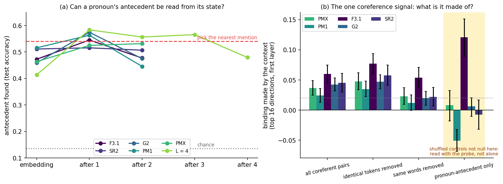

**Figure 8.** (a) A probe that scores each pronoun's candidate antecedents, trained on 150 texts and tested on 50: the fraction of pronouns whose antecedent it finds, against the fraction of each model's depth. The matched GPT-2 is in orange. The dashed red line is the accuracy of always choosing the nearest earlier mention (0.54); chance is 0.14. (b) The one coreference signal found in a restricted set of directions, broken down by which coreferent pairs are counted.

Binding by closeness is one way to bind. A transformer binds differently: attention copies information from the antecedent into the pronoun's state without making the two states alike. The probe in panel (a) tests for that kind of binding. It uses a learned bilinear score, which has the shape of one attention head. **No layer of the six models finds the antecedent more than four points better than choosing the nearest earlier mention** (for the two exchange-field models, see §24). The probe does best after the first layer and worse at the last, where the states are shaped for prediction. The antecedent is not recoverable as information.

The matched GPT-2 answers the obvious question, whether a transformer would do better. Somewhat, in the middle: its layers 2 to 4 reach 0.64, against at most 0.58 for any layer of our models. But its best layer is only 0.10 above the nearest-mention rule (interval −0.01 to +0.20), and its final states are *exactly* at that rule (0.54). By the same criterion it also fails. Both families show the same shape: antecedent information rises in the middle and is washed out where the states are shaped for prediction. At this budget, not binding reference is not a weakness of this framework in particular. With 48 test texts the intervals are about ±0.1, so a few points' difference between the families cannot be resolved.

A last possibility was that coreference binding exists but is hidden in a few directions, under each token's own identity, which dominates the whole-vector cosine. Recomputing the binding contrast in the 16 most varied directions does find one coreference signal, at the first layer, in five models (panel b, first group). Panel (b) shows what it is made of.

- **It does not depend on identical tokens**: removing pairs of the same token leaves it intact (second group).
- **It is the same word repeated.** GPT-2 spells one word with several token codes ("Zhang" at the start of a sentence and " Zhang" after a space; "Trump" and "Trump's"). Removing pairs of the same *word* reduces it to the level of a random set of 16 directions in four of the five models (third group). One model, F3.1, keeps a residual between different words that refer to the same entity; it does not replicate.
- **It is absent for pronoun–antecedent pairs** (fourth group). The shuffled controls of this group are biased in every model, so it cannot be read alone; it agrees with the probe.

So the signal is the identity of a repeated word, carried by the context field from each token's own state. It is not resolved reference.

## 22. Extra depth: when the tokens collapse

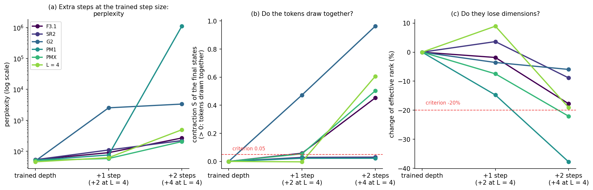

**Figure 9.** The trained models run for one and two steps beyond their trained depth (two and four for the four-layer model) at the trained step size. (a) Perplexity, on a logarithmic scale. (b) The contraction S of the final states against the trained depth. (c) The change of their effective rank. Dashed red lines: the pre-registered criteria.

Adding steps beyond the trained depth is catastrophic in every model, and the cause was unknown. The hypothesis of Part I (SY5) was that extra time over-synchronizes the tokens: they collapse together until the readout can no longer tell them apart. The test used the notebook's own extra-step code, so it is the same intervention whose cost was recorded before. At the trained depth it reproduces the trained model exactly.

- **One extra step.** The tokens draw together past the criterion (S ≥ 0.05) in PMX (+0.054), F3.1 (+0.058) and, dramatically, G2 (+0.47, with perplexity rising from 49 to 2,534). In PM1, SR2 and the four-layer model they do not, although perplexity still rises by 37% to 106%.
- **Two extra steps.** Every model that fails badly has collapsed. PMX, F3.1 and the four-layer model draw together strongly (S from +0.45 to +0.61). PM1, whose perplexity reaches a million, collapses differently: its tokens lose 38% of their effective dimensions while their distances barely change.
- **The constituent grouping keeps growing** through the extra steps (noun-chunk binding in PMX: +0.044, +0.051, +0.070). The clustered dynamics continue while the whole set contracts.

So the pre-registered call is a hit: extra depth does over-synchronize, in PMX and in two other models. But the picture is more specific than the hypothesis. Collapse accompanies the large failures, not the onset. The first, moderate degradation comes by some other route, and one step later the tokens are driven together. The evidence is co-occurrence across models and steps, not a causal test.

## 23. The matched transformer: what is generic and what is not

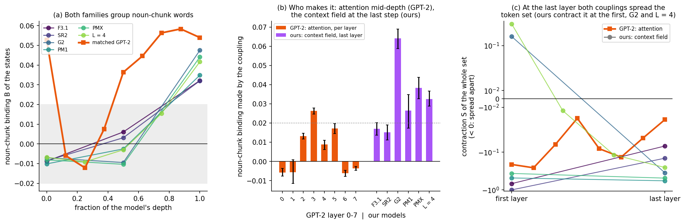

**Figure 10.** The matched GPT-2 (orange) beside our models, on a common axis of the fraction of each model's depth. (a) The noun-chunk binding of the states. (b) The noun-chunk binding made by the coupling: GPT-2's attention, layer by layer, and our context field at the last layer. (c) The contraction S of the whole token set by each coupling.

Everything above was measured on models built from this framework. The matched GPT-2 separates what is particular to them from what any language model trained on these data at this budget does. It was measured with the same tools, the same groupings and the same controls.

- **The grouping of constituents is generic** (panel a). GPT-2's final states put noun-chunk members closer together (+0.054) than any of our models do (+0.032 to +0.047). The grouping survives the prediction control there too: +0.050 remains after removing prediction similarity. Its head–dependent separation is, as in our models, explained by prediction.
- **The mechanism is not** (panel b). In GPT-2, attention builds the grouping gradually, from layer 2 to layer 5 (+0.026 at layer 3), and contributes nothing at the last layer. In our models the context field makes it in one go, at the last step. One more difference: GPT-2's *embedding* already groups noun-chunk words (+0.053); the grouping dips through the first two layers and attention then rebuilds it. Our models' embeddings start slightly negative.
- **Neither coupling collapses the token set** (panel c). At the last layer, GPT-2's attention and our context field both spread the tokens apart; attention does so at every layer. At this depth and budget the trained transformer is not in the collapsing regime of the idealized attention flow, as the literature on that flow's long-lived intermediate phase anticipates. Our context field contracts the tokens at the first layer in two models (G2, four layers) and spreads them at the last in all.
- **Neither binds reference.** Attention's coreference binding is at most +0.008 at any layer, and the probe fails (§21).

The pre-registered comparison asked whether GPT-2's attention makes at least as much binding at its last layer as the best coupling of any of our models, for coreference, head–dependent and noun chunks. It does not, for any of the three: 0.003, −0.002 and −0.004, against 0.029, 0.003 and 0.064. That is a statement about where the binding is made, not about how much the final states end up with.

## 24. The two exchange-field models

> **Corrected 2026-10-16.** G3′'s numbers in this section were re-measured after a bug in the local model loader, which had reset its exchange-field routing temperatures to their initial value. The values changed by small amounts and no conclusion changed (protocol §5.22, "G3′ re-measured after a loader bug").

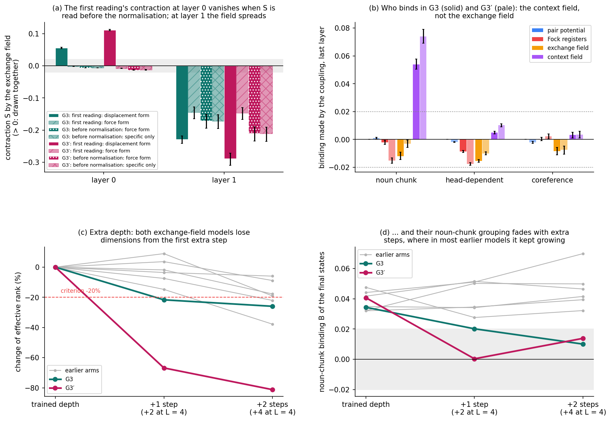

**Figure 11.** The two exchange-field models of Gen 3, G3 and its hardened version G3′. (a) The contraction made by the exchange field at each layer: as first read, between the step's two normalisations, against the two forms of the common-mode reference; and read before any normalisation, with the shared push removed first (force form) or last (specific only). (b) The binding made by each coupling at the last layer, G3 solid and G3′ pale; dotted lines are the threshold. (c, d) The extra-depth test: the change of effective rank, and the noun-chunk binding of the final states, with the six earlier models in grey.

After the six models above had been scored, every measurement was repeated on the two published Gen 3 models that have an **exchange field**: G3, and G3′, the same design hardened. Their coupling is the closest thing in this framework to attention: a conservative potential with attention's shape. They ask whether an attention-shaped coupling binds where the pair potential, the wells and the Fock registers do not. They were added after the pre-registered calls were scored, so they cannot change those calls. The exchange field was scored as a follow-up with the same criteria, and a result had to hold in both models.

- **It does not bind.** At neither layer does the exchange field make binding above the threshold for any grouping (panel b, orange). Its largest positive effect, on named entities in G3′, is +0.018, and its shuffled control is not null. Yet it is far from idle: switching it off changes the model's output substantially.
- **It does not draw tokens together either** (panel a). Getting this right took a test of its own, because the first reading said the opposite.
  - The common-mode reference can be built in two ways. The **force** form averages the coupling's force over the tokens and lets the rest of the step act on that average. The **displacement** form averages the change of state the coupling caused. For the contraction S, the displacement form reads the same as switching the coupling off, and Figure 1(b) showed that this counts a shared push.
  - At the first layer the two forms disagreed. By the displacement form the field drew tokens together (+0.056 in G3, +0.112 in G3′); by the force form it did nothing.
  - The reason is where S was read. In models with Fock registers each step normalises the states twice, once before the registers' push is added and once after, and S was read between the two. The exchange field's shared push is large: its common part moves every token by about a quarter of the tokens' spread. The first normalisation rescales each token separately, and that turns a shared shift into apparent alignment.
  - A toy check confirmed the danger in both directions. With a normalisation before the readout, a shared push reads as strong contraction under the displacement form. It can also inflate a genuine coupling's contraction 13 to 47 times under the force form. Read before the normalisation, the force form recovers the genuine coupling exactly.
  - Read before any normalisation, the exchange field contracts nothing at the first layer (−0.007 and −0.013, whether its shared push is removed first or last) and spreads the tokens at the second (−0.17, −0.21). Freezing the first normalisation removes the apparent contraction. So **claim 1 fails for the exchange field**, as claim 2 does. The pair potential carries almost no shared push, and its readings do not change.
- **The context field binds here more strongly than anywhere** (panel b, purple). Noun-chunk binding is +0.054 in G3 and +0.074 in G3′, against at most +0.064 in the six earlier models. It survives the prediction control as before (+0.031 and +0.037 remain), and the true next words again have no chunk structure.
- **The head–dependent separation moves to other couplings.** The context field no longer makes it, and pushes slightly the wrong way (+0.005, +0.010). The states still separate heads from dependents (−0.018, −0.015). In G3 the exchange field does it; in G3′ the Fock registers and the exchange field share it.
- **No reference binding.** The probe fails in both models: 0.475 and 0.482 at the last layer, against 0.54 for the nearest earlier mention. G3′'s first layer reaches 0.62, the highest of any of our models at any layer and close to GPT-2's middle layers (0.64). With 48 test texts, though, a margin of eight points is within the uncertainty. In the 16 dominant directions, G3′ shows the first-layer coreference signal of the earlier models. It is again the same word repeated, though narrowly: without same-word pairs it is +0.021, 0.018 above a random projection, where the rule needs 0.02. The pair potential again does not choose related sources (coreference 1.06–1.15 times chance).
- **Extra depth collapses them at once** (panels c, d).
  - One extra step raises perplexity from 50 to 1,025 in G3 and from 48 to 187 in G3′.
  - In both, the tokens draw together (S +0.31, +0.27) and lose dimensions (−22%, −67%). Unlike PM1, SR2 and the four-layer model, these failures come with collapse from the start.
  - Unlike most earlier models, their noun-chunk grouping fades with the extra steps instead of growing. In G3′ it is gone after one step.

The reading is short. At two layers, the attention-shaped conservative coupling behaves like the first layers of the matched GPT-2: it moves the tokens, spreads them, and binds nothing. Whatever these models group, they group through the context field, and more strongly than any other model does.

**The same field without the registers (added 2026-10-18).** A third model, XRB-F, has G3′'s exchange field and no register read: the conservative-only model F3.1 plus the field (protocol §5.25, "XR part B"). Every measurement above was repeated on it. These are descriptive; no SY call was fixed for this model.

- **It still draws nothing together.** Read before any normalisation, the field's specific part contracts nothing at the first layer (−0.011 by the force form, −0.007 specific only), and it spreads the tokens at the second (about −0.24).
- **Its shared push is six times larger.** Without the registers the field moves every token by 1.7 times the tokens' spread at the first layer and 3.2 times at the second (G3′: 0.28 and 0.71). That push does not move every token by exactly the same amount, and at this size the difference alone reads as contraction (+0.06 and +0.08) even before any normalisation. It is a common-mode effect, not synchronization by the field.
- **It now separates related words.** At the last layer it pushes the words of noun chunks apart (−0.046) and heads apart from their dependents (−0.029), both past the threshold. Beside the registers it did neither measurably. The context field still groups noun chunks (+0.049; +0.034 after the prediction control), and the two nearly cancel: the final states keep a chunk grouping of +0.038.
- **No reference binding.** The probe reads 0.534 at the last layer and 0.615 at the first, at the nearest-mention baseline within the test's uncertainty.
- **Extra depth collapses it,** as G3 and G3′: one extra step raises perplexity from 50 to 118, the tokens draw together (S +0.30) and lose 41% of their dimensions, and the chunk grouping turns negative.

So the field's failure to bind does not come from sharing the work with the registers. Alone, it takes on more of the model's work and pushes harder, but what it does to related words is to separate them.

## 25. The verdict against the pre-registered calls

| call | prediction | called at | result |
| --- | --- | ---: | --- |
| SY-L0 | synchronization exists (claim 1) | 75% | **hit** |
| SY-L1 | it follows linguistic structure on the designed routes (claim 2) | 45% | **miss** |
| SY-pair | the pair potential binds coreferent or head–dependent pairs | 50% | **miss** |
| SY-wells | the wells pass claim 2 and the pair potential does not | 25% | **miss** |
| SY-L2, SY-L3 | the models use it; it is at the root | 30%, 10% | cannot hold once claim 2 fails |
| SY-G2 | extra depth over-synchronizes | 35% | **hit** (PMX, F3.1, G2; §22) |
| SY-GPT2 | GPT-2's attention binds at least as much at its last layer | 60% | **miss**, 0 of 3 (§23) |

The four follow-up tests, each fixed in advance in the protocol, are not part of the pre-registered ladder and do not rescore it.

| follow-up | result |
| --- | --- |
| A: does the context field form the pattern? | **yes**, replicated (§18) |
| B: is the pattern the geometry of prediction? | **no** for noun chunks, **mostly yes** for head–dependent (§19) |
| decoding probe: is the antecedent recoverable? | **no**, in every model (§21) |
| binding in a subspace | only lexical identity, not reference (§21) |
| exchange field (G3 and G3′ both): claims 1 and 2 | **both fail**; the apparent contraction at the first layer was the normalisation acting on its shared push (§24) |
| exchange field without registers (XRB-F; descriptive) | claim 1 fails again; on related words the field now separates instead of doing nothing (§24) |

**The verdict, in plain terms.** On the couplings the test was designed around, the trained models synchronize tokens without grouping related words, so the pre-registered verdict is "semantically blind". They do group the words of syntactic constituents, through a coupling Part I had classed as a confound to control: the context field, a mean field that produces clustered synchronization. That grouping is generic, since the matched transformer forms it too, but the mechanism is particular to this framework: one mean field at the last step, where the transformer uses attention spread over its middle layers. The attention-shaped exchange field of the Gen 3 models does not change this: it binds nothing, and those models too bind constituents through the context field. Neither family binds reference at this budget. And running the models past their trained depth makes the tokens collapse together, which is how their catastrophic failures look, though not how they begin.

## 26. What remains open

- **What starts the extra-depth failure.** Collapse accompanies the catastrophic stage but not the first degradation (§22), so something else breaks first.
- **Why GPT-2's embedding already groups noun chunks** while ours does not, and whether this is why attention can build the grouping gradually.
- **A larger probe test set.** With 48 test texts the probe cannot resolve differences of a few points between the families. G3′'s first layer (0.62, §24) is the first case it should decide.
- **The readout point in the other measures.** S is now read before any normalisation. The binding contrast is read, by design, on the normalised states the next layer reads. For the couplings measured here the references agree on it, but a coupling with a large shared push could make it depend on the reference too.
- **Whether the wells act through the context or alongside it**, which needs a replay that changes both at once.
- **The Fock register readout** (are related tokens written into the same register?), which Part I planned and was not implemented.
- **Predictions P3 and P4 of the book**: clustering the last-layer states into constituency trees, and a per-phrase potential well.
- **A possible link to the context design.** A smooth, redundant bank of moving averages makes a better context than more informative orthogonal bases (book claim C7). A smooth, local-in-time field may be exactly what produces constituent clusters. That is a hypothesis, not a finding.
- **Scope.** Every result is for seven two-layer models (counting G3 and G3′) and one four-layer model at about a third of a compute-optimal budget. The effects are a few hundredths of a cosine: small, consistent across models, and controlled, but not large.

**References.** B. Geshkovski, C. Letrouit, Y. Polyanskiy, P. Rigollet, The emergence of clusters in self-attention dynamics, NeurIPS 36 (2023); A mathematical perspective on Transformers, arXiv:2312.10794. N. Karagodin, Y. Polyanskiy, P. Rigollet, Clustering in causal attention masking, arXiv:2411.04990 (2024). Y. Kuramoto, Chemical Oscillations, Waves, and Turbulence (1984). S. Strogatz, Sync (2003). A. Warstadt et al., BLiMP: The Benchmark of Linguistic Minimal Pairs for English, TACL 8 (2020).
