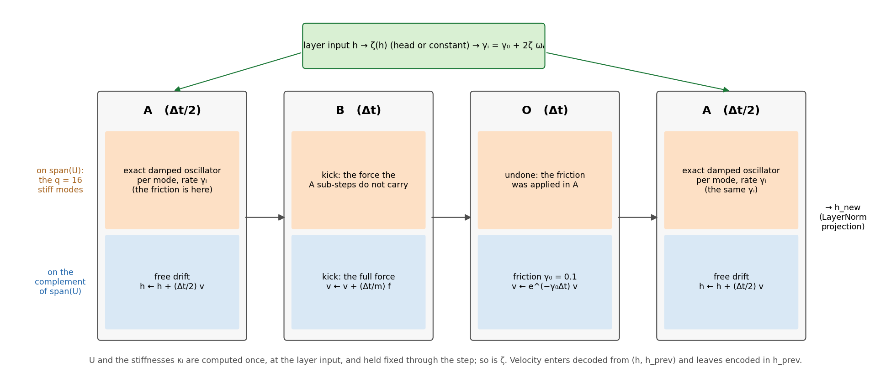
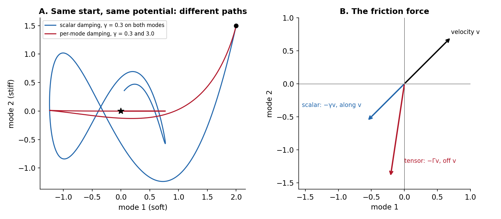
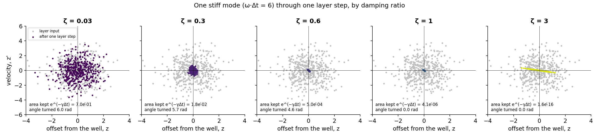
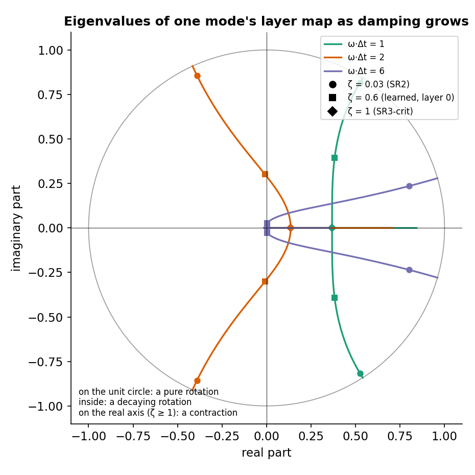
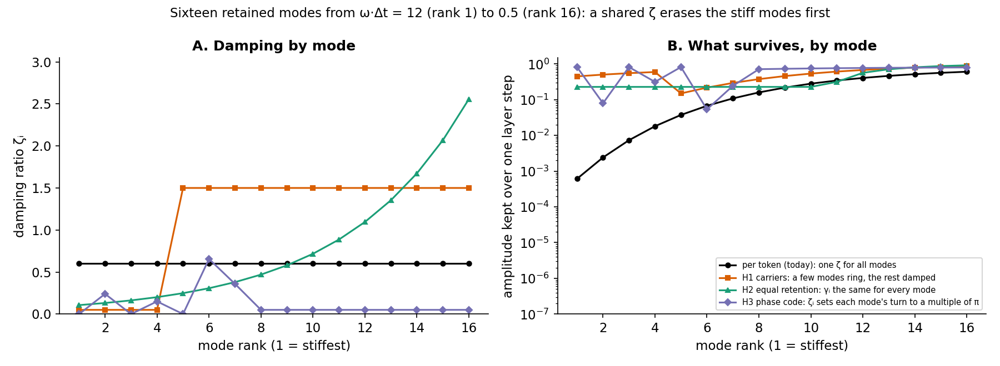
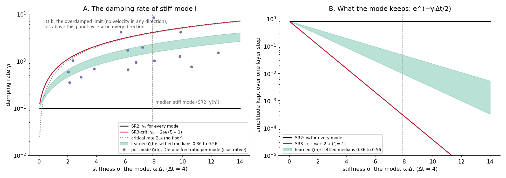
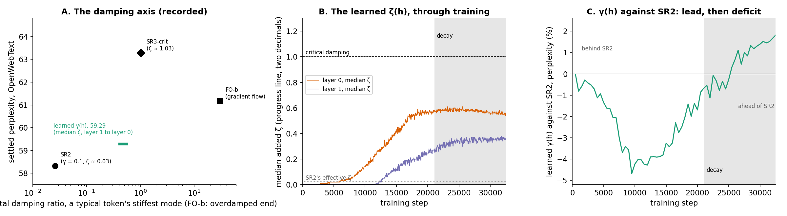
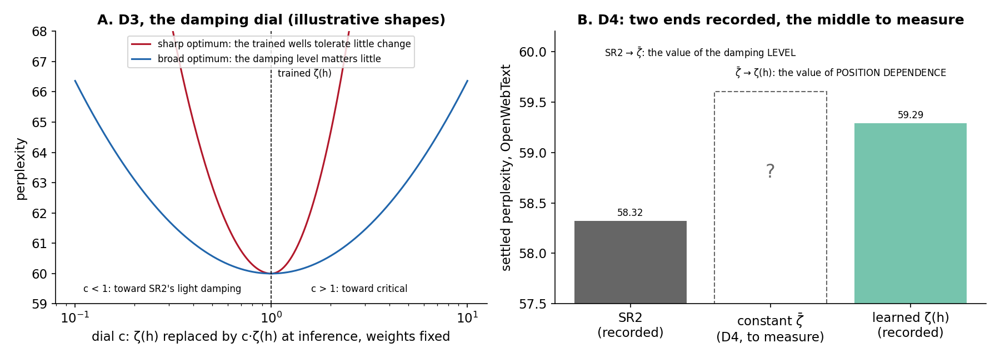
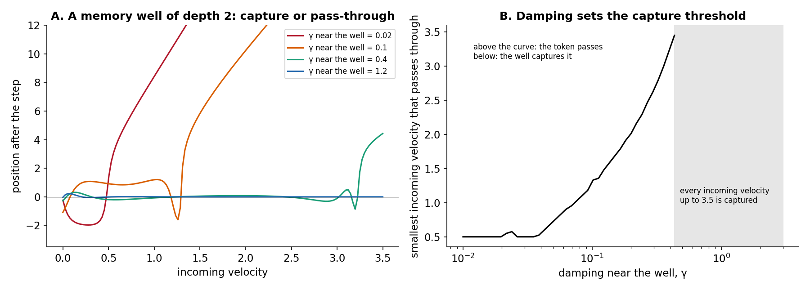

# Position-Dependent Damping in CfC/BAOAB Semantic-Simulation Models: Theory, Implementation and Results

**Technical Report** · version 1 · 2026-10-21 · Dimitar Gueorguiev, with Claude

> **Status.** The theory (§3), the parameterisations (§4) and the implementation (§5) are complete for the arms that have trained. The results (§6) cover four arms on OpenWebText, all settled. Slots marked **⟨pending⟩** wait for measurements that have not been run: the diagnostic cells on the learned arm, and the experiments D1–D7 (§7).
>
> **Scope.** Only the CfC/BAOAB models: the exact low-rank integrator of the Gen 3 ladder (SR2 and the arms built on it), PMX, and the Fock arms where they bear on damping. The Gen 1 models and their damped-velocity-Verlet integrator are out of scope; §1 says where that material lives.
>
> **Companion documents:**
> - **The earlier note, now historical:** [`Position_Dependent_Damping_and_Reinforcement_Field.md`](Position_Dependent_Damping_and_Reinforcement_Field.md)
> - **Pre-registrations and scores:** [`Depth_Ladder_and_Matched_Baseline_Protocol.md`](Depth_Ladder_and_Matched_Baseline_Protocol.md) §5.13
> - **The experiment queue (D1–D7):** [`Hyperparameter_Tuning_Checklist.md`](Hyperparameter_Tuning_Checklist.md)
> - **Why second order can pay:** [`Future_of_Semantic_Simulation_When_Second_Order_Earns_Its_Keep.md`](Future_of_Semantic_Simulation_When_Second_Order_Earns_Its_Keep.md)
> - **The wells integrated exactly:** [`Exact_Integration_of_Poisson_Mode_Wells_PMX.md`](Exact_Integration_of_Poisson_Mode_Wells_PMX.md)
> - **Code:** [`parf/cfc_baoab.py`](../notebooks/conservative_arch/parf/cfc_baoab.py), [`parf/model_parf_multixi.py`](../notebooks/conservative_arch/parf/model_parf_multixi.py)

**Abstract.** In a Semantic-Simulation language model each token's hidden state moves as a damped particle through a learned potential, one integration step per layer. The damping, how fast the particle's velocity is removed, has so far been one constant, $\gamma_0 = 0.1$. This report develops the theory of a damping that depends on the token's state, for the CfC/BAOAB integrator, in which the stiffest directions of the potential are integrated exactly. In that setting damping is naturally a *tensor*, one rate per direction, and three facts follow: it never adds energy; unlike a scalar damping, it supplies a force across the velocity, so it can bend a token's path; and its effect over one layer step is an exact linear map whose determinant and eigenvalues say how much of each direction a token keeps and how far it turns. Four arms on OpenWebText place the trained models on a damping axis: lightly damped stiff modes (SR2, perplexity 58.32) are best; a learned per-token damping ratio settles at 59.29; the overdamped limit at 61.16; critical damping at 63.28. What the second-order model gains from is the oscillation of its stiff modes, not inertia as such. The report sets out the parameterisations, the code that implements them and how it is verified, the results with their caveats, and the experiments that come next.

---

## Contents

1. [Scope, and how this report relates to the earlier note](#1-scope-and-how-this-report-relates-to-the-earlier-note)
2. [The layer step](#2-the-layer-step)
3. [Theory of position-dependent damping](#3-theory-of-position-dependent-damping)
4. [The family of parameterisations](#4-the-family-of-parameterisations)
5. [Implementation](#5-implementation)
6. [Results on OpenWebText](#6-results-on-openwebtext)
7. [The open programme, D1–D7](#7-the-open-programme-d1d7)
8. [Extensions: the Fock mechanism and the Poisson-mode wells](#8-extensions-the-fock-mechanism-and-the-poisson-mode-wells)
9. [Summary](#9-summary)
- [Appendix A. Proofs](#appendix-a-proofs)
- [Appendix B. Reproducing the figures and checks](#appendix-b-reproducing-the-figures-and-checks)

---

## 1. Scope, and how this report relates to the earlier note

The note `Position_Dependent_Damping_and_Reinforcement_Field.md` was written in August 2026 for the Gen 1 models. Their integrator, a damped velocity-Verlet step, mixes the friction into the force coefficients, and most of that note is about consequences of that choice: a training-time gradient cascade that a position-dependent damping could worsen, the calibration of a single $\gamma$ against two regimes of model width, and a geodesic diagnostic whose reading was later withdrawn. Its §11 and §12 (October 2026) began the CfC/BAOAB story on top of that material.

This report starts again from the CfC/BAOAB step. Three properties of that step change the problem:

1. **Friction is exact.** It enters as the exact solution of the damped motion, not as a first-order factor, so a damping of any size is stable.
2. **The stiff directions are integrated in closed form.** SR2 computes, for every token at every layer, the stiffest directions of the potential and moves the token along them by the exact solution of a damped oscillator. Damping can therefore be set **per direction** at no extra cost.
3. **The cascade is gone.** The exact step removes the backward instability that made the Gen 1 discussion about stability; damping here is about what the model computes, not about whether it trains.

The earlier note is kept unchanged as the record that the protocol's pre-registrations cite. Where this report supersedes it, it says so.

---

## 2. The layer step

### 2.1 The hidden state as a particle

Each token carries a hidden state $h \in \mathbb{R}^{d}$, a vector of $d = 384$ numbers, and a velocity $v$ of the same size. The token has a mass $m$, which depends on the token (rarer tokens are heavier; the mass is learned from the token's log-frequency). The model defines a potential energy $V(h)$, the sum of a learned landscape $V_{\theta}$ (wells conditioned on the context) and a pair interaction $V_{\phi}$ between tokens; the force on the token is $f = -\nabla V$. Each layer advances every token by one step of length $\Delta t$ of the damped equation of motion

$$
m \ddot{h} = f(h) - m \Gamma(h) \dot{h} ,
$$

where $\Gamma(h)$ is the **friction**. In all deployed models $\Gamma = \gamma_0 I$, the same rate $\gamma_0 = 0.1$ in every direction. The Gen 3 ladder model of this report has $L = 2$ layers over a fixed integration time $T = 8$, so $\Delta t = T / L = 4$.

### 2.2 Friction as a dissipation function

In the Lagrangian framework friction is introduced by a Rayleigh dissipation function, a quadratic form in the velocity whose gradient is the friction force:

$$
\mathcal{R}(h, \dot{h}) = \tfrac{1}{2} m \dot{h}^{\top} \Gamma(h) \dot{h} , \qquad F_{\text{friction}} = -\frac{\partial \mathcal{R}}{\partial \dot{h}} = -m \Gamma(h) \dot{h} .
$$

$\Gamma(h)$ must be symmetric and non-negative for $\mathcal{R}$ to be a dissipation (§3.1). Everything in this report is a choice of $\Gamma(h)$.

### 2.3 The BAOAB step and where friction enters

The CfC/BAOAB integrator splits each layer step into four parts, each solved exactly or nearly so. In the low-rank variant used by every arm here (`integrator = 'baoab_cfc_lowrank'`):

- **A**, over $\Delta t / 2$: move the token. On the stiff directions the motion is the exact solution of the damped oscillator under the local quadratic part of $V_{\theta}$; on all other directions it is a free drift, $h \leftarrow h + \tfrac{1}{2} \Delta t v$.
- **B**, over $\Delta t$: a kick, $v \leftarrow v + (\Delta t / m) \tilde{f}$, with $\tilde{f}$ the force evaluated at the midpoint minus the part the A sub-steps already carried.
- **O**, over $\Delta t$: friction on the velocity, $v \leftarrow e^{-\gamma_0 \Delta t} v$ (plus noise when a temperature is set; every arm here runs at zero temperature).
- **A**, over $\Delta t / 2$: move again, as in the first A.



*The A-B-O-A step of SR2. Orange: the q = 16 stiff modes, whose friction is integrated inside the exact flow of the two A sub-steps (the O-step is undone there). Blue: every other direction, which drifts freely in A and is damped at γ₀ in O. Green: the position-dependent damping of this report sets the rate γᵢ of each stiff mode from the layer input, once per step.*

### 2.4 SR2: the stiff modes integrated exactly

At the layer input, $V_{\theta}$ is approximated by a quadratic in $h$. Its curvature (the Hessian) is a symmetric matrix; SR2 keeps its $q = 16$ largest eigenpairs. The eigenvectors $u_i$ form the columns of an orthonormal $d \times q$ matrix $U$, the **retained stiff modes**; the eigenvalues $\kappa_i$ are their **stiffnesses**. Along mode $i$ the token's coordinate is $z_i = u_i^{\top} h$, and the linearised motion is a damped oscillator:

$$
\ddot{z_i} + \gamma_i \dot{z_i} + \omega_i^2 z_i = a_i , \qquad \omega_i = \sqrt{\kappa_i / m} ,
$$

with $\omega_i$ the mode's natural frequency and $a_i$ the projection of the remaining force divided by the mass. SR2 solves this equation exactly over each A sub-step, with $\gamma_i = \gamma_0$ for every mode, and removes the O-step's friction from $\mathrm{span}(U)$ so that the modes are not damped twice. The frozen quadratic, $U$ and the $\kappa_i$, is computed once per step, at the layer input.

The trained SR2 has stiff wells: its median stiff mode has $\omega \Delta t \approx 7.55$, more than one full oscillation per layer step, which an explicit step could not integrate stably. At $\gamma_0 = 0.1$ such a mode is lightly damped (§3.5).

### 2.5 Notation

| symbol | meaning |
| --- | --- |
| h, v | hidden state and velocity of one token, d = 384 numbers each |
| m | the token's mass (learned, from its log-frequency) |
| V, f | potential energy and force, f = −∇V |
| Δt, L, T | layer step (4), number of layers (2), integration time T = LΔt (8) |
| U, uᵢ | the q = 16 retained stiff modes, orthonormal |
| κᵢ, ωᵢ | stiffness of mode i, and its frequency ωᵢ = √(κᵢ/m) |
| span(U), P⊥ | the subspace of the retained modes, and the projector onto its complement |
| γ₀ | the base damping rate, 0.1, on every direction |
| γᵢ | the damping rate of stiff mode i |
| Γ(h) | the friction tensor, Σᵢ γᵢ uᵢuᵢᵀ + γ₀ P⊥ |
| ζ, ζ(h) | the **added** damping ratio: γᵢ = γ₀ + 2ζωᵢ |
| ζᵢ^tot | the **total** damping ratio of mode i, γᵢ / (2ωᵢ) = ζ + γ₀/(2ωᵢ) |
| ζ₀, ζ_max | the learned head's starting ratio (0.005) and cap (10) |
| s(h) | the learned head's output, ζ(h) = ζ₀ e^s(h) |
| μ | the mobility of the first-order arm FO-b, Δt/(2m) |

---

## 3. Theory of position-dependent damping

### 3.1 The friction tensor

A position-dependent damping replaces $\gamma_0 I$ by a symmetric, non-negative matrix $\Gamma(h)$. For every damping in this report $\Gamma$ is diagonal in the retained-mode basis:

$$
\Gamma(h) = \sum_{i=1}^{q} \gamma_i(h) u_i u_i^{\top} + \gamma_0 P_{\perp} , \qquad \gamma_i(h) \ge \gamma_0 \ge 0 .
$$

**It never adds energy.** With the total energy $E = \tfrac{1}{2} m v^{\top} v + V(h)$, the equation of motion gives

$$
\frac{dE}{dt} = m v^{\top} \dot{v} + \nabla V^{\top} v = -m v^{\top} \Gamma(h) v \le 0 ,
$$

because $\Gamma$ is non-negative. The conservative force is untouched: a position-dependent damping changes how energy leaves, never the landscape.

### 3.2 A scalar damping throttles; a damping tensor steers

The earlier note's correction of 2026-09-27 states that damping is *tangential*: the friction force $-\gamma(h) v$ is parallel to the velocity. Paper v6 (§8.6) makes the statement precise. A scalar damping adds no force across the velocity. It changes a token's path only indirectly, because a slower token is bent more sharply by the same transverse force of the potential: the path's curvature is $\lVert f_{\perp} \rVert / (m \lVert v \rVert^{2})$, with $f_{\perp}$ the part of the force across the velocity. A scalar $\gamma(h)$ is a throttle that also changes how corners are taken, not a steering wheel.

That limit holds for a scalar only.

**Proposition 1 (a damping tensor steers).** For a symmetric $\Gamma$, the friction force $-\Gamma v$ is parallel to $v$ for every velocity $v$ if and only if $\Gamma = \gamma I$ for some scalar $\gamma$. Otherwise there are velocities for which the friction has a component across $v$, of size

$$
\Big\lVert \Gamma v - \frac{v^{\top} \Gamma v}{v^{\top} v} v \Big\rVert ,
$$

and that component bends the path directly. (Proof in Appendix A.)



*A. The same start in the same two-mode potential, damped by a scalar (blue) and by a tensor that damps the stiff mode ten times harder (red): the paths differ, not only the speeds. B. For one velocity, the scalar friction points straight back along it; the tensor's does not.*

Two consequences. Every arm in this report except SR2 already steers, because its rates differ between modes (through $\omega_i$), in a direction fixed by the stiffness spectrum. A damping whose per-mode rates are *learned* (§4.4) makes the steering direction learnable: damping becomes a control channel, while the dissipation stays non-negative and the conservative force stays exactly as it was.

### 3.3 What a damped mode does in one layer step

Over a time $t$, the exact solution of the mode equation is linear in the mode's state at the start. Write $\omega_d$ for the damped frequency, defined when $\omega_i \gt \gamma_i / 2$ (otherwise the cosines below become hyperbolic cosines), and

$$
\omega_d = \sqrt{\omega_i^2 - \gamma_i^2 / 4} , \qquad C = \cos(\omega_d t) , \qquad S = \frac{\sin(\omega_d t)}{\omega_d} , \qquad e = e^{-\gamma_i t / 2} .
$$

Then the displacement $z$ and the velocity $w$ of the mode, measured from the start, evolve as

$$
\begin{pmatrix} z(t) \cr w(t) \end{pmatrix} = \begin{pmatrix} e (C + \tfrac{1}{2} \gamma_i S) & e S \cr -\omega_i^2 e S & e (C - \tfrac{1}{2} \gamma_i S) \end{pmatrix} \begin{pmatrix} z(0) \cr w(0) \end{pmatrix} + \begin{pmatrix} Q \cr P \end{pmatrix} a_i ,
$$

with $P = eS$ the velocity response and $Q$ the position response to a constant force,

$$
Q = \frac{1 - e (C + \tfrac{1}{2} \gamma_i S)}{\omega_i^2} .
$$

These are the coefficients `damped_mode_coefficients` returns (§5.2). Two numbers describe the homogeneous map completely.

- **The determinant** of the map is $e^{-\gamma_i t}$: the factor by which it scales area in the mode's phase plane. Area in phase space is the room the model has to keep tokens apart along that mode: area lost is distinctions between tokens merged.
- **The eigenvalues** are $e^{(-\gamma_i / 2 \pm i \omega_d) t}$. For a total ratio below 1 they are a complex pair. Their modulus is the **amplitude kept**, their argument the **angle turned**.

Over a layer step the friction of the stiff modes acts for the two A sub-steps, $\Delta t$ in all, so with the total ratio $\zeta_i^{\mathrm{tot}}$ of §3.5

$$
\text{amplitude kept} = e^{-\gamma_i \Delta t / 2} = e^{-\zeta_i^{\mathrm{tot}} \omega_i \Delta t} , \qquad \text{angle turned} = \omega_i \Delta t \sqrt{1 - (\zeta_i^{\mathrm{tot}})^2} .
$$



*Five hundred states of one stiff mode (ωΔt = 6) through one layer step. At SR2's damping the cloud rotates and keeps most of its area; at ζ = 0.3 it rotates and shrinks; at 0.6 and above it collapses toward the well; at ζ = 3 it is squeezed onto a line, the slow overdamped direction.*



*The two eigenvalues of one mode's layer map as ζ grows from 0 to 3, for three stiffnesses. On the unit circle the map is a rotation; inside it a decaying rotation; once the pair meets the real axis (critical damping) it is a contraction with no rotation at all.*

This picture is the measured order of the damping arms (§6): SR2's stiff modes sit near the unit circle, rotations that keep distinctions; critically damped modes sit on the real axis, contractions that merge them, as a gradient flow does.

### 3.4 Freezing the damping over a step

Every damping in this report is computed once per layer step, from the step's input, and held fixed through both A sub-steps, as $U$ and the $\kappa_i$ are. Within a step each stiff mode is then an oscillator with constant coefficients, and the map of §3.3 is its exact solution: the step adds no splitting error of its own on $\mathrm{span}(U)$, whatever the damping. Freezing is the same approximation the integrator already makes for the stiffness; a damping that changed inside the step would need either a finer split or a numerical solve.

### 3.5 The damping ratio, critical damping and the overdamped limit

The **damping ratio** of a mode measures its damping rate against its own frequency:

$$
\zeta_i^{\mathrm{tot}} = \frac{\gamma_i}{2 \omega_i} .
$$

- Below 1 the mode oscillates as it settles (underdamped).
- At 1 it settles as fast as it can without overshooting (critical).
- Above 1 it creeps toward the well without oscillating (overdamped).

SR2's median stiff mode, at $\omega \Delta t \approx 7.55$ (so $\omega \approx 1.89$) and $\gamma_0 = 0.1$, has a total ratio of $0.1 / (2 \times 1.89) \approx 0.026$: very lightly damped, more than one oscillation per layer step, keeping $e^{-0.2} \approx 0.82$ of its amplitude.

As the damping grows without bound, the second-order motion tends to a **gradient flow**, in which the velocity is always the force times a mobility. The arm FO-b implements that limit directly:

$$
\frac{dh}{dt} = \mu f(h) , \qquad \mu = \frac{\Delta t}{2m} ,
$$

with $\mu$ chosen so that one step of length $\Delta t$ from rest moves the token by $\mu \Delta t f = \Delta t^{2} f / (2m)$, the displacement a second-order step from rest makes. FO-b carries no velocity in **any** direction, not only on the stiff modes; it is the end of the damping axis, reached by a different route.

### 3.6 A shared ratio couples erasure to stiffness

When one ratio $\zeta$ is shared by all modes of a token (as in SR3-crit and the learned per-token arm, §4.2–§4.3), the amplitude a mode keeps, $e^{-\zeta_i^{\mathrm{tot}} \omega_i \Delta t}$, falls exponentially with its stiffness. At the learned arm's layer-0 ratio of 0.56, a mode at $\omega \Delta t \approx 7.9$ keeps about 1% of its amplitude through a step, while a soft mode at $\omega \Delta t = 1$ keeps about 45%. A shared ratio cannot keep a stiff mode ringing while damping a soft one: it ties how much a mode is erased to how stiff it is.



*Sixteen retained modes from ωΔt = 12 (rank 1, the stiffest) to 0.5 (rank 16). Black: one ratio, ζ = 0.6, for every mode; the stiffest modes keep less than 0.1% of their amplitude. Coloured: three hypotheses for what a per-mode damping would learn (§7.2).*

A per-mode ratio (§4.4) removes the tie.

---

## 4. The family of parameterisations

Every parameterisation of this report sets the rate of stiff mode $i$ as the base rate plus an added ratio times twice the mode's frequency, and leaves every other direction at $\gamma_0$:

$$
\gamma_i(h) = \gamma_0 + 2 \zeta_i(h) \omega_i .
$$

They differ only in what sets the added ratio.

| arm | added ratio of mode i | what is learned | extra parameters | status |
| --- | --- | --- | --- | --- |
| SR2 | 0 | nothing | 0 | trained: 58.32 |
| SR3-crit | 1, every token and mode | nothing | 0 | trained: 63.28 |
| learned γ(h) | ζ(h), one per token and layer | a damping head | 24,705 | trained: 59.29 |
| constant ζ̄ (D4) | 0.46, every token and mode | nothing | 0 | to run |
| per-mode ζᵢ(h) (D5) | one per token, layer and mode | a damping head with q outputs | about 25,700 | designed |
| FO-b | the overdamped limit, every direction | nothing | 0 | trained: 61.16 |



*A. The damping rate of a stiff mode against its stiffness, for each parameterisation (the learned arm as the band between its two layers' settled medians; the per-mode points are illustrative). B. The amplitude the mode keeps through one layer step. SR2 keeps about 82% of every mode; critical damping keeps 0.03% of the median stiff mode; the learned arm keeps 1–5%.*

### 4.1 The constant base (SR2)

The rate is $\gamma_i = \gamma_0 = 0.1$ for every mode and token. $\Gamma = \gamma_0 I$ is a multiple of the identity, so SR2's friction does not steer. It is the base every other arm is built on and compared against.

### 4.2 A fixed curvature-keyed ratio (SR3-crit, and the constant control)

The added ratio $\zeta$ is a constant: every stiff mode of every token is damped at $\gamma_0 + 2 \zeta \omega_i$. At $\zeta = 1$ (SR3-crit) the added rate alone is critical, and the total ratio of the median stiff mode is $1 + 0.026 \approx 1.03$, slightly above critical. The book's constant-ratio family (paper v6, §8.8, eq. (97)) sets the *total* ratio to a target instead, absorbing the base rate; the two agree up to the share of $\gamma_0$, which is small on stiff modes. The form keys the damping to the curvature, as the earlier note's potential-derived proposal intended, but through each mode's frequency rather than through the value of $V_{\theta}$. The constant control D4 is this form at $\zeta = 0.46$ (§7).

### 4.3 A learned per-token ratio (the learned γ(h) arm)

A small network, the **damping head**, maps the token's state at the start of the layer step to one number $s(h)$:

- a linear map from the $d = 384$ coordinates of $h$ to 64 hidden units;
- the GELU nonlinearity;
- a linear map from the 64 hidden units to one output;

24,705 parameters in all. The ratio is

$$
\zeta(h) = \zeta_0 \exp\Big(\min\big\lbrace s(h), \ln(\zeta_{\max} / \zeta_0) \big\rbrace\Big) , \qquad \zeta_0 = 0.005 , \quad \zeta_{\max} = 10 .
$$

- **The start.** The head's last layer is initialised to zero, so $s = 0$ and $\zeta = \zeta_0$ for every token: a total ratio of about 0.031 on SR2's median stiff mode, against SR2's 0.026. The arm starts, in effect, as SR2.
- **The bounds.** The exponential keeps $\zeta$ positive, so the damping never falls below SR2's; the cap keeps it at most 10. The log parameterisation moves $\zeta$ multiplicatively in both directions: with Adam, $\ln \zeta$ moves by about the learning rate per step, so critical damping is a few thousand steps away where the loss favours it.
- **One head for both layers.** The same head is applied at every layer. The two layers' ratios differ only because their input states differ.
- **The frequency in this term.** It is $\omega_i = \sqrt{\kappa_i / m}$ with the mass's gradient stopped, so the head cannot train the mass through the damping. A retained mode with negative stiffness (an unstable direction) has no frequency; $\omega_i$ is set to 0 there, and the mode keeps $\gamma_0$.
- **Training.** The gradient of the loss reaches the head through $\gamma_i$. The head's parameters form their own clipping group, with gradient-norm bound 0.3.

**Relation to the earlier note's proposals.** The earlier note (§4.2) proposed a learned MLP that outputs a damping *rate* bounded by a sigmoid between two fixed rates, applied to every direction. The learned arm differs in three ways: it outputs a *ratio*; the stiffness spectrum, not the network, spreads it over the modes, so the friction is a tensor and steers (§3.2); and it acts inside the exact flow of the A sub-steps, not in the O-step where the earlier note placed it.

### 4.4 A learned per-mode ratio (D5, designed)

The head outputs one ratio per retained mode, $\zeta_i(h)$ for $i = 1, \dots, q$. The modes are indexed by stiffness rank: the eigensolve returns them in descending stiffness, so rank 1 is the stiffest mode of every token, and a fixed output index means the same thing across tokens. The log parameterisation, start (0.005) and cap (10) are those of §4.3. At initialisation the arm equals SR3's form at the fixed ratio 0.005, which the verification checks bit for bit, as for the per-token arm.

The per-mode head removes the coupling of §3.6 and makes the steering direction of §3.2 learnable. What it learns scores the hypotheses H1–H3 of §7.2.

### 4.5 The overdamped end (FO-b)

FO-b replaces the second-order step by an A-B-A step of the gradient flow. Over each half step the stiff modes relax exactly toward the bottom $z_i^{\star}$ of their quadratic,

$$
z_i \leftarrow z_i^{\star} + e^{-\mu \kappa_i t} (z_i - z_i^{\star}) ,
$$

and the remaining force is applied as one gradient step of size $\mu \Delta t$ at the midpoint. No velocity is carried into the next layer. It is not a parameterisation of $\Gamma$; it is the limit every $\Gamma$ tends to as all its rates grow, and it anchors the overdamped end of the damping axis (§6.2).

---

## 5. Implementation

### 5.1 Switches and run tags

All arms are switched from Cell 0 of the ladder notebook `colab_fock_cfc_baoab_lowrank_depth_ladder_openwebtext_d384.ipynb`, on SR2's settings (`LOWRANK_DAMPED_FLOW = True`, `LOWRANK_MAX_MODES = 16`, `FIXED_GAMMA = 0.10`, `LADDER_L = 2`, `LADDER_T = 8.0`).

| arm | Cell 0 | config field | run tag |
| --- | --- | --- | --- |
| SR2 | `LOWRANK_DAMPED_FLOW = True` | `lowrank_damped_flow` | `…_sr2_…` |
| SR3-crit | `STIFF_MODE_DAMPING_RATIO = 1.0` | `stiff_mode_damping_ratio` | `…_sr2_sr3_…` |
| constant ζ̄ (D4) | `STIFF_MODE_DAMPING_RATIO = 0.46` | `stiff_mode_damping_ratio` | `…_sr2_sr3_…` (ratio in the banner) |
| learned γ(h) | `LEARNED_DAMPING_RATIO = True` | `learned_damping_ratio`, `damping_ratio_init`, `damping_head_hidden` | `…_sr2_gzh_…` |
| FO-b | `FIRST_ORDER_OVERDAMPED = True` | `first_order_overdamped` | `…_sr2_fob_…` |

The head's width and clip bound are `DAMPING_HEAD_HIDDEN = 64` and `DAMPING_HEAD_CLIP = 0.3`; the start is `DAMPING_RATIO_INIT = 0.005`.

### 5.2 The exact damped mode

`cfc_baoab.damped_mode_coefficients` returns the coefficients of §3.3 in float64, for every damping regime:

```python
w2 = omega0_sq.double()
g = torch.as_tensor(gamma, dtype=torch.float64, device=w2.device)
wd2 = w2 - 0.25 * g * g                                    # omega_d^2, either sign
r = wd2.abs().sqrt()
under = wd2 >= 0
C = torch.where(under, torch.cos(r * t), torch.cosh(torch.where(under, torch.zeros_like(r), r) * t))
S = t * torch.where(under, _sinc(r * t), _sinhc(torch.where(under, torch.zeros_like(r), r) * t))
e = torch.exp(-0.5 * g * t)
E11 = e * (C + 0.5 * g * S)
E12 = e * S
E22 = e * (C - 0.5 * g * S)
P = E12                                                    # velocity response to unit forcing
```

The underdamped and overdamped regimes share one expression through `torch.where`, with sinc and sinhc so that critical damping, where $\omega_d = 0$, is not a division by zero. The position response $Q$ of §3.3 cancels catastrophically for a soft mode, so it is summed from the exact Taylor recurrence of the mode equation where $\omega^2 t^2$ is tiny, and falls back to the zero-stiffness damped drift where the damping is large. Because $\gamma$ enters as a tensor, a per-mode, per-token rate passes through unchanged.

### 5.3 The A sub-step on span(U)

`cfc_baoab.lowrank_damped_substep` projects onto the retained modes, applies the exact map mode by mode, and drifts freely on the complement:

```python
z = torch.einsum('...dq,...d->...q', U, h)
wz = torch.einsum('...dq,...d->...q', U, v)
fz = torch.einsum('...dq,...d->...q', U, f_lr)
mq = m                                                    # (..., 1) broadcasts over the q modes
w0sq = kappa / mq
E12, E22, P, Q = damped_mode_coefficients(w0sq, gamma, dt)
E12, E22, P, Q = (c.to(h.dtype) for c in (E12, E22, P, Q))
a = fz / mq
z_new = z + E12 * wz + Q * a
wz_new = E22 * wz + P * a
h_new = h + dt * v + torch.einsum('...dq,...q->...d', U, z_new - z - dt * wz)
v_new = v + torch.einsum('...dq,...q->...d', U, wz_new - wz)
```

The last two lines add the free drift $h + \Delta t v$ on all of $\mathbb{R}^{d}$ and then replace, on $\mathrm{span}(U)$, the free drift by the exact damped motion.

### 5.4 Setting the per-mode rate

In the SR2 branch of `model_parf_multixi._layer_step_langevin_core`, the rate passed to both A sub-steps is built from the arm's ratio:

```python
_zeta = getattr(cfg, "stiff_mode_damping_ratio", None)
gamma_U = gamma
if getattr(self, "damping_head", None) is not None:
    # learned zeta(h) per token, (B, T, 1), from the layer input
    _zeta = self._zeta0 * torch.exp(torch.clamp(
        self.damping_head(h_in).float(), max=self._zeta_head_max))
    ...
if _zeta is not None:
    _mb = m_b.detach() if torch.is_tensor(m_b) else m_b
    _zeta_t = _zeta if torch.is_tensor(_zeta) else float(_zeta)
    gamma_U = gamma + 2.0 * _zeta_t * torch.sqrt(
        torch.clamp(lr_kappa / _mb, min=0.0))
h_mid, v_mid = lowrank_damped_substep(
    h_in, v, lr_U, lr_kappa, f_L, m_b, gamma_U, half,
)
```

`h_in` is the layer input, so $\zeta$ is frozen over the step (§3.4); `m_b.detach()` stops the mass's gradient in this term; the clamp sets $\omega_i = 0$ on a negative stiffness. The second A sub-step uses the same `gamma_U`.

### 5.5 The O-step, and undoing it on span(U)

The O-step damps every direction at $\gamma_0$; SR2 then restores the velocity's component on $\mathrm{span}(U)$, whose friction the A sub-steps already applied:

```python
_v_pre_o = v_mid
if not pmx:     # PMX: friction is inside the exact flow on all of R^d
    v_mid = ou_step(v_mid, gamma, dt, m=m_b, T=getattr(cfg, "langevin_T", 0.0), ...)
if use_lowrank and getattr(cfg, "lowrank_damped_flow", False) and not pmx:
    # SR2: span(U) gets its friction inside the exact damped flow of
    # the A substeps, so undo the O-step there (complement unchanged).
    v_mid = v_mid + torch.einsum(
        '...dq,...q->...d', lr_U,
        torch.einsum('...dq,...d->...q', lr_U, _v_pre_o - v_mid),
    )
```

### 5.6 The damping head

Built in the model's constructor when `learned_damping_ratio` is set:

```python
self.damping_head = nn.Sequential(
    nn.Linear(cfg.d, _hd), nn.GELU(), nn.Linear(_hd, 1))
nn.init.zeros_(self.damping_head[2].weight)
nn.init.zeros_(self.damping_head[2].bias)             # zeta = zeta_0 exactly at initialisation
self._zeta0 = float(getattr(cfg, "damping_ratio_init", 0.005))
self._zeta_head_max = math.log(10.0 / self._zeta0)    # cap: zeta <= 10
self.register_buffer("zeta_stats", torch.zeros(cfg.L, 4), persistent=False)
```

`zeta_stats` holds, per layer, the median, 10th and 90th percentiles of $\zeta$ and the fraction of tokens above 1, from the last training forward pass; the notebook prints the median and the fraction every 50 steps and writes all four into every evaluation record. The training cell puts the head's four tensors in the clip group `damping_head` (a name no other parameter contains).

### 5.7 Guards

- A per-mode damping (fixed or learned) needs SR2's exact damped flow on every layer, and is refused with PMX, whose flow damps all of $\mathbb{R}^{d}$ with one scalar (§8.2).
- FO-b needs the low-rank integrator and is defined at zero temperature.
- The run's Cell 5b prints a banner naming the active damping and refuses inconsistent combinations before any GPU time is spent.

### 5.8 Verification

Every switch is verified on SR2's trained weights before its run, on CPU, in float64 where exactness is the claim, with a reference written from an unmodified copy of the code.

| script | arm | what it establishes |
| --- | --- | --- |
| `debug/verify_sr3_switch.py` | SR3-crit | off is bit-identical to the code before the change (logits, loss, all 73 gradients); at γ = 2ω the exact flow reproduces the closed-form critical response (1 + ωt)e^(−ωt) to 1e-16 and an RK4 solve to 7e-15; the step changes only on span(U); it trains; no parameters added |
| `debug/verify_gzh_switch.py` | learned γ(h) | off is bit-identical; at initialisation it equals SR3 at the fixed ratio 0.005 in logits, loss and all shared gradients; the head receives finite, non-zero gradients and is the only addition; `zeta_stats` read 0.005 at initialisation, follow a shift of the head's bias, and stop at the cap; the clip group matches the head exactly |
| `debug/verify_fob_switch.py` | FO-b | off is bit-identical; the relaxations match RK4 to 1e-14; the per-layer flow converges to the gradient flow at first order; it trains; no parameters added; a step does not depend on `cfg.dt` |
| `debug/verify_pm_switch.py` | all | the shared harness: builds a model from the notebook's own cells and loads a checkpoint, accepting the head's tensors as the only new keys |

On SR2's trained weights the learned arm at initialisation moves the evaluation loss from 3.5072 to 3.5076 nats: it starts as SR2.

### 5.9 A pairing defect, found while scoring

The head's first linear layer draws random numbers when it is built, which shifts the random stream for every parameter initialised after it. Built from the notebook at the same seed, 51 of the 89 tensors the learned arm shares with SR2 start from different values (the embeddings, the output layer, and the projections of $V_{\theta}$ and $V_{\phi}$ among them). The data order is drawn from its own seeded generator and is the same. So the learned arm and SR2 differ by the head **and** by their initial weights; SR3-crit, FO-b and the constant control add no parameters and start from SR2's exact weights.

**The fix, before D5:** build the head under its own generator (for example inside `torch.random.fork_rng()` with a fixed seed), so that a head arm and its base start from the same weights, and add a check of that to the verification. **⟨pending: not yet applied⟩**

---

## 6. Results on OpenWebText

### 6.1 Setup

All arms: OpenWebText, $d = 384$, $L = 2$, $\Delta t = 4$, $q = 16$, $\gamma_0 = 0.1$; 32,500 steps at 32 sequences of 512 tokens (about 0.53 billion tokens); learning rate 1.2e-3 with warm-up to step 1,625, constant to step 21,125 and decay to 6e-5 at step 32,500; one seed (0); an A100 80 GB, about 1.1 s per step. **Settled** perplexity is the mean of the last three evaluations, once a line fitted to the last 3,000 steps changes by no more than the residual standard deviation. All four runs finished cleanly, with no watchdog trigger or spike, and every causal audit clean.

### 6.2 The damping axis

| arm | damping of the stiff modes | settled perplexity | against SR2 |
| --- | --- | ---: | ---: |
| SR2 | light, total ratio ≈ 0.03 | **58.32** | — |
| learned γ(h) | moderate, total ratios ≈ 0.39 (layer 1) and 0.59 (layer 0) | 59.29 | +1.7% |
| FO-b | the overdamped limit, every direction | 61.16 | +4.9% |
| SR3-crit | critical, total ratio ≈ 1.03 | 63.28 | +8.5% |



*A. Settled perplexity against the total damping ratio of a median stiff mode (FO-b drawn at the overdamped end; its place is approximate, since it removes velocity in every direction). B. The learned arm's median added ζ per layer through training. C. The learned arm against SR2, evaluation by evaluation.*

Two readings follow.

- **More damping of the stiff modes, worse settled perplexity**, among the second-order arms. SR2's light damping is the best measured.
- **The oscillation is the mechanism, not inertia as such.** Critical damping keeps the velocity between layers and removes only the oscillation of the stiff modes; it is worse than removing inertia altogether (FO-b). In the language of §3.3: a lightly damped stiff mode is a rotation that keeps tokens distinct, a critically damped one a contraction that merges them, as a gradient flow does. This is the information-preservation account of the future note (§3).

### 6.3 Training dynamics

| step | SR2 | learned γ(h) | SR3-crit | FO-b | γ(h) against SR2 |
| ---: | ---: | ---: | ---: | ---: | ---: |
| 2,500 | 135.3 | 134.7 | 134.3 | 131.4 | −0.4% |
| 5,000 | 108.4 | 106.9 | 111.2 | 101.1 | −1.3% |
| 10,000 | 86.0 | 82.3 | 95.5 | 83.6 | −4.2% |
| 15,000 | 76.8 | 74.3 | 83.5 | 79.5 | −3.3% |
| 20,000 | 70.8 | 69.6 | 77.7 | 72.5 | −1.7% |
| 25,000 | 65.9 | 65.8 | 72.2 | 67.5 | −0.3% |
| 30,000 | 58.1 | 58.9 | 63.4 | 61.0 | +1.4% |
| settled | 58.32 | 59.29 | 63.28 | 61.16 | +1.7% |

- **FO-b led SR2 early** (by 6.7% at step 5,000) and fell behind at step 11,000.
- **SR3-crit was level to step 2,500** and behind from step 5,000 on; its gap held at about +0.09 nats through the stable phase and the decay.
- **The learned arm led SR2 through the stable phase** (ahead at 50 of 65 evaluations, by up to 4.7% at step 9,500; a mean of −0.029 nats over steps 5,000–21,000) and lost the lead in the decay: level by step 22,500, behind from 25,500, +0.015 nats over the last 3,000 steps. Its decay gain from step 21,000 to 32,500 is 0.171 nats, against SR2's 0.196; the whole settled deficit forms in the decay.

### 6.4 What the learned head chose

- **Moderate damping, well below critical.** The settled medians of the added ratio are 0.56 at layer 0 and 0.36 at layer 1 (0.54–0.58 and 0.33–0.38 over the last 3,000 steps). At most 3% of tokens at layer 0, and 1% at layer 1, are above $\zeta = 1$.
- **Layer 0 first, layer 1 later.** Layer 0 stayed near $\zeta_0$ to about step 5,000, then rose to 0.14 (step 10,000), 0.41 (15,000) and 0.56 (20,000), where it stayed. Layer 1 moved later and less: 0.12 at step 15,000, 0.24 at 20,000, 0.35 from 25,000.
- **An early overdamped tail at layer 1.** While layer 1's median was still at $\zeta_0$, 5–6% of its tokens were above $\zeta = 1$ (steps 2,500–5,000), a heavily damped minority that was gone by step 10,000.
- **The wells kept SR2's stiffness.** The in-flight median was $\omega \Delta t \approx 7.9$ at the end (SR2: 7.55 at its endpoint), where critical damping had softened SR3-crit's wells to about 2. At the settled ratio a median stiff mode keeps about 1% of its amplitude through a step and still turns about one full rotation: the model damps the oscillation hard but keeps it.

**Reading.** The head's choice is made at the learning rate of the stable phase, where the added damping went with a lower loss, and the decay rewards the lightly damped model more. The head's optimisation, not the settled optimum of the finished model, decided $\zeta$. Two measurements test that reading: the inference-time dial D3 (if scaling $\zeta$ down on the trained model lowers perplexity, the head is past its own optimum) and the constant control D4 (§7). Because of the pairing defect (§5.9), the early lead is not attributed to the head.

### 6.5 Diagnostics

Best checkpoints (step 31,000), Cells 6b-7, 6b-13 and 6b-9 of the ladder notebook, and FLOW-R (`refinement_flow_confirmation.py`).

| reading | SR2 | learned γ(h) | SR3-crit | FO-b |
| --- | ---: | ---: | ---: | ---: |
| Gate 1, velocity reset between layers | +3.9% | ⟨pending⟩ | +3.6% | 0 |
| Gate 2, one extra layer at the trained Δt | +35% | ⟨pending⟩ | +132% | +0.6% |
| Gate 3 at N = 3 (nats) | 0.405 | ⟨pending⟩ | 0.447 | 0.178 |
| median ωΔt at the endpoint (6b-13) | 7.55 | ⟨pending⟩ (7.9 in flight) | 2.06 | 0.74 |
| FLOW-R: per-layer flow at N = 16 (nats above the trained step) | 0.104, converged | ⟨pending: D2⟩ | 0.300, drifting | 0.904, not converging |

Only the lightly damped SR2 gives a trained step that closely samples a convergent per-layer flow; perplexity orders the three measured arms the same way. Where the learned arm falls is D2's question.

### 6.6 Caveats

- **One seed per arm**, and the spread between seeds is unmeasured. The learned arm's +1.7% (0.015 nats) is steady over the last 7,000 steps but small; the other gaps (4.9%, 8.5%) are large against any plausible spread.
- **The learned arm and SR2 do not share initial weights** (§5.9).
- **One corpus, one depth, one width:** OpenWebText, $L = 2$, $d = 384$, 0.53 billion tokens. D7 tests the corpus.
- **The ζ medians in the progress lines are printed to two decimals**, so $\zeta_0 = 0.005$ reads 0.00 in that run's log; the evaluation records hold the full values.

---

## 7. The open programme, D1–D7

### 7.1 The experiments

| id | what | where | the question |
| --- | --- | --- | --- |
| D1 | the trained head read token by token, against frequency, position, surprisal, the local anharmonic fraction ε and the stiffness of the modes it damps | CPU | what sets ζ(h); scores GH2 (ζ against ε) |
| D2 | FLOW-R on the learned arm | CPU | where a model at ζ 0.36–0.56 sits between SR2 (converged) and SR3-crit (drifting) |
| D3 | the damping dial: ζ(h) replaced by c·ζ(h) at inference, c from 0.1 to 10, weights fixed | CPU | how sharp the optimum is, and whether the head is past its own |
| D4 | the constant control: SR3's form at ζ̄ = 0.46, no head | GPU, 10 h | level against position dependence |
| D5 | the per-mode head ζᵢ(h) (§4.4) | GPU, 10 h | which stiff modes the model keeps ringing |
| D6 | a learned damping on a Fock or well base (§8) | GPU, 14 h | does the register path or the wells change where damping goes (GH4) |
| D7 | the learned γ(h) on TinyStories | GPU, 5 h | does a narrow corpus want more damping |

D1–D3 run on the learned arm's checkpoint **⟨pending: the run's folder to be downloaded⟩**. D4's calls are registered in the protocol before it runs **⟨pending⟩**. D5 waits for the pairing fix (§5.9).

### 7.2 Three hypotheses for the per-mode head

| hypothesis | what ζᵢ(h) does | what it would mean | how D5 reads it |
| --- | --- | --- | --- |
| H1, carriers | a few modes keep a small ratio and ring; the rest are damped hard | the distinctions live in a few stiff directions | ζᵢ bimodal across rank, the low group stable across tokens |
| H2, equal retention | ζᵢ falls with stiffness, so the rate γᵢ is about the same for every mode | SR2's single rate was right in form, too small in value | γᵢ nearly constant across rank |
| H3, phase code | ζᵢ is set so that each mode's angle turned lands on chosen values | the rotation angle is itself the computation | the turn clusters, modulo 2π, by mode and token type |

In the terms of §3.3, H2 predicts, for one rate $\bar{\gamma}$ per token,

$$
\zeta_i(h) \approx \frac{\bar{\gamma} - \gamma_0}{2 \omega_i} ,
$$

and H3 predicts that the angle turned, $\omega_i \Delta t \sqrt{1 - (\zeta_i^{\mathrm{tot}})^2}$, clusters modulo $2\pi$.

### 7.3 The damping dial (D3)

Replace the trained $\zeta(h)$ by $c \zeta(h)$ for a dial $c$ and measure perplexity on fixed weights. A dial $c \lt 1$ moves the model toward SR2's light damping, $c \gt 1$ toward critical. The wells were shaped together with the damping they were trained under, so the curve has its minimum near $c = 1$ by construction; its width and asymmetry are the information. With the learned arm 1.7% behind SR2, the dial also asks whether the trained head is past its own optimum. Like the velocity-reset gate, it measures reliance, not need: fixed weights say how a model trained one way reacts to another damping, not what a model trained at that damping would reach. For the per-mode arm the dial generalises to one dial per band of ranks.

### 7.4 The constant control (D4)

The learned arm differs from SR2 in two ways at once: its damping **level** is higher, and its damping **varies** with the token. One run separates them: SR3's form at a fixed ratio $\bar{\zeta}$, with no head.

$$
\Delta_{\text{level}} = \mathrm{PPL}(\bar{\zeta}) - \mathrm{PPL}(\text{SR2}) , \qquad \Delta_{\text{position}} = \mathrm{PPL}(\zeta(h)) - \mathrm{PPL}(\bar{\zeta}) .
$$

The control uses $\bar{\zeta} = 0.46$, the mean of the learned arm's two settled medians. The two terms add up to the learned arm's recorded cost:

$$
\Delta_{\text{level}} + \Delta_{\text{position}} = 59.29 - 58.32 = 0.97 .
$$

A negative $\Delta_{\text{position}}$ means the per-token variation earns something back from a costly level; a value near zero means the head is a constant in disguise. The control starts from SR2's exact initial weights, so its comparison with SR2 is free of the pairing defect. A per-layer constant (0.56 and 0.36) is the intermediate if the single constant falls short; it needs a small code change, since the ratio is one number today.



*A. Two illustrative shapes of the dial curve. Not measured; D3 measures it. B. D4's decomposition: SR2 and the learned arm recorded, the constant control between them to be measured.*

---

## 8. Extensions: the Fock mechanism and the Poisson-mode wells

### 8.1 The Fock mechanism

The Fock arms add a register bank that persists across layers and a reverse channel that injects it into the tokens at every layer (and, in G3′ and XRB-F, an exchange field built from other tokens' states).

1. **Damping acts on the velocity, whatever produced it.** The reverse channel's increment carries no velocity of its own, while the conservative displacement does, so damping harder raises the channel's share of the step (measured: 0.915 to 0.952 as $\gamma$ goes from 0.1 to 0.5). A per-mode damping keeps that property direction by direction.
2. **The head can read the register state.** In a Fock arm the natural input to $\zeta(h)$ is the layer input together with the register occupancy, so the model can damp where memory is written or read. The earlier note's Fock-channel proposal returns here as a choice of *where to damp*, not as a geometric compensation, which a scalar damping cannot provide.
3. **The base matters.** The damping arms are built on SR2's exact damped flow. G3′ and XRB-F use F3.1's split integrator, which has no per-mode damping coefficients to set. A Fock damping arm needs a Fock arm on the SR2 integrator first, or a head built for the split step; D6 chooses its base after D5.

### 8.2 The Poisson-mode wells (PMX)

PMX integrates exactly, with damping, the frozen spring made of the retained modes of $V_{\theta}$ and the wells' quadratic at the step's start: an isotropic curvature $\alpha$ per token on all of $\mathbb{R}^{d}$, plus the top wells' rank-one terms, of either sign. In the retained-mode basis the spring is

$$
K = \alpha I + U \mathrm{diag}(\kappa_1, \dots, \kappa_q) U^{\top} ,
$$

so mode $i$ has stiffness $\kappa_i + \alpha$ and the complement has stiffness $\alpha$. Its damping today is one scalar on every direction.

- **At the wells, damping decides capture.** A token approaching a memory well either passes through or is captured, depending on the energy it loses near the well. The lighter the damping, the smaller the incoming velocity at which a token passes.



*A. A token approaching a well of depth 2 from x = −3, for four dampings near the well. B. The smallest incoming velocity that passes through, against the damping: damping is the capture dial. Exact simulation of the damped equation in a Gaussian well.*

- **A position-dependent damping at the wells is a capture policy.** With $\zeta(h)$ in the wells' flow the model can capture tokens at the wells they should bind to and let them pass the others. A model that damps every well heavily has chosen capture everywhere, which a gradient flow already provides; one that keeps light damping at some wells uses inertia to pass them. This is the most direct test of whether the wells need second-order dynamics.
- **Implementation.** The per-mode rate goes into `lowrank_iso_damped_substep`, which already computes its coefficients mode by mode from the stiffnesses of $K$. The coefficient routine accepts a rate per mode. Two details need care. A negative stiffness has no oscillation, so its ratio must be defined with the magnitude of the stiffness. And the complement's isotropic spring keeps the scalar damping unless the head has a separate output for it. The guard of §5.7 excludes PMX until both are settled.

---

## 9. Summary

- **In the CfC/BAOAB step, damping is naturally a tensor**, one rate per stiff mode, applied inside the exact flow; computed once per step, it keeps the step exact (§3.4).
- **A damping tensor dissipates and steers**: it never adds energy, and unlike a scalar it supplies a force across the velocity (§3.1–§3.2).
- **One layer step of a damped mode is an exact linear map**, whose determinant, $e^{-\gamma_i \Delta t}$, is the area kept and whose eigenvalues give the amplitude kept and the angle turned (§3.3).
- **The implemented family** sets the rate $\gamma_i$ of each stiff mode to $\gamma_0 + 2 \zeta \omega_i$, with $\zeta$ zero (SR2), constant (SR3-crit, D4), learned per token (γ(h)) or per mode (D5); FO-b is the overdamped limit (§4).
- **On OpenWebText the damping axis is ordered**: SR2 58.32, learned γ(h) 59.29, FO-b 61.16, SR3-crit 63.28. The oscillation of the stiff modes is what the second-order model gains from (§6.2).
- **Given the choice, the model adds moderate damping** (median added ratios 0.56 and 0.36), keeps its stiff wells and their rotation, leads SR2 while the learning rate is high and loses the lead in the decay (§6.3–§6.4).
- **Next:** the diagnostic cells and D1–D3 on the learned arm; D4 to separate level from position dependence; the pairing fix, then D5 (§7).

---

## Appendix A. Proofs

**Proposition 1.** *If.* When $\Gamma = \gamma I$, the force $-\Gamma v = -\gamma v$ is parallel to $v$.

*Only if.* Suppose $-\Gamma v$ is parallel to $v$ for every $v$: every non-zero vector is an eigenvector of $\Gamma$. Take two linearly independent eigenvectors $x$ and $y$, with eigenvalues $\lambda$ and $\lambda'$. Their sum is an eigenvector too, with some eigenvalue $\nu$, so

$$
\lambda x + \lambda' y = \Gamma (x + y) = \nu (x + y) \quad \Longrightarrow \quad (\lambda - \nu) x + (\lambda' - \nu) y = 0 .
$$

Since $x$ and $y$ are independent, $\lambda = \nu = \lambda'$. Any two eigenvalues are equal, so $\Gamma = \gamma I$.

*The transverse component.* The component of $\Gamma v$ across $v$ is $\Gamma v$ minus its projection onto $v$,

$$
\Gamma v - \frac{v^{\top} \Gamma v}{v^{\top} v} v ,
$$

which vanishes exactly when $v$ is an eigenvector of $\Gamma$. ∎

**The determinant of the mode map.** With the entries of §3.3 and $e = e^{-\gamma_i t / 2}$,

$$
\det = e^{2} \big[ (C + \tfrac{1}{2} \gamma_i S)(C - \tfrac{1}{2} \gamma_i S) + \omega_i^{2} S^{2} \big] = e^{2} \big[ C^{2} + (\omega_i^{2} - \tfrac{1}{4} \gamma_i^{2}) S^{2} \big] = e^{2} \big( C^{2} + \omega_d^{2} S^{2} \big) .
$$

The definition of the damped frequency and of $S$ give

$$
\omega_d^{2} = \omega_i^{2} - \tfrac{1}{4} \gamma_i^{2} , \qquad S = \frac{\sin(\omega_d t)}{\omega_d} ,
$$

so

$$
C^{2} + \omega_d^{2} S^{2} = \cos^{2}(\omega_d t) + \sin^{2}(\omega_d t) = 1 , \qquad \text{so} \qquad \det = e^{2} = e^{-\gamma_i t} .
$$

In the overdamped regime the same computation gives $\cosh^{2} - \sinh^{2} = 1$. ∎

**The eigenvalues.** Written in first-order form, the mode equation has the matrix

$$
A = \begin{pmatrix} 0 & 1 \cr -\omega_i^{2} & -\gamma_i \end{pmatrix} , \qquad \det(\lambda I - A) = \lambda^{2} + \gamma_i \lambda + \omega_i^{2} ,
$$

whose roots are $\lambda = -\gamma_i / 2 \pm i \omega_d$. The flow over a time $t$ is $e^{A t}$, with eigenvalues $e^{\lambda t}$:

$$
\lvert e^{\lambda t} \rvert = e^{-\gamma_i t / 2} = e^{-\zeta_i^{\mathrm{tot}} \omega_i t} , \qquad \arg e^{\lambda t} = \pm \omega_d t . \qquad \blacksquare
$$

**Energy.** With $m$ constant along the motion and $\Gamma$ symmetric and non-negative,

$$
\frac{dE}{dt} = m v^{\top} \dot{v} + \nabla V^{\top} v = v^{\top} (f - m \Gamma v) - f^{\top} v = -m v^{\top} \Gamma v \le 0 . \qquad \blacksquare
$$

---

## Appendix B. Reproducing the figures and checks

| output | how |
| --- | --- |
| `figures/tr_damping/tr_layer_step.png`, `tr_parameterisation_family.png` | `python3 figures/_make_tr_damping_figs.py` |
| `figures/per_mode_damping/*.png` | `python3 figures/_make_per_mode_damping_figs.py` (the recorded panels read the run logs from `~/Downloads`) |
| switch verifications | `python3 debug/verify_sr3_switch.py OUT check REF.npz threads=1`, and likewise `verify_gzh_switch.py`, `verify_fob_switch.py` (from `notebooks/conservative_arch/scaleup/`; the reference is written by `verify_sr3_switch.py OUT ref` in a copy of the unmodified code) |
| settling and step-matched comparisons | the rule of §6.1 applied to the `>>> EVAL` lines of each run's output |

---

**Revision history.** Version 1, 2026-10-21: first issue, after the learned γ(h) arm settled. Formulas set as GitHub math throughout the prose and proofs, the same day.
