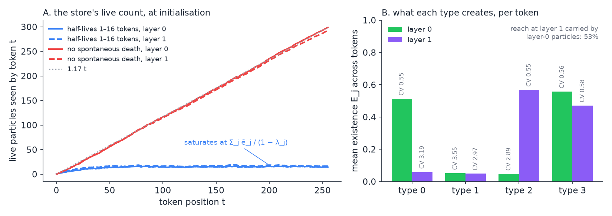
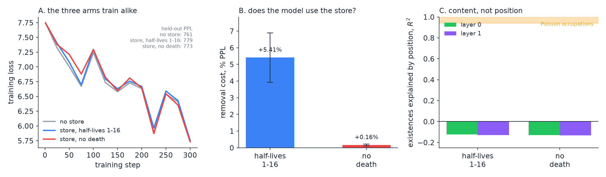

# The Particle Store: Making Allocation Real

**Design note and first results — Semantic Simulation Research Programme**
**Relates to:** [*Implementing Semantic Templates: A Path*](Implementing_Semantic_Templates_A_Path.md) §7 (Stage 0″, which this note expands); [*Expressivity Bounds for the v0 Simulator*](Expressivity_Bounds_For_v0_Simulator.md) (Lemma 2, Lemma 4, §8.2); [*Semantic Templates as Doi–Peliti Reactions*](Semantic_Templates_as_Doi_Peliti_Reactions.md); [*Poisson Mode Registers (PM1)*](Poisson_Mode_Registers_PM1.md); [*MCS Reduction for the v3 Composite*](MCS_Reduction_For_v3_Composite.md); book §10.5.2.
**Status:** the mechanism is built and verified; one short CPU training run has been scored. Nothing has been trained at scale, and nothing consumes yet.

> **Thesis.** Templates lift the expressivity class only if firing *instantiates* a particle, and until 2026-10-31 no mechanism in the codebase allocated a degree of freedom: a register is rewritten in place, a Poisson mode deepens a well at a fixed centre. The particle store is the missing substrate — a write-once, block-causal record of created particles. It is built, it is off by default and bit-identical when off, and a first CPU run says two things: the existences it creates are content-driven in a way the Poisson occupations never were, and the arm the expressivity argument actually needs — no spontaneous death — is the arm the model declines to use. That second result makes **destruction by consumption** a requirement rather than a next step.

---

## Contents

1. [Why neither registers nor modes allocate](#1-why-neither-registers-nor-modes-allocate)
2. [The design](#2-the-design)
3. [Decay decides the class](#3-decay-decides-the-class)
4. [The implementation](#4-the-implementation)
5. [Verification](#5-verification)
6. [The first training run](#6-the-first-training-run)
7. [What the results say](#7-what-the-results-say)
8. [What this does not do yet](#8-what-this-does-not-do-yet)
9. [How to reproduce](#9-how-to-reproduce)

---

## 1. Why neither registers nor modes allocate

The v0 ceiling rests on a single hypothesis — that no mechanism grows the state space during inference. Nothing else lifts it: not more parameters, not RL signal, not a richer force vocabulary. And §8.2 of the bounds note names what does: with creation in place "the simulator can grow its memory linearly with input length".

Three facts say the slot registers cannot be that mechanism, however their salience is retrained.

1. **The pool is fixed.** `n_registers` is a constructor constant and the per-position bank is $(B, T, M, d)$, so the state at position $t$ is $Md$ numbers whatever $t$ is. The book concedes it: the class statement "concerns the architecture family with a register pool that grows with the input, not the trained instances".
2. **The write is the forbidden form.** The write port $r \leftarrow \sigma r + (1 - \sigma) \mathrm{readout}$ matches against the active set and edits the matched slot in place. That is match-and-edit, under which the MCS reduction's polynomial parsing becomes PSPACE-complete recognition. A template substrate must **consume and emit** — destroy a reactant, bear a product elsewhere — and a slot rewritten in place cannot.
3. **DP1–DP3**, measured: the trained registers are always occupied, their content is renewed layer by layer, and salience is not an intensity.

The Poisson modes fail for a different reason. A mode creates particles at a *fixed* centre, so however many it creates, the state it adds is one intensity per mode — $K$ numbers. What grows the state is a particle whose payload is set at birth from the token that bore it, and which persists to be read, matched and consumed.

## 2. The design

**State.** Per layer, slots $(B, T, K, \cdot)$: at every position each of $K$ particle types may bear one particle. A slot carries a bounded payload — a position in $\Sigma$, a type, a birth index — and an **existence** $e \in [0, 1]$, the occupation a creation operator sets. In this first build the existence is the Stage 0′ overlap of the token with the type, which is its Poisson creation mean, and the payload is the token state displaced by a learned per-type offset:

$$
e^{(b)}_{s,j} = E_{b,j}(h^{(b)}_s), \qquad \mu^{(b)}_{s,j} = h^{(b)}_s + \delta_j, \qquad (1)
$$

for the particle of type $j$ that token $s$ bears at layer $b$. Capacity $KT$ is preallocated, so allocation is realised as $e$ leaving zero; what grows with the input is the number of live particles a token sees, up to $Kt$. **Payloads are written once and never again.**

**Visibility and force.** A particle born at (layer $b$, token $s$) is visible to every token $t \gt s$ at every layer $l \geq b$ — a block-causal $T \times KT$ mask — and acts through the well potential the modes already use, evaluated in the acting layer's matching subspace:

$$
U_l(h_t) = -\sum_{b \leq l}\sum_{s < t}\sum_j a_{l,j} e^{(b)}_{s,j} \lambda_j^{t-1-s} \exp(-\kappa_{l,j}^2 \lVert P_l (h_t - \mu^{(b)}_{s,j}) \rVert^2), \qquad (2)
$$

with $a$ the layer's per-type depths (starting at zero, so the force is exactly zero at step 0), $\lambda$ the per-type survival per token, and $\kappa$, $P$ the acting layer's width and projection. The sources are of tokens $s \lt t$, so they are constant in $h_t$ and the explicit gradient is exact in it, while the loss still reaches the creating token through $e$ and $\mu$:

$$
f_{\mathrm{ps}}(h_t) = -\nabla_{h_t} U_l = -2 P_l^\top \sum_{b,s,j} w^{(b)}_{t,s,j} \kappa_{l,j}^2 P_l (h_t - \mu^{(b)}_{s,j}), \qquad (3)
$$

where $w$ is the summand of (2) without the sign. This is the additive v2 channel: order-blind by the commutativity theorem, which is its job.

**Consumption**, when the first template with a reactant arrives, thins the existence, $e_p \leftarrow e_p (1 - \mathrm{fire})$, and touches nothing else — rebinding is destroy-old plus emit-new, never an edit.

What the store satisfies, requirement by requirement:

| requirement | how the store meets it |
|---|---|
| state grows with the input (Lemma 4's hypothesis fails) | live particles at $t$ up to $Kt$; payloads persist |
| bounded multiplicity per firing | at most one particle per type per position |
| consume and emit, never match and edit | write-once payloads; consumption touches only the existence |
| bounded fragment dimension and arity | payload $d + O(1)$; the two-slot stage reads two particles |
| causal and parallel-trainable | block-causal mask; no particle-to-particle dependence within a layer |
| conservative token forces | wells in $h$; the force is the gradient by autograd (§5) |
| exactness of the mean | with no reactant the potential is linear in the existences, so carrying the mean is exact |

Cost: $O(KT^2 d)$ per layer, attention over $KT$ keys; memory $(B, T, K, d)$ per layer. Measured at $K = 4$: **no detectable cost at all** (§6).

## 3. Decay decides the class

The number of live particles a token sees is the occupation summed over types,

$$
N(t) = \sum_{s<t}\sum_j \lambda_j^{t-1-s} e_{s,j} \longrightarrow \sum_j \frac{\bar{e}_j}{1-\lambda_j} \quad (\lambda_j < 1), \qquad N(t) \approx K \bar{e} t \quad (\lambda_j = 1). \qquad (4)
$$

With spontaneous death the count **saturates** — a decaying store is bounded memory however large the store, which is Lemma 2 of the bounds note (damping is information-destroying) wearing another hat. With no spontaneous death the count grows with the input, and destruction is left to consumption.

So the switch is not a tuning knob, it is the class statement: **only $\lambda = 1$ can lift the ceiling**, and $\lambda = 1$ is only coherent if something removes particles. That is why §8 ends where it does.



**Figure 1.** At initialisation, $K = 4$, rank 8, on $2 \times 256$ real validation tokens. **(A)** the live count a token sees: with half-lives of 1–16 tokens it saturates near 15; without death it grows as about $1.2 t$, reaching 298 by $t = 255$. **(B)** what each type creates per token, with the coefficient of variation of its existence across tokens. Two of the four types are broad (reaching 64–70% of tokens) and two narrow (2–4%), which is the k-means geometry of the matcher at $K = 4$.

## 4. The implementation

The switch is `particle_store = K` (0 = off, bit-identical), in `notebooks/conservative_arch/parf/model_parf_multixi.py`, with the matching rank, width factor and its running median, the half-life range, the decay switch and the payload's gradient path. Notebook switches are `PARTICLE_STORE`, `PARTICLE_STORE_RANK`, `PARTICLE_STORE_DECAY`, `PARTICLE_STORE_CLIP`; the tag is `ps<K>r<rank>`, with `nd` appended when decay is off.

| piece | where |
|---|---|
| parameters `pstore_{mu, P, log_c, depth, delta, logit_lambda}`, buffers `pstore_{D2, ready, share, stats}` | the model's constructor, created only when enabled so the default draws the same RNG stream |
| the matcher, shared with Stage 0′ | `_lowrank_match(h, l, mu, P, log_c, D2, ready, ema, seed)` — `_pm_match` and `_ps_match` both delegate to it, same operations in the same order, different seeds |
| the pair terms of (2) | `_ps_pairs` |
| the force (3) and the potential for the autograd check | `particle_store_force`, `particle_store_potential` |
| where the force enters | `_layer_forces`, as a plain kick after the Poisson-mode block, so every integrator path receives it in the one force evaluation per layer |
| pass lifecycle | `_ps_begin()` at the start of each `_stack_forward`; the store is written only inside the stack loop, so a layer-checkpoint recompute reads the forward's record |

The store itself is a dictionary on the model, birth layer $\to$ (existences, payload states), emptied per forward pass.

## 5. Verification

`scaleup/debug/verify_particle_store.py`, output `verify_particle_store_output.txt`. Bit-identity with the switch off was checked by `verify_pm_match.py`'s fingerprint on a checkout of HEAD against the working copy: F3.1, PM1-K64, PMX-K16 and FO-b-PMX-K16 agree on the loss, the logits checksum, every parameter and every gradient. With the store on ($K = 4$, rank 8, F3.1 base with SR2, CPU, at initialisation, real tokens), all of the following passed:

- the tag carries `ps4r8`; the new parameters are exactly the six `pstore_*` tensors, and the clip group `pstore_` catches them and nothing else;
- with the depths at zero, eval and train logits are bit-identical to the model without the store, and the gradient still reaches `pstore_depth`;
- the first training forward initialises every layer's matcher from its states; the existences are finite and in $(0, 1)$;
- with depths and offsets non-zero, the force equals $-\nabla U$ by autograd at fixed sources to about $10^{-7}$, at layer 0 (own particles) and at layer 1 (layer-0 and own particles);
- causality: tokens replaced at $t \geq 128$ leave the logits at $t \lt 128$ unchanged;
- layer checkpointing on and off give the same loss and the same gradients, bit for bit;
- every `pstore_` parameter has a finite, non-zero gradient.

**A pre-existing bug surfaced here.** Checkpoint identity failed on the first run, and the cause was not the store: `_lowrank_match` updated its running median $D^2_l$ in *every* training forward, including the recompute that layer checkpointing runs in the backward. The recompute then used a different width than the forward had, computed a different force, and moved the median twice per step — on PM1-K16 with `POISSON_MATCH_RANK = 8` the gradients differed by $6.6 \times 10^{-5}$ and $D^2$ was 220.9 against 293.9 after one step, under the production default `LAYER_CHECKPOINT = True`. The matcher's state now moves only in the forward inside the stack loop. No trained `pmlr` arm existed and the planned 2B template pair runs with checkpointing off, so nothing already measured is invalidated.

## 6. The first training run

`scaleup/debug/ps_short_train.py`. Three arms, identical but for the store, each trained from scratch on CPU from the notebook's own cells (F3.1 base, SR2, explicit kick, no Poisson modes), seed 0, AdamW at $1.2\times10^{-3}$ with a 50-step warm-up, weight decay 0.01, clip 1.0, 300 steps of $4 \times 256$ tokens from the first 1.5M tokens of the validation cache, evaluated on $8 \times 256$ held-out tokens:

| arm | store |
|---|---|
| `off` | `PARTICLE_STORE = 0` — the control |
| `decay` | $K = 4$, rank 8, half-lives 1–16 tokens — bounded memory |
| `nodecay` | $K = 4$, rank 8, no spontaneous death — the live count grows with $t$ |

Results:

| | held-out PPL | selectivity L0 / L1 | existences by position $R^2$ | mean $e$ L0 / L1 | live at $t$ = 32 / 128 / 255 | depths \|a\| | removal cost |
|---|---:|---|---|---|---|---:|---:|
| off | **760.8** | — | — | — | — | — | — |
| decay 1–16 | 778.5 | 0.79 / 0.47 | −0.12 / −0.13 | 0.118 / 0.359 | 12 / 14 / 12 (L1) | 0.113 | **+5.41% ± 1.5** |
| nodecay | 773.4 | 2.47 / 0.77 | −0.13 / −0.13 | **0.003** / 0.282 | 36 / 143 / 288 (L1) | 0.018 | **+0.16% ± 0.05** |

**Removal cost** is the measurement that matters: the perplexity change when every well depth is set to zero at evaluation, i.e. the store's force switched off on a model trained with it. It is the analogue of the wells-removal cost, and it separates "the model routes through this" from "the model ignores it". Errors quoted are ±1 SEM over the 8 held-out sequences.



**Figure 2.** **(A)** the three arms train indistinguishably; the held-out perplexities differ by less than this budget can resolve, and the train-loss ordering is the reverse of the held-out ordering. **(B)** removal cost — switching the store off at evaluation. The decay arm has come to depend on it; the no-decay arm has not. **(C)** the share of the existences' variance explained by position, leave-one-sequence-out. Negative means position predicts worse than the mean does. The band marks where the Poisson *occupations* sit for contrast, at 0.94–1.00.

## 7. What the results say

**The existences are content-driven, and that is new.** Position $R^2$ is **negative at every layer in both arms** — position predicts an existence worse than its own mean does. Set that against the Poisson occupations, which are 94–100% position at the default half-lives. The reason is structural rather than lucky: an occupation sums a mode's overlaps over its half-life window and the sum averages the token-level variation away, whereas an existence *is* a per-token overlap and no averaging is applied to it. Selectivity also survives training (0.47–2.47, against the isotropic modes' 0.01–0.04), and the depths move off zero on their own, taking both signs.

**The arm the expressivity argument needs is the arm the model declines to use.** Removal cost 0.16% against the decay arm's 5.41% — a factor of 34 — with depths six times smaller, and at layer 0 the no-decay arm suppressed creation almost entirely (mean existence 0.003, fewer than 3 live particles by $t = 255$). With $\lambda = 1$ nothing is ever removed, so by $t = 255$ a token sees ~288 particles and their summed well potential is a near-uniform background. Each individual existence stays content-driven; the **sum** the token actually feels does not. This is the same averaging that made the Poisson occupations positional, reappearing as *infinite half-life = maximal averaging*.

**Reliance is not value.** The decay arm leans on the store (+5.41%) while being 2.3% *worse* than no store at all. That is the pattern the Fock v2.1 note records for the register path — 1.49 nats of reliance against 0.084 nats of value — and it is worth naming now rather than discovering at 2B tokens.

**Force share is a poor proxy for influence here.** The decay arm reads $31.8\times$ and the no-decay arm $29.1\times$ the conservative force at layer 1, yet their removal costs differ by a factor of 34. A large but near-uniform force is removed by the post-step LayerNorm projection. Removal cost is the measure; a share much greater than one says little on its own, which is consistent with the exchange field's own `share_max` peaking at 15.68 early in a healthy run and falling to 3.93.

**Caveats.** 300 CPU steps at perplexity ~770 is deeply undertrained; one seed; $n = 8$ sequences for the removal cost. These readings say how the mechanism behaves structurally and whether it gets used — not whether it helps.

## 8. What this does not do yet

- **Consume.** Nothing has a reactant. This is now the binding item: §3 and §7 together say that $\lambda = 1$ is the only setting that lifts the class and that $\lambda = 1$ without removal is noise the model ignores. **Destruction by reaction is therefore required, not optional.** The moment a reactant exists, $k_v \geq 1$ makes the reaction nonlinear in the occupations, the exactness of carrying the mean is lost, and one of the three options of the implementing note §3 has to be chosen — stay linear, sample the occupations, or declare mean-field. The measurement has made that trilemma binding rather than theoretical.
- **Move.** The payload is frozen at birth. Integrating created particles under the flow, as Fock v2 did when it concatenated registers into the Verlet state, is open; write-once is the simpler first choice, not the only one.
- **Order.** The channel is additive and therefore order-blind by the commutativity theorem. That is by design: it supplies *what* is written, not *in which order*.
- **The collapse-depth criterion.** Stage 0″'s criterion 3 — the Dyck-1 depth $D^\ast$ of the bounds note moving with the training length — belongs to the first consuming template, because without consumption a closing bracket cannot decrement the live count.
- **Train at scale.** A store arm on PMX-K16's base with `PARTICLE_STORE = 4` and no decay, tag `…ps4r8nd…`, is the natural third member of the 2B template pair; its queue position is an open author decision.

## 9. How to reproduce

```
cd notebooks/conservative_arch/scaleup/debug
python3 verify_particle_store.py  OUT_DIR                                  # the checks of §5
python3 ps_short_train.py         OUT_DIR {off|decay|nodecay} steps=300 batch=4 threads=8
python3 ../../../../companion_notes/figures/_make_particle_store_figs.py   # Figures 1 and 2
```

Each arm takes 46–63 minutes on CPU. **Environment caveat:** the default interpreter here pairs NumPy 2.5 with torch 2.2, where `torch.from_numpy` fails; use a virtual environment built with `--system-site-packages` and `numpy<2`.

Outputs, all in `scaleup/debug/`: `verify_particle_store_output.txt`, `ps_short_train_output.txt`, and `ps_short_train_{off,decay,nodecay}.json` (loss curve and every reading per arm). The JSONs are mirrored under `companion_notes/figures/particle_store/` so the figure script is self-contained.
