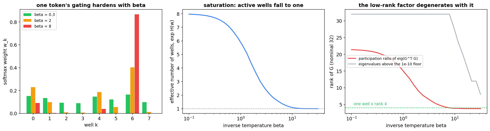
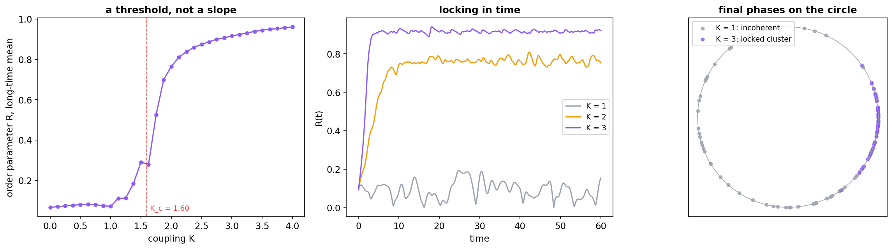
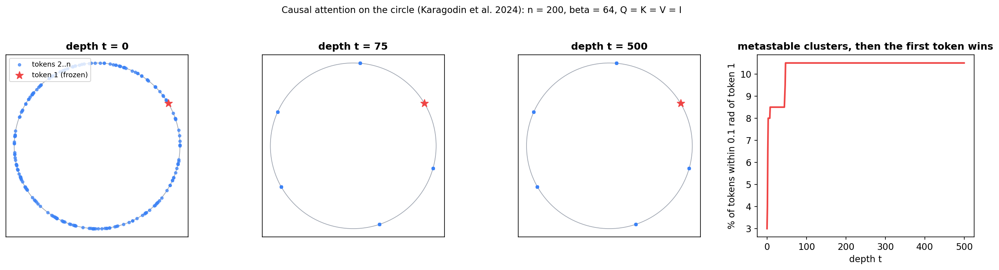
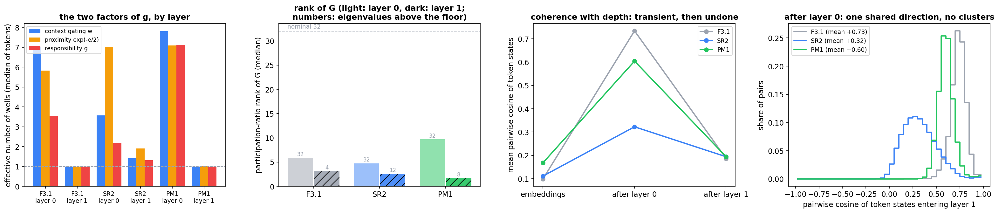

# Two Clustering Mechanisms: Saturation and Synchronization

**How tokens cluster in attention dynamics and in the Lagrangian framework, what the theorems of Geshkovski, Letrouit, Polyanskiy, Rigollet and Karagodin say, and which mechanism our trained arms show**

Companion note to protocol [`Depth_Ladder_and_Matched_Baseline_Protocol.md`](Depth_Ladder_and_Matched_Baseline_Protocol.md) (§5.15, §5.19) and to the book's §17c (ii), the Sinkformer passage, and §37.6, property (C). The measurements are `debug/dsync_clustering_diagnostics.py` and its outputs in each arm's results folder; the figures are made by [`figures/_make_clustering_mechanisms_figs.py`](figures/_make_clustering_mechanisms_figs.py).

**Status, 2026-10-11.** Descriptive, not pre-registered. Two questions prompted it: whether the eigensolve failures of 2026-09-17 in the low-rank integrator were a clustering effect, and whether spontaneous synchronization of coupled oscillators has a use in understanding the Fock mechanism. The first is answered below: the failures were **saturation** of the context gating, not synchronization of tokens. The second is left as measured hypotheses (§7).

---

## Contents

0. [Why two mechanisms](#0-why-two-mechanisms)
1. [The setting: tokens as particles on a sphere](#1-the-setting-tokens-as-particles-on-a-sphere)
2. [Mechanism 1: saturation, or hard assignment](#2-mechanism-1-saturation-or-hard-assignment)
3. [Mechanism 2: synchronization](#3-mechanism-2-synchronization)
4. [Causal masking: the sequential gradient flow](#4-causal-masking-the-sequential-gradient-flow)
5. [How the two mechanisms relate, and where they live in our models](#5-how-the-two-mechanisms-relate-and-where-they-live-in-our-models)
6. [Measurements on the trained arms](#6-measurements-on-the-trained-arms)
7. [Consequences and open questions](#7-consequences-and-open-questions)
8. [References, with the theorems used](#8-references-with-the-theorems-used)

---

## 0. Why two mechanisms

"Clustering" names two different things in this literature, and they fail, degrade and get measured differently.

| | **Saturation** (hard assignment) | **Synchronization** (consensus) |
|---|---|---|
| what concentrates | the **weights** a token puts on its options: attention rows, well gating | the **states** of the tokens themselves |
| the limiting object | a one-hot row; a low-rank Boolean attention matrix; one active well | a single point, or a few clusters, on the sphere |
| the control parameter | the inverse temperature β, the score scale | the coupling strength, against the spread of natural frequencies |
| its signature | entropy of the weights falls; the generated operator loses rank | an order parameter rises; pairwise distances shrink; a threshold in the coupling |
| the theorem | Geshkovski et al. 2023a, Theorem 2.1 (leaders) | Kuramoto 1975; Geshkovski et al. 2023b, Theorems 4.3, 5.1, 6.1; Karagodin et al. 2024, Theorem 4.1 |
| in our code | the responsibility g_k of V_θ's wells; the 2026-09-17 degenerate Gram | token states under V_φ, the Poisson wells and the LayerNorm sphere |

The two are coupled: in the attention papers the hardening of the weights is what drives the states together. But they can occur separately, and in V_θ they do, because V_θ's wells are generated per token (§5).

---

## 1. The setting: tokens as particles on a sphere

Both frameworks view a layer stack as a dynamical system on the token states, with depth as time.

**Attention** (Geshkovski et al. 2023a, equation 1.1; 2023b, equation 2.3). With frozen weights $Q, K, V$ and inverse temperature β, token $i$ moves as

$$
\dot{x}_i = P_{x_i}\Big( \frac{1}{Z_i} \sum_{j} e^{\beta \langle Q x_i, K x_j \rangle} V x_j \Big), \qquad Z_i = \sum_{j} e^{\beta \langle Q x_i, K x_j \rangle}. \qquad (1.1)
$$

Here $V$ is the **value matrix**, not a potential, and $P_x = I - x x^{\top}$ projects onto the tangent plane of the unit sphere: that is how LayerNorm is modelled (2023b, §2.2, with its gain set to the identity, justified on ALBERT where the trained gain is nearly constant). This is a **first-order** system: the right-hand side is a velocity field, and there is no inertia.

**The Lagrangian framework.** Each token carries a velocity and a mass, and moves under forces that are gradients of potentials at fixed context,

$$
m_t \ddot{h}_t = -\nabla_{h_t} V_\theta(\xi_t, h_t) - \nabla_{h_t} V_\phi - \nabla_{h_t} U_t - \gamma m_t \dot{h}_t, \qquad (1.2)
$$

with $U_t$ the Poisson wells where present, followed by one LayerNorm projection per layer. In the limit of large friction, $\gamma m \dot{h} = F$, the velocity is proportional to the force and (1.2) becomes a first-order system like (1.1): a transformer layer is the **overdamped** limit of our step. Cell 6b-7's Gate 1 measures exactly the distance from that limit ("reset = gradient descent on V_θ"); SR2 at +3.9% sits near it, PMX at +30,600% relies on inertia.

**Two readings of LayerNorm follow.** In (1.1) it is a holonomic constraint: the radial component of the velocity field, which otherwise grows like $e^{tV}$ (2023a, §3), is removed by the projection. It is not damping in the Langevin sense, which needs a velocity. In (1.2) the projection acts once per layer on the position; our FLOW-C result that the trained model samples the once-per-layer version, not the per-substep one, is consistent with that discrete reading.

---

## 2. Mechanism 1: saturation, or hard assignment

**Figure 1.** Left: one token's softmax weights over K = 8 wells at three temperatures. Centre: the effective number of active wells, $\exp H(w)$, against β. Right: the participation-ratio rank of the factor G of equation (2.1), built from those weights with rank-4 blocks, and the count of eigenvalues above the integrator's floor. One active well leaves rank 4 of a nominal 32.

### 2.1 In attention: leaders

A softmax row with scores $s_{ij}$ at inverse temperature β has entropy that falls to zero as β grows or as the scores spread; in the limit the row is one-hot. Geshkovski et al. 2023a prove this as a **dynamical** fact for the pure attention flow in $d = 1$: with $V \gt 0$ the attention matrix $P(t)$ converges to a low-rank matrix with entries 0 and 1 (**Theorem 2.1**), which they read as the emergence of **leaders**, the tokens that the others attend to. It is the mathematical form of the observation in the original Transformer paper that leaders appear in a processed sequence. The paper's clustering results then follow from this hardening: with $V = I$ and $Q^{\top} K \gt 0$ the rescaled tokens converge to the boundary, generically the vertices, of a convex polytope determined by the initial tokens (**Theorem 3.1**); with a simple positive leading eigenvalue of $V$ they converge to one of three parallel hyperplanes (**Theorem 4.2**); with a repeated one, to a polytope in some directions and a subspace in the others (**Theorem 5.2**); with $V = -I$ all tokens collapse to the origin (**Theorem 8.5**).

### 2.2 In V_θ: the responsibility and the rank of G

V_θ generates, from each token's context $\xi$, K anisotropic Gaussian wells with centres $\mu_k(\xi)$, diagonal precisions $a_k(\xi)$, low-rank factors $B_k(\xi)$ and a gating $w_k(\xi)$. The low-rank integrator freezes the quadratic of V_θ at the layer input and splits it into a diagonal spring and a positive semi-definite part $L = G G^{\top}$ with

$$
G = \big[\sqrt{g_1} B_1, \ldots, \sqrt{g_K} B_K\big], \qquad g_k = w_k \exp\big(-\tfrac{1}{2} e_k\big), \qquad e_k = \lVert h - \mu_k \rVert_{a_k}^2 + \lVert B_k^{\top} (h - \mu_k) \rVert^2. \qquad (2.1)
$$

The responsibility $g_k$ has **two factors**:

- the **context gating** $w = \mathrm{softmax}(s(\xi))$, with $s$ the well scores, which depends on the context only and can saturate exactly as an attention row does;
- the **proximity** $\exp(-e_k / 2)$, the token's Gaussian overlap with well $k$, which concentrates when the token sits far inside one well.

The operator is a weighted sum of the blocks,

$$
L = \sum_{k} g_k B_k B_k^{\top},
$$

and each block has full column rank (Cell 6b-4 measured a participation ratio of 3.68 against rank 4), so the rank of L is the number of active wells times the rank. One active well leaves 4 eigenvalues above the floor and 28 near zero and nearly equal: a degenerate spectrum, which is what cuSOLVER reports as "ill-conditioned or has too many repeated eigenvalues". That was the 2026-09-17 failure, and the hardening in `_gram_eigh` (symmetrisation, float64, a deterministic ramp that splits exact repeats, SVD in place of eigh, inert-column masking) is the response to this spectrum. §6 measures which of the two factors produced it.

---

## 3. Mechanism 2: synchronization

**Figure 2.** Kuramoto's model with 200 oscillators and unit-variance natural frequencies. Left: the long-time order parameter against the coupling, with Kuramoto's critical value $K_c = 2 / (\pi g(0))$ for the frequency density $g$. Centre: the order parameter in time. Right: the final phases below and above threshold.

### 3.1 Kuramoto

Oscillators with phases $\theta_i$ and natural frequencies $\omega_i$, coupled through the mean field, obey

$$
\dot{\theta}_i = \omega_i + \frac{K}{n} \sum_{j} \sin(\theta_j - \theta_i) = \omega_i + K R \sin(\psi - \theta_i), \qquad R e^{i \psi} = \frac{1}{n} \sum_j e^{i \theta_j}. \qquad (3.1)
$$

$R \in [0, 1]$ is the **order parameter**. Below a critical coupling the oscillators run incoherently and $R$ stays near zero; above it a locked cluster forms and $R$ rises. The transition is a threshold, not a slope (Figure 2, left). Two features matter for what follows: the coupling acts through the mean field, so each unit is pulled toward the population's average phase, and the pull is strongest on the units that lag it.

### 3.2 On the sphere: the interaction energy and its gradient flows

Geshkovski et al. 2023b put attention on the sphere and find the energy behind it. For the dynamics (1.1) with $Q^{\top} K$ symmetric and $V = Q^{\top} K$, define

$$
E_\beta(x_1, \ldots, x_n) = \frac{1}{2\beta} \sum_{i, j} e^{\beta \langle V x_i, x_j \rangle}. \qquad (3.2)
$$

- **Proposition 3.4.** Over probability measures on the sphere, the unique minimiser of $E_\beta$ is the uniform measure and every maximiser is a point mass. The attractive case $V = I$ increases $E_\beta$ along the flow; the repulsive case $V = -I$ decreases it.
- **§3.4.** The true dynamics (SA), with its softmax denominators, is the gradient flow of $E_\beta$ on $(S^{d-1})^n$ **for a modified Riemannian metric** whose weights are the partition functions $Z_i$. The surrogate (USA), with $Z_i$ replaced by $n$, is the ordinary Wasserstein gradient flow of the same energy.
- **Without the symmetry** of the coupling the field is not the gradient of any functional (their §3.3, citing Sander et al. 2022). This is the content of the book's Conservative Obstruction Theorem: the row normalisation, property P3, is compatible with a gradient flow once the metric absorbs it; what forecloses a potential is the asymmetric coupling (P1) and the independent values (P2).
- **Clustering theorems.** A single cluster for small β (**Theorem 4.3**) and for large β (**Theorem 5.1**); for $d \ge 3$ clustering at any temperature (**Theorem 6.1**, from Markdahl, Thunberg and Goncalves 2017); an exponential rate when $d \ge n$ (**Theorem 6.3**); and the histogram of inter-particle distances in time (**Theorem 6.9**), which is the object §6 measures.
- **Metastability.** For large β the configuration first coalesces into several clusters and stays there for a long time before the final collapse. Since depth plays the role of time, that metastable multi-cluster state, not the asymptotic single cluster, is what a network of realistic depth sees.
- **§7.** In $d = 2$ at β = 0 the dynamics **is** Kuramoto's model (3.1) with identical frequencies. The link to synchronization is theirs, not an analogy.

So Mechanism 2 is the ascent of (3.2): tokens pulled toward one another by an attractive, mean-field, saturating coupling, on a compact manifold where the ascent cannot escape to infinity.

---

## 4. Causal masking: the sequential gradient flow

**Figure 3.** Karagodin et al.'s (CSA) on the circle with $Q = K = V = I$, 200 tokens, β = 64. The first token never moves. By depth 75 the tokens sit in a handful of clusters that persist to depth 500 and beyond, the metastable phase; the asymptotic collapse onto the first token is exponentially far away. The right panel is the share of tokens within 0.1 rad of token 1.

Karagodin, Polyanskiy and Rigollet 2024 replace the full sum in (1.1) by the causal one, $j \le k$:

$$
\dot{x}_k = P_{x_k}\Big( \frac{1}{Z_k} \sum_{j \le k} e^{\beta \langle Q x_k, K x_j \rangle} V x_j \Big). \qquad (4.1)
$$

- **No global energy.** The abstract states it: the causal system "cannot be interpreted as a mean-field gradient flow". Section 5 states what remains: it is "a sequential gradient flow, where each particle minimizes a slightly different energy potential", token $k$ descending its own potential with tokens $1, \ldots, k - 1$ held fixed. This is the structure of our causal forces, and it is the per-token scope of the book's property (C): conservative per token at fixed context, with no total potential.
- **Lemma 3.1.** A token alone, $\dot{x} = P_x(V x)$, converges exponentially to the leading eigenspace of $V$. With $V = I$ it does not move at all: the first token, which under causal masking attends only to itself, is frozen.
- **Theorem 4.1.** With $V = I$ and **arbitrary** $Q, K$ and β, for almost every initialisation every token converges to the first token's initial position. The proof uses the hierarchy, token by token, instead of Łojasiewicz's theorem, which needs a gradient flow; the weights only have to be positive and smooth, which is why $Q$, $K$ and β drop out.
- **Conjectures 1 and 2, and Table 1.** The final configuration is set by the leading eigenvalue $\lambda_{\max}$ of $V$ and its eigenspace $L$: collapse onto one point in $L$ when $\lambda_{\max} \gt 0$ with $\dim L \ge 2$; two clusters at $\pm \xi$ when $\dim L = 1$; point clouds instead of clusters when $\lambda_{\max} \lt 0$, the repulsive case. Only $V$'s spectrum decides; $Q$, $K$ and β set the weights, not the destination.
- **Rényi parking centres (Lemma 5.1, Theorem 5.2).** The nuclei of the metastable clusters are the tokens that happened to be isolated at initialisation; they stay nearly stationary while the rest fall onto them, and all tokens end near one of a set of frozen nuclei. Their number scales as $\beta^{(d_1 - 1)/2}$ with $d_1$ the effective dimension $V$ reduces the tokens to.

The book's §17c (ii) now cites this paper for exactly the first point: the row-only, causal choice gives up the global potential and keeps the per-token one.

---

## 5. How the two mechanisms relate, and where they live in our models

### 5.1 The root cause is the sign of the coupling, not LayerNorm

The three papers agree on a hierarchy, and it is worth stating because LayerNorm is the usual suspect.

- **Attraction causes the clustering.** In (1.1) token $i$ moves toward the softmax-weighted mean of the value vectors, and a mean of points is closer to all of them than they are to each other. With a positive leading eigenvalue of $V$ the configuration contracts under repetition; with $V = -I$ the same mechanism repels and the tokens spread to the uniform measure (2023b, Proposition 3.4). Karagodin et al. make the point structural: only the spectrum of $V$ decides the final configuration, and $Q$, $K$ and β set the weights, not the destination.
- **The softmax's hardening shapes it.** At β → 0 the weights are uniform and the tokens contract to one mean (2023b, Theorem 4.3). At large β the weights concentrate on near neighbours, the contraction is local, and tokens that start close pull each other together first: several clusters, metastable for exponentially long, nucleated at the isolated tokens (the Rényi centres). Saturation sets how many clusters and for how long, not whether there are any.
- **LayerNorm bounds it and makes it visible.** The first paper has no LayerNorm: the norms grow like $e^{tV}$ and in the rescaled frame $z_i = e^{-tV} x_i$ the tokens cluster all the same (Theorems 3.1, 4.2, 5.2); the rescaling is their "surrogate for layer normalization". The second paper models LayerNorm as the tangential projection, a constraint that removes the radial direction, so the energy is bounded and the ascent has a maximum to reach. A constraint that removes one direction cannot create attraction in the others.
- **Why there is no threshold in the pure dynamics.** At $d = 2$ and β = 0 the model is Kuramoto's with identical frequencies. Kuramoto's threshold comes from the competition between the mean-field pull and the spread of natural frequencies; with no spread the pull always wins, and the only question is how fast. A sub-critical regime reappears when something resists the pull. In a real transformer that is the MLP and the data-dependence of the weights, which these papers leave out; in our models it is the per-token V_θ landscape, which gives each token its own destination.

**In attention the two mechanisms are one process.** The weights harden (Mechanism 1) and the hardened weights pull states together (Mechanism 2); Geshkovski et al.'s leaders are the Rényi centres of Karagodin et al. seen from the weights' side. The energy (3.2) contains both: $e^{\beta \langle x_i, x_j \rangle}$ is large only for aligned pairs, and ascending it aligns them further.

### 5.2 Where each mechanism lives in our models

**In V_θ they come apart.** The wells of V_θ are not shared: each token has its own K centres $\mu_k(\xi_t)$, generated from its own context. Its gating can saturate (Mechanism 1) without any two tokens being pulled toward a common point, because there is no common point. Saturation of V_θ therefore cannot synchronize tokens with one another. What can:

- **V_φ**, the pair potential between tokens, the one direct token-to-token coupling in the conservative arms. Its structural form contains the Kuramoto–Lohe coupling term by term: the value-aligner Θ_φ in [−1, 1] is the sign of the coupling (attractive or repulsive, the "AR" of PARF), the competitive row-softmax over past sources is its weight, and the inverse-distance kernel plays the cosine's part; the top-k gather is its saturation mechanism and the sign channel its synchronization mechanism. Because V_φ moves a token toward the source states themselves, a uniformly attractive Θ_φ would reproduce Karagodin et al.'s V = I collapse onto the first token; the learned pairwise sign is what the attention models lack. Details and the measurements to add are §17 of [`Structured_VPhi_Design_and_Theory.md`](Structured_VPhi_Design_and_Theory.md);
- **the Poisson-mode registers of PM1 and PMX**, whose 64 centres $\mu_v$ are shared parameters: the one mechanism in these models that synchronizes tokens by construction. It does so differently from attention, and the difference matters:
  - **the target is fixed, not emergent.** Attention contracts tokens toward one another, so the cluster location is whatever the tokens make it (leaders, Rényi centres) and the clusters eventually merge. The registers contract tokens toward parameters, so the multi-cluster state is permanent; depth cannot collapse it;
  - **the coupling is indirect, through the occupation.** Token $t$ is pulled toward $\mu_v$ with strength $\phi_v(t) a_v$, and $\phi_v(t)$ is the decay-weighted count of earlier tokens that overlapped the mode. Earlier tokens deepen a well; later tokens fall into it. Two tokens end up close because both fell into the same mode, not because either pulled on the other: a mean-field coupling through the occupation, one-way in token order;
  - **the occupation is the order parameter.** φ plays the role Kuramoto's $R$ plays: it measures how much of the recent context sits in a mode and feeds back as the pull. This is the reading behind the threshold hypothesis of §7: the pull is $\phi_v a_v$, and capping $a_v$ caps the feedback;
  - **against the Fock slot registers.** Those hold content vectors and read them back through the reverse channel, which can move a token anywhere; they could synchronize tokens only through shared content, and DP2 found their contents are not shared. The Poisson-mode registers can only reshape the landscape, toward a fixed set of points, which is synchronization by shared geometry;
  - **the clean measurement is still missing.** The overlap argmax of §6.3 is not an assignment (one broad mode wins everywhere); each mode's share of the force on the token is, and it has only been measured in aggregate (6b-15). A per-token force-share assignment is the first thing to add before claiming clusters on the registers.
- **the context ξ itself**, a leaky average over earlier tokens that places V_θ's wells. A token whose wells sit at a function of its predecessors' mean state is coupled to that mean, a Krause-type coupling in disguise.

**Which measurement separates them.** The responsibility (2.1) factorises, so the entropy of $w$ (gating alone), of $\exp(-e/2)$ (proximity alone) and of $g$ can be compared token by token, with the rank of $G$ beside them; and the token states' pairwise cosines, nearest-neighbour cosines and distances to the first token measure Mechanism 2 directly. If the rank deficit of $G$ tracks the gating entropy and not the inter-token distances, the 2026-09-17 degeneracy was saturation.

### 5.3 Two routes for carrying context: conservative and non-conservative

The book's conservative obstruction (Theorem 85, §17c) says a force map that is the gradient of one scalar on all $T$ token states cannot be asymmetric, content-decoupled and budget-normalised at once. Its corollary leaves two ways out: **(a)** extend the state space with auxiliary degrees of freedom, or **(b)** admit a force that is the gradient of no scalar. Both routes the book develops ("Two routes across the obstruction": the Fock registers and Fock Attention) take branch (b).

The Poisson-mode registers take **branch (a) alone.** Their occupations $\phi_v(t)$ are auxiliary state, built from the strict past, and the force they exert on token $t$ is the gradient of a potential in $h_t$ at fixed occupation. V_φ is conservative in the same sense: a gradient in $h_t$ with its sources held fixed. "Conservative" here is the per-token sense of property (C) (book §37.6), not the global sense of the theorem: under causal masking no global potential exists for any of our arms (Karagodin et al.'s point, §4), but the per-token gradient survives, and it is what the conservativity test checks (PM1: all terms conservative, wells exact).

So the trained arms carry context between tokens by two routes:

| route | mechanism | force on token $t$ | arm | settled PPL |
| --- | --- | --- | --- | ---: |
| non-conservative, branch (b) | Fock slot registers, reverse channel | no gradient | G2 | 53.12 |
| conservative, branch (a) | Poisson-mode wells + V_φ | gradient in $h_t$, context fixed | PM1 | 55.17 |
| conservative, no auxiliary state | V_φ alone | gradient in $h_t$, sources fixed | F3.1 | 57.76 |

**They treat the pair potential differently** (§6.4). The non-conservative channel subordinates V_φ; the conservative wells work beside it. Removed at inference, the Fock channel costs G2 1.49 nats and V_φ beside it 0.037; the wells cost PM1 0.77 and V_φ beside them 0.32, more than V_φ costs F3.1 alone (0.28), with only 13% overlap. The likely reason, untested: the reverse channel and V_φ do the same job, moving a token toward content drawn from specific earlier tokens, so one crowds the other out; the wells do a different one, pulling toward shared prototypes weighted by how much of the context occupied them, so the two add.

**What this does not yet license.**

- **"The wells enable V_φ."** 0.32 against 0.28 compares two models against their own baselines, and a removal cost measures the trained network's reliance on a term, not its value. Whether V_φ is *worth more* beside the wells needs models trained without it (§7 item 8; protocol §5.21).
- **"Competing in expressivity."** The comparison is on perplexity. The corollary is about attention-like routing in the formal sense, which the F-falsifiers (Dyck tasks) test; neither route has been run on them.
- **The decisive axis is still open.** A per-token gradient flow is what refinement needs, and the Fock route fails refinement badly (Gate 3 +1,274% at N = 3 in G2). If PMX passes CX3, the conservative route has an advantage the non-conservative one structurally cannot match.

---

## 6. Measurements on the trained arms

**Figure 4.** `debug/dsync_clustering_diagnostics.py` on F3.1, SR2 and PM1 (best checkpoints), 4 × 512 tokens from Cell 6b-7's first batch, on the layer inputs the model used. Left: effective number of wells, $\exp H$, for the gating $w$, the proximity $\exp(-e/2)$ and the responsibility $g$ (medians over tokens). Second: participation-ratio rank of $G$, with the count of eigenvalues above the floor. Third: mean pairwise cosine of the token states at the embeddings, after layer 0 and after layer 1. Right: the histogram of pairwise cosines entering layer 1.

### 6.1 The degeneracy was saturation

| layer 1, medians over tokens | F3.1 | SR2 | PM1 |
|---|---:|---:|---:|
| effective wells, gating w | **1.00** | 1.40 | **1.00** |
| effective wells, proximity | 1.00 | 1.91 | 1.01 |
| effective wells, responsibility g | 1.00 | 1.31 | 1.00 |
| tokens on one well (responsibility below 1.5) | **100%** | 64% | **100%** |
| participation-ratio rank of G (nominal 32) | 3.1 | 2.6 | 1.7 |
| eigenvalues above the floor | **4** | 12 | 8 |
| Spearman(rank, nearest-token distance) | −0.60 | −0.22 | +0.05 |

| layer 0, medians over tokens | F3.1 | SR2 | PM1 |
|---|---:|---:|---:|
| effective wells, gating / proximity / responsibility | 7.0 / 5.8 / 3.6 | 3.6 / 7.0 / 2.2 | 7.8 / 7.1 / 7.1 |
| rank of G (participation ratio; above the floor) | 5.9; 32 | 4.7; 32 | 9.7; 32 |
| Spearman(rank, responsibility) / (rank, nearest-token distance) | +0.86 / +0.10 | +0.89 / +0.01 | +0.80 / −0.17 |

- **At layer 1 the context gating is one-hot for every token** in F3.1 and PM1 (effective wells 1.00 at the 5th, 50th and 95th percentiles), and nearly so in SR2. The responsibility follows, and $G$ keeps 4, 12 and 8 of its 32 eigenvalues. That is the spectrum that broke the eigensolver.
- **The rank tracks the responsibility, not the token geometry.** At layer 0, where the wells are still shared out, the rank's Spearman correlation with the responsibility entropy is +0.80 to +0.89 and with the nearest-token distance is within ±0.17. F3.1's −0.60 at layer 1 lives inside the one-well regime, where the rank varies between 2.7 and 3.8 with the single active block's spectrum.
- **Proximity saturates too at layer 1,** but it cannot be token clustering: the wells are per token, and a token sitting inside "its" well is the context placing a well on it. The gating is the factor that is one-hot across arms.

**Answer:** the degenerate matrices were hard assignment of each token's context to one well, Mechanism 1. Clustering of tokens, Mechanism 2, played no part in them.

### 6.2 Token synchronization: a transient shared direction, no clusters

| mean pairwise cosine of token states | embeddings | after layer 0 | after layer 1 |
|---|---:|---:|---:|
| F3.1 | 0.10 | **0.73** | 0.19 |
| SR2 | 0.11 | 0.32 | 0.19 |
| PM1 | 0.17 | **0.60** | 0.19 |

- **Layer 0 aligns the tokens; layer 1 undoes it.** After layer 0 the pairwise cosine is 0.73 in F3.1 and 0.60 in PM1, against 0.32 in SR2. Yet the share of pairs with cosine above 0.9 stays near 1%: this is one **shared direction**, a common component in every state, not a set of clusters. After layer 1 the three arms agree at 0.19.
- **The step that aligns is the long one.** Layer 0's step is about six times the state's norm (6b-9), then projected. A large common displacement followed by LayerNorm leaves the tokens near a common direction; layer 1, whose step is 0.7 of the norm, spreads them again for the readout.
- **No pull toward the first token.** The geodesic distance to token 1 is 1.5 rad at the output in every arm, with no dependence on position (bands 1–8 to 128–512 within 0.05 rad apart from the shared component after layer 0). Karagodin et al.'s attractor, the first token, is not an attractor here, as expected: there is no self-attention term giving token 1 a special role, and the arms were trained, not iterated to their asymptotics.
- **SR2 synchronizes least,** at every snapshot. Its exact stiff-mode flow doubled V_θ's stiffness (6b-13); the aligned component after layer 0 is half F3.1's.

### 6.3 PM1's modes: one mode overlaps every token

By the overlap alone (the creation rate of PM1 note equation 1.1, a Gaussian in the distance to the mode centre), every token's nearest mode is the same one at both layers (1 of 64 used; top overlap 0.92 at layer 0, 0.74 at layer 1). This is a property of the widths: a broad mode wins the overlap everywhere. The force, which weighs the overlap by occupation and depth, is spread over the modes (6b-15: 8 of 64 dead, short half-lives carrying most of the layer-1 force). So the overlap argmax is not the right assignment variable for PM1; the per-mode force share is. The measurement is recorded for the caveat it carries.

### 6.4 Removal costs: which coupling carries the model

`debug/coupling_dominance_ablation.py` (protocol §5.20, pre-registered and scored 2026-10-11): each coupling removed at inference from the trained weights, on Cell 6b-7's 12 × 4 × 512 batches, cost $c = \ln(\mathrm{PPL}\_{\text{removed}} / \mathrm{PPL}\_{\text{full}})$ in nats. Every switch exact (identity patch and restores bit-identical).

| arm | remove V_φ | remove the other coupling | remove both | 6b-9 V_φ share |
| --- | ---: | ---: | ---: | ---: |
| F3.1 | **0.282** (+33%) | — | — | −0.291 |
| SR2 | 0.014 (+1.4%) | — | — | −0.002 |
| G2 | 0.037 (+3.7%) | Fock **1.486** (+342%) | 1.524 | −0.0002 |
| PM1 | **0.324** (+38%) | wells **0.775** (+117%) | 0.956 | −0.017 |

- **Displacement is not reliance.** The 6b-9 shares of 0.0002 and 0.017 hid costs of 3.7% and 38%. "V_φ inert" (G2) and "the wells took over V_φ's role" (PM1) are withdrawn.
- **The Fock channel carries G2,** and the two costs add exactly (1.524 against 1.523): what V_φ still does there is a separate job.
- **The wells and V_φ both carry PM1,** overlapping by 13% (0.956 against 1.099).
- **Under SR2's exact flow V_φ is marginal** with no competitor at all: V_θ integrated exactly does most of its work.
- **Reliance overstates value.** The trained-without gains are 0.084 nats for the Fock channel (G2 against F3.1) and 0.046 for the wells (PM1 against F3.1), against removal costs of 1.49 and 0.77.

---

## 7. Consequences and open questions

1. **The 2026-09-17 degeneracy is understood and already handled.** It is saturation of V_θ's context gating at layer 1, generic in all three arms. The eigensolver hardening is the right fix; a model-side alternative would be an entropy floor on the gating, which is a design change and would need its own arm.
2. **For PMX, the clustering case does produce degeneracy,** and differently: a token on a mode centre has $r_v = h - \mu_v \to 0$, and an unoccupied mode has $dW_v \to 0$; both kill columns of the wells' rank part. The inert-column masking of `indefinite_lowrank_modes_chol` and the measured conditioning of the well directions (worst 8.7 on PM1's states) cover it.
3. **Mechanism 2 in our arms is a transient of layer 0,** not a growing coherence with depth. With L = 2 nothing can be said about the metastable multi-cluster regime that the theorems describe for deep stacks; the L = 8 live arm, when it runs, is where the distance histogram of Theorem 6.9 should be measured against depth.
4. **The PM1-cap null result as a threshold.** The capped arm rebuilt the wells' force to three times the conservative force and gained nothing, while the uncapped wells gained 15%; scaling PM1's trained wells by α gave perplexity 122, 77, 60 and 54 at α = 0, 0.5, 0.75 and 1. A Kuramoto reading would call the cap sub-critical. This is a hypothesis; the test is the α sweep with the token order parameter and the per-mode force share measured alongside, on PM1's weights, and then on PMX's when its run ends.
5. **A Kuramoto-type pair force is available within property (C).** On the sphere the Lohe coupling

$$
V_{\mathrm{K}}(x_i) = -\sum_{j \lt i} J_{ij} \langle x_i, x_j \rangle
$$

   is a gradient per token at fixed sources, as V_φ is. Miyato et al. 2025 built networks of such oscillators with attention-like coupling. In our framework it would be a second pair potential, to be pre-registered like any other arm.
6. **Over-synchronization is a failure mode to monitor,** the collapse of representations that deep attention stacks show. The order parameter and the pairwise-cosine histogram per layer are cheap to log in flight, as the resonance monitor is.
7. **A theorem to try.** Karagodin et al. prove convergence without a global energy by using the causal hierarchy. Our conservative arms have the same hierarchy and, per token at fixed context, an energy that friction alone decreases (PM1 note §4.3). A sequential Lyapunov argument for the per-layer flow of SR2 would turn FLOW-R's measured convergence into a statement about the model class, which is what property (R) in the book asks for.
8. **Does V_φ gain value beside the wells? The trained-without test.** §6.4 measures reliance. Value needs the models trained without V_φ (`PAIR_POTENTIAL = 'none'`), on F3.1's base so that the three measured arms are the other cells: no coupling, wells, Fock, each without V_φ. V_φ's worth in each setting is ln(PPL without / PPL with). If its worth beside the wells exceeds its worth uncontested, the wells enhance the pair potential; if it is near zero beside Fock, the channel substitutes for it in training as well as at inference. This is the live-gradient successor to the protocol's runs 10 and 11, which were never run. Pre-registered in protocol §5.21.

---

## 8. References, with the theorems used

- B. Geshkovski, C. Letrouit, Y. Polyanskiy, P. Rigollet, *The emergence of clusters in self-attention dynamics*, NeurIPS 2023, [arXiv:2305.05465](https://arxiv.org/abs/2305.05465). Used: Theorem 2.1 (low-rank Boolean limit of the attention matrix, leaders), Theorem 3.1 (polytope vertices), Theorem 4.2 (hyperplanes), Theorem 5.2, Theorem 8.5 (collapse for $V = -I$), §3 (the time rescaling as a surrogate for LayerNorm).
- B. Geshkovski, C. Letrouit, Y. Polyanskiy, P. Rigollet, *A mathematical perspective on Transformers*, 2023, [arXiv:2312.10794](https://arxiv.org/abs/2312.10794). Used: §2.2 (LayerNorm as the sphere), Proposition 3.4 (extremes of $E_\beta$), §3.3 and §3.4 (gradient-flow structure; the modified metric), Theorems 4.3, 5.1, 6.1, 6.3, 6.9 (clustering, rates, the distance histogram), §7 (Kuramoto at β = 0), the metastability discussion.
- N. Karagodin, Y. Polyanskiy, P. Rigollet, *Clustering in causal attention masking*, 2024, [arXiv:2411.04990](https://arxiv.org/abs/2411.04990). Used: equation (CSA), Lemma 3.1, Theorem 4.1, Conjectures 1 and 2 and Table 1, Lemma 5.1 and Theorem 5.2 (Rényi parking centres), §5's sequential-gradient-flow remark.
- M. E. Sander, P. Ablin, M. Blondel, G. Peyré, *Sinkformers: Transformers with doubly stochastic attention*, AISTATS 2022, [arXiv:2110.11773](https://arxiv.org/abs/2110.11773). The doubly stochastic coupling as a Wasserstein gradient flow; the book's §17c (ii).
- Y. Kuramoto, *Self-entrainment of a population of coupled non-linear oscillators*, 1975; S. H. Strogatz, *From Kuramoto to Crawford*, Physica D 143 (2000). The order parameter and the critical coupling.
- J. Markdahl, J. Thunberg, J. Goncalves, *Almost global consensus on the n-sphere*, IEEE TAC 2018 (the result quoted as Theorem 6.1 in Geshkovski et al. 2023b).
- T. Miyato, S. Löwe, A. Geiger, M. Welling, *Artificial Kuramoto oscillatory neurons*, ICLR 2025, [arXiv:2410.13821](https://arxiv.org/abs/2410.13821). Oscillators on the hypersphere coupled through attention-like terms.
- This repository: [`Poisson_Mode_Registers_PM1.md`](Poisson_Mode_Registers_PM1.md) (§4.3, the per-token energy; §6.6, the wells and refinement), the protocol's §5.15 (PM1-cap, PMX) and §5.19 (SR2, FLOW-C, FLOW-R), and the book's §17c (ii) and §37.6.
