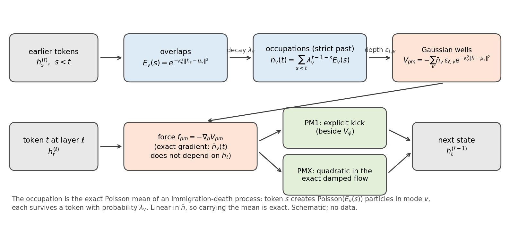
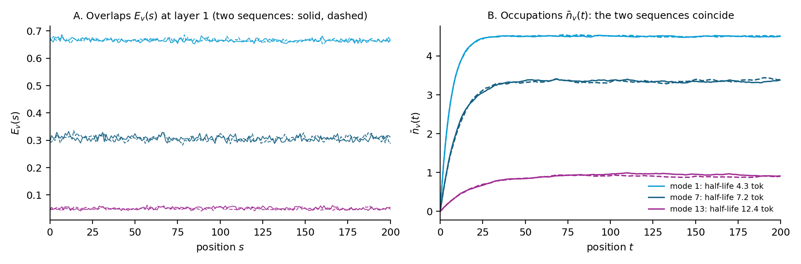
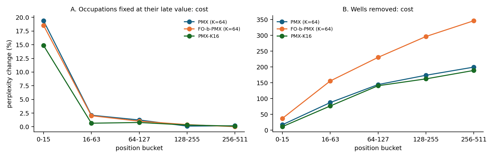
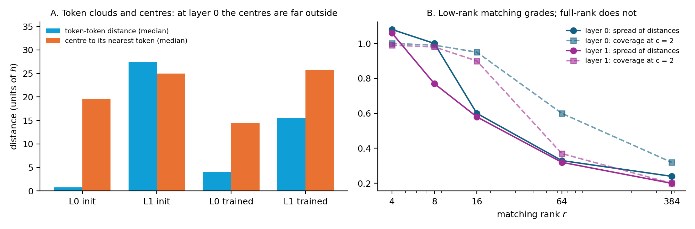
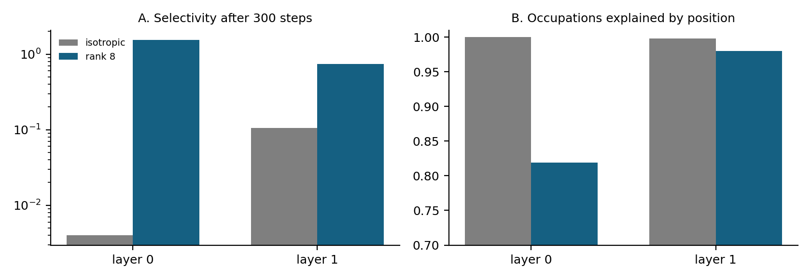
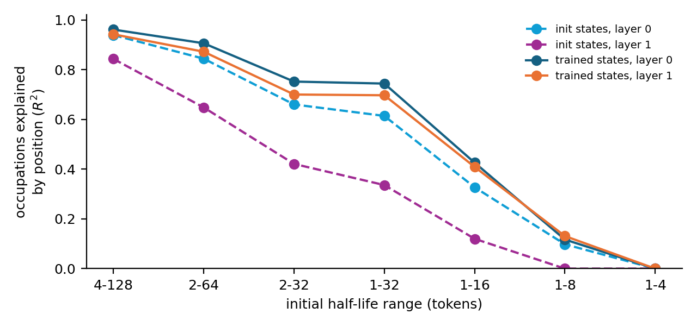

```{=openxml}
<w:p><w:pPr><w:pStyle w:val="Title"/></w:pPr><w:r><w:t>Deep Dive in the Poisson Mode Registers, Wells and Semantic Templates</w:t></w:r></w:p>
<w:p><w:r><w:t>Compiled by D. Gueorguiev, 10/23/2026</w:t></w:r></w:p>
<w:p/>
<w:sdt><w:sdtPr><w:docPartObj><w:docPartGallery w:val="Table of Contents"/><w:docPartUnique/></w:docPartObj></w:sdtPr><w:sdtContent>
<w:p><w:pPr><w:pStyle w:val="TOCHeading"/></w:pPr><w:r><w:t>Table of Contents</w:t></w:r></w:p>
<w:p><w:r><w:fldChar w:fldCharType="begin" w:dirty="true"/></w:r><w:r><w:instrText xml:space="preserve"> TOC \o "1-3" \h \z \u </w:instrText></w:r><w:r><w:fldChar w:fldCharType="separate"/></w:r><w:r><w:t>Right-click and choose Update Field to build the table of contents.</w:t></w:r><w:r><w:fldChar w:fldCharType="end"/></w:r></w:p>
</w:sdtContent></w:sdt>
<w:p><w:r><w:br w:type="page"/></w:r></w:p>
```

# The Poisson-Mode Registers and Wells

## Notation and Introductory Notes

This deep dive explains the Poisson-mode registers and the wells they create, as implemented in `model_parf_multixi.py` \[1\] and the ladder notebook \[2\], and the work that prepares them to serve as the matchers of semantic templates. It follows the notation of the book's §9 (paragraph *Poisson-mode registers: the bosonic v2, trained*, equations pm-occupation and pm-potential) \[3\] and of the SPLM deep dive \[4\]. Where the book writes the layer index as $l$, this document writes $\ell$, as the SPLM deep dive does.

### Architecture Hyperparameters

$d$ – hidden width; $d = 384$ in every Gen 3 arm discussed here. In code `cfg.d`.

$L$ – number of integration layers (trained layer steps); $L = 2$ in the 0.5B- and 2B-token arms. In code `cfg.L`; in the notebook `LADDER_L`.

$\Delta t$ – the trained layer step; $\Delta t = 4$, so the stack integrates over $L\,\Delta t = 8$. In code `cfg.dt`.

$K$ – number of Poisson modes, shared by the layers in the default design. In the notebook `POISSON_MODES` (0 = off; tag `pm<K>`); in code `cfg.poisson_modes`. The arms discussed use $K \in \{16, 64\}$; the dose-response adds $K = 2$.

$M$ – the number of a token's strongest wells whose rank part joins the exact flow under PMX. In the notebook `POISSON_WELLS_EXACT_MODES` (default 16); in code `cfg.poisson_wells_exact_modes`.

$[\tau_{\min}, \tau_{\max}]$ – the range, in tokens, over which the modes' initial half-lives are log-spaced. In the notebook `POISSON_HALFLIFE_MIN`, `POISSON_HALFLIFE_MAX` (defaults 4 and 128; tag `pmhl<min>t<max>` otherwise); in code `cfg.poisson_halflife_min`, `cfg.poisson_halflife_max`.

$r$ – the rank of the content-selective matcher (Stage 0′; see *The Narrow-Well Deliberations and Experiments*). In the notebook `POISSON_MATCH_RANK` (0 = off; tag `pmlr<r>`); in code `cfg.poisson_match_rank`.

$\gamma$ – the scalar damping of the second-order step; $\gamma = 0.1$. In code `cfg.fixed_gamma`.

$c_{\text{cap}}$ – an optional smooth bound on the well depths. In the notebook `POISSON_DEPTH_CAP` (None = off; tag `pmcap<cap>`).

### State Variables

$x$ – input token-id tensor; in code `x`. Shape: $(B, T)$.

$h_t^{(\ell)}$ – the state of token $t$ at the input of layer $\ell$, a point of the semantic space $\mathbb{R}^d$. In code `h` or `h_in`. Shape: $(B, T, d)$. At $\ell = 0$ it is the embedding of the token (not LayerNorm-scaled; see *Why the Trained Modes Cannot Match*); every later layer receives a LayerNorm-projected state of norm about $\sqrt{d} \approx 19.6$.

$v_t^{(\ell)}$ – the velocity carried between layers by the second-order step; in code `v`. A first-order (FO-b) model has none.

$\mathfrak{m}_t$ – the token's semantic mass; in code `m_b`. Shape $(B, T, 1)$.

$\xi_t$ – the context channels: five normalised causal exponential averages of earlier states, with trained decay coefficients near $(0.33, 0.52, 0.89, 0.99, 0.99)$; in code `xis`. They drive the wells of $V_\theta$, the core potential, not the Poisson-mode wells.

### Learnable Parameters of the Poisson Modes

$\mu_v \in \mathbb{R}^d$ – the centre of mode $v$. In code `pm_mu`, shape $(K, d)$, initialised from $\mathcal{N}(0, I)$, so $\lVert \mu_v \rVert \approx \sqrt{d}$. Under the content-selective matcher the centres are per layer, $\mu_{\ell,v}$, `pm_mu` of shape $(L, K, d)$.

$\kappa_v^2$ – the inverse squared width of mode $v$, stored as its logarithm. In code `pm_log_kappa2`, shape $(K,)$, initialised at $\ln \kappa_v^2 = -\ln d$, so the exponent of the overlap starts as $\lVert h - \mu_v \rVert^2 / d$.

$\lambda_v \in (0, 1)$ – the per-token survival probability of a particle in mode $v$, stored as a logit. In code `pm_logit_lambda`, shape $(K,)$. Its half-life is

$\tau_v = \dfrac{\ln 2}{-\ln \lambda_v},\qquad \lambda_v = 2^{-1/\tau_v}\qquad$(pm.1)

and the initial half-lives are log-spaced over $[\tau_{\min}, \tau_{\max}]$.

$\varepsilon_{\ell,v}$ – the depth of mode $v$'s well at layer $\ell$, of either sign: positive is attractive, negative repulsive. In code `pm_depth`, shape $(L, K)$, initialised at zero, so the wells exert no force at step 0. With a cap the depth the force uses is $a_{\ell,v} = c_{\text{cap}} \tanh(\varepsilon_{\ell,v}/c_{\text{cap}})$ (`pm_effective_depth`); without one $a_{\ell,v} = \varepsilon_{\ell,v}$.

Content-selective matcher only (Stage 0′): $P_\ell \in \mathbb{R}^{r \times d}$, a learned projection per layer (`pm_P`, shape $(L, r, d)$); $c_{\ell,v} > 0$, a learned width factor (`pm_log_c`, its logarithm, shape $(L, K)$); and two buffers, $\bar{D}^2_\ell$, a running median of the squared projected distance between tokens (`pm_D2`), and a flag that records whether layer $\ell$'s matcher has been initialised from data (`pm_match_ready`).

### Derived Quantities

$E_v(s)$ – the overlap of token $s$ with mode $v$, and the rate at which token $s$ creates particles in mode $v$ (the single-particle overlap identity of \[5\]):

$E_v(s) = \exp\!\left(-\kappa_v^2 \lVert h_s - \mu_v \rVert^2\right)\qquad$(pm.2)

In code `E`, shape $(B, T, K)$.

$\bar{n}_v(t)$ – the mean occupation of mode $v$ that token $t$ sees, built from the strict past:

$\bar{n}_v(t) = \sum_{s<t} \lambda_v^{\,t-1-s} E_v(s),\qquad \bar{n}_v(t+1) = \lambda_v \bar{n}_v(t) + E_v(t),\qquad \bar{n}_v(1) = 0\qquad$(pm.3)

In code `phi`, shape $(B, T, K)$. The book calls it the occupation; the code calls it `phi` for historical reasons.

$V_{\text{pm}}(h; t)$ – the potential of the Poisson-mode wells felt by token $t$ at layer $\ell$:

$V_{\text{pm}}(h; t) = -\sum_{v=1}^{K} \bar{n}_v(t)\, a_{\ell,v}\, e^{-\kappa_v^2 \lVert h - \mu_v \rVert^2}\qquad$(pm.4)

$w_v(t)$ – the weight of well $v$ in the force, and the token's force:

$w_v(t) = 2\kappa_v^2\, a_{\ell,v}\, \bar{n}_v(t)\, E_v(t),\qquad f_{\text{pm}}(h_t) = -\nabla_h V_{\text{pm}} = -\sum_v w_v(t)\,(h_t - \mu_v)\qquad$(pm.5)

In code `w` and `f`. The force is a pull of strength $w_v$ toward each centre (a push where $w_v < 0$).

$\alpha_t$, $r_v$, $\mathrm{d}W_v$ – the pieces of the wells' Hessian used by PMX: $\alpha_t = \sum_v w_v(t)$ (the isotropic curvature, `alpha`), $r_v = h_t - \mu_v$ (`r`) and $\mathrm{d}W_v = 2\kappa_v^2 w_v(t)$ (`dW`):

$\nabla_h^2 V_{\text{pm}} = \alpha_t I - \sum_v \mathrm{d}W_v\, r_v r_v^{\top}\qquad$(pm.6)

$x^{\ast}_v = 1/(\sqrt{2}\,\kappa_v)$ – the inflection radius of well $v$, where its pull is strongest.

### Diagnostic Quantities

$p_v$ – mode $v$'s share of the wells' force over the evaluated tokens, $p_v = \sum_t \lVert w_v(t)(h_t-\mu_v) \rVert / \sum_t \sum_u \lVert w_u(t)(h_t-\mu_u) \rVert$.

$N_{\text{eff}}$ – the effective number of modes in use:

$N_{\text{eff}} = \exp\!\left(-\sum_v p_v \ln p_v\right)\qquad$(pm.7)

It equals $K$ when every mode carries the same share and 1 when one mode carries all of it.

Selectivity – the median, over modes, of the coefficient of variation of the overlap across tokens, $\mathrm{std}_s E_v(s) / \mathrm{mean}_s E_v(s)$. Trained isotropic modes read 0.01–0.04.

Position share $R^2_{\text{pos}}$ – the share of the occupations' variance explained by position alone, each $\bar{n}_v(t)$ replaced by its mean over the *other* sequences at the same position.

Content swap – the perplexity change when every sequence is given another sequence's occupations (same positions, different content).

### Disambiguation: Registers, Modes and Wells

Three words are overloaded in this code base, and the deep dive keeps them apart.

*Register.* The Fock models have **slot registers**: $M$ always-occupied slots whose content is renewed layer by layer and which reach the tokens through the reverse channel. The **Poisson-mode registers** are a different mechanism: $K$ modes whose occupations are Poisson means. In this document "register" without a qualifier means the Poisson-mode register.

*Mode.* The integrator speaks of the **stiff modes** of $V_\theta$: the leading eigendirections of its curvature, which the exact flow integrates (`lr_U`, `lr_kappa`). A **Poisson mode** is a Gaussian cloud in $\mathbb{R}^d$ with an occupation. The two meet only in PMX, where a token's strongest Poisson wells join the stiff modes in one eigensolve.

*Well.* $V_\theta$ has its own wells: eight joint Gaussian attractors whose centres and precisions are read from the context channels $\xi$. The **Poisson-mode wells** are the $K$ Gaussian terms of (pm.4), whose depths are occupations. In this document "the wells" means the Poisson-mode wells.

## Principle of Operation



### From Slot Registers to Poisson Modes

Book Remark rem:dp-registers measured what the trained slot registers implement: their active fraction is 0.9995–1.000 at every layer, so their particle number never changes, and their salience is not an intensity. The Poisson-mode registers were built to make both hold by construction. Each token creates particles in each mode at a rate equal to its overlap with the mode, and each particle survives from one token to the next with probability $\lambda_v$. That is an immigration–death process, one per mode, and the token at $t$ feels Gaussian wells whose depths are the current occupations.

### The Occupation Is a Poisson Mean

Book Proposition prop:pm-poisson states that if mode $v$ receives at token $s$ a Poisson-distributed number of particles with mean $E_v(s)$, and every particle survives each token independently with probability $\lambda_v$, then the number of particles at token $t$ is Poisson with mean $\bar{n}_v(t)$ of (pm.3), independently across modes. The proof is a binomial thinning argument (Appendix A1). The consequence for the code is that carrying the mean is exact: the potential (pm.4) is linear in the occupation, so the expected force over the particle process equals the force of the mean, and no sampling is needed.

The occupation uses the strict past ($s < t$). It therefore does not depend on $h_t$, and the force (pm.5) is the exact gradient in $h_t$ of a potential: the wells keep the model conservative. The loss still reaches earlier tokens through $\bar{n}_v(t)$ (the *live* gradient convention of Gen 3).

### The Wells and Their Force

Each well is a Gaussian with centre $\mu_v$ and width $1/\kappa_v$, scaled by the occupation and the depth. Its pull on a token at distance $\rho$ is proportional to $\rho\, e^{-\kappa_v^2 \rho^2}$, zero at the centre, largest at the inflection radius $x^{\ast}_v$, and negligible a few widths out. A positive depth attracts; a negative depth repels. Earlier context deepens the wells that later tokens fall into, and the half-life sets how long a deposit lasts.

### Two Ways to Integrate the Wells: PM1 and PMX

**PM1** adds $f_{\text{pm}}$ to the conservative force beside the pair force $f_\phi$, as a plain kick: the integrator treats it like any other force evaluated at the step's midpoint.

**PMX** integrates the wells exactly. At the start of each layer step it freezes the wells' quadratic, (pm.6) at $h_0 = h_t$ with the occupations fixed, and joins it to $V_\theta$'s retained low-rank modes in one frozen spring on all of $\mathbb{R}^d$:

$K_{\text{spring}} = \alpha_t I + U\,\mathrm{diag}(\kappa)\,U^{\top},\qquad \mathfrak{m}\,\ddot{x} = f - K_{\text{spring}}(x - h_0) - \gamma\,\mathfrak{m}\,\dot{x}\qquad$(pm.8)

The columns of $U$ span $V_\theta$'s retained stiff modes and the rank part of the token's $M$ strongest wells; the modes in that span have stiffness $\kappa + \alpha_t$ and the complement $\alpha_t$, either sign. The flow is solved in closed form for every damping regime (Appendix A2), so damping is exact on the whole space and no separate friction (O) step is applied. What the frozen quadratic misses, the remainder of the wells' force and $V_\theta$'s soft modes, stays in the kick.

### First Order: FO-b on the Well Base

The first-order twin FO-b replaces (pm.8) by the gradient flow with the same frozen spring, $\dot{x} = \mu_{\text{FO}}\,(f - K_{\text{spring}}(x - h_0))$ with mobility $\mu_{\text{FO}} = \Delta t/(2\mathfrak{m})$, solved exactly per direction (Appendix A3), and carries no velocity between layers.

## The Code: model_parf_multixi.py

### Configuration Fields

The configuration class documents the mechanism where it declares it. The comment on `poisson_modes` states the process and why the mean is exact:

@@code notebooks/conservative_arch/parf/model_parf_multixi.py | # PM1 \(protocol SS5.15, 2026-10-05\): bosonic Poisson-mode registers | poisson_modes: int = 0@@

The half-life range and the PMX switches:

@@code notebooks/conservative_arch/parf/model_parf_multixi.py | poisson_halflife_min: float = 4.0 | poisson_halflife_max: float = 128.0@@

@@code notebooks/conservative_arch/parf/model_parf_multixi.py | # PMX \(protocol SS5.15, 2026-10-10\): integrate the Poisson-mode wells | poisson_wells_exact_modes: int = 16@@

### Construction of the Parameters

The parameters are created only when the modes are switched on, so the default model draws the same random stream and keeps the same `state_dict` (every existing arm stays bit-identical). The depths start at zero, so the force is exactly zero at step 0 and the depths receive a gradient from step 1:

@@code notebooks/conservative_arch/parf/model_parf_multixi.py | # PM1 Poisson-mode registers. Created ONLY when enabled | self.register_buffer\("pm_share"@@

Two details matter later. The centres are drawn at the LayerNorm scale (`|mu| ~ sqrt(d)`), which is the scale of layer 1's input but not of layer 0's (see *Why the Trained Modes Cannot Match*). And one set of centres and widths serves both layers; only the depths are per layer.

### The Occupation: poisson_mode_occupation

The overlap (pm.2) is computed from the expansion $\lVert h - \mu \rVert^2 = \lVert h \rVert^2 + \lVert \mu \rVert^2 - 2\,h\cdot\mu$, clamped at zero against round-off, in float32 with autocast disabled:

@@code notebooks/conservative_arch/parf/model_parf_multixi.py | def poisson_mode_occupation\(self | return E, phi@@

The occupation (pm.3) is computed as a matrix product rather than by the recursion: a $(K, T, T)$ tensor of decay factors $\lambda_v^{t-1-s}$, masked to $s < t$, contracted with the overlaps. This is parallel over positions and exact; the decay tensor holds $K T^2$ floats, shared by the batch: about 17 MB at $K = 16$ and $T = 512$, 67 MB at $K = 64$:

@@code notebooks/conservative_arch/parf/model_parf_multixi.py | def _pm_occupation_from_overlap | return torch.einsum\("kts,bsk->btk", Lam, E\)@@

`logsigmoid` gives $\ln \lambda_v$ directly from the logit, so $\lambda_v$ stays in $(0, 1)$ without clipping.

### The Force: poisson_mode_force

The force (pm.5) is evaluated in closed form, with no autograd: $f = -\left(\left(\sum_v w_v\right) h - \sum_v w_v \mu_v\right)$, which is `-(w.sum(-1) * h - w @ mu)`:

@@code notebooks/conservative_arch/parf/model_parf_multixi.py | def poisson_mode_force | ^        return f.to\(h.dtype\)\s*$@@

The `_flow_ctx` branch serves the per-layer flow test (FLOW-R): when a layer is refined into several substeps, the occupations are frozen at the layer's first substep, as the trained step freezes them. The first branch is the content-selective matcher (*Implementation: poisson_match_rank*).

The effective depth applies the optional cap:

@@code notebooks/conservative_arch/parf/model_parf_multixi.py | def pm_effective_depth | return a\s*$@@

### Where the Force Enters: _layer_forces

`_layer_forces` returns the conservative force at a point. The wells' force is added to the pair force $f_\phi$, and its size relative to the rest is recorded per layer (`pm_share`, logged during training):

@@code notebooks/conservative_arch/parf/model_parf_multixi.py | # PM1: the Poisson-mode force, a plain kick | f_phi = f_phi \+ _f_pm@@

Under PM1 this is the whole story: the kick carries the wells. Under PMX the exact flow carries their quadratic and the kick subtracts what the flow already integrated (below).

### The Wells' Quadratic: poisson_mode_quadratic

PMX needs, at the step's start, the force and the Hessian pieces of (pm.6). The rank part is returned only for the token's `top` wells with the largest force $\lvert w_v \rvert\, \lVert r_v \rVert$, because the batched eigensolvers on the GPU stop at $32 \times 32$ and $V_\theta$ already uses up to 16 of those dimensions:

@@code notebooks/conservative_arch/parf/model_parf_multixi.py | def poisson_mode_quadratic | return F, alpha, r, dW@@

### The PMX Layer Step

In `_layer_step_langevin` the wells' quadratic joins $V_\theta$'s retained modes. `indefinite_lowrank_modes_chol` builds an orthonormal basis of $\mathrm{span}[U_\theta, r_v]$ and the eigenpairs of the combined spring on it, with signs $+1$ for $V_\theta$'s modes and $-\mathrm{d}W_v$ for the wells. `_pm_quad_force` is the linearised wells' force the flow carries, $F(h_0) - H(h - h_0)$:

@@code notebooks/conservative_arch/parf/model_parf_multixi.py | if pmx:\s*$ | return \(pm_F0 - Hdh\).to\(hh.dtype\)@@

The A substep then calls the exact damped flow with the combined spring and the force at the substep's start:

@@code notebooks/conservative_arch/parf/model_parf_multixi.py | h_mid, v_mid = lowrank_iso_damped_substep\( | m_b, gamma, half, pm_nterms,@@

and the kick between the two A substeps removes the part of the force the flow already carries, so nothing is counted twice:

@@code notebooks/conservative_arch/parf/model_parf_multixi.py | # the exact flow carries Vtheta's retained-mode force and the | f_kick = f_kick - \(_th_proj\(f_L_mid\) \+ _pm_quad_force\(h_mid\)\)@@

### The Exact Substeps in cfc_baoab.py

The damped substep projects the velocity and force onto $\mathrm{span}(U)$ and its complement, and applies to each the closed-form flow of a damped oscillator with the corresponding stiffness (Appendix A2) \[6\]:

@@code notebooks/conservative_arch/parf/cfc_baoab.py | ^def lowrank_iso_damped_substep\( | return h_new, v_new@@

The first-order counterpart moves each direction by $\mu_{\text{FO}}\Delta t\,\varphi(\mu_{\text{FO}} k \Delta t)$ times its force component, $\varphi(x) = (1 - e^{-x})/x$ (Appendix A3):

@@code notebooks/conservative_arch/parf/cfc_baoab.py | ^def lowrank_iso_overdamped_substep\( | return h \+ torch.einsum\('...dq,...q->...d', U, dz\) \+ dc@@

and the FO-b layer step is A–B–A: exact relaxation over $\Delta t/2$, one gradient step on everything the relaxation does not integrate, relaxation again, and zero velocity into the next layer:

@@code notebooks/conservative_arch/parf/model_parf_multixi.py | def _overdamped_step\( | return h_new, h_new@@

### The Notebook: Switches, Tags and Guards

Every switch in Cell 0 is off by default, and every non-default value adds a part to the run's tag, which names its Drive folder. A run with a new setting therefore never resumes another run's checkpoint:

@@code notebooks/conservative_arch/scaleup/colab_fock_cfc_baoab_lowrank_depth_ladder_openwebtext_d384.ipynb | ^POISSON_MODES        = 0 | ^POISSON_HALFLIFE_MAX = 128.0 | cell=# == Cell 0:@@

@@code notebooks/conservative_arch/scaleup/colab_fock_cfc_baoab_lowrank_depth_ladder_openwebtext_d384.ipynb | ^if POISSON_MODES: | _variant_parts.append\(f'pmlr\{POISSON_MATCH_RANK\}'\) | cell=# == Cell 0:@@

Cell 5 passes the switches to the configuration (older Cell 0 versions without the newest switches still run, through `globals().get`), and Cell 5b refuses to train a model whose tag or built configuration disagrees with Cell 0:

@@code notebooks/conservative_arch/scaleup/colab_fock_cfc_baoab_lowrank_depth_ladder_openwebtext_d384.ipynb | ^    _pmhl = \( | 'repo model files predate PM1 \(git pull\).'\) | cell=# == Cell 5b:@@

The wells' parameters have their own gradient-clipping group: every parameter whose name starts with `pm_` is clipped at `POISSON_MODE_CLIP` (0.3), separately from the default group (1.0).

## What the Trained Wells Do

The measurements below were made on the best checkpoints of three arms at 0.53B tokens: PMX ($K = 64$, exact wells, second order), FO-b-PMX (its first-order twin) and PMX-K16 ($K = 16$). The tools are listed in *The Diagnostic Tools* below.

### Position, Not Content



The trained modes barely discriminate between tokens. A mode's overlap varies by 1–4% from token to token (selectivity 0.01–0.04), so its occupation is close to the deterministic curve

$\bar{n}_v(t) \approx \bar{E}_v\,\dfrac{1 - \lambda_v^{\,t-1}}{1 - \lambda_v}\qquad$(pm.9)

with $\bar{E}_v$ the mode's average overlap: a function of the position alone. The figure shows it: two different texts give occupation curves that coincide. Rebuilt from position alone, the wells' force reproduces 99.8–99.98% of its variance, and giving a sequence another text's occupations changes perplexity by 0.02–0.09%, while removing the wells costs 155–282%. The models rely on the wells, but not on any memory of content.

The model has no positional encoding, and the context channels $\xi$ are normalised averages, which carry almost no position signal. The un-normalised occupations are its only explicit clock.

### A Fixed Landscape Beyond the First Tokens



An occupation rises over a few half-lives and then levels off (trained half-lives are 3–20 tokens). Replacing every occupation by one position-independent value, its mean over positions 256–511, costs about 1% overall: 15–19% in the first 16 tokens, about 2% up to position 63, and nothing from position 128 on. Removing the wells, by contrast, costs more the later the position. So, at 0.53B tokens, the wells act mainly as a **fixed extra potential**, $K$ Gaussian wells per layer with learned centres, widths and per-layer depths added to $V_\theta$'s context-driven wells, with a start-of-sequence correction on top (Appendix A7).

### Sixteen Modes Against Sixty-Four

| reading | PMX-K16 | PMX ($K=64$) | FO-b-PMX ($K=64$) |
|:---|---:|---:|---:|
| settled perplexity | 54.24 | 54.63 | 54.02 |
| velocity reset (Gate 1) | +5,788% | +91% | 0 by construction |
| stiffest-mode $\omega\Delta t$, median | 3.65 | 2.65 | |
| attractive depths, layer 0 / layer 1 | 19% / 94% | 50% / 48% | 64% / 61% |
| $N_{\text{eff}}$, layer 0 / layer 1 | 11.0 / 13.6 of 16 | 39.8 / 36.7 of 64 | 48.4 / 39.1 of 64 |
| force reproduced from position | 99.96% | 99.89% | 99.82% |

Sixteen modes give the second-order model the same perplexity as sixty-four, as a smooth positional potential needs few functions. The organisation differs: with fewer wells the model leans about sixty times as much on its velocity and its stiff rotation, and its wells split by layer (repulsive at layer 0, attractive at layer 1).

### The Diagnostic Tools

All of them run on CPU from a downloaded run folder (`ckpt=` selects a snapshot, `folder=` another arm; $K$ is read from the folder's `pm<K>` tag) \[7\]:

- `pm_mode_usage.py`: $N_{\text{eff}}$, $N_{80}$, per-token $N_{\text{eff}}$, selectivity, the overlap exponent, attractive shares, half-lives, and the position-only reconstruction.
- `pm_content_swap.py`: occupations from another sequence, averaged by position, or zero.
- `pm_static_landscape.py`: occupations fixed at their late value, everywhere or from $t = 128$, by position bucket.
- `mechanism_ablations.py`: the content paths ($\xi$ swapped, its context channels only, $V_\phi$ off, the wells swapped or off).
- `vtheta_omega_dt.py`: $V_\theta$'s stiffest-mode $\omega\Delta t$ with one definition for both orders.
- `run_diag_cell_cpu.py`: any notebook diagnostic cell, unchanged, on CPU.

The hook each of them uses is one line, because every path that computes occupations goes through `_pm_occupation_from_overlap` (or `poisson_mode_occupation` in the isotropic design). The content swap, for example:

@@code notebooks/conservative_arch/scaleup/debug/pm_content_swap.py | ^orig_occ = model.poisson_mode_occupation | ^model.poisson_mode_occupation = occ@@

# Toward Semantic Templates

## What a Template Needs

A semantic template pairs a Pattern Matching Structure with an Inference Structure (book Definition 8). In reaction form it is catalytic and non-consuming \[8\]:

$\sum_v k_v A_v \longrightarrow \sum_v (k_v + l_v)\, A_v\qquad$(pm.10)

where $A_v$ is a particle in mode $v$, $k_v$ the number the template requires and $l_v$ the number it produces. The bank of all templates, together with transport and destruction, is the complete Liouvillian of the dynamics, so a bank cannot be hard-coded without hard-coding the whole inference dynamics, including the prior: templates with trivial matchers reduce to spontaneous creation $\varnothing \to A_v$, whose stationary state is Poisson with mean $c/d$ (creation over destruction rate).

### Anatomy: Three Kinds of Parameter

*Continuous, already differentiable.* The hard firing threshold of the original template apparatus is the zero-temperature limit of a rate:

$r_{\mathcal{T}} = r_0\, \sigma\!\left(\beta(\mathrm{BC} - \Theta)\right) \longrightarrow r_0\, \mathbb{1}[\mathrm{BC} > \Theta]\quad (\beta \to \infty)\qquad$(pm.11)

with $\mathrm{BC}$ the Bhattacharyya coefficient between the template's cloud and the local state. Made bilinear, the matcher's threshold is a binding radius in inflection radii:

$\mathrm{BC} > \Theta \iff \dfrac{\rho}{x^{\ast}} < \sqrt{2 \ln(1/\Theta)}\qquad$(pm.12)

so learning $\Theta$ is learning how far a template reaches, with the same $\kappa$ that sets a well. The price of sharpness is that the gradient that trains $\Theta$ and the centroid vanishes as $\beta$ grows, so annealing $\beta$ is the central training schedule.

*Discrete, but relaxable.* The stoichiometry $(k, l)$ is combinatorial. Read as intensities over modes, $k, l \in \mathbb{R}_{\ge 0}^{K}$ (the relaxation the occupations already use: an intensity instead of a count), a template becomes a learned vector field on mode space, parameterised through softplus; sparsity is top-$k$ routing over the bank (the straight-through Gumbel machinery the pair potential already uses), and low-rank $(k, l)$ is a precondition for trainability.

*Neither.* The pairing of the matched structure with the created one is a correspondence, not a density, and has no formulation yet. A placement map $\mu_{\text{new}} = \mu_{\text{match}} + \delta_{\mathcal{T}}$ is the weak baseline to falsify first.

### Tiers and Stages

Templates learned at training and fired at inference (Tier 1) are reachable; templates induced from context with no weight update (Tier 2) are the real target. The staging of the implementing note \[8\]:

- **Stage 0, make creation real:** an active fraction that varies, and a salience that behaves as an intensity (the slot registers fail both).
- **Stage 0′, make matching real:** modes whose overlaps discriminate between tokens, and a model that uses them (*The Narrow-Well Deliberations and Experiments*).
- **Stage 1:** one catalytic template $A_u \to A_u + A_v$, with the built-in check that unconditional templates reproduce the log-unigram bias.
- **Stage 2:** a bank (Gumbel top-$k$, low-rank $(k,l)$, placement map), tested on the Dyck falsifier F1.
- **Stage 3:** induction.

## Modes as Matchers: Form Without Function

A trained Poisson mode has the form of a template's matching half:

| a template has | a trained Poisson mode has |
|:---|:---|
| a pattern, a density over $\Sigma$ | a centre $\mu_v$ and width $\kappa_v$: a Gaussian cloud |
| a trigger at a threshold $\Theta$ | the overlap $E_v(t)$ against a radius |
| a firing record | the occupation $\bar{n}_v(t)$, decaying with $\lambda_v$ |
| slots (dummy particles) | none: one centre |
| an inference region that writes a structure | none: it deepens a well |

As trained it does not have the function. A matcher must respond to some tokens and not others; the trained modes respond to every token about equally (*Position, Not Content*). That is why Stage 0′ exists: before a bank of modes can serve as matchers, they have to be made selective, and the model has to use the selectivity.

## The Narrow-Well Deliberations and Experiments

### Why the Trained Modes Cannot Match

The analysis `narrow_wells_design.py` measured the geometry of states and centres at initialisation and after training \[9\]. Three findings, each sufficient on its own:

1. **The centres sit outside the token cloud.** Layer 0's input is the token embedding: median norm 0.6 at initialisation and 2.9 trained, the whole cloud spanning 1–4 units. The centres sit at the LayerNorm scale, norm 19 at initialisation and 14 trained. Every token is then 14–19 units from every centre, the same distance to within 0.1–0.4. No width makes such a mode selective, and training did not move the centres in.
2. **One set of centres cannot serve two layers.** Layer 1's input lies on the LayerNorm sphere (norm 19.6), far from layer 0's small cloud near the origin.
3. **In 384 dimensions an isotropic Gaussian cannot grade.** Even with centres placed on trained token states, the token-to-centre distances spread by only 20–24% of their median (Appendix A4). Halving the width moves a mode from reaching 97–100% of tokens to reaching 1–6%.



### Low-Rank Matching

Measured in an $r$-dimensional subspace, the distances spread out. With $r = 8$ the spread is 0.77–1.00 of the median, a mode reaches a graded 6–15% of tokens, and 94–99% of tokens reach some mode. The design that follows matches each layer in its own learned subspace:

$E_{\ell,v}(s) = \exp\!\left(-\kappa_{\ell,v}^2 \lVert P_\ell (h_s - \mu_{\ell,v}) \rVert^2\right),\qquad \kappa_{\ell,v}^2 = \dfrac{c_{\ell,v}}{\bar{D}^2_\ell}\qquad$(pm.13)

The potential is still a scalar function of $h$, so the force stays conservative; differentiating (pm.13),

$f_{\text{pm}}(h_t) = -P_\ell^{\top} \sum_v w_v(t)\, P_\ell (h_t - \mu_{\ell,v}),\qquad w_v(t) = 2\kappa_{\ell,v}^2\, a_{\ell,v}\, \bar{n}_v(t)\, E_{\ell,v}(t)\qquad$(pm.14)

whose curvature lies in the $r$-dimensional span of $P_\ell^{\top}$. The width follows the cloud through the running median

$\bar{D}^2_\ell \leftarrow \beta_D\, \bar{D}^2_\ell + (1 - \beta_D)\, \mathrm{median}_{s \neq s'} \lVert P_\ell (h_s - h_{s'}) \rVert^2,\qquad \beta_D = 0.99\qquad$(pm.15)

because layer 0's cloud grows about fivefold in training, and a width fixed in absolute units would end too narrow.

### Implementation: poisson_match_rank

`_pm_match` implements (pm.13). On the first training forward of each layer it sets the layer's projection, centres and width scale from the token states it receives, without gradient and without drawing from the global random stream; afterwards it updates (pm.15):

@@code notebooks/conservative_arch/parf/model_parf_multixi.py | def _pm_match\(self | return torch.exp\(-k2 \* d2\), z, m, k2@@

The force (pm.14) is the first branch of `poisson_mode_force` shown in *The Force: poisson_mode_force*: `fz = -(w.sum(-1) * z - w @ m)` in the projected coordinates, mapped back by `fz @ P`. The exact (PMX) path refuses the new mode explicitly (`poisson_mode_quadratic` raises), so the first trained test runs on the explicit kick.

Two changes against the first design came from the checks. **Centres by k-means, not random samples:** at initialisation the projected cloud is a dense core holding about 75% of the tokens plus small tight clusters (most likely the frequent tokens' random embeddings), and 16 random samples left about 15% of the tokens unreached; k-means in the projected subspace reaches all of them (Appendix A6). **A starting width factor $c = 1$:** it keeps selectivity at 0.5 or more and coverage at 100% for both $K = 16$ and $K = 64$.

### Verification

`verify_pm_match.py` checks the change in three modes \[10\]. *Fingerprint:* with the switch off, four existing configurations (F3.1, PM1, PMX-K16, FO-b-PMX-K16) built from the notebook's cells at seed 0 reproduce the committed code exactly (loss, logits checksum, every parameter, every gradient, every tag), compared against a checkout of HEAD. *Checks*, with $r = 8$, $K = 16$, in both orders: the force equals $-\nabla_h V_{\text{pm}}$ by autograd to about $10^{-7}$; selectivity at initialisation is 3.2–3.6 with 100% coverage and about five modes per token; every new parameter has a finite, non-zero gradient after one optimizer step; the running width moves in training and not in evaluation. *Planned:* the two configurations of the 2B template pair build from the notebook's cells and pass Cell 5b.

### The Short Training Run



Two arms trained from scratch on CPU for 300 steps of $4 \times 256$ tokens, identical except for the matcher (`pm_match_short_train.py`). After 300 steps the rank-8 selectivity is 1.54 at layer 0 and 0.74 at layer 1, against 0.004 and 0.11 for the isotropic modes; at layer 0 the occupations are 81.9% position (100.00% isotropic), at layer 1 98.0%; the content swap costs +0.08% (spread 0.20%), not yet a use of the content. The selectivity survives early training; whether a full run uses it is the trained test's question.

### The Half-Life Range

Selective overlaps are necessary, not sufficient. An occupation sums a mode's overlaps over its half-life window, and the sum averages token-level variation away (Appendix A5). `pm_halflife_range.py` measured the position share by initial range:



At the default 4–128 tokens the occupations stay 94–96% position even with selective overlaps; at 1–16 they are 41–43% position on the trained geometry, leaving 57–59% of their variance for content with a 16-token horizon. Trained models had already moved 4–128 to about 4–16 on their own (PMX-K16: p05 4.2, median 7.9, p95 15.7). The 2B template pair therefore uses 1–16.

# The 2B-Token Run

## Why 2B, and What It Must Decide

The calls of the book rest on 0.53B-token runs. Using a memory of content is a learned behaviour that may appear late, so a negative at 0.53B would not separate the design from the budget; the isotropic wells already gave one such result (broad and content-blind at 0.5B). A 2B run with snapshots gives an emergence curve instead of an endpoint. It decides three things: whether the potential still falls along every trained step (the basis of a native hallucination detector), whether the trained map moves toward or away from its continuous law as training lengthens, and whether the wells start to remember content.

## The Schedule and the Snapshots

Each 2B arm uses its 0.5B Cell 0 plus `LADDER_STEPS = 130_000`: 2.13B tokens, about 1.07 passes over the 2.0B-token pool. The WSD fractions are unchanged (`WSD_WARMUP_FRAC = 0.05`, `WSD_STABLE_FRAC = 0.60`), so warm-up ends at step 6,500, the stable phase at 84,500 and the decay at 130,000, with peak learning rate $1.2\times10^{-3}$ and floor $6\times10^{-5}$.

### Snapshot Code (Cell 6)

`SNAPSHOT_STEPS` lists the steps at which a weights-only checkpoint is written (no optimizer state, about 0.3 GB each), named `<prefix>_step<N>_snap.pt`, kept for good and never used to resume. The 2B grid is

`[6_500, 16_500, 32_500, 48_500, 65_000, 84_500, 97_500, 113_500, 130_000]`

the end of warm-up; four points in the stable phase, of which 32,500 is the 0.5B arms' token count; the start of the decay; two in the decay; and the end. With the default `[]` the save branch is never entered:

@@code notebooks/conservative_arch/scaleup/colab_fock_cfc_baoab_lowrank_depth_ladder_openwebtext_d384.ipynb | # training-trend snapshot \(2026-10-22\) | print\(f'\[WARN\] Snapshot NOT saved | cell=# == Cell 6:@@

### Reading a Snapshot: ckpt= and the Harness

Every CPU tool loads a model through one function, `verify_pm_switch.build`, which executes the notebook's own Cells 0–5b with the arm's Cell 0 replacements and loads a checkpoint from the run folder. It takes a file name, so any snapshot can be read:

@@code notebooks/conservative_arch/scaleup/debug/verify_pm_switch.py | ^def build\(folder, repl, ckpt=None\): | ck = torch.load\(g\['CKPT_DIR'\] / \(ckpt or f'\{pfx\}_best.pt'\)@@

## Per-Snapshot Diagnostics

At every snapshot of every arm, on CPU:

| id | measurement |
|:---|:---|
| D-a | perplexity on Cell 6b-7's 12 fixed batches |
| D-b | the per-layer flow: penalties at $N = 4$–16, convergence, standard refinement |
| D-c | the descent readout: direction and distance against the continuous law, the potential along the trained step, a force-based basin |
| D-d | $\omega\Delta t$ of each token's stiffest mode, per layer |
| D-e | the wells: depths, half-lives, force shares, $N_{\text{eff}}$; for the template pair also selectivity, the position share and the content-swap cost |
| D-f | Gates 1–3 at 32,500, 84,500 and 130,000 |

## The Planned Template Pair

The trained test of Stage 0′ is a pair at 2B tokens, identical except for the matcher, both on PMX-K16's base with explicit wells and the 1–16 range:

| arm | tag | parameters |
|:---|:---|---:|
| template | `…pm16_pmhl1t16_pmlr8_sr2_st130000…` | 76,590,622 |
| isotropic control | `…pm16_pmhl1t16_sr2_st130000…` | 76,578,318 |

Cell 0 for both: PMX-K16's list (`REVERSE_CHANNEL = False`; `VPHI_GRAD_PATH`, `XI_GRAD_PATH = 'live'`; `POISSON_MODES = 16`; `LOWRANK_DAMPED_FLOW = True`; `VPHI_ANALYTIC_FORCE = True`; `LAYER_CHECKPOINT = False`) with `POISSON_WELLS_EXACT` left `False`, plus `POISSON_HALFLIFE_MIN = 1.0`, `POISSON_HALFLIFE_MAX = 16.0`, `LADDER_STEPS = 130_000` and the snapshot list; the template arm adds `POISSON_MATCH_RANK = 8`. The configurations are built and checked by:

@@code notebooks/conservative_arch/scaleup/debug/verify_pm_match.py | ^if MODE == 'planned': | ^    sys.exit\(0\)@@

## Pre-Registered Calls

The 2B calls were registered before any 2B run (protocol §5.13, TL) \[11\]:

| id | prediction | called |
|:---|:---|---:|
| TL1 | the potential falls along the trained step for at least 99% of tokens at both layers, at every snapshot from 16,500 on | 80% |
| TL2 | the per-layer flow penalty at $N = 16$ is larger at 84,500 than at 32,500 in at least three of four arms | 60% |
| TL3 | first order departs from its continuous law more than second order, in both pairs | 55% |
| TL4 | layer 0 stays a descent: the first-order arms' median direction cosine at least 0.95 | 70% |
| TL5 | the second-order arm gains more in the decay phase, in both pairs | 65% |
| TL6 | SR2-2B is more than 4.9% better than FO-b-2B | 50% |
| TL7 | $N_{\text{eff}}$ rises from 32,500 to 84,500 in both $K = 64$ arms | 55% |
| TL8 | $N_{\text{eff}}$ at 130,000 exceeds the 0.5B value in both $K = 64$ arms | 60% |
| TL9 | the first-order arm's $N_{\text{eff}}$ exceeds its twin's at both layers | 55% |
| TL10 | the content swap costs more than 0.5% at 130,000 in at least one $K = 64$ arm | 35% |

The template pair's own calls are to be registered when it is scheduled.

## Paired Evaluation: the Shared Random Stream

One generator, seeded by `SEED`, serves both the training batches and the evaluation batches (Cell 6: `rng = np.random.default_rng(SEED)`; `evaluate()` draws from the same `rng`). Every run trained from step 0 at the same seed therefore sees the same training data in the same order and the same evaluation batches at each step, and comparisons between such runs are paired. The step-to-step changes of the evaluations correlate at 0.92–0.99 across arms, and a paired difference between two arms is resolved to 0.1–0.3% where the unpaired settled values carry about ±1.2% of evaluation noise (Appendix A8). A resumed run (PMX at $K = 64$, resumed at step 8,500) draws different batches after the resume. The template pair is to be trained from step 0, so that its two arms are paired.

# References

\[1\] [notebooks/conservative_arch/parf/model_parf_multixi.py](https://github.com/dimitarpg13/semsimula-paper/blob/main/notebooks/conservative_arch/parf/model_parf_multixi.py)

\[2\] [notebooks/conservative_arch/scaleup/colab_fock_cfc_baoab_lowrank_depth_ladder_openwebtext_d384.ipynb](https://github.com/dimitarpg13/semsimula-paper/blob/main/notebooks/conservative_arch/scaleup/colab_fock_cfc_baoab_lowrank_depth_ladder_openwebtext_d384.ipynb)

\[3\] Semantic Simulation: Prescriptive Lagrangian Framework, D. Gueorguiev, paper v6, §9 (Poisson-mode registers) and §26.9 (memory substitution), 2026

\[4\] Deep Dive in the SPLM model and code, D. Gueorguiev, 2026 (companion_notes/deep_dives)

\[5\] [The Single-Particle Hilbert Space in the Semantic Simulation Framework](https://github.com/dimitarpg13/semsimula-paper/blob/main/companion_notes/Single_Particle_Hilbert_Space_in_Semantic_Simulation.md), companion note

\[6\] [notebooks/conservative_arch/parf/cfc_baoab.py](https://github.com/dimitarpg13/semsimula-paper/blob/main/notebooks/conservative_arch/parf/cfc_baoab.py)

\[7\] [notebooks/conservative_arch/scaleup/debug/](https://github.com/dimitarpg13/semsimula-paper/tree/main/notebooks/conservative_arch/scaleup/debug) (pm_mode_usage.py, pm_content_swap.py, pm_static_landscape.py, mechanism_ablations.py, vtheta_omega_dt.py, run_diag_cell_cpu.py)

\[8\] [Implementing Semantic Templates: A Path](https://github.com/dimitarpg13/semsimula-paper/blob/main/companion_notes/Implementing_Semantic_Templates_A_Path.md), companion note; and [Semantic Templates as Doi–Peliti Reactions](https://github.com/dimitarpg13/semsimula-paper/blob/main/companion_notes/Semantic_Templates_as_Doi_Peliti_Reactions.md)

\[9\] [debug/narrow_wells_design.py](https://github.com/dimitarpg13/semsimula-paper/blob/main/notebooks/conservative_arch/scaleup/debug/narrow_wells_design.py) and its output narrow_wells_design_output.txt

\[10\] [debug/verify_pm_match.py](https://github.com/dimitarpg13/semsimula-paper/blob/main/notebooks/conservative_arch/scaleup/debug/verify_pm_match.py), [debug/pm_match_short_train.py](https://github.com/dimitarpg13/semsimula-paper/blob/main/notebooks/conservative_arch/scaleup/debug/pm_match_short_train.py), [debug/pm_halflife_range.py](https://github.com/dimitarpg13/semsimula-paper/blob/main/notebooks/conservative_arch/scaleup/debug/pm_halflife_range.py)

\[11\] [Depth Ladder and Matched Baseline Protocol](https://github.com/dimitarpg13/semsimula-paper/blob/main/companion_notes/Depth_Ladder_and_Matched_Baseline_Protocol.md), §5.13 (MS, TL, the K = 16 pair and the wells' results)

\[12\] [A Community of Semantic Templates as the Source of Native Chain-of-Thought](https://github.com/dimitarpg13/semsimula-paper/blob/main/companion_notes/Community_of_Semantic_Templates_for_Native_CoT.md), companion note

\[13\] [Doi–Peliti Dynamics of Semantic Particles and Registers](https://github.com/dimitarpg13/semsimula-paper/blob/main/companion_notes/Doi_Peliti_Dynamics_of_Semantic_Particles_and_Registers.md), companion note

# Appendix

## A1. The Poisson Thinning Argument

Let $N_s$ be the number of particles that token $s$ creates in mode $v$, $N_s \sim \mathrm{Poisson}(E_v(s))$, and let each survive every later token independently with probability $\lambda_v$. The survivors from token $s$ at token $t > s$ are a binomial thinning of $N_s$ with retention $q = \lambda_v^{\,t-1-s}$. The probability generating function of a Poisson variable of mean $E$ is $G(z) = e^{E(z-1)}$; thinning replaces $z$ by $1 - q + qz$, so

$G_{\text{thinned}}(z) = e^{E\,((1-q+qz) - 1)} = e^{qE\,(z-1)}\qquad$(a1.1)

which is Poisson with mean $qE$. Survivors from different tokens are independent, and a sum of independent Poisson variables is Poisson with the summed mean, $\sum_{s<t} \lambda_v^{\,t-1-s} E_v(s) = \bar{n}_v(t)$. The modes are independent by construction, so the joint law is a product of Poisson laws: the coherent state $e^{\sum_v \bar{n}_v(t)(a_v^\dagger - 1)}\lvert 0\rangle$ \[13\].

Two consequences used in the main text. Since $V_{\text{pm}}$ is linear in the particle numbers, $\mathbb{E}[V_{\text{pm}}] = V_{\text{pm}}(\bar{n})$ and the same holds for the force: the mean is exact, not mean-field. And with a constant creation rate $E$ the occupation approaches the stationary value

$\bar{n}^{\ast}_v = \dfrac{E}{1 - \lambda_v}\qquad$(a1.2)

the Poisson mean $c/d$ of spontaneous creation (rate $c = E$ against destruction $d = 1 - \lambda_v$ per token), which is the prior of templates with trivial matchers (*What a Template Needs*).

## A2. The Exact Damped Flow of an Indefinite Spring

Along one direction with stiffness $k$ (either sign), mass $\mathfrak{m}$ and damping $\gamma$, the A substep integrates $\ddot{x} + \gamma \dot{x} + \omega_0^2 x = a$ with $\omega_0^2 = k/\mathfrak{m}$ and constant forcing $a = f/\mathfrak{m}$, from $x(0) = 0$, $\dot{x}(0) = v$. With $\omega_d^2 = \omega_0^2 - \gamma^2/4$ (either sign), $\rho = \sqrt{\lvert \omega_d^2 \rvert}$, $C = \cos \rho t$ and $S = \sin(\rho t)/\rho$ when $\omega_d^2 \ge 0$, and $C = \cosh \rho t$, $S = \sinh(\rho t)/\rho$ otherwise,

$x(t) = E_{12}\, v + Q\, a,\qquad \dot{x}(t) = E_{22}\, v + P\, a\qquad$(a2.1)

$E_{12} = e^{-\gamma t/2} S,\qquad E_{22} = e^{-\gamma t/2}\left(C - \tfrac{\gamma}{2} S\right),\qquad P = E_{12},\qquad Q = \dfrac{1 - e^{-\gamma t/2}\left(C + \tfrac{\gamma}{2} S\right)}{\omega_0^2}\qquad$(a2.2)

`damped_mode_coefficients` evaluates these in float64 for every regime (underdamped, overdamped, critical, $\omega_0 = 0$), summing $Q$ from its Taylor recurrence where $\omega_0^2 t^2$ is small, because the division cancels catastrophically there. A negative stiffness, the top of a repulsive well, gives the hyperbolic branch: the direction grows, exactly.

For the spring $K = \alpha I + U\,\mathrm{diag}(\kappa)\,U^\top$ with orthonormal columns $U$, the space splits into $\mathrm{span}(U)$, where direction $q$ has stiffness $\kappa_q + \alpha$, and its complement, where every direction has stiffness $\alpha$. `lowrank_iso_damped_substep` projects the velocity and force onto each part, applies (a2.1) with the corresponding stiffness, and adds the results. The damping is inside the flow on all of $\mathbb{R}^d$, so no friction step may follow.

## A3. The Overdamped Relaxation

The first-order flow $\dot{x} = \mu_{\text{FO}}(f - k x)$ from $x(0) = 0$ with constant $f$ has the solution

$x(t) = \mu_{\text{FO}}\, t\, \varphi(\mu_{\text{FO}} k t)\, f,\qquad \varphi(y) = \dfrac{1 - e^{-y}}{y}\qquad$(a3.1)

with $\varphi(0) = 1$ (a free step) and $\varphi(y) \approx 1/y$ for large $y$ (full relaxation to the spring's equilibrium $f/k$). `_relax_coeff` evaluates $\varphi$ smoothly through $y = 0$ and for either sign; a negative stiffness grows as $e^{\mu_{\text{FO}} \lvert k \rvert t}$. The relaxation exponent $\mu_{\text{FO}} k \Delta t$ is FO-b's own stiffness measure: above about 3 a mode relaxes fully within the step.

## A4. Concentration of Distances and Low-Rank Matching

Let the token states near a centre behave, for distances, like a cloud with $d_{\text{eff}}$ independent directions of comparable variance $\sigma^2$. Then $\lVert h - \mu \rVert^2$ is a sum of $d_{\text{eff}}$ comparable terms, with mean $\approx d_{\text{eff}}\sigma^2$ (plus the squared offset of the centre) and relative standard deviation of order $\sqrt{2/d_{\text{eff}}}$. A Gaussian kernel $E = \exp(-c\,\lVert h - \mu \rVert^2 / D^2)$, with $D^2$ the median squared distance, then maps the tokens to

$\dfrac{E_{\text{near}}}{E_{\text{far}}} \approx \exp\!\left(c \cdot \text{spread}\right)\qquad$(a4.1)

with *spread* the relative width of the distance distribution. For a full-rank cloud the spread is small (0.20–0.24 measured), so the kernel is either almost constant over the cloud ($c$ small) or almost zero except at a few near neighbours ($c$ large): it cannot grade. In a subspace of $r$ directions the spread grows roughly as $1/\sqrt{r}$ (measured 0.58–0.60 at $r = 16$, 0.77–1.00 at $r = 8$), and a width exists at which each mode reaches a graded fraction of the tokens. The principal directions are the right subspace at initialisation because they carry the cloud's largest variations; $P_\ell$ is learned afterwards.

## A5. How an Occupation Averages Content Away

Write a mode's overlap as $E_v(s) = \bar{E}_v + \delta_v(s)$, with $\delta_v$ the token-level (content) part, of variance $\sigma_v^2$ and short correlation across positions. The occupation (pm.3) is then

$\bar{n}_v(t) = \bar{E}_v\, \dfrac{1 - \lambda_v^{\,t-1}}{1 - \lambda_v} + \sum_{k \ge 0} \lambda_v^{\,k}\, \delta_v(t-1-k)\qquad$(a5.1)

The first term depends on position only. The second carries content, with variance $\sigma_v^2 (1 - \lambda_v^{2(t-1)})/(1 - \lambda_v^2)$. Far from the start, the ratio of the content part's standard deviation to the occupation's mean is

$\dfrac{\mathrm{std}(\text{content})}{\text{mean}} \approx \dfrac{\sigma_v}{\bar{E}_v} \sqrt{\dfrac{1 - \lambda_v}{1 + \lambda_v}}\qquad$(a5.2)

which vanishes as $\lambda_v \to 1$. For a half-life of 128 tokens the square root is about 0.052; for 2 tokens about 0.41. Even with selective overlaps ($\sigma_v/\bar{E}_v \approx 1$), long half-lives average content into a small ripple on a positional curve, and the early positions, where the positional term still rises, add positional variance that dominates. That is the trend of the measured position shares (*The Half-Life Range*), and it is why the template pair starts from 1–16 tokens.

## A6. The k-Means Initialisation and the Clustered Initial Cloud

At initialisation the layer-0 states are the token embeddings, drawn independently, and a token that occurs often becomes a dense point repeated many times. The principal directions of the cloud point at the most frequent of these, so the projected cloud is a dense core (about 75% of the tokens, the rest of the vocabulary) plus small, tight clusters (2–4% each). k-means++ seeding samples centres with probability proportional to the squared distance from the centres already chosen, which reaches the clusters; ten Lloyd passes then move each centre to the mean of its cluster. At $K = 16$ about five centres sit in the core and eleven in the clusters, so the median mode reaches a small cluster while every token reaches some mode (coverage 100%). This geometry belongs to the random embeddings and changes in training; the short training run shows the selectivity surviving the change.

## A7. The Fixed Landscape: What the Static Test Shows and What It Does Not

The static test replaces $\bar{n}_v(t)$ by $\bar{n}^{\text{late}}_v$, its mean over positions 256–511, at every position. Its cost falls with position (19% in the first 16 tokens, nothing from 128 on), while the cost of removing the wells grows with position. Read together: past the first few half-lives the occupations are constant, the wells reduce to the fixed potential $-\sum_v \bar{n}^{\text{late}}_v a_{\ell,v} e^{-\kappa_v^2 \lVert h - \mu_v \rVert^2}$, and the model depends on that potential heavily. The growing removal cost reflects the model's reliance on a term it was trained with (reliance, not value: trained-without gains are much smaller than removal costs throughout this series), not wells that keep deepening. What the test does not show is whether the fixed potential needs the Poisson machinery at all; a first-order model with a fixed bank of $K$ Gaussian wells per layer would answer that (proposed in the protocol).

## A8. Paired Evaluation and the Seed

Let $\ell_A(n)$ and $\ell_B(n)$ be two runs' evaluation losses at step $n$, each the true loss plus an evaluation-sampling error $e(n)$ that depends on the batches drawn. If the runs draw the same batches, $e_A(n) \approx e_B(n)$ and the paired difference $\ell_A(n) - \ell_B(n)$ cancels most of it; measured, the paired spread over the last eight evaluations is 0.08–0.23% against about 2% per evaluation unpaired. A second seed changes the initialisation, the data order and the evaluation batches together, so it loses the pairing; measuring the seed spread (MS1) cleanly needs a separate evaluation generator, seeded 0 and advanced through the same draws as seed 0's training batches, so that a seed-1 run replays seed 0's evaluation batches. That switch is planned, not yet built.
