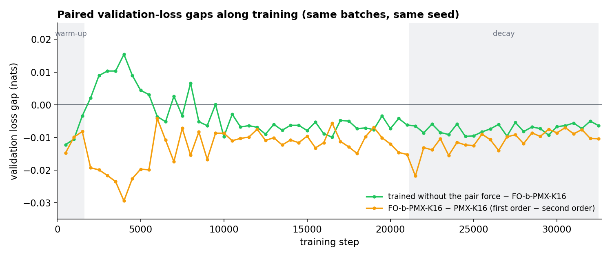
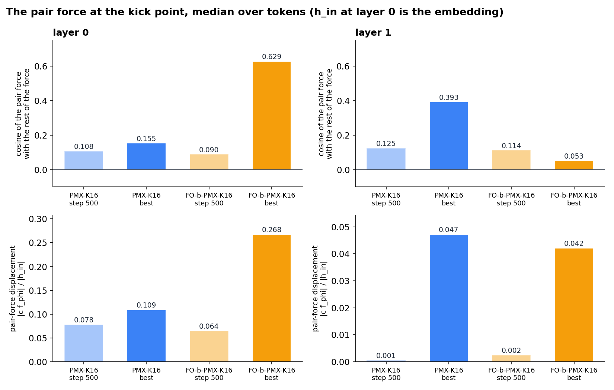
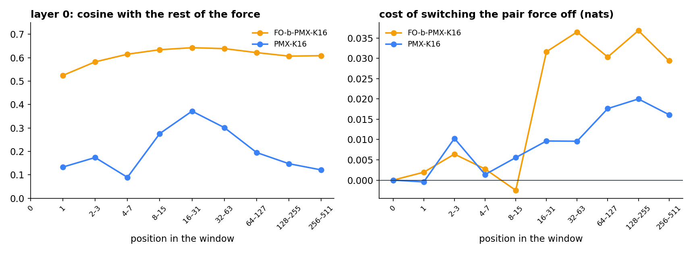
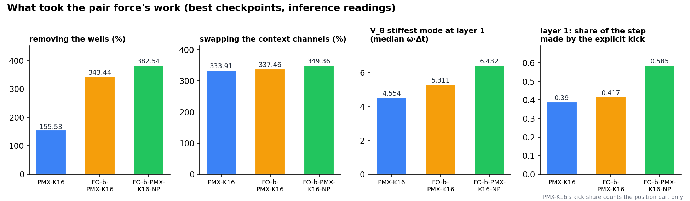

# The Pair Force in the First-Order Step: Why Training Without It Helps FO-b-PMX-K16

**What this note is.** The technical report of a CPU probe of the layer step, run on 2026-11-24 after [FO-b-PMX-K16-NP](../productization/Stage3e_FO_b_PMX_K16_Without_Pair_Force.md) finished training. That arm is FO-b-PMX-K16, the first-order model with sixteen Poisson-mode wells, trained without the routed pair force $V_\varphi$. It settled 0.63% below the same model trained with the pair force. SR2, the second-order model without wells, settled 0.33% above its no-pair-force version. The author asked why the pair force seems to cost a first-order model, and whether the evidence could be published. This note sets out two hypotheses, the probe that tests them, and what the readings support.

**Status.** Probe run and read. The readings are measurements on trained weights. They favour one hypothesis but cannot prove a cause; §7 lists the training arms that would.

---

## Contents

1. [The question](#1-the-question)
2. [Definitions](#2-definitions)
3. [Two hypotheses](#3-two-hypotheses)
4. [The probe](#4-the-probe)
5. [Results](#5-results)
6. [What the readings support](#6-what-the-readings-support)
7. [What would settle it](#7-what-would-settle-it)
8. [Caveats](#8-caveats)
9. [Reproduction and files](#9-reproduction-and-files)

---

## 1. The question

Three of the four corners of the two-by-two grid (first or second order, with or without the pair force) exist on the line of models with sixteen wells. Each corner trained on the same 532,480,000 OpenWebText tokens, with the same schedule and seed, so their evaluations are paired. Settled perplexities:

| model | order | pair force | settled perplexity |
| --- | --- | --- | ---: |
| PMX-K16 | second | trained with it | 54.24 |
| FO-b-PMX-K16 | first | trained with it | 53.73 |
| FO-b-PMX-K16-NP | first | none | 53.39 |
| PMX-K16-NP | second | none | not run |

The first-order model relies on its pair force: switching it off at inference costs 3.6% (Section 2 defines reliance). Its second-order twin's reliance is 1.7%. Yet the first-order model trained without the pair force is better than the one trained with it. The paired gap is 0.0074 nats on average over the 23 evaluations of the decay, with a standard deviation of 0.0015, and it is negative at all 23. The question is why a term the model leans on has negative value.



**Figure 1.** The validation-loss gap between the model trained without the pair force and FO-b-PMX-K16 (green), and between FO-b-PMX-K16 and its second-order twin (orange), at every evaluation. The pair force helps between steps 2,000 and 5,500, where the green curve is above zero by up to 0.015 nats. From step 6,000 on, the model without it is ahead at 51 of 54 evaluations. Both models gain 0.171 nats over the decay, so the gap forms in the stable phase and the decay leaves it unchanged.

## 2. Definitions

**Reliance and value.** As in [the competing-mechanisms note](Velocity_and_Pair_Force_as_Competing_Mechanisms.md), §1. The reliance on a mechanism $A$ is the cost of switching it off at inference in a model trained with it,

$$R_A = \ln \frac{\mathrm{PPL}(\text{trained with } A, \text{ evaluated without } A)}{\mathrm{PPL}(\text{trained with } A)} .$$

The value of $A$ is the cost of training without it,

$$V_A = \ln \frac{\mathrm{PPL}(\text{trained without } A)}{\mathrm{PPL}(\text{trained with } A)} .$$

For the pair force in the first-order model, $R_\varphi = 0.031$ to $0.035$ nats (two window sets) and $V_\varphi = \ln(53.39 / 53.73) = -0.0063$.

**The two layer steps.** At layer $\ell$, a token's state is $h$. The force on it is the conservative force

$$f(h) = f_\theta(h) + f_{\mathrm{w}}(h) + f_\varphi(h),$$

with $f_\theta = -\nabla V_\theta$ the context potential's force, $f_{\mathrm{w}}$ the force of the sixteen Poisson-mode wells, and $f_\varphi = -\nabla V_\varphi$ the pair force from the 16 earlier tokens the score head selects. The rest of the force is

$$f_{\mathrm{rest}} = f_\theta + f_{\mathrm{w}} .$$

Both orders split the step the same way. A part $K(h)$ of the force (the wells' quadratic spring and the retained stiff modes of $V_\theta$) is integrated exactly. The remainder is applied as one explicit kick at a midpoint $h_{\mathrm{mid}}$, and the pair force is always in the remainder.

- **First order (FO-b).** With $\mathcal{A}$ the exact relaxation over half a step and mobility $\mu = \Delta t / 2m$,

$$h_{\mathrm{mid}} = \mathcal{A}(h_{\mathrm{in}}), \qquad h' = h_{\mathrm{mid}} + \mu \Delta t \big( f(h_{\mathrm{mid}}) - K(h_{\mathrm{mid}}) \big), \qquad h_{\mathrm{out}} = \mathcal{A}(h') .$$

  The kick moves the state. No velocity passes to the next layer.

- **Second order.** The kick changes the velocity, $v \leftarrow v + (\Delta t / m)\big(f(h_{\mathrm{mid}}) - K(h_{\mathrm{mid}})\big)$. The exact damped flow of the second half step turns it into displacement, and what is left of the velocity passes into the next layer.

In both, the coefficient of the force in the state within the layer is

$$c = \frac{\Delta t^2}{2m} :$$

$\mu \Delta t$ in first order, and $(\Delta t / 2)(\Delta t / m)$ in second order. In second order the friction inside the exact flow shrinks the in-layer displacement further, by a factor between $e^{-\gamma \Delta t} = 0.67$ and 1. The probe uses $c$ in both orders, so its displacement readings for the second-order model are upper bounds.

**The readings.** All are taken at $h_{\mathrm{mid}}$, per token, at each of the two layers. $f_\varphi$ is obtained exactly as the difference between the force with the pair force on and with it off, at the same point.

- **Cosine:** $\cos(f_\varphi, f_{\mathrm{rest}})$. Near 1, the pair force pushes the same way as the landscape. Near 0, it pushes across it.
- **Displacement:** the pair force's displacement against the layer input,

$$d_\varphi = \frac{c \lVert f_\varphi \rVert}{\lVert h_{\mathrm{in}} \rVert} .$$

  At layer 0 the input is the token embedding, whose norm is about 3. At layer 1 the input has the LayerNorm norm $\sqrt{384} = 19.6$. So the two layers' values are not comparable with each other, only across models.
- **Roughness:** the relative change of a force per relative change of the state, for a random perturbation $\delta$ with $\lVert \delta \rVert = \epsilon \lVert h \rVert$ and $\epsilon = 0.01$:

$$\rho(f) = \frac{\lVert f(h + \delta) - f(h) \rVert / \lVert f(h) \rVert}{\epsilon} .$$

- **Switch rate:** the share of a token's 16 selected sources that change under the same perturbation.
- **Drift:** how much the pair force changes over the displacement its own explicit update makes,

$$\Delta_\varphi = \frac{\lVert f_\varphi(h + c f_\varphi) - f_\varphi(h) \rVert}{\lVert f_\varphi(h) \rVert} .$$

  An explicit update is self-consistent when this is small.
- **Sub-kick refinement (first order only):** the explicit kick split into $k$ sub-kicks of size $c / k$. In variant (a) only the pair force is re-evaluated at each sub-kick, and the rest of the kick stays as computed at $h_{\mathrm{mid}}$. In variant (b) the whole kick is re-evaluated. The reading is the loss change against the trained single kick.

## 3. Two hypotheses

**H1, the explicit update.** In first order the pair force's whole effect within a layer is one explicit position update. It is computed from a top-k selection that can switch. If the force is rough, or changes a lot over its own update, the single update is a poor integration of it, and the error goes straight into the state. In second order the same kick enters the velocity and is spread across the layer boundary, which could average such errors out.

H1 predicts that, in the trained first-order model, the pair force is rougher or switches more than in the second-order model, that its drift is large, and that re-evaluating it in sub-kicks changes the loss by an amount comparable to its reliance.

**H2, crowding out.** In first order the pair force is trained into a second push along the landscape force: extra displacement in the direction $V_\theta$ and the wells already push. The model leans on it. Because it takes that share, the landscape mechanisms do less of the work. Trained without the pair force, the wells and $V_\theta$ do the work themselves and do it better. In the book's terms this is dominance of the pair force over the landscape mechanisms (book §28; [competing mechanisms](Velocity_and_Pair_Force_as_Competing_Mechanisms.md), §1).

H2 predicts four things:
- the pair force aligns with $f_{\mathrm{rest}}$ in the trained first-order model, more than in the second-order model;
- the alignment forms during training rather than being there at initialisation;
- the reliance sits where the pair force is large;
- in the model trained without it, the landscape mechanisms carry more.

## 4. The probe

`debug/pair_force_order_probe.py` builds each checkpoint through the ladder notebook's own cells, as `mechanism_ablations.py` does, and evaluates validation windows of 512 tokens with the batch seed of `mechanism_ablations.py`. Every reading above is taken in the forward pass itself, by wrapping the layer step and the force routine. Models and checkpoints:

| model | checkpoints | windows |
| --- | --- | ---: |
| PMX-K16 (second order, with the pair force) | step 500; best (step 31,000) | 16; 32 |
| FO-b-PMX-K16 (first order, with the pair force) | step 500; best (step 31,000) | 16; 32 |
| FO-b-PMX-K16-NP (first order, without it) | step 500; best (step 31,000) | 16; 32 |

**Checks, all passed:**
- the forward with the measurement hooks gives the same per-sequence losses as without them, to 1e-6 nats;
- recomputing the force at the captured point reproduces the model's own force exactly;
- the sub-kick step with one sub-kick reproduces the trained model exactly.

## 5. Results

### 5.1 The pair force at the kick point

Medians over tokens. "Step 500" uses 16 windows and "best" 32.

| reading | layer | PMX-K16, step 500 | PMX-K16, best | FO-b-PMX-K16, step 500 | FO-b-PMX-K16, best |
| --- | ---: | ---: | ---: | ---: | ---: |
| cosine with the rest of the force | 0 | 0.108 | 0.155 | 0.090 | **0.629** |
| cosine with the rest of the force | 1 | 0.125 | **0.393** | 0.114 | 0.053 |
| displacement against the input | 0 | 0.078 | 0.109 | 0.064 | **0.268** |
| displacement against the input | 1 | 0.001 | 0.047 | 0.002 | 0.042 |
| pair force against the rest of the force | 0 | 0.076 | 0.033 | 0.065 | 0.054 |
| roughness of the pair force | 0 | 0.40 | 1.22 | 0.36 | 0.43 |
| roughness of the rest of the force | 0 | 0.034 | 0.178 | 0.033 | 0.158 |
| roughness of the pair force | 1 | 1.64 | 1.50 | 2.03 | 1.79 |
| drift over its own update | 0 | 0.24 | 0.78 | 0.19 | 0.50 |
| drift over its own update | 1 | 0.03 | 0.46 | 0.05 | **1.53** |
| sources switched by a 1% perturbation | both | 0 | 0 | 0 | 0 |
| reliance (switching it off), nats | | −0.0050 | +0.0163 | −0.0022 | +0.0310 |



**Figure 2.** The cosine of the pair force with the rest of the force, and its displacement against the layer input, medians over tokens, per layer, at step 500 (light) and at the best checkpoint (dark).

**At step 500 the two orders look alike.** The pair force is nearly orthogonal to the rest of the force in both (cosine about 0.1), its displacements are similar, and switching it off helps slightly in both.

**By the end of training they have gone different ways:**
- **First order puts its pair force at layer 0, along the landscape.** The cosine rises to 0.63 and the displacement grows to 0.27 of the embedding's norm, 2.5 times the second-order model's.
- **Second order puts its pair force at layer 1.** The cosine there rises to 0.39. Its layer-0 pair force stays nearly orthogonal (0.16).
- **At layer 1 the first-order pair force is orthogonal to the rest** (cosine 0.05). It is the same size as the second-order model's but far from self-consistent: it changes by 1.5 times its own size over its own update, against 0.46 in second order.

### 5.2 By position



**Figure 3.** Left: the cosine at layer 0 by position in the window. Right: the reliance by position, as the loss change from switching the pair force off.

- **The alignment holds at every position in first order:** a cosine between 0.58 and 0.64 from position 2 on. The second-order model peaks at 0.37 for positions 16 to 31.
- **The first-order model's reliance is nothing before position 16 and 0.03 nats from there on.** With 16 sources selected, a token before position 16 sums over every earlier token, and there the pair force is small. The pair force the first-order model leans on is the full-strength force of positions 16 and after.

### 5.3 Is it the explicit update?

Sub-kick refinement in the trained first-order model, loss change in nats (standard error over 32 windows):

| variant | 2 sub-kicks | 4 sub-kicks |
| --- | ---: | ---: |
| only the pair force re-evaluated | +0.0081 (0.0009) | +0.0117 (0.0011) |
| the whole explicit kick re-evaluated | +0.530 (0.018) | +0.631 (0.019) |

At step 500 both variants cost under 0.006 nats.

Three readings bear on H1:
- **Splitting the pair force's update costs a quarter to a third of its reliance** (0.008 to 0.012 against 0.031). The trained model is tuned to the single update, but the whole kick depends on it more than fifty times as much. The step is a map, not a flow, and the pair force is a small part of that.
- **The first-order pair force is not rougher.** At layer 0 it is smoother than the second-order model's (roughness 0.43 against 1.22). At layer 1 the two are alike (1.79 against 1.50). No selection switches under a 1% perturbation in any model.
- **The drift at layer 1 is large** (1.53 against 0.46), but the layer-1 pair force carries little of the reliance; layer 0 carries most (the [recall split](../productization/Pair_Force_Recall_Split_FO_b_PMX_K16.md), §4: switching it off at layer 0 costs 0.015 nats over all positions, at layer 1 0.010).

### 5.4 What took the work in the model trained without it



**Figure 4.** Readings on the best checkpoints of the three models. The stiffness row is the median over tokens of $\omega \Delta t$, the angle the stiffest mode of $V_\theta$ turns through in one layer step (`vtheta_omega_dt.py`, one definition for both orders).

| reading | PMX-K16 | FO-b-PMX-K16 | FO-b-PMX-K16-NP |
| --- | ---: | ---: | ---: |
| removing the wells | +155.5% | +343.4% | **+382.5%** |
| swapping the context channels with another sequence's | +333.9% | +337.5% | +349.4% |
| stiffness of the context potential at layer 1, median angle per step of its stiffest mode | 4.55 | 5.31 | **6.43** |
| layer 1: share of the step made by the explicit kick | 0.39 | 0.42 | **0.59** |
| layer 1: rest of the force at the kick point, median | 0.64 | 0.32 | **0.34** |
| layer 0: rest of the force at the kick point, median | 0.21 | 0.24 | 0.23 |
| wells' force against the rest at layer 1 (Cell 6b-15) | 3.53 | 3.24 | **3.81** |
| first 16 positions: cost of freezing the wells' clock at its late value | +14.9% | +28.8% | **+61.8%** |

In the model trained without the pair force:
- **the wells carry more:** removing them costs more, their force share at layer 1 is higher, and their start-of-sequence clock matters twice as much;
- **layer 1 works harder:** $V_\theta$ is stiffer there, the rest of the force is larger, and the explicit kick makes a larger share of the step;
- **layer 0's landscape force is about the same** (0.23 against 0.24), without the pair force's aligned push on top of it.

**What the rest of the force is at layer 0** (`debug/layer_force_split.py`, 16 windows, at the kick point; medians over tokens):

| model | context potential's force | wells' force | cosine of the pair force with each |
| --- | ---: | ---: | --- |
| PMX-K16 | 0.155 | 0.085 | 0.09 and 0.20 |
| FO-b-PMX-K16 | 0.168 | 0.102 | 0.54 and 0.60 |
| FO-b-PMX-K16-NP | 0.165 | 0.091 | no pair force |

Both terms matter at layer 0 and the context potential's is the larger. The first-order pair force aligns with both. The ratio of the two agrees with Cell 6b-15 (0.535 for this arm).

**Correction (2026-11-25).** From 2026-11-24 this section said that the force of $V_\theta$ is negligible at layer 0 and that the pair force therefore reinforces the wells' positional clock. That was wrong. The figures came from the conservativity test, whose script read layer 0 with layer 1's depth code, and they contradicted Cell 6b-15. Rerun with the right code, the test gives $V_\theta$ a force of 0.17 at layer 0 on PMX-K16, 0.09 on FO-b-PMX-K16 and 0.10 on FO-b-PMX-K16-NP (medians of its five tokens), in line with the table above. A first correction, made the same day, blamed a misread row of the output; the output itself was wrong ([Depth_Code_Correction.md](Depth_Code_Correction.md)).

The context channels change little, and recall runs through them exactly as before: removing the earlier occurrence from the layer-1 channels costs 0.456 nats on far recall, against 0.463 (paired difference −0.004, standard error 0.002).

## 6. What the readings support

**H2, crowding out, is supported on every prediction it makes:**
- the trained first-order pair force aligns with the landscape force (cosine 0.63, against 0.16 in second order);
- the alignment is absent at step 500 and forms in training, as the gap in Figure 1 does;
- the reliance sits where the force is at full strength (positions 16 and after);
- without the pair force, the wells and the layer-1 landscape carry more.

**H1, the explicit update, is not supported as the main cause.** The first-order pair force is not rougher and does not switch sources under small perturbations. Refining its update costs a quarter to a third of its reliance, while the whole kick depends on the single update more than fifty times as much. The large layer-1 drift is real but sits on the layer that carries the smaller share of the reliance.

**Reliance and value together point to training, not to the trained step.** The trained FO-b-PMX-K16 is better with its pair force than without it: switching it off costs 0.031 nats. Given the rest of its weights, the push helps. Yet the model trained without the pair force ends better. So the cost is not in the step the pair force computes but in the solution that training reaches with it.

**The readings fit a training lock-in:**
- early on the pair force is a cheap gain: it helps between steps 2,000 and 5,500, it does no addressing ([recall split](../productization/Pair_Force_Recall_Split_FO_b_PMX_K16.md)), and it acts largely as a fixed landscape in the token's own state ([Probe A](../mean_field/Probe_A_Field_Pair_Force.md)), so it is easy to learn;
- once the model leans on it, the wells and the layer-1 landscape develop less;
- training settles in a worse solution. The model trained without the pair force puts that work into layer 1 instead (§5.4), and that split is better.

What the readings do not show is when the lock-in happens, or that it causes the gap. FO-b-PMX-K16 has no checkpoints between step 500 and step 31,000, so the alignment cannot be watched forming.

**Why first order: open.** An earlier version of this note (2026-11-24) read the order dependence as the pair force standing in for the velocity, which in second order carries layer 0's displacement into layer 1. That reading predicts that the pair force helps. It explains the reliance but not the negative value. It could also cut the other way: in second order the velocity amplifies layer 0's displacement on its way into layer 1, which would make a layer-0 push more attractive there, not less. Whether the pair force's value depends on the order on this line at all is open until PMX-K16-NP runs ([Stage3f_PMX_K16_Without_Pair_Force.md](../productization/Stage3f_PMX_K16_Without_Pair_Force.md)). On SR2, which has no wells, it was +0.33%.

**In one sentence:** in a first-order model with wells, the pair force becomes a second, cruder push along the rest of the force at layer 0; the readings fit a training lock-in, in which the model leans on that push instead of strengthening its wells and its layer-1 landscape, and it ends 0.6% worse than without it.

## 7. What would settle it

The readings are inference measurements on trained weights. A cause needs training arms:

1. **PMX-K16-NP,** the missing corner: PMX-K16 trained without the pair force. With it, the interaction of the competing-mechanisms note (§8: the value of removing both the velocity and the pair force, minus the two single values) can be read on the line with wells. If the pair force's value is near zero or positive in second order (as on SR2, +0.33%), the order dependence is established.
2. **FO-b-PMX-K16 with the pair force at layer 1 only.** H2 places the harm at layer 0. If this arm recovers most of the 0.63%, the layer-0 crowding is the cause.
3. **FO-b-PMX-K16 with the pair force's update sub-stepped in training,** $k = 4$. This is the direct test of H1. The probe predicts little gain.
4. **A second seed of FO-b-PMX-K16 and of its no-pair-force arm,** saving intermediate checkpoints. It measures the training-seed spread, and the checkpoints would show when the alignment forms against when the gap opens.

## 8. Caveats

- **One seed per model.** The paired evaluation removes the evaluation noise, not the seed spread.
- **Inference readings.** Reliance, cosines and sub-kick costs describe trained weights. They cannot show what a model would have learned otherwise.
- **The displacement coefficient is nominal.** In second order the friction inside the exact flow shrinks the in-layer displacement by up to a third, so the second-order displacements in §5.1 are upper bounds. The gap to first order is, if anything, larger.
- **Layer 0's input is the embedding.** Displacements against the input are comparable across models at the same layer, not across layers.
- **The step-500 readings use 16 windows** and the best-checkpoint readings 32. The step-500 values are small enough that this does not change their reading.
- **L = 2, 532M tokens, OpenWebText, sixteen wells.** The balance could differ with depth, budget, corpus or well count. On SR2, which has no wells, the pair force's value is slightly positive.

## 9. Reproduction and files

```bash
cd notebooks/conservative_arch/scaleup
P=semsimula_fock_cfc_baoab_owt_xi5long_topk16_dt32da16_mh4_aniso_dcvt5x8_vtjoint_cgqk_norc_
X=_L2probe_ob_untied_wsd_e5c_plgate_rep0.05_fockreg0.005_g0.1_baoab_cfc_lowrank_idt4_lr0p0012_noattn
python3 debug/pair_force_order_probe.py results/pair_force_order fob-pmx folder=${P}vplive_xilive_pm16_pmx16_sr2_fob$X batches=8 name=fobk16_best
python3 debug/pair_force_order_probe.py results/pair_force_order pmx folder=${P}vplive_xilive_pm16_pmx16_sr2$X batches=8 name=pmxk16_best
python3 debug/pair_force_order_probe.py results/pair_force_order fob-pmx folder=${P}nophi_xilive_pm16_pmx16_sr2_fob$X batches=8 name=fobk16np_best
# step 500: add ckpt=fock_cfc_owt_<tag>_step500_best.pt and batches=4
python3 ../../../companion_notes/figures/_make_pair_force_order_figs.py
```

The folders are the runs' Drive folders with their `checkpoints/`. Each run takes 3 to 8 minutes on 8 CPU threads, with a peak of about 7 GB.

- **Outputs:** `results/pair_force_order/pair_force_order_{pmxk16,fobk16,fobk16np}_{best,step500}.{txt,json}`. The JSON files hold every reading's percentiles, the readings and losses by position, and the per-sequence losses of every variant.
- **Figures:** [`figures/_make_pair_force_order_figs.py`](../figures/_make_pair_force_order_figs.py), written to `figures/pair_force_order/`.
- **The other readings in §5.4:** each model's `mechanism_ablations_*`, `vtheta_omega_dt_*`, `refinement_flow_confirmation_*`, `pm_static_landscape_*` and `conservativity_test_output.txt` outputs in its results folder, and Cell 6b-15.
