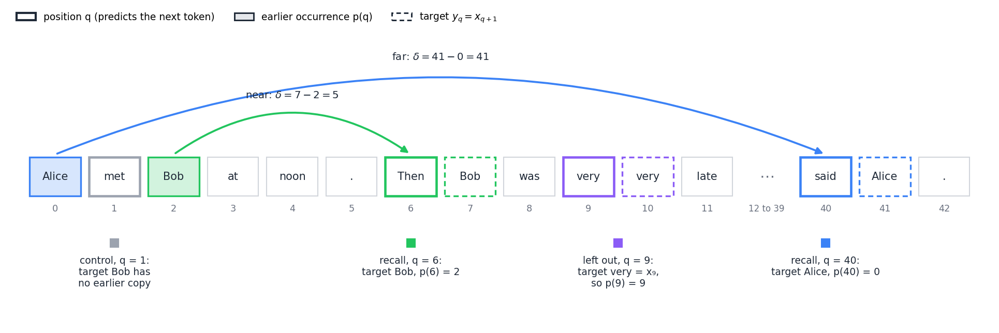
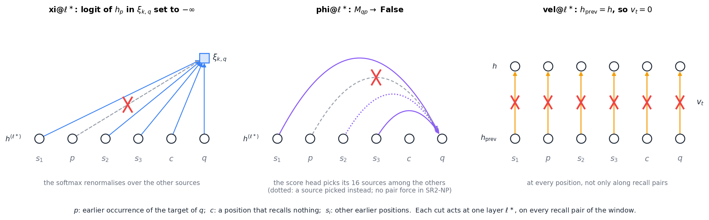
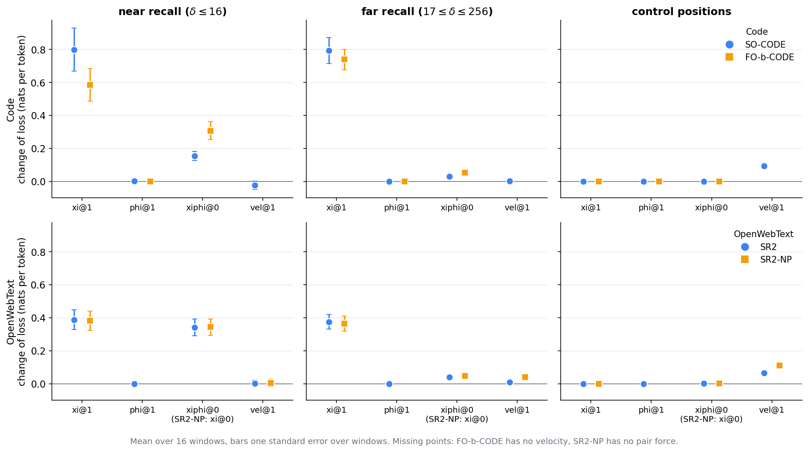
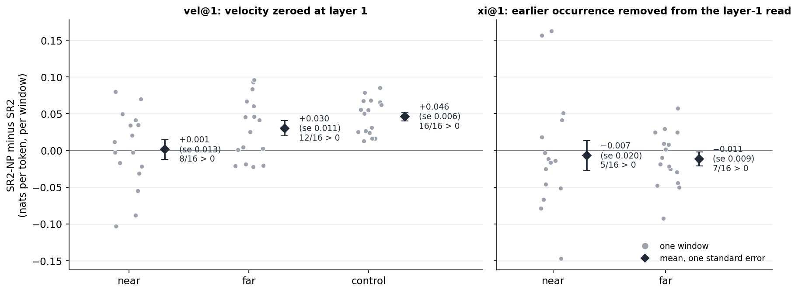

# The Recall Pathway Probe

**What this note is.** The full statement of probe 6 of [Second_Order_Memory_Probes.md](Second_Order_Memory_Probes.md): which pathway of a trained conservative model carries an earlier token to the position that recalls it. It gives the problem in equations, how the script realizes it, the results so far and the limits. Written 2026-11-21.

**Status.** Run on four models: SO-CODE and FO-b-CODE on code (2026-11-17), SR2 and SR2-NP on OpenWebText (2026-11-21).

---

## Contents

1. [The question](#1-the-question)
2. [Recall and control positions](#2-recall-and-control-positions)
3. [The pathways and the cuts](#3-the-pathways-and-the-cuts)
4. [The estimator](#4-the-estimator)
5. [How the code realizes it](#5-how-the-code-realizes-it)
6. [Results](#6-results)
7. [Limits](#7-limits)

---

## 1. The question

In the conservative core, a token's state $h_t$ meets earlier tokens' states through three pathways only:

- the **context channels** $\xi$, a content-routed causal average of the earlier states, which set the wells of $V_\theta$;
- the **pair force** $V_\varphi$, a pair potential between $h_t$ and up to $k = 16$ earlier states chosen by a score head (absent in SR2-NP);
- the **velocity**, carried from one layer to the next by the second-order step.

When a model predicts a token that occurred earlier in the window, the information has to travel from the earlier occurrence through one of these pathways. The probe removes one pathway's access to the earlier occurrence, at one layer, in the trained model, and measures how much the loss rises at the recalling positions compared with positions that recall nothing.

## 2. Recall and control positions

Take a window of $T = 512$ input tokens $x_0, \dots, x_{T-1}$ with targets $y_t = x_{t+1}$, and let $c(v)$ be the number of times token $v$ occurs in the window. For each position $q$, let

$$p(q) = \max \lbrace s \le q : x_s = y_q \rbrace$$

be the last input position at or before $q$ holding the target, if there is one. Then, with distance $\delta = q + 1 - p(q)$:

- **recall pair** $(q, p)$: $p(q)$ exists, $p(q) \lt q$ and $c(y_q) \le 8$. It is **near** if $1 \le \delta \le 16$ and **far** if $17 \le \delta \le 256$; pairs further back are not used.
- **control position** $q$: no earlier occurrence of $y_q$ exists, and $c(y_q) \le 8$.

Positions with $p(q) = q$ (the target repeats the current input token) are left out of every class. The frequency filter keeps out tokens so common that their repetition says little about memory (punctuation, keywords, frequent words). It is a rough proxy, discussed in §7.



**Figure 1.** One window, with an invented sentence (positions 12 to 39 not drawn; none of them holds "Alice"). Each class is marked at its position $q$ (solid outline), with the earlier occurrence $p(q)$ shaded and the target $y_q = x_{q+1}$ outlined dashed. At $q = 6$ the target "Bob" last occurred at $p = 2$: a near pair with $\delta = 5$. At $q = 40$ the target "Alice" last occurred at $p = 0$: a far pair with $\delta = 41$. At $q = 1$ the target "Bob" has not occurred yet: a control position. At $q = 9$ the target "very" is the current input token, $p(9) = 9$, and the position is left out.

## 3. The pathways and the cuts

Write $\ell \in \lbrace 0, 1 \rbrace$ for the layer, $H^{(\ell)} = (h_0^{(\ell)}, \dots, h_{T-1}^{(\ell)})$ for the states entering layer $\ell$, and $R$ for the set of all near and far recall pairs of the window. Every cut acts at **one layer** $\ell^\ast$, on **every pair in $R$ at once**, and leaves the model's weights unchanged.

**The context channels.** Channel $k = 1, \dots, 5$ at position $t$ reads

$$\xi_{k,t}^{(\ell)} = \sum_{s \le t} w_{k,ts}^{(\ell)} h_s^{(\ell)}, \qquad w_{k,t\cdot}^{(\ell)} = \mathrm{softmax}_s \left( (t - s) \log \alpha_k + \frac{q_{k,t} \cdot \kappa_{k,s}}{\sqrt{d_\kappa}} \right),$$

with the channel's decay $\alpha_k$, the query $q_{k,t} = W_q h_t^{(\ell)}$ and the key $\kappa_{k,s} = W_k h_s^{(\ell)}$ (both of dimension $d_\kappa = 48$ per channel), and $s \gt t$ excluded. **The cut `xi@ℓ`** sets the logit of the earlier occurrence to $-\infty$ for every recall pair and every channel:

$$\text{logit}_{k,qp} \to -\infty \quad \text{for all } (q, p) \in R, \quad k = 1, \dots, 5, \text{ at layer } \ell^\ast .$$

The softmax renormalises over the remaining sources, so position $q$ still reads its context, only without $h_p$.

**The pair force.** At position $t$ the pair force acts between $h_t$ and the sources selected from the allowed set $\lbrace s : s \lt t \rbrace$, given by a strictly lower-triangular causal mask $M_{ts}$. **The cut `phi@ℓ`** removes the earlier occurrence from the allowed set:

$$M_{qp} \to \text{False} \quad \text{for all } (q, p) \in R, \text{ at layer } \ell^\ast,$$

so the score head chooses its 16 sources among the others. **`xiphi@ℓ`** applies both cuts.

**The velocity.** The step decodes the velocity entering layer $\ell$ from the two states it receives, $v = (h - h_{\mathrm{prev}}) / \Delta t$. **The cut `vel@ℓ`** passes $h_{\mathrm{prev}} = h$, so

$$v_t^{(\ell^\ast)} = 0 \quad \text{for every position } t .$$

This cut is not restricted to the recall pairs: it removes the velocity at every token, so its control column is the general cost of losing the inertia, against which the recall columns are read. A first-order model has no velocity, and the cut is skipped.

**What each cut leaves untouched.** At the last layer ($\ell^\ast = 1$), a `xi` or `phi` cut changes only the update of the rows $q$ that recall something: the states entering layer 1 are unchanged, so the control positions read exactly zero. At layer 0 the changed states propagate into layer 1, and control positions can move slightly.



**Figure 2.** The three cuts at layer $\ell^\ast$, for one recall pair $(q, p)$. Left: every earlier state feeds the channel read $\xi_{k,q}$; the cut removes the link from $h_p$ and the remaining weights renormalise. Middle: the pair force at $q$ draws on sources chosen from the causal mask; the cut removes $p$ from the mask and the score head may pick another source instead (dotted). Right: the velocity is decoded from the two states the step receives; the cut makes them equal, so the velocity is zero at every position, including the control position $c$.

## 4. The estimator

For window $b$ and cut $c$, let $\mathcal L_{b,t}$ be the per-token cross-entropy of the unmodified model and $\mathcal L_{b,t}^{c}$ the same with the cut. The reading for class $C \in \lbrace \text{near}, \text{far}, \text{control} \rbrace$ is the mean over windows of the mean within each window:

$$\Delta_{C}^{c} = \frac{1}{\lvert B_C \rvert} \sum_{b \in B_C} \frac{1}{\lvert C_b \rvert} \sum_{q \in C_b} \left( \mathcal L_{b,q}^{c} - \mathcal L_{b,q} \right),$$

where $C_b$ is the class's set of positions in window $b$ and $B_C$ the windows where it is not empty. The standard error is over windows,

$$\mathrm{se} \left( \Delta_{C}^{c} \right) = \frac{\mathrm{sd}_{b \in B_C} \left( \Delta_{C,b}^{c} \right)}{\sqrt{\lvert B_C \rvert}},$$

which treats the window as the unit of independence: positions within a window share their context and are not independent. Two models probed on the same windows are compared **paired**, by the mean and standard error of the per-window differences.

## 5. How the code realizes it

Script: [`debug/recall_pathway_probe.py`](../../notebooks/conservative_arch/scaleup/debug/recall_pathway_probe.py).

```text
python3 recall_pathway_probe.py OUT FOLDER [windows=16] [val=<tokens.npy>] [name=<stem>] [maxfreq=8] [check=1]
```

- **The model** is built from its run folder's tag through the ladder notebook's own Cells 0 to 5b (`copy_split.ladder_model`), with the best checkpoint, in evaluation mode and in float32 on the CPU. Each forward runs under `enable_grad`, because the pair force is an autograd gradient.
- **The windows** are evenly spaced over the validation file and offset by half a spacing: $s_b = \lfloor (b + \tfrac{1}{2})(N - T - 1) / W \rfloor$ for $b = 0, \dots, W - 1$, with $N$ the file's length and $W = 16$. The offset keeps them apart from the windows of the earlier probes. They are processed four at a time.
- **The classes** come from one pass over each window, as in §2 (`classes()`). The removal set is a boolean tensor $\mathrm{REM}[b, q, p]$, true for every recall pair.
- **The hooks**, each replacing a bound method on the model instance:
  - `_layer_step_langevin` records the current layer and, for `vel`, passes `h_prev = h` at the cut layer;
  - `xi_module.forward` is replaced by a re-implementation of the content-routed read that fills `REM` with $-\infty$ in the logits, at the cut layer only;
  - `_pair_mask_for` returns the causal mask with `REM` removed, at the cut layer only.
- **The cuts run:** `base`, `vel@1` (second-order models), `xi@1`, `phi@1`, `xiphi@1` and `xiphi@0`. On a model without a pair force (SR2-NP) the pair-force cuts are dropped, and `xi@0` replaces `xiphi@0`.
- **The checks** (`check=1`, on the first batch of windows):
  1. the re-implemented read with nothing removed reproduces the model's own loss;
  2. under the layer-1 cut, every position before the first recall position is unchanged (causality of the cut).

  Both differences are reported rather than thresholded. Every run so far reads exactly 0 for both.
- **Output:** `OUT/recall_pathway_<stem>.txt` (the table) and `.json` (the readings, the per-window values and the class counts). The outputs are in [`results/recall_pathway/`](../../notebooks/conservative_arch/scaleup/results/recall_pathway/).

The table's last column, far over control, is meaningful only for the velocity cut. For the other cuts the control reading is zero or nearly so.

## 6. Results

Change of the loss per token in nats; standard error over windows in brackets.

**Code** (16 windows; 443 near pairs, 1,552 far, 2,016 control positions; SO-CODE second order, FO-b-CODE first order):

| cut | SO-CODE near | SO-CODE far | SO-CODE control | FO-b-CODE near | FO-b-CODE far | FO-b-CODE control |
| --- | ---: | ---: | ---: | ---: | ---: | ---: |
| `xi@1` | +0.800 (0.130) | +0.794 (0.079) | +0.000 | +0.586 (0.099) | +0.740 (0.062) | −0.000 |
| `phi@1` | +0.001 | +0.000 | +0.000 | +0.000 | +0.000 | +0.000 |
| `xiphi@0` | +0.153 (0.028) | +0.029 (0.004) | −0.000 | +0.307 (0.056) | +0.052 (0.005) | +0.000 |
| `vel@1` | −0.024 (0.026) | +0.001 (0.011) | +0.094 (0.016) | | | |

**OpenWebText** (16 windows; 317 near pairs, 1,507 far, 4,198 control positions; the same windows for both models):

| cut | SR2 near | SR2 far | SR2 control | SR2-NP near | SR2-NP far | SR2-NP control |
| --- | ---: | ---: | ---: | ---: | ---: | ---: |
| `xi@1` | +0.388 (0.061) | +0.376 (0.045) | +0.000 | +0.381 (0.059) | +0.364 (0.045) | +0.000 |
| `phi@1` | +0.000 | +0.000 | +0.000 | (no pair force) | | |
| `xiphi@0` (SR2-NP: `xi@0`) | +0.342 (0.051) | +0.041 (0.003) | +0.001 | +0.343 (0.049) | +0.047 (0.004) | +0.000 |
| `vel@1` | +0.002 (0.019) | +0.008 (0.009) | +0.064 (0.006) | +0.004 (0.022) | +0.038 (0.008) | +0.111 (0.006) |



**Figure 3.** The two tables above, drawn from the probe's JSON outputs. Rows: corpus; columns: class; one standard error over windows. The `xi@1` points stand alone in the two recall columns and sit on zero in the control column. The `phi@1` points sit on zero everywhere. The layer-0 cut reaches near pairs far more than far ones. Only `vel@1` moves the control positions.

**What they show.**
- **One pathway carries far recall, in every model:** the context channels at layer 1. Removing the earlier occurrence there costs 0.36 to 0.79 nats per recalled token and nothing at control positions.
- **The pair force carries none of it,** on code and on OpenWebText alike.
- **Near recall is shared between the layers:** on OpenWebText, removing the earlier occurrence at layer 0 costs about as much as at layer 1 for near pairs, but little for far ones.
- **The velocity is not the memory:** zeroing it costs ordinary tokens more than recalled ones in every second-order model.
- **The arm without a pair force leans more on the velocity.** SR2-NP against SR2, paired: +0.046 nats on control positions (se 0.006) and +0.030 on far recall (se 0.011). The layer-1 read itself does not change (far recall −0.011, se 0.009).



**Figure 4.** The paired comparison of the last point, one dot per window. Under `vel@1` the arm without a pair force loses more on control positions in all 16 windows, and on far recall in 12 of 16. Near recall shows no difference. Under `xi@1` the two arms do not differ.

The figures are made by [`figures/_make_recall_pathway_figs.py`](../figures/_make_recall_pathway_figs.py); Figures 3 and 4 read only the JSON files in [`results/recall_pathway/`](../../notebooks/conservative_arch/scaleup/results/recall_pathway/).

The registered calls of the code run (LR2, LR3) and their verdicts are in §8 of [Second_Order_Memory_Probes.md](Second_Order_Memory_Probes.md). The OpenWebText runs had no calls.

## 7. Limits

- **One seed per model,** two layers, two corpora.
- **The cuts measure reliance, not necessity.** They remove a pathway from a model trained with it; a model trained without the pathway could route the information elsewhere, as SR2-NP shows for the pair force.
- **Only the most recent earlier occurrence is removed.** A target that occurred several times (up to eight) can still be read from an older copy, so the readings bound the pathway's role from below.
- **The frequency filter is a rough proxy** for separating memory from syntax: a threshold of eight occurrences per window, the same for code and prose.
- **The velocity cut is global:** it zeroes the velocity at every position, not only along the recall pairs, so it cannot isolate a velocity-borne trace of one earlier token. The transmission probes (2, 5 and the replication in 6) address that question directly.
- **CPU, float32, evaluation mode.** The readings do not depend on hardware beyond float rounding; the checks bound the re-implementation's effect at exactly zero.
