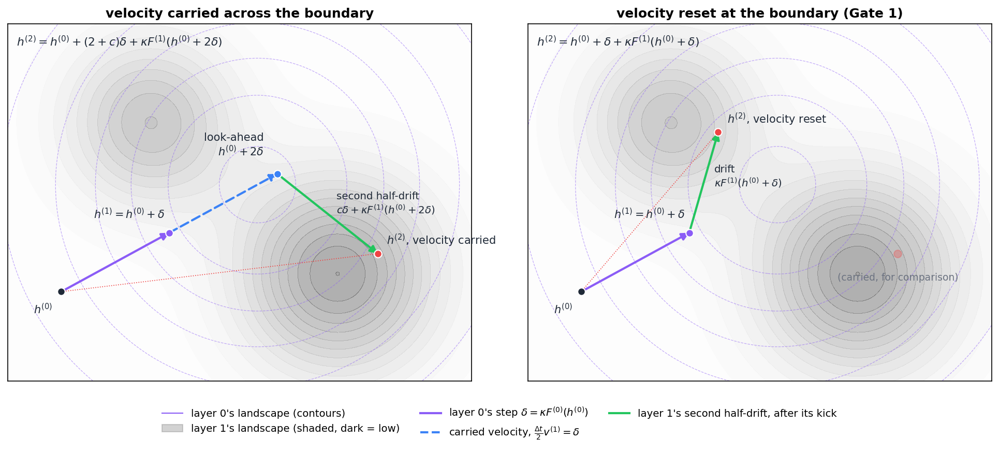
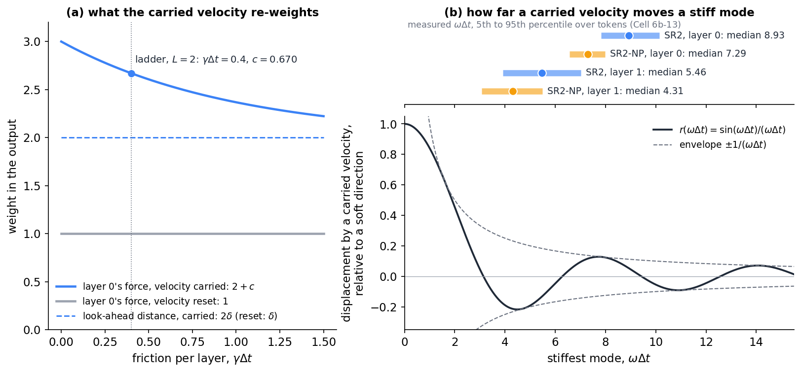
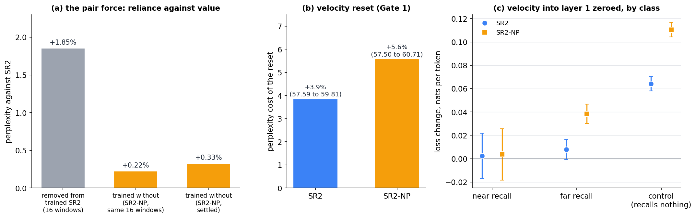
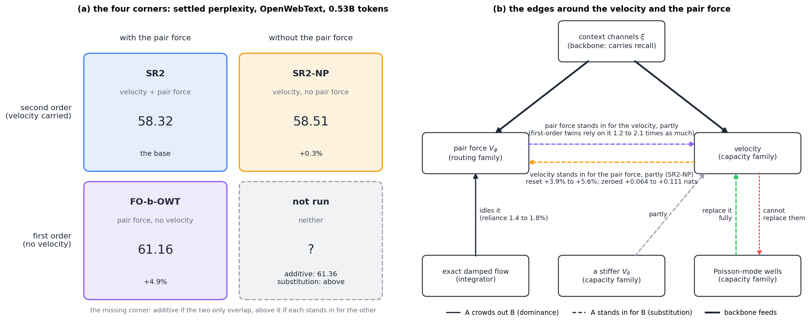

# The Velocity and the Pair Force as Competing Mechanisms

**What this note is.** An explanation, with the mathematics, of one edge pair of the book's graph of competing mechanisms (§28, "Competing Mechanisms: Families, Dominance and Substitution"): the velocity and the pair force $V_\phi$ each partly stand in for the other. It shows what the velocity carries from one layer to the next, what the pair force adds to a step, why one can take over part of the other's work although the book puts them in different families, and which run would settle it. Written 2026-11-21.

**Status.** One direction of the edge was in the book before SR2-NP: first-order models lean harder on the pair force. The other direction comes from [SR2-NP](../productization/Stage3_SR2_Without_Pair_Force.md), SR2 trained without the pair force (2026-11-21). The interaction test of §8 has not been run.

**Related.** [Recall_Pathway_Probe.md](Recall_Pathway_Probe.md) (the velocity and $\xi$ cuts); [First_vs_Second_Order_Series.md](First_vs_Second_Order_Series.md) (the first-order twins and the Poisson-mode wells); [Competing_Mechanisms_Families_Dominance_and_Substitution.md](../Competing_Mechanisms_Families_Dominance_and_Substitution.md) (the working note behind the book's chapter).

---

## Contents

1. [Definitions](#1-definitions)
2. [The question](#2-the-question)
3. [The step, as the code runs it](#3-the-step-as-the-code-runs-it)
4. [The velocity as a carrier](#4-the-velocity-as-a-carrier)
5. [Stiff directions: where the velocity cannot reach](#5-stiff-directions-where-the-velocity-cannot-reach)
6. [What the pair force adds, and what it does not carry](#6-what-the-pair-force-adds-and-what-it-does-not-carry)
7. [The measurements](#7-the-measurements)
8. [What stands in for what](#8-what-stands-in-for-what)
9. [Limits](#9-limits)

---

## 1. Definitions

The terms follow §28 of the book. Every cost is a log ratio of perplexities, so costs of independent effects add. $\mathrm{PPL}$ is the perplexity on the same validation tokens.

**Mechanism.** A part of the model's step that can be switched off or trained out on its own: the velocity, the pair force, the Poisson-mode wells, the stiffness of $V_\theta$, the context channels $\xi$.

**Families.** The book's two groups of competing mechanisms. *Token-to-token routing* brings content from earlier tokens into the current token's step (the register path, the exchange field, the pair force). *Landscape and dynamics capacity* shapes how a token moves without bringing in other tokens' content (the velocity and the stiff rotation, the Poisson-mode wells, the stiffness of $V_\theta$). The context channels underlie both and belong to neither.

**Reliance** on a mechanism $A$: the cost of switching $A$ off in a model trained with it, at inference only,

$$R_A = \ln \frac{\mathrm{PPL}(\text{trained with } A, \text{ evaluated without } A)}{\mathrm{PPL}(\text{trained with } A)} .$$

It says how much the trained network routes through $A$.

**Value** of $A$: the cost of training without $A$, against the base model trained with it,

$$V_A = \ln \frac{\mathrm{PPL}(\text{trained without } A)}{\mathrm{PPL}(\text{trained with } A)} .$$

It says what the model loses after it has had the chance to compensate. Reliance overstates value, often by a large factor, because a model trained with $A$ never learned to do without it.

**Dominance** ($A$ crowds out $B$). Where both are present, $B$'s reliance is smaller than where $B$ is alone: $A$ takes a share of the step that $B$ would otherwise hold. Dominance is read in reliance.

**Substitution** ($A$ stands in for $B$). Trained without $B$, the model recovers part of $B$'s worth through $A$. Two signs together establish it: $B$'s value $V_B$ is well below its reliance $R_B$, and $A$'s reliance rises in the model trained without $B$. The **recovered share**, read on the same tokens, is

$$1 - \frac{V_B}{R_B} .$$

Substitution is read in value, with reliance saying where the recovery went.

**Partial substitution** recovers some of $B$'s worth through $A$. **Full substitution**, or **replacement**, recovers all of it: $V_B \le 0$ when $A$ is present. The book's one replacement is the Poisson-mode wells replacing the velocity: with as few as two wells, the first-order twin matches or beats its second-order twin.

**One-way substitution.** $A$ stands in for $B$ but $B$ does not stand in for $A$. The wells and the velocity are the example: the velocity does not stand in for the wells (a second-order model without wells is 6 to 7% worse than one with them).

**Mutual substitution.** $A$ stands in for $B$ and $B$ stands in for $A$, each at least partly. In value, it means that removing both costs more than the sum of removing each, because each was covering for the other. With $V_{AB}$ the value of training without both, the **interaction**

$$I_{AB} = V_{AB} - V_A - V_B$$

is positive under mutual substitution, near zero when the two mechanisms only add up, and negative when they overlap (each makes the other partly redundant, so removing both costs less than the sum).

**Coexistence.** Both mechanisms are relied on, and their reliances overlap little. With $R_{AB}$ the reliance on both together, the **overlap**

$$\frac{R_A + R_B - R_{AB}}{R_A + R_B}$$

is small. The book's example is the wells and the pair force under the explicit integrator, 13% overlap.

**Carrier.** A mechanism that transports information along depth, from one layer to the next for the same token, rather than across tokens. The velocity is the model's one carrier.

**Look-ahead point.** The position at which a layer evaluates its force when a velocity enters it (§4).

**Soft and stiff directions.** At a token, the directions in which $V_\theta$ has small and large curvature. In the stiff directions the step integrates $V_\theta$ exactly as a damped oscillation of angular frequency $\omega$; $\omega\Delta t$ is the angle such a mode turns through in one layer step.

**Gate 1.** A reading of Cell 6b-7: the perplexity of the trained model with its velocity carried across each layer boundary, against the same model with the velocity reset to zero at each boundary.

**Recall and control positions.** From the [recall pathway probe](Recall_Pathway_Probe.md): a recall position predicts a token that occurred earlier in the window; a control position predicts a token that did not.

## 2. The question

The book's §28 states the competition as a conjecture: the mechanisms compete for influence over a token's step, in two families, with an order of dominance and substitution. Before SR2-NP, the velocity and the pair force were linked by one edge: the first-order twins, which have no velocity, rely on the pair force 1.2 to 2.1 times as much as their second-order twins do (at 2, 16 and 64 Poisson-mode wells; book Table 52). SR2-NP adds the edge in the other direction. Two questions follow: how can a carrier along depth stand in for a force between tokens, and is the pair of edges a mutual substitution in the sense of §1?

## 3. The step, as the code runs it

At layer $\ell \in \lbrace 0, 1 \rbrace$, token $t$ has a position $h_t^{(\ell)}$ and an incoming velocity $v_t^{(\ell)}$. The state passed between layers is a position pair $(h, h_{\mathrm{prev}})$: the layer decodes $v = (h - h_{\mathrm{prev}}) / \Delta t$ and hands on, as the next layer's $h_{\mathrm{prev}}$, its new position $h_{\mathrm{new}}$ minus $\Delta t$ times its new velocity $v_{\mathrm{new}}$, so the next layer decodes exactly the velocity this one produced (`decode_velocity`, `encode_velocity` in [cfc_baoab.py](../../notebooks/conservative_arch/parf/cfc_baoab.py)). The stack starts with $h_{\mathrm{prev}}$ equal to the embedding $h_0$ ([model_fock_parf_multixi.py](../../notebooks/conservative_arch/parf/model_fock_parf_multixi.py)), so the velocity entering layer 0 is zero. At $L = 2$ the velocity acts across one layer boundary only.

The force on token $t$ at layer $\ell$ is the sum of the context potential's force and the pair force:

$$F_t^{(\ell)}(h) = -\nabla_h V_\theta\big(h; \xi_t^{(\ell)}\big) - \sum_{s \in S_t^{(\ell)}} \nabla_1 V_\phi\big(h, h_s^{(\ell)}\big) .$$

Here $\xi_t^{(\ell)}$ are the five context channels, content-routed averages of the earlier states at the same layer; $S_t^{(\ell)}$ is the set of 16 earlier tokens the pair force's score head picks; $\nabla_1$ is the gradient in the first argument. In SR2-NP the sum is absent. Other tokens' content enters a token's step through two doors only: $\xi$, inside $V_\theta$, and the pair sources. The velocity carries none of its own: it is the token's own history.

The deployed layer step applies, in order, $\mathrm{A}$ for half a step, $\mathrm{B}$ for a full step, $\mathrm{O}$ for a full step and $\mathrm{A}$ for half a step (book §7a.4). $\mathrm{A}$ moves the token freely in the soft directions and integrates the stiff low-rank modes of $V_\theta$ exactly. $\mathrm{B}$ is a kick by the remaining force, which includes the pair force. $\mathrm{O}$ is the friction, solved exactly: $v \leftarrow c \cdot v$ with $c = e^{-\gamma \Delta t}$. The ladder has $\gamma = 0.1$ and $\Delta t = 4$, so $\gamma\Delta t = 0.4$ and $c = 0.670$.

## 4. The velocity as a carrier

In a soft direction, $\mathrm{A}$ is a free drift, and one layer step maps an incoming position $h$ and velocity $v$ to

$$v_{\mathrm{out}} = c \Big( v + \tfrac{\Delta t}{m} F\big(h + \tfrac{\Delta t}{2} v\big) \Big), \qquad h_{\mathrm{out}} = h + \tfrac{\Delta t}{2} (1 + c) v + \tfrac{c \Delta t^2}{2m} F\big(h + \tfrac{\Delta t}{2} v\big),$$

with $m$ the token's learned mass. The first half-drift carries the token to $h + \tfrac{\Delta t}{2} v$, where the kick evaluates the force; the friction scales the new velocity by $c$; the second half-drift moves the token by $\tfrac{\Delta t}{2} v_{\mathrm{out}}$.

Write $\kappa = c \Delta t^2 / 2m$ and let layer 0's displacement be

$$\delta_t = \kappa F_t^{(0)}\big(h_t^{(0)}\big) .$$

Since the velocity entering layer 0 is zero, layer 0 gives

$$h_t^{(1)} = h_t^{(0)} + \delta_t, \qquad v_t^{(1)} = \frac{2}{\Delta t} \delta_t ,$$

and layer 1, entered with that velocity, gives the stack's output

$$h_t^{(2)} = h_t^{(0)} + (2 + c) \delta_t + \kappa F_t^{(1)}\big(h_t^{(0)} + 2 \delta_t\big) .$$

With the velocity reset at the boundary (Gate 1), the same stack gives instead

$$h_t^{(2)} = h_t^{(0)} + \delta_t + \kappa F_t^{(1)}\big(h_t^{(0)} + \delta_t\big) .$$

The carried velocity does two things.

1. **It re-weights layer 0's force in the output,** from 1 to $2 + c = 2.67$ (Figure 2a).
2. **It moves the point where layer 1 samples its landscape,** from $h^{(0)} + \delta$ to the look-ahead point $h^{(0)} + 2\delta$. Layer 1 evaluates its force further along the direction layer 0 chose.

The second is the source of capacity. Layer 1's contribution becomes the composition $F^{(1)} \circ (\mathrm{id} + 2\kappa F^{(0)})$: two context-dependent nonlinear fields composed, with no new parameters. Where layer 1's landscape changes quickly, the look-ahead can put the token in a different basin of layer 1's landscape than the reset step would (Figure 1). This is information along depth, not across tokens: everything the velocity hands to layer 1 was computed by layer 0 for the same token.

**Figure 1.** The two-layer stack on an invented two-dimensional landscape, with the update rules above. Left: the velocity carried across the boundary; layer 1 samples its force at the look-ahead point $h^{(0)} + 2\delta$, near the lower-right well, and the token ends there. Right: the velocity reset; layer 1 samples at $h^{(1)}$, near the upper-left well, and the token heads there. The landscapes are made up; only the arithmetic of the step is the model's.

## 5. Stiff directions: where the velocity cannot reach

In a stiff direction of angular frequency $\omega$, $\mathrm{A}$ is an exact rotation of position into velocity and back. Over one layer step, ignoring the friction inside the exact flow, a unit incoming velocity moves the position by

$$\frac{(1 + c) \sin(\omega \Delta t)}{2 \omega}$$

against $(1 + c) \Delta t / 2$ in a soft direction (the product of the two half-step rotations around the friction step, read in its position-from-velocity entry). Their ratio is

$$r(\omega\Delta t) = \frac{\sin(\omega \Delta t)}{\omega \Delta t}, \qquad \lvert r \rvert \le \frac{1}{\omega \Delta t} .$$

The friction inside the exact flow scales this by about $e^{-\gamma \Delta t / 2} = 0.82$ and leaves the envelope's order unchanged.

The measured stiffest modes sit at $\omega\Delta t$ between about 3 and 10 (Cell 6b-13), where $\lvert r \rvert$ is at most 1/3. So the carried velocity acts mainly in the soft directions. SR2-NP's modes are softer than SR2's: median 6.18 against 7.55, and at layer 1, where the velocity arrives, 4.31 against 5.46. The envelope $1/(\omega\Delta t)$ loosens by about 27% at layer 1 (5.46 / 4.31). A softer landscape is consistent with a model that lets its velocity act more widely; this is a reading, not a test.

**Figure 2.** (a) The weight of layer 0's force in the output, carried ($2 + c$) and reset (1), and the look-ahead distance, against the friction per layer; the ladder sits at $\gamma\Delta t = 0.4$. (b) How far a carried velocity moves a stiff mode, relative to a soft direction, with the measured range of $\omega\Delta t$ in each layer of SR2 and SR2-NP.

## 6. What the pair force adds, and what it does not carry

In SR2, $\delta_t$ contains $\kappa F_{\phi,t}^{(0)}$, so the pair force also reaches layer 1 through the velocity. If the pair force were routing content, removing it would remove information the velocity cannot recreate, since the velocity holds no other token's content of its own. Two readings of the recall pathway probe say that under the exact flow it was not routing content:

- removing an earlier occurrence of the predicted token from the pair force's sources at layer 1 costs SR2 nothing at recall positions;
- recall runs through the context channels at layer 1, which cost 0.36 to 0.39 nats per recalled token when the earlier occurrence is removed from them, in both models, and removing the pair force does not change that read (difference −0.011 nats, standard error 0.009).

So in SR2 the pair force was mostly an extra learned nonlinear term in $F^{(\ell)}$: shaping of the step rather than content. That is the same kind of contribution the velocity makes through the composition of §4, which is how a routing mechanism can be stood in for by a capacity mechanism.

## 7. The measurements

**Figure 3.** (a) The pair force's reliance and value: removing it from the trained SR2 costs 1.85% on 16 validation windows; the model trained without it (SR2-NP) is 0.22% behind on the same windows and 0.33% behind in settled perplexity. (b) Gate 1, the velocity reset, in both models. (c) The velocity entering layer 1 set to zero, by class (recall pathway probe), with one standard error over windows.

**The pair force: relied on, worth little.** The recovered share on the same windows is

$$1 - \frac{V_\phi}{R_\phi} = 1 - \frac{0.22}{1.85} \approx 0.88 .$$

Trained without the pair force, the model recovers about seven eighths of what the trained model relies on it for.

**Where the recovery went.** The velocity's reliance rises in the model trained without the pair force, on both readings:

- Gate 1: $+3.9\%$ in SR2 (57.59 to 59.81) against $+5.6\%$ in SR2-NP (57.50 to 60.71);
- the velocity entering layer 1 zeroed: 0.064 nats per control token in SR2 against 0.111 in SR2-NP. On the same windows the difference is 0.046 nats with a standard error of 0.006, and SR2-NP's cost is the higher one in all 16 windows. On far recall the difference is 0.030 (standard error 0.011); on near recall there is none.

Recalled tokens are hit less than ordinary ones in both models. That is what a capacity term predicts: it helps every token, and it is not where recall runs.

Reliance costs do not add, so the rise of the velocity's reliance (about 1.7 points of perplexity) is not a measure of the share it took over. Its size, close to the pair force's 1.85%, is suggestive only.

## 8. What stands in for what

**Figure 4.** (a) The four corners of velocity and pair force, settled perplexity on OpenWebText at 0.53B tokens. The corner without either has not been run. (b) The edges of the book's mechanism graph around the velocity and the pair force, with the evidence for each.

Against SR2 (58.32), the two measured values are

$$V_v = \ln \frac{61.16}{58.32} = 0.0475 \quad (\text{FO-b-OWT}), \qquad V_\phi = \ln \frac{58.51}{58.32} = 0.0033 \quad (\text{SR2-NP}).$$

By the definitions of §1, the edges now read:

| edge | kind | evidence |
| --- | --- | --- |
| pair force stands in for the velocity | partial substitution | first-order twins rely on the pair force 1.2 to 2.1 times as much as their second-order twins (2, 16 and 64 wells) |
| velocity stands in for the pair force | partial substitution | the pair force's value is 0.0033 against a reliance of about 0.018; the velocity's reliance rises (Figure 3b, 3c) |
| wells stand in for the velocity | replacement | first-order twins at −1.6%, −0.9%, −1.1% against second order (2, 16, 64 wells) |
| velocity stands in for the wells | none (one-way) | second order without wells 58.32 against 54.24 to 54.71 with them |
| exact damped flow crowds out the pair force | dominance | the pair force's reliance falls from 0.282 nats under the explicit integrator to 0.014 under the exact flow |

Whether the first two edges make a mutual substitution is a question about the missing corner. With $V_{v\phi}$ the value of a first-order model trained without the pair force, against SR2,

$$I_{v\phi} = V_{v\phi} - V_v - V_\phi .$$

- If the two mechanisms only add up, $I_{v\phi} \approx 0$, and the missing corner settles near $58.32 \cdot e^{0.0475 + 0.0033} = 61.36$.
- If each stands in for the other, $I_{v\phi} \gt 0$, and the corner settles above 61.36: the first-order model has lost its velocity and the pair force it would lean on in its place.
- If they overlap, $I_{v\phi} \lt 0$, and the corner settles below 61.36.

The run is FO-b-OWT with `PAIR_POTENTIAL = 'none'`: one arm, the size of SR2-NP. The difference to resolve is small against one seed (§9), so the prediction should be registered with a margin before the run.

## 9. Limits

- **One seed per model.** A value of 0.3% is of the size the spread between training seeds could produce; paired evaluation removes only the evaluation noise.
- **Reliance shows where the recovery went only in part.** The velocity is where it is seen. The wells of $V_\theta$ may have taken a share, and the two models have not been compared on them.
- **Two layers, one boundary.** At $L = 2$ the velocity's composition acts once. At $L = 4$ it repeats across three boundaries, and the balance could change.
- **The soft-direction algebra is a model of the step, not the step.** §4 treats the soft directions exactly and §5 the stiff ones without the friction inside the exact flow; the real step mixes them through the low-rank basis of each token.
- **One integrator.** The pair force goes idle under the exact flow and is relied on under the explicit integrator, so the edges hold for the exact flow only.
- **The calls of SR2-NP** (NP1 to NP3) were scored as written, but were not confirmed by the author before launch.

The figures are made by [`figures/_make_velocity_pair_force_figs.py`](../figures/_make_velocity_pair_force_figs.py). Figures 2b and 3 read the run outputs: Cell 6b-13 and Cell 6b-7 of SR2 and SR2-NP, and the recall pathway JSON files.
