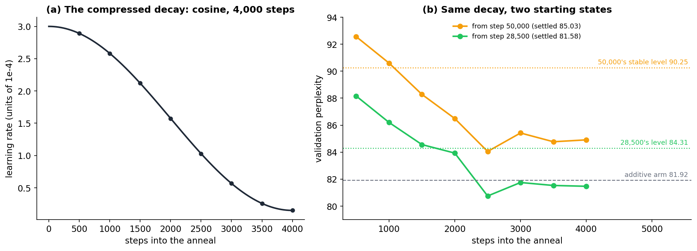
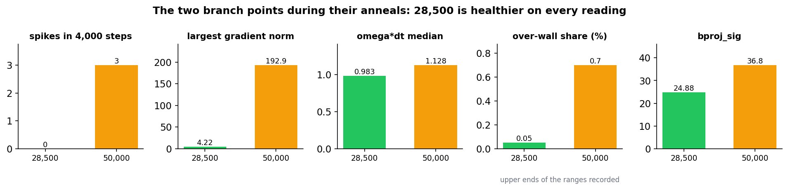

# Anneal Probes: Was the Joint Arm's Plateau a Learning-Rate Problem?

**What this note is.** Two short learning-rate decays branched from the joint-coupling $V_\theta$ arm in September 2026, one from where the run stopped (step 50,000) and one from its best checkpoint (step 28,500), and the production decay they led to. Split out of the former `Joint_Vtheta_QKNorm_Run_Diagnostic_Checklist.md` (its §6) on 2026-11-22; the run's story is in [README.md](README.md).

**Status.** Both probes run, 2026-09-17. The learning rate was the block; and the run had been trained about 36,500 steps past its peak. The production decay from step 28,500 was the next action (§6).

---

## Contents

1. [Definitions](#1-definitions)
2. [The problem](#2-the-problem)
3. [The probe from step 50,000](#3-the-probe-from-step-50000)
4. [The probe from step 28,500](#4-the-probe-from-step-28500)
5. [What the two probes establish](#5-what-the-two-probes-establish)
6. [The production decay from step 28,500](#6-the-production-decay-from-step-28500)
7. [Files](#7-files)

---

## 1. Definitions

- **The joint arm.** The run `fock_cfc_owt_..._vtjoint_cgqk_L8probe_..._baoab_cfc`, with one well bank whose wells read all five context channels at once. **The additive arm** has one bank per channel; its best after 100,000 steps was 81.92.
- **WSD schedule.** Warm-up, a stable phase at the peak learning rate, then a decay to a floor. The joint arm's: warm-up 0 to 5,000, stable 5,000 to 65,000, decay 65,000 to 100,000, floor 1.5e-5, with `TOTAL_STEPS = 100,000`; the windows are a pure function of `TOTAL_STEPS` (the stable phase ends at 65% of it).
- **Anneal probe.** A compressed decay branched from a stable-phase checkpoint: the same start and floor and the same cosine shape as the real decay, 8.75 times faster (4,000 steps against about 35,000).
- **Settled PPL.** The mean of the last three evaluations; **eval noise** is about 1.5 PPL ($\sigma \approx 1.54$) on this arm.
- **Decay gain.** The drop from the stable-phase level to the settled level after the decay.
- **`omega*dt`, `over_wall`, `bproj_sig`.** The stiffness of the low-rank precision modes and the share of readings above the explicit integrator's stability limit of 2, and the largest singular value of the low-rank factor map ([Bank_Geometry_and_Stiffness_Diagnostics.md](Bank_Geometry_and_Stiffness_Diagnostics.md), §1).
- **Spike.** A step whose pre-clip gradient norm exceeds 100.
- **Leak probe.** A causality check: honest PPL (each position scored with only its prefix) against standard PPL.

## 2. The problem

The main run stopped improving and began to degrade: windowed mean PPL bottomed at steps 30,000 to 35,000 and rose after, at +0.159 ± 0.065 PPL per 1,000 steps from step 34,000 (t = 2.45), while the learning rate sat at 3.0e-4 for 15,400 steps and the gradient norms grew ([README.md](README.md), §2). The question: **is the plateau a mismatch between a fixed step size and a sharpening landscape, or something deeper?** And if the learning rate was the block, from which state should the real decay start?

**The schedule of each probe.** Over $S$ = 4,000 steps the learning rate falls along a cosine from $\eta_0$ = 3e-4 to $\eta_1$ = 1.5e-5, the WSD floor:

$$\eta(s) = \eta_1 + \tfrac{1}{2}(\eta_0 - \eta_1)\left(1 + \cos(\pi s / S)\right).$$

The cosine is nearly flat at its start: 96.4% of $\eta_0$ at the first evaluation ($s$ = 500) and 86.1% at the second.

| step | learning rate | share of the start |
| --- | --- | --- |
| 50,500 | 2.892e-4 | 96.4% |
| 52,000 | 1.575e-4 | 52.5% |
| 53,000 | 5.674e-5 | 18.9% |
| 54,000 | 1.500e-5 | 5.0% |

**The comparison.** Two probes on the same schedule from two starting states measure the states' worth with the schedule held fixed: the difference of their settled values is what the steps between the two states bought or cost.



*Figure 1. (a) The compressed decay. (b) The same decay from the two branch points: the one from 28,500 is lower at every evaluation and ends below the additive arm.*

## 3. The probe from step 50,000

**Notebook:** [`colab_fock_cfc_baoab_joint_vtheta_qknorm_annealed_after_50K_openwebtext_d384.ipynb`](../../notebooks/conservative_arch/scaleup/colab_fock_cfc_baoab_joint_vtheta_qknorm_annealed_after_50K_openwebtext_d384.ipynb) (committed 2026-09-17). Run order: Cell 0 → 1 → 1c → 2 → 3 → 4 → 5 → the `import shutil` redirect cell → Cell 6; skip 1b (no-op) and 6d.

```python
ANNEAL_PROBE     = True        # short-circuits lr_schedule entirely
ANNEAL_FROM_STEP = 50_000
ANNEAL_STEPS     = 4_000       # ~4.7h at 4.2 s/step
ANNEAL_LR_START  = 3e-4
ANNEAL_LR_END    = 1.5e-5      # == WSD_LR_FLOOR
PROBE_MAX_STEPS  = 54_000
```

`TOTAL_STEPS` stays 100,000, so the WSD windows are untouched and the main run stays resumable.

**Three traps, found by inspection before running.**

1. **Cell 2 would silently resume from `_step45000.pt`.** It matches `f'{CKPT_PREFIX}_step{s}.pt'` for `s in CKPT_STEPS`, and at `CKPT_INTERVAL = 7,500` step 50,000 is not in `CKPT_STEPS`, nor does the pattern match `_step50000_probe_stop.pt`. The probe cell sets `resume_ckpt` and `resume_step` explicitly.
2. **Outputs are redirected** to `GDRIVE_ROOT / 'anneal_probe'`. `RESULTS_DIR` is where `training_log.jsonl` is opened in append mode, and the probe's steps 50,001 to 54,000 would otherwise interleave with the main run's future steps at identical step numbers.
3. **The probe folder's `_best.pt` is seeded.** `_reload_best` resolves `CKPT_DIR / f'{CKPT_PREFIX}_best.pt'` and returns early if it is absent, so the watchdog is a silent no-op until the first evaluation at 50,500. Copying `_step50000_probe_stop.pt` in as `_best.pt` closes that window and makes the rollback target the anneal's own starting state rather than the main run's step-28,500 best.

**No anneal marker in `_variant_parts`:** that would change `CKPT_PREFIX` and break the resume path; the probe reuses the tag on purpose and isolates itself through the redirect. **Not to be judged before about step 52,500:** the informative evaluations are from 52,500 on, the decisive ones 53,500 and 54,000.

**The gate, recorded in advance:** PPL into the 70s confirms the learning rate was the block; PPL barely moving (high 80s) says the block is deeper.

**Result, 2026-09-17: the learning rate was the block.**

| step | learning rate | validation PPL |
| --- | --- | --- |
| 50,000 | 3.00e-4 | 93.93 (branch point) |
| 50,500 | 2.89e-4 | 92.56 |
| 51,000 | 2.58e-4 | 90.60 |
| 51,500 | 2.12e-4 | 88.28 |
| 52,000 | 1.58e-4 | 86.49 |
| **52,500** | 1.03e-4 | **84.05** |
| 53,000 | 5.68e-5 | 85.42 |
| 53,500 | 2.59e-5 | 84.77 |
| 54,000 | 1.50e-5 | 84.91 |
| **settled** | | **85.03** |

Monotone to 52,500, where 84.05 beat the main run's all-time best of 84.31 from a start 10 PPL worse, in 2,500 steps; the uptick at 53,000 (+1.37) is inside the eval noise.

**Scored honestly: a partial hit.** 93.93 was a high draw (the 45,000 to 50,000 windowed mean was 90.25), so the real gain is 90.25 to 84.05, −6.2 PPL (−6.9%): between the two outcomes stated in advance, not "into the 70s". Direction unambiguous, magnitude below the threshold. A compressed 4,000-step decay against a real one of about 27,000 typically underperforms, so 84.05 is a lower bound.

**The finding that matters most:** `omega*dt` was flat across the whole anneal (median 1.097 to 1.160) while the learning rate fell 5.3 times and PPL improved 7%; `over_wall` stayed at 0.2% to 0.7% and `bproj_sig` at 36.7 to 36.9. The curvature did not change and PPL improved anyway, so **integration error was not what capped PPL** ([Integration_Refinement.md](Integration_Refinement.md), §2).

**Spikes continued:** 3 in 3,050 steps (101.2, 164.2, 192.9) against 4 in the previous 15,400. Not a rate increase: the pre-clip gradient norm is computed before the optimiser step and does not depend on the learning rate, so the anneal was never expected to suppress spikes, and three is too few. The useful negative: **lowering the learning rate does not touch the spike mechanism**, consistent with routing conjunctions.

**The next action recorded then:** return to the main folder at step 50,000 (not the anneal's checkpoint, which is already annealed to a low learning rate), set `ANNEAL_PROBE = False` and `TOTAL_STEPS = 77,000`, so that the stable phase ends at 50,050 and the real decay begins at once instead of burning 15,000 more flat steps that measurably degrade (+0.159 PPL per 1,000): about 27,000 steps, 31 hours, against 58 hours to finish at 100,000. §4 replaced this plan.

## 4. The probe from step 28,500

**Notebook:** [`colab_fock_cfc_baoab_joint_vtheta_qknorm_annealed_after_28500_openwebtext_d384.ipynb`](../../notebooks/conservative_arch/scaleup/colab_fock_cfc_baoab_joint_vtheta_qknorm_annealed_after_28500_openwebtext_d384.ipynb) (2026-09-17). The recipe, length and learning rate at every evaluation are those of §3; only the starting weights differ, so the two are directly comparable. The differences are confined to three cells: the configuration (`ANNEAL_FROM_STEP = 28_500`, `PROBE_MAX_STEPS = 32_500`), the redirect (source `_step28500_best.pt`, output folder `anneal_probe_28500`, and an assertion that the loaded checkpoint's `step` is 28,500) and a markdown note.

**Why.** §3 settled at about 85.0 from a stable-phase level of about 90.25: a decay gain of about −5.25 PPL. The main run's stable-phase best was 84.31 at step 28,500, so a decayed step-50,000 model was worth about the same as an undecayed step-28,500 model: the step-28,500 weights were better by roughly one decay's worth. The 21,500 stable-phase steps between them bought nothing, and the training loss agrees (4.4733 over steps 25,000 to 30,000 against 4.5000 over 45,000 to 50,000): the model regressed.

**Prediction, recorded before running: settles near 79.**

- About 79: set `TOTAL_STEPS` to about 44,000 (stable phase ending at 28,600) and run the real decay from 28,500. That would beat the additive arm's 81.92 at under half its compute.
- About 84 again: the step-28,500 advantage is illusory, §3's plan stands, and the joint-against-additive gap (+2.6% best, +3.8% settled, at 54% of the steps) is real.

Read the settled level, not the best: §3 settled at 85.03 while its best, 84.05, was a lucky draw of 1.37.

**Result, 2026-09-17: it beat the additive arm.**

| evaluation | learning rate | from 50,000 (§3) | from 28,500 | difference |
| --- | --- | --- | --- | --- |
| 1 | 2.89e-4 | 92.56 | 88.16 | −4.40 |
| 2 | 2.58e-4 | 90.60 | 86.20 | −4.40 |
| 3 | 2.12e-4 | 88.28 | 84.56 | −3.72 |
| 4 | 1.58e-4 | 86.49 | 83.93 | −2.56 |
| 5 | 1.03e-4 | 84.05 | **80.75** | −3.30 |
| 6 | 5.68e-5 | 85.42 | 81.75 | −3.67 |
| 7 | 2.59e-5 | 84.77 | 81.53 | −3.24 |
| 8 | 1.50e-5 | 84.91 | 81.47 | −3.44 |
| **settled** | | **85.03** | **81.58** | **−3.45** |

Better at every evaluation, by 2.6 to 4.4 PPL. Against the additive arm (81.92 best, 100,000 steps), joint wins: best 80.75 (−1.4%), settled 81.58 (−0.4%), using 32,500 steps, 32.5% of the compute.

**Prediction scored: a near miss.** "Settles near 79"; actual 81.58, off by +2.58. Direction strongly confirmed, magnitude optimistic: the same failure mode as the PPL extrapolation scored in [Bank_Geometry_and_Stiffness_Diagnostics.md](Bank_Geometry_and_Stiffness_Diagnostics.md), §5.

**Leak probe at step 30,000: clean** (honest 49.86 against standard 48.29, +0.0319 ± 0.0358 nats).

## 5. What the two probes establish

**The sharpest form of the finding.** Training from 28,500 to 50,000 did not merely buy nothing: it cost 3.45 PPL permanently, measured after both states were given an identical decay. The step-28,500 state is also healthier on every reading taken during its anneal:

| | at 28,500 | at 50,000 |
| --- | --- | --- |
| spikes in 4,000 steps | **0** | 3 |
| largest gradient norm | **4.22** | 192.9 |
| `omega*dt` median | **0.983** | 1.128 |
| `over_wall` | **0.011% to 0.050%** | 0.2% to 0.7% |
| `bproj_sig` | **24.88** | 36.80 |



*Figure 2. The two branch points during their anneals (upper ends of the recorded ranges for the over-wall share).*

`bproj_sig` grew 48% across that window while the model got worse, so the curvature accumulated there was harmful rather than productive. Consistent with §3: the anneal at 50,000 improved PPL without moving `omega*dt`, so curvature does not cap PPL directly, but a state that accumulated it anneals to a worse place.

**This reframes the arm.** The joint-against-additive comparison read "+2.6% worse at 54% of the steps" from step 50,000; with the right branch point it is −1.4% better at 32.5%. Joint coupling was never underperforming: it was being trained about 36,500 steps past its peak on a schedule that decayed far too late.

## 6. The production decay from step 28,500

**Notebook:** `colab_fock_cfc_baoab_joint_vtheta_qknorm_decay_from_28500_openwebtext_d384.ipynb`. `TOTAL_STEPS = 44_000`, so the stable phase ends at 28,600 and a resume at 28,500 runs 100 stable steps and then a real 15,400-step decay; `ANNEAL_PROBE = False`, `PROBE_MAX_STEPS = None`; about 18 hours. The compressed version reached 81.58; a decay about four times longer should do better.

**Two traps the notebook handles explicitly.**

1. **Cell 2 would resume from `_step30000.pt`, not 28,500.** With `TOTAL_STEPS = 44,000` the checkpoint steps are 7,500, 15,000, 22,500, 30,000 and 37,500, and `_step30000.pt` already exists in the main folder from the abandoned trajectory (evaluated at 87.73 against 28,500's 84.31, a materially worse start). The notebook sets `resume_ckpt` explicitly and asserts the loaded `step`.
2. **Writes must not go to the main folder.** The main run already covers steps 28,501 to 50,000, so a second trajectory over 28,501 to 44,000 would duplicate step numbers in `training_log.jsonl` and overwrite `_step30000.pt` and `_step37500.pt`. Output is redirected to `GDRIVE_ROOT / 'decay_from_28500'`.

**Do not reuse `anneal_probe/`.** Its `_best.pt` is now the step-52,500 model at 84.05, which would suppress checkpointing, restore the wrong `best_val_ppl` and give the watchdog a rollback target from a different trajectory.

## 7. Files

- **Notebooks:** the two anneal notebooks linked in §3 and §4; the production decay notebook of §6.
- **Evaluation sequences:** the 50,000 anneal's notebook outputs and the 28,500 anneal's result log (`fock_cfc_baoab_joint_vtheta_qknorm_annealed_after_28500_openwebtext_d384_result.txt`, Drive).
- **Figures:** [`figures/_make_joint_vtheta_arm_figs.py`](../figures/_make_joint_vtheta_arm_figs.py), writing `figures/joint_vtheta_arm/`.
