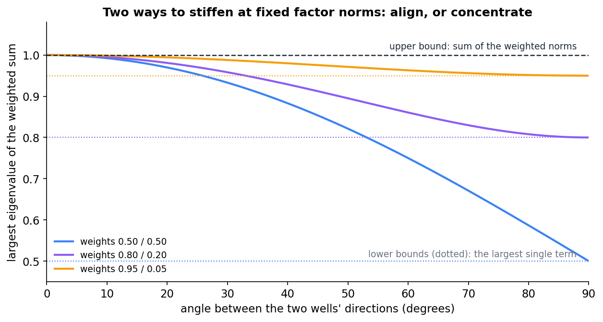
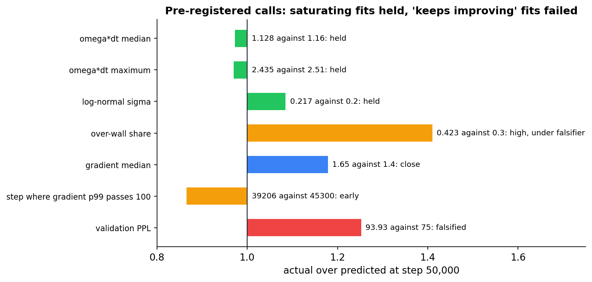
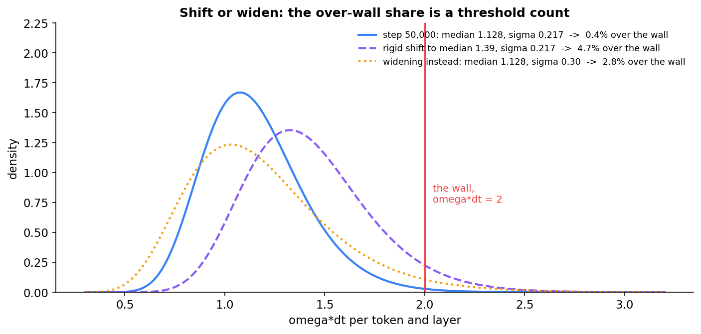

# Bank Geometry and Stiffness Diagnostics of the Joint Arm

**What this note is.** The diagnostic plan drawn up for the joint-coupling $V_\theta$ arm when its 50,000-step probe stopped improving (September 2026): what the well bank's low-rank precision factors are doing, why the stiffness `omega*dt` keeps rising, what causes the gradient spikes, and the predictions recorded in advance for step 50,000. Written on 2026-11-22 from its §0, §2 to §5 of the arm's original diagnostic checklist, which the documents in this folder replace; the run's story and the other studies are indexed in [README.md](README.md).

**Status.** §5's predictions were scored on 2026-09-16. The probes of §4 were proposed then; the decisions they feed are in §6. What happened next is in [Anneal_Probes.md](Anneal_Probes.md) and [Integration_Refinement.md](Integration_Refinement.md).

---

## Contents

1. [Definitions](#1-definitions)
2. [The problem](#2-the-problem)
3. [Before running anything](#3-before-running-anything)
4. [The tests](#4-the-tests)
5. [Predictions recorded in advance for step 50,000](#5-predictions-recorded-in-advance-for-step-50000)
6. [What the results decide](#6-what-the-results-decide)
7. [Lower priority](#7-lower-priority)
8. [Files](#8-files)

---

## 1. Definitions

- **The joint arm.** The run `fock_cfc_owt_..._vtjoint_cgqk_L8probe_..._baoab_cfc`: eight layers, a QK-normalised creation gate, and one well bank whose wells read all five context channels at once. **The additive arm** ([`Post_100K_CfC_BAOAB_Analysis_Checklist.md`](../Post_100K_CfC_BAOAB_Analysis_Checklist.md)) has one bank per channel, five in all, whose potentials are summed.
- **Well bank, $V_\theta$.** A potential over $K = 8$ wells, each with a centre $\mu_k$, a weight $w_k$ and a precision $P_k$, all computed from the context by dense maps:

  $$V_\theta(h; \xi) = -\sum_k w_k \exp\left(-\tfrac{1}{2}(h - \mu_k)^{\top} P_k (h - \mu_k)\right).$$

- **Precision.** A diagonal part and a low-rank part, with $B_k$ of size $d \times r$ and rank $r = 4$:

  $$P_k = \mathrm{diag}(a_k) + B_k B_k^{\top}.$$

- **Force weight.** How strongly well $k$ pulls the token at its current state $h$:

  $$g_k = w_k \exp\left(-\tfrac{1}{2}(h - \mu_k)^{\top} P_k (h - \mu_k)\right).$$

- **Site.** One (layer, bank) pair. The joint arm has 8 sites (8 layers, one bank); the additive arm has 40 (8 layers, five banks).
- **The cap, `PRECISION_LR_MAX`.** A smooth bound on the Frobenius norm of each $B_k$, at most the square root of the cap. With the cap at 1.0, a factor at the cap has Frobenius norm 1; **pinned** means every site reads 1. The cap is a live Python attribute of the bank (`bank._precision_lr_max`), not part of the saved state, so it can be changed mid-run.
- **Participation ratio (PR).** For the singular values $\sigma_i$ of $B_k$, the effective number of directions in use, between 1 and $r$:

  $$\mathrm{PR} = \frac{\left(\sum_i \sigma_i^2\right)^2}{\sum_i \sigma_i^4}.$$

  Its **random-init null** at $r = 4$ is 3.96: an untrained model already scores near the ceiling, so PR must be read against 3.96, not against $r$.
- **`between_frac`.** From `sigma_lr_spectrum_by_site`: the share of PR's spread that lies between sites rather than among the wells of one site, with $s_b$ the spread of the per-site median PR and $s_w$ the mean spread inside a site:

  $$\text{between-frac} = \frac{s_b^2}{s_b^2 + s_w^2}.$$

  Near 0, homogeneous; near 1, organised by site.
- **Stiffness operator.** The low-rank part of the potential's curvature at the token's state:

  $$\mathcal{K} = \sum_k g_k B_k B_k^{\top}.$$

- **Semantic mass.** $m$ (in the code `m_b`), the per-token mass in the second-order step.
- **`omega*dt`.** The stiffest low-rank mode's angular frequency $\omega = \sqrt{\lambda_{\max}(\mathcal{K}) / m}$ times the step $\Delta t$, read per token and per layer.
- **The wall, `over_wall`.** The integrator `baoab_cfc` treats the low-rank part with an explicit kick, which is stable on a harmonic mode only for `omega*dt` below 2. `over_wall` is the share of readings above 2.
- **`bproj_sig`.** The largest singular value of `B_proj`'s weight matrix, logged during training: how large the low-rank factors can get for any unit-norm input, before the cap acts.
- **Pre-clip gradient norm, spike.** The global gradient norm before per-group clipping. A **spike** is a step whose pre-clip norm exceeds the capture threshold of 100. A **spikebatch bundle** saves the weights, the batch and the random state at that step so it can be replayed; bundles at or above 200 (`ARCHIVE_MIN_GRAD_NORM`, twice the capture threshold) are archived permanently, the others stay in a live ring of 12.
- **Per-group clip.** Clipping thresholds set per parameter group: 0.1 to 0.3 on the groups implicated in spikes, 1.0 otherwise.
- **Routing conjunction.** The finding on the additive arm ([`Gradient_Spikes_as_Routing_Conjunctions.md`](../Gradient_Spikes_as_Routing_Conjunctions.md)) that a spike is the coincidence of a particular microbatch with a particular random draw, not a property of the curvature.
- **Saturating and non-saturating fits.** A saturating fit has a growth rate that decays (here, logarithmic in the step); a non-saturating one keeps its growth (linear, power law or exponential).

## 2. The problem

By step 50,000 the run had stopped improving (best 84.31 at step 28,500, final evaluation 93.93), while three quantities kept rising: the stiffness `omega*dt`, the gradient-norm tail and `bproj_sig`. The questions:

1. **Is the precision cap binding?** If every factor sits at the cap, its magnitude is fixed and cannot be what raises `omega*dt`.
2. **If not the magnitude, what?** `omega*dt` depends on the weights $g_k$, on how the factors $B_k$ are oriented relative to each other, and on the mass $m$.
3. **What causes the spikes?** Curvature, or the routing conjunction already found on the additive arm?
4. **Is `omega*dt` shifting or widening,** and will it reach the wall before step 100,000?

All the probes are deterministic functions of saved checkpoints, so none of them competes with training for a Colab session.

## 3. Before running anything

- **Cell order for a diagnostics-only session:** Cell 0 → 1 → 1c → 2 → 3 → 4 → 5 → 6b → 6b-2 → 6b-3 → 6b-4. Cell 1c must run (it archives the spikebatch and prereload rings before rotation; cheap, idempotent). Cells 6d-2, 6d-3 and 6d-4 were deleted from this notebook on 2026-09-14: they were hard-coded to the additive arm's steps 70522, 71194 and 71703, register 14 and `model_fock_parf_v2`, and 6d-4 probed `log_tau`, which does not exist under QK-norm (`[tau-floor] no creation_gate_qkv.log_tau on this model`).
- **Cell 6d's helpers need Cell 6 to have at least started.** `replay_spike_batch` and `attribute_spike_rows` look up Cell 6's globals (`forward_with_vreg`, `LAMBDA_V`, `_GRAD_CLIP_CFG`, `WATCHDOG_EXCLUDE_GROUPS`, `CKPT_DIR` and `CKPT_PREFIX`) at call time. A session that skips Cell 6 can define them but not call them. The additive arm's checklist says to skip Cell 6, which may only have worked because nothing there called 6d; verify before relying on it.
- **Verify what is loaded before trusting any live-model probe.** Cell 5 builds the model but does not load weights; confirm the resume step printed by Cell 2. A silent Cell 2 resume failure once produced a random-init model that read as "homogeneous" and cost a full round of measurements (Mitigations §42.5).
- **Read PR against its null of 3.96,** not against $r$ (§1).

## 4. The tests

The runnable diagnostics (`semsimula-diag`): `sigma_lr_spectrum_by_site`, `sigma_lr_spectrum_report`, `sigma_lr_report`, `stiffness_report`, `spectrum_across_checkpoints` and `bracket_precision_lr_max` take a batch or checkpoint tags; the bundle-dependent probes of §4.6 need spikebatch bundles, which exist since 2026-09-16 ([README.md](README.md), §3).

### 4.1 Is the cap binding? (highest priority, free, no bundle)

For each site $s$, read the factors' Frobenius norms against the cap $c$:

$$\rho_s = \frac{\mathrm{median}\left( \lVert B_k \rVert_F \right)}{\sqrt{c}}.$$

```python
sigma_lr_spectrum_by_site(ctx, x)     # prints per-site ||B||_F and PR
```

**Why it matters.** If the factors are pinned at the cap everywhere, $B$'s scale is fixed, and the rigid upward shift of the `omega*dt` distribution (§5) cannot come from $B$'s magnitude; it must come from the weights $g_k$ concentrating, from the factors aligning across wells, or from $m$ (§4.5). Lowering the cap then buys nothing.

**Prior.** On the additive arm this read 1.000 at every one of 40 sites: the cap binding uniformly. This arm has 8 sites, so the same answer cannot be assumed.

**Decision rule.**

- every site at about 1.000: the cap is binding; `PRECISION_LR_MAX` is not the lever; go to §4.5;
- sites below 1.000: the cap is slack; tightening it acts directly on `omega*dt`, and it can be changed mid-run.

### 4.2 How is the rank used, and where?

The same call as §4.1; read PR per site against the null 3.96, and `between_frac` with the range across channels and across layers. On the additive arm `between_frac` was 0.39 to 0.41 ("structured"), carried by channel (range 0.65) more than by layer (range 0.33). The joint bank has no per-channel sites, since each well is a joint function of all five channels, so the channel axis of that structure cannot exist here by construction. Whether the layer axis alone still produces structure is a direct, architectural test of what the additive arm's heterogeneity was made of.

### 4.3 When did it happen?

```python
spectrum_across_checkpoints(ctx, step_tags=(15000, 20000, 25000, 28500, 34156))
```

The cap ratio $\rho_s$ and the per-site PR at each checkpoint. When did the factors reach the cap, and does PR move as `omega*dt` shifts? PR falling while the cap ratio stays at 1 points to alignment or concentration (§4.5).

### 4.4 What budget would bind?

`bracket_precision_lr_max`: the quantiles of each factor's squared largest singular value at a healthy checkpoint and at spike checkpoints. A cap is a useful tail-only budget only if it sits above the healthy quantiles and below the spike-regime ones. On the additive arm the healthy and spike-regime checkpoints had statistically similar values (medians about 280 to 310 across all four), so no such budget existed there. Worth re-checking here, because this arm ran with the cap on from step 0, rather than switching it on at step 47,000.

### 4.5 Which factor of `omega*dt` moves? (needs new tooling)

Taking logarithms of the definition,

$$\ln(\omega \Delta t) = \ln \Delta t + \tfrac{1}{2} \ln \lambda_{\max}(\mathcal{K}) - \tfrac{1}{2} \ln m.$$

At fixed $\Delta t$, either the mass falls or $\lambda_{\max}(\mathcal{K})$ rises. For the second, the largest eigenvalue of a sum of positive semi-definite terms is bounded on both sides. Each term is at most the sum (the others only add), and the spectral norm of a sum is at most the sum of the norms:

$$\max_k g_k \sigma_{\max}(B_k)^2 \le \lambda_{\max}(\mathcal{K}) \le \sum_k g_k \sigma_{\max}(B_k)^2.$$

The upper bound is reached when the wells' top directions coincide. With the factors' norms fixed (§4.1), $\lambda_{\max}$ can therefore grow in two ways, in order of suspicion:

1. **Concentration:** the weights pile onto fewer wells, raising the lower bound; the sum stops averaging and starts adding coherently.
2. **Alignment:** the factors rotate into a shared subspace, moving $\lambda_{\max}$ towards the upper bound even at fixed norms and fixed weights.
3. **The mass** shrinking: cheapest to rule out; check first.



*Figure 1. Two wells with unit factors: at a fixed weight split, aligning the directions raises the largest eigenvalue to the upper bound; at a fixed angle, concentrating the weights raises the lower bound.*

For two rank-one terms with unit factors, weights $p$ and $1 - p$ and an angle $\theta$ between their directions, the largest eigenvalue has a closed form:

$$\lambda_{\max} = \tfrac{1}{2} \left( 1 + \sqrt{1 - 4 p (1 - p) \sin^2 \theta} \right),$$

equal to 1 at $\theta = 0$ and to $\max(p, 1 - p)$ when $\theta$ is 90 degrees. The minimal probe reads, at one checkpoint, the distribution of the weights (their entropy after normalising them to sum to one, and the top well's share), the pairwise principal angles between the factors' column spaces, and the percentiles of $m$; compared with the step-15,000 checkpoint, it gives a direction of travel. Not in `semsimula-diag` yet.

### 4.6 What makes a spike? (bundle-dependent; unblocked 2026-09-16)

On a spikebatch bundle, replay the step and record the pre-clip norm $G_0$; replay under a control arm and record $G_1$. The **collapse ratio**, $G_0$ divided by $G_1$, large means the spike depends on the specific draw or directions, not on curvature. Use the bundle of step 39,521 first (pre-clip 479.9, the most severe) and 39,206 (202.2) to confirm; both are archived. 40,075 and 41,135 are in the live ring only ([README.md](README.md), §3).

In order, highest value first:

1. **`replay_rank_perturbation_control`.** The one genuinely open question. The routing-conjunction finding was established on the additive arm, which saw collapse ratios of 264 to 937 across three checkpoints. If the joint arm's first spike collapses the same way, the finding generalises and joint coupling introduces no new mechanism. If it does not, joint coupling has introduced a curvature-driven spike: the first evidence for anything like the otherwise falsified resonance hypothesis, which would change what the wall crossings mean. *Note (2026-11-22):* the checklist called this "the RNG-reset test", but the function's documentation describes a control for the rank-truncation ablation: each arm perturbs $B$ with isotropic noise carrying the energy a truncation to that rank would remove, separating "these directions are load-bearing" from "any perturbation of this size defuses the spike". Check which reading applies before interpreting it.
2. **`omega_dt_report`** on the bundle: was the spiking step's `omega*dt` distribution anomalous against the ambient one? Given the rigid shift (§5), the prediction is ordinary.
3. **`omega_dt_under_truncation`:** does the truncation that kills the spike also carry `omega*dt` back under the wall?
4. **`replay_precision_cap_ablation`:** does the cap collapse this arm's spike, as it did all three of the additive arm's?
5. **`tail_coherence_report`.**

## 5. Predictions recorded in advance for step 50,000

Stated before the data, so the next log would be a test rather than a story. All fits on steps up to 34,600.

**The model behind the `omega*dt` calls.** The per-token readings are close to log-normal, $\ln(\omega \Delta t) \sim \mathcal{N}(\mu, \sigma^2)$, so the median is $e^{\mu}$ and

$$\text{over-wall share} = 1 - \Phi\left( \frac{\ln 2 - \mu}{\sigma} \right),$$

with $\Phi$ the standard normal distribution function. A **rigid shift** is $\mu$ rising with $\sigma$ fixed; **widening** is $\sigma$ rising. The model reproduces the measurements: at the step-50,000 median 1.128 and $\sigma$ = 0.217 it gives 0.41% over the wall, against 0.423% measured.

| quantity | prediction at 50,000 | actual | verdict |
| --- | --- | --- | --- |
| `omega*dt` median | 1.16 | 1.128 | held |
| `omega*dt` maximum | 2.51 | 2.435 | held |
| `over_wall` | about 0.3% | 0.423% | high, under the 0.5% falsifier |
| log-normal sigma | about 0.20 | 0.217 | held (under the 0.22 falsifier) |
| gradient p99 passes 100 | step about 45,300 | step 39,206 | about 6,000 steps early |
| gradient median | about 1.4 | 1.65 | close |
| validation PPL | about 75 | 93.93 (best 84.31) | **falsified** |



*Figure 2. The saturating `omega*dt` fits held within 3%; the fits that assumed continued improvement failed.*

**Scored 2026-09-16: the pattern in the misses is the lesson.** Every saturating (logarithmic) fit held. Both fits that assumed continued improvement failed, and the PPL one failed badly, because it extrapolated a monotonic power law through a turning point that the windowed means place at steps 30,000 to 35,000. The gradient-tail exponential was right in direction but too slow: real growth in that window was faster than exponential. **Rule for next time:** before extrapolating a trend, check whether its growth rate is decaying. Saturating fits have been reliable here; "this keeps going" fits have not.

**The load-bearing claim, and how it was to be falsified.** `omega*dt` is saturating (logarithmic; its growth rate had already decayed 4.4 times, from +0.034 to +0.0077 per 1,000 steps) and the distribution shifts rigidly rather than widening ($\sigma$ +3.7% over 11,000 steps). Under that reading the median reaches only about 1.39 by step 100,000 and would not touch 2.0 until about step 663,000, and the rising `over_wall` is a threshold-crossing artifact of a rigid shift past a fixed cut, not a runaway. It is falsified if, at step 50,000, $\sigma$ has grown materially past about 0.22, the median overshoots about 1.2, or `over_wall` substantially exceeds about 0.5%. None happened.



*Figure 3. A rigid shift and a widening both raise the share over the wall. Under the log-normal model a shift to median 1.39 at fixed spread puts 4.7% over the wall; the run's own projection for step 100,000 was about 3.3%, so the model's tail is somewhat heavier than the projection assumed.*

**The gradient-norm tail is the trend that does not saturate,** and the real thing to watch. These are pre-clip norms: the per-group clips (0.1 to 0.3 on the implicated groups) protect the update, and they evidently work, with zero watchdog events. Two distinct signatures so far: led by `depth_code` (steps 23,000 to 28,700, up to 9.43) and led by `reverse_channel_scale` (steps 33,200 to 34,600, up to 15.36).

## 6. What the results decide

- **§4.1 pinned:** `PRECISION_LR_MAX` is spent as a lever; any mitigation has to act on the weights or the bank geometry (§4.5). Do not spend a run lowering the cap.
- **§4.1 slack:** lowering the cap is available and can be done mid-run; bracket it with §4.4 before choosing a value.
- **§4.6 item 1 collapses:** joint coupling introduced no new spike mechanism; the routing-conjunction finding generalises; the wall crossings are a stability curiosity rather than a cause, and the gradient tail is the only thing worth managing.
- **§4.6 item 1 does not collapse:** the significant outcome. Joint coupling has a curvature-driven spike mechanism the additive arm did not, and §5 of [`Analytic_Multi_Channel_Integration_in_Structured_Vtheta.md`](../Analytic_Multi_Channel_Integration_in_Structured_Vtheta.md) (fusion concentrates precision into exactly the operator the wall constrains) is a live risk rather than a hedge.
- **§5's predictions hold:** the saturating reading is right; the run can go to 100,000 steps without intervening on `omega*dt`.
- **§5's predictions fail:** re-derive before acting; do not patch the fit.

## 7. Lower priority

- **Register dominance is not the clean lock reported after the 15,000-step pilot.** Register 14 held from step 7,350 to 19,300, then register 9 took over from 19,900 to 22,950 (about 3,050 steps), and the two have alternated in bursts of 150 to 400 steps since, with a blip of register 18 at 34,450. Worth a per-register gate-scale attribution if it ever settles; handing off is the healthy behaviour.
- **`bproj_sig` grows but decelerates:** 7.29 to 25.77 across the run, with increments of +6.33, +4.17, +2.20, +2.13, +1.88 and +1.77 per 5,000-step window. Consistent with the saturating picture; no action.
- **Cosmetic:** after a `PROBE_MAX_STEPS` stop, the final log line prints `next_step=150000 (== TOTAL_STEPS means training is fully done)`, which is misleading; the halt is correctly reported one line earlier. Fix if the cell is edited anyway.

## 8. Files

- **Notebook:** the joint arm's training notebook (Cells 6b to 6b-4 and 6d for these probes).
- **Diagnostics:** `semsimula-diag` (`probes.stiffness`, `probes.precision_cap`, `probes.resonance`).
- **Figures:** [`figures/_make_joint_vtheta_arm_figs.py`](../figures/_make_joint_vtheta_arm_figs.py), writing `figures/joint_vtheta_arm/`.
- **Related:** [`Post_100K_CfC_BAOAB_Analysis_Checklist.md`](../Post_100K_CfC_BAOAB_Analysis_Checklist.md) (the additive arm's counterparts), [`Gradient_Spikes_as_Routing_Conjunctions.md`](../Gradient_Spikes_as_Routing_Conjunctions.md), [`Analytic_Multi_Channel_Integration_in_Structured_Vtheta.md`](../Analytic_Multi_Channel_Integration_in_Structured_Vtheta.md) §5, [`Register_Temperature_Instability_in_the_Fock_Creation_Gate.md`](../training_instabilities/Register_Temperature_Instability_in_the_Fock_Creation_Gate.md).
