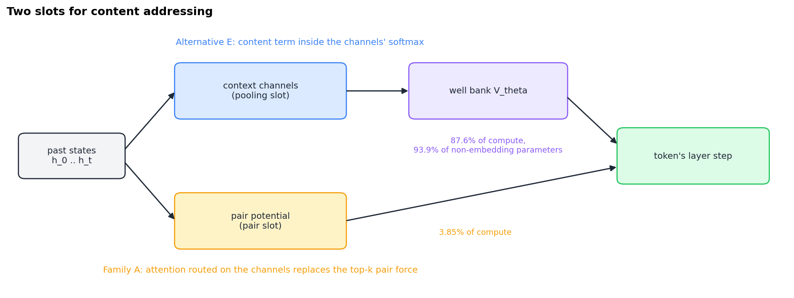
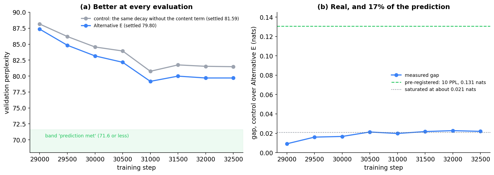

# Content-Addressed Context Routing: Family A and Alternative E

**What this note is.** The September 2026 test of the bottleneck diagnosis that followed the matched-GPT-2 comparison ([Matched_GPT2_Comparison.md](Matched_GPT2_Comparison.md), §6): if the context reaches each token only through distance-weighted averages, does making that routing depend on content recover the gap? Two mechanisms were built: **Family A**, content-routed attention in the pair slot, and **Alternative E**, a content term inside the context channels. Written on 2026-11-22 from its §10 of the arm's original diagnostic checklist, which the documents in this folder replace; the run's story is in [README.md](README.md).

**Status.** Family A: ported and gated (gates 0 to 2 passed, 2026-09-18), not trained. Alternative E: run 2026-09-19; the effect is real (+1.79 PPL) and far below the predicted 10, so the diagnosis in its strong form is refuted. The content term was kept: every model of the depth ladder uses it ([`Context_Mixing_Mechanisms_in_the_Conservative_Framework.md`](../Context_Mixing_Mechanisms_in_the_Conservative_Framework.md) §8 is its design document). The Phase 2 factorisation (§7) was proposed.

---

## Contents

1. [Definitions](#1-definitions)
2. [The problem](#2-the-problem)
3. [Family A: content-routed attention in the pair slot](#3-family-a-content-routed-attention-in-the-pair-slot)
4. [Alternative E: content-addressed context pooling](#4-alternative-e-content-addressed-context-pooling)
5. [Alternative E: the result](#5-alternative-e-the-result)
6. [Family A: the from-scratch ladder](#6-family-a-the-from-scratch-ladder)
7. [Next: the Phase 2 factorisation probe](#7-next-the-phase-2-factorisation-probe)
8. [Files](#8-files)

---

## 1. Definitions

- **Context channels.** $\xi_c(t)$, $c = 1, \dots, 5$: causal weighted averages of the past states $h_s$, $s \le t$, with learned decays $\alpha_c$. Before this study the weights were an exponential moving average, depending only on the distance $t - s$.
- **Well bank, $V_\theta$.** The potential whose wells' centres, precisions and weights are generated from the context channels by dense maps; 87.6% of the model's compute and 93.9% of its non-embedding parameters.
- **Pair potential, $V_\varphi$.** The routed pair force between tokens (top-k selection by a score head); 3.85% of compute.
- **Pooling slot and pair slot.** The two places context can enter a token's step: through the context channels into $V_\theta$, or through the pair potential directly.
- **Family A.** $\xi$-routed conservative attention (`XiRoutedConservativeAttention`, `V_attn`): attention whose routing weights are computed from the detached context channels, replacing the top-k pair force.
- **Alternative E.** Content-addressed $\xi$ pooling: a query-key content term added inside the context channels' softmax.
- **Conservative force.** A force that is minus the gradient of a scalar potential; checked by comparing the force with a finite-difference gradient.
- **Causality.** A position's output does not depend on later tokens.
- **Gate.** A pass/fail check run before a longer experiment is trusted.
- **Warm start.** Continuing from a trained checkpoint with new parameters added; exact if the new model computes the same function at the start.
- **Settled PPL.** The mean of the last three evaluations.

## 2. The problem

The diagnosis ([Matched_GPT2_Comparison.md](Matched_GPT2_Comparison.md), §6): the context reaches the token update only through five fixed-decay moving averages, so the 93.9% of parameters downstream in $V_\theta$ can only reshape what survived a content-blind compression. Prediction 3 recorded there: a content-addressed pooling variant would gain **10 PPL or more**.

**Two mechanisms, two slots.** Family A, as written, replaces the pair force: the pair slot, 3.85% of compute. The diagnosed bottleneck is the context-channel path into $V_\theta$: 87.6% of compute, 93.9% of parameters. Running only Family A risks a false negative on the whole hypothesis. The two occupy different slots and compose:

| mechanism | slot | change | tests |
| --- | --- | --- | --- |
| **Family A**, xi-routed conservative attention | pair | `V_attn` replaces the top-k pair force | content addressing on the pair path; ported, gated, ready |
| **Alternative E**, content-addressed xi pooling | pooling | a content term inside the moving average's softmax, feeding the well bank | content addressing on the diagnosed path; implemented and gate-verified |

*Figure 1. The two slots, with the compute each path carries.*

**Readings of the outcomes:** both help, content addressing helps generally; only Alternative E helps, the diagnosis is confirmed; only Family A helps, the diagnosis is wrong and the book's framing (pair-level routing) is right; neither helps, content addressing is not the issue and the second-order flow itself is the suspect.

**Naming.** An earlier draft called the two mechanisms "A1" and "A2". That clashed twice: `Context_Mixing_Mechanisms_in_the_Conservative_Framework.md` §4.4 uses Option A1 and Option A2 for Family A's own kernel choices (squared norm and dot product), and paper v3 uses §A1 and §A2 for appendices. The names here follow that document's "Alternative X" convention.

## 3. Family A: content-routed attention in the pair slot

**What already existed.** `model_xi_attention.py` (committed 2026-07-02, `8fbf4fe`) implements Family A as `XiRoutedConservativeAttention`, conservative by construction: the routing weights are read off the detached context channels, so each weight $\alpha(t, s)$ is a constant with respect to $h_t$ and the induced force stays the gradient of a scalar potential; no straight-through estimator is needed. Two things blocked using it directly: its notebook (`colab_xi_attention_openwebtext.ipynb`) had never been run, and `XiAttnPARFLM` subclasses `MultiXiPARFLM`, not `FockMultiXiPARFLM`, so it has no registers, no QK-norm, no CfC/BAOAB integrator and no joint anisotropic $V_\theta$; training it as it was would confound content routing with four other absent mechanisms.

**The port (gate 0), committed in `661d959`.** `_pair_potential` in `model_parf_multixi.py` is a clean seam: it returns a scalar and is called once from `_layer_forces`, which already holds the context channels; `FockMultiXiPARFLM` overrides neither, so the port is a branch, not a rewrite. Four edits, all opt-in:

| edit | what |
| --- | --- |
| `MultiXiPARFConfig` | `pair_potential` (default `'sparse_topk'`) and the `attn_*` knobs |
| `MultiXiPARFLM.__init__` | builds `V_attn` when selected and sets `V_phi` and `score_head` to `None`; imports `model_xi_attention` lazily, since that module imports from this one |
| `_pair_potential` | a new leading branch; the signature gains `xis=None`, so the old two-argument call still works |
| `_layer_forces` | passes `xis=xis` |

The default path is untouched: `pair_potential` defaults to `'sparse_topk'`, `V_attn` is `None`, nothing new is built, and the selection is read with `getattr`, so older checkpoints and notebooks still load and take the sparse path.

**Gate results.**

| gate | test | result |
| --- | --- | --- |
| 0a | default configuration unchanged; the old two-argument `_pair_potential` still callable | pass |
| 0b | `xi_attention` builds; no `V_phi` or `score_head` keys left in the state | pass |
| 0c | calling without the context channels raises rather than computing silently wrong | pass |
| 0d | forward and backward for both kernels; all four `V_attn` tensors receive gradient | pass |
| **1** | the force equals minus the finite-difference gradient, context frozen | **pass**, relative error 1.4e-9 (`dot`), 4.8e-9 (`rbf`) |
| **2** | perturb the tokens at positions 4 and later; the force at positions 0 to 3 must not move | **pass**, change exactly 0, against 2.9e-3 at positions 4 and later |

**Two findings from running the gates.**

- **The Hessian-symmetry test is vacuous for the `dot` kernel.** Its potential is bilinear in $h_t$ and the detached source $h_s$, hence linear in $h_t$, so its Hessian is identically zero and symmetry proves nothing; the finite-difference test (gate 1) is the real proof, valid for either kernel. Under `rbf` the Hessian is non-trivial (largest entry 2.0) and exactly symmetric. Consequence: a linear potential adds no curvature, so the `dot` kernel cannot move `omega*dt` at all, while `rbf`, quadratic in $h_t$, can push it towards the wall. Run `dot` first.
- **A finite-difference conservativity check must freeze the source.** Because the source is `h_in.detach()`, a naive perturbation moves the query and the source together and the test fails with a relative error near 1: a broken test, not a broken model. This is what `arm1_jacobian_symmetry`'s docstring means by "with context frozen".

**Cost and parameters at d = 384:**

| | parameters | MMAC per token per layer |
| --- | ---: | ---: |
| `sparse_topk`: `V_phi` and `score_head` | 137,801 | 1.557 |
| `xi_attention`: `V_attn` (dot, 4 heads, key and value width 48) | 884,736 | 1.081 |

All-to-all routing is cheaper than top-k here, because the routing projections from the 1,920-wide context dominate, while the term that grows with $T$ is only (heads × $T$ × key width). The parameter count rises 6.42 times, but that is +747K on a 76.7M model, under 1%.

## 4. Alternative E: content-addressed context pooling

**The pooling is already a softmax.** The deployed moving average is exactly a softmax over a distance logit, $(t - s) \log \alpha_c$ (verified to 5.6e-17), so content addressing is an additive change inside the same softmax rather than a replacement:

$$\ell_c(t, s) = (t - s) \log \alpha_c + \frac{(W_q h_t)^{\top} (W_k h_s)}{\sqrt{d_k}}, \qquad \xi_c(t) = \sum_{s=0}^{t} \frac{\exp \ell_c(t, s)}{\sum_{r=0}^{t} \exp \ell_c(t, r)} h_s.$$

The output contract (batch, $T$, channels, $d$) is unchanged, so $V_\theta$, the integrator, the registers and the pair potential are untouched.

**The initialisation is asymmetric on purpose.** With $W_q = 0$ the content term vanishes and step 0 is bit-identical to the moving average (4.4e-16), so a warm start from a trained checkpoint is exact. The key map must not also start at zero: the content term is bilinear, so its gradient with respect to the query map is proportional to the keys, and its gradient with respect to the key map is proportional to the queries. Both vanish when both maps are zero, a saddle from which nothing would learn and which would report a null result. Starting the key map random and the query map at zero gives the query map a non-zero gradient from the first step.

**Why it reaches the diagnosed path.** Unlike Family A, it acts on the path carrying 87.6% of compute and 93.9% of non-embedding parameters, against 3.85% for the pair slot: a null result here refutes the diagnosis, while a null result from Family A would not.

**The warm-start probe (the recommended next step then).** Only Alternative E can warm-start: Family A removes the trained `V_phi` and `score_head` and initialises `V_attn` at scale 0.02, so it perturbs the model at step 0 and cannot resume.

| gate | what | cost | criterion |
| --- | --- | --- | --- |
| 3 | `omega*dt` and step-0 PPL after loading `_step28500_best.pt` | minutes | PPL must read the checkpoint's own 84.31 exactly; anything else means the warm start is not bit-identical. Confirm the resonance monitor arms ([Integration_Refinement.md](Integration_Refinement.md), §5, records it going blind under the low-rank path) |
| 3b | `scaf.audit(...).assert_causal()` | minutes | no leak. The single future-perturbation probe of the gates is exactly what certified a checkpoint at 7.69 PPL whose honest value was 258.07 |
| 4 | the anneal from step 28,500, unchanged: a 4,000-step decay | about 5 h | compare the settled value with 81.58 |

This is an exactly controlled comparison: the same checkpoint, schedule, step count and evaluation grid as [Anneal_Probes.md](Anneal_Probes.md), §4, with the content term the only difference; no new control run is needed. `bench_inference.py` was folded in after Cell 5, to yield Part B ($V_\theta$ measured on the GPU) at no extra cost.

**The test statistic** is the settled gap in nats against that control:

$$\Delta = \ln \frac{\mathrm{PPL}_{\mathrm{control}}}{\mathrm{PPL}_{\mathrm{E}}}.$$

The prediction of 10 PPL corresponds to $\ln(81.58 / 71.58) \approx 0.131$ nats. **The bands, pre-registered:**

| settled result | reading |
| --- | --- |
| **71.6 or less** | prediction met; the diagnosis confirmed; proceed to a full run |
| 73.6 to 79.6 | real but under-predicted; worth the full run; the prediction scored as a miss |
| **79.6 or more** | within about 2 PPL of 81.58, inside the control's own eval noise: **refutes the diagnosis**; the parameters downstream of the channels were not starved of context, and the second-order flow itself becomes the suspect (§7.4 of the productionization plan) |

## 5. Alternative E: the result

**Run 2026-09-19.** Notebook: [`colab_fock_cfc_baoab_joint_vtheta_qknorm_xi_content_from_28500_openwebtext_d384.ipynb`](../../notebooks/conservative_arch/scaleup/colab_fock_cfc_baoab_joint_vtheta_qknorm_xi_content_from_28500_openwebtext_d384.ipynb). Warm-started from `_step28500_best.pt` with `xi_content_route=True` and run through the identical 4,000-step decay. All four start-up gates passed: 120 of 122 tensors loaded, the two new tensors freshly initialised, the optimizer remap carrying 113 states with none dropped, and the rollback target re-seeded at 122 tensors.

| step | control | Alternative E | PPL gain | nats |
| ---: | ---: | ---: | ---: | ---: |
| 29,000 | 88.16 | 87.36 | 0.80 | 0.0091 |
| 29,500 | 86.20 | 84.83 | 1.38 | 0.0161 |
| 30,000 | 84.56 | 83.16 | 1.40 | 0.0167 |
| 30,500 | 83.93 | 82.16 | 1.77 | 0.0213 |
| 31,000 | 80.75 | **79.17** | 1.58 | 0.0198 |
| 31,500 | 81.75 | 79.99 | 1.76 | 0.0218 |
| 32,000 | 81.53 | 79.70 | 1.83 | 0.0227 |
| 32,500 | 81.47 | 79.70 | 1.77 | 0.0220 |
| **settled** | **81.59** | **79.80** | **+1.79** | **0.0222** |

The projection recorded before the last two evaluations was 79.87, against an actual 79.80: a 0.07 PPL error, the gap having held at its saturated value as the flattening growth rate implied.

*Figure 2. (a) Better at every evaluation. (b) The gap saturated at about 0.021 nats, 17% of the 0.131 predicted.*

**The effect is real, and far too small.** Six of six evaluations and ten of ten paired training steps favour Alternative E, never once reversing. The runs share a checkpoint, a schedule and a data order, so the training comparison is paired on identical batches: not noise. The gap saturated at about 0.021 nats, flat across the last three evaluations (0.0213, 0.0198, 0.0218) after growing from 0.0091; its growth rate had fallen four times between steps 28,550 and 29,000, which was called at the time and held.

**Prediction scored: failed.** 10 PPL or more (0.1306 nats) was predicted; 0.0222 nats was achieved, 17% of the target. The settled 79.80 lands in the band at or above 79.6, which the notebook and the gates both defined as refuting the diagnosis. Two distinctions:

- **The band call is marginal:** the value sits 0.20 PPL inside the boundary; a gap larger by 0.0025 nats would have read "real but under-predicted".
- **The prediction call is not:** 1.72 PPL against a required 10 is a clear miss wherever the boundary sits.

**Meta-prediction scored, four for four.** The saturating reading again beat the linear one: at step 29,000 the saturating outcome was put at about 85.4 for the 29,500 evaluation, and "on track to the prediction" at about 83.2; the actual was 84.83, after which it flattened. The fourth confirmation that linear extrapolation of PPL fails in this programme.

**What this rules out, and what survives.** Ruled out: the strong form of the diagnosis. The 93.9% of non-embedding parameters downstream of the channels were not meaningfully starved of context: making the pooling content-addressed, the strongest available upgrade to that path, recovers 2.1%. Against GPT-2's 54.67 the ratio moves from 1.49 to only 1.46. Surviving: that a second-order conservative flow is a weaker inductive bias for language than a residual stream, independent of how context is pooled (productionization plan §7.4); and that the parameters were never useful, as distinct from never fed, which §7 tests.

**As an optimisation, a separate verdict:** 1.72 PPL for +0.76% compute and +184K parameters is a good trade on its own terms; it is not an explanation for a 27 PPL gap. Keep the option; do not keep the hypothesis. (It was kept: the depth-ladder notebook switches it on for every model, `XI_CONTENT_ROUTE = True`, from 2026-09-20.)

**Secondary observations.** `over_wall` climbed from 0.003% to 0.070% across the anneal, with the median `omega*dt` rising from 0.976 to 0.998. Alternative E started below the control at step 29,000 (0.003% against 0.011%), but the control's later values were not to hand, so this is unattributed: it may be the decay stiffening the landscape rather than the content routing. The learned decays moved opposite to the control on the shortest channel ($\alpha_1$ rose from 0.287 to 0.298 while the control's fell, and $\alpha_2$ dropped faster, 0.605 to 0.582): consistent with the content term taking over work the distance term had been doing. Timing was identical to the control within one second at step 28,800, so the predicted +0.76% cost is invisible in practice.

## 6. Family A: the from-scratch ladder

Only if worth running (it was not run):

| gate | what | cost | criterion |
| --- | --- | --- | --- |
| 3 | `omega*dt` at initialisation; step-0 PPL | minutes | use the `dot` kernel first (§3: no curvature, so it cannot move `omega*dt`; `rbf` can) |
| 4 | a 2,000-step pilot | about 2.5 h | no watchdog trips; gradient norms comparable |
| 5 | a 5,000-step pilot | about 6 h | see below |
| 6 | the full 32,500 steps | about 38 h | beat 81.58 and 54.67 |

**Gate 5 uses a control that already exists.** Run on the same schedule as the 150,000-step run (warm-up 7,500, learning rate 3.0e-4) and compare step for step against its logged head; do not generate a fresh control and do not change `TOTAL_STEPS` (the WSD schedule is a pure function of it):

| step | current arm's validation PPL |
| ---: | ---: |
| 2,000 | 473.12 |
| 3,000 | 332.90 |
| 4,000 | 253.93 |
| 5,000 | **201.56** |

This matched-step comparison is valid where the GPT-2 early-curve comparison was not: identical schedule, warm-up, learning rate, initialisation recipe and data order, with the pair term the only difference. At step 5,000, near 200 PPL, a real mechanism gain should appear as 15 PPL or more, far outside the eval noise of 1.5; under 5 PPL at step 5,000 does not justify gate 6.

## 7. Next: the Phase 2 factorisation probe

**Proposed.** Alternative E tested whether the parameters downstream of the channels were starved; they were not. The other half is whether they were ever useful. Factorise `B_proj`, `mu_proj` and `a_proj` at bottleneck width 256, cutting $V_\theta$'s parameters about 6.5 times, warm-started from the rank-256 SVD truncation of the trained weights so the start is near-exact; run the same 4,000-step decay from step 28,500 and compare the settled value with 81.58. This is prediction 1 of [Matched_GPT2_Comparison.md](Matched_GPT2_Comparison.md), §7, already scheduled for cost reasons (productionization plan §6, Phase 2, worth 49% of inference cost), and it completes a 2×2:

| Alternative E | Phase 2 | reading |
| --- | --- | --- |
| null | null | the parameters were neither starved nor used; the well bank as a hypernetwork is the wrong design, and the capacity should be reallocated |
| null | hurts | the parameters are used, but not for context: an aperture or capacity story, not a routing one |

Alternative E landed null; Phase 2 decides which row. (A related trained test on the later Gen 3 core is twin PB, a bottleneck of width 512 in `B_proj`: [productization/Stage3c_Twin_PB_Precision_Bottleneck.md](../productization/Stage3c_Twin_PB_Precision_Bottleneck.md).)

## 8. Files

- **Design document for Alternative E:** [`Context_Mixing_Mechanisms_in_the_Conservative_Framework.md`](../Context_Mixing_Mechanisms_in_the_Conservative_Framework.md) §8 (the softmax identity, the saddle argument, cost, conservativity, causality, warm start).
- **Code:** `model_xi_attention.py` (Family A); `model_parf_multixi.py` (`pair_potential`, `xi_content_route`); `multixi/model_multixi.py` (`MultiChannelXi`, `causal_ema_logits`).
- **Notebooks:** the Alternative E warm-start notebook linked in §5; `colab_xi_attention_openwebtext.ipynb` (Family A, never run).
- **Figures:** [`figures/_make_joint_vtheta_arm_figs.py`](../figures/_make_joint_vtheta_arm_figs.py), writing `figures/joint_vtheta_arm/`.
