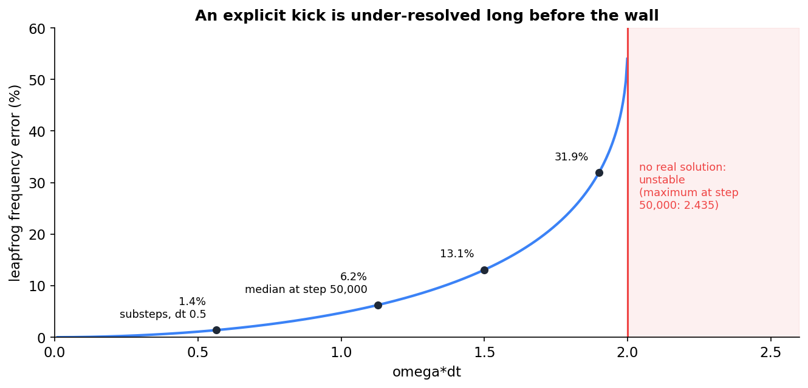
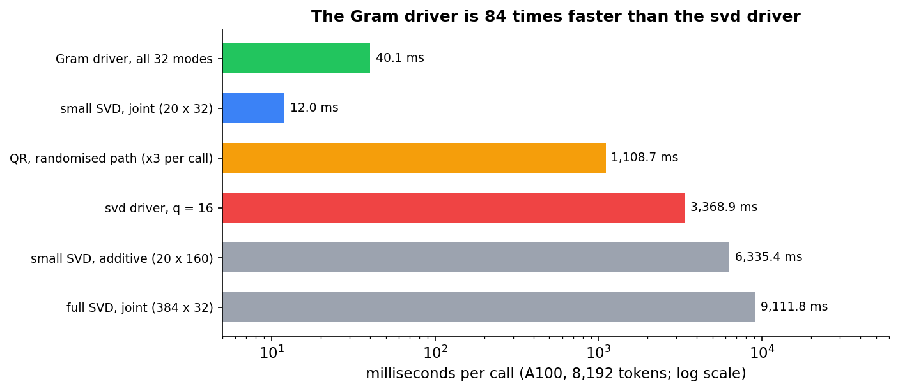
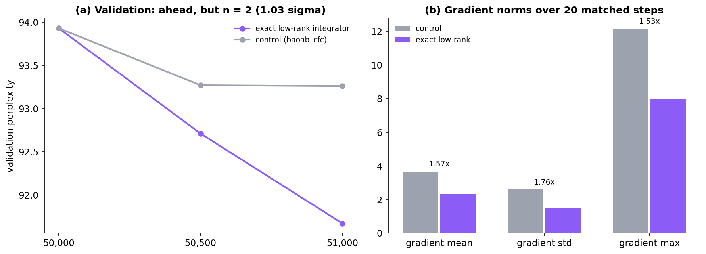
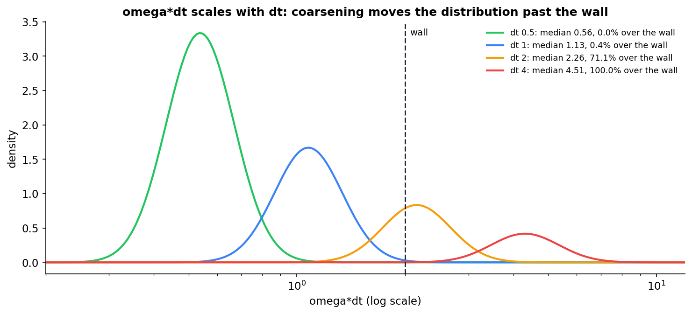

# Integration Refinement: Does the Joint Arm's Over-the-Wall Tail Cost Anything?

**What this note is.** The integration side of the joint-coupling $V_\theta$ arm's diagnostics (September 2026): why an explicit kick on the low-rank precision modes is under-resolved and, past `omega*dt` = 2, unstable; the two remedies (smaller steps, and integrating the stiffest modes exactly with `baoab_cfc_lowrank`); the benchmark that made the exact integrator affordable; and what not to do with depth. Split out of the former `Joint_Vtheta_QKNorm_Run_Diagnostic_Checklist.md` (its §7) on 2026-11-22; the run's story is in [README.md](README.md).

**Status.** The benchmark ran 2026-09-17 and the exact low-rank integrator was run against a control and closed on 2026-09-18 (§5): it is affordable and buys stability rather than loss. The substep variant (§6) was largely superseded by it.

---

## Contents

1. [Definitions](#1-definitions)
2. [The problem](#2-the-problem)
3. [What refines for free, and what does not](#3-what-refines-for-free-and-what-does-not)
4. [The linear algebra benchmark](#4-the-linear-algebra-benchmark)
5. [The exact low-rank integrator](#5-the-exact-low-rank-integrator)
6. [Substeps at dt = 0.5](#6-substeps-at-dt--05)
7. [What not to do](#7-what-not-to-do)
8. [Standing facts about depth in this architecture](#8-standing-facts-about-depth-in-this-architecture)
9. [Files](#9-files)

---

## 1. Definitions

- **The joint arm.** The run `fock_cfc_owt_..._vtjoint_cgqk_L8probe_..._baoab_cfc`: eight layers of step $\Delta t$ = 1.0, one well bank whose wells read all five context channels.
- **Precision and its low-rank part.** Each well's precision is a diagonal part plus a rank-4 part; the low-rank parts weighted by the wells' force weights $g_k$ form the **stiffness operator** ([Bank_Geometry_and_Stiffness_Diagnostics.md](Bank_Geometry_and_Stiffness_Diagnostics.md), §1):

  $$\mathcal{K} = \sum_k g_k B_k B_k^{\top}.$$

- **`omega*dt`.** The stiffest low-rank mode's angular frequency, $\omega = \sqrt{\lambda_{\max}(\mathcal{K}) / m}$ with $m$ the semantic mass, times the step $\Delta t$; read per token and per layer.
- **Explicit kick, the wall, `over_wall`.** A force applied as an impulse over the step, as in leapfrog. On a harmonic mode it is stable only for `omega*dt` below 2, **the wall**; `over_wall` is the share of readings above it.
- **`baoab_cfc`.** The CfC/BAOAB layer step: the closed-form harmonic propagator handles the diagonal precision exactly; the low-rank part is still an explicit kick.
- **`baoab_cfc_lowrank`.** The same step with the stiffest low-rank modes of $\mathcal{K}$ also integrated exactly, as damped oscillators; that channel then has no wall, only narrow damped resonances near `omega*dt` = $k \pi$.
- **`lowrank_modes` drivers.** How the stiff modes are extracted: the **svd driver** (a randomised range finder followed by a small SVD, for the top $q$ modes) or the **Gram driver** (an eigen-decomposition of the small Gram matrix, all modes).
- **Substeps.** Splitting each layer's integration into $n$ steps of $\Delta t / n$, with the gates still applied once per layer.
- **Register blend.** The register update $r \leftarrow \beta r + (1 - \beta) \text{readout}$, applied once per layer with no $\Delta t$ factor ($\beta$ is gate-computed per token).
- **Zero-training read.** Evaluating a trained checkpoint with a changed integrator and no further training.

## 2. The problem

**The premise, revised on 2026-09-17.** This study first said "run only if the anneal does not unstick the plateau". The anneal did unstick it, and in doing so falsified the motivating hypothesis: `omega*dt` stayed flat (median 1.097 to 1.160) while PPL improved 7% ([Anneal_Probes.md](Anneal_Probes.md), §3). Integration error is therefore not what caps PPL today. What survives is forward-looking:

- `omega*dt` is climbing logarithmically: projected median about 1.39 and `over_wall` about 3.3% by step 100,000;
- the tail is genuinely unstable: maximum 2.2 to 2.5, and above 2.0 the explicit kick has no real solution;
- the phase error at the median is about 6% and rising (below);
- all of it worsens at the next scale-up, where the additive arm's d = 768 blow-up at about step 37,000 is on record.

So the justification moved from "rescue this run" to "remove a ceiling while it is still cheap to measure, rather than mid-crisis at the next scale". This is de-risking work, not the fix for the plateau, and a **stability** experiment, not a capacity one: it adds no parameters.

**How wrong is an explicit kick?** For leapfrog on a harmonic mode of frequency $\omega$, the numerical frequency $\omega_{\mathrm{num}}$ satisfies

$$\sin\left( \tfrac{1}{2} \omega_{\mathrm{num}} \Delta t \right) = \tfrac{1}{2} \omega \Delta t.$$

The left side is at most 1, so there is no real solution once `omega*dt` exceeds 2: the wall. Below it the relative frequency error is $\omega_{\mathrm{num}} / \omega - 1$:

| `omega*dt` | frequency error | where |
| --- | --- | --- |
| 0.564 | 1.4% | with two substeps (§6) |
| **1.128** | **6.2%** | **the median at step 50,000** |
| 1.500 | 13.1% | |
| 1.900 | 31.9% | |
| 2.000 | unstable | the wall |
| **2.435** | **unstable** | **the maximum at step 50,000** |



*Figure 1. The median mode carries about 6% phase error, and the readings over the wall have no stable solution.*

**What changing the step does.** `omega*dt` is proportional to $\Delta t$, so halving the step halves the whole distribution and moves it back under the wall. With the per-token readings close to log-normal ($\ln$ of `omega*dt` normal with spread $\sigma$ = 0.217 at step 50,000), the share over the wall at median $M$ is $1 - \Phi\left( (\ln 2 - \ln M) / \sigma \right)$:

| | step 1.0 (now, step 50,000) | step 0.5 |
| --- | --- | --- |
| `omega*dt` median | 1.128 | **0.564** |
| `omega*dt` maximum | 2.435 | **about 1.22** |
| `over_wall` | 0.423% | **about 0%** |

**Two remedies,** compared below: shrink the step (substeps, §6), or remove the error on the stiff modes (`baoab_cfc_lowrank`, §5), which fixes the cause rather than shrinking the step. **The order, revised 2026-09-17:** first the two-minute benchmark (§4), which decides whether the exact integrator is affordable on this arm; then the exact integrator if it is (it needs no code, only a configuration switch); then substeps as an independent cross-check, because two mechanisms agreeing on "no PPL change" is far stronger than either alone, and agreeing on "improvement" would be decisive; substeps first instead only if the exact integrator is expensive.

## 3. What refines for free, and what does not

Checked against `_fock_layer_step` and `_layer_step_langevin`, 2026-09-16:

- **Forces refine for free.** They enter the update multiplied by $\Delta t$ (`v_mid + (dt / m_b) * f_kick`), so two half-steps deliver the same impulse as one whole step. $V_\theta$ and the reverse channel need no correction.
- **Register blends do not.** $r \leftarrow \beta r + (1 - \beta) \text{readout}$ is applied once per layer with no $\Delta t$ factor. Doubling the layer count applies it twice as often ($\beta^{16}$ against $\beta^{8}$), halving the register's effective memory horizon in layer units. Any depth change must either hold the gate schedule fixed or correct $\beta$ to $\sqrt{\beta}$, which is right for a geometric blend but hard here, because $\beta$ is computed per token by a gate, not stored.

That asymmetry is why substeps (§6) are preferable to doubling the layers (§7.1).

## 4. The linear algebra benchmark

**Run 2026-09-17** (A100, CUDA 12.8, 8,192 tokens). [`debug/bench_lowrank.py`](../../notebooks/conservative_arch/scaleup/debug/bench_lowrank.py) times the operations `lowrank_modes` performs, at the shapes this arm produces, with no model and no training; it scales the token batch to fit smaller cards and normalises every timing against a reference matrix product, so results compare across GPUs.

**The hypothesis it tested.** cuSOLVER's `gesvdjBatched` handles matrices only up to 32 × 32; above that PyTorch loops over the batch, 8,192 sequential kernel launches per call. The randomised path's small SVD has shape $(q_{\mathrm{over}}, P)$, with $P = K r$ the number of low-rank columns per bank: (20, 160) on the additive arm, which loops, and (20, 32) on this arm, which is batched. The QR in the same routine has shape $(BT, d, q_{\mathrm{over}})$, independent of $P$, identical on both arms. So if the SVD is the bottleneck, the joint arm sidesteps it for free; if the QR is, joint coupling changes nothing.

| operation | shape | ms per call |
| --- | --- | ---: |
| QR (randomised path, three per call) | 384 × 20 | 1,108.7 |
| small SVD, joint | 20 × 32 | 12.0 |
| small SVD, additive | 20 × 160 | **6,335.4** |
| full SVD, joint (`max_modes=None`) | 384 × 32 | 9,111.8 |
| **`lowrank_modes` svd driver, q = 16** | 384 × 32 | **3,368.9** |
| **`lowrank_modes` Gram driver, all 32** | 384 × 32 | **40.1** |



*Figure 2. The Gram driver takes 40 ms where the svd driver takes 3.4 s.*

- **The 32 × 32 cliff is real** (532 times between (20, 160) and (20, 32)) **but not this arm's problem.** Three QRs take 3,326 ms of the svd path's 3,368.9: 99% of the cost is the QR, whose shape does not depend on $P$. The "joint sidesteps the cliff for free" hypothesis is closed: wrong branch.
- **The Gram driver is 84 times faster than the svd path** (40.1 against 3,368.9 ms), taking the arm from 112 s per step to 5.48 predicted and 5.74 measured. It also returns all 32 modes, so the exact treatment is now the cheap one and truncation is obsolete.
- **An assumption that carried the reading:** the remembered figure of about 60 s per step from an earlier attempt was never confirmed to be from the additive arm; the cliff explanation needed that. The measured QR dominance made the question moot.
- **A T4 is adequate** for this benchmark (the 32 × 32 limit is an API constraint, not a hardware one), but it understates the gap: looping is launch-bound and roughly GPU-independent, the batched path throughput-bound and slower there, so a cliff seen on a T4 is a lower bound on the A100's.
- **Two process notes, both self-inflicted:** the first benchmark hard-coded a clone path and skipped the only row that mattered; the second had an unasserted string replacement that silently did nothing. Assert every replacement, and prefer a shallow clone over path discovery.

## 5. The exact low-rank integrator

**Run and closed 2026-09-18. Verdict: it works, it is affordable, and it buys stability rather than loss.** `baoab_cfc` was used for the production decay; the exact integrator was kept for the next scale-up.

**The run.** `colab_..._lowrank_from_50K_...ipynb` and its matched control `colab_..._control_flat_from_50K_...ipynb`: identical branch point (step 50,000), flat learning rate 3e-4, 1,000 steps, same seed and data order, differing only in `INTEGRATOR` and the output folder.

| step | exact low-rank | control | edge |
| --- | --- | --- | --- |
| 50,000 | 93.93 | 93.93 | (shared start) |
| 50,500 | 92.71 | 93.27 | +0.56 |
| 51,000 | **91.67** | 93.26 | **+1.59** |

- **Validation:** the control went flat (−0.67, then nothing); the exact arm kept descending (−2.26, still falling at the stop). But the gap of 1.59 is 1.03 sigma on two evaluations: suggestive, not established.
- **Training loss is a dead heat,** and it is the more direct measurement: control 4.5120 against 4.5115 over 20 matched step lines, a difference of 0.0005.
- **Gradient stability is solid,** over 20 matched steps: mean norm 3.67 against 2.34 (1.57 times calmer), standard deviation 2.59 against 1.47 (1.76 times), maximum 12.16 against 7.94; spikes 2 (343.9 and 258.7, led by `creation_gate`) against 1 (145.3, led by `depth_code`). The direction was called at 7 steps, collapsed at 10 and recovered at 20: magnitude loose, direction now surviving a real sample.
- **Cost:** 1.36 times the time (5.74 against 4.21 s per step) and +6.9 GB: evaluation peak 75.86 GB against 68.96, 89% of an 85.1 GB card. Tight on an 80 GB card, would not fit a smaller one.



*Figure 3. (a) Validation ahead but on two evaluations. (b) Gradient norms calmer by a factor of about 1.5 to 1.8.*

**Why `baoab_cfc` for the production decay anyway:** a known quantity, 18 hours against 24.6, with the anneal's 81.58 as a reference; the validation edge was measured at a flat learning rate from the degraded step-50,000 state, with no reason to assume it transfers to a decay from the healthy 28,500; and the decay is where the final number comes from, not the place for a code path that raised `_LinAlgError` on its first contact with a real Gram matrix.

**Why keep it for the next scale-up:** `omega*dt` climbs logarithmically, `over_wall` projects to about 3.3% by step 100,000, and the d = 768 blow-up at about step 37,000 is on record. Calmer gradients and half the spikes are the right insurance there, and the integrator is now a working, benchmarked option behind a switch rather than a non-starter at 112 s per step.

**Open item: the resonance monitor is blind under this integrator.** Zero `[resonance]` lines across the whole pilot, where every `baoab_cfc` run emits one per 500 steps: `resonance.observe()` patches `vt.harmonic_terms` and `integrator_module.cfc_substep`, while the low-rank path calls `harmonic_terms_lowrank` and `lowrank_cfc_substep`, so the monitor records and warns about nothing. To be fixed before any long low-rank run; meanwhile the control supplies the reference (median 1.108 and 1.118, maximum 2.418 and 2.344, `over_wall` 0.200% and 0.284% at steps 50,500 and 51,000).

**The driver, as built: nothing needed building (verified 2026-09-17).**

- `lowrank_modes(G, max_modes=...)` has both paths: `_svd_stable` (all $P$ modes) and `_randomised_svd_det` (the top $q$).
- `_randomised_svd_det` is a hand-rolled Halko–Martinsson–Tropp range finder, written branch-free with a local fixed-seed generator, because `torch.svd_lowrank` trips `CheckpointError` under gradient checkpointing. Do not replace it with a library call.
- The caller demotes dropped modes correctly: `_layer_step_langevin` subtracts only the projection of the low-rank force onto the kept modes, so the soft modes stay in the stable explicit kick instead of being cancelled.
- `lowrank_max_modes`, `lowrank_niter` and `lowrank_oversample` are live configuration knobs read through `getattr(cfg, ...)`.

**Keep `LOWRANK_MAX_MODES = 16`, not `None`, on this arm** (with the svd driver). Sixteen of $P$ = 32 selects the randomised path, whose small SVD (20, 32) fits inside cuSOLVER's batched limit; `None` takes `_svd_stable` on (384, 32), which does not. `_svd_stable` also carries a jitter-retry escalation and a CPU fallback, so a forward and a gradient-checkpoint recompute could take different branches; the truncated path avoids that by construction. With `over_wall` at 0.423%, the set of modes needing exact treatment is far smaller than 16.

**Why it was affordable here when it was not on the additive arm (confirmed 2026-09-16).** The Gram matrix has $K r$ columns per bank, and the number of banks differs with the coupling:

| class | columns | modes |
| --- | --- | --- |
| `AnisotropicMixtureGaussianVTheta` (one bank) | d × Kr | 32 |
| `AnisotropicMultiContextGaussianVTheta` (additive, banks concatenated) | d × nKr (n = 5 banks) | **160** |
| `JointContextAnisotropicGaussianVTheta` (this arm, one bank) | d × Kr | **32** |

This arm's low-rank operator is five times smaller than the additive arm's, an incidental payoff of joint coupling. If the cost were dominated by the $O(d P^2)$ SVD, $P$ going from 160 to 32 would cut that term 25 times; §4 found the cost dominated by the QR instead, and the Gram driver removed it.

**Plumbing.** `INTEGRATOR` is part of `_variant_tag`, so switching it would normally orphan the arm's checkpoints into a fresh folder. Cell 1b (`RESUME_VARIANT_TAG_OVERRIDE`) exists for this case ("keep training the SAME run and only change which integrator it uses from here on"); set it to this arm's tag, and re-read its warning first: pointed at the wrong tag, it silently loads an incompatible $V_\theta$.

**The zero-training gate, with its asymmetry:** load step 50,000, switch the integrator, evaluate without training, compare with 93.93. An immediate improvement is strong evidence; an immediate regression is inconclusive, because the trained weights partly compensate for the integration error being removed. Then measure the time per step over a few hundred steps before committing.

## 6. Substeps at dt = 0.5

**Largely superseded by §5 (2026-09-18).** §5 answered the same question more directly and with a proper control: equal training loss (4.5115 against 4.5120), a 1.03-sigma validation edge on two evaluations and 1.57 times calmer gradients. Halving the step is a weaker version of that test (it shrinks the error rather than removing it), so this is worth building only as a second, independent mechanism to confirm §5's stability result.

**The design.** Keep $L$ = 8, `depth_code`, every gate and every weight as they are; split each layer's integration into two substeps of 0.5. No checkpoint surgery (shapes unchanged); the gate schedule preserved exactly (gates still fire once per layer); total integration time per layer unchanged (2 × 0.5 = 1 × 1.0); compute rises only on the integrator, so well under twice per step.

**The zero-training read.** Branch from the anneal's best, `anneal_probe/checkpoints/..._step52500_best.pt` (84.05), not step 50,000: a settled state at a low learning rate, so a PPL change is attributable to integration accuracy instead of being confounded with plateau dynamics; `omega*dt` there is still about 1.12 and `bproj_sig` about 36.8, so the error under test is present at full size. Evaluate with the refined integrator against 84.05:

- **PPL improves:** integration error was costing accuracy; reducing the step or capping curvature is a real lever.
- **PPL unchanged:** the wall crossings are harmless at this size, and `omega*dt` can be retired as a concern for this run.
- **PPL degrades:** inconclusive, not negative. The model was trained with explicit kicks at 1.0 and its parameters partly compensate for that error; distinguishing "the refinement is worse" from "the compensation was removed" needs a few hundred steps of re-adaptation.

**Implementation: about 12 lines.** Velocity is carried implicitly and the substeps must decode it at the inner step, not the outer one; both conversions are linear and invertible ($v = (h - h_{\mathrm{prev}}) / \Delta t$ and $h_{\mathrm{prev}} = h - v \Delta t$), so the boundary re-encoding is a rescale. Wrap the existing `_layer_step_ex` call in `_fock_layer_step` (two call sites, the `prefix_causal` branch and the extended one):

```python
_n = getattr(cfg, 'integrator_substeps', 1)
if _n > 1:
    _dt  = dt / _n
    v_in = decode_velocity(h, h_prev, dt)
    h_cur, hp = h, encode_velocity(h, v_in, _dt)
    for _ in range(_n):
        h_cur, hp = super()._layer_step_ex(
            h_cur, hp, m_b, gamma, _dt, layer_idx=layer_idx)
    h_new, h_prev_out = h_cur, encode_velocity(
        h_cur, decode_velocity(h_cur, hp, _dt), dt)
else:
    h_new, h_prev_out = super()._layer_step_ex(
        h, h_prev, m_b, gamma, dt, layer_idx=layer_idx)
```

The gates stay outside this loop, which preserves the schedule (§3). Validate first: `integrator_substeps=1` must be bit-identical to the current path, which catches any boundary-handling error before `=2` is trusted.

## 7. What not to do

### 7.1 L = 16 at dt = 0.5 with checkpoint surgery (only if §5 or §6 says yes)

It doubles the gate applications as well as the integration resolution, so it is a different and larger change than §6. Three tensors are shaped by $L$:

| parameter | L = 8 | L = 16 |
| --- | --- | --- |
| `depth_code` | [8, 5, 384] | [16, 5, 384] |
| `reverse_channel_scale` | [8] | [16] |
| `destruction_gates` | 8 modules | 16 modules |

(`creation_gates` is empty under `fock_version='v2'`, where the creation gate is the shared `creation_gate_qkv`, and `reverse_ch` and $V_\theta$ are shared, so only these three break.) It will not load without surgery, and it fails loudly (verified 2026-09-16): `load_state_dict(..., strict=False)` suppresses missing and unexpected keys but never shape mismatches, so `depth_code` and `reverse_channel_scale` raise outright, and the eight new destruction gates would trip the resume guard (`_n_loaded < 0.9 * _n_model`). Surgery: interpolate `depth_code` and `reverse_channel_scale` along the layer axis (new layer $\ell'$ at old time $\ell'/2$), duplicate each destruction gate into the two layers that subdivide it, and then deal with the register blend (§3), which duplication alone does not solve. The same zero-training gate applies: evaluate at once against 93.93; if PPL collapses, the surgery did not preserve the function.

### 7.2 L = 16 at dt = 1.0

Confounded. Layers here are integration steps, so 16 layers of 1.0 integrate for twice as long: a different trajectory, not more capacity. The run's own `L_PROBE_OVERRIDE` comment already separates this from "fewer layers, bigger steps for the same total integration time", a different experiment.

### 7.3 Coarsening (L = 4 at dt = 2.0, and so on)

`omega*dt` scales with the step, so coarsening moves the whole distribution past the wall. With the step-50,000 median 1.128 and $\sigma$ = 0.217:

| configuration | step | median | maximum | `over_wall` |
| --- | --- | --- | --- | --- |
| L = 16, or L = 8 with two substeps | 0.5 | 0.564 | 1.22 | about 0% |
| **L = 8 (current)** | **1.0** | **1.128** | **2.44** | **0.4%** |
| L = 4 | 2.0 | 2.256 | 4.87 | **71%** |
| L = 2 | 4.0 | 4.512 | 9.74 | **100%** |



*Figure 4. At a step of 2 the median reading is over the wall.*

Beyond stability, two structural reasons make "exactness means fewer layers" not apply to this explicit integrator:

1. **The flow is non-autonomous.** `depth_code` is [L, n_ctx, d] and `V_THETA_DEPTH_CONDITION = True`, so each layer applies a different conditioned potential. Exact integration allows larger steps through a fixed vector field; it cannot merge steps of a field that changes every layer. Dropping layers discards learned potentials, not redundant steps.
2. **Gates are not integration.** The register blend fires once per layer with no $\Delta t$ factor (§3), so halving $L$ halves the register updates, the depth of a recurrent channel.

The substep experiment bounds the question from both sides: if PPL is unchanged at 0.5, integration error at 1.0 is already negligible and coarsening buys nothing while costing the wall; if PPL improves, coarsening is worse still. (The later depth ladder did train at $L$ = 2 with a step of 4, under the exact low-rank integrator, which has no wall: [depth_ladder/](../depth_ladder/README.md).)

## 8. Standing facts about depth in this architecture

- **Depth is nearly free in parameters and expensive in compute.** The embeddings and untied head (38.6M, 50%) and the shared $V_\theta$ bank (35.4M, 46%) are independent of $L$; only about 2.69M is per layer, 337K each. So going from 8 to 16 layers is +3.5% parameters but about twice the compute per step (about 8.4 s). Adding wells is the opposite trade: 8 to 16 wells is +46% parameters at about the same compute.
- **L = 8 is a mitigation, not a preference.** The `ARCH_TIERS` ladder picks d = 384, L = 16, M = 32 by default; L = 8 was pinned because the L = 16 run hit a burst of clipped gradient spikes (steps 6,297 to 6,676) with a real PPL hit (176.88 to 207.11), depth lengthening the compounding chain a spike propagates through. All four of this run's spikes are led by `reverse_channel_scale`, and `reverse_ch` is a single weight-tied module reused at every layer, so its gradient accumulates once per layer: depth amplifies the exact signature that was escalating.
- **No evidence L = 16 was ever better at matched steps:** at step 6,000 the L = 16 run was at 176.88 (before the burst) against this arm's 170.98. Different arms, so not clean, but it was not ahead, and it was spikier.

## 9. Files

- **Benchmark:** [`debug/bench_lowrank.py`](../../notebooks/conservative_arch/scaleup/debug/bench_lowrank.py).
- **Code:** `lowrank_modes`, `_randomised_svd_det` and `_svd_stable` in the integrator module; `_layer_step_langevin` and `_fock_layer_step` in the model.
- **Notebooks:** the low-rank and flat-control branches from step 50,000 (§5).
- **Figures:** [`figures/_make_joint_vtheta_arm_figs.py`](../figures/_make_joint_vtheta_arm_figs.py), writing `figures/joint_vtheta_arm/`.
