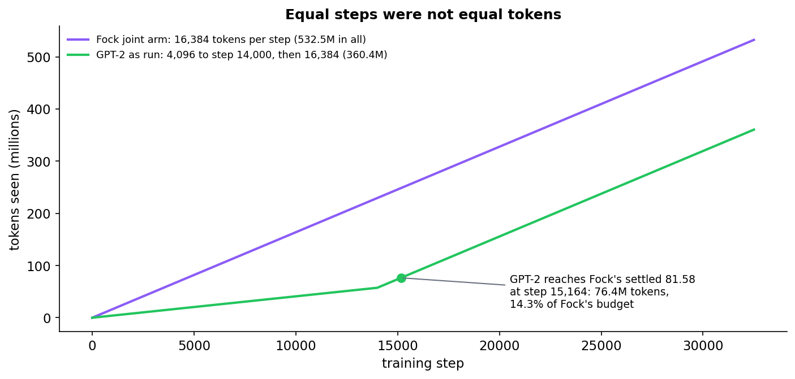
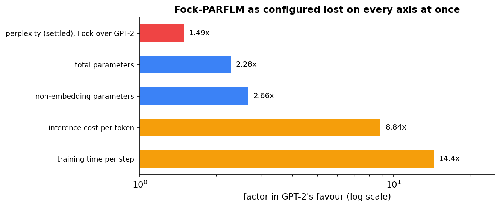

# The Joint Arm Against a Matched GPT-2

**What this note is.** The September 2026 comparison of the joint-coupling $V_\theta$ arm (Fock-PARFLM) with a GPT-2 trained on the same data, and the bottleneck diagnosis and predictions it led to. Written on 2026-11-22 from its §9 of the arm's original diagnostic checklist, which the documents in this folder replace; the run's story is in [README.md](README.md).

**Status.** Run 2026-09-18 to 2026-09-19. The endpoint perplexities stand; the token budgets were not matched (corrected 2026-09-20, §3), and a token-matched baseline is in [depth_ladder/Matched_GPT2_Baselines.md](../depth_ladder/Matched_GPT2_Baselines.md), which supersedes this note's budget claims.

---

## Contents

1. [Definitions](#1-definitions)
2. [The problem](#2-the-problem)
3. [Why the comparison is valid, and where it was not](#3-why-the-comparison-is-valid-and-where-it-was-not)
4. [Result](#4-result)
5. [The four-axis comparison](#5-the-four-axis-comparison)
6. [The bottleneck diagnosis](#6-the-bottleneck-diagnosis)
7. [Pre-registered predictions](#7-pre-registered-predictions)
8. [Files](#8-files)

---

## 1. Definitions

- **The joint arm (Fock).** Fock-PARFLM with one joint well bank over five context channels, eight layers, d = 384; its reference endpoint is the anneal from step 28,500, settled 81.58, best 80.75 ([Anneal_Probes.md](Anneal_Probes.md), §4).
- **Matched GPT-2.** A GPT-2 with the same tokenizer, validation file, training pool, width (d = 384), context (512) and fully decayed endpoint; depth eight layers, tied embeddings.
- **Settled PPL.** The mean of the last three evaluations.
- **Token budget.** The tokens a run has seen: the sum over steps of batch × accumulation × 512.
- **Non-embedding parameters.** All parameters except the token embeddings and output head.
- **MMAC per token.** Millions of multiply-accumulates per generated token at inference.
- **Context channels.** Causal averages of the past states that carry the context into each token's step; here exponential moving averages with fixed learned decays, whose weights depend on the distance $t - s$ and never on content.
- **Well bank, $V_\theta$.** The potential whose wells' centres, precisions and weights are generated from the context channels by dense maps.

## 2. The problem

Where is the bottleneck in the Fock architecture? A plain transformer trained on the same data, at the same width and to the same endpoint, gives the reference: the ratio of endpoint perplexities,

$$R = \frac{\mathrm{PPL}_{\mathrm{Fock}}}{\mathrm{PPL}_{\mathrm{GPT\text{-}2}}},$$

together with parameters, inference cost and training time. A ratio near 1 at lower cost would make the architecture competitive; a ratio well above 1 calls for a diagnosis of what limits it.

## 3. Why the comparison is valid, and where it was not

**Notebook:** [`colab_matched_gpt2_baseline_openwebtext.ipynb`](../../notebooks/conservative_arch/scaleup/colab_matched_gpt2_baseline_openwebtext.ipynb). Four things had to line up, and all four were verified in the source:

| | Fock joint arm | GPT-2 baseline |
| --- | --- | --- |
| validation set | `openwebtext_val_2M.npy` | the same file: the same 2B stream, the same `all_ids[-2M:]` slice |
| tokens per step | 16 × accumulation 2 × 512 = 16,384 | see the correction below |
| training pool | 2B, sampled with replacement | the same 2B pool |
| endpoint | step 32,500, learning rate at the floor 1.5e-5 | step 32,500, cosine at `LR_MIN` |

Four notebook bugs were fixed first: a token budget of 200M (32.5 epochs), a `total_mem` typo, a stale cache-name list that re-streamed 2B tokens, and an `EVAL_INTERVAL` of 2,000, which does not divide 32,500 and would have skipped the final decayed evaluation, producing exactly the schedule-position error this comparison exists to avoid.

**Correction, 2026-09-20: the budgets were not matched.** The original text claimed that because tokens per step match, steps map one to one and equal steps are equal tokens. That is false, and false in the direction that flatters Fock. The console logs show the baseline ran in two phases: steps 0 to 14,000 at batch 8 (4,096 tokens per step) and steps 14,000 to 32,500 at batch 32 (16,384), the second phase resuming the first's step-14,000 checkpoint.

| | steps | tokens |
| --- | ---: | ---: |
| Fock joint arm | 32,500 | **532.5M** |
| GPT-2 as published | 32,500 | **360.4M** |
| | | Fock used **1.48 times** more |

The difference was invisible in `training_log.jsonl`, which computes its `tokens` field as `step * 16,384` regardless of the batch used; only the console banner recorded the real one. The notebook printed a mismatch warning, but a `print` scrolls past in a 14,000-step log; it now raises instead (`ALLOW_BATCH_MISMATCH`). What survives unchanged: the validation file, the context, the 2B pool, the fully decayed endpoints, and therefore the endpoint perplexities themselves (54.59 final and 54.67 settled measure the right quantity on the right data). Only the budget framing was wrong; the token-matched baseline in [depth_ladder/Matched_GPT2_Baselines.md](../depth_ladder/Matched_GPT2_Baselines.md) was expected to land below 54.59, widening the gap rather than narrowing it.

*Figure 1. GPT-2 ran its first 14,000 steps at a quarter of the batch, so equal steps were not equal tokens.*

## 4. Result

**GPT-2 crossed the Fock arm's fully decayed endpoint at about step 15,200.** Interpolating linearly between the step-15,000 evaluation (82.80) and step 15,500 (79.07):

| Fock reference | GPT-2 reaches it at | share of the steps | share of the tokens |
| --- | ---: | ---: | ---: |
| 81.58 (settled) | step about 15,164 | 46.7% | **14.3%** |
| 80.75 (best) | step about 15,275 | 47.0% | **14.6%** |

Read the token column: step 15,164 of the baseline is 14,000 × 4,096 + 1,164 × 16,384 = 76.4M tokens, against the Fock arm's 532.5M, so GPT-2 crossed the Fock endpoint at 14.3% of its token budget, not 47%. At step 20,500 GPT-2 stood at 64.60 and was still falling about 1 PPL per 500 steps with 12,000 steps of decay left.

**Final endpoint at step 32,500: 54.59** (settled 54.67), recorded 2026-09-19.

**Prediction scored: the extrapolation was wrong again, in the same direction.** A log fit over steps 17,000 to 20,500 projected about 44 to 48; the saturating reading said 55 to 60. Actual 54.59: the third time in this programme that a log-linear extrapolation overshot and a saturating fit held, so log-linear extrapolation of PPL is treated as refuted for this programme, not merely unreliable. GPT-2 also missed its own Kaplan prediction of 30 to 35, as expected: 0.53B tokens against 33.7M parameters is 15.7 tokens per parameter, below the Chinchilla-optimal 20.

## 5. The four-axis comparison

| | Fock | GPT-2 | |
| --- | ---: | ---: | --- |
| PPL, final decayed | 81.47 | **54.59** | −26.88 |
| PPL, settled (last three) | 81.58 | **54.67** | −26.91, a ratio of **1.49** |
| PPL, best | 80.75 | 54.59 | −26.16 |
| total parameters | 76,745,698 | 33,691,776 | GPT-2 uses **2.28 times fewer** |
| non-embedding parameters | 37,760,000 | 14,196,480 | GPT-2 uses **2.66 times fewer** |
| inference MMAC per token | 323.6 | 36.6 | GPT-2 is **8.84 times cheaper** |
| training seconds per step | 4.18 | 0.29 | GPT-2 is **14.4 times faster** |

*Figure 2. The factor in GPT-2's favour on each axis.*

**The comparison was decided.** A plain transformer with 2.66 times fewer non-embedding parameters reached 33% lower perplexity on identical data, while costing 8.84 times less to serve and 14.4 times less to train. Fock-PARFLM as configured lost on every axis at once, and not narrowly. Step times are from the logs: Fock steps 28,550 to 28,600 took 209 s for 50 steps; GPT-2 steps 14,200 to 14,400 took 58 s for 200. The one caveat runs in Fock's favour: 81.58 came from a compressed 4,000-step anneal, which typically underperforms a real decay; crediting Fock a generous 2 PPL does not move the conclusion.

## 6. The bottleneck diagnosis

Full analysis in [`Fock_Inference_Productionization_Plan.md`](../productization/Fock_Inference_Productionization_Plan.md) §7. In brief: the context reaches the token update only through five fixed-decay moving averages, whose weights depend on the distance $t - s$ and never on content. 93.9% of Fock's non-embedding parameters sit in $V_\theta$'s well-parameter generator, which is downstream of that compression and can only reshape what survived it. Every earlier negative ablation is consistent with an upstream bottleneck: more wells did not help (the joint bank with 8 wells beat the additive one with 40), more depth did not help ([Integration_Refinement.md](Integration_Refinement.md), §8), and the rank is already fully used (participation ratio 3.68 against rank 4).

## 7. Pre-registered predictions

Recorded before running, to be scored as the trend predictions were:

1. **Factorising $V_\theta$ at bottleneck width 256** (Phase 2 of the productionization plan) cuts its parameters about 6.5 times. **Prediction: PPL moves by less than 2.** If it holds, those parameters were not doing work and the bottleneck is upstream in the context channels; if PPL degrades sharply, the capacity was used and this diagnosis is wrong.
2. **Raising the context channels from 5 to 10. Prediction: gain under 2 PPL.** More fixed taps do not fix content independence.
3. **A content-addressed pooling variant** (the book's family A or C). **Prediction: a gain of 10 PPL or more,** much larger than 2.

Predictions 2 and 3 together separate "too few taps" from "the wrong kind of pooling". Prediction 1 is the cheapest and sharpest. Prediction 3 was tested by Family A and Alternative E, and prediction 1 is the Phase 2 probe: [Content_Addressed_Context_Routing.md](Content_Addressed_Context_Routing.md). The answer: content addressing gained 1.79 PPL, not 10, and the diagnosis in its strong form was refuted.

## 8. Files

- **Notebook:** [`colab_matched_gpt2_baseline_openwebtext.ipynb`](../../notebooks/conservative_arch/scaleup/colab_matched_gpt2_baseline_openwebtext.ipynb).
- **Superseding baseline:** [depth_ladder/Matched_GPT2_Baselines.md](../depth_ladder/Matched_GPT2_Baselines.md).
- **Figures:** [`figures/_make_joint_vtheta_arm_figs.py`](../figures/_make_joint_vtheta_arm_figs.py), writing `figures/joint_vtheta_arm/`.
