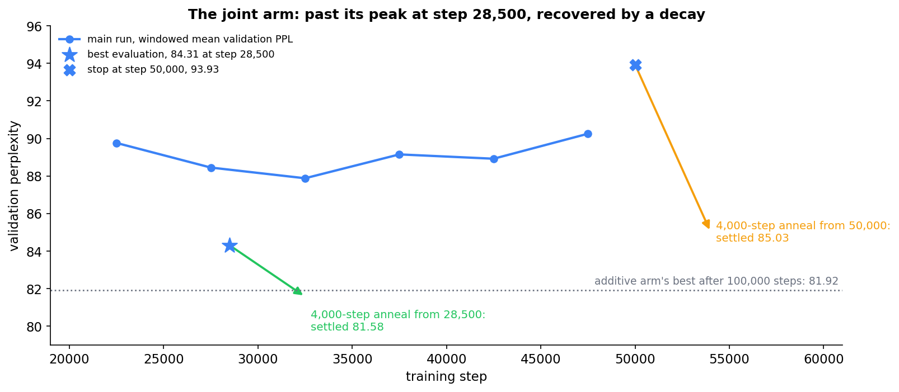

# The Joint-Coupling V_theta Arm (September 2026)

**What this folder is.** The studies run on the joint-coupling $V_\theta$ arm with the QK-normalised creation gate at d = 384 (`fock_cfc_owt_..._vtjoint_cgqk_L8probe_..._baoab_cfc`) in September 2026, just before the depth ladder. They decided four things the later Gen 3 models rest on: one joint well bank over the five context channels, a learning-rate decay timed to the run's peak, the exact low-rank integrator, and a content term in the context channels. They also produced the first matched-GPT-2 comparison. Written on 2026-11-22 from the arm's original diagnostic checklist, which these documents replace: each one below is self-contained, with its own definitions, problem statement and analysis.

---

## Contents

1. [Definitions](#1-definitions)
2. [The run](#2-the-run)
3. [Checkpoints and spike bundles](#3-checkpoints-and-spike-bundles)
4. [The studies](#4-the-studies)
5. [What it led to](#5-what-it-led-to)
6. [Background and files](#6-background-and-files)

---

## 1. Definitions

- **Arm.** One training configuration. **The joint arm**: one well bank whose wells read all five context channels at once (`vtjoint`), eight layers of step 1.0, the CfC/BAOAB integrator `baoab_cfc`, the creation gate QK-normalised (`cgqk`). **The additive arm**: one bank per channel, five in all, potentials summed ([`Post_100K_CfC_BAOAB_Analysis_Checklist.md`](../Post_100K_CfC_BAOAB_Analysis_Checklist.md)).
- **Context channels.** Causal averages of the past states with learned decays, which carry the context into each token's step.
- **Well bank, $V_\theta$.** The potential over $K$ = 8 Gaussian wells whose centres, precisions and weights are generated from the context channels.
- **WSD schedule.** Warm-up, a stable phase at the peak learning rate, a decay to a floor. **Settled PPL**: the mean of the last three evaluations.
- **`omega*dt`.** The stiffness of the well bank's low-rank precision modes times the step; an explicit kick is stable only below 2 (**the wall**).
- **Spike.** A step whose gradient norm before clipping exceeds 100; a **spikebatch bundle** saves the weights, batch and random state of that step for replay.
- **Tokens per parameter.** Training tokens divided by parameters; about 20 is the compute-optimal ratio of the Chinchilla scaling law.

## 2. The run

**Configuration.** `TOTAL_STEPS = 100,000`, WSD: warm-up 0 to 5,000, stable 5,000 to 65,000, decay 65,000 to 100,000, floor 1.5e-5, peak learning rate 3.0e-4; 76.7M parameters.

**The 50,000-step probe concluded on 2026-09-16.** Best PPL 84.31 at step 28,500; final evaluation 93.93 at step 50,000. Four spikes fired (steps 39,206, 39,521, 40,075 and 41,135); no watchdog or reload events.

**The run stopped improving and began degrading.** Windowed mean PPL over 5,000-step windows from step 20,000: 89.76, 88.45, 87.88, 89.15, 88.92, 90.25, bottoming at steps 30,000 to 35,000 and rising after. The slope from step 34,000 is +0.159 ± 0.065 PPL per 1,000 steps (t = 2.45): significant degradation, not noise. From the telemetry:

- **Not overfitting.** Training and validation loss agree within ±0.01 nats in every window, and both stopped falling; at 0.41 epochs of a 2B-token pool there is nothing to overfit to.
- **Not capacity.** 76.8M parameters × 0.819B tokens is 10.7 tokens per parameter against the compute-optimal 20: 53% of compute-optimal, under-trained.
- **Not data volume.** The training loss is flat, so more data cannot help a model that is not fitting what it already has.
- **Optimisation.** The median gradient norm doubled (0.82 to 1.65), its 99th percentile grew 14 times (5.73 to 80.27), and `bproj_sig` kept climbing (22.12 to 34.10), all while the learning rate sat at 3.0e-4 for 15,400 steps: a fixed step size gone too hot for a sharpening landscape.

*Figure 1. The main run passed its peak at step 28,500. A 4,000-step decay from the stop recovered to 85.03; the same decay from the best checkpoint reached 81.58, below the additive arm's 81.92 after 100,000 steps.*

## 3. Checkpoints and spike bundles

**Checkpoints** (Drive, `checkpoints/`): every 500-step evaluation that set a new best, plus `_step15000.pt`, `_step15000_probe_stop.pt`, the 23.5-hour autosave at step 34,156, and `_best.pt` (84.31, step 28,500).

**Spikebatch bundles exist since 2026-09-16,** which unblocked the bundle-dependent probes. Four captures, two permanent:

| step | pre-clip gradient norm | top group | archived? | availability |
| --- | --- | --- | --- | --- |
| 39,206 | 202.2 | `reverse_channel_scale` 286.6 | yes | permanent (`spikebatch_archive`) |
| 39,521 | **479.9** | `reverse_channel_scale` 321.2 | yes | permanent (`spikebatch_archive`) |
| 40,075 | 102.4 | `reverse_channel_scale` 125.9 | no | transient: live ring only |
| 41,135 | 163.6 | none recorded | no | transient: live ring only |

- **Why only two are archived.** `ARCHIVE_MIN_GRAD_NORM` is twice the capture threshold, 200, deliberately filtering the routine 100 to 190 band to bound Drive usage. The two others are still in the live ring of 12 but rotate out once 12 more captures accumulate, about 30,000 further steps at the observed rate of one per 3,850. Copy them out before then if wanted, or lower the archive threshold before the next long run.
- **All four are led by `reverse_channel_scale`,** itself a finding: the earlier cluster of large gradients (steps 23,000 to 28,700) was led by `depth_code`, so the dominant group changed as the run progressed.
- **The anneal probes redirect `CKPT_DIR`** to their own folders, so captures during them cannot evict the main ring's bundles.

## 4. The studies

| document | question | tests | outcome |
| --- | --- | --- | --- |
| [Bank_Geometry_and_Stiffness_Diagnostics.md](Bank_Geometry_and_Stiffness_Diagnostics.md) | Is the precision cap binding, which factor of `omega*dt` is moving, what causes the spikes, and is `omega*dt` shifting or widening? | cap binding, rank structure, trajectory, budget bracket, the stiffness decomposition, spike controls, pre-registered trend calls | saturating `omega*dt` fits held within 3%; the PPL extrapolation was falsified |
| [Anneal_Probes.md](Anneal_Probes.md) | Was the plateau a learning-rate problem, and from which state should the decay start? | two compressed decays, from steps 50,000 and 28,500 | the learning rate was the block; the 28,500 branch settled at 81.58, beating the additive arm at a third of its compute |
| [Integration_Refinement.md](Integration_Refinement.md) | Does the over-the-wall tail cost loss, and can the stiff modes be integrated exactly at an affordable cost? | the leapfrog error, a linear-algebra benchmark, the exact low-rank integrator against a control, substeps | the Gram driver made exact integration affordable; it buys stability (1.57 times calmer gradients), not loss |
| [Matched_GPT2_Comparison.md](Matched_GPT2_Comparison.md) | Where does the architecture stand against a plain transformer? | a GPT-2 matched in data, width and endpoint | 81.58 against 54.67 (1.49 times), lost on every axis; token budgets later found unmatched |
| [Content_Addressed_Context_Routing.md](Content_Addressed_Context_Routing.md) | Does content-addressed routing recover the gap? | Family A gates; Alternative E warm start; the Phase 2 factorisation | Alternative E gained 1.79 PPL, not 10: the strong diagnosis refuted; the content term kept |

## 5. What it led to

- **The production decay from step 28,500** ([Anneal_Probes.md](Anneal_Probes.md), §6), with `baoab_cfc`.
- **The exact low-rank integrator** `baoab_cfc_lowrank` with the Gram driver, kept for the next scale-up; it is the integrator of the depth-ladder models, which run two layers of step 4 ([depth_ladder/](../depth_ladder/README.md)).
- **The content term in the context channels** (`XI_CONTENT_ROUTE = True`), on in every depth-ladder model from 2026-09-20.
- **The matched GPT-2 as the standing reference,** later re-run token-matched ([depth_ladder/Matched_GPT2_Baselines.md](../depth_ladder/Matched_GPT2_Baselines.md)).

**After this analysis** (as recorded then): decide `PROBE_MAX_STEPS`, clearing it to `None` for the full 100,000-step arm or setting another stop. The WSD schedule is a pure function of `TOTAL_STEPS` and is unaffected; the decay would not begin until step 65,000, so any stop before then cost nothing but a pause. The anneal probes replaced this plan.

## 6. Background and files

- [`Post_100K_CfC_BAOAB_Analysis_Checklist.md`](../Post_100K_CfC_BAOAB_Analysis_Checklist.md): the additive arm's equivalent; many probes here are its counterparts.
- [`Gradient_Spikes_as_Routing_Conjunctions.md`](../Gradient_Spikes_as_Routing_Conjunctions.md): the spike mechanism found on the additive arm.
- [`Analytic_Multi_Channel_Integration_in_Structured_Vtheta.md`](../Analytic_Multi_Channel_Integration_in_Structured_Vtheta.md) §5: joint coupling and why it concentrates precision.
- [`Register_Temperature_Instability_in_the_Fock_Creation_Gate.md`](../training_instabilities/Register_Temperature_Instability_in_the_Fock_Creation_Gate.md): the creation-gate temperature instability that preceded the QK-normalised gate.
- **Figures:** [`figures/_make_joint_vtheta_arm_figs.py`](../figures/_make_joint_vtheta_arm_figs.py), writing `figures/joint_vtheta_arm/`.
