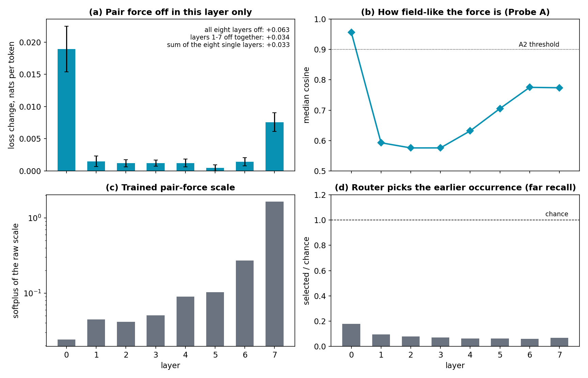

# The Pair Force Layer by Layer in an Eight-Layer Model

**What this note is.** A CPU test on L8-CODE, the eight-layer conservative model trained on code. It asks where the model's pair force $V_\varphi$ does its work across depth, and whether that explains why Probe A's call A2 missed ([Probe_A_Field_Pair_Force.md](Probe_A_Field_Pair_Force.md)). Run 2026-11-22. The calls PL1 to PL3 were written before the run and confirmed by the author before any result.

**Status.** Done. All three calls hit, but only on their letter. A joint cut, added after them, changes the reading. Each deep layer's pair force is weak on its own, yet layers 1 to 7 together carry more of it than layer 0. They cover for one another. So A2's miss is not a technicality about a weak term. The deep layers' pair force is a distributed, redundant part of the model, and it is not field-like in direction.

---

## Contents

1. [Definitions](#1-definitions)
2. [The problem](#2-the-problem)
3. [Method](#3-method)
4. [Results](#4-results)
5. [The calls](#5-the-calls)
6. [Analysis](#6-analysis)
7. [What it means](#7-what-it-means)
8. [Caveats](#8-caveats)

---

## 1. Definitions

**L8-CODE.** The second-order conservative core with the exact stiff-mode flow (SR2's recipe), at eight layers, trained on code; the checkpoint at step 18,000. Its pair force is the routed force of the two-layer models, with one trained scale per layer, $s_\ell = \mathrm{softplus}(r_\ell)$.

**Removal cost.** The pair force is switched off, its force set to zero, in a chosen set of layers, and the validation loss is read on the same windows. The cost is the paired change of the per-token loss in nats, averaged within each window and then over windows, with the standard error over windows. Three kinds of cut are used:
- **single layer:** layer $\ell$ alone, for each $\ell = 0, \dots, 7$;
- **joint deep:** layers 1 to 7 together, layer 0 left on;
- **whole:** all eight layers.

**Redundancy.** If the layers' contributions were independent, the joint cost of a set of layers would equal the sum of their single costs. A joint cost larger than that sum means the layers cover for one another: when one is removed, the others compensate. The ratio of the joint cost to the summed single costs measures it.

**Position classes.** As in the recall test ([Pair_Force_Recall_Split_FO_b_PMX_K16.md](../productization/Pair_Force_Recall_Split_FO_b_PMX_K16.md)):
- **recall positions:** the predicted token occurred earlier in the window, at distance 1 to 16 (near) or 17 to 256 (far);
- **control positions:** it did not occur earlier;
- tokens occurring more than 8 times in the window are left out of every class.

**Field-likeness.** Probe A's median cosine, per layer, between the model's pair force and the causal field with eight components.

**Selection rate.** How often the layer's router places the earlier occurrence of the predicted token among the 16 sources it selects, as a multiple of what random selection would give.

## 2. The problem

Probe A found that a field reproduces L8-CODE's pair force well at layer 0 (cosine 0.96) and poorly at layers 1 to 7 (0.58 to 0.77), so A2 missed. Across seven models, the pair force was more field-like the more work it did. That suggested a reading: A2 missed because the deep layers' pair force is weak, a small remainder that no field copies well and that matters little. The test measures what the pair force in each layer is worth. If the reading holds, layer 0 carries most of the cost and the deep layers little.

## 3. Method

- **Script:** `notebooks/conservative_arch/scaleup/debug/recall_pathway_probe.py`, extended on 2026-11-22 with two cut sets:
  - `arms=phioff_layers`: the whole force off, then each layer alone;
  - `arms=phioff_deep`: the whole force off, layer 0 only, and layers 1 to 7 together.
- **Data:** 16 windows of 512 code tokens from `code_val_2M.npy`, evenly spaced and offset by half a spacing. Both runs use the same windows, and their shared cuts agree exactly (whole +0.0630, layer 0 +0.0189).
- **Outputs:** `results/recall_pathway/recall_pathway_l8_code_phioff_{layers,deep}.{txt,json}`.
- **Scales:** read from the checkpoint.
- **Runtime:** 10 minutes per run on the CPU.
- **Figure:** `figures/_make_pair_force_layers_figs.py`.

## 4. Results

**The cost of each cut,** nats per token (standard error over windows):

| pair force off in | all positions | near recall | far recall | control |
| --- | ---: | ---: | ---: | ---: |
| all eight layers | +0.0630 (0.0069) | +0.106 | +0.125 | +0.040 |
| layer 0 only | +0.0189 (0.0035) | +0.041 | +0.050 | +0.012 |
| layers 1 to 7 together | **+0.0341 (0.0042)** | +0.069 | +0.042 | +0.019 |
| layer 1 only | +0.0015 (0.0008) | +0.008 | +0.003 | −0.007 |
| layer 2 only | +0.0012 (0.0005) | +0.006 | +0.000 | −0.003 |
| layer 3 only | +0.0012 (0.0005) | +0.001 | −0.001 | −0.001 |
| layer 4 only | +0.0012 (0.0006) | −0.002 | −0.003 | +0.000 |
| layer 5 only | +0.0005 (0.0005) | −0.003 | −0.002 | −0.000 |
| layer 6 only | +0.0014 (0.0006) | −0.002 | +0.000 | +0.001 |
| layer 7 only | +0.0076 (0.0015) | +0.017 | +0.014 | +0.005 |

**Per layer, beside the cost:**

| layer | 0 | 1 | 2 | 3 | 4 | 5 | 6 | 7 |
| --- | ---: | ---: | ---: | ---: | ---: | ---: | ---: | ---: |
| trained scale | 0.024 | 0.045 | 0.042 | 0.051 | 0.090 | 0.103 | 0.271 | 1.643 |
| field cosine (Probe A) | 0.956 | 0.593 | 0.576 | 0.576 | 0.632 | 0.705 | 0.775 | 0.774 |
| router selects the earlier occurrence, far recall (× chance) | 0.18 | 0.09 | 0.08 | 0.07 | 0.06 | 0.06 | 0.06 | 0.07 |

*Figure 1. L8-CODE layer by layer. (a) The cost of switching the pair force off in one layer only. (b) How field-like the force is. (c) The trained scale, on a log axis. (d) How often the router selects the earlier occurrence at far recall, against chance.*

## 5. The calls

Confirmed by the author 2026-11-22, before the run. Scored as written.

- **PL1 (layer 0 carries at least half of the summed single-layer costs), 65%: HIT.** 0.0189 of 0.0334, 57%.
- **PL2 (over layers 1 to 7, the single-layer cost rises with the field cosine; Spearman above 0), 60%: HIT.** $\rho = +0.41$. The correlation rests on layer 7, the costliest deep layer and among the most field-like. With seven points it is far from significant ($p = 0.36$).
- **PL3 (layers 1 to 7 weak: summed single-layer costs under 0.02 nats), 55%: HIT.** 0.0145.

**The calls hit, the reading behind them does not.** PL3 used the sum of single-layer costs as the measure of the deep layers' weight, which assumes the layers act independently. The joint cut, added after the calls and not a call itself, shows they do not. Together, layers 1 to 7 cost 0.0341 nats, 2.4 times the sum of their single costs. That is more than layer 0 (0.0189) and 54% of the whole pair force.

## 6. Analysis

**The deep layers carry the pair force jointly and redundantly.** Remove the pair force from any one deep layer and the loss barely moves, by 0.0005 to 0.0015 nats for layers 1 to 6. Remove it from all seven and the loss rises by 0.034. Each deep layer can stand in for the others. The same holds at the top level: layer 0 alone (0.019) plus the deep layers jointly (0.034) make 0.053, still less than the whole (0.063). In this model the pair force is not a set of per-layer contributions but a function the depth stack shares.

**Layer 7 is the exception among the deep layers.** It has the largest trained scale (1.64, seventy times layer 0's), the largest single-layer cost of the deep layers (0.0076), and the highest field cosine among them with layer 6. It is the last step before the read-out, so nothing after it can compensate for its loss, and its single-layer cost is the closest thing to its full contribution.

**Strength and field-likeness, inside one model.** Layer 0 has the largest single-layer cost and is the most field-like. Among the deep layers, the costliest (7) is among the most field-like. That agrees with the cross-model pattern, but weakly (PL2). For the deep layers, the single-layer cost is a poor measure of strength, because redundancy hides it. Their joint strength is substantial, and their direction is not field-like. That is a counterexample to the cross-model pattern read as a rule: at depth, a pair force can matter without being field-like.

**Most of the value is at recall positions, and none of it is addressing.** Every cut costs two to four times as much per token at far recall as at control positions; the deep layers jointly cost +0.069 at near recall. Yet the routers select the earlier occurrence less often than chance, 0.06 to 0.18 times. In the two-layer code model SO-CODE they selected it two to three times as often as chance. With depth, the pair force's routers avoid the token that holds the answer, and the recall itself runs through the context channels. The pair force helps at recall positions through other sources, as in the two-layer models.

**Removing a single middle layer's pair force can help at control positions.** Layer 1 alone lowers the loss at control positions by 0.0065 (0.0018) nats, and layer 2 by 0.0027 (0.0014). There, in isolation, the middle layers' pair force costs more than it gives; the joint cut shows the stack as a whole still needs it.

**The field's loss recovery and its poor direction fit together.** With the field in every layer, Probe A recovered 76% of the removal cost, even though the deep layers' field points only loosely along the model's force. Redundancy explains how. If the deep layers can compensate for one another's missing force, they can also compensate for one another's approximate force, so a loose copy in every layer loses less than its cosine suggests.

## 7. What it means

- **For A2 and the field.** A2's miss is a real limit, not a technicality. At eight layers the pair force is shared across depth, carries about half of its total value in the deep layers, and is not field-like there. A field still keeps most of the loss, because the layers compensate for an approximate force too, but it is not a faithful copy.
- **For the conjecture.** The cross-model pattern (the more the pair force carries, the more field-like it is) holds for the two-layer models and for layer 0. Depth adds a second way for a pair force to matter, distributed and redundant, which the pattern does not cover. The book should state both.
- **For the mechanism-interplay picture.** Redundancy across depth is a form of complementarity: one mechanism repeated over layers that cover for each other. Single-layer cuts understate how much the deep layers carry, and a field substituted in every layer overstates how faithful the copy is. Only joint cuts measure the deep layers' weight. That is a methodological point for every future depth ablation.
- **In the book.** The author decided on 2026-11-23 to include it (the test confirmed one half of the conjecture and qualified the other). It is in book §28.11, "What depth changes: redundancy", with the method point in §28.9 ("Single-layer cuts understate deep layers"); written 2026-11-23, uncommitted. The material: the per-layer picture, the redundancy, the routers avoiding the answer token with depth, and the two ways a pair force matters.

## 8. Caveats

- **One model, one seed, 16 windows.** The per-layer costs of the middle layers are 1 to 3 standard errors from zero.
- **The joint cut was added after the calls.** It is a measurement, not a scored call.
- **Reliance, not value.** Every number is a removal from the trained model. A model trained with fewer pair-force layers may redistribute the work differently.
- **Joint cuts were run for two sets only** (all layers, and layers 1 to 7). Which subsets of the deep layers suffice, and whether layer 7 alone with layer 0 recovers most of the value, are not measured.
