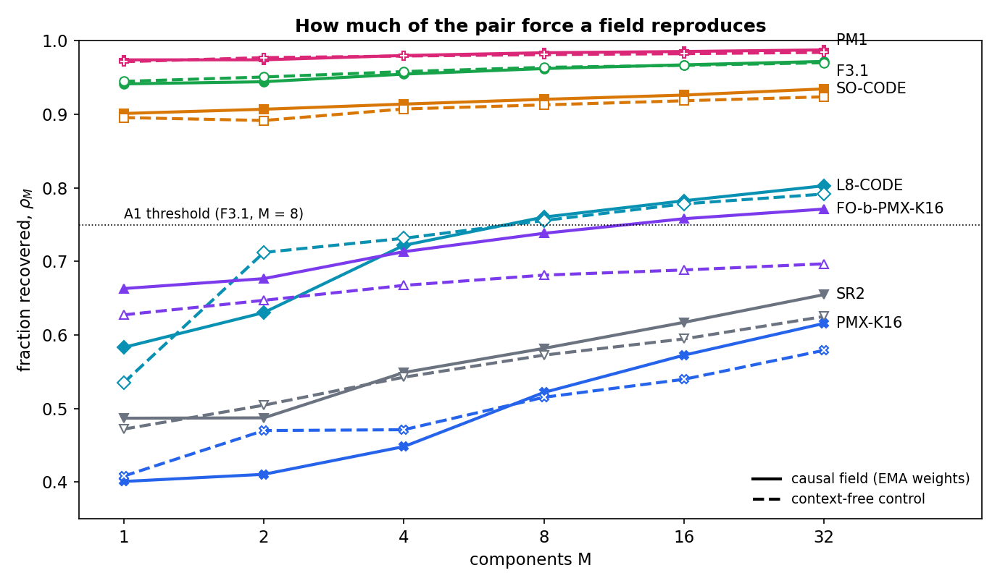
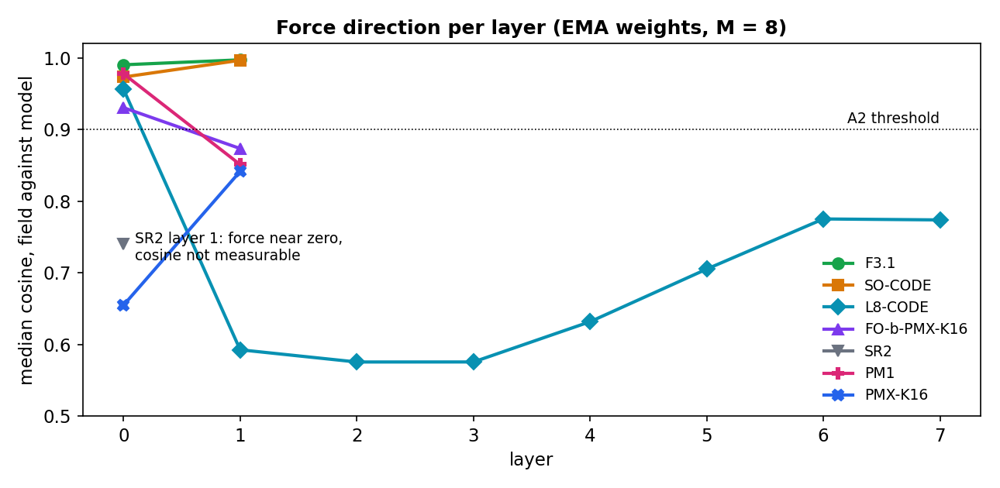
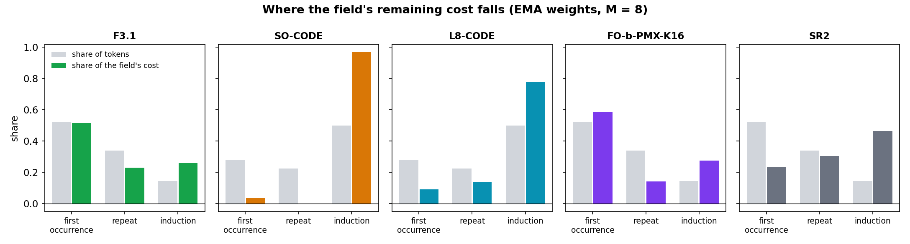

# Probe A: Can a Field Stand In for the Pair Force?

**What this note is.** The write-up of Probe A of the mean-field programme ([Mean_Field_PARFLM_Programme.md](../Mean_Field_PARFLM_Programme.md), §5). The probe asks whether the trained pair force $V_\varphi$ can be replaced by a field: a force built from a few summary points of the earlier states instead of 16 routed earlier tokens. It is a CPU test on trained checkpoints. Run 2026-11-22 on seven models: F3.1, PM1, FO-b-PMX-K16, PMX-K16, SR2, SO-CODE and L8-CODE.

**Status.** Complete: seven models. All the calls are scored: A1 hits; A2, A3, A4 and A5 miss; A0, which was proposed but never confirmed, also misses. **A2's miss fired the programme's stop gate for the field arm** (§7); the author ruled that no field arm runs and that VF0 runs under the protocol's own entry. The main finding was not pre-registered. A control with **no context at all** does as well as the causal field: on F3.1 the pair force acts almost entirely as a function of the token's own state. In the deep layers of the eight-layer code model, no field reproduces the force's direction.

---

## Contents

1. [Definitions](#1-definitions)
2. [The problem](#2-the-problem)
3. [Method](#3-method)
4. [Results](#4-results)
5. [The calls](#5-the-calls)
6. [Analysis](#6-analysis)
7. [What it decides, and what runs next](#7-what-it-decides-and-what-runs-next)
8. [Caveats](#8-caveats)

---

## 1. Definitions

**The pair force.** In layer $\ell$, token $t$ feels

$$
f_t = -s_\ell \nabla_{h_t} \sum_{j \in S_t} g_{tj} V_\varphi(h_t, h_j),
$$

where $S_t$ is the set of 16 earlier tokens chosen by a content router, $g_{tj}$ are the router's gates, $s_\ell$ is the trained per-layer scale, and $V_\varphi$ is the pair potential (a value aligner and a type gate over an inverse distance after LayerNorm). The sources $h_j$ are treated as constants, so the force is the gradient of a potential in $h_t$.

**The causal field.** The 16 routed sources are replaced by $M$ component means of all earlier states:

$$
f_t^{\mathrm{field}} = -\lambda_\ell s_\ell \nabla_{h_t} \sum_{m=1}^{M} \pi_{m,t} V_\varphi(h_t, \mu_{m,t}),
$$

$$
\pi_{m,t} = \sum_{s \lt t} W_{ts} r_{s,m}, \qquad \mu_{m,t} = \frac{1}{\pi_{m,t}} \sum_{s \lt t} W_{ts} r_{s,m} h_s, \qquad r_{s,m} = \underset{m}{\mathrm{softmax}} \left( -\frac{\lVert h_s - c_m \rVert^2}{\tau} \right).
$$

The prototypes $c_m$ come from k-means on the layer's input states. The temperature $\tau$ is set so that the median token spreads over 1.5 components. $W$ is a strictly causal average, either with decay 0.995 ("EMA") or uniform. The field changes with the context because the weights $\pi_{m,t}$ and the means $\mu_{m,t}$ follow the earlier tokens.

**The context-free control.** The same sum with the prototypes themselves as sources, at their overall weights $\omega_m$ (the mean responsibility over all tokens):

$$
f_t^{\mathrm{free}} = -\nabla_{h_t} U_\ell(h_t), \qquad U_\ell(h) = \lambda_\ell s_\ell \sum_{m=1}^{M} \omega_m V_\varphi(h, c_m).
$$

$U_\ell$ is a fixed potential landscape with $M$ centres, the same for every context. It was added after the first smoke test, as a control.

**The scale $\lambda_\ell$.** One scalar per layer, fitted by least squares to the model's own force on the probe windows. It is needed because the routed term is a sum over 16 sources, while the field's weights sum to at most 1.

**Fidelity.** Per token and layer, the cosine between the field force and the model's force, and the relative error after $\lambda_\ell$.

**Substitution cost and $\rho_M$.** The field force is put in place of the pair force in every layer and the validation loss is read on the same windows. With $c_{\mathrm{field}}$ that cost and $c_{\mathrm{off}}$ the cost of switching the pair force off, both paired against the trained model,

$$
\rho_M = 1 - \frac{c_{\mathrm{field}}(M)}{c_{\mathrm{off}}}
$$

is the fraction of the removal cost the field recovers.

**Copy-split categories.** Each target token is labelled: *first occurrence* (it does not occur earlier in the window), *induction* (the pair of the current token and the target occurred earlier), or *repeat* (it occurred earlier, but not as an induction pair).

**Reliance and value.** Probe A measures reliance: what the trained model routes through the term. Value, what a model trained without the term loses, needs a training run (VF0 for F3.1, §7).

## 2. The problem

The pair force is the only part of these models whose cost grows with the square of the context length in prefill, and whose decoding state grows with every token. A field replaces it by $M$ running averages per layer: a fixed-size state and a cost per token independent of the context length. This would help wherever the pair force is kept, most of all in F3.1. There the pair force carries a third of the perplexity, and F3.1's split stiff-mode step trains about a third faster than SR2's exact one ([Mean_Field_PARFLM_Programme.md](../Mean_Field_PARFLM_Programme.md), §2).

A field cannot reproduce a force that retrieves one specific earlier token. Two earlier tokens in the same component are indistinguishable to it. The CPU recall test found that the pair force does no such addressing in FO-b-PMX-K16, PMX-K16 or SR2 ([Pair_Force_Recall_Split_FO_b_PMX_K16.md](../productization/Pair_Force_Recall_Split_FO_b_PMX_K16.md)), so a field was credible. Probe A measures how much of the force, and of the loss, it recovers.

## 3. Method

- **Script.** `notebooks/conservative_arch/scaleup/debug/mean_field_probe_a.py`; outputs in `notebooks/conservative_arch/scaleup/results/mean_field_probe_a/mean_field_probe_a_<model>.{txt,json}`.
- **Windows.** 64 windows of 512 tokens, evenly spaced over the OpenWebText or code validation set.
- **Grid.** $M \in \lbrace 1, 2, 4, 8, 16, 32 \rbrace$, three variants (EMA, uniform, context-free), every layer.
- **Checks, passed on every model before any reading.**
  - The closed-form pair force gives the same loss as the autograd force (largest difference $2.6 \times 10^{-5}$).
  - The re-implemented heads reproduce the model's force on its own 16 sources (relative difference $2 \times 10^{-7}$ or less).
  - The field at position $t$ does not change when later positions are perturbed (difference exactly 0).
- **Memory.** One batch of 4 windows at a time and a 45 GB watchdog; peak 10.7 to 12.0 GB and 23 to 44 minutes per two-layer model, 31.5 GB and 134 minutes for L8-CODE.

## 4. Results

Costs in nats per token against the trained model, with the standard error over windows. Columns: the cost of switching the pair force off; then $\rho_M$ for the causal field (EMA) and the context-free control, at $M = 1$ and $M = 8$.

| model | pair force off | EMA, M = 1 | EMA, M = 8 | context-free, M = 1 | context-free, M = 8 |
| --- | ---: | ---: | ---: | ---: | ---: |
| F3.1 (OpenWebText) | +0.2665 (0.0086) | 0.941 | **0.962** | 0.945 | **0.964** |
| SO-CODE (code) | +0.2007 (0.0072) | 0.901 | 0.920 | 0.896 | 0.913 |
| FO-b-PMX-K16 (OpenWebText) | +0.0245 (0.0013) | 0.663 | 0.738 | 0.627 | 0.681 |
| SR2 (OpenWebText) | +0.0148 (0.0011) | 0.487 | 0.582 | 0.472 | 0.573 |
| L8-CODE (code, eight layers) | +0.0620 (0.0032) | 0.583 | 0.760 | 0.535 | 0.756 |
| PM1 (F3.1 with 64 wells) | +0.3119 (0.0055) | 0.974 | **0.984** | 0.971 | **0.981** |
| PMX-K16 (second order, 16 wells) | +0.0159 (0.0010) | 0.401 | 0.522 | 0.408 | 0.515 |

The uniform average scores within 0.01 of the EMA everywhere. The remaining costs at $M = 8$ (EMA) are +0.0101 (F3.1), +0.0160 (SO-CODE), +0.0064 (FO-b-PMX-K16), +0.0062 (SR2) and +0.0149 (L8-CODE), each with a standard error of 0.0007 to 0.0017.

*Figure 1. The fraction of the pair force's removal cost the field recovers, against the number of components. Solid: the causal field; dashed: the context-free control. In every model but FO-b-PMX-K16 the two lines lie close, at least from M = 4.*

**Force fidelity (EMA, $M = 8$; median cosine, layer 0 and layer 1).**
- F3.1: 0.990 and 0.997.
- SO-CODE: 0.973 and 0.997.
- FO-b-PMX-K16: 0.931 and 0.874.
- SR2: 0.740 at layer 0. Layer 1's force cannot be measured, because its trained scale is 0.006 and the force is close to zero; its fitted $\lambda$ is meaningless.
- PM1: 0.978 and 0.851. PMX-K16: 0.655 and 0.842.
- L8-CODE: 0.956 at layer 0, then 0.593, 0.576, 0.576, 0.632, 0.705, 0.775 and 0.774 at layers 1 to 7. At $M = 32$ layers 1 and 7 reach only 0.643 and 0.832; the context-free control gives the same.

The fitted $\lambda_\ell$ is 13 to 15 on F3.1 and SO-CODE: the routed sum acts like about 16 copies of one average source.

*Figure 2. Median cosine between the field force and the model's force, per layer (EMA weights, M = 8). The dotted line is A2's threshold for L8-CODE's layers 1 and 7.*

**Where the remaining cost falls (EMA, $M = 8$).** The share of the substitution cost in each category, against the share of the tokens:

| model | first occurrence | repeat | induction |
| --- | --- | --- | --- |
| F3.1 | 0.51 / 0.52 | 0.23 / 0.34 | 0.26 / 0.14 |
| SO-CODE | 0.03 / 0.28 | 0.00 / 0.22 | **0.97 / 0.50** |
| FO-b-PMX-K16 | 0.59 / 0.52 | 0.14 / 0.34 | 0.27 / 0.14 |
| SR2 | 0.23 / 0.52 | 0.30 / 0.34 | 0.46 / 0.14 |
| L8-CODE | 0.09 / 0.28 | 0.14 / 0.22 | 0.77 / 0.50 |

*Figure 3. Share of the field's remaining cost (coloured) against share of the tokens (grey), per category.*

## 5. The calls

Confirmed by the author 2026-11-21 (A1 to A5); A0 was proposed only. Scored as written.

- **A0 (F3.1, $\rho_1 \lt 0.25$: content gating is needed), 70%, proposed only: MISS.** $\rho_1 = 0.941$. A single component, even a context-free one, recovers 94%.
- **A1 (F3.1, $\rho_8 \ge 0.75$), 50%: HIT.** $\rho_8 = 0.962$ (EMA), 0.962 (uniform).
- **A2 (L8-CODE, layers 1 and 7, median cosine at least 0.9 at $M = 8$), 60%: MISS.** 0.593 and 0.774 (EMA), 0.600 and 0.787 (uniform). It misses at every $M$: the best is 0.650 and 0.842, at $M = 32$ (uniform).
- **A3 (on every model, layer 0's median cosine below the deeper layers' at every $M$), 75%: MISS.** It holds on F3.1, SO-CODE and PMX-K16 at every $M$ and variant. It is reversed on FO-b-PMX-K16 (0.931 against 0.874 at $M = 8$), on PM1 (0.978 against 0.851) and on L8-CODE, where layer 0 is the most field-like layer of all (0.956 against 0.58 to 0.77). SR2's layer 1 is not measurable.
- **A4 (SO-CODE, the induction share of the substitution cost at least twice its share of the tokens), 55%: MISS.** The factor is 1.94 (EMA, $M = 8$; 1.93 to 1.96 for EMA and uniform at every $M$). **A flaw in the call:** induction is 49.8% of the code tokens, so the largest possible factor is 2.01. The call could pass only if more than 99.6% of the cost fell on induction tokens. I set the threshold without checking the token share. On the substance, the remaining cost is as concentrated as it can be: 97% of it falls on induction tokens, and the other two categories are within noise of zero. The call stays scored as written.
- **A5 (SR2, substitution cost at $M = 8$ within twice its standard error of zero), 75%: MISS.** +0.0062 (0.0007), nine standard errors. SR2's pair force is small (1.5% of the loss on these windows) but not idle, and the field recovers 58% of it.

## 6. Analysis

**The pair force acts mostly as a function of the token's own state.** On F3.1 the context-free landscape $U_\ell$, with one centre, recovers 94.5% of the removal cost, and the causal field adds nothing to it at any $M$. On SO-CODE and SR2 the context adds less than 0.01 to $\rho_8$, and at most 0.03 at any $M$. This goes beyond the recall test's finding that the pair force does no addressing: in these models, which earlier tokens are near hardly matters to the force a token feels. It is close to a fixed landscape in the state space, the same kind of object as the wells and the context potential $V_\theta$, only with $V_\varphi$'s inverse-distance shape. The router, the 16 gathered sources and the sequence dimension do almost none of the work they are paid for.

**The part that depends on context is small and sits on induction tokens.** What no field recovers is 4% of the removal cost on F3.1, 8% on SO-CODE, 26% on FO-b-PMX-K16 and 42% on SR2. On code it falls entirely on induction tokens, and the context-free control leaves the same remainder (induction share 1.01 at $M = 8$). The causal field's context does not capture it either. It is the part that needs one specific earlier token, the job the programme assigns to the particle store of the templates line ([Mean_Field_PARFLM_Programme.md](../Mean_Field_PARFLM_Programme.md), §7). On code the router selects the earlier occurrence two to three times as often as chance, against 1.3 times on OpenWebText ([Pair_Force_Recall_Split_FO_b_PMX_K16.md](../productization/Pair_Force_Recall_Split_FO_b_PMX_K16.md)).

**The wells hypothesis, tested: not supported.** The first runs left one pattern to check: only FO-b-PMX-K16, the one model with wells, showed a context gap. That suggested the wells take over the landscape part of the pair force, leaving a more context-dependent remainder. The three runs added to test it record the paired context gap, the causal field's cost minus the context-free control's, at $M = 8$:

| model | wells | pair force off (nats) | context gap at M = 8 (nats) | gap as a share of the removal cost |
| --- | --- | ---: | ---: | ---: |
| PM1 | 64 | +0.312 | −0.0008 (0.0003) | 0.3% |
| PMX-K16 | 16 | +0.016 | −0.0001 (0.0003) | unresolved |
| FO-b-PMX-K16 | 16 | +0.025 | −0.0014 (0.0004) | 6% |

PM1 has the most wells, and its pair force is as context-free as F3.1's. PMX-K16 has the same wells as FO-b-PMX-K16 and no gap. The gap is resolved only in FO-b-PMX-K16, where it is small. So the wells do not make the pair force context-dependent. What remains is a property of that one first-order model, not of the wells.

**A different pattern: the larger the pair force, the more field-like.** Across the seven models, $\rho_8$ follows the size of the removal cost. Where the pair force carries a lot, a field reproduces nearly all of it: PM1 (0.31 nats, $\rho_8 = 0.98$), F3.1 (0.27, 0.96), SO-CODE (0.20, 0.92). Where it carries little, much less: L8-CODE (0.062, 0.76), FO-b-PMX-K16 (0.025, 0.74), SR2 (0.015, 0.58), PMX-K16 (0.016, 0.52). The order does not follow the integrator: SO-CODE has SR2's exact stiff-mode flow and is near the top. A reading, not a call: when the pair force does a large share of the model's work, it does it as a landscape term, a fixed shape over the state space. When the rest of the model has taken that work over, what is left is a small, more structured remainder that no smooth field copies well.

**With depth, the field keeps most of the loss but not the force.** On L8-CODE the field recovers 76% of the removal cost at $M = 8$, yet in layers 1 to 7 its force points only loosely along the model's (median cosine 0.58 to 0.77, relative error 0.66 to 0.84). Layer 0 is field-like (0.956), as in every two-layer model. Two readings are open, and Probe A cannot separate them, because it substitutes the field in every layer at once and does not cost the layers one by one. Either the deep layers' pair force matters little to the loss, so a poor copy of it costs little. Or the deep layers' force depends on which specific states are near, and the loss the field keeps comes from layer 0. The cosine still rises with $M$ in the deep layers (layer 1: 0.26 at $M = 1$, 0.64 at $M = 32$), which points to fine structure in the states that a few components cannot resolve. That is the depth question the field programme needed answered, and the answer is no: at eight layers on code, a field is not a faithful copy of the pair force.

**SR2.** The field recovers about half of a pair force that is already small. SR2-NP, trained without it, lost 0.3% ([Stage3_SR2_Without_Pair_Force.md](../productization/Stage3_SR2_Without_Pair_Force.md)). On SR2, dropping the term remains the cheaper route; a stand-in matters only if SR2-T's call ST1 reopens the question.

## 7. What it decides, and what runs next

**The programme's gate fires.** Its decision table reads: "A2 misses at every M: the field is the wrong parametrisation of $V_\varphi$; stop Stages 6; keep Probes C, D, E as the theory of PARFLM." A2 missed at every $M$. As written, that stops the field arm (FA-OWT) and VF0, its prerequisite under this programme. The author rules on it. These are the facts the ruling has to weigh:

- **What the gate was for.** A2 asked whether the field holds in deep layers. It does not, and that is a real limit on the field as a general stand-in for the pair force.
- **What the gate did not test.** On F3.1, the field arm's intended base, the field is close to exact in both layers. A context-free landscape, simpler than the field the gate refers to, does as well there.
- **Changing the plan now would be post hoc.** Any arm built on the F3.1 result is a choice made after seeing the data, and it must be registered and labelled that way, with new calls.

**The author's ruling (2026-11-22):** no field arm; VF0 runs, under the protocol's own entry ([VF0_F31_Without_Pair_Force.md](../depth_ladder/VF0_F31_Without_Pair_Force.md)).

**My recommendation.** Honour the gate for the content-gated field: no FA-OWT as specified. Keep two things outside the field programme:
1. **VF0**, F3.1 trained without the pair force, under the protocol's own entry (§5.21, call VF-a). It answers the F3.1-against-SR2 design question independently of any field: what the pair force is worth to F3.1. A fixed landscape is the kind of term $V_\theta$ can learn, so a model trained without the pair force may absorb much of it, as SR2 did (reliance 1.8%, value 0.3%; [Mean_Field_PARFLM_Programme.md](../Mean_Field_PARFLM_Programme.md), §2). If VF0 loses little, the fast F3.1 is VF0 itself.
2. **A context-free landscape arm on F3.1**, registered as post hoc and only if VF0 shows real value (VF-a hits). Learned centres (initialised from Probe A's k-means at $M = 8$), learned weights and a learned $\lambda_\ell$; $M$ kernel evaluations per token and no decoding state. Restricted to the two-layer F3.1, the regime where Probe A found it exact.

**For the PMX line.** FO-b-PMX-K16's pair force is among the least field-like ($\rho_8 = 0.74$). Whether that matters depends on FO-b-PMX-K16-NP ([Stage3e_FO_b_PMX_K16_Without_Pair_Force.md](../productization/Stage3e_FO_b_PMX_K16_Without_Pair_Force.md)): if training without the pair force costs within the tolerance, there is nothing to stand in for.

**For A4's gate.** The gate reads "the routed force does retrieval; the field arm is the hybrid". A4 missed on its letter, and with the field arm stopped the gate has no arm to act on. The retrieval part is 8% of the pair force's cost on SO-CODE, 4% on F3.1, and a larger share on L8-CODE (77% of a 24% remainder).

**Done.** PM1, PMX-K16 and the paired rerun of FO-b-PMX-K16 finished on 2026-11-22 (§6, "The wells hypothesis, tested").

## 8. Caveats

- **Representability is not trainability.** Probe A measures how well a fixed field reproduces the trained force; a model trained with a stand-in may use it differently. Only a trained arm measures that, and only against VF0 does it measure value.
- **The prototypes and $\lambda_\ell$ are fitted on the probe windows.** That is 6 to 32 centres and one scalar per layer against 32,768 tokens, so overfitting is negligible. The k-means uses states from later in the window too, which is legitimate for a fixed landscape but means the context-free control is a learned parameter in a trained model, not a statistic a decoder computes.
- **The monopole approximation.** The field evaluates $V_\varphi$ at the component means. Sigma points would raise $\rho_M$ further; on F3.1 there is little left to gain.
- **One window set per corpus.** The costs are paired, so the standard errors cover the window spread, not a different sample of text.
