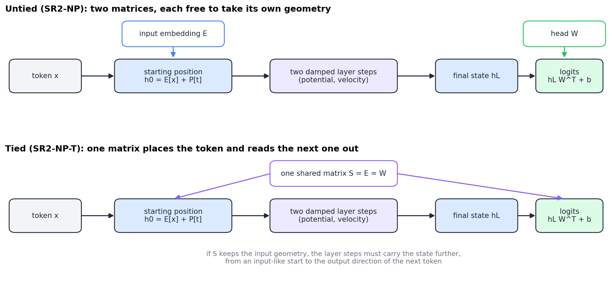
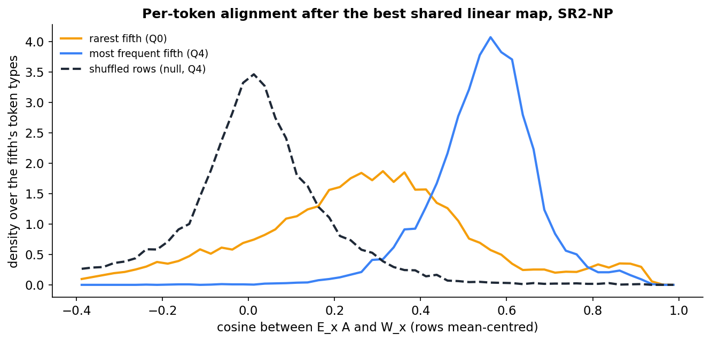
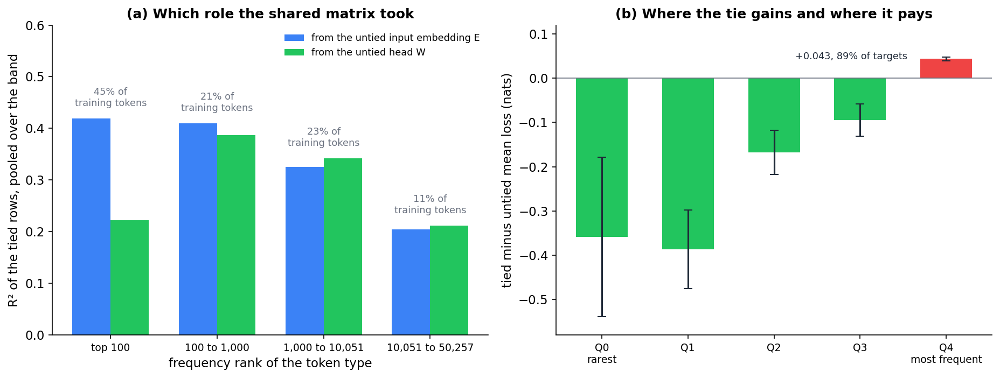
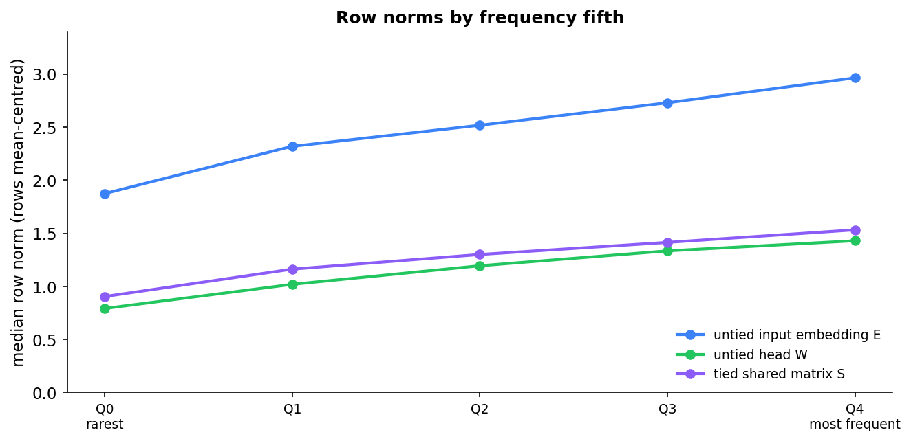

# The Embedding–Head Alignment Test: Where the Tie's Cost Is Paid

**What this note is.** The problem statement, the mathematics and the result of a CPU test run on 2026-11-22, after the tied-embeddings arm SR2-NP-T ([Stage3b_SR2_NP_Tied_Embeddings.md](Stage3b_SR2_NP_Tied_Embeddings.md)). Tying the input embedding to the output head cost SR2-NP 1.44% in perplexity, all of it on the most frequent tokens. The test asks how that cost is paid: by a compromise inside the shared matrix, or by the layer dynamics. The answer decides whether a GPU run of the tie with the pair force switched back on is worth its time.

**Status.** Run on the trained weights of SR2-NP and SR2-NP-T. The decision rule (§6) was stated before the test ran; one of the readings it rests on, the role test of §5.4, was added after the first readings were seen (§10).

---

## Contents

1. [Definitions](#1-definitions)
2. [The problem](#2-the-problem)
3. [What tying constrains](#3-what-tying-constrains)
4. [Which differences do not matter](#4-which-differences-do-not-matter)
5. [The measures](#5-the-measures)
6. [Two hypotheses and the decision rule](#6-two-hypotheses-and-the-decision-rule)
7. [Why rare input rows are under-trained](#7-why-rare-input-rows-are-under-trained)
8. [Results](#8-results)
9. [The link to the dynamics](#9-the-link-to-the-dynamics)
10. [What the test decides, and its limits](#10-what-the-test-decides-and-its-limits)
11. [Files](#11-files)

---

## 1. Definitions

- **Token type, vocabulary.** The GPT-2 tokenizer has $V$ = 50,257 token types. A token type $x$ is an entry of the vocabulary; a token is one occurrence of a type in the text.
- **Training frequency.** $\pi_x$, the share of training tokens that are of type $x$ (from the add-one smoothed counts the run stores as `logfreq_surprisal`). The $\pi_x$ sum to one.
- **Frequency fifth.** The vocabulary ranked by training frequency and cut into five groups of equal size (10,051 or 10,052 types each), from Q0 (the rarest) to Q4 (the most frequent). This is the grouping of diagnostic D0.4. The fifths hold very different shares of the text: Q4 alone holds 89% of the validation targets.
- **Frequency band.** A finer cut by rank: the 100 most frequent types (45% of training tokens), ranks 100 to 1,000 (21%), ranks 1,000 to 10,051 (23%), and the rest (11%).
- **State width.** $d = 384$, the width of every token's state.
- **Input embedding.** A matrix $E$ with one row $E_x \in \mathbb{R}^{d}$ per type. The token's **starting position** at position $t$ is the sum of its row $E_x$ and the row $P_t$ of the learned positional table $P$.
- **Final state.** $h_L$, the state after the $L = 2$ damped layer steps.
- **Output head.** A matrix $W$ with one row $W_y$ per type. The **logit** of type $y$ is the dot product of $h_L$ with $W_y$, plus the type's output bias $b_y$. The next-token probabilities are the **softmax** of the logits: each logit exponentiated and divided by the sum of all the exponentiated logits.
- **Read-out.** The head's job: turning the final state into next-token probabilities.
- **Tying.** Using one matrix $S$ for both roles: $E = W = S$. SR2-NP is untied; SR2-NP-T is tied and keeps the output bias.
- **Mean-centred rows.** A matrix with its mean row subtracted from every row (§4).
- **Cosine.** For two vectors, their dot product divided by the product of their lengths: 1 for the same direction, 0 for perpendicular.
- **Shared linear map.** A single $d \times d$ matrix $A$ applied to every input row, so that $E_x A$ is compared with $W_x$ for every type at once.
- **Least squares.** Choosing $A$ to minimise the sum of squared differences between $E_x A$ and $W_x$ over the types; **weighted least squares** weights each type's term by $\pi_x$.
- **Relative residual.** $\rho_x$, how far the mapped input row misses the output row, relative to the output row's length (§5.2).
- **Null.** The same cosine computed between a type's mapped input row and a different, randomly chosen type's output row: what the measure reads when there is no correspondence.
- **Coefficient of determination.** $R^2$, the share of a set of rows' squared length that a prediction explains (§5.4).
- **Role of the shared matrix.** Whether the tied model's rows, for a group of types, resemble the untied model's input embedding or its head, as read by §5.4.
- **Read-out compromise** and **burden on the dynamics.** The two hypotheses of §6.
- **Pair force.** The routed pair potential $V_\varphi$ that SR2 has and SR2-NP was trained without ([Stage3_SR2_Without_Pair_Force.md](Stage3_SR2_Without_Pair_Force.md)).

## 2. The problem

SR2-NP-T settled at 59.35 against SR2-NP's 58.51. The loss by frequency fifth ([Stage3b_SR2_NP_Tied_Embeddings.md](Stage3b_SR2_NP_Tied_Embeddings.md), §5) places the cost precisely: the tied model is better on Q0 to Q3 (by 0.36, 0.39, 0.17 and 0.10 nats) and worse only on Q4, by 0.043 nats, which carries 89% of the targets.

The tie removes a degree of freedom: the untied model can give each type an input row and an output row of its own; the tied model must use one row for both. A cost can then arise in two ways:

- the matrix settles on a compromise row that serves neither role fully, and the loss is paid at the read-out;
- the matrix keeps one role's geometry, and the layer steps must make up the difference between the two.

**The question.** From the trained weights alone, which of these happened, and for which types?

**Why it matters.** In the second case the dynamics are doing extra work, and another carrier of displacement, the pair force, could take part of it. A run of SR2 (which keeps the pair force) with tied embeddings would then measure something; in the first case it would not.

**Inputs.** SR2-NP's $E$ and $W$, and SR2-NP-T's $S$, each at its best checkpoint (step 31,000), and the training frequencies $\pi$.

## 3. What tying constrains

*Figure 1. Untied, the input embedding and the head are separate matrices. Tied, one matrix both places each token and reads the next one out.*

Untied, the model computes

$$h_0 = E_x + P_t, \qquad h_L = \Phi(h_0), \qquad \ell_y = h_L \cdot W_y + b_y,$$

where $\Phi$ stands for the two layer steps, which also read the context. Tied, $E$ and $W$ are replaced by the same $S$:

$$h_0 = S_x + P_t, \qquad \ell_y = h_L \cdot S_y + b_y.$$

The constraint is on the pair of rows each type owns: untied, its input row and its output row are free; tied, they are equal. The test measures, in the untied model, how far apart the two rows of each type are, after removing the differences that tying would not actually forbid.

## 4. Which differences do not matter

Three transformations change the matrices without changing what the model can do, or change it in a way the network could absorb. The comparison must not count them as differences.

**A vector common to every head row.** Replace every $W_y$ by $W_y + c$. Every logit changes by the same amount:

$$\ell_y \longrightarrow \ell_y + h_L \cdot c \quad \text{for every } y,$$

and a softmax is unchanged when the same number is added to every logit, because $e^{h_L \cdot c}$ appears in the numerator and the denominator and cancels. So the mean row of $W$ carries no information about the predictions, and the rows are compared after subtracting it. Without this step the comparison is meaningless: before centring, the cosine between a type's mapped input row and a *random* type's output row was 0.93, because every head row shares a large common component.

**A vector common to every input row.** Replace every $E_x$ by $E_x + c$. Every starting position moves by $c$, and the same model results when $c$ is subtracted from every row of the positional table. The positional table is free in both models, so the mean row of $E$ is subtracted too.

**One shared linear map.** If $W = E A$ for some $d \times d$ matrix $A$, the untied read-out can be written with the input matrix:

$$h_L W^{\top} = h_L A^{\top} E^{\top} = (h_L A^{\top}) E^{\top}.$$

A tied model could reproduce the untied read-out if its dynamics delivered the final state $h_L A^{\top}$ in place of $h_L$. This is not an exact invariance: the dynamics are conservative and end in a LayerNorm projection, so they cannot apply an arbitrary linear map to the final state. Allowing the best $A$ is therefore generous: whatever remains after it is a lower bound on what the tie forbids.

## 5. The measures

All rows below are mean-centred (§4).

### 5.1 Raw cosine

$$c^{\mathrm{raw}}_x = \frac{E_x \cdot W_x}{\lVert E_x \rVert \lVert W_x \rVert}.$$

The two matrices of the untied model start from independent random initialisations, so nothing makes their rows point the same way; this is a reference, expected near zero.

### 5.2 Cosine and residual after the best shared map

The least-squares map from the input rows to the output rows is

$$A^{\ast} = \arg\min_{A} \sum_{x} \lVert E_x A - W_x \rVert^{2} = (E^{\top} E)^{-1} E^{\top} W,$$

and the frequency-weighted one, which favours the types that carry the text,

$$A^{\ast}_{\pi} = \arg\min_{A} \sum_{x} \pi_x \lVert E_x A - W_x \rVert^{2} = (E^{\top} D E)^{-1} E^{\top} D W, \qquad D = \mathrm{diag}(\pi).$$

For each type, the cosine $c_x$ between $E_x A$ and $W_x$, and the relative residual

$$\rho_x = \frac{\lVert E_x A - W_x \rVert}{\lVert W_x \rVert}.$$

Predicting zero for every row gives $\rho_x = 1$. So $\rho_x = 1$ marks "the input row says nothing about the output row", and $\rho_x \gt 1$ marks a map that points the type's row the wrong way.

### 5.3 The null

The same cosine against a randomly permuted row, $E_x A$ against $W_{\sigma(x)}$ for a random permutation $\sigma$. It is measured rather than assumed: for independent directions spread evenly in $d = 384$ dimensions the cosine would scatter around 0 with spread $1/\sqrt{d} \approx 0.05$, but these rows are not spread evenly (they concentrate in fewer directions), so the measured null is wider.

### 5.4 The role test

Which matrix of the untied model does the tied model's $S$ resemble? Fit a linear map from each:

$$B_E = (E^{\top} E)^{-1} E^{\top} S, \qquad B_W = (W^{\top} W)^{-1} W^{\top} S,$$

and score each prediction on a group $G$ of types (a frequency band) by the pooled coefficient of determination,

$$R^{2}_{G}(E) = 1 - \frac{\sum_{x \in G} \lVert E_x B_E - S_x \rVert^{2}}{\sum_{x \in G} \lVert S_x \rVert^{2}},$$

and likewise for the prediction from $W$. The rows of $S$ are centred, so the denominator is the group's total squared row length, and $R^2_G$ is the share of it the prediction explains. If the prediction from $E$ explains more than the prediction from $W$, then, for those types, the shared rows kept the geometry of an input embedding rather than of a head.

Pooling over the group matters: a row of small length gives a per-row ratio that can be large and negative, so per-row $R^2$ medians are unstable.

## 6. Two hypotheses and the decision rule

**$H_R$, a read-out compromise.** The untied model's frequent types want input and output rows that no shared map reconciles; tied, the matrix takes a row between the two, and the loss is paid at the read-out. Nothing in the dynamics compensates, so no force term, the pair force included, would recover the cost.

**$H_D$, the burden on the dynamics.** For the costly types, the shared matrix keeps the input geometry, and the layer steps must carry the state from an input-like start to the output direction of the next type. The dynamics do extra work, and another carrier could share it.

**The rule, as stated before the test ran:**

> If the frequent tokens' rows are far apart and the rare tokens' rows close, the tie's cost is a read-out compromise, and no force term, the pair force included, is likely to recover it. I'd skip the arm.
>
> If not, the dynamics are carrying more of the burden, and the 2×2 becomes worth its GPU time.

The "2×2" is the four combinations of pair force (on, off) and embeddings (tied, untied): SR2, SR2-NP and SR2-NP-T exist; the fourth, SR2 tied, does not.

## 7. Why rare input rows are under-trained

One half of the rule's first branch ("the rare tokens' rows close") could hardly occur, for a reason the gradients show.

The loss is the negative log-probability of each position's target type, summed over the positions:

$$\mathcal{L} = -\sum_{t} \log p_{t, y_t}.$$

The input row $E_x$ enters only through the starting positions of the positions whose input is $x$:

$$\frac{\partial \mathcal{L}}{\partial E_x} = \sum_{t : x_t = x} \frac{\partial \mathcal{L}}{\partial h_{0,t}}.$$

It receives a gradient only on steps whose batch contains type $x$, which for a rare type is a small fraction of the steps (about $\pi_x$ times the 16,384 tokens of a batch). The head row $W_y$ enters every logit at every position:

$$\frac{\partial \mathcal{L}}{\partial W_y} = \sum_{t} \left( p_{t,y} - \mathbf{1}[y_t = y] \right) h_{L,t},$$

so every head row receives a gradient at every step: the softmax pushes every type's probability down a little at every position and pulls the target's up. Rare input rows are therefore updated rarely, while weight decay acts on every step. They stay closer to their initialisation and shorter: the median centred norm of $E_x$ is 1.87 in Q0 against 2.96 in Q4 (Figure 5). Their output rows, trained throughout, have no reason to point the same way, so the rare types' two rows are far apart in the untied model, whatever the tie's cost.

This also suggests why tying helps the rare types: tied, a rare type's single row receives the head's gradient at every step, so its starting position is trained even when the type is absent from the batch. That is a reading consistent with the gains on Q0 to Q3, not a measurement of them.

## 8. Results

*Figure 2. (a) In SR2-NP the two rows of a type are unrelated as they stand (grey) and only partly related after the best shared map (blue); shuffled rows read zero (black). (b) Most of each output row is left unexplained by any shared map; a map fitted to favour the frequent types does better on Q4 and worse than no map at all on Q0 to Q2.*

**In the untied model the two roles want different rows** (median per fifth, Q0 to Q4; frequency-weighted means in `embedding_head_alignment_sr2np_vs_tied.txt`):

| reading | Q0 | Q1 | Q2 | Q3 | Q4 |
| --- | ---: | ---: | ---: | ---: | ---: |
| raw cosine | 0.018 | 0.034 | 0.043 | 0.054 | 0.048 |
| cosine after the best shared map | 0.275 | 0.400 | 0.443 | 0.500 | 0.557 |
| relative residual after it | 0.995 | 0.936 | 0.907 | 0.874 | 0.843 |
| cosine after a frequency-weighted map | 0.139 | 0.268 | 0.316 | 0.389 | 0.514 |
| relative residual after it | 1.161 | 1.076 | 1.022 | 0.963 | 0.876 |
| null (shuffled rows) | −0.009 | 0.003 | 0.007 | 0.008 | 0.012 |

- **Unrelated as they stand:** the raw cosines are at the level of independent directions.
- **Partly related after the best shared map, more so for frequent types:** the median cosine rises from 0.28 (Q0) to 0.56 (Q4), against a null of zero. But the relative residuals stay between 0.84 and 1.00: most of each output row's length is not predictable from its input row by any single linear map.
- **A frequency-weighted map trades the rare for the frequent.** Weighted by $\pi$, the map reaches a cosine of 0.82 on Q4 (weighted mean; the most frequent types), but its median residual exceeds 1 on Q0 to Q2: there it is worse than no map. One shared map cannot serve all types; the frequent ones can be reconciled only at the rare ones' expense.

*Figure 3. Per token, after the best shared map: the most frequent fifth sits in a narrow band around 0.55, the rarest fifth spreads widely, and shuffled rows centre on zero.*

**The role test: for the most frequent types, the shared matrix kept the input geometry.**

| frequency band | share of training tokens | R² from the untied input embedding | R² from the untied head |
| --- | ---: | ---: | ---: |
| top 100 | 45% | 0.419 | 0.222 |
| 100 to 1,000 | 21% | 0.410 | 0.387 |
| 1,000 to 10,051 | 23% | 0.326 | 0.342 |
| 10,051 to 50,257 | 11% | 0.205 | 0.212 |

*Figure 4. (a) For the 100 most frequent types, which carry 45% of the text, the tied rows are predicted twice as well from the input embedding as from the head; from rank 100 on the two are level. (b) The tie's cost sits on the most frequent fifth; the rarer fifths gain.*

- For the 100 most frequent types the tied rows look like an input embedding ($R^2$ 0.42) much more than like a head (0.22). From rank 100 on, the two predictions are level.
- **Magnitude follows the head, direction follows the input.** The tied rows' lengths match the untied head's (centred median norms 0.90 to 1.53 across the fifths, against the head's 0.79 to 1.43 and the input embedding's 1.87 to 2.96; Figure 5), while their directions, for the most frequent types, follow the input embedding.
- All $R^2$ are modest (at most 0.42): the tied matrix is largely its own solution and resembles neither role of the untied model closely.

*Figure 5. The untied input rows grow with frequency and are longer than the head rows; the tied rows have the head's scale.*

## 9. The link to the dynamics

If the shared row $S_x$ keeps the input geometry for the most frequent types, the read-out cannot simply use it: the next type $y$ is read out through its own row $S_y$, and for a frequent $y$ that row is input-like too. The layer steps must then move the state further, or differently, to land where those input-like rows score the right type highly. The Colab cells on the two best checkpoints show the dynamics doing more (Stage3b, §5):

- **Larger steps.** The median step size relative to the state is 6.56 at layer 0 and 1.08 at layer 1, against 6.06 and 0.76 untied.
- **More reliance on the velocity.** Resetting the velocity between the layers costs +10.1% in perplexity, against +5.6% untied.
- **A step fitted more tightly.** Replacing the two trained steps by three smaller ones costs 1.16 nats, against 0.40 untied.

These agree with $H_D$ and are not predicted by $H_R$, under which the matrix absorbs the compromise and the dynamics need not change. They do not show that the extra work is what costs the 0.043 nats on Q4.

## 10. What the test decides, and its limits

**Against the rule of §6.** The first branch required rare types' rows to be close and frequent types' far apart. Neither half holds: the rare types' rows are the furthest apart (for the reason of §7), and the frequent types' rows are the closest, though still mostly unreconciled. The rule's first branch does not apply, so by its letter the second does.

**What carries the conclusion.** The rule's two branches are not the only possibilities, and its first branch was poorly posed, since §7 makes "rare rows close" unlikely whatever the tie does. The reading that supports $H_D$ is the role test (§5.4), which was designed after the alignment numbers were seen, together with the dynamics of §9, which were read before. Taken together: for the types that carry the cost, the shared matrix kept the input geometry, and the dynamics work harder. That is the case in which a second carrier of displacement could plausibly take part of the load.

**What it implies for the 2×2.** A run of SR2 with tied embeddings measures the interaction of the tie with the pair force. If the two effects add in log-perplexity,

$$\ln P_{\mathrm{SR2\text{-}T}} = \ln P_{\mathrm{SR2}} + \left( \ln P_{\mathrm{SR2\text{-}NP\text{-}T}} - \ln P_{\mathrm{SR2\text{-}NP}} \right),$$

so the additive prediction is $58.32 \times 59.35 / 58.51 \approx 59.16$. The interaction is

$$I = \ln P_{\mathrm{SR2\text{-}T}} - \ln P_{\mathrm{SR2}} - \ln P_{\mathrm{SR2\text{-}NP\text{-}T}} + \ln P_{\mathrm{SR2\text{-}NP}},$$

and a clearly negative $I$ (SR2 tied settling below 59.16) would mean the pair force absorbs part of what the tie takes away. This is a research question about competing mechanisms, not a productization arm: the deployment model has no pair force, and the untied head stays. The arm is set up, with the additive prediction as a call and a trigger for the mean-field programme: [Stage3d_SR2_Tied_With_Pair_Force.md](Stage3d_SR2_Tied_With_Pair_Force.md).

**Limits.**

- **A linear lens.** The test allows one shared linear map; the dynamics are nonlinear and end in a LayerNorm, so neither "unreconcilable by a linear map" nor "reconcilable by one" transfers exactly to what the dynamics can do.
- **One solution of each model.** The roles are read against the untied model's particular solution; another seed would give other rows, and the test has one seed of each.
- **Modest $R^2$.** The role test's contrast (0.42 against 0.22) holds for the top 100 types only, and the tied rows resemble neither role closely.
- **Post-hoc.** The role test was added after the alignment readings, so it is a finding to confirm, not a pre-registered result.
- **It does not predict the pair force's effect.** It makes the 2×2 informative; only the run measures $I$.

## 11. Files

- **The test:** [`debug/embedding_head_alignment.py`](../../notebooks/conservative_arch/scaleup/debug/embedding_head_alignment.py) (`OUT UNTIED_FOLDER [TIED_FOLDER] [name=]`), reading each best checkpoint's `E.weight`, `lm_head.weight` and `logfreq_surprisal`.
- **Outputs:** `results/frequency_quintiles/embedding_head_alignment_sr2np_vs_tied.txt` and `.json` in [`results/frequency_quintiles/`](../../notebooks/conservative_arch/scaleup/results/frequency_quintiles/); the loss by fifth in `frequency_quintiles_sr2np_tied_gpt2.txt` there.
- **Figures:** [`figures/_make_embedding_head_figs.py`](../figures/_make_embedding_head_figs.py), writing `figures/embedding_head/`.
- **Related:** [Stage3b_SR2_NP_Tied_Embeddings.md](Stage3b_SR2_NP_Tied_Embeddings.md) (the arm, its calls and diagnostics), [Stage3_SR2_Without_Pair_Force.md](Stage3_SR2_Without_Pair_Force.md) (SR2-NP), [depth_ladder/Velocity_and_Pair_Force_as_Competing_Mechanisms.md](../depth_ladder/Velocity_and_Pair_Force_as_Competing_Mechanisms.md) (how the velocity and the pair force stand in for each other).
