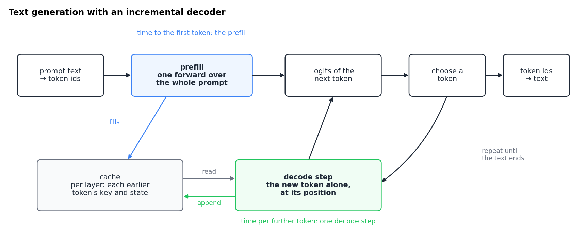
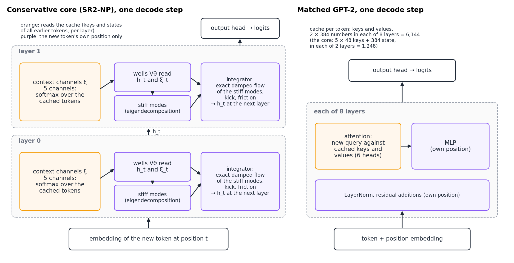
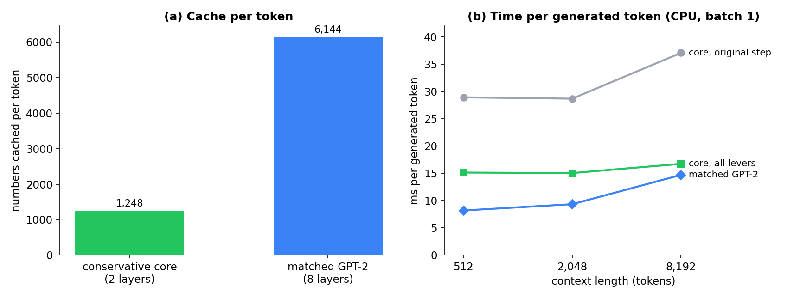

# The Incremental Decoder: What It Is and How It Works

**What this note is.** A reader's account of the incremental decoder written in stage 2 of the productization plan ([Stage2_Decoding.md](Stage2_Decoding.md), measured 2026-11-17): what a decoder is in a language model, why the conservative core admits one, how it works, its place in text generation, and what it requires of a model. The levers that speed up its step are in [Stage2b_Decode_Step_Levers.md](Stage2b_Decode_Step_Levers.md); how decoding sits beside training and the prompt pass is in [Training_Prefill_and_Decoding.md](Training_Prefill_and_Decoding.md). Written 2026-11-23.

---

## Contents

1. [Definitions](#1-definitions)
2. [The problem a decoder solves](#2-the-problem-a-decoder-solves)
3. [Why the conservative core admits one](#3-why-the-conservative-core-admits-one)
4. [How it works](#4-how-it-works)
5. [Its role in text generation](#5-its-role-in-text-generation)
6. [What it depends on](#6-what-it-depends-on)
7. [Cost against the matched GPT-2](#7-cost-against-the-matched-gpt-2)
8. [Limits](#8-limits)
9. [Files](#9-files)

---

## 1. Definitions

- **Autoregressive generation.** A language model gives, at each position, a distribution over the next token. To generate text, it reads a prompt, a token is chosen from the distribution at the last position, the token is appended, and the model is asked again. Each new token depends on all the tokens before it.
- **Logits.** The model's scores for every token of the vocabulary (50,257 here) at one position; a softmax turns them into probabilities.
- **Prefill.** The first pass, over the whole prompt at once.
- **Decode step.** Each later pass, which adds one token.
- **Incremental decoder.** The code that runs generation without recomputing the past: it keeps a **cache** of whatever later positions need from earlier ones, and each decode step computes only the new token's position. In this note, "decoder" always means this inference engine.
- **Not to be confused with** a *decoder-only transformer*, the name of an architecture (GPT-2 is one): a transformer whose attention is causal. The conservative core is causal too, and in that sense also decoder-only. The two uses of the word are unrelated.
- **Key–value cache.** The cache of a transformer's decoder: at every layer, each earlier token's key and value vectors, which the new token's attention query reads.

## 2. The problem a decoder solves

Without a decoder, generating each new token means rerunning the model over the whole sequence so far. A forward pass over $t$ tokens costs work in proportion to $t$ for everything that acts within one position, and in proportion to $t^2$ for whatever relates every position to every earlier one. Rerunning it for each of $N$ new tokens repeats all of that work, almost all of it already done.

Causality is what makes the repetition avoidable. In a causal model, a position's computation depends only on itself and earlier positions, so appending a token changes nothing that was computed at the earlier positions. Whatever a later position reads from an earlier one can be computed once and kept. The decode step then costs work in proportion to 1 for the new position's own computation and in proportion to $t$ for its reading of the cache.

## 3. Why the conservative core admits one

The decoder is possible only if one can say exactly what crosses positions. In the conservative core, with the pair force removed (SR2-NP has none) and the Fock registers skipped because nothing reads them, **one pathway crosses positions: the context channels $\xi$.** At layer $\ell$, the new position $t$ reads

$$
\xi_{k,t} = \sum_{s \le t} \underset{s}{\mathrm{softmax}}\left((t - s) \log a_k + \frac{q_{k,t} \cdot \kappa_{k,s}}{\sqrt{d_\kappa}}\right) h_s, \qquad k = 1, \dots, 5,
$$

where:
- $h_s$ is the state of token $s$ at the input of layer $\ell$;
- $a_k$ is channel $k$'s learned decay, so the first term favours recent tokens, each channel over its own horizon;
- $q_{k,t}$ and $\kappa_{k,s}$ are a query of the new state and a key of each earlier state, of width $d_\kappa = 48$; their dot product moves weight toward earlier tokens whose content matches;
- the weighted sum takes the earlier states themselves as values.

Everything else in a layer acts within one position: the well bank $V_\theta$ reads the token's own state and its own five channel readings; the stiff-mode decomposition, the integrator (the exact damped flow of the stiff modes, the kick and the friction), the mass and the output head are all per position. So the cache needs, per layer and per earlier token, only its key $\kappa_{k,s}$ for the 5 channels and its state $h_s$: $5 \times 48 + 384 = 624$ numbers, 1,248 per token at two layers.

## 4. How it works



*Figure 1. Text generation with an incremental decoder. The prompt is read once, filling the cache; each further token is one decode step that reads the cache and appends its own entries.*

**Prefill.** The decoder runs the model's ordinary forward over the prompt. On the way, at each layer, it stores every prompt token's keys and state in that layer's cache. The logits at the last position give the first new token.

**Decode step.** For the new token at position $t$:
1. The model's own forward runs on that token alone, told its position ($t$), so the position embedding is the right one.
2. At each layer, the context-channel module is replaced by one that computes $\xi_{k,t}$ from the cache: one row of weights over positions $0, \dots, t$ per channel, instead of a $t \times t$ matrix. It first appends the new token's keys and state, so the new position reads itself too, as in the full forward. The order matters: the mask of the full forward admits $s \le t$ rather than $s \lt t$, so a token counts itself, and the step reproduces that only by writing before it reads. Its row is therefore $t + 1$ long, not $t$. The inclusive mask is also what keeps the softmax defined at position 0, which under a strict mask would have no admissible source.
3. The rest of the layer (wells, stiff modes, integrator) runs on the new position as in the full forward.
4. The output head gives the logits for position $t + 1$.

The model's code is not changed. The decoder swaps the context-channel module's `forward` for its cache-reading one and restores it when closed.

**Why the keys can be cached and the query cannot.** Both come from the same two matrices the trained model already carries, $W_q$ and $W_k$, each of shape $Kd_\kappa \times d$, applied to a state and split across the $K$ channels: $q_{k,t}$ is the $k$-th block of $W_q h_t$ and $\kappa_{k,s}$ the $k$-th block of $W_k h_s$. The asymmetry that makes a decoder possible is that **a key depends only on its own token while a query depends only on the current one**. Token $s$'s key is the same whichever $t$ later reads it, so it is computed once, when $s$ is first seen, and stored:

```python
kk = xm.W_k(h).view(B, T, self.K, self.dk).permute(0, 2, 1, 3)
self.keys[li][:B, :, t0:t0 + T] = kk
```

That one line runs in both phases, over the whole prompt during the prefill and over the single new token during a step, which is why the prefill needs no separate key-writing path. The query is the opposite: it is a read of the state the step has just produced, so it is recomputed every step, for one position only:

```python
q = xm.W_q(h).view(B, 1, self.K, self.dk).permute(0, 2, 1, 3)   # (B, K, 1, dk)
logits = logits + (q @ self.keys[li][:B, :, :n].transpose(-1, -2)) * (self.dk ** -0.5)
```

The cost of the query is therefore one $d \times Kd_\kappa$ product per step, independent of the context, while the keys it multiplies grow with it. The distance part of the logit is not cached either, since $(t-s)\log a_k$ depends on both ends; it is rebuilt per step as a vector over the $n$ cached positions.

**Folding the distance into the key.** The `FOLD_CACHE` variant of [Stage2b_Decode_Step_Levers.md](Stage2b_Decode_Step_Levers.md) removes that separate term by widening both sides by one component, so the whole logit becomes a single dot product and the step can call fused attention. With $\lambda_k = -\log a_k \gt 0$, the key gains $\lambda_k (s - s_0)$ and the query gains the constant $\sqrt{d_\kappa}$, so after the usual $1/\sqrt{d_\kappa}$ scaling the extra product contributes exactly $\lambda_k(s - s_0)$. That differs from the true distance term $\lambda_k(s - t)$ by $\lambda_k(t - s_0)$, which is the same for every $s$ in the row and therefore cancels in the softmax. The centring at $s_0$ at half the cache's capacity is not needed for correctness; it halves the largest value the component ever takes. I checked the identity numerically: the two logit vectors differ by exactly the predicted constant and the resulting weights agree to 6e-17.

The price is a second key array held alongside the first, which is the extra 490 numbers per token recorded in §5.



*Figure 2. One decode step, the conservative core beside the matched GPT-2. Orange parts read the cache; purple parts act within the new token's position. The core reads its cache through five context channels per layer at two layers; GPT-2 through six attention heads per layer at eight layers.*

**The check.** On 256 validation tokens, the first 128 as prefill and the rest one at a time, the decoder's logits match the full forward's to float rounding (largest difference $3.8 \times 10^{-5}$ for SR2 with the pair force removed, at most $5.0 \times 10^{-5}$ over the configurations checked) and give the same top token at every position ([Stage2_Decoding.md](Stage2_Decoding.md), §2).

## 5. Its role in text generation

A deployed model answers a request in two phases with different costs:
- **Time to the first token** is the prefill: one forward over the prompt. Its cost grows with the prompt's length, partly in proportion to the square of it. The stage 1 levers ([Stage1_CPU_Levers.md](Stage1_CPU_Levers.md)) and the context channels as 30 heads ([Stage1b_Context_Channels_as_30_Heads.md](Stage1b_Context_Channels_as_30_Heads.md)) act here.
- **Time per further token** is the decode step. For a single sequence on a CPU it is dominated by per-operation overhead, not arithmetic ([Stage2_Decoding.md](Stage2_Decoding.md), §4), which is what the levers of [Stage2b_Decode_Step_Levers.md](Stage2b_Decode_Step_Levers.md) address.
- **Memory** is the model's weights plus the cache, which grows by 1,248 numbers per token of context. At float32 that is $L(Kd_k + d) \times 4 = 4{,}992$ bytes, just under 4.9 KiB per token, so 2.59 MB at a context of 512 and 39.15 MB at 8,192. The dtype is the model's own, so a half-precision model halves it. The prompt's token ids are negligible beside it, $8T$ bytes, 64 KiB even at 8,192 tokens. The breakdown and the caveat about the folded-key experiment are in [Training_Prefill_and_Decoding.md](Training_Prefill_and_Decoding.md) §3.

Choosing each token from the logits (greedy, sampling with a temperature, top-k and so on), and turning token ids back into text, sit outside the decoder. The benchmark feeds random tokens, since the cost of a step does not depend on which token it is.

## 6. What it depends on

**What the model must satisfy.** The decoder refuses, with an error naming the reason, any configuration in which something other than the context channels crosses positions:
- **the routed pair force.** A model that has one can be decoded only with `drop_pair_force=True`, which removes it and changes the model's predictions (for SR2, +1.8% in perplexity; SR2-NP was trained without it). A cache for it would hold each earlier token's state and a 32-wide projection, 416 numbers per token and layer; it is not written;
- **the Fock exchange field and a reverse channel**, both of which route between positions;
- **the Poisson-mode wells and the particle store.** A mode's occupation is a decaying running sum over earlier tokens: a fixed-size state per layer that a decoder could carry, but it is not written, so the PMX models are not decoded;
- **read registers.** The registers must be prefix-causal and unread, and skipped;
- **a walk with substeps or a variable number of steps**: the decoder assumes one step per layer, as trained.

**What it depends on in the code.** The model's forward must accept a position offset, and the context-channel module must be replaceable by attribute. The decoder relies on causality: if any part of a layer read later positions, appending a token would change earlier results and the cache would be wrong. The check of §4 is what guards against that, and it must be rerun after any change to the model's code.

**Which models qualify.** SR2-NP as trained; SR2 and K4-R6 with the pair force removed; any of these with the inference levers (layer-1 pruning, the `eigh` decomposition, the step 1 switches).

## 7. Cost against the matched GPT-2



*Figure 3. (a) Numbers cached per token. (b) Milliseconds per generated token against the context length: GPT-2 with its key–value cache (2026-11-17), and SR2-NP with layer 1 pruned, with the original decode step and with every lever of Stage 2b (2026-11-23). One thread pool of 8 on the same CPU, batch 1, float32; the three lines come from different sessions.*

- **The cache is a fifth of GPT-2's.** 1,248 numbers per token against 6,144: two layers of five 48-wide keys and one 384-wide state, against eight layers of six heads' keys and values. Both grow in proportion to the context; neither is a fixed-size state.
- **The step is slower, and nearly flat in the context.** With every lever of [Stage2b_Decode_Step_Levers.md](Stage2b_Decode_Step_Levers.md) (multiply-and-sum products, the compiled core, the cache read as one product), SR2-NP generates a token in 15.1 ms at context 512 and 16.7 ms at 8,192, against GPT-2's 8.2 and 14.7: 1.8 times slower at 512 and 1.14 times at 8,192. The original step took 28.9 and 37.1 ms. The core's step grows by under 2 ms over this range, GPT-2's by 6.5 ms, because a longer cache costs GPT-2's eight attention layers more than the core's two channel reads.

## 8. Limits

- **One sequence at a time.** Batch 1 only; batched decoding of several requests is not written or measured.
- **The prompt in one piece.** A multi-token step is accepted only as the prefill, at position 0.
- **A fixed capacity.** The cache is allocated for a maximum length at the start, the `max_len` given to the constructor. Prompt and generated tokens share that ceiling, and overrunning it raises `decoder cache full` before anything is written, rather than growing the buffers.
- **Not a fixed-size state.** Like a key–value cache, the cache grows with the context. A fixed-size state would need the content term of the context channels in a recurrent form, which stage 1 found risky at layer 0 ([Stage2_Decoding.md](Stage2_Decoding.md), §6).

## 9. Files

- The decoder: [`parf/incremental_decoder.py`](../../notebooks/conservative_arch/parf/incremental_decoder.py), classes `LadderDecoder` and `GPT2Decoder`.
- The benchmark that runs and checks it: [`debug/cpu_throughput_benchmark.py`](../../notebooks/conservative_arch/scaleup/debug/cpu_throughput_benchmark.py) with `decode=1` (`decode_check=`, `decode_profile=1`, `decode_attrib=1`, `ab=`).
- Figures: [`figures/_make_incremental_decoder_figs.py`](../figures/_make_incremental_decoder_figs.py).
