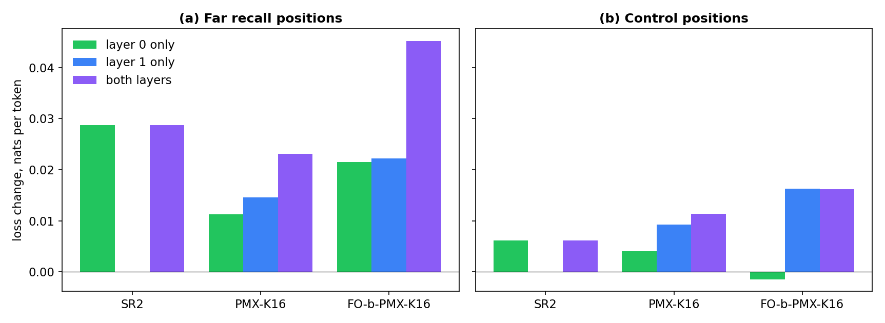
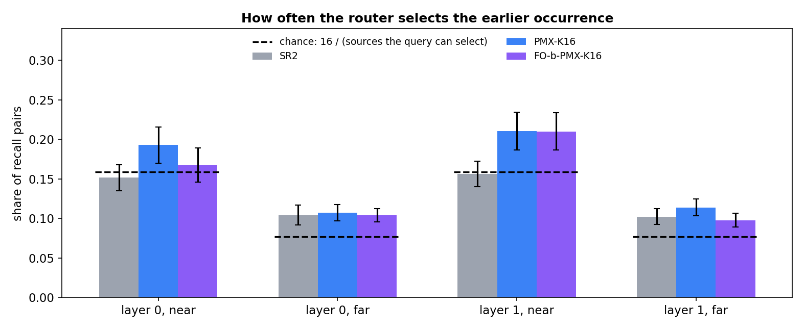

# Where the Pair Force's Cost Sits in FO-b-PMX-K16: Recall or Averaged Work?

**What this note is.** A CPU test, run 2026-11-22, on the first-order model with sixteen Poisson-mode wells (FO-b-PMX-K16), its second-order twin (PMX-K16) and SR2. It asks whether the pair force $V_\varphi$ retrieves a specific earlier token, which a mean field could not reproduce, or does work spread over the context, which a mean field could. It is the first step of the PMX line in the productization plan ([Conservative_Core_Productization_Plan.md](Conservative_Core_Productization_Plan.md), §6).

**Status.** Done. The decision rule was stated before the run (§2.3) but not confirmed by the author. **Result: the pair force does not fetch the earlier occurrence.** Removing that one source costs 4% of what removing the whole pair force costs at the same positions, and the router selects it only 1.3 times as often as chance. The pair force is worth about three times more per token at recall positions than at control positions, but about two thirds of its total cost falls outside the recall positions. So a mean field is a credible replacement on this line, provided its components are addressed by content.

---

## Contents

1. [Definitions](#1-definitions)
2. [The problem](#2-the-problem)
3. [The method](#3-the-method)
4. [Results](#4-results)
5. [Analysis](#5-analysis)
6. [What it decides](#6-what-it-decides)
7. [A correction to the earlier SR2 reading](#7-a-correction-to-the-earlier-sr2-reading)
8. [The same test on code](#8-the-same-test-on-code)
9. [Caveats](#9-caveats)
10. [Reproduction and files](#10-reproduction-and-files)

---

## 1. Definitions

- **The three models.** All are trained on 532.5M OpenWebText tokens with the Gen 3 recipe, at two layers.
  - **SR2**: the second-order conservative core, with the stiff modes integrated as exact damped oscillators. Settled perplexity 58.32.
  - **PMX-K16**: SR2 with 16 Poisson-mode wells integrated exactly. Settled 54.24.
  - **FO-b-PMX-K16**: PMX-K16 trained as a true first-order gradient flow, with no velocity anywhere. Settled 53.73.
- **Pair force.** The force from the pair potential $V_\varphi$. At each layer and query token $t$, a router (a score network) scores every earlier token $s$; the 16 highest-scoring tokens become $t$'s **sources**; and the force is minus the gradient in $h_t$ of $\sum_{j} m_{tj} V_\varphi(h_t, h_j)$ over those sources, with $m_{tj}$ the router's weights. A query at position $t$ can select from the $t$ tokens before it.
- **Context channels, $\xi$.** Five causal averages of the earlier states per layer, with a content term. They are the model's other way of reading the past, and the one that carries recall in SR2 ([Second_Order_Memory_Probes.md](../depth_ladder/Second_Order_Memory_Probes.md), probe 6).
- **Recall pair.** A position $q$ whose target token (the token at $q + 1$) last occurred at an earlier input position $p$. The **distance** is $q + 1 - p$. A pair is **near** if the distance is 1 to 16 and **far** if it is 17 to 256.
- **Control position.** A position whose target does not occur earlier in the window. These are the positions that recall nothing.
- **Frequency filter.** A token that occurs more than 8 times in the window is excluded from all three classes, so frequent tokens (punctuation, function words) do not dominate them. About a quarter of the positions belong to no class.
- **Cut.** A change to one pathway during the forward pass. The cuts used here:
  - **whole pair force off** (`phioff`): the pair force set to zero, at both layers or at one;
  - **earlier occurrence removed from the pair force** (`phi@L`): for every recall pair, $p$ is removed from $q$'s eligible sources at layer $L$, so the router cannot select it;
  - **earlier occurrence removed from the context channels** (`xi@L`);
  - **velocity zeroed** (`vel@1`): the velocity entering layer 1 set to zero, in a second-order model only.
- **Loss change.** For a cut, the change of the per-token cross-entropy, in nats. It is averaged over the positions of a class within each window, then over windows, with the standard error over windows.
- **Selection rate.** The share of recall pairs for which $p$ is among the 16 sources the router selects for $q$, in the uncut pass. The **chance rate** is what a router that picks 16 of the eligible tokens uniformly at random would give.

## 2. The problem

### 2.1 Why it matters

The first-order twins lean harder on the pair force than their second-order twins. On these windows, removing it costs FO-b-PMX-K16 0.026 nats per token (+2.6% in perplexity), against 0.016 for PMX-K16 and 0.014 for SR2. If this line goes into production, the pair force may be worth keeping, and its cost then calls for a cheaper form of it: the mean field of [Mean_Field_PARFLM_Programme.md](../Mean_Field_PARFLM_Programme.md). That field replaces the routed sources by $M$ summaries of the past:

$$f_t = -\lambda_\ell \nabla_{h_t} \sum_{m=1}^{M} \pi_{m,t} V_\varphi(h_t, \mu_{m,t}), \qquad \pi_{m,t} \propto \sum_{s \lt t} w_{t,s} r_{s,m}, \qquad \mu_{m,t} = \frac{\sum_{s \lt t} w_{t,s} r_{s,m} h_s}{\sum_{s \lt t} w_{t,s} r_{s,m}},$$

where $r_{s,m}$ is the responsibility of component $m$ for token $s$ (a softmax over distances to learned prototypes) and $w_{t,s}$ an exponential decay in $t - s$.

### 2.2 What a mean field cannot do

Each component mean $\mu_{m,t}$ averages over many earlier tokens. If component $m$ effectively averages over $N_m$ tokens, removing one of them moves $\mu_{m,t}$ by a term of order $1/N_m$. So the field's force at $t$ barely depends on any single earlier token. A routed force can depend on one token entirely: if the router picks out $p$ and the force from $p$ carries the prediction, removing $p$ removes the benefit. Call the part of the pair force's benefit that depends on one specific source its **addressing**. A mean field cannot reproduce addressing. It can reproduce benefit that depends on what the context contains in aggregate.

The test measures addressing directly. At far recall positions, set the cost of removing the earlier occurrence from the pair force's sources (both layers, summed) against the cost of removing the whole pair force:

$$A = \frac{\Delta\ell_{\text{far}}(\texttt{phi@0}) + \Delta\ell_{\text{far}}(\texttt{phi@1})}{\Delta\ell_{\text{far}}(\texttt{phioff})}.$$

$A$ near 1 means the pair force's value at recall positions is the value of fetching $p$. $A$ near 0 means the value is there but does not come from $p$.

A second reading asks where the total cost falls. With $n_c$ the number of positions in class $c$ and $N$ the number of positions in all windows, the share of the pair force's total cost carried by class $c$ is approximately

$$S_c \approx \frac{n_c \cdot \Delta\ell_c(\texttt{phioff})}{N \cdot \Delta\ell_{\text{all}}(\texttt{phioff})}.$$

### 2.3 The decision rule (stated before the run)

- If the cost sits mostly at recall positions, and in particular if the pair force retrieves $p$ ($A$ large), a mean field is the wrong tool and the exact routed force would have to stay.
- If the cost sits mostly at positions that recall nothing ($A$ small, most of $S$ outside the recall classes), a mean field is a credible replacement.

The rule was given in conversation before the run and not confirmed by the author, so the reading below is on its letter.

## 3. The method

`debug/recall_pathway_probe.py`, the probe 6 harness of [Second_Order_Memory_Probes.md](../depth_ladder/Second_Order_Memory_Probes.md), extended on 2026-11-22 in two ways:

- **Arms that switch the whole pair force off**, at both layers or at one, by wrapping the closed-form force and the pair potential exactly as `mechanism_ablations.py` does for `vphi_off`. The probe also gained the targeted cut at layer 0 (`phi@0`) and a column over all positions.
- **The selection rate.** In the uncut pass the router's top-16 source indices are recorded at each layer. For each recall pair the probe checks whether $p$ is among $q$'s sources. The chance rate at query $q$ is $\min(1, 16/q)$, since the pair mask lets $q$ select from the $q$ tokens before it.

Everything else is as in the earlier probe:
- **Windows.** 16 windows of 512 tokens from the OpenWebText validation set, evenly spaced and offset by half a spacing. There are 317 near recall, 1,507 far recall and 4,198 control positions out of 8,192.
- **Checks.** The re-implemented context-channel branch reproduces the model's own exactly (max change 0.0), and a cut leaves every position before the first recall position unchanged (0.0).
- **SR2 as a regression check.** On SR2, every arm of the earlier run (`recall_pathway_sr2_owt.txt`) reproduced to the last printed digit.
- **Cost.** On the CPU (8 threads), 3 to 4.5 minutes per model, with a peak resident memory of 6.8 to 8.1 GB.

## 4. Results

Loss change per token in nats, with the standard error over windows in brackets:

| model and cut | near recall | far recall | control | all positions |
| --- | ---: | ---: | ---: | ---: |
| **FO-b-PMX-K16**, whole pair force off | +0.030 (0.020) | **+0.045** (0.008) | +0.016 (0.004) | **+0.026** (0.002) |
| FO-b-PMX-K16, earlier occurrence removed from the pair force, layer 1 | +0.0026 | +0.0018 | +0.0000 | +0.0004 |
| FO-b-PMX-K16, earlier occurrence removed from the pair force, layer 0 | −0.0000 | +0.0001 | +0.0000 | +0.0000 |
| FO-b-PMX-K16, earlier occurrence removed from the context channels, layer 1 | +0.533 | +0.463 | −0.0001 | +0.112 |
| **PMX-K16**, whole pair force off | +0.022 (0.016) | +0.023 (0.005) | +0.011 (0.002) | +0.016 (0.002) |
| PMX-K16, earlier occurrence removed from the pair force, layers 0 + 1 | +0.0026 | +0.0021 | +0.0000 | +0.0005 |
| **SR2**, whole pair force off | +0.044 (0.022) | +0.029 (0.006) | +0.006 (0.004) | +0.014 (0.003) |
| SR2, earlier occurrence removed from the pair force, layers 0 + 1 | +0.0025 | +0.0022 | −0.0000 | +0.0005 |


*Figure 1. Left: where the pair force's cost falls, per token. Right: at far recall positions, removing only the earlier occurrence from the pair force's sources costs 4% (FO-b-PMX-K16) to 9% (PMX-K16) of removing the whole pair force.*

**By layer** (whole pair force off at one layer, nats per token):

| model | layer 0, far | layer 1, far | layer 0, control | layer 1, control | layer 0, all | layer 1, all |
| --- | ---: | ---: | ---: | ---: | ---: | ---: |
| FO-b-PMX-K16 | +0.022 | +0.022 | −0.002 | +0.016 | +0.015 | +0.010 |
| PMX-K16 | +0.011 | +0.015 | +0.004 | +0.009 | +0.008 | +0.010 |
| SR2 | +0.029 | −0.0000 | +0.006 | +0.0000 | +0.014 | −0.0000 |



*Figure 2. The pair force's cost by layer. SR2's is entirely at layer 0. FO-b-PMX-K16's cost at positions that recall nothing is entirely at layer 1.*

**The router's selection of the earlier occurrence** (share of recall pairs, standard error in brackets):

| | chance | SR2 | PMX-K16 | FO-b-PMX-K16 |
| --- | ---: | ---: | ---: | ---: |
| layer 0, near | 0.159 | 0.152 (0.017) | 0.193 (0.023) | 0.168 (0.022) |
| layer 0, far | 0.077 | 0.104 (0.012) | 0.107 (0.010) | 0.104 (0.008) |
| layer 1, near | 0.159 | 0.156 (0.016) | 0.211 (0.024) | 0.210 (0.023) |
| layer 1, far | 0.077 | 0.102 (0.010) | 0.114 (0.011) | 0.098 (0.009) |



*Figure 3. The router picks the earlier occurrence at 1.0 to 1.5 times the chance rate: a weak preference, not a lookup.*

## 5. Analysis

**No addressing.** The addressing fraction is

$$A_{\text{FO-b-PMX-K16}} = \frac{0.0001 + 0.0018}{0.0453} \approx 0.04, \qquad A_{\text{PMX-K16}} = \frac{0.0003 + 0.0018}{0.0231} \approx 0.09, \qquad A_{\text{SR2}} = \frac{0.0022 + 0.0000}{0.0287} \approx 0.08.$$

In every model, 91% to 96% of the pair force's value at far recall positions survives removing the one source that holds the answer. The selection rates say the same from the other side: the router picks $p$ 1.3 times as often as chance at far distances, nowhere near a lookup (a lookup would select $p$ almost always). The recall itself runs through the context channels: removing $p$ from layer 1's context channels costs 0.46 nats at far recall in FO-b-PMX-K16, ten times the whole pair force's cost there.

**More value per token at recall positions, but not through $p$.** In FO-b-PMX-K16 the whole pair force is worth 0.045 nats per token at far recall and 0.016 at control positions, 2.8 times as much. Removing $p$ does not account for the difference. The likeliest reading: positions that recall something sit in contexts that repeat a topic, and there the router's sources (related tokens, not the repeated token itself) carry more information. That is benefit from what the context contains in aggregate, which a mean field with content-addressed components can carry. A field whose components were positional, with no dependence on content, could not.

**Where the total cost falls.** With the position counts of §3 and the all-positions mean, the approximate shares $S_c$ of the pair force's total cost are:

| class | positions | FO-b-PMX-K16 | PMX-K16 | SR2 |
| --- | ---: | ---: | ---: | ---: |
| near recall | 317 | 4% | 5% | 13% |
| far recall | 1,507 | 32% | 26% | 39% |
| control | 4,198 | 32% | 36% | 24% |
| frequent tokens (no class) | 2,170 | 32% | 33% | 25% |

About two thirds of FO-b-PMX-K16's pair-force cost falls outside the recall positions.

**The first-order model uses the pair force differently from its twin.** Its extra cost over PMX-K16 is spread over every class: +0.022 nats at far recall and +0.005 at control positions. At control positions it uses only layer 1's pair force (layer 0's removal changes nothing there, −0.002 ± 0.004). This matches the trained scales of the force, softplus of the raw per-layer scale: 0.020 and 0.035 at layers 0 and 1 in FO-b-PMX-K16, against 0.024 and 0.140 in PMX-K16 and 0.020 and 0.006 in SR2.

**Against the decision rule (§2.3).** $A$ is small (0.04), and about 64% of the total cost falls outside the recall classes. On the rule's letter, the mean field is **a credible replacement**. The per-token concentration at recall positions is a qualification, not a reversal: it is content-dependent value without addressing.

## 6. What it decides

- **The mean field stays a candidate for the PMX line.** The pair force does no addressing in FO-b-PMX-K16, so a field loses nothing the router provides. Whether the field can represent the force at all is Probe A's question; this test only removes the strongest reason it could not.
- **The field's components must be addressed by content.** The value concentrates where the context repeats a topic, so the prototypes and responsibilities of §2.1 must depend on content, as the programme's design already has them. Probe A should report its fit separately at recall and at control positions.
- **The next step is the GPU arm:** FO-b-PMX-K16 trained without the pair force ([Stage3e_FO_b_PMX_K16_Without_Pair_Force.md](Stage3e_FO_b_PMX_K16_Without_Pair_Force.md)). Reliance is not value, and SR2 lost only 0.3% when trained without a force whose removal cost 1.8%. If the trained-out cost is small, neither the pair force nor a field is needed on this line.

## 7. A correction to the earlier SR2 reading

Probe 6 found that removing the earlier occurrence from **layer 1's** pair force changes the far-recall loss by +0.000 in SR2, on OpenWebText and on code. That was read as "the pair force carries none of the recall". On OpenWebText the layer-1 test was weak. SR2 trained layer 1's pair-force scale down to 0.006, and switching off layer 1's whole pair force changes the loss by less than 0.0001 nats at every class. All of SR2's pair-force cost is at layer 0. There, removing $p$ costs +0.0022 nats at far recall: 8% of the pair force's cost at those positions and 0.6% of what the context channels' layer-1 read carries (0.376). The conclusion holds, now on the layer where the force acts. On code the layer-1 pair force is not inert in the models without wells, and the conclusion holds there at both layers (§8).

## 8. The same test on code

Added 2026-11-22. The probe was rerun on four code models trained on 532.5M code tokens with the same recipe at two layers: SO-CODE (second order), FO-b-CODE (first order), and their twins with two Poisson-mode wells, PM2-CODE and FO-b-PM2-CODE. Outputs `recall_pathway_{so,fob,pm2,fobpm2}_code_phisplit.{txt,json}`. Loss changes in nats per token (standard error over windows):

| model | whole pair force off, all positions | layer 0 only | layer 1 only | far recall | control | addressing fraction A | selection at far recall, layer 0 and 1 (times chance) |
| --- | ---: | ---: | ---: | ---: | ---: | ---: | --- |
| SO-CODE | +0.1906 (0.0148) | +0.0782 | +0.1596 | +0.3459 | +0.2182 | 0.002 | 2.1, 2.9 |
| FO-b-CODE | +0.6811 (0.0705) | +0.0934 | +0.7277 | +1.5213 | +0.2422 | 0.000 | 2.6, 1.9 |
| PM2-CODE | +0.0187 (0.0043) | +0.0150 | +0.0025 | +0.0606 | −0.0027 | 0.000 | 2.2, 3.3 |
| FO-b-PM2-CODE | +0.0649 (0.0113) | +0.0682 | +0.0056 | +0.1985 | −0.0564 | 0.000 | 1.5, 2.1 |

The whole-force cost was checked independently by zeroing the trained per-layer scale, with the same result.

- **No addressing on code either.** Removing the earlier occurrence from the pair force's sources, at either layer, costs at most 0.0004 nats at far recall: 0.2% or less of the whole force's cost there. The router selects $p$ 1.5 to 3.3 times as often as chance, more than on OpenWebText, but the selected $p$ carries nothing the other sources do not. The recall runs through the context channels (`xi@1` costs 0.74 to 0.89 nats at far recall in every model). The book's statement that removing the earlier occurrence from the pair force's sources costs nothing holds on code at both layers.
- **Layer 1 carries the pair force in the models without wells.** Its trained scale is large (0.445 in SO-CODE, 0.844 in FO-b-CODE), and switching off layer 1 alone costs 84% (SO-CODE) to 107% (FO-b-CODE) of switching off both layers. With two wells, layer 1's pair force is close to inert and what is left sits at layer 0.
- **The wells displace the pair force on code.** Adding two wells cuts the pair force's cost by a factor of ten in both orders (0.19 to 0.019 nats in second order, 0.68 to 0.065 in first order). The first-order models lean on it about 3.5 times as much as their second-order twins.
- **With wells, the pair force works only at recall positions.** In PM2-CODE and FO-b-PM2-CODE its whole cost sits at recall positions, and at control positions removing it lowers the loss (FO-b-PM2-CODE −0.056 ± 0.012 nats). In SO-CODE and FO-b-CODE it is worth a lot at control positions too.
- **For the mean field.** Without wells, the code pair force is large and, by this test, does no addressing; Probe A finds that a field recovers 92% of SO-CODE's ([Probe_A_Field_Pair_Force.md](../mean_field/Probe_A_Field_Pair_Force.md)).

## 9. Caveats

- **One seed per model; 16 windows.** The standard errors are over windows, not over training seeds.
- **Only $p$ is removed.** The targeted cut removes the earlier occurrence itself, not its neighbours ($p - 1$, $p + 1$). A force that fetched the phrase around $p$ without $p$ would escape this test. The selection rate argues against it but does not exclude it.
- **The two targeted cuts were run separately**, and $A$ sums them. A joint cut at both layers was not run; the sum of the separate cuts matches the joint value when the two layers act independently, as the whole-force splits suggest (0.015 + 0.010 against 0.026 in FO-b-PMX-K16).
- **Reliance, not value.** Every number here is measured on a trained model with the pair force removed at inference.
- **The shares $S_c$ are approximate.** They use pooled position counts with window-averaged means.

## 10. Reproduction and files

```bash
cd notebooks/conservative_arch/scaleup
V=<path to>/openwebtext_val_2M.npy
python3 debug/recall_pathway_probe.py results/recall_pathway <SR2 folder> name=sr2_owt_phisplit val=$V check=1
python3 debug/recall_pathway_probe.py results/recall_pathway <PMX-K16 folder> name=pmxk16_owt val=$V check=1
python3 debug/recall_pathway_probe.py results/recall_pathway <FO-b-PMX-K16 folder> name=fobk16_owt val=$V check=1
```

The folders are the runs' Drive folders (`semsimula_fock_cfc_baoab_owt_<tag>`) with their `checkpoints/` holding the best weights.

- Outputs: `results/recall_pathway/recall_pathway_{sr2_owt_phisplit,pmxk16_owt,fobk16_owt}.{txt,json}`.
- Figures: [`figures/_make_pair_force_recall_figs.py`](../figures/_make_pair_force_recall_figs.py), writing `figures/pair_force_recall/`.
- Related: [Velocity_and_Pair_Force_as_Competing_Mechanisms.md](../depth_ladder/Velocity_and_Pair_Force_as_Competing_Mechanisms.md); [First_vs_Second_Order_Series.md](../depth_ladder/First_vs_Second_Order_Series.md) §9 (the readings M1 to M4); [Stage3_SR2_Without_Pair_Force.md](Stage3_SR2_Without_Pair_Force.md).
