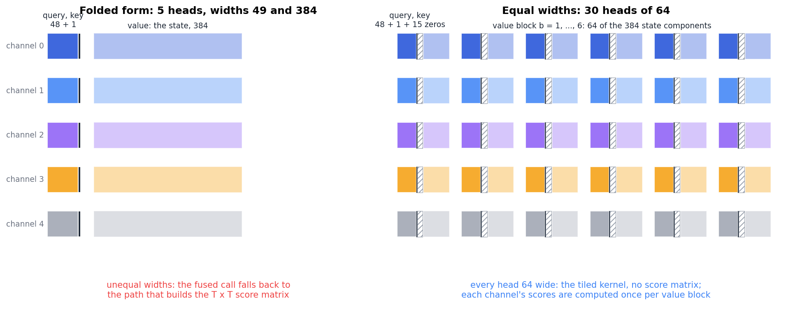
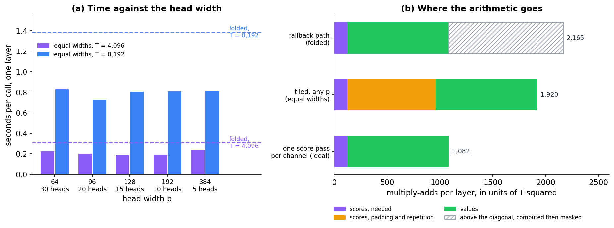
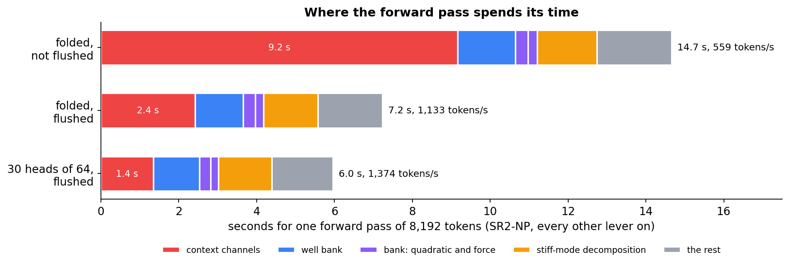

# Stage 1b: The Context Channels as 30 Heads of 64

**What this note is.** The mathematics and the measurements behind the second speed lever of 2026-11-22 in [Conservative_Core_Productization_Plan.md](Conservative_Core_Productization_Plan.md) (§6, "What remains of the speed push", item 2): an exact rewriting of SR2-NP's content-routed context channels that lets PyTorch's tiled attention kernel compute them on the CPU. [Stage1_CPU_Levers.md](Stage1_CPU_Levers.md), §8, records the result in one paragraph; this note states the problem, derives the rewriting and its cost and error, and explains why it is faster. Written 2026-11-22.

**Status.** Measured on the CPU (PyTorch 2.2.2, 8 threads, float32, one sequence), on SR2-NP's trained weights. The rewriting is exact in exact arithmetic; in float32 it matches the folded form of lever N1 to rounding. It lives in the benchmark (`xi=fold64` in `cpu_throughput_benchmark.py`); it is not in the model code or in the incremental decoder of [Stage2_Decoding.md](Stage2_Decoding.md). There it could help only the prompt phase, and only for long prompts (§9).

---

## Contents

1. [Definitions](#1-definitions)
2. [The problem](#2-the-problem)
3. [Step 1: folding the distance term into the keys](#3-step-1-folding-the-distance-term-into-the-keys)
4. [Step 2: equal widths](#4-step-2-equal-widths)
5. [Why the kernel choice decides the time](#5-why-the-kernel-choice-decides-the-time)
6. [Cost](#6-cost)
7. [Error](#7-error)
8. [Measurements](#8-measurements)
9. [Scope and limits](#9-scope-and-limits)
10. [Files](#10-files)

---

## 1. Definitions

- **Position, length.** A sequence of $T$ tokens; $t$ is the position of the token being computed (the query), $s$ the position of an earlier token it reads (the key), $0 \le s \le t \le T-1$.
- **State.** $h_s \in \mathbb{R}^{d}$, the layer's state at position $s$, of width $d = 384$.
- **Context channel.** One of $K = 5$ causal averages of the past states. Channel $c$ produces $\xi_c(t) \in \mathbb{R}^{d}$, a weighted average of the states $h_0$ to $h_t$ (§2). In the code it is `MultiChannelXi`; the notes call it $\xi$.
- **Decay and decay rate.** Each channel has a trained decay $\alpha_c \in (0, 1)$; its decay rate is $\lambda_c$, defined as $-\log \alpha_c$, which is positive. A larger decay rate forgets faster. SR2-NP's trained values are $\alpha = 0.369, 0.550, 0.903, 0.987, 0.994$, so $\lambda = 0.997, 0.597, 0.102, 0.0127, 0.0062$.
- **Query and key.** Content vectors of width $d_k = 48$ per channel, made from the state by trained linear maps (`W_q`, `W_k`): the query $q_{c,t}$ from $h_t$ and the key $k_{c,s}$ from $h_s$.
- **Logit, weight.** The logit is the score of key $s$ for query $t$ before normalisation; the weights are the logits passed through a softmax over $s$, so they are positive and sum to one.
- **Head, head width.** An attention kernel processes a batch of independent attention problems, called heads. A head's width is the length of its query and key vectors (the query-key width) or of its value vectors (the value width).
- **Fused attention call.** `torch.nn.functional.scaled_dot_product_attention`, one call that computes the scores, the softmax and the weighted sum. Inside, PyTorch dispatches to one of two CPU implementations:
  - **The tiled kernel** (`_scaled_dot_product_flash_attention`). It walks over blocks of queries and keys, keeps a running maximum and a running sum for the softmax, and never stores the full score matrix. With a causal mask it skips the key blocks that lie wholly above the diagonal.
  - **The fallback path** (`_scaled_dot_product_attention_math`). It forms the full $T \times T$ score matrix of every head with a matrix product, applies the mask, takes the softmax and multiplies by the values.
- **Multiply-add.** One multiplication followed by one addition, the unit of arithmetic counted in §6.
- **Subnormal float.** A float32 number below $2^{-126} \approx 1.2 \times 10^{-38}$ in magnitude and above zero. x86 processors handle these much more slowly than ordinary floats. Lever N6 flushes them to zero (`torch.set_flush_denormal(True)`).
- **Unit roundoff.** $u = 2^{-24} \approx 6.0 \times 10^{-8}$, the largest relative error of rounding one real number to float32.
- **Folded form (lever N1)** and **equal-width form (this note).** The two exact rewritings of §3 and §4. In the benchmark, `xi=fold` and `xi=fold64`.

## 2. The problem

For each channel $c$ and position $t$, the context channels compute

$$\xi_c(t) = \sum_{s=0}^{t} w_c(t,s) h_s, \qquad w_c(t,s) = \frac{\exp \ell_c(t,s)}{\sum_{r=0}^{t} \exp \ell_c(t,r)},$$

with the logit made of a distance term and a content term:

$$\ell_c(t,s) = -\lambda_c (t-s) + \frac{q_{c,t}^{\top} k_{c,s}}{\sqrt{d_k}}.$$

The distance term alone ($q = 0$) gives an exponential moving average of the past with decay $\alpha_c$; the content term moves weight toward earlier states whose keys match the current query. This is `MultiChannelXi.forward` in [`multixi/model_multixi.py`](../../notebooks/conservative_arch/multixi/model_multixi.py). The trained code path builds the distance logits as a $K \times T \times T$ tensor and the content logits as another, adds them, and takes the softmax.

The available primitive is the fused attention call. For one head with query rows $x_t$, key rows $y_s$, value rows $z_s$ and a scale $\sigma$, it returns, under a causal mask,

$$\mathcal{A}(X, Y, Z)_t = \sum_{s=0}^{t} \frac{\exp(\sigma x_t^{\top} y_s)}{\sum_{r=0}^{t} \exp(\sigma x_t^{\top} y_r)} z_s.$$

It takes a stack of heads; within one call every head has the same query-key width $p_{xy}$ and the same value width $p_z$.

**Problem.** Find layout maps that turn the state $h$ and the trained parameters into stacks $(X, Y, Z)$, and a map that reassembles the call's output into $(\xi_c(t))$, such that:

1. **Exactness.** In exact arithmetic the result equals $\xi_c(t)$ for every input.
2. **No explicit score tensor.** Memory grows as $T \cdot d$, not $T^2$.
3. **Error.** In float32 the result stays within the error of the folded form of lever N1, which the model-level checks already accepted (perplexity and logits unchanged).
4. **Time.** Among the layouts that meet 1 to 3, the one with the least wall time on the CPU.

The constraint that shapes the answer is the dispatch rule of §5: on this PyTorch, the tiled kernel runs only when the query-key width equals the value width.

## 3. Step 1: folding the distance term into the keys

The distance term splits into a part that depends only on the query and a part that depends only on the key:

$$-\lambda_c (t-s) = -\lambda_c t + \lambda_c s.$$

A softmax is unchanged when the same constant is added to every logit of one row, because the factor $\exp(-\lambda_c t)$ appears in the numerator and in the denominator and cancels:

$$\frac{\exp(a_s + b)}{\sum_{r} \exp(a_r + b)} = \frac{\exp(a_s)}{\sum_{r} \exp(a_r)}.$$

So the term $-\lambda_c t$ can be dropped, and what remains, $\lambda_c s$, is a property of the key alone. Append one component to the query and one to the key:

$$\tilde{q}_{c,t} = \left( q_{c,t}, \sqrt{d_k} \right) \in \mathbb{R}^{d_k+1}, \qquad \tilde{k}_{c,s} = \left( k_{c,s}, \lambda_c s \right) \in \mathbb{R}^{d_k+1}.$$

With the scale $\sigma = 1/\sqrt{d_k}$,

$$\sigma \tilde{q}_{c,t}^{\top} \tilde{k}_{c,s} = \frac{q_{c,t}^{\top} k_{c,s}}{\sqrt{d_k}} + \lambda_c s = \ell_c(t,s) + \lambda_c t,$$

which differs from the logit only by the row constant. Hence, channel by channel,

$$\xi_c = \mathcal{A}(\tilde{Q}_c, \tilde{K}_c, H), \qquad \sigma = 1/\sqrt{d_k},$$

with $H$ the matrix of states as values and the causal mask doing the work of $s \le t$. This is lever N1 (2026-11-17): five heads, query-key width $d_k + 1 = 49$, value width $d = 384$.

**Why it is not enough.** The widths 49 and 384 differ, so the call takes the fallback path (§5). The fallback path builds the score matrix that the rewriting was meant to avoid, and on top of it a $T \times T$ causal mask. The measured gain of the folded form over the trained code path was 1.43 times at 8,192 tokens (`xi_sdpa_microbench_8192.txt`, on SR2's weights).

## 4. Step 2: equal widths

Two exact operations make the widths equal.

**Zero padding of queries and keys.** For any width $p \ge d_k + 1$, append $p - d_k - 1$ zeros to each folded query and key:

$$\hat{q}_{c,t} = \left( \tilde{q}_{c,t}, 0, \dots, 0 \right) \in \mathbb{R}^{p}, \qquad \hat{k}_{c,s} = \left( \tilde{k}_{c,s}, 0, \dots, 0 \right) \in \mathbb{R}^{p}.$$

The extra products are $0 \cdot 0$, so

$$\hat{q}_{c,t}^{\top} \hat{k}_{c,s} = \tilde{q}_{c,t}^{\top} \tilde{k}_{c,s}.$$

The scale must be passed explicitly as $\sigma = 1/\sqrt{d_k}$; the call's default, $1/\sqrt{p}$, would change every logit.

**Splitting the values into blocks.** Let $m = d/p$ and cut each state into $m$ consecutive blocks of width $p$:

$$h_s = \left( h_s^{(1)}, h_s^{(2)}, \dots, h_s^{(m)} \right), \qquad h_s^{(b)} \in \mathbb{R}^{p}.$$

For fixed weights, $\mathcal{A}$ is linear in its values, and each output block depends only on the matching value block:

$$\mathcal{A}(X, Y, Z)^{(b)}_t = \sum_{s=0}^{t} w(t,s) z^{(b)}_s = \mathcal{A}(X, Y, Z^{(b)})_t.$$

So the channel can be computed as $m$ heads that share the same queries and keys, each with one block of the state as its values:

$$\xi_c^{(b)} = \mathcal{A}(\hat{Q}_c, \hat{K}_c, H^{(b)}), \qquad b = 1, \dots, m.$$

**The layout.** The heads are indexed by the pair $(c, b)$: $K m = K d / p$ heads of width $p$ for queries, keys and values. The reassembly puts block $b$ of channel $c$ back at components $(b-1)p + 1$ to $bp$ of $\xi_c$. The conditions on $p$ are

$$p \ge d_k + 1 = 49, \qquad p \text{ divides } d = 384,$$

which leave $p \in \lbrace 64, 96, 128, 192, 384 \rbrace$. The smallest, $p = 64$, gives $K m = 5 \cdot 6 = 30$ heads of width 64, the form in the title.

**The fold costs heads of 48.** Without the fold, the content keys have width $d_k = 48$, which divides 384: 40 heads of 48 with no padding. The fold adds one component, and $49 \gt 48$. The earlier attempt with heads of 48 kept the folded queries and keys at 49 against values of 48. The widths still differed, so it took the fallback path with 40 score matrices: 8.3 s and 23.8 GB at 8,192 tokens (`xi_sdpa_microbench_8192.txt`). The next width that divides 384 and holds 49 components is 64.

*Figure 1. Left: the folded form, five heads of unequal widths. Right: the equal-width form. Each channel's 49 query-key components (48 content components and the distance component, dark) are padded with 15 zeros (hatched) and repeated for each of the six blocks of 64 state components.*

## 5. Why the kernel choice decides the time

**The dispatch rule, measured.** The PyTorch profiler shows which implementation the fused call runs (2026-11-22, PyTorch 2.2.2, random inputs, $T = 2048$):

| query-key width | value width | heads | implementation |
| ---: | ---: | ---: | --- |
| 49 | 384 | 5 | fallback path |
| 64 | 384 | 5 | fallback path |
| 49 | 48 | 40 | fallback path |
| 48 | 48 | 40 | tiled kernel |
| 64 | 64 | 30 | tiled kernel |
| 96, 128, 192, 256, 384 | the same | 20, 15, 10, 8, 5 | tiled kernel |

Equal widths choose the tiled kernel at every width tried, up to 384; any difference sends the call to the fallback path. The rule belongs to this PyTorch build. 2.2.2 is the last release with wheels for Intel Macs (Stage1_CPU_Levers.md, §6), and later releases may relax it.

**The fallback path stores and re-reads the scores.** For $K$ heads in float32 the score matrix holds

$$4 K T^2 \text{ bytes} = 4 \cdot 5 \cdot 8192^2 \approx 1.34 \times 10^{9} \text{ bytes at } T = 8192,$$

about 1.25 GiB. The matrix product writes it; the mask, the softmax and the product with the values each read it, and the mask and softmax write new copies. Every pass moves more than a gigabyte through main memory. The fallback path also computes the whole square, including the upper triangle that the mask then discards. Measured, the call's peak memory rises 3.46 GB above the loaded checkpoint at 8,192 tokens, about 2.8 score matrices.

**The tiled kernel keeps the scores in cache.** It computes a block of scores, updates the running maximum and sum, and multiplies by the matching block of values while the block is still in cache. Only the inputs and the output, which grow as $T \cdot d$, live in main memory. With the causal mask it skips the blocks above the diagonal. On random inputs at 4,096 tokens, the causal call takes 0.60 of the unmasked call's time with 30 heads of 64, and 0.68 with 5 heads of 384; the ideal is 0.5. The equal-width call's peak memory rises 0.44 GB at 8,192 tokens.

## 6. Cost

Count multiply-adds per layer for large $T$, in units of $T^2$. The width $d_k + 1 = 49$ is the useful query-key width.

**Fallback path (folded form).** Scores and values over the full square:

$$K (d_k + 1) T^2 + K d T^2 = (245 + 1920) T^2 = 2165 T^2.$$

Half of it lies above the diagonal and is discarded.

**Tiled kernel, equal widths $p$.** There are $Kd/p$ heads, each over the causal half, with $p$ multiply-adds per score and $p$ per value:

$$\frac{K d}{p} \cdot (p + p) \cdot \frac{T^2}{2} = K d T^2 = 1920 T^2.$$

The count does not depend on $p$. The score work is $K d T^2 / 2 = 960 T^2$ for every $p$, of which only $K (d_k + 1) T^2 / 2 = 122.5 T^2$ is needed. The rest is redundant: at small $p$ the same scores are recomputed once per value block, at large $p$ they carry more zero padding. The two trade exactly.

**What does depend on $p$:** the number of exponentials in the softmax, one per score per head,

$$\frac{K d}{p} \cdot \frac{T^2}{2},$$

which is $15 T^2$ at $p = 64$ and $2.5 T^2$ at $p = 384$, against $K T^2 = 5 T^2$ on the fallback path. The kernel's efficiency at each width also varies.

**One score pass per channel (not available).** A kernel that computed each channel's scores once at width 49 and applied them to the full 384-wide value would need

$$\frac{K (d_k + 1) T^2}{2} + \frac{K d T^2}{2} \approx 1082 T^2,$$

1.77 times fewer than the equal-width form. That is the headroom left in the arithmetic. Reaching it needs a tiled kernel that accepts unequal widths, or a hand-written one.

**Arithmetic rate.** At 8,192 tokens, $T^2 = 6.71 \times 10^{7}$:

- **Fallback path:** $1.45 \times 10^{11}$ multiply-adds in 1.39 s, $1.05 \times 10^{11}$ per second.
- **30 heads of 64:** $1.29 \times 10^{11}$ in 0.83 s, $1.55 \times 10^{11}$ per second.

The 1.67 times of §8 is the product of 1.13 times less arithmetic (the skipped upper triangle outweighs the redundant score work) and a 1.48 times higher rate (no score matrix in main memory).

*Figure 2. (a) Every equal width beats the folded form at 4,096 and 8,192 tokens; the spread between widths is at most 14% at 8,192 and 26% at 4,096 tokens, from one run each. (b) Where the arithmetic goes: the fallback path does the upper triangle and then masks it (hatched); the tiled kernel skips it, but recomputes or pads the scores (orange).*

## 7. Error

**Where it comes from.** The folded key carries $\lambda_c s$, which grows with the position. Rounding it to float32, and accumulating it in the dot product, perturbs each computed logit by an amount proportional to its size:

$$\hat{\ell}_c(t,s) = \ell_c(t,s) + \lambda_c t + \varepsilon_s, \qquad \lvert \varepsilon_s \rvert \le \gamma \lambda_c s,$$

with $\gamma$ a small multiple of $u$. The row constant $\lambda_c t$ cancels as before; the $\varepsilon_s$ do not.

**How it reaches the output.** To first order in $\varepsilon$, the softmax becomes

$$\hat{w}_c(t,s) = w_c(t,s) \left( 1 + \varepsilon_s - \bar{\varepsilon} \right), \qquad \bar{\varepsilon} = \sum_{r=0}^{t} w_c(t,r) \varepsilon_r,$$

and since the deviations $\varepsilon_s - \bar{\varepsilon}$ average to zero under the weights,

$$\hat{\xi}_c(t) - \xi_c(t) = \sum_{s=0}^{t} w_c(t,s) (\varepsilon_s - \bar{\varepsilon}) \left( h_s - \xi_c(t) \right).$$

Each component is bounded by the largest deviation times the spread of the states:

$$\lvert \hat{\xi}_c(t) - \xi_c(t) \rvert \le 2 \gamma \lambda_c t \max_{s \le t} \lvert h_s - \xi_c(t) \rvert.$$

The error therefore grows linearly with the length and with the channel's decay rate. A channel whose weight sits on a single key has $\varepsilon_s - \bar{\varepsilon} \approx 0$, so the bound is loose there. The trained code path computes the distance term as $(t - s) \log \alpha_c$, which is small where the weights are, so its error does not grow with $T$.

**Measured** (against the trained code path in float64, standard Gaussian states, SR2-NP's maps; `xi_head_width_bench.txt`):

- Across channels and lengths, the folded and equal-width forms both stay within about $3 u \lambda_c T$ once that exceeds the float32 floor of about $10^{-5}$. Channels 1 and 2 come close to it; channel 0 at short lengths, whose weight sits on the last few keys, stays well below.
- At 8,192 tokens the largest differences are $7.8 \times 10^{-4}$ (channel 0) and $9.4 \times 10^{-4}$ (channel 1), the same in both forms.
- The trained code path in float32 stays at or below $1.6 \times 10^{-5}$ at every length.
- In the model, the perplexity on 16 windows and the logits check were unchanged (Stage1_CPU_Levers.md, §8).

**Centring the key term halves it.** Any constant subtracted from every key's distance component cancels in every row, so the component can be centred at $s_0 = (T-1)/2$:

$$\hat{k}_{c,s} = \left( k_{c,s}, \lambda_c (s - s_0), 0, \dots, 0 \right).$$

The largest key term falls from $\lambda_c (T-1)$ to $\lambda_c (T-1)/2$, and the bound with it. Measured at 8,192 tokens: $4.0 \times 10^{-4}$ and $5.5 \times 10^{-4}$ on channels 0 and 1, against $7.8 \times 10^{-4}$ and $9.4 \times 10^{-4}$. It costs nothing and should go in with the deployment code. Centring per block of queries would reduce the error further, but needs one call per block.

*Figure 3. (a) The fast-forgetting channels (0 to 2) grow with the length; channels 3 and 4 stay at the float32 floor. (b) Plotted against the rounding scale, the points of every channel and length stay at or below one line, three times the scale. Centring (green) moves them down by about a factor of two.*

## 8. Measurements

**The channels alone** (one layer's call on SR2-NP's maps, subnormals flushed, median of 5, peak memory above the loaded checkpoint; `xi_head_width_bench.txt`):

| length | folded, s | 30 heads of 64, s | speed-up | folded, GB | 30 heads, GB |
| ---: | ---: | ---: | ---: | ---: | ---: |
| 256 | 0.0037 | 0.0041 | 0.91 | 0.03 | 0.01 |
| 512 | 0.0076 | 0.0095 | 0.80 | 0.07 | 0.06 |
| 1,024 | 0.023 | 0.028 | 0.82 | 0.12 | 0.20 |
| 2,048 | 0.085 | 0.062 | 1.38 | 0.17 | 0.21 |
| 4,096 | 0.308 | 0.224 | 1.38 | 0.85 | 0.36 |
| 8,192 | 1.386 | 0.829 | 1.67 | 3.46 | 0.44 |

The crossover lies between 1,024 and 2,048 tokens. At 1,024 the equal-width form loses 5 ms per layer, about 1% of that forward pass. The forward-level runs put the threshold near 1,000 tokens (Stage1_CPU_Levers.md, §8), so a switch anywhere from 1,024 to 2,048 tokens costs almost nothing either way.

**Against GPT-2's attention.** One layer of the matched GPT-2's attention (6 heads of 64) takes 0.223 s at 8,192 tokens. SR2-NP has two layers of channels and GPT-2 eight of attention, so the totals are 1.66 s and 1.78 s: at long context the channels now cost about what GPT-2's whole attention costs.

**With and without the subnormal flush** at 8,192 tokens: the folded form takes 4.59 s unflushed against 1.39 s flushed, and the 30 heads 3.04 s against 0.83 s. Both kernels need lever N6.

- **Why.** Relative to the row maximum, a weight $\exp(-\lambda_c (t-s))$ is subnormal when $\lambda_c (t-s)$ lies between about 87.3 and 103.3.
- **Which keys.** That band is about $16/\lambda_c$ keys wide and starts $87.3/\lambda_c$ keys back. For channel 0 it is 16 keys starting 88 back; for channel 3, 1,260 keys starting 6,870 back; channel 4's band starts beyond 8,192.
- **Effect.** A modest share of the scores, but each one is slow enough to dominate.

*Figure 4. (a) The equal widths overtake the folded form between 1,024 and 2,048 tokens; the four widths shown stay within a few tens of percent of each other at every length. (b) The folded form's memory follows the score tensor; the tiled kernel's stays near the size of its inputs.*

**In the whole forward pass** (SR2-NP with every other lever on: `chunk=512 skipreg=1 prune=1:5 gram=eigh64`). The interleaved runs of Stage1_CPU_Levers.md, §8, two of each form, subnormals flushed:

| | folded | 30 heads of 64 |
| --- | --- | --- |
| channels at 8,192 tokens, s | 2.42, 2.34 | 1.32, 1.31 |
| forward at 8,192 tokens, tokens/s | 1,131, 1,176 | 1,348, 1,391 |
| forward at 512 tokens, tokens/s | 1,422, 1,594 | 1,508, 1,553 |

The component timers at 8,192 tokens (Figure 5) show the shift:

- **Folded, not flushed:** the channels take 9.2 of 14.7 s.
- **Folded, flushed:** 2.4 of 7.2 s.
- **30 heads of 64, flushed:** 1.35 of 6.0 s (23%). The well bank (20%, plus 8% for its quadratic and force), the stiff-mode decomposition (23%) and the rest (26%) now each cost as much.

The whole model's peak memory at 8,192 tokens is almost unchanged (10.42 against 10.26 GB): another component sets the peak, so the channels' saving of 3 GB does not show at the model level.

*Figure 5. One forward pass of 8,192 tokens by component. The context channels (red) go from 9.2 s to 2.4 s with the flush and to 1.4 s with the equal widths; the rest of the model is unchanged.*

**Which width.** All five equal widths are exact and take the tiled kernel. At 8,192 tokens they range from 0.73 s (96) to 0.83 s (64); at 4,096 from 0.185 s (192) to 0.234 s (384). These come from one run per width, and the forward-level runs of the 30 heads varied by a few percent between repeats, so no width is shown to be best. Width 64 is measured in the full forward pass. An interleaved comparison of 64, 96 and 128 is cheap and would settle the choice before deployment.

## 9. Scope and limits

- **Prefill only.** In decoding, each step adds one query row; any implementation then forms a $1 \times T$ score row, not a $T \times T$ matrix, and the problem of §5 does not arise. Whether the tiled kernel helps a single query has not been measured; the folded form with one fused call was measured for a single query in Stage 2b's step 4 and lost, because the cost of a decode step's read is streaming the cached states, which the heads still do once per channel ([Stage2b_Decode_Step_Levers.md](Stage2b_Decode_Step_Levers.md), §5.7; [Training_Prefill_and_Decoding.md](Training_Prefill_and_Decoding.md), §5). It would not change the decoding picture of [Stage2_Decoding.md](Stage2_Decoding.md) in any case: a decode step is bound by per-operation overhead (about 5,900 operator calls per step against GPT-2's 1,000), not by the channel read.
- **This PyTorch.** The dispatch rule of §5 was read on PyTorch 2.2.2. A release whose tiled kernel accepts unequal widths would make the folded form fast as it stands, and would allow the one-pass arithmetic of §6.
- **The CPU.** Nothing here was timed on a GPU. Training uses the trained code path, which builds the $K \times T \times T$ tensors explicitly; whether the equal-width form would speed up training is untested, and its error grows with $T$ (§7).
- **Exact, but not bit-exact.** The rewriting is exact in exact arithmetic; in float32 its error is that of the folded form, which grows as $3 u \lambda_c T$ (about $10^{-3}$ at 8,192 tokens on the fastest channels) where the trained code path stays near $10^{-5}$. Centring halves it.
- **Not in the model code.** The form exists as a replacement for `MultiChannelXi.forward` inside the benchmark. The incremental decoder exists (stage 2, 2026-11-17) and runs the module's trained code path. Carrying the form into it would speed up only the decoder's prompt phase, and only for prompts longer than about 1,000 tokens (1.18 times on the forward at 8,192). It would need an inference-only switch of the module, like the query chunking: equal widths above a length threshold, centred key term, subnormals flushed. No planned use case needs prompts that long, so it is not scheduled (2026-11-23).

## 10. Files

- **The rewriting in the benchmark:** [`cpu_throughput_benchmark.py`](../../notebooks/conservative_arch/scaleup/debug/cpu_throughput_benchmark.py), options `xi=fold` (§3) and `xi=fold64` (§4), with `denormal=flush`.
- **The channels alone:** [`xi_head_width_bench.py`](../../notebooks/conservative_arch/scaleup/debug/xi_head_width_bench.py) (§5 to §8: every width, memory per process, error against float64, centring); the earlier [`xi_sdpa_microbench.py`](../../notebooks/conservative_arch/scaleup/debug/xi_sdpa_microbench.py) (the folded form and the heads of 48).
- **Outputs** in [`results/productization/`](../../notebooks/conservative_arch/scaleup/results/productization/):
  - `xi_head_width_bench.txt` and `.json`;
  - `cpu_bench_j_fold_*` and `cpu_bench_j_fold64_*` (interleaved forward runs);
  - `cpu_bench_np_lean_fold_timers`, `cpu_bench_k_np_fold_flush_timers` and `cpu_bench_i_np_fold64_flush_timers` (component timers).
- **Figures:** [`figures/_make_xi_heads_figs.py`](../figures/_make_xi_heads_figs.py), writing `figures/xi_heads/`.
- **Related:** [Stage1_CPU_Levers.md](Stage1_CPU_Levers.md) (levers N1 to N6), [Stage2_Decoding.md](Stage2_Decoding.md) (decoding and `torch.compile`).
