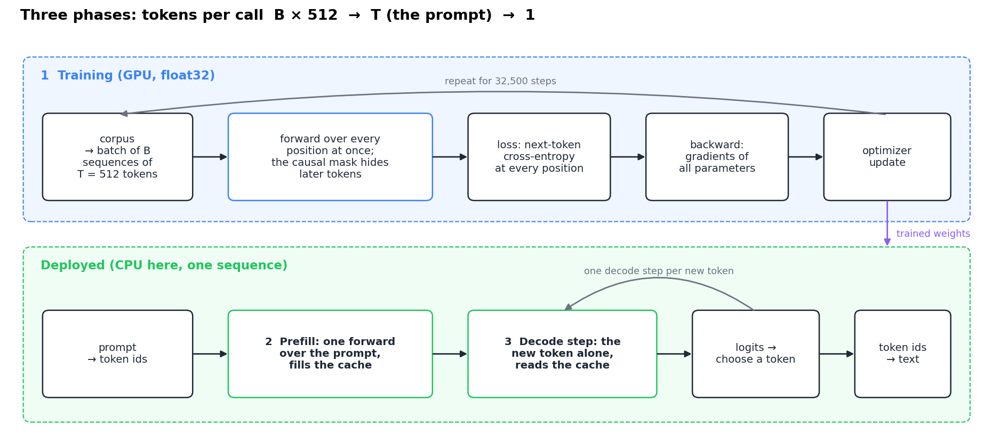

# Training, Prefill and Decoding: The Three Phases of the Conservative Core

**What this note is.** A reader's guide to how the Gen 3 conservative core is used, from training to generating text, and to what limits each phase. It follows one computation, the context channels, through all three phases, and discusses where splitting them into attention heads helps: the prompt pass, decoding, training. It collects results from [Stage1_CPU_Levers.md](Stage1_CPU_Levers.md), [Stage1b_Context_Channels_as_30_Heads.md](Stage1b_Context_Channels_as_30_Heads.md), [Stage2_Decoding.md](Stage2_Decoding.md), [Stage2b_Decode_Step_Levers.md](Stage2b_Decode_Step_Levers.md) and [Incremental_Decoder.md](Incremental_Decoder.md); the code comes later. Written 2026-11-23.

---

## Contents

1. [Definitions](#1-definitions)
2. [What one layer does](#2-what-one-layer-does)
3. [The three phases](#3-the-three-phases)
4. [What limits each phase, and the levers](#4-what-limits-each-phase-and-the-levers)
5. [Splitting the context channels into heads](#5-splitting-the-context-channels-into-heads)
6. [What it means](#6-what-it-means)
7. [Caveats](#7-caveats)
8. [Files](#8-files)

---

## 1. Definitions

- **Token, sequence, batch.** Text is cut into tokens, integers from a vocabulary of 50,257. A sequence is a run of tokens; a batch is $B$ sequences processed together.
- **Forward pass.** One run of the model over a sequence. For every position it gives **logits**, a score for each vocabulary token as the next token.
- **Causal.** The computation at position $t$ uses positions $s \le t$ only. In a forward pass over a whole sequence this is enforced by a **causal mask** that hides later positions.
- **Loss.** In training, the cross-entropy of the true next token under the softmax of the logits, averaged over every position of every sequence. Because the model is causal, one forward pass trains every position at once: this is called teacher forcing.
- **Backward pass and optimizer step.** The backward pass computes the gradient of the loss with respect to every parameter; the optimizer then changes the parameters a little against it. One forward, one backward and one update make a **training step**.
- **Prefill.** At generation time, the one forward pass over the prompt.
- **Decode step.** Each later forward pass, over the one new token.
- **Cache.** What the decode steps need from earlier positions, stored during the prefill and extended at each step ([Incremental_Decoder.md](Incremental_Decoder.md)).
- **What bounds a computation.** It is *arithmetic-bound* when the multiply-adds take the time, *memory-bound* when reading the data does, and *overhead-bound* when the fixed cost of launching each of many small operations does.

## 2. What one layer does

The conservative core moves each token's state $h$ (a vector of $d = 384$ numbers) through $L = 2$ layers, each one step of a damped, second-order motion on a learned potential. A layer does three things:

1. **Context channels $\xi$.** For each token, five weighted averages of the states of the earlier tokens and itself, at the input of the layer:

$$
\xi_{k,t} = \sum_{s \le t} w_k(t,s) h_s, \qquad w_k(t,s) = \underset{s \le t}{\mathrm{softmax}}\left[ (t-s) \log a_k + \frac{q_{k,t} \cdot \kappa_{k,s}}{\sqrt{48}} \right].
$$

   The first term of the logit favours recent tokens, each channel $k$ with its own learned decay $a_k$, from about 2 to about 200 tokens. The second compares a 48-wide query $q_{k,t}$ of the current state with a key $\kappa_{k,s}$ of each earlier state, so that tokens whose content matches weigh more. This is attention with a distance bias, and the earlier states themselves are the values (family E of the book's §24, proposed in [Context_Mixing_Mechanisms_in_the_Conservative_Framework.md](../Context_Mixing_Mechanisms_in_the_Conservative_Framework.md) §8).

   **The query and the key.** Both are plain linear reads of the same layer-input state, one pair per channel, with no bias, no normalisation and no position term. Two weight matrices of shape $Kd_k \times d$ are applied to every token and the result is split into the $K$ channels:

$$
q_{k,t} = \left(W_q h_t\right)_k, \qquad \kappa_{k,s} = \left(W_k h_s\right)_k, \qquad W_q, W_k \in \mathbb{R}^{Kd_k \times d}, \quad d_k = 48 .
$$

   Three properties of this choice matter later. **The key is of the same $h$ that is pooled**, so a token serves as its own value; nothing separate is stored. **The scaling is the usual $1/\sqrt{d_k}$** and the logit is a bare dot product, with no unit-normalisation of $q$ or $\kappa$, unlike the query-key normalisation used in the exchange field and the creation gate. And **$W_q$ is initialised to zero while $W_k$ is not**, which makes the content term exactly zero at step 0, so the channels start as the pure exponential moving average of the earlier arms and the switch is bit-identical when first enabled. The asymmetry is deliberate: the logit is bilinear, so zeroing both would leave both gradients zero and the term could never learn.

   Written out, the content logit is the ordinary scaled dot product and the whole weight is one softmax over the prefix:

$$
w_k(t,s) = \frac{\exp\left[(t-s)\log a_k + d_k^{-1/2}\ q_{k,t} \cdot \kappa_{k,s}\right]}{\sum_{r \le t} \exp\left[(t-r)\log a_k + d_k^{-1/2}\ q_{k,t} \cdot \kappa_{k,r}\right]} .
$$

   Note that $s = t$ is allowed, so no row of the softmax is ever fully masked. The implementation is `MultiXiChannels` in [`conservative_arch/multixi/model_multixi.py`](../../notebooks/conservative_arch/multixi/model_multixi.py), under the switch `xi_content_route` with width `xi_content_d_k`; with the switch off the same code path reduces to $w_k(t,s) \propto a_k^{t-s}$, the content-independent pooling.

   **There is no value projection and no read-out.** The exchange field of the Fock arms carries four matrices, a routing pair and a bilinear value kernel $U^{\top}W_v$ that transports and reshapes what it moves. The channels carry two. The values are the earlier states themselves, so $\xi_{k,t}$ is a convex combination of actual hidden states and lives in the same space as $h$, which is what lets it feed the generator of the well bank. The consequence is that **the channels can reweight what they transport but cannot rotate or reshape it**: the only learnable part of the transport is the weights. A $W_v$ would break that, since the pooled result would no longer be a state.

   The four query-key pairs in the architecture are independent, despite the shared naming. The channels' pair reads $h$ and queries earlier tokens; the creation gate's query is a persistent per-register probe; the reverse channel's pair (`W_Q_rev`, `W_K_rev`) has a token query the registers; and the exchange field's pair reads the context summary, of width $\xi_{\text{channels}} \times d$, not $d$. Nothing is shared between them.

   **Where they are defined.** Both are created only when the switch is on, in the constructor of `MultiXiChannels`, with the asymmetric initialisation the code comments at length:

```python
self.W_q = None
self.W_k = None
if content_route:
    self.W_q = nn.Linear(d, K * content_d_k, bias=False)
    self.W_k = nn.Linear(d, K * content_d_k, bias=False)
    # ASYMMETRIC init, deliberately.
    #   W_q = 0 makes the content logit exactly zero, so xi is
    #   BIT-IDENTICAL to the pure EMA at step 0 and a warm start
    #   from an existing checkpoint is exact rather than approximate.
    #   W_k must NOT also be zero: the logit is bilinear, so
    #   d(q.k)/dW_q = h (x) (W_k h) and d(q.k)/dW_k = (W_q h) (x) h.
    #   Zeroing both makes BOTH gradients vanish -- a saddle the
    #   optimiser never leaves...
    nn.init.zeros_(self.W_q.weight)
    nn.init.normal_(self.W_k.weight, std=content_init_scale)
```

   **Where they are used.** One projection per matrix for the whole sequence, reshaped into the $K$ channels, then one softmax over the prefix and one pooling of the raw states. The five lines are the whole mechanism:

```python
q  = self.W_q(h).view(B, T, self.K, dk).permute(0, 2, 1, 3)
kk = self.W_k(h).view(B, T, self.K, dk).permute(0, 2, 1, 3)
content = (q @ kk.transpose(-1, -2)) * (dk ** -0.5)   # (B, K, T, T)
w   = torch.softmax(base.unsqueeze(0) + content, dim=-1)
xis = w @ h.unsqueeze(1)                              # (B, K, T, d)
```

   `base` is the distance logit $(t-s)\log a_k$, masked to $s \le t$ and built once per channel by `causal_ema_logits`; the content term is simply added to it inside the same softmax, which is why the switch degrades exactly to the moving average rather than approximately. The last line is where the absence of a value projection shows: the pooling multiplies `h` itself, not a projection of it. There is a second, numerically equivalent branch guarded by `query_chunk` that builds the softmax rows a block of queries at a time, so the $(B, K, T, T)$ tensor never has to exist at inference.

   **In the backward pass**, write $g_{k,t} = \partial \mathcal{L} / \partial \xi_{k,t}$ for the gradient arriving at a channel reading. The softmax backward gives the gradient on a single logit the form

$$
\frac{\partial \mathcal{L}}{\partial \ell_{k,t,s}} = w_k(t,s)\ g_{k,t} \cdot \left( h_s - \xi_{k,t} \right),
$$

   the weight times how far that source deviates from the pooled value the token already receives. A source equal to the current reading contributes no gradient however heavily it is weighted. Since the logit is bilinear in the two projections, each matrix then accumulates an outer product over positions:

$$
\frac{\partial \mathcal{L}}{\partial W_q^{(k)}} = d_k^{-1/2} \sum_t \left( \sum_s \frac{\partial \mathcal{L}}{\partial \ell_{k,t,s}} \kappa_{k,s} \right) h_t^{\top}, \qquad \frac{\partial \mathcal{L}}{\partial W_k^{(k)}} = d_k^{-1/2} \sum_s \left( \sum_t \frac{\partial \mathcal{L}}{\partial \ell_{k,t,s}} q_{k,t} \right) h_s^{\top} .
$$

   Two consequences follow, and both are design, not accident.

   **The zero initialisation makes the two matrices start at different times.** At step 0, $q = W_q h = 0$, so the query gradient above is driven by $\kappa = W_k h$, which is non-zero, and $W_q$ moves. The key gradient is driven by $q$, which is zero, so $W_k$ receives **exactly no gradient on the first step** and only begins to learn once $W_q$ has left zero. Zeroing both would strand both at zero permanently. This is why the code zero-initialises one and randomly initialises the other.

   **The states are live on three paths, not one.** A gradient reaches $h_s$ as a value, through $w_k(t,s)$, as a key, through $\kappa_{k,s}$, and at $s = t$ as a query. Nothing in the channel path is detached. That is the whole difference between this and the exchange field, whose routing is computed from a detached $\xi$ precisely so that the weights are constant with respect to $h_t$ and the force stays a gradient. The channels are not a force term, so they are under no such constraint, and the generation 2 arms that detached them are the ones the `live` slug distinguishes.
2. **The potential and its force.** The well bank $V_\theta(\xi_t, h)$ is a sum of anisotropic Gaussian wells whose centres, precisions and weights are generated from the token's five channel readings. Its stiffest directions are found by an eigendecomposition of the potential's low-rank curvature.
3. **The integrator.** The token's state and velocity move one step: the stiff directions as exact damped oscillators (two half steps), the rest by a kick from the force $-\nabla_h V_\theta$ and friction. The velocity carries into the next layer.

After the last layer an output head turns $h$ into logits. **Only the context channels cross positions;** everything else acts within one token. That single fact decides most of what follows.

## 3. The three phases



*Figure 1. The three phases. The number of tokens each call processes falls from B sequences of 512 (training) to the prompt's length (prefill) to one (decode step).*

| | training | prefill | decode step |
| --- | --- | --- | --- |
| tokens per call | $B \times 512$, all at once | the prompt, all at once | one |
| passes | forward, backward, update | forward | forward on one position |
| hardware in this programme | A100 GPU, float32 | CPU, one sequence | CPU, one sequence |
| context-channel weights built | $B \times 5 \times 512 \times 512$, kept for the backward | $5 \times T \times T$ | $5 \times 1 \times n$, over the $n$ cached tokens |
| measured (SR2-NP) | 0.68 to 0.72 s per step, 15.1 GB peak | 0.30 s at 512 tokens, 16 s at 8,192 | 15 ms per token at 512, 17 ms at 8,192 |
| bound by | arithmetic | arithmetic and elementwise work | per-operation overhead; at long context, reading the cache |

**Training.** A batch of sequences of 512 tokens goes through the forward pass, all positions at once under the causal mask. The loss averages over every position, the backward pass computes every gradient, and the optimizer updates: 32,500 times, 0.53 billion tokens. The backward needs the intermediate results of the forward, so the context-channel weights of every sequence are kept, or recomputed layer by layer (layer checkpointing, on by default). With the live gradient path, the gradient also flows from each position's channels back into the earlier positions' states.

**Prefill.** The same forward pass as in training, on one sequence and without the backward. On the way it stores, per layer, every prompt token's keys and state in the cache.

**What the prompt is, and what it costs.** The prompt is not a buffer the decoder owns. It is whatever token tensor is passed on the first call, of shape $(B, T)$, and `LadderDecoder.forward` decides what to do with it from the cache's state alone:

```python
@torch.no_grad()
def forward(self, x: torch.Tensor) -> torch.Tensor:
    """Logits for the tokens x (B, T): the prompt when the cache is empty, else one new token."""
```

Inside the channel hook, a call with more than one token is treated as the prefill and is accepted only at position 0, which is what makes "the prompt in one piece" a constraint rather than a convention:

```python
if T > 1:                       # the prefill: the ordinary computation over the prompt
    if t0 != 0:
        raise NotImplementedError("a multi-token step is supported only as the prefill")
    return self._xi_full(h)
```

As token ids the prompt is negligible: `int64` indices, so $8T$ bytes, 4 KiB at 512 tokens and 64 KiB at 8,192. What costs memory is the **cache**, which is allocated once at construction for a fixed ceiling `max_len` and is what the prompt fills:

```python
self.keys   = [torch.zeros(batch, self.K, max_len, self.dk, dtype=dt) for _ in range(self.L)]
self.states = [torch.zeros(batch, max_len, self.d, dtype=dt) for _ in range(self.L)]
```

Overrunning that ceiling is a hard error, `decoder cache full`, raised before anything is written. The per-token footprint is one key of width $d_k$ for each of the $K$ channels plus the state itself, at every layer:

$$
\text{numbers per token} = L\left(K d_k + d\right) = 2\left(5 \times 48 + 384\right) = 1248 ,
$$

which at float32 is **4,992 bytes, just under 4.9 KiB per token of context**. The benchmark reports the total as `cache_numbers_per_token() * (T + decoded) * 4`:

| prompt | prompt ids | cache |
| --- | ---: | ---: |
| 512 | 4 KiB | 2.59 MB |
| 2,048 | 16 KiB | 9.90 MB |
| 8,192 | 64 KiB | 39.15 MB |

Two caveats on that figure. The dtype is the model's own, `m.P.dtype`, so a half-precision model halves it to 2,496 bytes per token. And with the `FOLD_CACHE` experiment of [Stage2b_Decode_Step_Levers.md](Stage2b_Decode_Step_Levers.md) enabled, a second array of widened keys is allocated **in addition** to the first, so the true allocation rises to $L(Kd_k + K(d_k+1) + d) = 1738$ numbers per token while `cache_numbers_per_token()` still reports 1248.

The prompt tokens themselves, in the benchmark, are drawn at random over the vocabulary for timing and from the validation set for the correctness check, which is the `decode_check` path that compares a prefill plus single steps against one full forward.

**Decode step.** The model's own forward on the one new token, told its position. At each layer the context channels read the cache instead of building a $T \times T$ matrix: one row of weights per channel over the $n$ cached tokens. The rest of the layer runs on the new position as in the full forward.

**The step, line by line.** The decoder changes no model code. It replaces one method, the context-channel module's `forward`, and puts the original back when closed:

```python
self._xi_full = xm.forward        # the module's own forward, used for the prefill
xm.forward = self._xi
```

Everything else about the forward is untouched, which is what makes the arithmetic identical rather than merely close. The step itself is one ordinary call with a position offset, plus a guard that every layer's channels were reached exactly once:

```python
@torch.no_grad()
def forward(self, x: torch.Tensor) -> torch.Tensor:
    self._layer = 0
    logits = self.m(x, position_offset=self.t)[0]
    if self._layer != self.L:
        raise RuntimeError(f"expected {self.L} context-channel calls per forward, saw {self._layer}")
    self.t += x.shape[1]
    return logits
```

That counter is the decoder's safety net. If a configuration routed the model down a path that skipped or repeated a layer's channels, the cache would silently desynchronise from the model; instead the call fails.

Inside the replaced method, the new token is **written before it is read**, so the position attends to itself exactly as the full forward does:

```python
self.states[li][:B, t0:t0 + T] = h
if self.content:
    kk = xm.W_k(h).view(B, T, self.K, self.dk).permute(0, 2, 1, 3)
    self.keys[li][:B, :, t0:t0 + T] = kk
```

Then the read. The distance part of the logit cannot be cached, since it depends on both ends, so it is rebuilt each step as one vector over the $n$ cached positions; the content part is the new query against all stored keys; the two are added inside a single softmax, exactly as in training:

```python
n  = t0 + 1                       # positions 0..t0, the new token included
la = torch.log(xm.alpha.clamp(min=1e-6, max=1.0 - 1e-6))
dist   = (t0 - torch.arange(n, dtype=h.dtype, device=h.device))      # t - s >= 0
logits = (la.view(self.K, 1) * dist.view(1, n)).unsqueeze(0).unsqueeze(2)
if self.content:
    q = xm.W_q(h).view(B, 1, self.K, self.dk).permute(0, 2, 1, 3)
    logits = logits + (q @ self.keys[li][:B, :, :n].transpose(-1, -2)) * (self.dk ** -0.5)
w = torch.softmax(logits, dim=-1)                                     # (B, K, 1, n)
```

Compare the shapes with the training branch of §2. There the content term is `(q @ kk.transpose(-1, -2))` of shape $(B, K, T, T)$; here the query has a single row, so the same expression yields $(B, K, 1, n)$. **The step is the training computation with $T$ collapsed to 1 on the query side only.** That is the whole of the saving, and it is why the result is exact rather than approximate.

**Three ways to finish the read**, selected by the module constant `XI_READ`. They differ only in how the weights meet the states:

| variant | the final product | why |
| --- | --- | --- |
| `broadcast` (default) | `w @ states.unsqueeze(1)` | the plain form; the states are broadcast to the $K$ channels and read $K$ times |
| `gemm` | `(w.view(B, K, n) @ states)` | one $(K \times n)(n \times d)$ product, so the states are read once instead of $K$ times |
| `fold` | `F.scaled_dot_product_attention(qf, fkeys, vals, scale=...)` | the distance term is folded into a widened key, so the whole logit is one dot product and fused attention applies |

The `fold` path is the only one that changes what is cached rather than how it is multiplied, and its correctness rests on the constant-per-row argument set out in [Incremental_Decoder.md](Incremental_Decoder.md) §4. Its value tensor is built with `expand` rather than a repeat, so the $K$ channels share one copy of the states at stride 0 and no memory is duplicated.

**What `self.m` is.** The trained model itself, bound once in the constructor and never wrapped: `self.m(x, position_offset=self.t)` is an ordinary module call landing in the model's own `forward`. **The decoder calls the real model, not a reimplementation of it**, which is why its logits match the full forward to float rounding rather than approximately. That forward is three steps:

```python
h0 = self._embed(x, position_offset=position_offset)
h_L, traj = self._stack_forward(h0, x, return_trajectory=return_trajectory)
logits = self.compute_logits(h_L)
```

**The offset is used in exactly one place**, the embedding, and nowhere else:

```python
def _embed(self, x, position_offset=0):
    B, T = x.shape
    pos = self.P[position_offset:position_offset + T].unsqueeze(0)
    return self.E(x) + pos
```

This is the one thing a decode step must be told. The call sees a tensor holding a single token and would otherwise embed it at position 0; passing `self.t` slices the position table at the right place. The decoder's cache index and this offset are the same counter, advanced together by `self.t += x.shape[1]`. Then `_stack_forward` walks the $L$ layer steps, carrying the state and a velocity proxy with the mass computed once, and the head projects the last state to the vocabulary. With no targets, no loss is computed, and `[0]` takes the logits from the returned tuple.

**Three senses of "inference mode", of which the decoder changes one.**

- **The same as training.** The forward itself: embedding, the layer walk, the wells, the stiff modes, the integrator and the head are the identical code running identical arithmetic.
- **Inference-mode proper.** Gradients are off under the decoder's `@torch.no_grad()`, no targets are passed so no loss is computed, and nothing is retained for a backward. The layer-checkpoint branch takes the plain path, since it is gated on `torch.is_grad_enabled()` rather than on a training flag. The source comments that gating on `self.training` instead would silently retain every layer's graph during evaluation and inflate peak memory above the training peak.
- **Specific to the decoder, and neither of the above.** The position offset, and the swapped context-channel method. Prefill is already full inference mode and uses the model's own channel method unchanged; only the decode step needs the substitution.

So the three phases are: training is forward plus backward; prefill is forward alone; a decode step is forward alone with the cross-position computation rewritten to read what prefill stored.

**A caution on the word, because this architecture breaks the usual association.** In a transformer, inference implies no autograd. Here it does not: the PARF and SARF forces call `autograd.grad` at every layer whatever the mode, which is why the probes and diagnostics re-enable gradients inside a no-grad context. The decoder can run under `no_grad` only because the configurations it accepts take the closed-form force paths, `vtheta_analytic_force` and `vphi_analytic_force`, which compute $-\nabla V$ from its analytic expression instead of by differentiation. The BAOAB family forces the first of those on, since it needs the force split; the constructor checks the second before it will drop the pair force.

**What the step does not do.** No $T \times T$ weight matrix is built at any layer, nothing is kept for a backward, and no earlier position is recomputed. The entire cost that scales with context is the one query-against-keys product and the one weights-against-states product, per channel per layer, which is why §4 finds the step bound by per-operation overhead at short context and by reading the cache at long context.


*Figure 2. The context-channel weights each phase builds. White: the masked half, where the earlier-token index exceeds the current one.*

**The diagonal is the causal boundary, and it is on the allowed side.** The squares are indexed by row $t$, the current token, against column $s$, the earlier one, and the admitted region is $s \le t$ rather than $s \lt t$: a token participates in its own channel reading. That is deliberate. Under a strict mask the first row would have no admissible source at all and its softmax would be undefined; including the diagonal makes row 0 a single weight of 1 on the token itself. The decode step inherits the same convention as an ordering requirement rather than a mask, which is why the new token's key and state are written into the cache before the weights are built, and why its row has length $n = t_0 + 1$, the extra one being the token counting itself. The third panel shows no triangle because a step has no boundary to draw: $t$ is fixed, so there is one row whose right-hand end is the diagonal.

## 4. What limits each phase, and the levers

**Training** is dominated by large matrix products over $B \times 512$ positions: the bank's projections, the output head, the channels. Small operations are spread over thousands of positions, so their overhead hardly matters. The CPU estimate of the series lever showed this: removing the whole 40-term series of the damped-mode coefficients leaves a training step unchanged within 2% ([Stage2b_Decode_Step_Levers.md](Stage2b_Decode_Step_Levers.md), §6).

**Prefill** is the same work on one sequence. At 512 tokens it splits between elementwise work (about 47%), matrix products (36%) and the stiff-mode eigendecompositions (16%); at 8,192 tokens the context channels' $T \times T$ work grows to dominate unless their kernel is fast ([Stage1_CPU_Levers.md](Stage1_CPU_Levers.md)).

**Decoding** works on one token. The original step issued about 2,900 operations (dispatch level), each on a few hundred numbers, so their fixed costs dominated; at long context, reading the cache added to them. Stage 2b removed both, in four steps: measured end to end, 0.52 of the original step time at context 512, and about 0.45 at 8,192 (the end-to-end ratio, 0.65, times step 4's, 0.69, from two sessions).


*Figure 3. Each lever against each phase. A ratio below 1 is a speed-up against the configuration before the lever; n/a marks a lever that cannot act in that phase (for example, the multiply-and-sum products apply to single-token inputs only, and the masked series is off in training because it would make the GPU wait on the host).*

## 5. Splitting the context channels into heads

### 5.1 The idea

The context channels are attention-shaped, so PyTorch's fused attention call, `scaled_dot_product_attention`, could compute them, but two things stand in the way ([Stage1b_Context_Channels_as_30_Heads.md](Stage1b_Context_Channels_as_30_Heads.md)):

- **The distance term is not a query–key product.** It can be made one. In each softmax row the term $(t-s)\log a_k = -\lambda_k t + \lambda_k s$ (with $\lambda_k = -\log a_k$) differs from $\lambda_k s$ by a constant, which cancels. So one extra key component $\lambda_k s$, with a matching query component, carries the distance term inside the product. This is the **fold**.
- **The widths differ.** The folded queries and keys are 49 wide and the values 384, and the fast kernels need equal widths. Padding queries and keys with zeros to 64 and cutting each 384-wide state into six blocks of 64 gives **30 heads of 64** (5 channels times 6 blocks), each with its channel's weights and one block of the state as its values. The result is the same in exact arithmetic.

The fold has a price: its key component $\lambda_k s$ grows with the position, and rounding it adds an error that grows with the length, about $3 u \lambda_k T$ for a precision $u$.

### 5.2 In the prefill: it helps on long prompts

In the prefill the channels compute full $T \times T$ weight matrices, which is the job the fast kernel was written for. On the CPU, with every other lever on, the 30 heads take the channels 1.8 times faster than the folded form at 8,192 tokens and the whole forward pass 1.18 times. At 512 tokens they are slightly slower in the channels and level in the forward. The error at 8,192 tokens is about $10^{-3}$ in the channel outputs, with the perplexity unchanged. On x86 the fold also needs subnormal floats flushed to zero, or the softmax of the oldest keys slows down ([Stage1_CPU_Levers.md](Stage1_CPU_Levers.md), §8).

So the 30 heads belong in the prompt pass of long prompts, as an inference switch used above about 1,000 to 2,000 tokens. Because the decoder's prefill runs the model's own forward pass, it would inherit the switch. It is not scheduled, since no planned use case has prompts that long.

### 5.3 In decoding: it does not help

A decode step has one query per channel. What its read costs, at long context, is streaming the cached states. The original read multiplies each channel's row of weights by the states separately: five passes over the states. Written as one $(5 \times n)(n \times 384)$ product, it reads them once, which took the decode step at 8,192 tokens from 24.4 to 16.7 ms (step 4).


*Figure 4. (a) How each form reads the cached states. (b) The megabytes read per layer and step at 8,192 cached tokens.*

The head split does not change the number of passes: each channel's six heads read its six blocks, so all five channels still read every state. And the fold brings its error with it. Step 4 measured the folded read with one fused call: 5% slower at 8,192 tokens than the original, 1.5 times slower than the single product, and with logits $1.9 \times 10^{-3}$ away at that length. In decoding the single product does what the head split was meant to do, exactly.

### 5.4 In training: untested, with one case for it and two against

**The case for it** is memory, on the GPU. The explicit channels build, per layer, the $B \times 5 \times T \times T$ logits and weights and keep them, or recompute them, for the backward. A fused kernel never stores the $T \times T$ weights: it keeps one statistic per row and head and recomputes the rest in the backward. The memory then grows like $T$, not $T^2$. At the trained length, 512 tokens, the explicit weights are a small part of the 15 GB peak (about 0.16 GB per layer at $B = 16$, if logits and weights are both kept). At 2,048 tokens they are 16 times larger, at 8,192 tokens 256 times. So the split would matter for training at longer contexts.


*Figure 5. (a) The memory of the channel weights kept for the backward, estimated as logits and weights in float32; a fused kernel keeps row statistics only. (b) The error scale of the folded distance key, three times the precision times the decay rate times the length, for the fastest channel (decay rate 0.69), in float32 and bfloat16, with the measured differences in the channel outputs (Stage1b) and in the decode logits (step 4).*

**Against it, first: at 512 tokens there is little to gain.** The channels' $T \times T$ work is modest beside the bank and the head, and layer checkpointing already bounds their memory. Nothing measured says a training step would be faster.

**Against it, second: the fold and low precision do not mix.** Its key component reaches $\lambda_k T$, about 350 at 512 tokens for the fastest channel. In float32 the rounding error is about $3 u \lambda T \approx 6 \times 10^{-5}$ at 512 tokens, harmless. In bfloat16, which has 8 bits of mantissa, the component cannot even be stored to within 1. The training notebook has a bfloat16 switch (`AMP_BF16`, off by default, the layer-step core kept in float32). Any training use of the fold must keep the channels in float32, while the fastest of PyTorch's fused attention kernels on the GPU (the flash kernel) needs half precision.

**Verdict.** Worth a registered GPU test only if training moves to contexts well beyond 512 tokens, or if channel memory binds. Until then the explicit channels are the simpler and exact choice.

### 5.5 Summary

| phase | does the head split help? | why | status |
| --- | --- | --- | --- |
| prefill, long prompts | yes: channels 1.8 times, forward 1.18 times at 8,192 tokens | the $T \times T$ work takes the tiled kernel | measured; not scheduled |
| prefill, short prompts | no: level at 512 | the kernel's advantage needs long rows | measured |
| decoding | no: the fused folded read is 5% slower; the single product is 1.5 times faster than it | the cost is reading the states; heads still read them five times | measured (step 4) |
| training at 512 tokens | unlikely | small share of the step; checkpointing bounds the memory | not measured |
| training at long contexts | possibly, for memory | the fused kernel keeps no $T \times T$ weights | not measured; float32 only |

## 6. What it means

- **One fact explains the costs:** only the context channels cross positions. Training and prefill pay for them as $T \times T$ matrices, a decode step as one row over the cache. Every other part of a layer costs the same per token in every phase.
- **Different phases are limited by different things,** so a lever belongs to a phase: the head split to long prompts, the single-product read and the operation-level levers to decoding, and nothing measured so far to training.
- **The deployment configuration** for generation on the CPU is Stage 2b's: products as multiply-and-sum, the compiled core and the single-product read. With the 30-head switch added for prompts above about 1,000 to 2,000 tokens, if such prompts become a use case.

## 7. Caveats

- **One machine, one model.** CPU numbers are from one 8-core Intel machine and SR2-NP; GPU numbers are from training runs, not from a benchmark of these levers.
- **Sessions differ.** The absolute times in §3 come from several sessions; the paired ratios of Figure 3 are the measurements.
- **The training memory in Figure 5 is an estimate** from the tensor shapes, not a measurement.

## 8. Files

- Figures: [`figures/_make_training_prefill_decoding_figs.py`](../figures/_make_training_prefill_decoding_figs.py), writing `figures/training_prefill_decoding/`.
- The model: [`multixi/model_multixi.py`](../../notebooks/conservative_arch/multixi/model_multixi.py) (`MultiChannelXi`, the context channels), [`parf/cfc_baoab.py`](../../notebooks/conservative_arch/parf/cfc_baoab.py) (the integrator), [`parf/incremental_decoder.py`](../../notebooks/conservative_arch/parf/incremental_decoder.py) (the decoder).
- The measurements: the notes listed at the top, and their outputs in `notebooks/conservative_arch/scaleup/results/productization/`.
