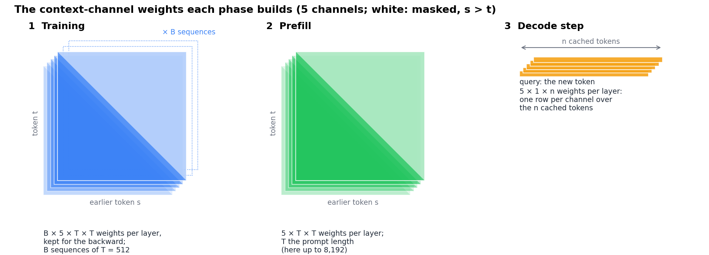
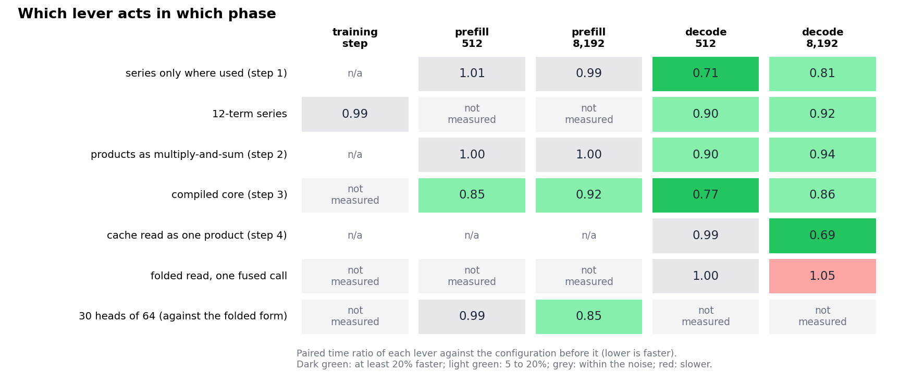
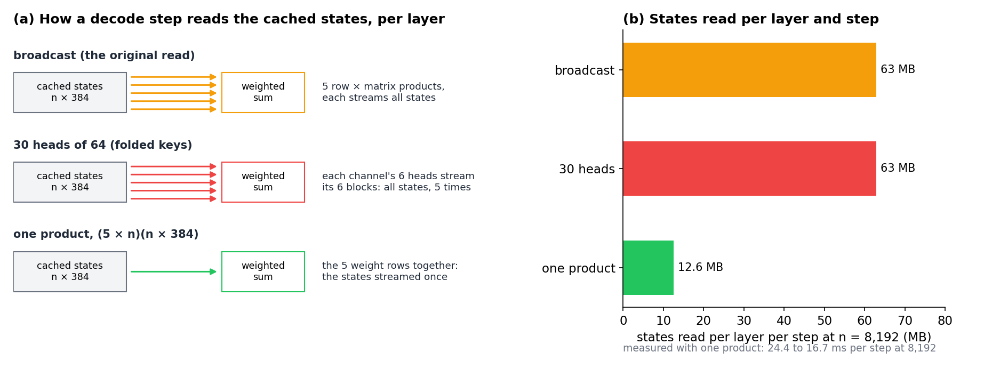

# Training, Prefill and Decoding: The Three Phases of the Conservative Core

**What this note is.** A reader's guide to how the Gen 3 conservative core is used, from training to generating text, and to what limits each phase. It follows one computation, the context channels, through all three phases, and discusses where splitting them into attention heads helps: the prompt pass, decoding, training. It collects results from [Stage1_CPU_Levers.md](Stage1_CPU_Levers.md), [Stage1b_Context_Channels_as_30_Heads.md](Stage1b_Context_Channels_as_30_Heads.md), [Stage2_Decoding.md](Stage2_Decoding.md), [Stage2b_Decode_Step_Levers.md](Stage2b_Decode_Step_Levers.md) and [Incremental_Decoder.md](Incremental_Decoder.md); the code comes later. Written 2026-11-23.

---

## Contents

1. [Definitions](#1-definitions)
2. [What one layer does](#2-what-one-layer-does)
3. [The three phases](#3-the-three-phases)
4. [What limits each phase, and the levers](#4-what-limits-each-phase-and-the-levers)
5. [Splitting the context channels into heads](#5-splitting-the-context-channels-into-heads)
6. [What it means](#6-what-it-means)
7. [Caveats](#7-caveats)
8. [Files](#8-files)

---

## 1. Definitions

- **Token, sequence, batch.** Text is cut into tokens, integers from a vocabulary of 50,257. A sequence is a run of tokens; a batch is $B$ sequences processed together.
- **Forward pass.** One run of the model over a sequence. For every position it gives **logits**, a score for each vocabulary token as the next token.
- **Causal.** The computation at position $t$ uses positions $s \le t$ only. In a forward pass over a whole sequence this is enforced by a **causal mask** that hides later positions.
- **Loss.** In training, the cross-entropy of the true next token under the softmax of the logits, averaged over every position of every sequence. Because the model is causal, one forward pass trains every position at once: this is called teacher forcing.
- **Backward pass and optimizer step.** The backward pass computes the gradient of the loss with respect to every parameter; the optimizer then changes the parameters a little against it. One forward, one backward and one update make a **training step**.
- **Prefill.** At generation time, the one forward pass over the prompt.
- **Decode step.** Each later forward pass, over the one new token.
- **Cache.** What the decode steps need from earlier positions, stored during the prefill and extended at each step ([Incremental_Decoder.md](Incremental_Decoder.md)).
- **What bounds a computation.** It is *arithmetic-bound* when the multiply-adds take the time, *memory-bound* when reading the data does, and *overhead-bound* when the fixed cost of launching each of many small operations does.

## 2. What one layer does

The conservative core moves each token's state $h$ (a vector of $d = 384$ numbers) through $L = 2$ layers, each one step of a damped, second-order motion on a learned potential. A layer does three things:

1. **Context channels $\xi$.** For each token, five weighted averages of the states of the earlier tokens and itself, at the input of the layer:

$$
\xi_{k,t} = \sum_{s \le t} w_k(t,s) h_s, \qquad w_k(t,s) = \underset{s \le t}{\mathrm{softmax}}\left[ (t-s) \log a_k + \frac{q_{k,t} \cdot \kappa_{k,s}}{\sqrt{48}} \right].
$$

   The first term of the logit favours recent tokens, each channel $k$ with its own learned decay $a_k$, from about 2 to about 200 tokens. The second compares a 48-wide query $q_{k,t}$ of the current state with a key $\kappa_{k,s}$ of each earlier state, so that tokens whose content matches weigh more. This is attention with a distance bias, and the earlier states themselves are the values (family E of the book's §24).
2. **The potential and its force.** The well bank $V_\theta(\xi_t, h)$ is a sum of anisotropic Gaussian wells whose centres, precisions and weights are generated from the token's five channel readings. Its stiffest directions are found by an eigendecomposition of the potential's low-rank curvature.
3. **The integrator.** The token's state and velocity move one step: the stiff directions as exact damped oscillators (two half steps), the rest by a kick from the force $-\nabla_h V_\theta$ and friction. The velocity carries into the next layer.

After the last layer an output head turns $h$ into logits. **Only the context channels cross positions;** everything else acts within one token. That single fact decides most of what follows.

## 3. The three phases

*Figure 1. The three phases. The number of tokens each call processes falls from B sequences of 512 (training) to the prompt's length (prefill) to one (decode step).*

| | training | prefill | decode step |
| --- | --- | --- | --- |
| tokens per call | $B \times 512$, all at once | the prompt, all at once | one |
| passes | forward, backward, update | forward | forward on one position |
| hardware in this programme | A100 GPU, float32 | CPU, one sequence | CPU, one sequence |
| context-channel weights built | $B \times 5 \times 512 \times 512$, kept for the backward | $5 \times T \times T$ | $5 \times 1 \times n$, over the $n$ cached tokens |
| measured (SR2-NP) | 0.68 to 0.72 s per step, 15.1 GB peak | 0.30 s at 512 tokens, 16 s at 8,192 | 15 ms per token at 512, 17 ms at 8,192 |
| bound by | arithmetic | arithmetic and elementwise work | per-operation overhead; at long context, reading the cache |

**Training.** A batch of sequences of 512 tokens goes through the forward pass, all positions at once under the causal mask. The loss averages over every position, the backward pass computes every gradient, and the optimizer updates: 32,500 times, 0.53 billion tokens. The backward needs the intermediate results of the forward, so the context-channel weights of every sequence are kept, or recomputed layer by layer (layer checkpointing, on by default). With the live gradient path, the gradient also flows from each position's channels back into the earlier positions' states.

**Prefill.** The same forward pass as in training, on one sequence and without the backward. On the way it stores, per layer, every prompt token's keys and state in the cache.

**Decode step.** The model's own forward on the one new token, told its position. At each layer the context channels read the cache instead of building a $T \times T$ matrix: one row of weights per channel over the $n$ cached tokens. The rest of the layer runs on the new position as in the full forward.

*Figure 2. The context-channel weights each phase builds. White: the masked half, where the earlier-token index exceeds the current one.*

## 4. What limits each phase, and the levers

**Training** is dominated by large matrix products over $B \times 512$ positions: the bank's projections, the output head, the channels. Small operations are spread over thousands of positions, so their overhead hardly matters. The CPU estimate of the series lever showed this: removing the whole 40-term series of the damped-mode coefficients leaves a training step unchanged within 2% ([Stage2b_Decode_Step_Levers.md](Stage2b_Decode_Step_Levers.md), §6).

**Prefill** is the same work on one sequence. At 512 tokens it splits between elementwise work (about 47%), matrix products (36%) and the stiff-mode eigendecompositions (16%); at 8,192 tokens the context channels' $T \times T$ work grows to dominate unless their kernel is fast ([Stage1_CPU_Levers.md](Stage1_CPU_Levers.md)).

**Decoding** works on one token. The original step issued about 2,900 operations (dispatch level), each on a few hundred numbers, so their fixed costs dominated; at long context, reading the cache added to them. Stage 2b removed both, in four steps: measured end to end, 0.52 of the original step time at context 512, and about 0.45 at 8,192 (the end-to-end ratio, 0.65, times step 4's, 0.69, from two sessions).

*Figure 3. Each lever against each phase. A ratio below 1 is a speed-up against the configuration before the lever; n/a marks a lever that cannot act in that phase (for example, the multiply-and-sum products apply to single-token inputs only, and the masked series is off in training because it would make the GPU wait on the host).*

## 5. Splitting the context channels into heads

### 5.1 The idea

The context channels are attention-shaped, so PyTorch's fused attention call, `scaled_dot_product_attention`, could compute them, but two things stand in the way ([Stage1b_Context_Channels_as_30_Heads.md](Stage1b_Context_Channels_as_30_Heads.md)):

- **The distance term is not a query–key product.** It can be made one. In each softmax row the term $(t-s)\log a_k = -\lambda_k t + \lambda_k s$ (with $\lambda_k = -\log a_k$) differs from $\lambda_k s$ by a constant, which cancels. So one extra key component $\lambda_k s$, with a matching query component, carries the distance term inside the product. This is the **fold**.
- **The widths differ.** The folded queries and keys are 49 wide and the values 384, and the fast kernels need equal widths. Padding queries and keys with zeros to 64 and cutting each 384-wide state into six blocks of 64 gives **30 heads of 64** (5 channels times 6 blocks), each with its channel's weights and one block of the state as its values. The result is the same in exact arithmetic.

The fold has a price: its key component $\lambda_k s$ grows with the position, and rounding it adds an error that grows with the length, about $3 u \lambda_k T$ for a precision $u$.

### 5.2 In the prefill: it helps on long prompts

In the prefill the channels compute full $T \times T$ weight matrices, which is the job the fast kernel was written for. On the CPU, with every other lever on, the 30 heads take the channels 1.8 times faster than the folded form at 8,192 tokens and the whole forward pass 1.18 times. At 512 tokens they are slightly slower in the channels and level in the forward. The error at 8,192 tokens is about $10^{-3}$ in the channel outputs, with the perplexity unchanged. On x86 the fold also needs subnormal floats flushed to zero, or the softmax of the oldest keys slows down ([Stage1_CPU_Levers.md](Stage1_CPU_Levers.md), §8).

So the 30 heads belong in the prompt pass of long prompts, as an inference switch used above about 1,000 to 2,000 tokens. Because the decoder's prefill runs the model's own forward pass, it would inherit the switch. It is not scheduled, since no planned use case has prompts that long.

### 5.3 In decoding: it does not help

A decode step has one query per channel. What its read costs, at long context, is streaming the cached states. The original read multiplies each channel's row of weights by the states separately: five passes over the states. Written as one $(5 \times n)(n \times 384)$ product, it reads them once, which took the decode step at 8,192 tokens from 24.4 to 16.7 ms (step 4).

*Figure 4. (a) How each form reads the cached states. (b) The megabytes read per layer and step at 8,192 cached tokens.*

The head split does not change the number of passes: each channel's six heads read its six blocks, so all five channels still read every state. And the fold brings its error with it. Step 4 measured the folded read with one fused call: 5% slower at 8,192 tokens than the original, 1.5 times slower than the single product, and with logits $1.9 \times 10^{-3}$ away at that length. In decoding the single product does what the head split was meant to do, exactly.

### 5.4 In training: untested, with one case for it and two against

**The case for it** is memory, on the GPU. The explicit channels build, per layer, the $B \times 5 \times T \times T$ logits and weights and keep them, or recompute them, for the backward. A fused kernel never stores the $T \times T$ weights: it keeps one statistic per row and head and recomputes the rest in the backward. The memory then grows like $T$, not $T^2$. At the trained length, 512 tokens, the explicit weights are a small part of the 15 GB peak (about 0.16 GB per layer at $B = 16$, if logits and weights are both kept). At 2,048 tokens they are 16 times larger, at 8,192 tokens 256 times. So the split would matter for training at longer contexts.

*Figure 5. (a) The memory of the channel weights kept for the backward, estimated as logits and weights in float32; a fused kernel keeps row statistics only. (b) The error scale of the folded distance key, three times the precision times the decay rate times the length, for the fastest channel (decay rate 0.69), in float32 and bfloat16, with the measured differences in the channel outputs (Stage1b) and in the decode logits (step 4).*

**Against it, first: at 512 tokens there is little to gain.** The channels' $T \times T$ work is modest beside the bank and the head, and layer checkpointing already bounds their memory. Nothing measured says a training step would be faster.

**Against it, second: the fold and low precision do not mix.** Its key component reaches $\lambda_k T$, about 350 at 512 tokens for the fastest channel. In float32 the rounding error is about $3 u \lambda T \approx 6 \times 10^{-5}$ at 512 tokens, harmless. In bfloat16, which has 8 bits of mantissa, the component cannot even be stored to within 1. The training notebook has a bfloat16 switch (`AMP_BF16`, off by default, the layer-step core kept in float32). Any training use of the fold must keep the channels in float32, while the fastest of PyTorch's fused attention kernels on the GPU (the flash kernel) needs half precision.

**Verdict.** Worth a registered GPU test only if training moves to contexts well beyond 512 tokens, or if channel memory binds. Until then the explicit channels are the simpler and exact choice.

### 5.5 Summary

| phase | does the head split help? | why | status |
| --- | --- | --- | --- |
| prefill, long prompts | yes: channels 1.8 times, forward 1.18 times at 8,192 tokens | the $T \times T$ work takes the tiled kernel | measured; not scheduled |
| prefill, short prompts | no: level at 512 | the kernel's advantage needs long rows | measured |
| decoding | no: the fused folded read is 5% slower; the single product is 1.5 times faster than it | the cost is reading the states; heads still read them five times | measured (step 4) |
| training at 512 tokens | unlikely | small share of the step; checkpointing bounds the memory | not measured |
| training at long contexts | possibly, for memory | the fused kernel keeps no $T \times T$ weights | not measured; float32 only |

## 6. What it means

- **One fact explains the costs:** only the context channels cross positions. Training and prefill pay for them as $T \times T$ matrices, a decode step as one row over the cache. Every other part of a layer costs the same per token in every phase.
- **Different phases are limited by different things,** so a lever belongs to a phase: the head split to long prompts, the single-product read and the operation-level levers to decoding, and nothing measured so far to training.
- **The deployment configuration** for generation on the CPU is Stage 2b's: products as multiply-and-sum, the compiled core and the single-product read. With the 30-head switch added for prompts above about 1,000 to 2,000 tokens, if such prompts become a use case.

## 7. Caveats

- **One machine, one model.** CPU numbers are from one 8-core Intel machine and SR2-NP; GPU numbers are from training runs, not from a benchmark of these levers.
- **Sessions differ.** The absolute times in §3 come from several sessions; the paired ratios of Figure 3 are the measurements.
- **The training memory in Figure 5 is an estimate** from the tensor shapes, not a measurement.

## 8. Files

- Figures: [`figures/_make_training_prefill_decoding_figs.py`](../figures/_make_training_prefill_decoding_figs.py), writing `figures/training_prefill_decoding/`.
- The model: [`multixi/model_multixi.py`](../../notebooks/conservative_arch/multixi/model_multixi.py) (`MultiChannelXi`, the context channels), [`parf/cfc_baoab.py`](../../notebooks/conservative_arch/parf/cfc_baoab.py) (the integrator), [`parf/incremental_decoder.py`](../../notebooks/conservative_arch/parf/incremental_decoder.py) (the decoder).
- The measurements: the notes listed at the top, and their outputs in `notebooks/conservative_arch/scaleup/results/productization/`.
