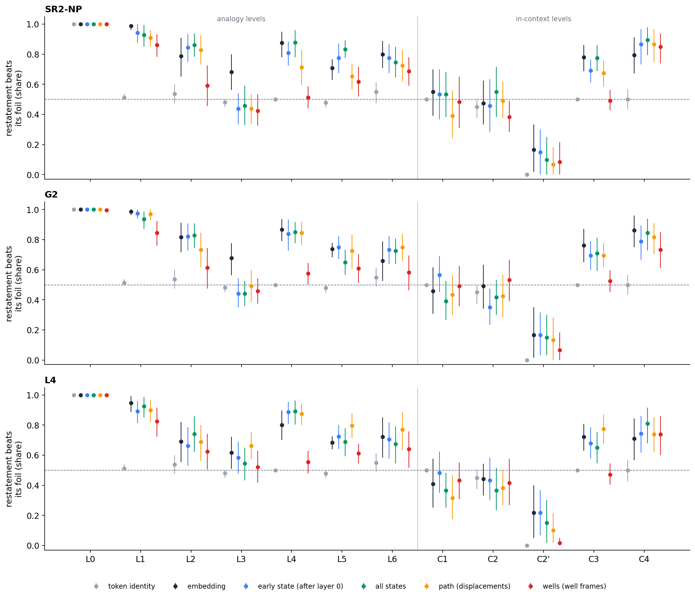
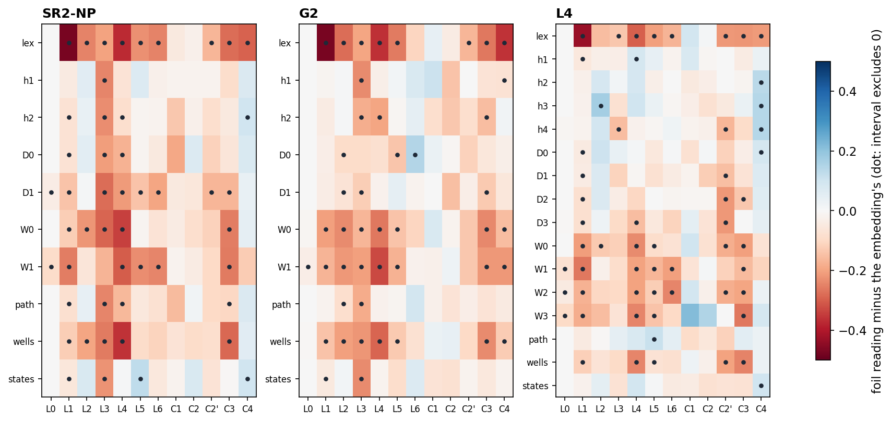

# Test 2 Results: the Template Matchers on Analogy and In-Context Meaning

**Report of a CPU test (2026-11-26).** Test 2 asks whether a template learned from verbatim premises fires on premises whose words do not carry the form: paraphrases, entailed cases, pronouns, restructured clauses, new domains, aliases defined in context, word senses, ellipsis and denials by an incompatible value. The design is [Analogy_and_Context_Test_Set.md](Analogy_and_Context_Test_Set.md), the items, reviewed by the author, are in [analogy_items/](analogy_items/README.md), and the calls, confirmed by the author before any reading, are [Analogy_Test_Calls.md](Analogy_Test_Calls.md). The programme is exploratory: readings without a call are leads.

**In brief.**
- **The gates passed after one fix.** Token identity sat at chance on every level from L1 on, except L3, where it preferred the foils (0.385). The cause was length: many L3 foils were one or two tokens shorter or longer than their restatements, and the matcher counts unmatched particles. The author approved 17 length-matched foils; L3 then passed (0.481), as narrowly as L5 and C2.
- **Nine of the ten calls hit, S1 hit on two models of three, and S3, the call the test was built for, missed.**
- **The embedding is not displaced.** It is above chance on every analogy level (L1 to L6) and on C3 and C4, on all three models. Only C1, C2 and C2′ hold it at chance or below. The words carry more than the design assumed: "storm" is near "rain" (L3), "he" is near "king" (L4, C3), "green" is near "red" (C4).
- **The layer states do not add analogy on the two-layer models.** The early state's gain over the embedding is not larger on the analogy levels than on L0 and L1: $-0.019$ on SR2-NP and $-0.028$ on G2. On L4 it is $+0.036$, with an interval across zero. With the stricter development set the sign flips on SR2-NP ($+0.005$), so the miss there is fragile; on G2 it is not.
- **No reading binds a name to a role from context (C1), and every reading follows the false friend (C2′).** Both were called; both mean that no reading, embedding or state, carries meaning that the words do not.
- **Leads, not tests:** the states beat the embedding on C4 (denial by an incompatible value) on SR2-NP and on L4, in several readings at once; and on L3 (entailed cases) the states lose the embedding's advantage on the two-layer models.

---

## Contents

1. [Definitions](#1-definitions)
2. [What was run](#2-what-was-run)
3. [The calls, scored](#3-the-calls-scored)
4. [Results by level](#4-results-by-level)
5. [The readings against the embedding](#5-the-readings-against-the-embedding)
6. [Secondary readings](#6-secondary-readings)
7. [Interpretation](#7-interpretation)
8. [Caveats](#8-caveats)
9. [Reproduce and files](#9-reproduce-and-files)

---

## 1. Definitions

- **Levels.** L0 verbatim; L1 one word replaced by a synonym; L2 full paraphrase; L3 an entailed case ("a storm is pouring down on the pitch" for "it rains"); L4 a pronoun ("He is ill." for "the king is ill"); L5 the clause restructured ("the plan has the council's approval"); L6 paraphrases in new domains; C1 an alias defined by a context sentence; C2 a word whose sense the consequent fixes, and C2′ a paraphrase in that sense against a foil that repeats the clause's words; C3 ellipsis ("He does."); C4 a denial by an incompatible value ("the light is green" against "the light is red").
- **Foil reading.** For each pair of a restatement and its matched foil (same clause, same wording), whether the restatement gets the larger log odds of its template; the share of such pairs, ties counting half. Chance is 0.5. The log odds of a template $t$ are

$$\log \sum_{c \in t} p_c - \log \sum_{c \notin t} p_c,$$

  where $p_c$ is the density of cloud $c$ at the premise.
- **Twin reading.** The same with a valid form against its fallacy twin. **Rank.** The right template has the largest density of the four.
- **Matchers.** The template matcher of [The_Embedding_Template_Matcher.md](The_Embedding_Template_Matcher.md), fed different particle vectors: lex (token identity), h0 (the embedding), the early state h1 (the state after layer 0; on L4 also h2), each later state, all states together, each layer's displacement (D) and the path (all of them), each layer's well frame (W) and wells (all of them). The clouds are fitted on the 60 verbatim development clauses and see no analogy premise.
- **Intervals.** 95%, from 4,000 resamples of the level's 20 clauses.

## 2. What was run

- **Extraction.** 6,720 premises per model (11 levels, 20 frames, six known wordings), plus 96 development premises rebuilt the same way. SR2-NP, G2 and L4, 12 to 35 minutes each. The development data of the depth extraction were reused; the 96 check premises match them to within 0.00024 in every cosine.
- **Gates, first run.** G2 (token identity below chance on C2′: 0.00) and G3 passed. G1 failed on L3: token identity's foil reading was 0.385 (interval 0.32 to 0.45). The overlap check had matched the shared words but not the length, and 37 of L3's 80 pairs differed by one or two tokens. The matcher's coordinates include the worst matches of the second sentence's particles, so an extra unmatched particle moves the score on its own.
- **The fix.** The author approved 17 new L3 foils of the same length as their restatements, overlap kept equal (logged on the items' index page). L3 alone was re-extracted and merged into each model's file after the check premises were compared.
- **Gates, second run.** All passed (table below). L3 (0.481, interval 0.45 to 0.50), L5 (0.479, 0.45 to 0.50) and C2 (0.450, 0.375 to 0.50) pass only at the edge.

| level | L1 | L2 | L3 | L4 | L5 | L6 | C1 | C2 | C3 | C4 | C2′ |
| --- | ---: | ---: | ---: | ---: | ---: | ---: | ---: | ---: | ---: | ---: | ---: |
| token identity, foil reading | 0.51 | 0.54 | 0.48 | 0.50 | 0.48 | 0.55 | 0.50 | 0.45 | 0.50 | 0.50 | 0.00 |

Other levels also have pairs of unequal length (L6 28 of 80, C2 20 of 60, L2 16, C1 12, C4 9) but passed G1.

## 3. The calls, scored

| call | what was called | result (SR2-NP, G2, L4) | verdict |
| --- | --- | --- | --- |
| A1 | L0: lex and h0 foil and rank at least 0.90 | all 1.00 | hit |
| E1 | L1: h0 foil at least 0.65, above 0.5 | 0.99, 0.99, 0.95 | hit |
| E2 | L2 and L6: h0 above 0.5 on two models of three, below its L1 value on all | L2 0.79, 0.82, 0.69; L6 0.80, 0.66, 0.72; every interval above 0.5 | hit |
| E3 | C1: h0 at chance | 0.55, 0.46, 0.41, every interval across 0.5 | hit |
| E4 | C2′: h0 below 0.5 | 0.17, 0.17, 0.22 | hit |
| E5 | L4 and C3: h0 above 0.5 (gender in the word vectors) | L4 0.88, 0.87, 0.80; C3 0.78, 0.76, 0.72 | hit |
| S1 | L0 and L1: the early state within 0.05 of h0 | L0 0.00 on all; L1 -0.046, -0.013, and on L4 -0.054 for h1, -0.025 for h2 | hit on SR2-NP and G2; miss on L4 for h1 (by 0.004), hit for h2 |
| S2 | C1: none of h0, early state, states, path above 0.5 on SR2-NP or G2 | highest 0.57 (G2, h1), interval 0.45 to 0.69 | hit |
| S3 | the early state's gain over h0 larger on L2 to L6, C1 to C3 than on L0, L1: above 0 on every model, interval above 0 on one | -0.019 (-0.073 to 0.035), -0.028 (-0.068 to 0.013), +0.036 (-0.012 to 0.089) | **miss** |
| S4 | L2: h0 twin at least 0.60 | 0.95, 0.95, 0.94 | hit |

**Measured.** The calls were confirmed before any reading; the S3 statistic averages the per-level gains, levels resampled independently.

## 4. Results by level



**Figure 1.** The foil reading by level, per model, for six readings. Dashed: chance. Intervals 95% over clauses.

| level | lex | embedding (SR2-NP, G2, L4) | early state | all states |
| --- | ---: | --- | --- | --- |
| L0 | 1.00 | 1.00, 1.00, 1.00 | 1.00, 1.00, 1.00 | 1.00, 1.00, 1.00 |
| L1 | 0.51 | 0.99, 0.99, 0.95 | 0.94, 0.97, 0.89 | 0.93, 0.94, 0.93 |
| L2 | 0.54 | 0.79, 0.82, 0.69 | 0.85, 0.82, 0.66 | 0.86, 0.83, 0.74 |
| L3 | 0.48 | 0.68, 0.68, 0.62 | 0.44, 0.44, 0.58 | 0.46, 0.44, 0.55 |
| L4 | 0.50 | 0.88, 0.87, 0.80 | 0.81, 0.84, 0.89 | 0.88, 0.85, 0.89 |
| L5 | 0.48 | 0.71, 0.74, 0.68 | 0.78, 0.75, 0.72 | 0.83, 0.65, 0.69 |
| L6 | 0.55 | 0.80, 0.66, 0.72 | 0.78, 0.73, 0.70 | 0.75, 0.72, 0.68 |
| C1 | 0.50 | 0.55, 0.46, 0.41 | 0.53, 0.57, 0.48 | 0.53, 0.39, 0.37 |
| C2 | 0.45 | 0.47, 0.49, 0.44 | 0.46, 0.35, 0.43 | 0.55, 0.42, 0.37 |
| C2′ | 0.00 | 0.17, 0.17, 0.22 | 0.15, 0.17, 0.22 | 0.10, 0.15, 0.15 |
| C3 | 0.50 | 0.78, 0.76, 0.72 | 0.69, 0.70, 0.68 | 0.78, 0.71, 0.65 |
| C4 | 0.50 | 0.79, 0.86, 0.71 | 0.87, 0.79, 0.74 | 0.89, 0.84, 0.81 |

The early state on L4 is h1. **Measured.**

- **The embedding falls from 1.00 (L0) to about 0.7 to 0.8 on the analogy levels and stays there.** It does not fall to chance on any L level. The design expected chance on L4, C1 and C3; the embedding reaches chance only on C1 and C2.
- **The well frames are the weakest reading** (Figure 2): they fall near chance on L4 and C3 on every model.
- **No reading reaches above chance on C1, and none on C2.** On C2′ every reading prefers the false friend.

## 5. The readings against the embedding



**Figure 2.** Every reading minus the embedding on the foil reading, by level and model. Blue: above the embedding; red: below. A dot marks an interval that excludes zero.

- **Most differences are below zero.** Token identity is far below on every level the words decide (L1, L4, C3, C4). The well frames and the deeper displacements are below on most levels.
- **L3 on the two-layer models: eight of the nine readings are below the embedding on each** (all but W1 on SR2-NP, all but D0 on G2). The embedding's 0.68 on L3 comes from word similarity between the case and the clause ("storm" and "rain", "fever" and "ill"); the states lose it. On L4 the difference is small.
- **Twelve readings are above the embedding with an interval above zero**, of 432 comparisons (Figure 2's dots on blue). By chance about eleven would be expected on that side. Seven of the twelve are on C4: all states and h2 on SR2-NP; h2, h3, h4, D0 and all states on L4 (gains of 0.09 to 0.14). The others: all states on L5 (SR2-NP, $+0.125$), the path on L5 (L4, $+0.113$), D0 on L6 (G2, $+0.146$), h3 on L2 (L4, $+0.171$), h1 on L4 (L4, $+0.087$). **Measured; the C4 cluster is a lead, the rest is at the level of chance.**

## 6. Secondary readings

- **The clean development set** (only premises sharing no noun with any analogy item) moves the embedding's foil reading by up to 0.13 on a level (L4 model, C4) and by 0.05 or less on most. The S3 statistic becomes $+0.005$, $-0.022$ and $+0.082$ for the early state, and $+0.045$, $+0.033$, $+0.051$ for all states. On SR2-NP the sign of S3 flips with the development set, on L4 the gain grows (still with an interval across zero for the early state), and G2 stays negative.
- **The twin reading.** The embedding separates valid forms from their twins at 0.94 or more on L2 and 0.69 to 0.82 on L3, L5, L6. On C2 the early state collapses (0.28, 0.13, 0.05 against the embedding's 0.73, 0.60, 0.67): on the C2 premises it no longer tells "the bank on the high street is not closed" (DS1) from the affirmed disjunct. Unexplained; a lead.
- **Rank** is high wherever the negation decides (L4, C4 at 1.00, as for lex) and adds little beyond the foil reading.
- **The 1% rule** fires on almost no analogy premise (detection 0 to 0.21 outside L0 and C2), as expected from a threshold set on verbatim near misses. On C2 it fires on a third of the valid premises and on half of the foils and twins: the C2 sentences repeat the clause's words, so they look like verbatim restatements.

## 7. Interpretation

**The test did not demote the words as much as designed.** Matched overlap removed string identity (token identity sits at chance), but it did not remove word similarity. The embedding's vectors carry synonymy, morphology, gender and some world knowledge, and the matcher reads all of that through its best-match cosines. A level is free of the embedding's advantage only when no single word links the restatement to the clause: C1 (names linked by context), C2 (the sense word appears in both). **Derived from §4 and §5.**

**On these models, the states do not carry meaning beyond the words.** Wherever the embedding is at chance (C1, C2), so is every state. Wherever the embedding is above chance, the states are level with it or below, with the one consistent exception of C4 on two of three models. S3, the pattern the test was built to show, missed on the two-layer models and is not resolved on L4. **Measured.** This matches the risk stated in the design: two- and four-layer models trained on 0.5B tokens may not resolve reference or bind a name from context, and a floor at chance is then a finding about the models.

**C4 is the one lead.** Denial by an incompatible value needs knowing that green excludes red. The later states and all states beat the embedding there on SR2-NP and L4 (not on G2). It fits states that add world knowledge learned in context. It is a lead: it was not called, and C4 has the narrowest range of items (20 frames, several of them about colours or on/off).

**The well frames lose the most.** They record which well a particle sits in, not which word; on the analogy levels that lost information is the word similarity the embedding uses, and nothing replaces it. **Derived; consistent with the verbatim tests.**

**For the programme.** The analogy question cannot be settled on these models with this matcher. Two routes stay open: deeper models (the eight-layer prose run SR2-NP-L8, queued after productization; the code models, L8-CODE included, are not used, by the author's ruling of 2026-11-26, because English premises lie outside their training text and the test would not be fair), and a matcher whose coordinates are not built around best-match cosines (the fitted metric of test 3, refitted on development premises, or approach F).

## 8. Caveats

- **20 clauses per level**, so a level's interval is about 0.1 either side. The design asked for 60.
- **Many comparisons.** 432 reading-against-embedding differences per development set; about eleven intervals above zero are expected by chance.
- **Three gates passed at the edge** (L3, L5, C2), and other levels have pairs of unequal length. Lengths may also move the embedding; an equal-length rule for every level is proposed, not applied.
- **One drafter**, the author's review; C4 and L3 rest on general knowledge.
- **The matcher is fixed.** Its coordinates are best-match cosines between particles, which favour readings that keep word identity; a state's meaning that is spread over the sentence may be invisible to it.
- **S1's miss on L4** is by 0.004 for h1, within any reasonable noise; h2 meets it.

## 9. Reproduce and files

```bash
cd notebooks/conservative_arch/scaleup
python3 debug/template_analogy_test.py RUN FOLDER name=np vec=1                 # extraction; also g2, l4
python3 debug/template_analogy_test.py RUNL3 FOLDER name=np_L3 vec=1 levels=L3   # re-extraction of L3 after its foils changed
python3 debug/template_analogy_merge.py RUN/analogy_np.pkl RUNL3/analogy_np_L3.pkl RUN2/analogy_np.pkl
python3 debug/template_analogy_analysis.py DEPTHDIR RUN2 results/template_matcher np,g2,l4 gates
python3 debug/template_analogy_analysis.py DEPTHDIR RUN2 results/template_matcher np,g2,l4
python3 ../../../companion_notes/figures/_make_analogy_results_figs.py
```

DEPTHDIR holds `depth_<stem>.pkl` of the depth extraction. Outputs in `results/template_matcher/`: `template_analogy_{np,g2,l4}.json` (all readings, both development sets), `template_analogy_gates_{np,g2,l4}.json` and `template_analogy_gates.txt` (second gate run), `template_analogy_gates_run1.txt` (the first, with L3 failing), `template_analogy.txt` (the scoring log), `template_analogy_extraction.log`. Figures: `figures/template_matcher/at_foil.png`, `at_gain.png`.
