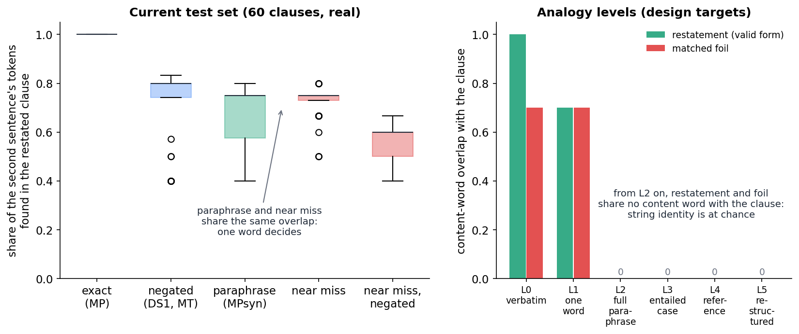
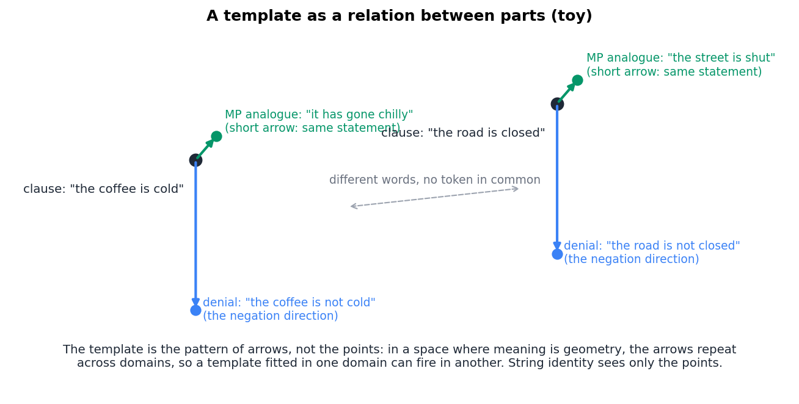
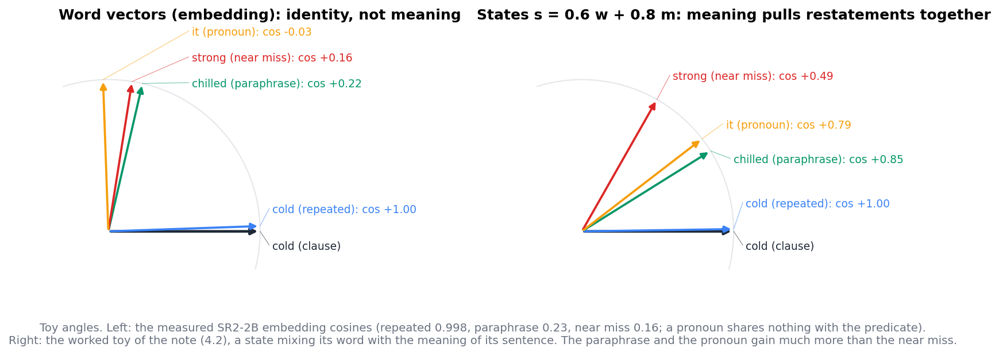
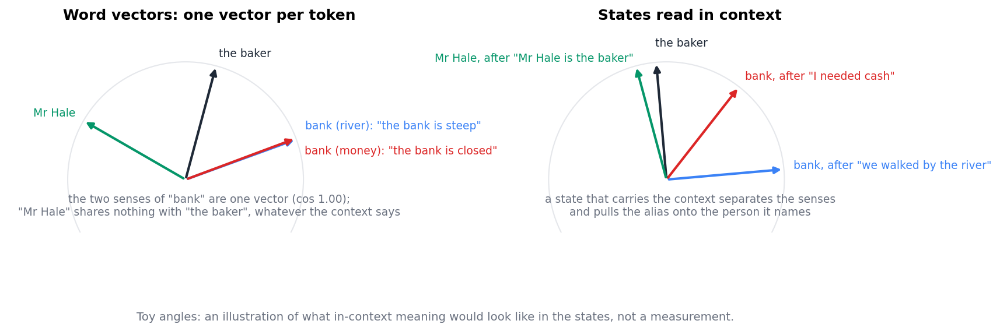
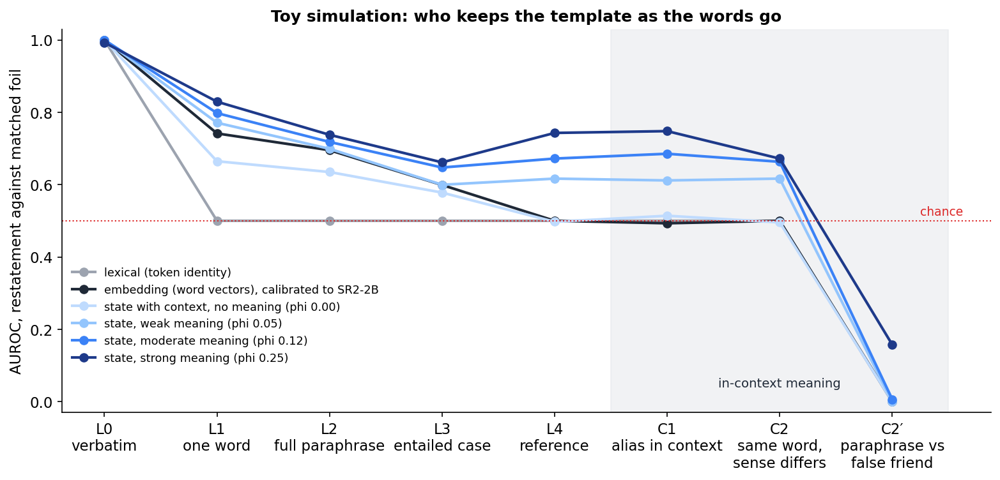
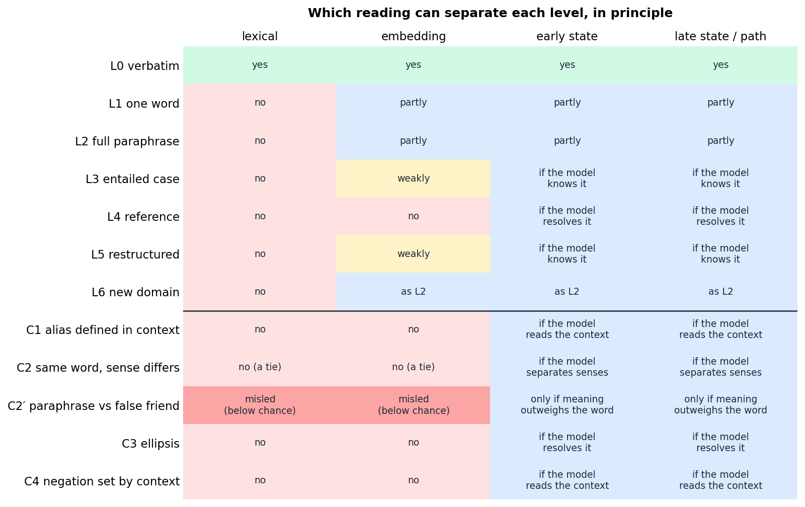

# Templates by Analogy and in Context: Design of a New Test Set

**What this note is.** The design of a test set on which the template matchers are compared where the words do not carry the logical form: the forms appear by analogy (the same relation between the parts, in other words) and through in-context meaning (what a word means in this passage, not in general). Written 2026-11-26 at the author's request, after the author pointed out that the current test rewards tracking the same words, and that the power of analogy is what the geometry should show. Nothing here has been run on a model. The figures marked "toy" are illustrations in a few dimensions, not measurements or predictions; the one figure on the current test set is real data.

**In brief.**
- **The current test set is a test of string identity.** Every valid form repeats a clause word for word, and a paraphrase shares as many tokens with its clause as a near miss does (67% against 72%): one word decides. A matcher that sees only which tokens are identical, with no vectors at all, scores 0.906 on unseen wordings, against the embedding's 0.952 to 0.976 ([Lexical_Baseline.md](Lexical_Baseline.md)). It reads the frame of a new wording by a string rule ("contains *or*").
- **What we want to measure instead** is whether a template fitted on plain instances fires on an analogue: the same relation between the parts, in other words, in another domain, or with its meaning set by the context. Success is graded and relative. Above chance and above the readings that only see words, not 80 to 90% (author, 2026-11-26).
- **Two axes.** Distance from the words: L0 verbatim to L6 a new domain. Dependence on context: C1 an alias defined by a context sentence, C2 the same word in another sense, C3 ellipsis, C4 a denial that only the context makes one.
- **The design rule that removes the embedding's advantage:** every restatement is paired with a foil that shares exactly as many tokens with the clause. String identity is then at chance by construction, and the lexical baseline is used as a check on the item set before any model is read.
- **Why the embedding loses its advantage** follows from its definition. The embedding of a token is the same vector in every context, so no distinction that depends on the context (C1 to C4) can be seen in it. Where the same word appears in another sense, it ties at chance. Where a paraphrase is paired with a false friend, it ranks the false friend first and falls below chance.
- **Why the states might win, and what the test then measures.** A layer state is computed from the whole context and can carry the meaning there. Whether a trained model's states do, and how much, is what the test measures. A calibrated toy shows the shape to expect: modest AUROC (0.6 to 0.75) where the embedding sits at 0.5.

---

## Contents

1. [The current test set rewards string identity](#1-the-current-test-set-rewards-string-identity)
2. [What a template is, and what analogy means for it](#2-what-a-template-is-and-what-analogy-means-for-it)
3. [The levels, with examples](#3-the-levels-with-examples)
4. [Why the embedding loses its advantage: small examples](#4-why-the-embedding-loses-its-advantage-small-examples)
5. [How each matcher should fare](#5-how-each-matcher-should-fare)
6. [Scoring](#6-scoring)
7. [Construction, size and checks](#7-construction-size-and-checks)
8. [Risks](#8-risks)
9. [Next steps](#9-next-steps)

---

## 1. The current test set rewards string identity

**Figure 1.** Left, real data: for the 60 test clauses, the share of the second sentence's tokens that also occur in the clause it restates (tokens compared after lower-casing and stripping the leading space). Right: the overlap the levels of §3 are designed to have, the restatement and its foil always equal.

What the left panel shows:

- **The valid forms are string patterns.** Modus ponens repeats its clause exactly (overlap 1.00). The denials add "not" (0.71).
- **A paraphrase and a near miss look alike to string identity.** "The waiter is sluggish" and "the waiter is Italian" share the same three of four tokens with "the waiter is slow". What separates them is one word, and only through what the reading knows about that word.

**The lexical baseline** ([Lexical_Baseline.md](Lexical_Baseline.md)). The template matcher unchanged, with every cosine replaced by "1 if the same token, 0 if not":

| reading | unseen wordings (R1) | modus ponens, known wordings | the three denied forms, known wordings | paraphrases at 1% near misses |
| --- | ---: | ---: | ---: | ---: |
| embedding, SR2-NP | 0.952 | 0.99 | 0.97 to 0.98 | 0.298 |
| embedding, G2 | 0.955 | 0.99 | 0.97 to 0.98 | 0.255 |
| token identity alone (any model) | 0.906 | 1.00 | 0.75 | 0.033 |

Token identity reaches 0.906 against the embedding's 0.95, and it fires on no fallacy. New wordings cost it nothing: every disjunctive wording of the set but "unless" contains the token "or", so "contains *or*: a disjunction, otherwise a conditional" carries over to every left-out wording. Its one loss on the valid forms is instructive: the 15 of 60 clauses whose denial changes the verb ("the candle burns", "the candle does not burn") are exactly the 25% it misses. The embedding catches them because "burns" and "burn" have similar word vectors, so even on this test part of the embedding's lead is geometry (morphology), not string identity. On paraphrases the embedding's geometry adds more: 0.26 to 0.30 against 0.03.

**What follows.** On this test the embedding wins because the test asks "are these the same words, and which connective is it?". The hidden states were never given a premise where knowing the context helps. A fair comparison needs premises on which the words do not decide.

## 2. What a template is, and what analogy means for it

A template is not a sentence; it is a relation between the parts of a premise. Modus ponens is "the second sentence asserts what the first clause conditioned on". Modus tollens is "the second sentence denies what the first clause concluded". The relation holds whatever the words are.

**Figure 2 (toy).** Two premises from unrelated domains with no token in common. In a space where meaning is geometry, the arrow from the clause to the second sentence is short for a restatement and points along the negation direction for a denial, in both domains. The template is the pattern of arrows; string identity sees only the points.

Analogy, for a template, means recognising the relation when the points move: other words, another domain, another surface structure, or a meaning fixed by the context. This is the kind of generalisation a geometry can give and a lookup of strings cannot. It is also loose. A paraphrase is not exactly the same statement, and an entailed case is only implied, so no matcher should be expected to reach the 90% of the verbatim test. The question is whether a reading rises above chance, and above the readings that see only words, as the analogies get looser.

## 3. The levels, with examples

Each level has the four valid forms (MP, MT, DS1, DS2), their fallacy twins (affirming the consequent, denying the antecedent, the affirmed disjunct) and a matched foil for each restatement. One example per level, on modus ponens:

| level | context or clause | restatement (MP analogue) | matched foil |
| --- | --- | --- | --- |
| L0 verbatim | If the road is closed, we take the ferry. | The road is closed. | The road is long. |
| L1 one word | as L0 | The road is shut. | The road is long. |
| L2 full paraphrase | as L0 | The street is shut. | The street is wide. |
| L3 entailed case | If it rains, the match is cancelled. | A storm is pouring down on the pitch. | A crowd is pouring onto the pitch. |
| L4 reference | If the generator fails, the lights go out. | It has broken down. | They have dimmed. |
| L5 restructured | If the council approves the plan, building starts. | The plan has the council's approval. | The plan has the council's attention. |
| L6 new domain | clauses from domains absent from the development set (law, medicine, machines, fiction) | as L2 | as L2 |
| C1 alias in context | Context: "Mr Hale runs the only bakery in town; Mrs Roe runs the florist." Premise: If the baker is ill, the bakery closes. | Mr Hale is ill. | Mrs Roe is ill. |
| C2 same word, sense differs | If the bank is closed, we cannot get cash. | The bank on Main Street is closed. | The river bank is closed. |
| C2′ paraphrase against a false friend | as C2 | The branch on Main Street has shut. | The river bank is closed. |
| C3 ellipsis | If the tap leaks, we call the plumber. | It does. | It does not. (a denial: the DA twin) |
| C4 denial set by context | If the alarm is armed, the light is red. | (MT analogue) The light is green. | The light is bright. |

Notes on the examples:

- **Matched overlap.** In every row the restatement and its foil share the same number of tokens with the clause: from L2 on no content word (only words such as "the" and "is", equally in both), the subject in L1, "is ill" in C1, "bank is closed" in C2. String identity therefore cannot prefer the restatement.
- **The strongest foils share the restatement's own surface.** In L3 both sentences are "a … is pouring … the pitch". In C2 both repeat "bank is closed". The only difference is meaning.
- **C2′ inverts string identity.** The false friend repeats the clause's words; the true restatement does not. A reading that follows words ranks the foil first.
- **C4 needs knowledge.** "Green" denies "red" only through what the reader knows about lights. That is a test of what the model carries, not of the matcher.
- **"Unless" and other connectives that hide a negation** belong with C4: the connective's word does not say which way the condition goes ([Connectives_With_a_Hidden_Negation.md](Connectives_With_a_Hidden_Negation.md)).

## 4. Why the embedding loses its advantage: small examples

### 4.1 One vector per token

The embedding of token $x$ at position $t$ is a lookup,

$$
h^{(0)}_t = E[x] + P[t] ,
$$

so two occurrences of the same token differ only by their position vectors, in any context. A layer state is a function of the whole prefix,

$$
h^{(\ell)}_t = F_{\ell} \left( h^{(0)}_1, \dots, h^{(0)}_t \right) ,
$$

and can differ between two occurrences of the same token when their contexts differ. **Derived.** It follows that no reading of the embedding can separate the restatement from the foil in C2 except through the position vectors, which carry no meaning. It also cannot tie an alias (C1) or a pronoun (L4, C3) to what it names, since "Mr Hale", "it" and "they" have fixed word vectors whatever the context says.

### 4.2 Identity against meaning, in two dimensions

**Figure 3 (toy).** Left: the measured SR2-2B embedding cosines of the restated word "cold" with its repetition (0.998), a paraphrase (0.23) and a near miss (0.16), as angles in a plane, and a pronoun that shares nothing with it. Right: the states of the worked toy below, computed from its formula.

A worked toy in two dimensions. Let the word vectors be unit vectors at the angles of the left panel, and let a state mix a word with the meaning of what it refers to:

$$
s = \alpha w + \beta m , \qquad \alpha = 0.6, \quad \beta = 0.8 ,
$$

with $w$ the word's vector and $m$ the direction of the meaning of the sentence it sits in. The repetition, the paraphrase "chilled" and the pronoun "it" all say that the coffee is cold, so their $m$ lies along "cold". The near miss "the coffee is strong" shares the subject but not the predicate, so its $m$ is put halfway, at 45 degrees. The clause's own state is $s_0 = \alpha w_0 + \beta m_0$, along "cold". The cosines with it:

| word | cosine of word vectors | cosine of states, toy |
| --- | ---: | ---: |
| cold (repeated) | 1.00 | 1.00 |
| chilled (paraphrase) | 0.23 | 0.85 |
| strong (near miss) | 0.16 | 0.50 |
| it (pronoun, refers to the coffee) | about 0 | 0.79 |

The numbers are illustrative. They show the mechanism: once the state carries meaning, the paraphrase and the pronoun move toward the clause and the near miss moves less. The gap between them, not their level, is what a matcher can use.

### 4.3 In-context meaning

**Figure 4 (toy).** Left: as word vectors, the two senses of "bank" are one vector, and "Mr Hale" shares nothing with "the baker", whatever the context sentence says. Right: what states that read the context would look like.

In-context meaning demotes the words in two ways. Where the context gives a new name (C1) or a pronoun (L4, C3), the words of the restatement carry nothing about the clause. Where the same word appears in another sense (C2), the words say "same" when the meaning does not, and string identity is not merely blind but misleading. This is the part of the test the embedding cannot pass by construction (§4.1), and where a state can pass only if the model has read the context.

### 4.4 The ladder in a calibrated toy

**Figure 5 (toy simulation).** AUROC of restatement against matched foil along the levels, for token identity, the embedding and states that carry meaning to four degrees (phi, the share of a state that is the word's meaning). The embedding's word cosines are drawn to match the measured SR2-2B values: paraphrase median 0.23, near miss 0.07, AUROC 0.74 (measured 0.77). A state mixes the word vector, a meaning term recovered with item-dependent fidelity, a context term shared with the clause (the subject and the frame) and noise. 64 dimensions, 800 premises per level.

What the toy shows:

- **At L0 every reading is perfect,** which is why the current test cannot separate them.
- **Token identity is at chance from L1 on,** by the matched-overlap rule.
- **The embedding degrades with the distance from the words** (0.74, 0.70, 0.60 at L1 to L3) and is at chance at L4, C1 and C2, by §4.1.
- **A state with context but no meaning (phi = 0) is no better than the embedding,** and on L1 to L3 worse, because the shared context lifts the near miss as much as the paraphrase. That is what the measured early states look like on the single restated-word cosine (SR2-2B: 0.33 against 0.18, AUROC 0.77, the same as the embedding).
- **States that carry meaning keep the template where the embedding loses it:** 0.61 to 0.75 at L4, C1 and C2 for phi 0.05 to 0.25, against 0.50.
- **C2′ is the hardest:** every reading is below chance, because the false friend repeats the word. Only strong meaning lifts it off zero (0.16 at phi 0.25). It is the cleanest measure of how far meaning overrides the word.
- **The levels are never near 90% for any reading.** This is the author's point: analogy is loose, and the test should be read by its ranking against the readings that only see words, not by an absolute rate.

### 4.5 Which reading can separate each level

**Figure 6.** Which reading can separate each level in principle. "If the model knows it" marks the levels where a state can succeed only if training put that knowledge into it. Those levels measure the model, not the matcher.

## 5. How each matcher should fare

Expectations from the argument above, to be turned into calls before any run:

| matcher | L0, L1 | L2, L3, L5 | L4, C1, C3 | C2 | C2′ |
| --- | --- | --- | --- | --- | --- |
| token identity (lexical baseline) | perfect; chance at L1 | chance | chance | chance (tie) | 0 |
| embedding | perfect; partial at L1 | partial, falling | chance | chance (tie) | below chance |
| early state | as the embedding | as the embedding or a little above | above chance if the model resolves reference | above chance if it separates senses | below chance unless meaning dominates |
| later states, the path | as the early state, less reliable | possibly above the early state (more context) | possibly the best | possibly the best | as the early state |
| displacement, well frame | below the embedding (the identity part is lost) | unknown | unknown | unknown | unknown |
| metric fitted per reading (test 3, running) | as its reading | the largest gain, if any | unknown | unknown | unknown |
| factorised hybrid (approach F) | as the embedding | as its gate | as its frame and gate readers | as its gate | as its gate |

The prediction that matters is the pattern, not the levels: on L0 and L1 the embedding should lead or tie; on L4, C1, C2 and C3 it should sit at chance; any reading above chance there shows meaning that the words do not carry.

## 6. Scoring

The 1% false-fire rule of the current test reads only the strict end of the ranking, where analogy will rarely reach. Three threshold-free readings per level, each with a known chance value:

| reading | what is compared | chance |
| --- | --- | ---: |
| template rank | the right template ranks first among the four | 0.25 |
| restatement against foil | the template's log odds of the restatement above those of its matched foil (AUROC) | 0.50 |
| valid form against its twin | an MP analogue against the affirming-the-consequent analogue at the same level (AUROC) | 0.50 |

Every reading is compared with the lexical baseline (at chance by construction from L1 on) and with the embedding, paired by clause, with intervals from resampling the clauses.

**What the clouds are fitted on.** The development set stays verbatim (L0): each template is learned from plain instances only, and the analogue levels appear only at test. This is the analogy question itself: does a template learned from "if the road is closed … the road is closed" fire on "… the street is shut"? A secondary reading refits with a small share of L2 premises in the development set.

**Context sentences.** The premises now follow 48 tokens of ordinary text. For the C levels that prefix is replaced by a designed context sentence or two; for the L levels the ordinary prefix stays.

## 7. Construction, size and checks

- **Size.** 60 clause frames per level, each with about 12 kinds of premise (the four forms, their twins, the foils), in six wordings (three conditional, three disjunctive) instead of twelve: about 4,300 premises per level, some 52,000 for the twelve levels, two and a half times the current extraction (21,180 premises, about an hour per two-layer model on the CPU). A difference of AUROC with 60 clauses has an interval of about ±0.05 to ±0.07, so a gain of 0.1 over chance is detectable at each level.
- **Drafting.** The agent drafts the clause frames, restatements and foils; the author checks them before any extraction. The levels that need knowledge (L3, C4) and the C2 senses are the ones most in need of a check.
- **Checks on the item set, run before any model is read:**
  - the lexical baseline must be at chance on every level from L1 on (restatement against foil, interval containing 0.5); a level that fails is redrafted;
  - the embedding must tie at chance on C2 (the two items repeat the same tokens);
  - the token counts of restatement and foil must match per item (a script, not by eye).
- **Then** the extraction (the same scripts with a new item bank and the context prefixes), the matchers unchanged, and the readings of §6.

## 8. Risks

- **The models may not carry the knowledge.** SR2-NP, G2 and L4 are two- and four-layer models trained on 0.5B tokens. They may not resolve pronouns or separate word senses. A floor at chance for every reading is then a finding about the models, not the method, and the eight-layer runs become the test.
- **The matcher's coordinates are built around identity** (best-match cosines). They may hide meaning that a state carries. Test 3 (a metric fitted per reading, running) and approach F address this; the analogy set should be read with both the current coordinates and the fitted metric.
- **Drafting style.** One drafter writes all items, so the foils may share a style the restatements lack, or the reverse. The author's check, and a lexical check on style words, limit this.
- **Clause boundaries are given to the matcher,** as in every test so far. This leaves out one part of analogy: finding the parts.
- **C2 items are hard to write cleanly.** The sense must be fixed by the premise or its context, not by an added word that string identity can see ("river" in "the river bank" is such a word; the design accepts it because the foil, not the restatement, carries it, which works against string identity).

## 9. Next steps

1. The lexical baseline is reported ([Lexical_Baseline.md](Lexical_Baseline.md)). Test 3, the metric fitted per reading, is running (the vector extractions take about four hours on the CPU); its report follows.
2. Done: 20 clause frames per level, drafted for the author's check, in [analogy_items/](analogy_items/README.md); all 420 restatement and foil pairs pass the overlap check.
3. Write the calls (per level and reading) for the author to confirm.
4. Draft the remaining frames, extract on SR2-NP, G2 and L4, and score.
