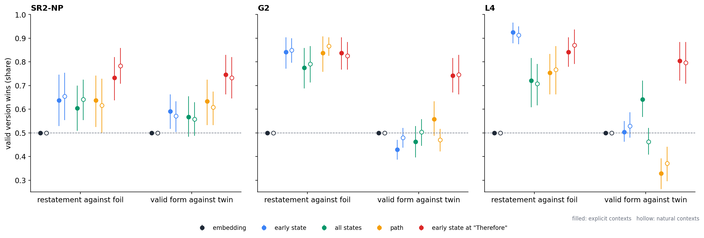

# Task B-logic: a Logical Form Set by Context

**Status (2026-11-27).** Items reviewed and approved by the author ([blogic_items/](blogic_items/README.md)). Calls drafted by the agent and **confirmed by the author on 2026-11-27, before any score was computed.** The gate check uses token identity, the embedding and the extraction's own consistency only. **Run and scored the same day (§5): the gate passed; BL1 and BL2 hit, BL3 and BL4 miss.** The layer states separate the contexts on every model, for both flavours, while token identity and the embedding tie exactly. But natural contexts work as well as explicit ones, and a simpler explanation than reading the definition is not excluded: the context names the clause that the signal is tied to, and a state can mark that clause as "seen just before" without using the word "means" (§5.3). A control that separates the two is proposed in §5.4. Terminology as in [README.md](README.md).

**In brief.**
- **The question.** Can a template recognise a valid logical form when only a context sentence makes the premise that form? Within each frame the premise is one string, "If P, then Q. S." (or "Either P or Q. S."), where S is an arbitrary signal; a context sentence before it says that S means P, Q, not P, not Q or something unrelated, which makes the premise modus ponens, affirming the consequent, modus tollens, denying the antecedent (or the disjunctive forms) or a foil.
- **Why the words cannot help.** The matcher's particles are the premise's tokens, identical in every version of a frame, at identical positions (the ordinary text before the context is shortened by the context's length). Token identity and the embedding therefore give identical readings: they tie at exactly 0.5 by construction. Only states that took in the context can separate the versions.
- **Two flavours.** Explicit: `Here, "the blue flag is up" means that the bank is closed.` Natural: `The blue flag is up only when the bank is closed.`
- **Calls.** One gate (the ties are exact), three calls on the layer readings, one on the flavours. Expectations are low: C1, the other test of meaning brought in by a context sentence, was at chance on these models.

---

## 1. What is scored

- **Premises.** 20 frames × 2 flavours × 5 meanings of the signal × 6 known wordings (if-then, when, provided; either-or, or, or else): 1,200 per model, on SR2-NP, G2 and L4, and on SR2-NP-L8 when it lands.
- **Kinds.** Conditional: MP (S means P), AC (S means Q), MT (S means not Q), DA (S means not P), foil (S means U). Disjunctive: DS1 (not P), DS2 (not Q), the affirmed P (P), the affirmed Q (Q), foil (U).
- **Readings.**
  - **The geometry matcher** on every vector (token identity, the embedding, each layer state, displacement and well frame, and states, path, wells), with its clouds fitted on the 60 verbatim development clauses, exactly as in Test 2 ([Analogy_Test_Results.md](Analogy_Test_Results.md)).
  - **The state at "Therefore"** (task A's reader, [Summary_State_Test.md](Summary_State_Test.md)): the clouds fitted on the development premises' "Therefore" states read the B-logic premises.
- **Scores, per flavour** (BX explicit, BN natural), means over the 20 frames, intervals from 4,000 resamples of the frames:
  - **foil**: the valid form against the foil of the same frame and wording, on the valid template's log odds (MP, MT, DS1, DS2); the share won, ties half; chance 0.5;
  - **twin**: the valid form against its twin (MP and AC, MT and DA, DS1 and the affirmed P, DS2 and the affirmed Q); chance 0.5.
- **Early state:** the state after layer 0 (on L4 also after layer 1). **Layer reading:** any state, displacement, well frame or joint reading of the trained layers.

## 2. The gate, checked before any model reading is looked at

- **BG1.** On every model and both flavours, token identity's and the embedding's foil and twin readings are exactly 0.500 (every pair tied), and the 96 check premises match the stored development premises to within 0.001. A failure means the premises are not identical across contexts and stops the scoring.

## 3. The calls

| id | call | probability |
| --- | --- | ---: |
| BL1 | Explicit flavour: on at least one model, the early state or all states, read by the geometry matcher, has a foil or twin reading above 0.5 (interval above 0.5). | 35% |
| BL2 | Explicit flavour: on at least one model, the state at "Therefore" (task A's reader, best layer) has a twin reading above 0.5 (interval above 0.5). | 40% |
| BL3 | Natural flavour: on SR2-NP and G2, no layer reading has a foil or twin interval above 0.5. | 65% |
| BL4 | On every model, the best layer reading's mean of foil and twin is at least as high on the explicit flavour as on the natural one. | 65% |

**Reasoning.** BL1: the explicit context puts the signal and the clause next to each other, so a state that carries recent context could pull the signal's particles toward the clause it was defined as; but the geometry matcher reads best-match cosines between particles, and C1 showed no such effect for names. BL2: task A found that the state at "Therefore" carries which clause the second sentence restates; whether it carries a restatement made only through a definition is the open question, so the call is near even. BL3: the natural flavour needs the model to turn "S only when X" into "S, therefore X", an inference the two-layer models are not expected to make. BL4: the explicit flavour is the easier link.

**Not called:** the displacement and well-frame readings, the single states other than the early state, rank, and differences between models. They are reported as leads.

## 4. Reproduce and files

```bash
cd notebooks/conservative_arch/scaleup
python3 debug/template_blogic_items.py                                       # builds the 1,200 premises; checks the particles are identical within each frame
python3 debug/template_analogy_test.py RUN FOLDER name=np vec=1 bank=blogic   # extraction; also g2, l4
python3 debug/template_analogy_analysis.py DEPTHDIR RUN results/template_matcher np,g2,l4 gates items=template_blogic_items tag=blogic
python3 debug/template_analogy_analysis.py DEPTHDIR RUN results/template_matcher np,g2,l4 items=template_blogic_items tag=blogic
python3 debug/template_summary_state.py VECDIR results/template_matcher np,g2,l4 analogy=RUN items=template_blogic_items tag=blogic       # task A's reader
```

Sources: `debug/template_blogic_clauses.py` (the frames), `debug/template_blogic_items.py` (the premises and pairs), `debug/template_blogic_review.py` (the review page). Outputs: `results/template_matcher/template_blogic_{np,g2,l4}.json`, `template_blogic_gates_{np,g2,l4}.json`, `template_summary_state_blogic_{np,g2,l4}.json`.

## 5. Results

Run on 2026-11-27 after the calls were confirmed: extraction 12 to 20 minutes per model (`results/template_matcher/template_blogic_extraction.log`), scoring and task A's reader a few minutes each. Outputs: `template_blogic_{np,g2,l4}.json`, `template_blogic_gates_{np,g2,l4}.json`, `template_summary_state_blogic_{np,g2,l4}.json`, logs `template_blogic.txt`, `template_blogic_gates.txt`, `template_summary_state_blogic.txt`.

### 5.1 The gate

Token identity and the embedding score exactly 0.500 on every reading, both flavours, all three models (every pair tied), and so do the length and the embedding at "Therefore". The 96 check premises match the stored development premises to within 0.0005. **BG1 passes.**

### 5.2 The calls



**Figure 1.** Per model, the valid version's share of wins against the foil (left group) and against its twin (right group), for the embedding (tied at 0.5 by construction), the early state, all states and the path read by the geometry matcher, and the early state at "Therefore" read by task A's clouds. Filled: explicit contexts; hollow: natural. Intervals 95% over the 20 frames.

| id | result | verdict |
| --- | --- | --- |
| BG1 | every token-identity and embedding reading 0.500; check premises within 0.0005 | pass |
| BL1 | explicit, early state, foil reading: 0.637 (0.529 to 0.746) on SR2-NP, 0.842 (0.771 to 0.904) on G2, 0.925 (0.879 to 0.967) on L4 | hit |
| BL2 | explicit, the state at "Therefore", twin reading: best layer 0.779, 0.812 and 0.804, every interval above 0.72 | hit |
| BL3 | natural, two-layer models: 10 layer readings on SR2-NP and 10 on G2 have intervals above 0.5 (early state foil 0.654 and 0.850) | miss |
| BL4 | best layer reading's mean of foil and twin, explicit against natural: 0.635 against 0.656 (SR2-NP), 0.713 against 0.715 (G2), 0.775 against 0.746 (L4) | miss (on two models) |

**Measured.** The geometry matcher's foil readings are high on every model (early state 0.64 to 0.93), its twin readings mixed: point estimates 0.55 to 0.63 on SR2-NP, around or below chance on G2 and L4 for the early state and the path, above chance for L4's later states and well frames (0.56 to 0.68). Task A's reader at "Therefore" is above chance on both readings on every model: for the states after layers 0 and 1, foil 0.70 to 0.91 and twin 0.73 to 0.80, for both flavours (L4's later states are lower, down to 0.63 and 0.57).

### 5.3 What the result can and cannot mean

**The states take in the context sentence.** The premise's particles are identical in every version, so every difference between the versions is information the layers carried from the context into the premise. This is the first test in which a separate sentence of context measurably changes how the matcher reads a premise. **Measured.**

**Whether they take in the meaning is not shown.** Two explanations fit:

1. **Binding.** The states carry "the signal means P", and the matcher reads the premise as a restatement of P.
2. **Mention.** Every context names one clause (P for MP, Q for AC, U for the foil; "not P" and "not Q" for the denial forms). When that clause then appears in the premise, its tokens are a repeat of something seen a sentence before, and states mark repeats (the matcher's own coordinates are built on how well particles match). A state can then tell "P was named before" from "Q was named before" or "neither", which separates MP from AC and from the foil, without the word "means" being used at all.

Two observations favour the second. Natural contexts ("only when", which needs a step of inference) work as well as explicit definitions (BL4 missed by 0.02 and 0.002 on two models). And the foil, the one version whose context names neither clause, is easier to separate than the twin on almost every reading, while the twins, whose contexts each name a clause, are often at chance for the geometry matcher. **Hypothesis; not tested.**

### 5.4 The control that separates the two (proposed)

Contexts that name both clauses and differ only in which one the signal is tied to:

- MP: `Here, "the blue flag is up" means that the bank is closed, and nothing about whether the high street is quiet.`
- AC: `Here, "the blue flag is up" means that the high street is quiet, and nothing about whether the bank is closed.`
- foil: `Here, "the blue flag is up" means that the cleaners are inside, and nothing about whether the bank is closed or the high street is quiet.`

Both clauses are named in every version, so a state that only marks mentions cannot separate them; a state that binds the signal to a clause can. Generated by template from the approved frames, it needs only a review of the wording, a 1,200-premise extraction per model, and calls written before scoring.

### 5.5 The control: design and calls

**Status (2026-11-27).** Set up at the author's request; contexts on [blogic_items/control.md](blogic_items/control.md); extraction running; **calls awaiting the author's confirmation.**

- **Contexts.** Every version names both clauses; only the clause the signal is tied to differs. Variant a: `Here, "S" means that X, and nothing about whether O.` Variant b: `Here, "S" says nothing about whether O; it means that X.` X is the meaning (P, Q, not P, not Q or U) and O the other clause (both clauses for the foil). In variant a the clause named last before the premise is the unbound one; in variant b it is the bound one. A state that marks only the most recent mention would score above chance in one variant and below it in the other.
- **Premises.** The approved frames, the same wordings and kinds: 1,200 per model (levels BCa and BCb). The premise again starts at the same position in every version, so token identity and the embedding tie exactly.

| id | call | probability |
| --- | --- | ---: |
| CG1 (gate) | token identity and the embedding score exactly 0.500 on every reading of both variants on every model; the check premises match to within 0.001 | — |
| CB1 | On at least one model, task A's reader (the best of the states after layers 0 and 1, at "Therefore") has a foil reading above 0.5 in both variants (each interval above 0.5). | 35% |
| CB2 | On at least one model, the same reader has a twin reading above 0.5 in both variants. | 30% |
| CB3 | On every model, that reader's twin reading, averaged over the two variants, is at least 0.10 below its value with explicit contexts (§5.2). | 60% |

**Reasoning.** CB1 and CB2 are binding: only a state that ties the signal to one named clause separates versions that name the same clauses. CB3 states the expectation that most of §5.2's twin effect was mention. The geometry matcher's readings are reported, not called.
