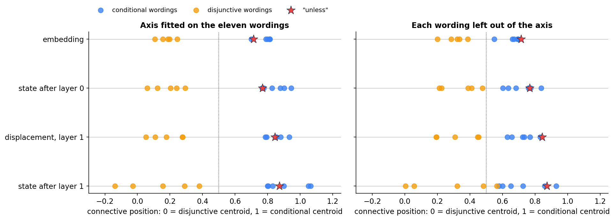
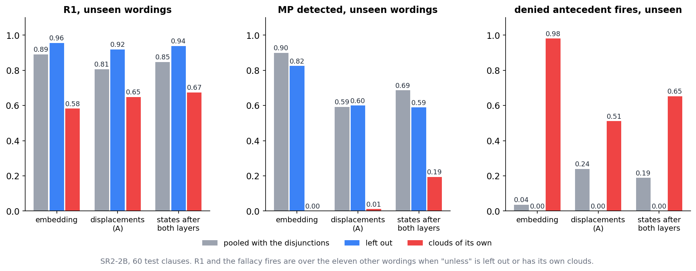

# Connectives With a Hidden Negation: the "Unless" Problem

**What this note is.** A statement and analysis of one limit of the template matchers built so far: a connective whose meaning contains a negation that its words do not show. "Unless" is the case in hand. The note follows the format of the earlier reports: definitions, the problem, the mathematics, an example, the measurements, and the directions to explore. Written 2026-11-25 at the author's request, from the SR2-2B runs ([Template_Matchers_on_the_Dynamics_SR2_2B.md](Template_Matchers_on_the_Dynamics_SR2_2B.md), [The_Embedding_Template_Matcher.md](The_Embedding_Template_Matcher.md)).

**In brief.**
- "Unless P, Q" means "if not P, then Q", which is "P or Q". Its truth function is the disjunction's, but its words and its layout are a conditional's. In every vector read so far its connective sits with the conditional connectives.
- The matchers see the connective through **one coordinate**, its position between the disjunctive and conditional centroids. For the eleven other wordings the sign of that coordinate gives the truth function. For "unless" it gives the wrong one.
- Three ways of filing it were measured on SR2-2B. Pooled with the disjunctions, it makes denied antecedents fire on unseen conditional wordings (4 to 24%). Left out, the matchers are clean. **Given clouds of its own, it destroys the conditional templates on unseen wordings**: the embedding then detects modus ponens 0% of the time and fires on 98% of denied antecedents. The agent proposed that third filing to the author earlier on 2026-11-25 and expected it to help; it does the opposite.
- The reason is exact. Each "unless" premise is a copy of a conditional premise in every coordinate but one, and two of the four copies have the opposite validity. When a conditional wording is left out of fitting, its connective lands at or past "unless" on that one coordinate.
- Nothing in the current coordinates says that a connective carries a negation. Getting it right needs a coordinate that does, or the model's own reading of the sentence. §8 lists the candidates.

---

## Contents

1. [Definitions](#1-definitions)
2. [The problem](#2-the-problem)
3. [Mathematical analysis](#3-mathematical-analysis)
4. [An example](#4-an-example)
5. [Measurements on SR2-2B](#5-measurements-on-sr2-2b)
6. [Analysis](#6-analysis)
7. [What does not solve it](#7-what-does-not-solve-it)
8. [Directions](#8-directions)
9. [Caveats and corrections](#9-caveats-and-corrections)
10. [Reproduce and files](#10-reproduce-and-files)

---

## 1. Definitions

**Premise, clause, template, rival, wording, matcher, cloud, rate** as in [Template_Matcher_From_Geometry.md](Template_Matcher_From_Geometry.md), §1. A premise is a first sentence that joins clauses $P$ and $Q$, a second sentence, and "Therefore".

**Truth function of a wording.** The Boolean function $f(P, Q)$ that the first sentence asserts. Two occur:

$$
f_{\to}(P, Q) = \neg P \lor Q \quad \text{(conditional)}, \qquad f_{\lor}(P, Q) = P \lor Q \quad \text{(disjunction)} .
$$

The six conditional wordings (if-then, when, whenever, Q if P, assuming, provided) assert $f_{\to}$; the five disjunctive ones (either-or, or, at least one, or else, one of these holds) assert $f_{\lor}$. "Unless P, Q" asserts "if not P, then Q", that is $\neg \neg P \lor Q = P \lor Q$: **the disjunction**.

**Second sentence.** One of $P$, $\neg P$, $Q$, $\neg Q$ (and paraphrases, near misses and so on, which are not needed here).

**Validity.** Whether a conclusion follows from the first sentence and the second. For the two truth functions:

| second sentence | conditional | disjunction (and "unless") |
| --- | --- | --- |
| P | valid: Q follows (MP) | nothing follows (affirmed disjunct) |
| not P | nothing follows (denied antecedent) | valid: Q follows (DS1) |
| Q | nothing follows (affirmed consequent) | nothing follows (affirmed disjunct) |
| not Q | valid: not P follows (MT) | valid: P follows (DS2) |

**Hidden negation.** A connective has a hidden negation when its truth function contains a negation of a clause that no particle of the sentence expresses. Read as a conditional, "unless" has its antecedent negated ("if not P"); no "not" appears.

**Repetition coordinates and connective coordinate.** The relational coordinates of a premise split into those that describe which clause the second sentence repeats and with what polarity (written $s$ below), and the one that reads the connective, its position $c$ ([The_Embedding_Template_Matcher.md](The_Embedding_Template_Matcher.md), §4). Write $r = (s, c)$.

## 2. The problem

A template per logical form must fire on a valid premise and stay silent on a fallacy, from the geometry of the premise. The form is fixed by the truth function and the second sentence (the table above). The geometry gives the second sentence through $s$, accurately: a repeated clause is near-perfect in the embedding. It gives the truth function only through $c$.

**The problem.** For a wording whose truth function is not the one its geometry resembles, the matcher has no coordinate from which the correct truth function could be read. On a known wording it can memorise the exception, at a cost to its neighbours. On an unseen wording of the same kind it cannot be right except by chance.

The question is not specific to "unless". Any connective that negates a clause internally, or reverses the roles of the clauses ("P only if Q" is "if P, then Q", with "if" next to Q), poses it.

## 3. Mathematical analysis

### 3.1 The truth function is a property of the connective alone

For a premise with wording $w$ and second sentence $\sigma$, validity is a function $V(f_w, \sigma)$. In the coordinates, $\sigma$ determines $s$ up to the noise of the clauses, and $w$ determines $c$:

$$
s = s(\sigma) + \varepsilon, \qquad c = c(w) + \eta ,
$$

with $\varepsilon$ and $\eta$ small within a kind. (On the worked clause pair of [The_Embedding_Template_Matcher.md](The_Embedding_Template_Matcher.md) the two copies of the same second sentence under two connectives differ by at most 0.005 in the repetition coordinates of §4.) So the decision reduces to recovering $f_w$ from $c(w)$, a function of the connective's vector.

### 3.2 Twins with swapped validity

For "unless" and a conditional wording $w$ with the same clauses, the premises with the same second sentence are **twins**: they agree in $s$ and differ in $c$ only. By the table of §1, the four twin pairs are

| second sentence | conditional premise | "unless" premise | validity |
| --- | --- | --- | --- |
| P | MP (template) | affirmed disjunct (rival) | **swapped** |
| not P | denied antecedent (rival) | DS1 (template) | **swapped** |
| Q | affirmed consequent (rival) | affirmed disjunct (rival) | same |
| not Q | MT (template) | DS2 (template) | same, another template |

In two pairs out of four the validity is swapped. Whatever cloud structure the matcher has, it must separate MP from its "unless" twin and the denied antecedent from its twin **through $c$ alone**.

### 3.3 With Gaussian clouds of one covariance, the boundary is a cut on the connective

Let kinds $A$ and $B$ have centres that agree in every coordinate but $c$, at $c_A$ and $c_B$, and share the covariance. The log ratio of their densities at a premise is linear in $c$ only,

$$
\log \frac{\rho_A(r)}{\rho_B(r)} = \frac{(c_A - c_B)}{\sigma_c^2} \left( c - \frac{c_A + c_B}{2} \right) ,
$$

with $\sigma_c^2$ the variance of $c$ left after conditioning on the other coordinates (the pooled within-kind spread). The premise goes to $A$ when its connective lies on $A$'s side of the midpoint. For the swapped twins this cut is all that separates a template from a rival.

### 3.4 The cut must fall between "unless" and the nearest conditional

On SR2-2B's embedding, with 0 the disjunctive and 1 the conditional centroid, the connectives of the conditional wordings sit at 0.70 to 0.81 and "unless" at 0.71, inside their range ([Template_Matchers_on_the_Dynamics_SR2_2B.md](Template_Matchers_on_the_Dynamics_SR2_2B.md), §5.4). A cut that sends every conditional wording to $f_{\to}$ and "unless" to $f_{\lor}$ does not exist on that axis for the embedding. Where one exists (the walk-through's fit, with "unless" in the axis: provided 0.28, "unless" 0.09, disjunctions -0.39 and below, on another scale), its margin is a fraction of the distance between the families.

### 3.5 A left-out wording moves toward the middle

The axis is refitted without the wording under test. Its centroid then no longer pulls the axis toward it, and its position falls. On the embedding the six conditional wordings fall from 0.70 to 0.81 in the full fit to 0.55 to 0.70 when each is left out of the axis, while "unless" stays at 0.71 (Figure 1, right). **Every left-out conditional wording lands at or below "unless"**, on the disjunctive side of any cut that keeps "unless" with $f_{\lor}$. Its MP premises then fall into the cloud of the "unless" affirmed disjunct (a rival), and its denied antecedents into the cloud of "unless" DS1 (a template).

### 3.6 One wording cannot teach a direction

The family "geometry of a conditional, truth function of a disjunction" has one member. A decision learned from one point says where that point is, not which feature of the connective produced its truth function. A test of whether a matcher reads hidden negations needs at least two such wordings, one left out and the others fitted, and a feature on which they agree.

## 4. An example

The clauses "the coffee is cold" and "the carpet is filthy", the embedding of SR2-2B, from [The_Embedding_Template_Matcher.md](The_Embedding_Template_Matcher.md):

| premise | second sentence to clause 1, smallest three best matches | connective position | what it is | template that fires |
| --- | --- | ---: | --- | --- |
| If the coffee is cold, then the carpet is filthy. The coffee is cold. | 0.089, 0.987, 0.998 | 0.40 | MP, valid | MP |
| Unless the coffee is cold, the carpet is filthy. The coffee is cold. | 0.094, 0.985, 0.998 | 0.09 | affirmed disjunct, fallacy | **MP** (rate 0.99), wrong |
| If the coffee is cold, then the carpet is filthy. The coffee is not cold. | 0.055, 0.089, 0.987 | 0.40 | denied antecedent, fallacy | none |
| Unless the coffee is cold, the carpet is filthy. The coffee is not cold. | 0.056, 0.094, 0.985 | 0.09 | DS1, valid | none, **missed** |
| Either the coffee is cold or the carpet is filthy. The coffee is not cold. | 0.056, 0.094, 0.985 | -0.39 | DS1, valid | DS1 |

The repetition coordinates of each "unless" premise equal those of its conditional twin to the second decimal. The connective coordinate puts "unless" on the conditional side, and the matcher (with "unless" pooled with the disjunctions) follows it: the affirmed disjunct fires MP, and the valid DS1 is taken for a denied antecedent.

## 5. Measurements on SR2-2B



**Figure 1.** Each wording's connective between the disjunctive (0) and conditional (1) centroids, 60 test clauses. Left: the axis fitted on the eleven wordings other than "unless". Right: each wording left out of its own axis.

| vector | conditional wordings, full fit | conditional wordings, each left out | "unless" |
| --- | --- | --- | ---: |
| embedding | 0.70 to 0.81 | 0.55 to 0.70 | 0.71 |
| state after layer 0 | 0.77 to 0.94 | 0.60 to 0.84 | 0.77 |
| displacement, layer 1 | 0.68 to 1.13 | 0.47 to 1.00 | 0.96 |
| state after layer 1 | 0.80 to 1.07 | 0.58 to 0.93 | 0.87 |

The layers do not move "unless" toward the disjunctions; it stays among, or beyond, the conditionals.



**Figure 2.** Three ways of filing "unless", at the number of particles and dimension each matcher chose in the main run. R1 is the hard set on unseen wordings; when "unless" is left out or has its own clouds, R1 and the fallacy fires are over the eleven other wordings.

| matcher | filing | R1 | MP detected, unseen | MT detected, unseen | denied antecedent fires, unseen | MP detected, known |
| --- | --- | ---: | ---: | ---: | ---: | ---: |
| embedding | pooled with the disjunctions | 0.892 | 0.90 | 0.77 | 0.04 | 1.00 |
| embedding | left out | **0.956** | 0.82 | 0.86 | 0.00 | 1.00 |
| embedding | clouds of its own | 0.582 | **0.00** | **0.00** | **0.98** | 0.73 |
| displacements (A) | pooled | 0.807 | 0.59 | 0.78 | 0.24 | 0.89 |
| displacements (A) | left out | **0.920** | 0.60 | 0.87 | 0.00 | 0.90 |
| displacements (A) | own clouds | 0.648 | 0.01 | 0.00 | 0.51 | 0.08 |
| states after both layers | pooled | 0.848 | 0.69 | 0.83 | 0.19 | 0.91 |
| states after both layers | left out | **0.939** | 0.59 | 0.98 | 0.00 | 0.92 |
| states after both layers | own clouds | 0.675 | 0.19 | 0.19 | 0.65 | 0.62 |

With clouds of its own, "unless" is detected on its known wording at 33% and 78% (DS1, DS2) by the embedding and 93% and 95% by the states. With the embedding, the template that fires on the 360 unseen denied antecedents is DS1 in 353 cases. The known-wording denied antecedents of "provided", the conditional nearest the middle, fire 75% of the time.

## 6. Analysis

**Pooled.** The DS1 cloud mixes five true disjunctions with "unless". Its spread along the connective coordinate then covers part of the conditional side, and denied antecedents of a conditional wording left out of fitting fall into it (4% for the embedding, 19% for the states, 24% for the displacements). "Unless" itself is detected poorly by the embedding (8 and 10%) and well by the states (98 and 95%), on its known wording.

**Left out.** No cloud has to contain a conditional-looking premise with a disjunctive truth function, and for the embedding, the displacements and the states nothing fires on any fallacy of the eleven wordings. This is the clean case; it says nothing about "unless".

**Own clouds.** The "unless" clouds are copies of the conditional clouds at a slightly different connective position, with the validity swapped in two of four (§3.2). They are fitted on one wording, and on SR2-2B's embedding they sit at or just inside the conditional range (§3.4). A left-out conditional wording lands nearer to them than to the clouds of its own family (§3.5), so its MP goes to the "unless" affirmed disjunct and its denied antecedent to "unless" DS1. Every step of this is visible in the numbers: unseen MP 0%, unseen denied antecedent 98%, and DS1 the template that fires. On known wordings the cut exists only with a thin margin, and "provided" crosses it.

**The general statement.** A matcher of this form can treat the truth function of a connective correctly only where the connective's coordinate separates the truth functions. For eleven wordings it does, because the syntactic family and the truth function coincide. "Unless" is the one wording where they part, and its coordinate follows the syntax.

## 7. What does not solve it

- **More particles or more dimensions.** The repetition coordinates are the same for the twins by construction. Only a coordinate of the connective can separate them.
- **A different template name.** Filing "unless" as a conditional with a negated antecedent gives the same twins, with MP and DS1 swapped in name. The geometry is unchanged.
- **Reading the trained states instead of the embedding.** On SR2-2B the layers move "unless" further into the conditional side (0.71 in the embedding, 0.77 to 0.96 after the layers).
- **Clouds of its own.** §5.

## 8. Directions

Ordered from cheapest to most ambitious. None has been run.

1. **Keep "unless" out of the primary scores** until one of the following works. This is what the confirmed depth calls already do ([Template_Matchers_and_Depth.md](Template_Matchers_and_Depth.md)).
2. **A polarity coordinate learned from explicit negation.** The premises already contain "not" in second sentences and in reworded denials. The direction from an affirmed clause to its negation, in whitened vectors, is learned from them without any word list. Each connective's vector is then read along that direction as well as along the conditional–disjunctive axis. If "unless" differs from "if" along it, the matcher has the coordinate it lacks. A first reading needs only the stored SR2-2B states and minutes of CPU.
3. **The connective as a subspace, not an axis.** Replace the single position by the first few principal coordinates of the connective vectors across wordings. A hidden negation can then show as a second direction. Without more wordings of the negated family it cannot be fitted on more than one point (§3.6), so this goes with direction 4.
4. **More wordings with a hidden negation or a role reversal,** so that one can be left out and the others fitted: "Q unless P", "except if P, Q", "Q except when P", "without P, Q"; and, as a control, "if not P, then Q", where the negation is explicit. A second family with the same structure is "P only if Q", whose "if" stands next to the consequent. The clauses and the extraction can be reused; one extraction run per model.
5. **Ask the model.** The language model predicts what comes after "Therefore". For "Unless the coffee is cold, the carpet is filthy. The coffee is not cold. Therefore", does it give "the carpet is filthy" more weight than after the denied antecedent with "if"? This reads whether the trained model distinguishes the truth functions at all. If it does not, no matcher on its states can find the distinction except through the words. It costs one forward pass per premise.
6. **Templates over a canonical form.** A first level of templates reads the connective and maps the wording to its truth function, with antecedent, consequent and the polarity of each. The form templates then work on that canonical form, and "unless" and "or" would share them. This is the hierarchy of templates the author proposed ([Implementing_Semantic_Templates_A_Path.md](../Implementing_Semantic_Templates_A_Path.md)), with the connective level as its first concrete case.
7. **Negation parity as a node.** Validity for "unless" with "not P" is a parity: the antecedent is negated twice, once inside the connective and once in the second sentence. A node that counts negations per clause, from the connective and from the second sentence, would turn the twins of §3.2 into different points. It needs direction 2 to see the connective's negation.
8. **Depth.** The depth arms read the connective at every layer ([Template_Matchers_and_Depth.md](Template_Matchers_and_Depth.md)). If the position of "unless" moves toward the disjunctions at four or eight layers, the model computes the truth function where two layers do not. The connective-position reading will be repeated on each depth arm.

## 9. Caveats and corrections

- **Correction (2026-11-25).** The agent told the author that giving "unless" clouds of its own "should remove the contamination" on known wordings. Measured afterwards, it improves the embedding's detection of "unless" itself (33% and 78% against 8% and 10%) but breaks the conditional templates, on unseen wordings almost entirely and on known ones in part (§5). The depth scoring keeps that filing as a third, secondary reading so that it can be followed with depth; the confirmed primary reading leaves "unless" out.
- One model, SR2-2B; the readings of the embedding, the displacements and the states. Each matcher keeps the number of particles and the dimension it chose in the main run.
- The connective positions of Figure 1 are on the 60 test clauses of the dynamics run, with the axis fitted without "unless". The worked example is on the earlier clauses, with "unless" in the axis, so its scale differs.
- English premises, drafted by the agent, awaiting the author's check.

## 10. Reproduce and files

```bash
cd notebooks/conservative_arch/scaleup
python3 debug/template_connective_position.py OUT OUT sr2_2b OUT/template_dynamics.json          # Figure 1
python3 debug/template_dynamics_without_unless.py OUT OUT sr2_2b OUT/template_dynamics.json      # left out
python3 debug/template_dynamics_unless_own.py OUT OUT sr2_2b OUT/template_dynamics.json [names]  # own clouds
python3 ../../../companion_notes/figures/_make_unless_problem_figs.py
```

Outputs in `results/template_matcher/`: `template_connective_position_sr2_2b.*`, `template_dynamics_without_unless_sr2_2b.*`, `template_dynamics_unless_own_sr2_2b.*` and `template_dynamics_unless_own_detail_sr2_2b.json` (which template fires on the denied antecedents, by wording). The pooled numbers are in `template_dynamics_readings_sr2_2b.json`. The "own clouds" reading is the third reading of `debug/template_depth_analysis.py`.
