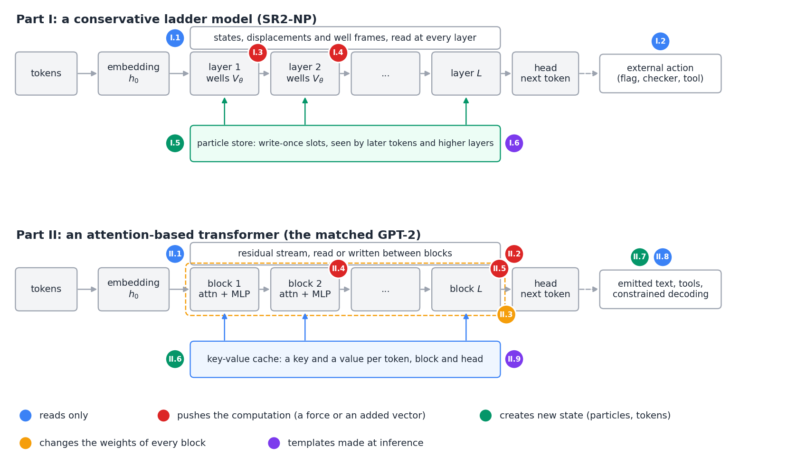
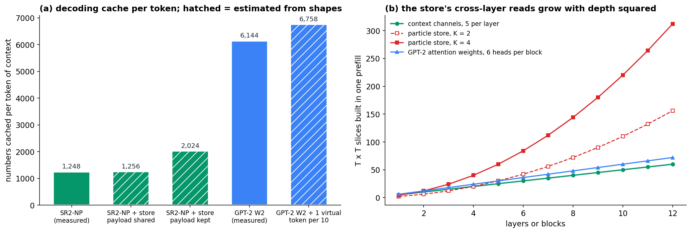

# Deploying Semantic Templates: Scenarios, Trade-offs and Challenges

**What this note is.** A design discussion, written on 2026-11-27 at the author's request, after the matched GPT-2 was read with the template tests ([GPT2_Template_Battery_Results.md](GPT2_Template_Battery_Results.md)). That result showed that *reading* a template from a model's states is not specific to the conservative architecture. The open question is what happens when a template is *deployed*: put to work in a running model, on text nobody has labelled, with something following from it when it fires. This note lists the ways that could be done, with the pros, cons and challenges of each. Part I covers our family of conservative models. Part II covers attention-based transformers.

**Status.** No new measurement. Every number is quoted from a report linked at the point of use, or computed from tensor shapes and marked as such. The tests proposed in the closing section are suggestions, not pre-registered calls.

**Relates to:** [Template_Programme_Status_and_Plan.md](Template_Programme_Status_and_Plan.md) (what is measured), [Implementing_Semantic_Templates_A_Path.md](../Implementing_Semantic_Templates_A_Path.md) (how templates would be built into the model), [The_Particle_Store_Making_Allocation_Real.md](../The_Particle_Store_Making_Allocation_Real.md), [Continuous_Learning_in_Semantic_Simulation-based_models_vs_with_Transformer_models.md](../Continuous_Learning_in_Semantic_Simulation-based_models_vs_with_Transformer_models.md) (adding a well to a trained model), [Transformers_as_Dynamical_Systems.md](../transformer/Transformers_as_Dynamical_Systems.md), and the productization notes on decoding ([Incremental_Decoder.md](../productization/Incremental_Decoder.md), [Stage2b_Decode_Step_Levers.md](../productization/Stage2b_Decode_Step_Levers.md)).

**In brief.**
- **Every deployment needs a firing rule first.** Today the templates rank: they put the right form first more often than chance. They do not fire, that is, make a yes-or-no decision at a controlled false-alarm rate, outside verbatim premises. Every scenario below starts from a firing rule, so building and testing one is the common first step for both families.
- **A deployed template can do one of four jobs.** It can read (flag what it sees), push the computation (add a force or a vector), create new state (a particle, a token), or be made at inference (induction). The two families differ most on the second and third jobs.
- **Our family has a natural place for each job, but none of them works yet as a deployment.** A template can become a well, which is a push with a basin; a particle in the store, which is new state; or a template one level up, which is induction. The measurements say what blocks each one: wells that do not discriminate, a no-decay store the model does not use, no consuming template, and order that additive updates cannot supply.
- **A transformer has mature tools for the first two jobs and a ready-made store for the third.** Probes, steering vectors, model editing and fine-tuning all exist. The key-value cache already grows by one entry per token, so a firing can be written as an inserted token. What it lacks is an energy: "installing a template as a well" has no meaning in a trained transformer, so every write is either an unconstrained push or a weight change spread over the network.
- **The trade-off.** Our family offers templates that remain inspectable objects with a defined geometry. They are still to be shown to work. Transformers offer deployments that work today, with templates that dissolve into the weights or stay outside the model.

---

## Contents

0. [What deploying a template means](#0-what-deploying-a-template-means)
   - 0.1 [Recognise, then act: four jobs](#01-recognise-then-act-four-jobs)
   - 0.2 [What every deployment needs](#02-what-every-deployment-needs)
   - 0.3 [What the measurements give a deployment to start from](#03-what-the-measurements-give-a-deployment-to-start-from)
1. [Part I: deployment in the conservative family](#part-i-deployment-in-the-conservative-family)
   - I.0 [The substrate as it stands](#i0-the-substrate-as-it-stands)
   - I.1 [A reader on a frozen model](#i1-a-reader-on-a-frozen-model)
   - I.2 [A reader that triggers an action outside the model](#i2-a-reader-that-triggers-an-action-outside-the-model)
   - I.3 [A template trained in as a well](#i3-a-template-trained-in-as-a-well)
   - I.4 [A well added to a trained model](#i4-a-well-added-to-a-trained-model)
   - I.5 [Firing into the particle store](#i5-firing-into-the-particle-store)
   - I.6 [Templates made at inference](#i6-templates-made-at-inference)
   - I.7 [Serving concerns common to Part I](#i7-serving-concerns-common-to-part-i)
   - I.8 [Part I side by side](#i8-part-i-side-by-side)
2. [Part II: deployment in attention-based transformers](#part-ii-deployment-in-attention-based-transformers)
   - II.0 [The substrate](#ii0-the-substrate)
   - II.1 [A probe on the residual stream](#ii1-a-probe-on-the-residual-stream)
   - II.2 [Steering: adding the template's direction](#ii2-steering-adding-the-templates-direction)
   - II.3 [Fine-tuning the template in](#ii3-fine-tuning-the-template-in)
   - II.4 [Editing the feed-forward memories](#ii4-editing-the-feed-forward-memories)
   - II.5 [An explicit template module inside the network](#ii5-an-explicit-template-module-inside-the-network)
   - II.6 [Firing as an inserted token](#ii6-firing-as-an-inserted-token)
   - II.7 [Firing as emitted text or a tool call](#ii7-firing-as-emitted-text-or-a-tool-call)
   - II.8 [Constrained decoding](#ii8-constrained-decoding)
   - II.9 [Induction in context](#ii9-induction-in-context)
   - II.10 [Serving concerns common to Part II](#ii10-serving-concerns-common-to-part-ii)
   - II.11 [Part II side by side](#ii11-part-ii-side-by-side)
3. [Closing: the two parts compared, and what to test first](#3-closing-the-two-parts-compared-and-what-to-test-first)
4. [References](#4-references)

---

## 0. What deploying a template means

### 0.1 Recognise, then act: four jobs

A semantic template pairs a recogniser (book Definition 8: the Pattern Matching Structure) with what follows from a match (the Inference Structure). The tests so far exercise only the recogniser: given a premise, which logical form is it. Deploying a template means running both halves inside a working system. Four jobs are possible, in increasing order of what they ask of the model:

1. **Read.** The template watches the model's states and reports a firing; nothing inside the model changes. Examples: a monitor that flags valid and fallacious arguments, a router that sends a passage to a checker.
2. **Push.** A firing changes the computation that follows, by a force on later tokens or a vector added to a state. The model's state space is unchanged: the firing biases where the existing state goes.
3. **Create.** A firing adds new state: a particle in a store, a token in a cache. This is the job that matters for expressivity. The bounds note shows that a model whose state space does not grow during inference stays in its class, whatever forces it applies ([Expressivity_Bounds_For_v0_Simulator.md](../Expressivity_Bounds_For_v0_Simulator.md); [Implementing_Semantic_Templates_A_Path.md](../Implementing_Semantic_Templates_A_Path.md), §1.1).
4. **Induce.** The model makes a template it did not have from regularities in its context, without weight updates (Tier 2 of the implementation path, §5 there).

Figure 1 places every scenario of this note on a sketch of each architecture, coloured by the job it does.

**Figure 1.** Where the scenarios of this note attach. Top: a conservative ladder model, with its layers of wells, the states and readings available at every layer, and the particle store below. Bottom: an attention-based transformer, with its residual stream, blocks and key-value cache. Colour gives the job: blue reads, red pushes the computation, green creates new state, amber changes the weights of every block, violet makes templates at inference.

### 0.2 What every deployment needs

Whatever the scenario, eight things have to be settled. The sections below refer to them by number.

- **D1. A firing rule.** A template that ranks the right form first 60% of the time is useful to a researcher and useless to a deployment, which needs a decision with a known false-alarm rate. The natural rule for the summary-position reader compares each form's score with its strongest rival,

$$
s_k(x) = \log p(k \mid x) - \max_{j \neq k} \log p(j \mid x), \qquad \text{fire } k \text{ when } s_k(x) \gt \tau_k,
$$

  with the threshold set on development premises so that 1% of non-matching premises fire. This is item 4 of the plan ([Template_Programme_Status_and_Plan.md](Template_Programme_Status_and_Plan.md), §5.2) and has not been run.
- **D2. A place and a time to read.** Which position (the tests read at "Therefore", a word free text does not supply), which layer, and where a premise starts and ends (the B-logic test fixed the premise position by construction).
- **D3. An action.** What happens on a firing, and how strongly.
- **D4. A cost at decoding.** Templates fire token by token during generation, so their cost is per decoding step and per cached token, not per batch.
- **D5. Stability across checkpoints.** A template fitted to one checkpoint's coordinates must survive retraining, fine-tuning or a new release, or be refitted with a known procedure.
- **D6. Interference within a bank.** Many templates share one model; firing one must not break the others or the language model itself.
- **D7. Order.** "If P then Q; P" and "if Q then P; P" contain the same parts. A deployment that reasons must make the outcome depend on the order in which things were matched. Additive updates cannot do this, because they commute (Doi–Peliti note §7.3; implementation path, §4.1).
- **D8. Verification.** A way to show that a firing caused what followed, by removing the template and measuring the cost (the removal cost used for the particle store), and gates that rule out shortcuts (the token-identity and exact-tie gates of the template tests).

### 0.3 What the measurements give a deployment to start from

Measured facts that bear on deployment, with their reports:

- **Verbatim premises are mostly string matching.** The geometry matcher identifies the four valid forms 92 to 97% of the time at 1% false fires, but token identity alone reaches 0.906 on unseen wordings ([Lexical_Baseline.md](Lexical_Baseline.md)). A deployment that relies on the verbatim matcher relies on surface words.
- **The meaning that matters is at the summary position, in the layer states.** At "Therefore" the states rank the right form first 54 to 62% of the time (chance 25%, embedding 20 to 22%) and carry which clause a context sentence bound ([Summary_State_Test.md](Summary_State_Test.md), [BLogic_Test.md](BLogic_Test.md)). The matcher's particle coordinates carry only which clause was mentioned.
- **Templates rank; they do not fire.** The 1% rule fires on 0 to 21% of analogy premises and never on task A's single-vector reading ([Template_Programme_Status_and_Plan.md](Template_Programme_Status_and_Plan.md), §3, item 7).
- **Depth.** SR2-NP carries form and binding after its first layer; the matched GPT-2 only from its third block. Before that, GPT-2's state favours whichever clause the context named first ([GPT2_Template_Battery_Results.md](GPT2_Template_Battery_Results.md), §4.2).
- **The conservative-only readings have not helped reading.** The well frames and displacements are not better readers than the states in any test so far (status note, §3, item 9).

---

# Part I: deployment in the conservative family

## I.0 The substrate as it stands

What a template deployed in our family would run on:

- **The productization base is SR2-NP**: two layers of the exact damped flow, no pair force, no attention (the ladder tags end in `noattn`). Context reaches a token through five content-routed context channels. Its settled perplexity is 58.51 on 0.5B tokens, against the matched GPT-2's 48.37.
- **The deployed configuration prunes layer 1 to one well** (well 5, `prune=1:5`), because the other wells there are dead and pruning them removes the series branch of the stiff-mode computation from every decoding step ([Stage2b_Decode_Step_Levers.md](../productization/Stage2b_Decode_Step_Levers.md)).
- **The decoder caches 1,248 numbers per token** (per layer, five 48-wide channel keys and one 384-wide state), a fifth of the matched GPT-2's 6,144. Both caches grow with the context; neither model has a fixed-size decoding state ([Incremental_Decoder.md](../productization/Incremental_Decoder.md)).
- **Deployment is on the CPU**, eight threads, float32, with a float64 eigendecomposition for the stiff modes.
- **The template machinery that exists**: the geometry matcher and the summary-position reader, as offline analysis scripts; the selective low-rank matcher in the model (`poisson_match_rank`, Stage 0′); the particle store in the model (`particle_store`, Stage 0″), verified and trained only in a 300-step CPU run; no consuming template, no bank of templates, no routing over templates.

## I.1 A reader on a frozen model

**What it is.** The template tests as they run today, turned into a service. A trained checkpoint runs unchanged; hooks collect the states (and, if wanted, the displacements and well frames); the reader scores each premise against the templates' clouds and reports which form fired.

**How it would work.** For the geometry matcher, each template is a cloud of premise points in a subspace of about ten dimensions, and a new premise is scored by its distance to each cloud. For the summary reader, a single state vector at the summary position is projected (PCA to 64 dimensions) and scored against one cloud per form; D1 turns the scores into firings. The reader needs the forward pass up to the layer it reads, and nothing after it.

**Pros.**
- **It exists and is measured.** The code is the test code; the numbers above are its performance.
- **Nothing in the model changes**, so the language model's quality, its decoder and its pruning are untouched (D4, D6 trivially satisfied).
- **It reads early.** SR2-NP carries form and binding after layer 1, so a reader can stop the forward pass there.
- **It is inspectable.** A firing comes with the distances that produced it, and our models also offer displacements and well frames to inspect, which a transformer does not.
- **It is cheap.** A projection to tens of dimensions and a few distances per premise.

**Cons.**
- **It does nothing.** A reader changes no output. Its value is monitoring, analysis and routing, not reasoning.
- **What works reads surface words or needs a summary position.** On verbatim premises the matcher mostly reads repeated words; the reader that carries binding needs a fixed position such as "Therefore".
- **It does not fire yet** (D1).

**Challenges.**
- **Segmentation (D2).** In free text nothing marks where a premise starts or which token plays the role of "Therefore". Options: read at every sentence end and fire on the best-scoring window; train a small boundary detector; or restrict deployment to text with explicit connectives. Each adds false fires that the tests never measured, because every test premise was cut by hand.
- **Calibration under shift.** A threshold set on development premises holds for text like them. Our premises are templated English sentences; real arguments are longer, nested and noisy, so the false-fire rate will move.
- **Refitting per checkpoint (D5).** The clouds are written in one checkpoint's coordinates. The admissible-regions theory shows that a template written in a well's own frame is invariant to a joint affine change of coordinates ([Admissible_Regions_for_Template_Search.md](Admissible_Regions_for_Template_Search.md), Proposition 1), but the settling map found that the live well keeps moving late in training ([Well_Settling_Map_SR2_NP.md](Well_Settling_Map_SR2_NP.md)). In practice every release needs the clouds refitted on the same development premises, and the gates rerun.

**A first test.** The firing test of D1 on SR2-NP and SR2-NP-L8: detection at 1%, 5% and 10% false fires on test clauses and on B-logic premises.

## I.2 A reader that triggers an action outside the model

**What it is.** I.1 plus an action taken by the surrounding system: flag the passage, call a symbolic logic checker on the premise, refuse to emit a conclusion the checker rejects, or switch the decoder to a constrained mode (the transformer version is II.8).

**Pros.**
- **Modular and auditable.** The action is ordinary code; a firing log is a record of why it acted.
- **Separates concerns.** The model supplies recognition from meaning, which symbolic tools lack; the tool supplies exact inference, which the model lacks.
- **No training.**

**Cons.**
- **The model does not learn from the firings.** The template's knowledge stays outside the dynamics, so this is not the programme's goal of templates as part of the model.
- **It needs a symbolic form of the premise.** A checker needs to know what P and Q are. The reader says which form fired, not which spans are P and Q; a span extractor is a second component with its own errors.

**Challenges.**
- **Latency in decoding.** Reading at every sentence end and calling a tool adds a pause per firing; acceptable for analysis, harder for interactive generation.
- **Error compounding.** A false fire triggers a wrong action. At 1% false fires per sentence, a 200-sentence document triggers about two.

## I.3 A template trained in as a well

**What it is.** The deployment the book has in mind when it says a conservative model can install a template: a well in the potential whose basin holds the premises of one form. A token whose state falls into the basin is pulled toward the well's centre; the template "fires" when the state is in the basin, and its action is the force on that and later tokens.

**How it would work.** The well bank already has wells of the form

$$
U_k(h) = -D_k \exp\left(-(h - \mu_k)^{\top} \Lambda_k (h - \mu_k)\right), \qquad F_k(h) = -\nabla U_k(h),
$$

with a learned centre, depth and precision; the code's bank is anisotropic, a diagonal plus a low-rank term. A template well would be one more member of the bank, trained with an auxiliary loss that makes its occupation high on premises of its form and low on their fallacy twins, for example a cross-entropy on the occupation at the summary position, with labelled premises mixed into training.

**Pros.**
- **Native.** The template is part of the dynamics: its action is a conservative force, so energy accounting, the exact integrator and the decoder all apply unchanged.
- **Inspectable.** The template is a well with a centre, a depth and a width that can be read, plotted and removed. This is the distinct claim of the architecture (status note, §5.4).
- **Its action is local.** A Gaussian well acts only near its centre, so premises far from the basin feel almost nothing.

**Cons.**
- **A well cannot create state.** Deepening a potential adds no degree of freedom, so a template well is a push, job 2, and leaves the class unchanged (implementation path, §1.1). It can bias the model toward the right continuation; it cannot hold an intermediate result.
- **Trained wells have not discriminated.** On the Poisson-mode models the wells stayed broad, overlaps varied by 1 to 4% from token to token, and the occupations were 99.8% a function of position (implementation path, §6). The selective low-rank matcher fixes selectivity at initialisation; whether training keeps it is open.
- **Binding is in the summary state, not in the particles.** In the B-logic control the matcher's particle coordinates read only the mention; the binding appears in the state at "Therefore". A well acts on each token's own state, so the well would have to sit in the space of the summary state at the right layer, not in the space of premise particles.
- **Additive, so order-blind (D7).** Forces add.

**Challenges.**
- **Supervision.** The basin must hold "premises of form k", which needs labelled premises during training. Our premises are a few thousand templated sentences; mixing them into 0.5B tokens of web text without the model memorising them is a curriculum problem.
- **Wells move with context.** A realised centre is a function of the context channels (in the admissible-regions notation, the centre is shifted by the channel state), so the basin for "modus ponens" moves with the passage. That is what binding needs, but it means the template is a family of basins, not one.
- **Distance concentration in 384 dimensions.** An isotropic well either reaches nearly every token or nearly none (Stage 0′a: halving the width moves reach from 97 to 100% down to 1 to 6%). The well has to live in a low-rank subspace, which is what the matcher's ten-dimensional clouds suggest.
- **The deployed configuration prunes layer 1 to one well.** A template well in layer 1 undoes the prune and brings back the series branch of the stiff-mode computation. The decoding cost is bounded by the measured gap between the pruned and unpruned steps (Stage 2b).
- **Verification (D8).** Training with the auxiliary loss changes everything else too. The fair comparison is a twin run without the template well, at a GPU run per template set.

**A first test.** CPU, no GPU: train a template well for one form on SR2-NP with the rest frozen (I.4 below), then measure whether its occupation separates the form from its twin on held-out premises and whether removing it costs anything on ordinary text.

## I.4 A well added to a trained model

**What it is.** The continual-learning note's well spawning, used to install a template after training: fit the template on development premises, then add a well at its centre without retraining the model.

**How it would work.** The new well $K+1$ gets a centre at the template's centroid (mapped into the layer's potential input), a width from the template cloud's spread and a depth set by hand or fitted with every other weight frozen. The continual-learning note proves two properties of the softmax-mixed bank ([Continuous_Learning_in_Semantic_Simulation-based_models_vs_with_Transformer_models.md](../Continuous_Learning_in_Semantic_Simulation-based_models_vs_with_Transformer_models.md), §4.1). The old wells' parameters are untouched. Their mixing weights are rescaled by a common factor, which leaves their proportions exact and moves each one by at most the new well's own weight,

$$
\left\lvert w^{\mathrm{new}}_k(\xi) - w^{\mathrm{old}}_k(\xi) \right\rvert = w^{\mathrm{old}}_k(\xi) w_{K+1}(\xi) \le w_{K+1}(\xi).
$$

**Pros.**
- **No retraining.** A template can be added, tuned and removed per deployment, which is the cheapest way to customise a conservative model.
- **Exactly reversible.** Removing the well restores the model bit for bit.
- **Bounded interference (D6).** The bound above makes "this template does not disturb the others where it is inactive" a theorem, not a hope. An unnormalised variant with independent gates makes it zero, at the cost of an amplitude budget.
- **A head-to-head with steering.** II.2 does the same job in a transformer. The two differ in kind: a well has a basin and a restoring force, a steering vector does not (II.2). That makes a clean comparison of the two families.

**Cons.**
- **The model was never trained to respond to the new well.** A force is not influence: in the store's short run, both arms pushed about 30 times harder than the conservative force at layer 1, yet their removal costs differed 34-fold (0.16% against 5.41%), because the LayerNorm after each step removes a near-uniform push ([The_Particle_Store_Making_Allocation_Real.md](../The_Particle_Store_Making_Allocation_Real.md)). The well's force may simply be ignored downstream.
- **The same push-only and order-blind limits as I.3.**

**Challenges.**
- **Which space.** The summary-reader templates are clouds of states at "Therefore" after a given layer, in 64 PCA dimensions; a well lives in the input space of a layer's potential. The map between the two (inverse PCA, then the layer's frame) is easy to write, but the result has to be checked to reproduce the cloud's ranking.
- **Depth and width without gradient signal.** Fitting the depth with every other weight frozen is a small optimisation on development premises; it can overfit them.
- **The pruned layer** (as in I.3).

**A first test.** On SR2-NP: spawn one well per form at the summary-reader centroids after layer 1; fit depths on development premises; measure (a) whether the model's next-token distribution after "Therefore" moves toward the valid conclusion on held-out premises, (b) perplexity on ordinary text, and (c) the same with the well removed.

## I.5 Firing into the particle store

**What it is.** The deployment the expressivity argument rests on. A template fires by creating a particle in the store; the particle then acts on later tokens and higher layers through a well potential, and a consuming template removes particles. This is job 3, the only one that grows the state.

**How it would work.** The store's design (implementation path, Stage 0″; [The_Particle_Store_Making_Allocation_Real.md](../The_Particle_Store_Making_Allocation_Real.md)) gives every slot a payload written once and an existence in $[0, 1]$. A firing at position $t$ sets a slot's existence to the firing strength and its payload to the matched centre plus a learned displacement; a consuming template thins the reactant's existence,

$$
e_p \leftarrow e_p \left(1 - \mathrm{fire}\right),
$$

and never edits a payload. Live particles act through

$$
U(h) = -\sum_p e_p D_p \exp\left(-\kappa_p^2 \lVert P_\ell (h - \mu_p) \rVert^2\right).
$$

A particle born at position $b$ is visible to positions $t \ge b$, so at generation the store behaves as a cache.

**Pros.**
- **It creates state.** With no spontaneous death and removal only by consumption, the number of live particles grows with the input, which is what lifts the class.
- **The existences stay content-driven after training.** In the short CPU run the share of their variance explained by position was negative at every layer, against 0.94 to 1.00 for the Poisson occupations.
- **The design matches the constraints of the MCS reduction**: write once, consume and emit, bounded payload, bounded births per position (implementation path, §7.1).
- **It fits the decoder.** Block-causal visibility makes the store a cache like the channel keys. If the payload is a state the decoder already keeps, the store adds only the existences, $K$ numbers per layer and token; if not, one more state per layer (Figure 2a, estimated from shapes).

**Cons.**
- **The no-decay store, the one that lifts the class, is the one the model did not use.** Removal cost 0.16% against 5.41% for the decaying store; by position 255 a token sees about 288 particles whose summed potential is a near-uniform background. With decay, the live count saturates at $\sum_j E_j / (1 - \lambda_j)$ and the store is bounded memory, which lifts nothing (Lemma 2 of the bounds note).
- **Consumption is required and not built.** Without a consuming template the no-decay arm is noise.
- **Order is still missing (D7).** The particles' forces add. A placement map writes what to create; it cannot make "A then B" differ from "B then A". That needs an operator-valued inference structure (implementation path, §4.1), which is v3 work.

**Challenges.**
- **Cost grows with depth squared.** Every layer reads the particles of every lower layer, so a prefill builds $K L (L+1)/2$ slices of size $T \times T$ against $5L$ for the context channels. At $L = 2$ and $K = 4$ that is 12 against 10; at $L = 8$ it is 144 against 40 (Figure 2b, from the code's tensor shapes). Templates are expected to need four or more layers, so the store's cost has to be designed down before deep template arms: sparse cross-layer reach, or a field summary of old particles that leaves recent ones discrete. The second runs into the warning that a summarised store is bounded memory again.
- **Decoding reads every live particle.** Per token and layer the read is linear in the number of live particles, which without decay grows like the context. It is the same order as the channel read, but adds to it.
- **Training signal.** Routing over a bank uses Gumbel top-k; the matcher's threshold sharpens with an annealed inverse temperature, and the gradient that trains it vanishes as it sharpens (implementation path, Figure 1). The rate scale has no principle yet.
- **Verification.** The pass criteria exist: a Dyck-1 collapse depth that grows with the training length, copying beyond the register count. None has been run.
- **The decoder's exactness.** The decoder reproduces the full forward to rounding; the store must keep that, including through consumption, which changes past existences when a later token fires.

**Figure 2.** (a) Numbers cached per token of context for decoding. SR2-NP (1,248) and the matched GPT-2 W2 (6,144) are measured by the decoder note. Hatched bars are estimates from tensor shapes: the particle store at $K = 4$ on two layers, when its payload is a state the decoder already caches (1,256) or a separate state per layer (2,024); and GPT-2 with one inserted token per ten text tokens (II.6). (b) Slices of size $T \times T$ built in one prefill, against depth: the five context channels per layer, the particle store at $K = 2$ and 4 (every layer reads every lower layer's particles), and GPT-2's attention weights with six heads per block. A fused attention kernel does not keep its weights, so GPT-2's line counts work, not memory.

## I.6 Templates made at inference

**What it is.** Tier 2 of the implementation path, read as one level up the template hierarchy (author, 2026-11-09): a level-1 template fires on configurations of level-0 firings and creates a level-0 template. The model starts firing a template it did not have, with no weight update.

**Pros.**
- **It is the real target.** A model that recognises a new regularity in context and turns it into a template answers "different corpora without retraining".
- **Every induced template is an object.** It has a cloud, a firing record and a removal cost, so induction stays auditable, unlike in-context learning in a transformer (II.9).
- **It dissolves the hardcoding objection at the top.** A fixed top-level bank generates templates rather than fixing the dynamics (implementation path, §5).

**Cons.**
- **Three missing pieces**: templates as particles that a higher level can match; level-1 observables over many level-0 firings, which must be non-additive to see order; and a bound that keeps the hierarchy inside the class. An unconstrained two-level grammar can generate any recursively enumerable set (van Wijngaarden; Sintzoff 1967), so an unbounded level-1 bank leaves the class.
- **No training signal for an induced template's rate** (implementation path, §8).

**Challenges.**
- **Runaway creation.** A model that writes its own rules at inference needs a budget: templates per passage, a lifetime, and consumption of templates as well as particles.
- **Evaluation.** Showing that a template was induced, and not already latent in the weights, needs held-out regularities absent from training, the analogue of the planted-copy task.
- **Safety and trust.** An induced template changes the model's behaviour for the rest of the passage. It should be logged and inspectable, which our design allows and should make mandatory.

## I.7 Serving concerns common to Part I

- **Exactness of the decoder.** Any template mechanism inside the model must be added to the incremental decoder, which today reproduces the full forward to float rounding. That rules out mechanisms that need the whole sequence (a store whose consumption reads future tokens would break causality and is excluded by design).
- **Numerical thresholds.** Firings are threshold decisions. The deployed path uses a float64 eigendecomposition and float32 elsewhere; a premise near threshold can fire on one machine and not on another. Thresholds should be set with a margin and firing logs should record the score, not only the decision.
- **Versioning.** A template bank belongs to one checkpoint (I.1, D5). Releases should ship the bank, its development premises and its gates together, and refuse to load a bank against a different checkpoint.
- **The productization grid.** The tied arms (shared input and output embedding) change the geometry the templates are written in. Templates have to be refitted per arm, and a well template inherits the tied model's coupling of landscape and readout, which the CfC+BAOAB deep dive argues costs a conservative model more than a transformer.
- **Depth.** The productization base has two layers. If templates need four or more, the deployed model and the template model diverge, and the decoding cost of depth (and of the store's depth-squared reads) comes back.

## I.8 Part I side by side

| scenario | job | exists today | main strength | main blocker |
| --- | --- | --- | --- | --- |
| I.1 reader on a frozen model | read | yes, as test code | measured, early, inspectable | does not fire; needs a summary position |
| I.2 reader with an outside action | read | no (reader only) | modular, auditable | model does not learn; needs spans |
| I.3 trained well | push | well bank yes, template wells no | native, inspectable | wells have not discriminated; supervision |
| I.4 added well | push | spawning designed, not built | no retraining, exactly reversible, bounded interference | model never trained to respond |
| I.5 particle store | create | store built, short CPU run | the only route that lifts the class | no consumption; no-decay store unused; cost grows with depth squared |
| I.6 induced templates | induce | no | the real target; auditable | three missing pieces; class bound |

---

# Part II: deployment in attention-based transformers

## II.0 The substrate

What a template deployed in a transformer runs on, with the matched GPT-2 W2 as the concrete case:

- **Eight pre-LN blocks of width 384**, six heads, feed-forward width 1,536, tied embeddings, learned absolute position embeddings up to 512 positions. Settled perplexity 48.37 on the same 0.5B tokens as the ladder models.
- **The residual stream** is the state. Each block adds an attention update and a feed-forward update to it; read as a dynamical system, a block is one step of a non-autonomous particle flow ([Transformers_as_Dynamical_Systems.md](../transformer/Transformers_as_Dynamical_Systems.md), §1 and §2).
- **No energy.** Softmax attention is a gradient flow only in special cases (symmetric query-key product, value tied to it, on the sphere); trained weights satisfy none of them (same note, §4 and §7). There is no landscape in which to put a well.
- **A growing store already exists.** The key-value cache keeps a key and a value per token, block and head: $2 L d = 6{,}144$ numbers per token at W2. Each token is a new degree of freedom that attention can address by content, so a transformer is not a fixed-state model in the sense of the bounds note. Its limits are of a different kind: a fixed-depth transformer with log-precision arithmetic sits in a small circuit class (Merrill and Sabharwal 2022), and intermediate tokens raise its power (II.7).
- **The measurements.** Form and binding are readable at "Therefore" from the third block on, at SR2-NP's level; in blocks 1 and 2 the state carries the mention, favouring the first-named clause ([GPT2_Template_Battery_Results.md](GPT2_Template_Battery_Results.md)).
- **Mature tooling.** Hooks on the residual stream, a large interpretability literature, and pretrained models far larger than ours. One practical limit: fused attention kernels, as a deployed transformer runs them, do not return the attention weights, so a template that reads attention patterns needs the slower naive path.

## II.1 A probe on the residual stream

**What it is.** The battery as run on GPT-2, turned into a service: hooks on the residual stream at the summary position and a chosen block, the summary reader on top, D1 for firing. In the probing literature this is a classifier probe (Alain and Bengio 2016).

**Pros.**
- **It works at our level today.** GPT-2's states at "Therefore" rank the right form first 65% of the time after block 7 and carry the binding (control twin 0.75 averaged over both word orders).
- **It transfers to any transformer**, including large pretrained ones, with the same hooks.
- **Standard practice.** Probing methods, their pitfalls and controls are well studied (Hewitt and Liang 2019; Belinkov 2021).

**Cons.**
- **Fewer readings.** Only the states. A transformer has no displacement in our sense and no well frames, although the per-block update (the difference of successive residual states) is the analogue of a displacement and was not read.
- **Later.** Three blocks are needed before the binding is there, against one layer in SR2-NP, so an early-exit reader saves less.
- **Does not fire yet** (D1), as in I.1.

**Challenges.**
- **A probe can learn what the representation does not carry.** Control tasks are the standard check (Hewitt and Liang 2019); our gates (token identity at chance, exact ties) do this job and must travel with the probe.
- **Which block.** The readable block depends on the model. For a larger model it has to be found again per model, on development premises.
- **Superposition.** Features are not aligned with coordinates and share directions (Elhage et al. 2022). A low-dimensional cloud reader is robust to that; a single-direction reader is not.
- **Segmentation and calibration** (as in I.1).

## II.2 Steering: adding the template's direction

**What it is.** When the template fires, add a vector to the residual stream at a chosen block, so that later computation moves toward the template's conclusion. This is activation steering (Turner et al. 2023; Zou et al. 2023; inference-time intervention on a few heads, Li et al. 2023).

**How it would work.** On a firing at block $l$,

$$
h_l \leftarrow h_l + \alpha v,
$$

with $v$ the template's direction (for example the difference of mean states between the form and its twin) and $\alpha$ a strength set on development premises. In our vocabulary this is the force of a linear potential $U(h) = -\alpha v^{\top} h$: a well of infinite width and no curvature.

**Pros.**
- **No training**, reversible, cheap: one vector addition per firing.
- **Well studied**, with known recipes for the direction and the strength.
- **Large models.** Steering has been shown on models far larger than ours.

**Cons.**
- **No basin.** A constant push has no restoring force: it moves every state the same way, whether the state is near the template or far. A Gaussian well (I.4) pushes only near its centre, and less as the state arrives. This is the cleanest difference between the two families' write operations.
- **Reading direction is not acting direction.** Our templates are recognisers. The direction that best separates two forms need not be the one that changes the model's conclusion. Causal localisation and the best place to intervene often disagree (Hase et al. 2023).
- **Additive, so order-blind (D7), and a push, not new state.**

**Challenges.**
- **Strength.** Too small does nothing; too large damages fluency. The strength is tuned per block and per model.
- **Collateral effects (D6).** A vector added at one position propagates through attention to later positions. Several templates firing in one passage add their vectors, and their interactions are untested.
- **Evaluation.** A steering effect has to be shown on the model's own conclusions after "Therefore", against twin premises, with perplexity on ordinary text as the cost.

## II.3 Fine-tuning the template in

**What it is.** Train the transformer, fully or with low-rank adapters (LoRA, Hu et al. 2021), on labelled premises so that it recognises the forms and draws the valid conclusions, possibly with an auxiliary loss on a probe.

**Pros.**
- **It makes the model act on the recognition.** The template's effect is built into the computation, which steering only approximates.
- **Standard tooling**, and adapters make it cheap and swappable.

**Cons.**
- **The template disappears as an object.** After fine-tuning there is no single thing that is the template: no centre, no basin, nothing to remove exactly. This gives up what the programme values most.
- **Forgetting.** Training on a narrow set damages other abilities unless regularised (Kirkpatrick et al. 2017) or mixed with general data.

**Challenges.**
- **Memorisation versus recognition.** A few thousand templated premises are easy to memorise. The test must be the B-logic kind, where the words are identical and only the context decides, or the analogy levels, where the words change.
- **Interpretability after the fact.** Showing that the fine-tuned model uses a template, rather than a shortcut, needs the full battery rerun.

## II.4 Editing the feed-forward memories

**What it is.** Feed-forward layers can be read as key-value memories: a key pattern in the input selects a value written to the residual stream (Geva et al. 2020). Model editing writes a new key-value pair by a rank-one change of one layer's weights (ROME, Meng et al. 2022) or many pairs across several layers (MEMIT, Meng et al. 2022). For templates: key = the premise pattern at the summary position, value = the inference.

**How it would work.** For a feed-forward output matrix $W$, a rank-one update $W' = W + u v^{\top}$ is chosen so that the key $k$ of the template maps to the desired value, $W' k = m$, while keys from other inputs change as little as possible.

**Pros.**
- **Local, cheap and exact to undo.** One rank-one change per template, stored separately.
- **The key-value form resembles a template.** The key is the matcher and the value the inference structure, the closest thing to a matcher paired with its inference structure in a transformer's weights.

**Cons.**
- **Built for facts, not forms.** Editing methods target a subject and its attribute, keyed at the subject's last token. A logical form is relational over clauses, and its binding exists only at the summary position after three blocks of attention, so the key has to be read there.
- **Locating is not editing.** Where causal tracing finds a fact and where editing works best often differ (Hase et al. 2023).
- **Push only, order-blind.**

**Challenges.**
- **Generalisation.** An edit must fire on unseen wordings and context-defined premises, not only on the premises used to compute the key. The analogy and B-logic sets are the test.
- **Side effects (D6).** Mass edits interact; a bank of form templates is a mass edit.

## II.5 An explicit template module inside the network

**What it is.** Give the transformer a component that holds templates as objects: a memory layer with product keys (Lample et al. 2019), a Hopfield layer whose stored patterns are the templates (Ramsauer et al. 2020), or a mixture-of-experts layer with one expert per template family, routed sparsely (Shazeer et al. 2017).

**How it would work.** A Hopfield layer updates a query toward stored patterns,

$$
\xi^{\mathrm{new}} = X \mathrm{softmax}\left(\beta X^{\top} \xi\right),
$$

so with the templates' centres as the columns of $X$ it matches a state against every template at once, with $\beta$ as a sharpness, and returns a mixture of the matched patterns. One such update is one step down an energy (transformer note, §4.4). Sparse routing over a bank is the same operation as our Gumbel top-k routing.

**Pros.**
- **Templates are objects again**: a stored pattern or an expert can be inspected, added and removed.
- **The Hopfield layer is the nearest thing to a well** a transformer can have: an energy, a basin around each stored pattern, a sharpness.
- **Sparse routing scales** to large banks.

**Cons.**
- **Needs training from scratch or a long fine-tune** to make the rest of the network use the module.
- **Retrieval, not a basin for the trajectory.** The Hopfield update replaces the query with a mixture of patterns at one layer; it is not a force that acts on the token at every later step.
- **Push only, order-blind.**

**Challenges.**
- **Where to insert it.** After the block where binding becomes readable (block 3 at W2), or the module reads the mention.
- **Bank growth.** A product-key memory supports millions of slots; the MCS constraints of I.5 (finite bank, bounded breadth per firing) have no counterpart, so a growing bank has no guarantee.

## II.6 Firing as an inserted token

**What it is.** The transformer counterpart of the particle store. On a firing, insert a token whose embedding is the template's payload into the sequence, so that its keys and values enter the cache and later tokens can attend to it. Prior work inserts learned tokens for other purposes: memory tokens (Burtsev et al. 2020), pause tokens (Goyal et al. 2023), gist tokens that compress a prompt (Mu et al. 2023).

**How it would work.** At a firing after position $t$, the decoder runs one extra forward step on the template token, appends its key and value at every block to the cache, and continues. Its cost is that of one token: $2 L d$ numbers in the cache and one decoding step.

**Pros.**
- **It creates state**, and the store is the one the model already has: write once, causally visible, read by content. The cache does what Stage 0″ had to build.
- **Order is available.** Attention with position embeddings is not additive in the sense of D7: the result can depend on which token came first. An inserted token's position records when the template fired. This is the half of the problem that our additive store cannot solve without an operator-valued inference structure.
- **Fits standard serving**: inserting tokens is an ordinary decoding operation.

**Cons.**
- **The model was never trained on such tokens.** Without training, an inserted embedding is an unknown token that attention may ignore or that disturbs the passage. Pause-token results suggest the gain needs the tokens in pretraining as well as fine-tuning.
- **No consumption.** A cache entry persists. Masking it out acts as destruction but is not part of any trained behaviour.
- **Expensive per firing.** Each firing costs a full token's cache, 6,144 numbers at W2, five times SR2-NP's whole per-token cache (Figure 2a).

**Challenges.**
- **Positions.** With learned absolute positions up to 512 (W2), each inserted token uses up a position and shifts every later token. Rotary or relative positions make insertion easier but are not what W2 uses.
- **What the payload is.** The payload is a template's centroid (a state at block 7) or a learned embedding for the inference. A state at block 7 is not a valid input to block 1. This mismatch has no counterpart in our store, where payload and state live in one space.
- **Firing inside generation.** The decision to insert is made by a reader at block 3 or later of the current token, so the inserted token can only follow it. It is never in time for the current prediction.

## II.7 Firing as emitted text or a tool call

**What it is.** On a firing, the model writes text: "By modus ponens, Q." or a call to a logic tool (Toolformer, Schick et al. 2023). Intermediate tokens are the transformer's way of allocating state, and a linear number of them raises a transformer's expressive power, to all regular languages under the paper's assumptions (Merrill and Sabharwal 2023).

**Pros.**
- **Creates state the model can read**, with no new mechanism.
- **Human-readable**: the firing is visible in the output.
- **Tools give exact inference** where the model is weak.

**Cons.**
- **The text is not the template.** A model can write a justification that does not reflect what produced its answer; stated reasoning is not always faithful (Turpin et al. 2023).
- **Costs tokens and latency**, and changes the output, which may not be wanted.

**Challenges.**
- **Training the model to emit on firing** is fine-tuning (II.3), with its loss of the template as an object, unless the emission is forced by an external reader (I.2 or II.1) and inserted.
- **Evaluation of faithfulness**: whether the emitted step causes the conclusion, measured by editing the step and watching the conclusion.

## II.8 Constrained decoding

**What it is.** On a firing, restrict the next tokens to those consistent with the template's inference, for example a grammar that forces the conclusion's form (grammar-constrained decoding, Geng et al. 2023).

**Pros.**
- **A hard guarantee on the output**, with no training.
- **Works on any model** that exposes its logits.

**Cons.**
- **Needs a symbolic target.** The constraint must name the conclusion string, which needs the premise spans (as in I.2).
- **Brittle.** A false fire forces a wrong output; there is no soft fallback.

**Challenges.**
- **Calibration matters most here**, because errors are forced into the output.

## II.9 Induction in context

**What it is.** Transformers already complete patterns from their context, through mechanisms such as induction heads (Olsson et al. 2022). A template could be "deployed" by showing examples of the form in the prompt and letting in-context learning do the rest.

**Pros.**
- **Exists natively**, needs no change to the model, and works well in large models.

**Cons.**
- **No object.** Nothing inspectable is created; the "template" is a pattern of activations for one passage.
- **No bound and no guarantee.** It works when it works; there is no class statement and no removal cost.

**Challenges.**
- **Measuring it as a template.** The battery could test it: give example premises in the prompt and read the summary state, but nothing ties the result to a template rather than to surface imitation.

## II.10 Serving concerns common to Part II

- **The readable block moves with the model.** Every scenario that reads or writes the residual stream needs the block found again per model and per release.
- **Fused kernels hide attention weights.** Readers of attention patterns need the naive path, which is slower; readers of the residual stream do not.
- **Cache cost per firing.** Any scenario that creates state (II.6, II.7) pays a full token's cache per firing, 6,144 numbers at W2 and far more in larger models.
- **Ecosystem advantage.** Every Part II scenario can be tried on large pretrained models today, which our family cannot offer. That makes Part II the faster path to a demonstration and the harder one for the programme's claims, because the template does not stay an object.

## II.11 Part II side by side

| scenario | job | exists today | main strength | main blocker |
| --- | --- | --- | --- | --- |
| II.1 probe on the residual stream | read | yes, as test code | works at our level; any transformer | does not fire; needs three blocks |
| II.2 steering | push | standard method | no training; reversible | no basin; reading direction is not acting direction |
| II.3 fine-tuning | push | standard method | the model acts on recognition | template stops being an object; forgetting |
| II.4 editing | push | standard method, for facts | local, exactly reversible | forms are relational; locating is not editing |
| II.5 template module | push | modules exist; not for templates | templates are objects; Hopfield has an energy | needs training; retrieval, not a basin |
| II.6 inserted token | create | related inserted-token methods exist | creates state; order available | model untrained on such tokens; a full token per firing |
| II.7 emitted text or tool | create | standard | readable; tools are exact | text need not be faithful; costs tokens |
| II.8 constrained decoding | read, then force | standard method | hard guarantee | needs a symbolic target; brittle |
| II.9 induction in context | induce | native | no change to the model | no object, no bound |

---

## 3. Closing: the two parts compared, and what to test first

**Where each family is ahead.**
- **Reading:** level. Both carry form and binding to the summary position at the same level; our family does it after one layer, GPT-2 after three blocks.
- **Pushing:** our family has the better object (a well, with a basin, a bounded interference and exact removal); the transformer has the methods that work today (steering, editing, fine-tuning). Neither has been shown to make a model draw a valid conclusion it would not otherwise draw.
- **Creating:** the transformer is ahead in mechanism. Its cache is a working store, and attention with positions can order. Our store is built but unused without decay, has no consumption, and cannot order without an operator. Our store is ahead in cost (Figure 2a) and in constraints: write once, consume and emit, a finite bank.
- **Inducing:** neither. The transformer induces without an object; our design keeps the object and lacks the pieces.

**What the comparison suggests.** The architecture's case for templates does not rest on reading, which is generic. It rests on two things a transformer cannot offer: a template that stays an object you can inspect, bound and remove, and a store whose growth obeys the constraints that keep the model in a known class. Both are still to be shown working.

**Tests that would move this forward** (proposals, no calls; in order of cost):
1. **The firing test** (D1) on SR2-NP, SR2-NP-L8 and GPT-2 W2: the precondition for every scenario, already item 4 of the plan.
2. **Well against steering, on CPU.** On SR2-NP, add one well per form at the summary-reader centroids (I.4); on GPT-2, add the corresponding steering vectors (II.2). Measure on held-out premises whether the next-token distribution after "Therefore" moves toward the valid conclusion, and the perplexity cost on ordinary text. This is the first head-to-head of the two families' write operations.
3. **The consuming template and the Dyck-1 test** for the store (I.5), on CPU, as the implementation path already plans.
4. **An inserted-token check on GPT-2** (II.6): whether an untrained model attends to an inserted template token at all, before any fine-tuning. It tells whether the transformer's ready-made store is usable without retraining.

---

## 4. References

Arxiv identifiers, titles, first authors and years were checked against arXiv on 2026-11-27, and each claim made here against the abstract. The Transformer Circuits entry was checked on its own site. For MEMIT (several layers), the Memory Transformer (where the tokens go) and the Neural Turing Machine family, the detail used here comes from the methods, not the abstract.

- Alain, G. and Bengio, Y. (2016). Understanding intermediate layers using linear classifier probes. arXiv:1610.01644.
- Belinkov, Y. (2021). Probing Classifiers: Promises, Shortcomings, and Advances. Computational Linguistics (2022). arXiv:2102.12452.
- Bricken, T. et al. (2023). Towards Monosemanticity: Decomposing Language Models With Dictionary Learning. Transformer Circuits Thread.
- Burtsev, M. et al. (2020). Memory Transformer. arXiv:2006.11527.
- Elhage, N. et al. (2022). Toy Models of Superposition. arXiv:2209.10652.
- Geng, S. et al. (2023). Grammar-Constrained Decoding for Structured NLP Tasks without Finetuning. arXiv:2305.13971.
- Geva, M. et al. (2020). Transformer Feed-Forward Layers Are Key-Value Memories. arXiv:2012.14913.
- Goyal, S. et al. (2023). Think before you speak: Training Language Models With Pause Tokens. arXiv:2310.02226.
- Hase, P. et al. (2023). Does Localization Inform Editing? Surprising Differences in Causality-Based Localization vs. Knowledge Editing in Language Models. arXiv:2301.04213.
- Hewitt, J. and Liang, P. (2019). Designing and Interpreting Probes with Control Tasks. arXiv:1909.03368.
- Hu, E. et al. (2021). LoRA: Low-Rank Adaptation of Large Language Models. arXiv:2106.09685.
- Kirkpatrick, J. et al. (2017). Overcoming catastrophic forgetting in neural networks. PNAS. arXiv:1612.00796.
- Lample, G. et al. (2019). Large Memory Layers with Product Keys. arXiv:1907.05242.
- Li, K. et al. (2023). Inference-Time Intervention: Eliciting Truthful Answers from a Language Model. arXiv:2306.03341.
- Meng, K. et al. (2022). Locating and Editing Factual Associations in GPT. arXiv:2202.05262.
- Meng, K. et al. (2022). Mass-Editing Memory in a Transformer. arXiv:2210.07229.
- Merrill, W. and Sabharwal, A. (2022). The Parallelism Tradeoff: Limitations of Log-Precision Transformers. TACL. arXiv:2207.00729. (Log-precision transformers are constant-depth, log-space-uniform threshold circuits.)
- Merrill, W. and Sabharwal, A. (2023). The Expressive Power of Transformers with Chain of Thought. ICLR 2024. arXiv:2310.07923. (Linearly many steps give all regular languages under projected pre-norm and standard conjectures; polynomially many with generalised pre-norm give exactly P.)
- Mu, J. et al. (2023). Learning to Compress Prompts with Gist Tokens. arXiv:2304.08467.
- Olsson, C. et al. (2022). In-context Learning and Induction Heads. arXiv:2209.11895.
- Ramsauer, H. et al. (2020). Hopfield Networks is All You Need. arXiv:2008.02217.
- Schick, T. et al. (2023). Toolformer: Language Models Can Teach Themselves to Use Tools. arXiv:2302.04761.
- Shazeer, N. et al. (2017). Outrageously Large Neural Networks: The Sparsely-Gated Mixture-of-Experts Layer. arXiv:1701.06538.
- Turner, A. et al. (2023). Steering Language Models With Activation Engineering (first titled Activation Addition: Steering Language Models Without Optimization). arXiv:2308.10248.
- Turpin, M. et al. (2023). Language Models Don't Always Say What They Think: Unfaithful Explanations in Chain-of-Thought Prompting. arXiv:2305.04388.
- Zou, A. et al. (2023). Representation Engineering: A Top-Down Approach to AI Transparency. arXiv:2310.01405.

The Sintzoff (1967) and van Wijngaarden references are as cited in [Implementing_Semantic_Templates_A_Path.md](../Implementing_Semantic_Templates_A_Path.md), §7.1; they were not rechecked here.

**Figures.** [_make_template_deployment_figs.py](../figures/_make_template_deployment_figs.py) writes both figures into `figures/template_deployment/`.
