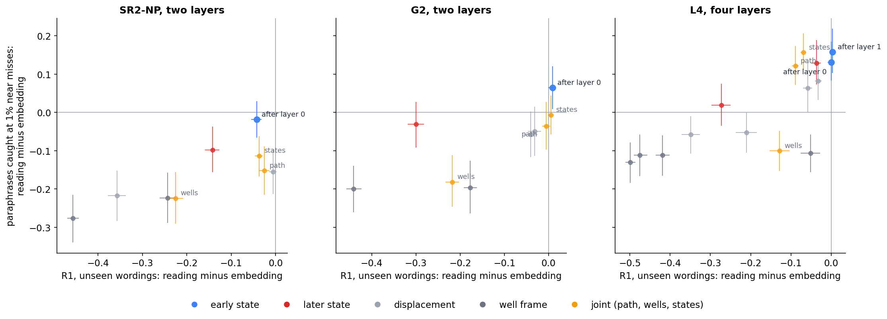

# The Early-State Matcher: Why It Is the Runner-Up

**What this note is.** A synthesis of readings already reported, written 2026-11-26 after the author asked which template matcher comes second among those tested, and whether any note explains why it does better than the readings of the dynamics and the joined readings. None did: the pieces were spread over five reports. Nothing new was run; one figure is drawn from the saved results. Each claim below is marked **measured** (a number in a report), **derived** (it follows from how the matcher is defined), or **hypothesis** (proposed, not tested).

**In brief.**
- **The runner-up is the embedding matcher fed an early layer state.** The matcher of [The_Embedding_Template_Matcher.md](The_Embedding_Template_Matcher.md) is used unchanged, but each particle's vector is the state after layer 0 (on L4 also the state after layer 1) instead of the embedding.
- **On unseen wordings it is level with the embedding** on three of four models (differences 0.000 to +0.009, intervals across zero) and 0.043 below it on SR2-NP.
- **On paraphrases at 1% near misses it is above the embedding** on SR2-2B (+0.051), G2 (+0.064) and L4 (+0.158), with intervals above zero, and level on SR2-NP (−0.019).
- **Why it beats the dynamics readings:**
  - it keeps the embedding's repetition signal almost whole (measured);
  - the displacement loses the part of the state that a whitened matcher reads best (derived, and measured on one cosine);
  - the well frame records which well, not which word (measured);
  - later states are blurred, and broken after the reverse channel (measured; the cause is partly hypothesis).
- **Why it beats the joined readings:** they contain its signal plus coordinates that read worse, and the search keeps fewer particles for them (observed). That this is the cause is a hypothesis.
- **It is not shown to beat a hybrid.** The one hybrid scored (step 1a: the embedding matcher's template plus a fitted paraphrase gate) catches more paraphrases on SR2-NP and G2, but it passes 64 to 67% of the fallacies. No complete hybrid has been built.
- **Why the first layer helps where it does is not tested.** It handles the wording "Q if P" far better than the embedding, and it catches more paraphrases; §5 gives the readings that fit and the tests that would decide.

---

## Contents

1. [Definitions](#1-definitions)
2. [The standings](#2-the-standings)
3. [Why it holds up where the dynamics readings fail](#3-why-it-holds-up-where-the-dynamics-readings-fail)
4. [Why it beats the joined readings](#4-why-it-beats-the-joined-readings)
5. [Why it beats the embedding where it does](#5-why-it-beats-the-embedding-where-it-does)
6. [Against the hybrids: what is and is not shown](#6-against-the-hybrids-what-is-and-is-not-shown)
7. [Where it loses](#7-where-it-loses)
8. [Measured, derived, hypothesis](#8-measured-derived-hypothesis)
9. [Tests that would settle the open parts](#9-tests-that-would-settle-the-open-parts)
10. [Caveats](#10-caveats)
11. [Sources and files](#11-sources-and-files)

---

## 1. Definitions

- **The matcher.** Whitening by ordinary text, the cosines and lengths among the premise's particles condensed into relational coordinates (91 at 8 particles), the connective's position, a projection onto the leading discriminant directions where each kind of premise is a unit Gaussian cloud, and the rule that a template fires when its share of the density is the largest of the four, above the threshold set for 1% false fires, and within reach of its nearest cloud. The number of particles $m$ and the dimension $d$ are searched the same way for every reading.
- **A reading** is the vector given to each particle. With $h^{(0)}$ the embedding and $h^{(\ell)}$ the state after $\ell$ layers (after the layer-end LayerNorm):
  - the **embedding** is $h^{(0)}$;
  - an **early state** is $h^{(1)}$, and on L4 also $h^{(2)}$: the states up to the middle of the depth;
  - a **later state** is any state after that, the final one included;
  - a **displacement** is what one layer's step adds before its LayerNorm;
  - a **well frame** is a particle's share, radius and stiff coordinates in each well of a layer's bank;
  - a **joint reading** concatenates several: the path (all displacements), the wells (all well frames), the states (all states after a layer).
- **R1** is the hard set on unseen wordings: half the detection of the four valid forms, half the silence on the five fallacy kinds, each wording left out of fitting in turn. Read here without "unless", which was misfiled ([Connectives_With_a_Hidden_Negation.md](Connectives_With_a_Hidden_Negation.md)).
- **Paraphrases at 1%** is the share of subject-keeping paraphrases for which the right template fires when the threshold is moved until 1% of the near misses fire (known wordings).

The **runner-up** is the best early state on each model: the state after layer 0 on SR2-2B, G2 and SR2-NP, the state after layer 1 on L4 (the state after layer 0 is a close second there).

## 2. The standings

All four models were read on the same 60 test clauses. SR2-2B: two layers, pair force, 2.1B tokens. G2: two layers, pair force, reverse channel, 0.5B. L4: four layers, as G2 otherwise. SR2-NP: two layers, no pair force, no reverse channel, 0.5B.

**Unseen wordings (R1, without "unless"). Measured.**

| model | embedding | best early state | all states | path |
| --- | ---: | ---: | ---: | ---: |
| SR2-2B | 0.956 | 0.963 | 0.939 | 0.920 |
| G2 | 0.955 | 0.964 | 0.961 | 0.950 |
| L4 | 0.976 | 0.980 | 0.907 | 0.887 |
| SR2-NP | 0.952 | 0.909 | 0.914 | 0.926 |

The early state's differences to the embedding are +0.007 (−0.001 to +0.015), +0.009 (−0.001 to +0.017), +0.003 (−0.004 to +0.009) and −0.043.

**Paraphrases caught at 1% near misses. Measured.**

| model | embedding | best early state | all states | path |
| --- | ---: | ---: | ---: | ---: |
| SR2-2B | 0.279 | 0.330 | 0.332 | 0.271 |
| G2 | 0.255 | 0.320 | 0.248 | 0.219 |
| L4 | 0.177 | 0.334 | 0.333 | 0.298 |
| SR2-NP | 0.298 | 0.280 | 0.185 | 0.146 |

The early state's differences: +0.051 (+0.009 to +0.092), +0.064 (+0.008 to +0.120), +0.158 (+0.102 to +0.218), −0.019 (−0.067 to +0.029). On SR2-2B these were read with "unless" in the fit.

**Figure 1.** Every reading on the three depth models, as its difference to the embedding on R1 (across) and on paraphrases at 1% near misses (up), with 95% intervals over clauses. On G2 and L4 the early states (blue) are the readings at the right edge and above zero; on L4 the joint states and the path (amber) come close. On SR2-NP no reading is above the embedding on either task.

**The ranking of paraphrases is the same for every reading. Measured.** The threshold-free AUROC of paraphrase against near miss is 0.755 to 0.793 for the embedding, the early states, the path and the joint states on the depth models, and 0.812 (embedding) against 0.793 (path) on SR2-2B. The early state's advantage at 1% is in how much of that ranking survives at the strict end of the threshold, not in the ranking.

## 3. Why it holds up where the dynamics readings fail

### 3.1 It is still mostly the embedding

On SR2-2B, the whitened cosine of the last word of the second sentence with the last word of clause 1 (if-then wording, medians over the test clauses):

| vector | repeated | paraphrased | near miss | unrelated | paraphrase above near miss (AUROC) |
| --- | ---: | ---: | ---: | ---: | ---: |
| embedding | 0.998 | 0.23 | 0.06 | 0.03 | 0.77 |
| state after layer 0 | 0.93 | 0.33 | 0.18 | 0.12 | 0.77 |
| displacement, layer 0 | 0.89 | 0.35 | 0.26 | 0.14 | 0.64 |
| state after layer 1 | 0.80 | 0.48 | 0.32 | 0.24 | 0.77 |
| well frame, layer 0 | 0.91 | 0.46 | 0.46 | 0.34 | 0.52 |

The correlation of a premise's particle cosines with the embedding's is 0.84 after layer 0 and 0.51 after layer 1 (median over 400 premises). **Measured.**

The embedding matcher works because the four forms are string patterns: one coordinate (the second-worst match of the second sentence to clause 1) decides repetition, and the connective's position decides the form ([The_Embedding_Template_Matcher.md](The_Embedding_Template_Matcher.md), §8). After layer 0 a repeated word is still at 0.93, so the decisive coordinate keeps its contrast. After layer 1 it has fallen to 0.80 while unrelated words rose to 0.24. That is why the early state keeps R1 and the later ones lose it. **The first two sentences are measured; the third is the reading of the reports, consistent with every table but not tested by an intervention.**

### 3.2 The displacement loses what the whitened matcher reads

The matcher sees a vector only through whitened inner products. If a displacement were an affine map of the entry state, $\Delta = M h + b$ with one invertible $M$ for every token, its covariance would be $M C M^{\top}$, and

$$
(\Delta_i - \bar{\Delta})^{\top} (M C M^{\top})^{-1} (\Delta_j - \bar{\Delta}) = (h_i - \bar{h})^{\top} C^{-1} (h_j - \bar{h}) .
$$

So a whitening matcher sees nothing of the linear part of a displacement that it would not see in the entry state, and sees it no better ([Template_Matchers_on_the_Dynamics_SR2_2B.md](Template_Matchers_on_the_Dynamics_SR2_2B.md), §3.1). **Derived.** What the displacement can add is its non-linear and context-dependent part. What it lacks is the copy of the entry state that the state $h^{(1)} = \mathrm{LN}(h^{(0)} + \Delta_0)$ keeps, which carries the word identity. The table of §3.1 shows the cost: the single cosine separates a paraphrase from its near miss at AUROC 0.64 in the layer-0 displacement, 0.77 in the state. **Measured.** The layer-0 displacement is below the embedding on R1 on every model (−0.006 to −0.033). **Measured.**

### 3.3 The well frame records which well, not which word

The well-frame vector is a particle's share, radius and stiff coordinates in each well. It separates a paraphrase from a near miss at AUROC 0.52 on the single cosine, and the matchers on it are below the embedding on R1 on every model, by 0.031 to 0.499. **Measured.** The reports' reading is that the frame says which well and how far, not which word: with eight wells many words share a well, so repetition, which carries the decision, is partly lost. **Hypothesis, consistent with the numbers.**

### 3.4 Later states blur, and break after the reverse channel

- **Blur.** Layers mix context into every particle. After layer 1 on SR2-2B, unrelated words have cosine 0.24 and repeated ones 0.80 (§3.1). **Measured.**
- **Particles leave the wells.** On SR2-2B's ordinary text the median radius to the dominant well grows from 1.95 to 9.23 widths over layer 1 ([What_the_Matchers_Read.md](What_the_Matchers_Read.md)). **Measured.** That this makes the state less readable is a **hypothesis**.
- **The reverse channel.** On G2 and L4 the final state, taken after the reverse channel, reads 0.656 and 0.703 on R1, while the step before it reads well (G2's layer-1 displacement 0.915). The break follows the reverse channel, not the depth ([Template_Matchers_and_Depth_G2.md](Template_Matchers_and_Depth_G2.md), §7). **Measured.**
- **Depth does not move the good layers.** On L4 the states are level with the embedding up to the middle of the depth (after layers 0 and 1), then fall: 0.939 after layer 2, 0.703 after layer 3 ([Template_Matchers_and_Depth_L4.md](Template_Matchers_and_Depth_L4.md), §3). **Measured.**

## 4. Why it beats the joined readings

A joint reading contains the early state's information, so it could match it. It does not, on R1:

| model | best early state | all states | path |
| --- | ---: | ---: | ---: |
| SR2-2B | 0.963 | 0.939 | 0.920 |
| L4 | 0.980 | 0.907 | 0.887 |

**Measured.** Joining the dynamics to the embedding itself also loses on R1 on SR2-2B: −0.067 with both displacements, −0.030 with both well frames, −0.084 with both states, while gaining 0.04 to 0.06 on paraphrases at the rule's threshold ([Template_Matchers_on_the_Dynamics_SR2_2B.md](Template_Matchers_on_the_Dynamics_SR2_2B.md), §5.8). **Measured.**

Two facts are observed: the joint readings concatenate readings that are worse on R1 (later states, displacements, well frames), and the search, facing two to four times the coordinates, picks fewer particles (on L4, 2 for the path and 4 for the states against 4 to 5 for the early states; on SR2-2B, 2 for two of the joined matchers). The reports read this as **dilution**: the discriminant directions are fitted on 60 development clauses, and adding weak coordinates costs the strong ones their share. **Hypothesis.** The SR2-2B report states that the reason is not known, and no test separates dilution from the particle count.

## 5. Why it beats the embedding where it does

Two gains are measured.

**"Q if P".** Detection of the valid forms with that wording left out of fitting:

| model | embedding | state after layer 0 | state after layer 1 |
| --- | ---: | ---: | ---: |
| G2 | 60% | 97% | |
| L4 | 59% | 91% | 94% |

**Measured.** On SR2-2B the same wording and "provided" carried the embedding's losses. Clauses are numbered by role, so in "Q if P" clause 1 is still the antecedent P; what differs is the layout: the consequent comes first and the connective sits between the clauses, so the position vectors and the six node cosines (among connective, clause 1, clause 2 and "Therefore") differ from every fitted wording. A reading that fits: the embedding's node cosines carry the text order through the position vectors, so a left-out layout falls off the clouds, and layer 0, by mixing each particle with its context, makes the node cosines depend more on the words and less on where they sit. **Hypothesis**; the test is in §9. The early state is not better on every wording: on L4 it loses "provided" (80% against 99%).

**Paraphrases at the strict end.** The ranking is the same (§2), and the gain is in the tail: the early state keeps more paraphrases above the 99th percentile of the near misses. The general argument is that layers cannot add information about the premise, only make it readable:

$$
h^{(\ell)}_t = F_{\ell} \left( h^{(0)}_1, \dots, h^{(0)}_t \right) \quad \Longrightarrow \quad I(h^{(\ell)}; K) \le I(h^{(0)}_{1:t}; K)
$$

for any property $K$ of the premise ([Hybrid_Template_Matchers.md](Hybrid_Template_Matchers.md), §3.2). **Derived.** The matcher reads only pairwise cosines, so context mixed into a word can bring a paraphrase's predicate closer to the restated predicate (0.23 to 0.33 in §3.1) more than it brings the near miss's (0.06 to 0.18). In that table it raises both, and the single-cosine AUROC stays 0.77; the gain must come from the other coordinates. Which ones is **not known**.

The L4 gain (+0.158) is partly the embedding's: L4's embedding catches 0.177, G2's 0.255, while the best early state is 0.320 and 0.334. L4's embedding search took the largest dimension on the grid (31), which may tighten its clouds. **Measured; the cause is a hypothesis.**

## 6. Against the hybrids: what is and is not shown

| hybrid | what was scored | result | source |
| --- | --- | --- | --- |
| "either fires" (embedding or best state) | paraphrases at 1% | gains at most 0.03 over the better of the two | [Hybrid_Step0_Complementarity.md](Hybrid_Step0_Complementarity.md) |
| embedding joined with displacements, well frames or states | R1 and R2 on SR2-2B | loses on R1 (−0.030 to −0.084) | SR2-2B report, §5.8 |
| narrow gate behind the embedding matcher's template (approach G) | paraphrases at 1%, pooled | 0.375, 0.361, 0.324 on SR2-NP, G2, L4, against the best matcher's 0.298, 0.320, 0.334 | [Hybrid_Step1a_Fitted_Gate.md](Hybrid_Step1a_Fitted_Gate.md), §5 |

**Measured.** So the gate hybrid beats the early state on paraphrases on two of three models. It is not usable as it stands: at the same threshold it passes 64 to 67% of the fallacies and 40 to 85% of premises about another subject, and its R1 was not scored. The early state fires on no fallacy at its own rule's threshold on known wordings, on any of the four models; at the 1% near-miss threshold its fallacy fires were not read, so the two are not compared at one operating point.

What is **not** shown: that the early state beats a complete hybrid. Approaches D (role split) and F (factorised templates), with a form decision in front of the gate, were not built. Step 1b found that the layer states make the connective's frame readable (AUROC +0.13 to +0.17 on the control pair, [Hybrid_Step1b_Null_Check.md](Hybrid_Step1b_Null_Check.md)), which suggests the early state's best use may be inside a hybrid, as its frame reader. **Hypothesis.**

## 7. Where it loses

- **SR2-NP**, the only model without the pair force and the only 0.5B model without a reverse channel: 0.043 below the embedding on R1 and level on paraphrases. Why SR2-NP's layer 0 reads worse is not known; its depth report is deferred. **Measured; cause unknown.**
- **All twelve wordings, "unless" filed with the disjunctions:** below the embedding on G2 (0.880 against 0.909) and SR2-NP (0.796 against 0.856), above it on L4 (0.923 against 0.838). **Measured.**
- **"Unless" in clouds of its own:** every reading fails, the early state included (0.595 on L4, 0.667 on G2). **Measured.**
- **Most paraphrases:** about two thirds are caught neither by the embedding nor by the best single state at 1% near misses (step 0). **Measured.**

## 8. Measured, derived, hypothesis

| claim | status |
| --- | --- |
| The early state is level with the embedding on unseen wordings on three of four models | measured |
| It catches more paraphrases at 1% on three of four models | measured |
| The embedding, the early states, the path and the joint states rank paraphrases against near misses alike (AUROC 0.755 to 0.812) | measured |
| After layer 0 a repeated word keeps cosine 0.93; after layer 1, 0.80 | measured (SR2-2B) |
| A whitening matcher is blind to the linear part of a displacement | derived (exact for an affine map, approximate with the ridge) |
| The displacement lacks the copy of the entry state; its single-cosine AUROC is 0.64 against 0.77 | derived; measured |
| The well frame loses word identity because many words share one of eight wells | hypothesis |
| The final state breaks after the reverse channel | measured (G2, L4) |
| Joint readings lose by dilution of a 60-clause fit | hypothesis |
| Layers cannot add information, only readability | derived |
| The early state handles "Q if P" because mixing weakens the position vectors' hold on the node cosines | hypothesis |
| The paraphrase gain comes from coordinates other than the single restated-word cosine | inferred from one table; which coordinates is not known |
| L4's large gain is partly a weaker embedding fit | measured fall of the embedding; cause hypothesis |
| The early state beats the hybrids | not shown; the one scored hybrid catches more paraphrases on two models but is not usable alone |

## 9. Tests that would settle the open parts

All run on the saved extractions, on the CPU.

1. **The "Q if P" reading.** Compare the six node cosines of the left-out "Q if P" premises with the fitted conditionals' clouds, in the embedding and in the early state. Repeat with the position vectors subtracted from the embedding ($E[x]$ alone): if the hypothesis holds, the embedding then handles "Q if P" too.
2. **Which coordinates carry the paraphrase gain.** Swap each coordinate group of the early state into the embedding's coordinates, one at a time, and read paraphrases at 1% (the swap method of [The_Embedding_Template_Matcher.md](The_Embedding_Template_Matcher.md), §8).
3. **Dilution against particle count.** Score the joint states at the early state's particle count and dimension; then add the later states' coordinates in steps.
4. **The operating point on L4.** L4's embedding at G2's particles and dimension, and the reverse (L4 report, §9).
5. **The linear share of layer 0.** The whitened Gram matrix of the layer-0 displacement against the entry state's, premise by premise (SR2-2B report, conjecture 1).
6. **A complete hybrid.** Approach D with step 1a's gate behind the form decision, scored on R1 and on paraphrases with fallacies counted ([Hybrid_Step1a_Fitted_Gate.md](Hybrid_Step1a_Fitted_Gate.md), §9).

## 10. Caveats

- A synthesis of post-hoc readings: the calls that were pre-registered (TD1 to TD5, TL1 to TL6) concern the dynamics and depth, not the early state. "Runner-up" is a ranking made after the fact over many readings, so the selection inflates its gains a little.
- One seed per model, one checkpoint each, 60 test clauses drafted by the agent and awaiting the author's check.
- SR2-2B's matchers were fitted with "unless" in; its R1 row is the refit without it, its paraphrase row is not.
- The SR2-NP numbers come from its depth run, whose report is deferred.

## 11. Sources and files

- Standings: [Hybrid_Template_Matchers.md](Hybrid_Template_Matchers.md), §2; [Template_Matchers_on_the_Dynamics_SR2_2B.md](Template_Matchers_on_the_Dynamics_SR2_2B.md), §5; [Template_Matchers_and_Depth_G2.md](Template_Matchers_and_Depth_G2.md), §3 and §4; [Template_Matchers_and_Depth_L4.md](Template_Matchers_and_Depth_L4.md), §3 to §5.
- Results: `notebooks/conservative_arch/scaleup/results/template_matcher/template_depth_{np,g2,l4}.json`, `template_dynamics_without_unless_sr2_2b.json`, `template_dynamics_rates_sr2_2b.json`.
- Figure: `python3 companion_notes/figures/_make_early_state_figs.py` writes `figures/template_matcher/es_standings.png`.
