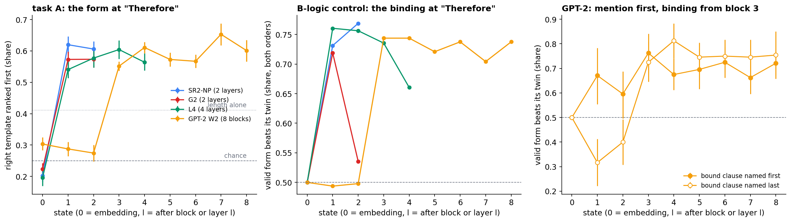

# The Matched GPT-2 Read by the Template Tests

**Status (2026-11-27).** Scored on 2026-11-27, against the calls the author confirmed the same morning ([Depth_and_Architecture_Battery.md](Depth_and_Architecture_Battery.md)). Three of the four architecture calls are about GPT-2 alone and are scored here: GA1, GA2 and GA4 all hit. GA3 (SR2-NP-L8 against GPT-2) and the depth calls DL1 to DL5 wait for SR2-NP-L8 (training, due around midday 2026-11-28). Readings without a call are reported as leads.

**In brief.**
- **The model.** The matched GPT-2 W2: eight blocks, width 384, six heads, tied embeddings, the ladder's schedule and peak learning rate (1.2e-3), 0.5B tokens of OpenWebText; settled perplexity 48.37 (SR2-NP: 58.51). Read through its residual stream, with every test unchanged.
- **GA4 hits.** On verbatim premises in unseen wordings, the geometry matcher fed GPT-2's embedding scores 0.970 (bar 0.90). Token identity alone scores 0.906 on the same premises, as for every model.
- **GA1 hits.** Read at "Therefore", GPT-2's states carry the logical form: the best state ranks the right template first on 0.653 of premises (bar 0.50), with twin AUROC 0.738 (bar 0.70).
- **GA2 hits.** In the B-logic control, GPT-2's states at "Therefore" carry which clause the context bound the signal to, in both word orders: twin reading 0.73 and 0.77 with all states read together, both intervals above 0.5.
- **Lead: GPT-2 needs three blocks; the ladder models need one.** After GPT-2's first two blocks the state at "Therefore" is at the embedding's level on the form, and on the binding it favours whichever clause the context named first (mention). From the third block on, it carries form and binding at the level SR2-NP reaches after its first layer.
- **Lead: GPT-2 at its best is level with SR2-NP, not ahead.** Best twin reading in the control 0.75 against SR2-NP's 0.77; best task A rank 0.65 against 0.62. So far the conservative architecture neither wins nor loses on what the templates read; it gets there in fewer steps.

---

## Contents

1. [What was run](#1-what-was-run)
2. [The calls, scored](#2-the-calls-scored)
3. [Results, test by test](#3-results-test-by-test)
4. [Leads (no call)](#4-leads-no-call)
5. [What this means](#5-what-this-means)
6. [How it was run, and the files](#6-how-it-was-run-and-the-files)

---

## 1. What was run

- **Model.** `~/Downloads/semsimula_matched_gpt2_baseline_owt_wsd_lr0p0012`, `checkpoints_wsd_lr0p0012/gpt2_baseline_best.pt`: step 32,500, peak learning rate 1.2e-3, best perplexity 48.14 at a context of 1,024, settled 48.37 (the run summary).
- **States read.** The residual stream at the entry of each block and at the output of the last block, before the final LayerNorm: nine states, $h^{(0)}$ (token plus position vector) to $h^{(8)}$. State $h^{(\ell)}$ is the stream after $\ell$ blocks, as $h^{(\ell)}$ of a ladder model is the state after $\ell$ layers. GPT-2 has no displacements of a conservative step and no well frames, so the path and wells readings are left out. The extraction path and its checks are in [Depth_and_Architecture_Battery.md](Depth_and_Architecture_Battery.md), §1.
- **Tests.** Every test unchanged, with the same items, development sets, whitening and scorers as for SR2-NP, G2 and L4:
  - the verbatim depth premises, read by the geometry matcher and by token identity;
  - test 2, the analogy and in-context premises ([Analogy_Test_Results.md](Analogy_Test_Results.md));
  - task A, the form read at "Therefore" ([Summary_State_Test.md](Summary_State_Test.md));
  - task B-logic and its control, read both ways ([BLogic_Test.md](BLogic_Test.md)).
- **Gates, all passed.** The check premises of the three extractions agree with the depth extraction, to float16 rounding for B-logic and its control (largest difference 2.4e-4, as for the ladder models) and exactly for test 2. Token identity scores the same as on SR2-NP on every level of test 2, and ties at exactly 0.5 on B-logic and its control. The embedding and the length tie at exactly 0.5 on both B-logic sets, by construction.

## 2. The calls, scored

| id | call | probability | result | verdict |
| --- | --- | ---: | --- | --- |
| GA1 | task A: GPT-2's best state ranks the right template first on at least 0.50 of valid premises in unseen wordings, with twin AUROC at least 0.70 | 75% | rank 0.653 (0.618 to 0.688), twin 0.738 (0.724 to 0.752), state after block 7 | **hit** |
| GA2 | B-logic control: GPT-2's best state at "Therefore" has a twin reading above 0.5 in both orders, interval above 0.5 | 75% | all states: 0.73 (0.67 to 0.79) and 0.77 (0.71 to 0.83); after block 3: 0.76 (0.68 to 0.84) and 0.72 (0.65 to 0.81) | **hit** |
| GA3 | B-logic control: SR2-NP-L8's best averaged twin reading at "Therefore" is at least GPT-2's | 45% | GPT-2's value to beat: 0.75 (all states) | waits for SR2-NP-L8 |
| GA4 | verbatim premises: GPT-2's embedding reaches at least 0.90 on unseen wordings (R1) | 70% | 0.970 | **hit** |

DL1 to DL5 are about SR2-NP-L8 and are not touched here.

## 3. Results, test by test

### 3.1 Verbatim premises

| reading | unseen wordings (R1) | paraphrases caught at 1% near misses | AUROC, paraphrase against near miss |
| --- | ---: | ---: | ---: |
| token identity | 0.906 | | |
| embedding | 0.970 | 0.203 | 0.718 |
| state after block 1 | 0.989 | 0.323 | 0.769 |
| state after block 2 | 0.981 | 0.395 | 0.765 |
| state after block 4 | 0.949 | 0.330 | 0.775 |
| output (after block 8) | 0.726 | 0.195 | 0.793 |
| all states | 0.861 | 0.393 | 0.786 |

As on the ladder models, the verbatim test is mostly string matching (token identity 0.906), and the embedding's lead over it is word similarity. Identifying the form in a new wording gets worse toward the output: the last states are tuned to predict the next token, not to keep the premise's shape. The paraphrase gain of the middle states is the lead of §4.1.

### 3.2 Task A: the form at "Therefore"

| state at "Therefore" | GPT-2: rank | GPT-2: twin AUROC | SR2-NP: rank | SR2-NP: twin AUROC |
| --- | ---: | ---: | ---: | ---: |
| embedding | 0.303 | 0.552 | 0.202 | 0.536 |
| after block or layer 1 | 0.288 | 0.545 | 0.620 | 0.741 |
| after 2 | 0.274 | 0.559 | 0.606 | 0.756 |
| after 3 | 0.552 | 0.749 | | |
| after 4 | 0.611 | 0.754 | | |
| after 5 | 0.573 | 0.748 | | |
| after 6 | 0.567 | 0.747 | | |
| after 7 | 0.653 | 0.738 | | |
| output (after 8) | 0.601 | 0.746 | | |
| all states | 0.553 | 0.754 | 0.621 | 0.750 |

The length of the premise alone ranks 0.412. GPT-2's embedding at "Therefore" ranks above SR2-NP's (0.30 against 0.20), probably because its learned position vectors carry a little of the length (not checked). As for every model, the 1% false-fire rule fires on almost nothing with a single vector: templates rank here, they do not fire.

### 3.3 Task B-logic and its control

Read at "Therefore" (the states that took in the context), valid version against foil and against twin, chance 0.5:

| reading at "Therefore" | B-logic, explicit: foil / twin | B-logic, natural: foil / twin | control, bound clause first: foil / twin | control, bound clause last: foil / twin |
| --- | --- | --- | --- | --- |
| GPT-2, after block 1 | 0.42 / 0.56 | 0.40 / 0.62 | 0.72 / 0.67 | 0.47 / 0.32 |
| GPT-2, after block 3 | 0.85 / 0.74 | 0.85 / 0.75 | 0.97 / 0.76 | 0.90 / 0.72 |
| GPT-2, after block 4 | 0.93 / 0.79 | 0.86 / 0.76 | 0.95 / 0.68 | 0.98 / 0.81 |
| GPT-2, all states | 0.97 / 0.74 | 0.96 / 0.76 | 0.86 / 0.73 | 0.92 / 0.77 |
| SR2-NP, after layer 1 | 0.73 / 0.75 | 0.78 / 0.73 | 0.90 / 0.76 | 0.88 / 0.70 |
| SR2-NP, all states | 0.82 / 0.78 | 0.84 / 0.76 | 0.95 / 0.71 | 0.93 / 0.83 |

Read by the geometry matcher from the particles' coordinates, GPT-2 behaves as the ladder models do: above chance on B-logic, where the bound clause is the one the context mentions (all states 0.80 and 0.65 against the foil), and at chance or below in the control, where both clauses are mentioned (all states 0.47 to 0.54). The particle coordinates read the mention; the state at "Therefore" reads the binding. This is the result of [BLogic_Test.md](BLogic_Test.md), §5.6, now on a transformer too.

### 3.4 Test 2

| reading | S3: gain over the embedding on the analogy levels, minus the gain on L0 and L1 (against the foil) |
| --- | --- |
| GPT-2, state after block 1 | +0.053 (0.008 to 0.098) |
| SR2-NP, state after layer 1 | −0.019 (−0.073 to 0.035) |
| G2, state after layer 1 | −0.028 (−0.068 to 0.013) |
| L4, state after layer 1 | +0.036 (−0.012 to 0.089) |

The picture of test 2 is otherwise that of the ladder models: the embedding stays above chance on most analogy levels (word similarity), and C1 is at chance for every state but one (§4.3). Per-level readings: `results/template_matcher/gpt2_w2/score_t2.txt`.



**Figure 1.** Left: task A's rank at "Therefore" for each state, with 95% intervals. Middle: the B-logic control's twin reading at "Therefore", averaged over the two word orders. Right: GPT-2's twin reading in each order. State $\ell$ is after $\ell$ blocks (GPT-2) or layers (the ladder models).

## 4. Leads (no call)

### 4.1 The middle states catch more paraphrases

GPT-2's state after block 2 catches 0.19 more paraphrases than its embedding at 1% near misses (interval 0.14 to 0.25). The ladder models: L4 +0.16, G2 +0.07, SR2-NP none. The gain peaks in the middle states and falls toward the output, as in L4.

### 4.2 GPT-2 needs three blocks; mention comes before binding

After one and two blocks, GPT-2's state at "Therefore" ranks the form at the embedding's level (0.29 and 0.27). In the control it favours the clause the context names first, whichever clause that is: 0.67 against the twin when the bound clause is named first, 0.32 when it is named last. That is mention, not binding. From the third block both appear together, at the level SR2-NP reaches after its first layer and L4 after its first.

A reading, not tested: in a transformer, information reaches the final token only through attention, and the first blocks may be busy with local work (the stream at a token's own position), so the long-range transfer of the context's meaning happens later. In the ladder models the context channels deliver it in the first step. The probe that would test this is to read the attention of "Therefore" to the context sentence block by block; it was not run.

### 4.3 C1 after block 1

On C1 (meaning in context, read by the geometry matcher), GPT-2's state after block 1 reads 0.66 against the foil (0.52 to 0.79). Every other GPT-2 state, and every state of the ladder models, is at chance on C1. One reading among many, with an interval that nearly touches chance: a weak lead at most.

### 4.4 S3 is positive on GPT-2

The call S3 of test 2 (the state gains more over the embedding where the words cannot help than where they can) missed on every ladder model. On GPT-2 its statistic is +0.053 with an interval above zero. On SR2-NP-L8 it is call DL5 (30%).

## 5. What this means

- **The templates are not specific to the conservative architecture.** What the template tests read (the form and the binding, carried to the summary position) a transformer of the same size and data carries too, and to the same level. This was GA1 and GA2's expectation, and the reason the battery has a GA3.
- **The difference found so far is in depth, not in level.** The conservative models carry form and binding after one layer, GPT-2 after three blocks. A conservative layer is a different object from a transformer block, so this is not a claim of efficiency per parameter or per operation; it says where in the stack the information is available.
- **GA3 is close.** GPT-2's best averaged twin reading in the control is 0.75; SR2-NP already reaches 0.77 with two layers. If SR2-NP-L8 is no worse than SR2-NP, GA3 hits, by a small margin.
- **The architecture's distinct claims stand where they stood.** Interpretability (displacements and well frames to read) and installing a template as a well, which a transformer has no landscape for ([../transformer/Transformers_as_Dynamical_Systems.md](../transformer/Transformers_as_Dynamical_Systems.md), §4 and §8).

## 6. How it was run, and the files

Run from `notebooks/conservative_arch/scaleup` on machine A, one job at a time, about 65 minutes in all (the extractions about 10 minutes; scoring the rest). The queue is `results/template_matcher/gpt2_w2/queue.sh`:

```
G=semsimula_matched_gpt2_baseline_owt_wsd_lr0p0012; R=results/template_matcher
python3 debug/template_vectors_extract.py SP/vec $G name=w2                       # depth premises, every state kept
python3 debug/template_depth_analysis.py SP/vec $R w2                             # verbatim premises
python3 debug/template_lexical_baseline.py SP/vec $R w2                           # token identity
python3 debug/template_analogy_test.py SP/t2 $G name=w2 vec=1                     # test 2 premises
python3 debug/template_analogy_test.py SP/bl $G name=w2 vec=1 bank=blogic         # B-logic
python3 debug/template_analogy_test.py SP/bc $G name=w2 vec=1 bank=blogic_control # the control
python3 debug/template_analogy_analysis.py SP/vec SP/t2 $R w2 gates               # gates, then the same for bl and bc
python3 debug/template_summary_state.py SP/vec $R w2 analogy=SP/t2                # task A
python3 debug/template_summary_state.py SP/vec $R w2 analogy=SP/bl items=template_blogic_items tag=blogic
python3 debug/template_summary_state.py SP/vec $R w2 analogy=SP/bc items=template_blogic_control_items tag=blogic_control
python3 debug/template_analogy_analysis.py SP/vec SP/t2 $R w2                     # test 2, then the same for bl and bc
```

**Files** (`notebooks/conservative_arch/scaleup/results/template_matcher/`):
- `template_depth_w2.json`, `template_lexical_w2.json`: the verbatim premises.
- `template_summary_state_w2.json`: task A.
- `template_analogy_w2.json`: test 2.
- `template_blogic_w2.json`, `template_blogic_control_w2.json`: the geometry matcher.
- `template_summary_state_blogic_w2.json`, `template_summary_state_blogic_control_w2.json`: the reading at "Therefore".
- The gate files `template_*_gates_w2.json`.
- `gpt2_w2/`: every printed table, the extraction logs, the queue and its log.
- Figure: `companion_notes/figures/_make_gpt2_battery_figs.py`.
